# 【全集】多伦多大学 操作系统 中英字幕 1080P p06 Lecture 6 - IPC -BV1Rbk7ByERc_p6-

Alrighty， welcome back to operating systems， Wow， echoy again。All right。

 so today we are talking about basic IPC or inter processces communication。

We talked about it a little bit before we need this because every process is independent。

 we need a way to communicate across processes。And we've always used this。

 Even our Hello world program used IP PCC。 We printed Hello world to another process。

 The terminal that printed off hellello world for us。 So we used I PCC before。

 even if we didn't know it。 So today， a lot more code examples and。😊，Everyone had fun with forking。

 having children。Making sure that you are a responsible parent， you acknowledge your children。

 what do you acknowledge them with， the weight system call， you can read their exit status。

 clean them up， make sure that they do not become orphans or zombies。

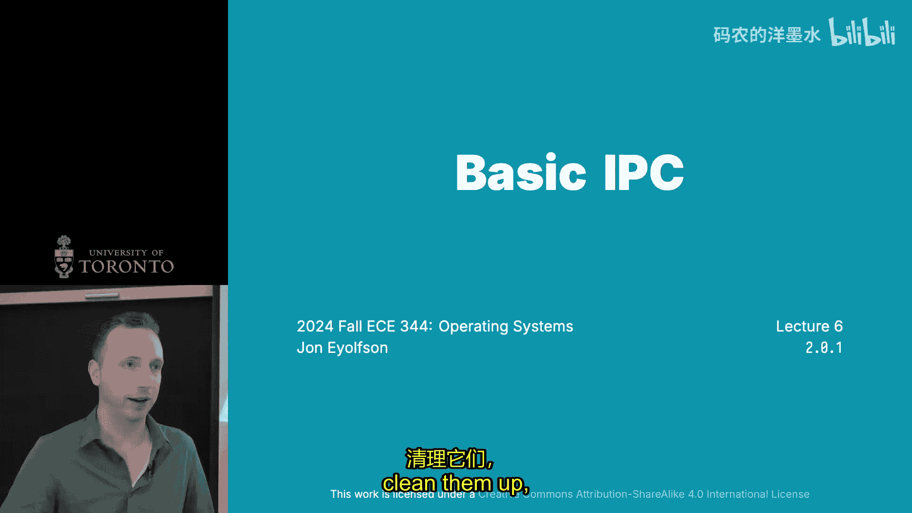

All right， so today IPC。IPC is just transferring bytes between two or more processes。

 so reading and writing files is a form of IPC if you think about it。

 so one process may have created a file， wrote to it。

 and then another process read from a file that is technically IPC that's how we can communicate across processes。

They don't even have to exist and be running at the same time。

 They could be running at the same time。 and， in fact。

 we can communicate between processes on different machines。

 Every one of us probably has used the Internet so that。

Server you're connecting to is running a process on another machine that you are communicating with。

So the Read and write system calls， that is how we primarily do our IPC。

 and they just allow any bytes to be written or read across them。So。

We'll just get right into code examples because we will have a fun day of code examples。

 So the first one。😊，Knowing all of the standard file descriptors。

All I'm going to do is keep on reading from standard in and then write any data I read from standard in to standard Out。

Does this remind us of a program we've written before， maybe maybe not， let's see。

 so we can run it in our terminal without arguments， it'll wait for us to press control D。

 and that will signify and def file。IPC。IPC Inter processcess communication。So。Yeah。

 one of the things that a kernel has to do to actually communicate across processes。All right。

 let's look at the example。

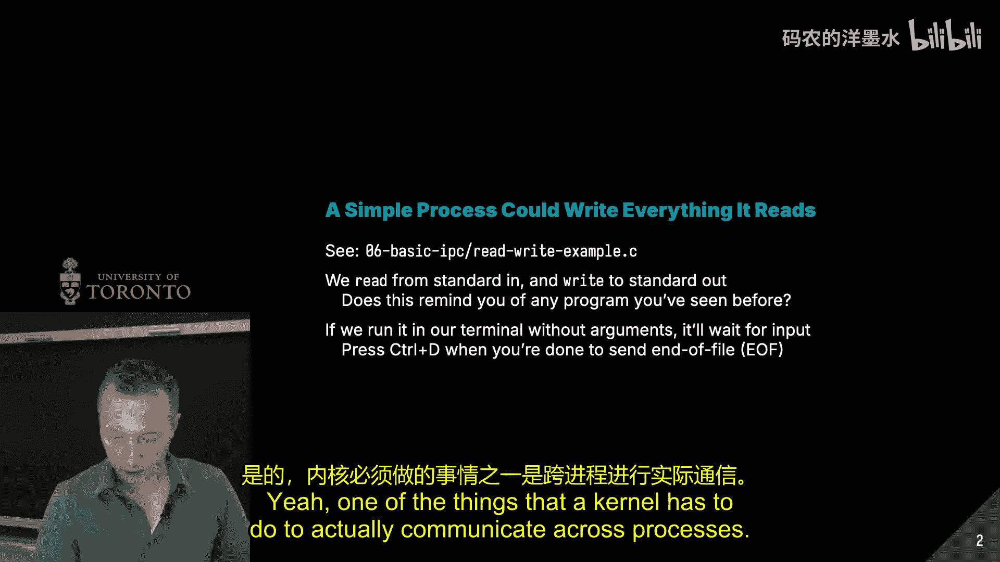

This one。ItDoes't have a fork in it， don't worry。Have a day without forks， but they will come back。

So。Here in this program in Maine。I declare an array called buffer of 4096 that number might seem completely arbitrary to you right now other than it's a power of two。

 so it's two to the power of 12 and that's fairly arbitrary as we go out through the course you will figure out why I've used this magical number so I picked it for a reason so basically we declare a variable called buffer。

 it is an array of 4096 characters， each character is one byte。

Then we declare a variable called Btes red。 and then we have this while loop。

 So while it just does a read system call file descriptor 0。 remember that is standard input。

 So that is just the magical convention standard input we've all agreed upon。

 So this should read anything I type on my keyboard。

 And then I give it buffer and then size of buffer。

 So the kernel can go ahead and fill that buffer write data to it up to 4096 Bs and it will tell me how many bytes it actually wrote to that buffer。

 tell me read from the。User doing input。And then we do a right system called to file descriptor1。

 same file descriptor we used for print like hellello world。

 That is standard output on Linux and Uniix。 So Macs as well。 We use that same buffer。

 And then we give it the number of bytes red。 So we just read some data from。

The user typing and then output it seems quite silly， but it's actually fairly powerful。

 and we'll see why when we execute this。 But other things it does checks the return value from bytes written。

 So if it's negative one like any of these C functions that are that eventually do a system call they signify an error by returning negative1 So we check if there's an error。

 we print off that hey， write had a problem， it will print off the error code for us and that I wrote this assert statement。

 So assert， we'll just check this condition if it is false。

 it will crash my program So it's a good way to sanity check things So if I'm not certain what the outputs would be。

 and I'm assuming that there're always the same。Never just assume anything that bad things will happen。

 We'll see how this becomes useful， but right now I just say assert bys red equals bytes written。

 so I assume that I can actually write everything back out and then I also check here in the loop if the bytes red is equal to negative one if it is and I had a problem or outside the loop。

So if I broke from the loop， then， well。I probably had an error。

 I check if I had an error or I exited normally。The way you've probably learned before that like the file is done whenever you've read an end of file character or something like that。

 that's not true on pretty much any operating system。

 So how the kernel signifies to you that you have reached end of file is the read system call will return zero bytes red。

 So that means no more data is coming。 you've read everything you've read  zero bytes。

 there's no more data that can come。 So that's why I put the assert here。

 because I assume if there's no error， I should have read zero bytes and that's the end of the data。

So if I go back here and I run this program。Whoops， if I can type properly。Build read。

So if I run this program， it just sits here and waits for me to type something， right。

 So doesn't do anything。 It's doing that read system call。 So that's a blocking system call。

 So your program will not return from read until it can read some data。 The standard way the。

Standard input works is it will wait if you type something， It won't return from the read。

 It will wait until you press enter。 And then that data will be sent to the kernel。

 And then you can go ahead and read it。 So here I wrote。Let's write something else。

 if I write hello and I print enter， well， I typepo He， So whatever I type， I press enter。

 it spits it back to me。Does this look like any program you've ever used before？Yeah。

 so there's a program on UniX called CA， in fact。It does exactly this。

 So if I just run cat without any arguments， I say， hello， it spits back， hello。

Might seem like a useful kind of useless program， but it's actually quite powerful。

 and it can do a lot of things because one thing it can do。Like， you probably， if you have used it。

 you probably used it like。Ohoops。Kt， let's see what's the file called。Probably used it like this。

 you cat gave it a file name and that's how you read a file in the terminal， something like that。

Right。But， first， off。Any questions about this program so I can type。It splits it back to me again。

Yeah。Ps entry。ですけど。Because one best venture also driven。それを。No， so here， whatever we press enter。

That's a character， so that's a new line character and the way the terminal works is it will actually write that data out to your program。

 so whenever I hit enter， that's when my program will read whatever I type。

 so my program will read whatever I type and then output it to me。And then。Yeah， so anyone。

So one way I can exit this that you probably didn't know is I can hit control D。

 so if I hit control D， that means I'm not going to write any more output and that would cause read to return as zero in my program so it can actually exit。

What's the other way， Do we know another way to exit the program if it was just doing this and was like。

 help， help。I want to get out of here。Yeah。Kill。We'll to killing。In a bit。

Anything else I should press to get out of this。 Yep， control C， right， I can press control C。

 and it looks like it kind of does the same thing aside from that weird carrot C so。

Does anyone actually know how control C works？Yeah keyboard。Keyboard interrupt kind of， y。大ぜは。

This does the operative find the end character create around， create like end character。第一 the时。Yeah。

 that's a good guess。 It could like feed it and end a file thing like my same control D， but just。

Force it to do that。Good guess。 So we'll figure out what control C does by the end of the lecture。

 So hold on to your hats。 But first。Let's modify our program a little bit。

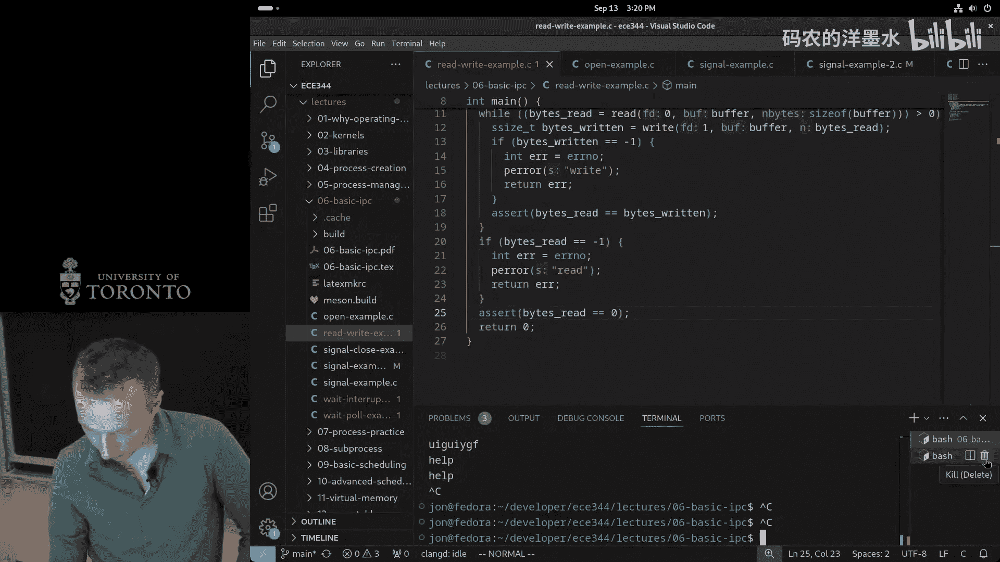

So。Just as a summary， so we use the read system call so that read from a file descriptor again。

 there's no end of file character。 If anyone's told you that before。

 it's a lie on most operating systems， read just returns zero bytes read whenever you are at the end of file or it's not possible to get any more data。

And that's it。 So you need to check for errors like every other function we've been using。

 if there's an error， it returns negative 1 and sets this global variable called error no。

 and we can use P error to read it for us and give us some output to describe what it is actually doing。

The right system call same thing， except we are feeding data to the file descriptor。

 whatever file that is pointing to。You shouldn't always assume it's successful， but you probably had。

 like， for instance， who has checked the return value of print F。Probably no one。

 technically you should， technically you should do this as well。But you might not。

In case in this course， we try an error check as much as possible because usually it has some type of meaning。

In this case， if there's an error again， it returns negative1 sets error and no all that fun stuff。

And the cool thing to know about this is that， well， in my process， whenever I read。

 there is a corresponding write somewhere else， and whenever I write。

 there is a corresponding read in another process， so when I am typing，Right， some other process。

 A K A， my terminal， whatever I am typing in my terminal， whatever I hit enter， that process。

 which would be my shell， writes data to a file descriptor， and then my process reads from it。

 and then I write out data。 and then the terminal would read that data and actually show me the characters。

Hello world or whatever I happen to type in the terminal。 So each read。

Has a corresponding right in a different process， and it can go either way。

So the standard file descriptors， this is where I show you that they are quite powerful。

 so we could actually close standard input if we want。

 so if we close a file descriptor using the closed system call。

 that essentially means like that index is not valid in that file descriptor array。

 it's not pointing to a file anymore for this process so if I close file descriptor 0 and open a file。

 the way Linux works is that it will use the lowest possible file descriptor。

Like the lowest free one for any new file descriptors you're open。

 So if I close file descriptor 0 and then I open a file which returns me a file descriptor。

 I will get file descriptor0， so I'm essentially replacing whatever file descriptor0 is。So。

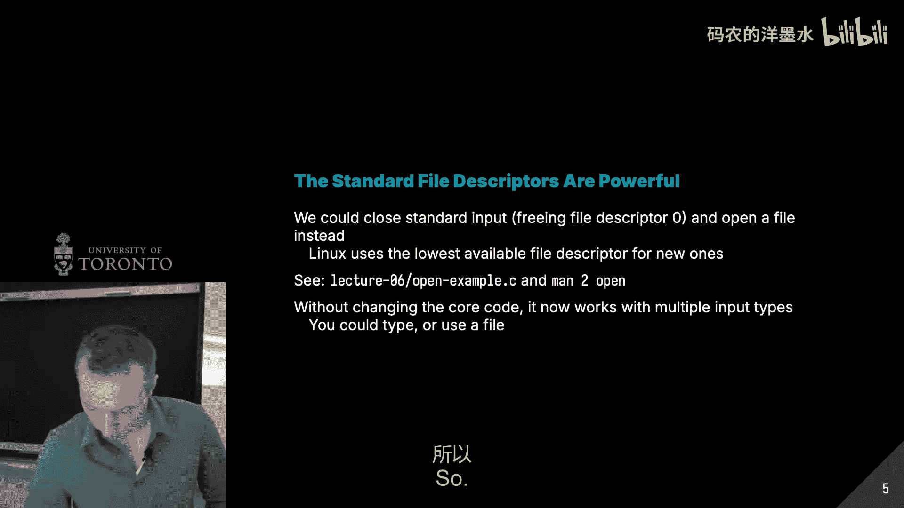

If I go back and I so。The body of this program is the same。 So I'm not going to change it。

 So it's going to do the same thing where it reads from file descriptor 0 and writes to file descriptor 1。

 I'm not going to change the main body of my program whatsoever。

But what I'm going to do is like cat with an argument。

 I'm going to take another argument from the command line。

 so here I check that I have either one or two arguments， if not I give some error code。

If I have exactly two arguments， so I have the name of my executable and then a file。

 I will close file descriptor 0 and then open。The file given by the argument for reading。

 because I'm only going to read information from it。

And I should get file descriptor 0 if I just closed it。 so I can go ahead。

 make sure that I check for errors。 and that's it。 So the rest of。

My program is exactly the same as before。 So now when I run this。Open example。

 I can give it the name of a file so that we can have it read itself。So if we do that。

 we actually see the contents of the file itself， and we didn't have to change the main part of the program at all。

 So this is actually how CA works。 So this is just exactly what CA does。

So any questions about that before I show you some little tricks？Yeah。ちょと生明。

So what's the significance of saving ano？ So， yeah， that's a good question。 So yeah。

 you can tell here。I want to return error no， and I want to return the error number of the first function that failed。

 So here I save it to variable。 And why do I do that， Well， because if I called P error。

 that can also set errorno。So that could also fail。 So I don't。 if I didn't save the first value。

 that might overwrite it。 And then I wouldn't know whatever the first error was。

 So that's why I always save it because if you look at the documentation， P error can also set it。

Yeah。いそよ。So the question is， what's Arg V 0， So Arg V 0 is gonna be whatever I type here。

 Remember that convention。 So it would be like， build。Open example， the name of the program。

All right， okay with this， yeah。So you said other functions。Yep。我呢。Like because。

I stop and start at any time。What it happens like after this process is called。これってい aァだ。

So processes are independent of each other， right if another process sets its a no doesn't affect me。

Yeah， yeah， it's a global variable in the process。 So it's only set by calling a function。

 processessses are independent。Alright， so cool things we can do with this is turns out。😊。

I didn't actually need to write that whole open file descriptors in my program。

 my shell will actually do some of this stuff for me。

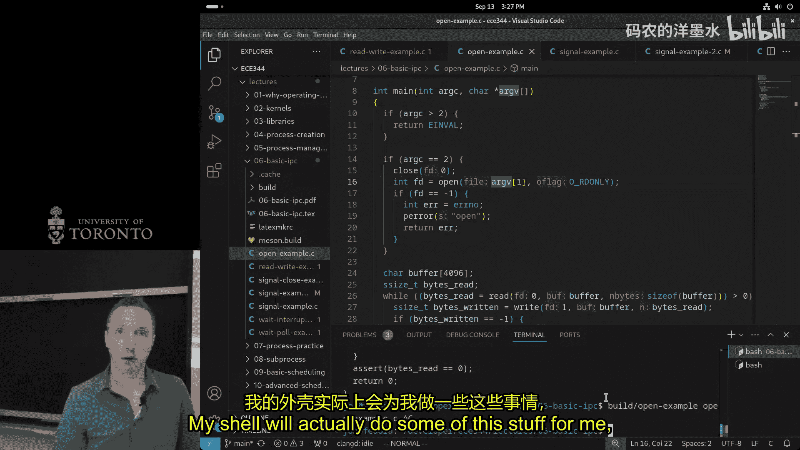

That's if I say like redirect file descriptors， that's basically what you can do in the shell。

 So your shell lets you replace the standard file descriptors with actual files before it runs your program。

 So essentially do the same thing that I just did。 So instead of running open example that read this open example file。

 I could do open example， In fact， I could just do my read。

 write one that didn't have any open system called whatsoever。 and do this arrow。

 So at this arrow means or the lesson symbol， but you should think of this as like an  error or sorry。

 an arrow is I'm changing standard input。Which is just by default file descriptor 0 and by default the terminal with this file instead。

 so my terminal will go ahead and replace itself with that file for file descriptor 0 before it starts my process。

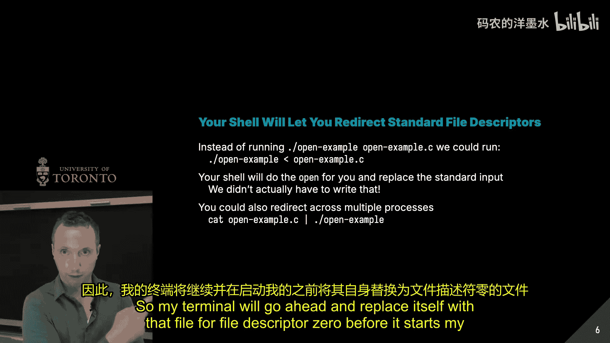

So what would that look like， So instead of doing that， I could just do my read， write example that。

Did nothing with files。 And I could just use this。 And what that will do is open the file。

 open example dot C as file descriptor1 before it starts my process and it can modify。

 We'll see how fork works with this， but basically。

It sets file descriptor 0 for that process to point to open example do C， and I can run it。

 and I can see the result of the file without actually having any code myself that actually opened a file。

 I just use file descriptor 0。 And here I just let my shell replace whatever file descriptor 0 pointed to before starting me。

 So nice shortcut you can use。And so yeah， I didn you don't actually need to write an opener things if you want to deal with files。

 if you just use the standard file descriptors。Yeah， so the question might be， hey。

 can I do multiple file descriptors？The shell will only let you by default replace the standard ones。

 so I can only have one file's input， not multiple。All right， any other fun things with this？So。

Other things I could do， too is like。Here I have another let's say I have another program。

 so there's this echo program that will just like print out whatever you type to it。

 so there's another thing in the terminal that will connect two processes together called a pipe。

 so if I just do a straight line，And then say I run my readr example。

This might not make sense initially， but what this pipe is going to do is。

Whatever this program or this process outputs。It will use it as input for this process。

 So now I have connected the right。So whenever this write to standard out。

 this one is going to be able to read that information from its standard input so it kind of glues these two processes together using its file descriptors。

 So if I run that I'll get the same result， I'll get high。

 but what actually happened is this program wrote high to its file descriptor 1 and that the terminal connected that So when this process read from file descriptor 0。

 it read high and then it wrote to file descriptor1， which was the terminal which showed high。

 so it's like a roundabout way to connect different processes together。

Unix people love doing this stuff。 So that's actually what it's kind of doing under the hood。

 So just in case you've seen that before and you didn't know what it did。 Yeah forward。你猜的就多。

So my readr example just reads from file descriptor 0， right。But if I do this。Pippe command。

 then yeah， it would read just high。And it would read it because this process wrote it out。

So this just kind of glues those two parts。This glues the standard output of this process to the standard input of this process。

Which is kind of neat。 You can feed programs through each other and kind of link them together in that way。

 If you want to do multiple steps。 You've probably had instructions where they get you to copy and paste stuff like that all the time。

And that's what it actually does。

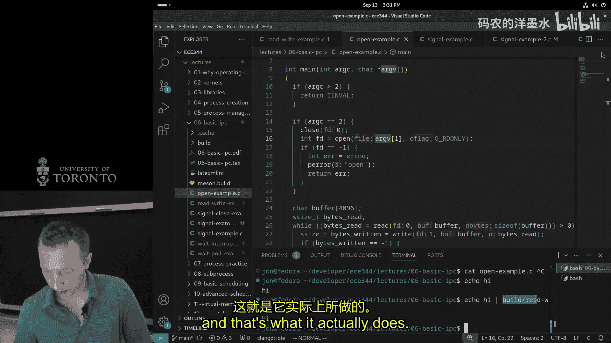

All right， so now we get into signal。So everyone loves interrupts， right？No。

 they you probably all hate them。 Well， they're coming back with the vengeance。

So signals are a form of IPC that interrupt your process and just like a signal or sorry just like an interrupt and you have an interrupt handler。

 you get a signal and you have a signal handler， so they are essentially interrupts for user space like there interrupts at your program gets to see because you can't actually play with the hardware interrupts。

But， you know， the operating system developers were like， well。

 surely we can't let you just ignore interrupts。 We have to give you some form of interrupts and make your life a living hell。

 So if I press control C， that's what actually happens is an interrupt gets sent to my program。

 So if I was running open example or read，r When I hit control C。

 it actually interrupted my program and told it to exit。And by default。

There's some default signal handlers in your program。

 The default signal handler for control C is to just exit your program。

 You won't have to write anything to do it。 So that's why when you hit control C。

It exits your program。So how that works is the kernel the interrupt the kernel gives you just also supplies you with a number that indicates the type of signal your process received。

And there's default handlers for them。There's basically two default handlers。

 One default is to ignore the signal， and the other one is to just terminate your process by exiting。

So。If I hit C C， that sends a signal called Sig init。

 so it's supposed to represent interrupt from keyboard and the default handler。

Just does an exit system call and sets the exit status equal to 128 plus a signal number。

Why does it do that， I don't know。 They just decided to do that so we can actually kind of see。

So if we go ahead and we run。

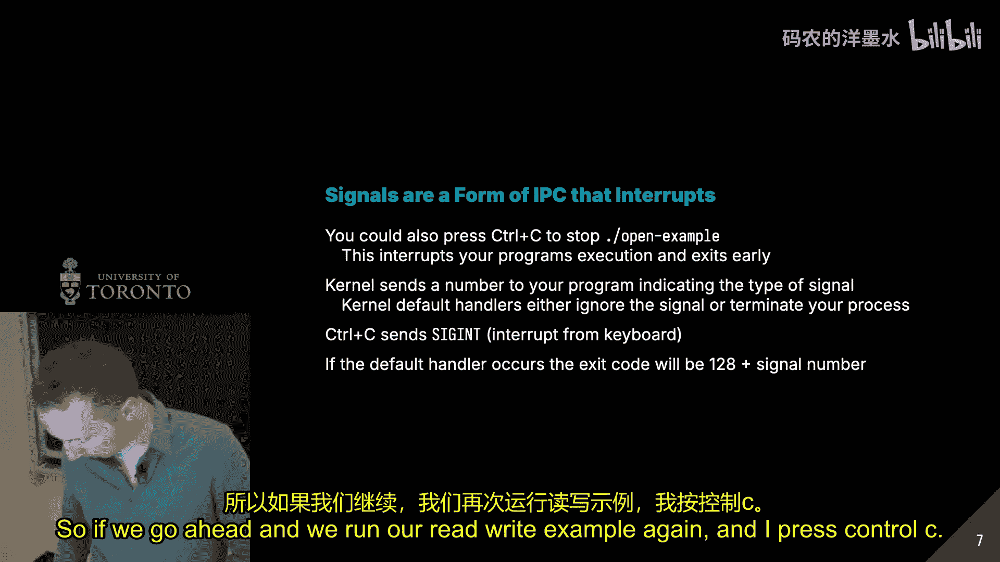

Ill readrite example again， and I press control C。Doesn't really look like anything happens。

 There's this red icon here， and that means that we have a nonzero exit code and if I read it there。

 it actually says command executed now how long it took and failed and says exit code。130。

 So knowing that the default signal handler。Does 128 plus the signal number。

 we can figure out what the number is for interrupt by keyboard。Can anyone do simple math for me？

What would be the number four interrupt from keyboard？I think I heard too。 Yeah， it's two， right。

130 minus120 is 2。 So it just send us the number two。

 and we just exited because we use the default handler。

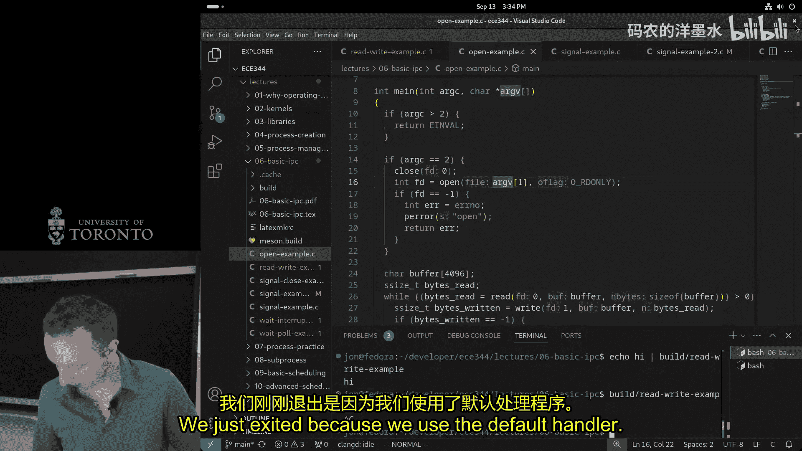

So we can have more fun with this so we can set our own signal handlers using the SG action system call。

😊，So I wrote a program to do it。It's kind of uninteresting。 It's a lot of。

Borring things basically just declare a function that doesn't return a value and has an int argument。

 that int argument is going to get the signal number。And some common numbers。Are below for Linux。

 so these are the typical ones you'll see on Linux， two is SigAit interrupt for keyboard。

 Sig9 is SG kill， that means terminate immediately。

11 is probably something you've encountered before。 That is Sg Sig V。

 which is a memory access violation。 Aka， a Seg fault。

 Aka A UD referenced a pointer that you shouldn't have。

 everyone's probably done that before right so that's what actually happens at the operating system level as it sends your process a signal。

 and signal 11， and then by default， it just quits。

 cool thing about that is you could just ignore a sg fault if you wanted。

 and just keep on trucking and trying to do other things。 It probably won't work very well。

 but you're free to ignore sg faults if you really， really want。😊，And then。15 is seg term。

 So that's supposed to tele a process to terminate。 And that's like， please exit nicely。

 And the idea behind this is that it should do。Any clean up it needs to before it exits。

 like write some files， whatever it needs to do before it exits。 And then Sig kill。

 as we'll see as in the examples， is that is the violent version where it just kills it immediately。

 It doesn't get a chance to do anything。So。When a signal gets sent to your process。

Your process immediately drops what it is doing and runs the signal handler。

 so it can be interrupted at any point of execution。

 as you probably know from doing interrupts in lower level hardware。

 And then as soon as that signal handler is done， your process just resumes from wherever it left off。

 So this is an example of concurrency。 So we are doing we're juggling between two different functions。

 because your process is switching whatever function it's executing and coming back to。

 So you actually have to be very careful what you write there because weird things can happen。

 So let's go to the next example。 So we're going to follow through。

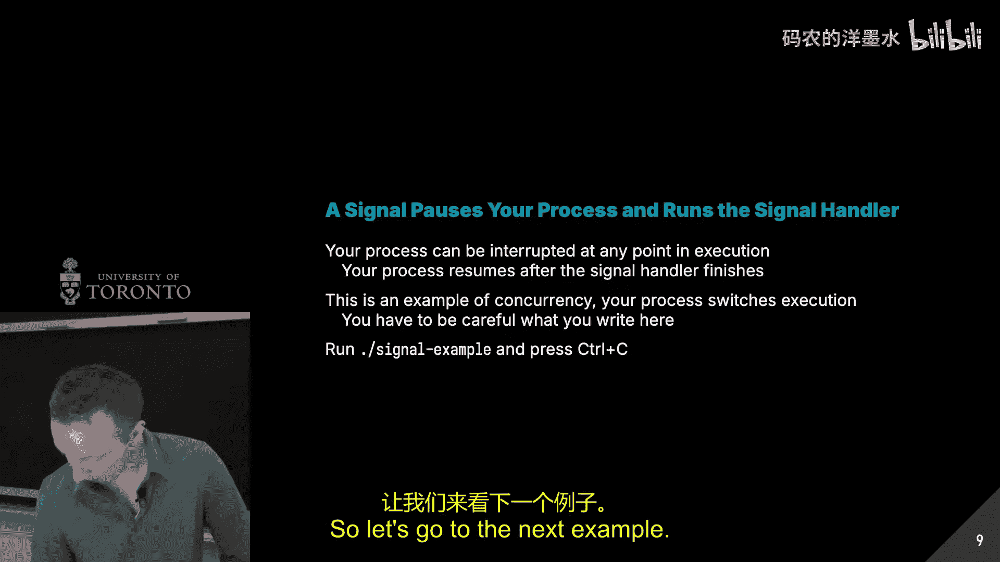

Still have our program that reads from file descriptor0。

 writes to file descriptor1 and has a file argument， but we're also going to register two signals。

 so we're going to register the signal Sig and knit and SG term。

 so that is control C and then please terminate nicely， we'll also register that。

So the code for register signal， you do not have to memorize this if you ever need to use it。

 just copy and paste it from the code。 You have code examples。 Basically。

 this will do that Sig action。 And you have to set this up。 Basically。

 the only thing you care about in this function is。

You have to register what function will actually do will actually be the signal handler。

 So I named it handle signal。 Then it set it up。 Does the Sig action system call。

 and then it's registered at that point。 So I just have a function called register signal and registered the two signals。

 And then here is my implementation of the signal handler。 So I just print off。 I'm ignoring this。

 I don't care。 And then we continue doing whatever were doing。So。Now， if I run this program， Oop。

 sorry， it's called signal example。 Now， if I run signal example。Help， help。 I need to。

So you would probably， if you got this in first year。You'd say。

 if someone came to you with this problem of like， how do I exit my program。

 you would tell them to press control C。What's going to happen when I press control C now。

It's essentially going to taught me， right， It's going to be like， hey， I'm ignoring you。But。

It turnsur out that doesn't quite happen。 So if I press control C， I do see ignoring signal 2。

But I see here， I actually got an error from Reed。And this is why it is good to program defensively。

 So Re actually returned negative one。And actually set Erno as an interrupted system call。

 so in the middle of doing that， I was like my process was in the read。

 waiting for something to happen， waiting for some data to come in。And then I press control C。

 which did the interrupt。 and that actually interrupted the read system call。

 and it got an error even though it should be able to continue again， right。

 It just interrupted system call， who cares we can continue so。If I didn't program defensively。

 I wouldn't have known that happens。 this error code is actually something I can actually handle。

 So if I see interrupted system call from a read， I can be like， oh okay well I'll just go again。

 So here I wrote a different version of the program。 So here in the body of the while loop。

 I check if I have an error and then if I have an error。

 this is how you actually check what your specific error is。

 So if you read the documentation for error no， it'll tell you all the different numbers here I check to see if I got the system call interrupted error and if I did I just continue and that will just call read again。

 So I'll just。Just retry the read system call。So now。If I run this。

 my fixed program that restarts that system call。And I type hellello， help， I'm a first year student。

 I need to exit this。You would tell them， or if you went back in that day， it would be control C。

 right， press control C to get out of this。How do I anyone know how I get out of this now？And also。

 if you know anyone first year， you can give them this program and see if they can exit it。

After this lecture， you can taunt them because you can get out of it y。

Press the exit button on the top right， so that will not only exit my process。

 that will exit my shell， only why I exit this process。Sorry。Another terminal。Yeah。

So you want me to kill this that sounds violent。Control D。 Oh， control D will end it。

 That's end of file。 So yeah， control D will still work， but。Let's assume we don't have control D。

Okay， so we saw some other signals。 There was like that seg term， which is like please terminate。

 right？ Well， how do I actually send that to tell this process to please terminate？

 So that's where we get to learn the word kill。 Oh， yeah。 and this is just a slide。

 you need to account for interrupted system calls because you know。

 whenever I ran my program I got an error from Read。 that's So you have it on slide。

 So you can actually send signals to process just knowing their process Id。

 the command to send a signal to a process is called kill。😊。

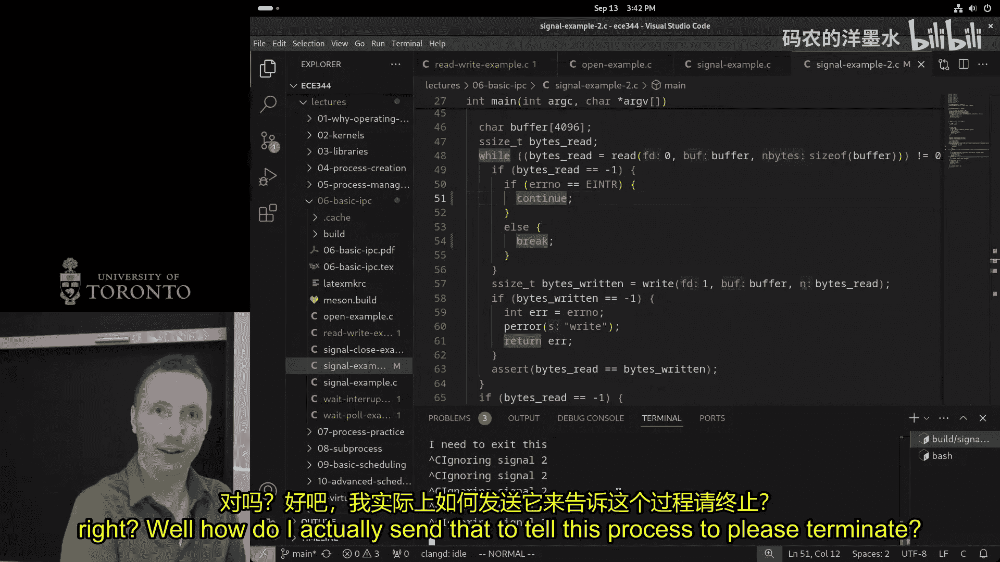

I don't know why。 So they didn't want to name it。 Send signal。 They wanted to name it kill。

 I don't know。They woke up and chose violence。 I have no idea。

So kill just remember that sends a signal to a process so by default， the kill command。

 if I just use kill and then PID that sends that seG term so that is please close nicely or you know if you went to task manager and hit and task。

 it's going to do the same thing it's just going to send a signal to that process to say please end。

Right。

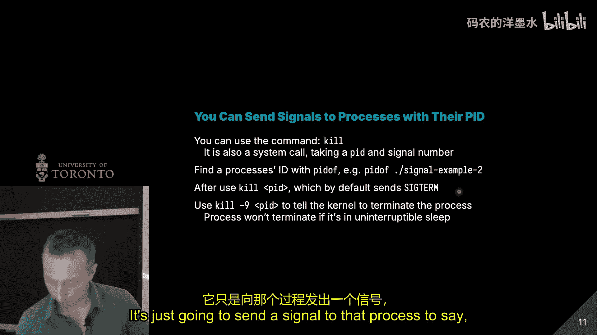

Here， if we go back to it。I can， in another terminal， I can figure out the process I D of that。

 So you should actually be able to write this。 So I could do Pi of signal example 2。

So that will tell me the process ID。Of any program or any process running name signal example two。

 so you can probably write this after lab1 right basically all it does is go through the pro file system。

 look at the name of it， if it matches the name of the argument。

 print out the process ID so you could actually write this program if you really wanted to。

So this number， what is this， It is 56，54。 So if I that is a process I D of this thing that's running。

 that is being a jerk and ignoring me over and over again so I can be like， hey。

 I would like you to die so I can say kill and kill。

 that should send that terminate to that process and it should end， but if I go over。

 it says ignoring signal 15。What a jerk。 So I also ignored that signal。 So it said the Chme was like。

 hey， you sent a signal to it that's supposed to be like， please exit nicely。

 And because you can be a jerk， you can just be like， yeah， now I'm good。Now。

 so if you want to actually murder it， there is a signal that you cannot ignore。

 and that is the Sig kill or。9ine。So if I do dash 9， that sends the signal number 9 to that process。

 yeah。最初のこし。あしておれ。Yeah， so so yeah， end task is like end nicely。 Everyone's probably used force quit。

 That's force quit。So dash 9 is just straight up。The colonel is going to murder you violently。

 You are just going to end immediately。 You get no say of it。 So if I do kill Dash 9。

And I go over this one it just says killed and now I can type on my terminal again， yay。

 so if I did try to register signal handler and register SG kill。

I would get an error from the kernel that says， you're not allowed to ignore that， nice try。fuhu。

Allright。 What other examples do we have， So now I've equippedpped you with dangerous information。

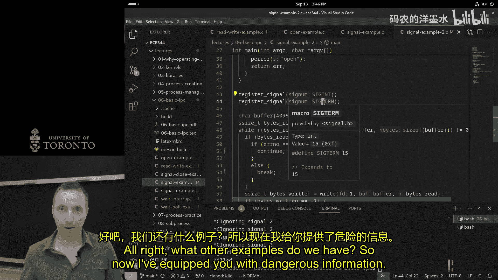

So that's killed Dash9。 Oh， yeah。Oh， so if that process is actually in like that D state where it's waiting on a file or something like that that we saw from before。

 it actually won't kill it immediately， the kernel will just let it live until it's done doing that so if you can figure out how to get in that uninterruptible sleep state。

 then you can be a big jerk and that's why like forcequi sometimes will not work but generally the kernel frees it up。

All right， so also real quick， we talked that most operations。

Most operations are like non blocking that we would like to do。

Non blocking just means the call returns immediately， we are just checking if something occurs。

 so we saw a wait before that is how we checked like we waited until a process died。

Or terminated until it returned。 So there's actually a non blocking version of weight， oh， yep。

So whatれ。AndAnother you。Yeah， so what if？You just killed D 9 someone else's process。 So likely。

The kernel will check that， you know you actually own the process that's running and will do permission checks so you just can't kill other people's random processes so you can only kill your own processes unless you're the root user and then you can kill any process you want。

Which。R， and you can use pseudo to be the root user so you could just kill anyone's processes。

 So yeah， if you log into the UG machine， you just can't kill your friends's processes and be like。

haha I got you or anything like that。So you have to have permission。

 there are permission checks for these things。All right， so real quick。

 So to turn weight into a non blocking call， you can use weight P ID and use an option called W。

 no hang。 So that means just return immediately and。On the flip side。

 if I want to like react to changes in a non blocking call， we either use pull or an interrupt。

 Everyone remembers pulling and interrupt from that hardware course。 So same thing we could do。

 So if we have a non blocklocking function， we can pull over and over again if a process is terminated yeah。

The killed process。Yeah， what if I'm root and I try and kill process one？Also end a lecture。

 so we'll wait on that to try that。But yeah， process one， pretty important， right， if I kill9。

 process one。Yeah， probably something in bad will happen。So first， let's go over this。So。

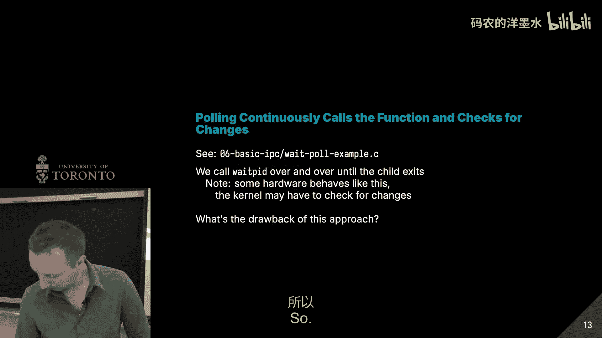

Let's go back so if we want。So this is going back to that fork example where we have a child that we just wait for over and over again。

 so the child here just sleeps for two seconds and we're going to rewrite the parent to use the non-blocking version of weight so one thing to do is just pull over and over again so I just call wait so。

I call weight P I D。 So I wait for my children child to die。 If I want to behave the same as weight。

 where it's like the first child to die。 If you read the documentation。

 if you set the first argument as-1 instead of a PD that will behave as the normal weight system call and wait for the first one to die。

 in this case， it doesn't matter。 otherwise， it takes a w status as before。

 and then this option is W， no hang。 So now if weight P ID returns 0。

 that means no process has terminated。 So if I run this was a weight pull example。

I see over and over again， I'm trying again， have you ended， have you ended， have you ended。

 And if I look at the number of attempts I made， which was like a third of a million。

 that probably wasted a lot of time right？ So I just kept on asking over and over again。

 Are you dead yet or you dead yet or you dead yet or you dead yet over and over and probably wasting time。

So this is a trade off with polling。 If I wanted to not do so many。Wasteful weight calls。

 What modification should I make to this code， So I do less weight calls that I know aren't going to work。

Yeah。Just with pulling。No signalss。 Oh， that is the same thing。So， yeah。Yeah， just sleep。

 so here maybe between weights， maybe I sleep for a second。Ohoops。Oh， crap。All right。

 so I did it to myself3。All right， I have to chose violence。All right。

So you can really annoy first years with that。All right。I have to compile。Compile。

So now if I compile that， I'm checking every so often so now I only check two times makes sense。

 but the big drawback here is if I only check every second。

 well I actually might not respond instantly it might be the case where I check and then I go to sleep for a second but my child process terminates right after I check so I might not actually act on the result to like a full second after it happened in the worst case so。

Generally， it's always a trade off， the longer I wait。The slower I might be at responding to it。

 but the less wasteful weight calls I'll have。えにゴールす？And the child term。This in。

YSo does it call weighthead。Does the a child Co？No， so in this case。

 when my child terminated before I called weight on it， it just terminated， its still as its parent。

 I'm still alive， I'm the one calling weight， so it's just a zombie。

 so it could be a zombie for up to a second here。And then I call weight on it， weight returns。

 it gets cleaned up， and we rejoice。Al right， so remember when I said before that the operating system will poke your process when when a child dies and tell you to。

 you know， handle it。Turns out that poking is a signal。If I wanted to。

 so here I'll show you this program again。The poking is it sends you a signal。

 and it was called Sig child。 So it means one of your child has terminated。

 so you can register that signal and。In the rest of the program， as before。

 I just have my child go to sleep for two seconds and terminate and to show that this is just to simulate my。

Original parent process just doing useful work this， but I just sleep for 9999 seconds。

 So I say time to go to sleep。And just sleep。 And then I just have this signal handler。

 So I check that I actually get sick child。 If I don't get sick child， if someone tries to control。

 see it or something， just says it ignores it， but I don't register anything else。

 So this shouldn't actually execute。Then in my signal handler， I call weight。

 So I just have my weight in the signal handler。 So as soon as my child terminates， I wait on it。

 I clean it up， and then I make sure that it doesn't stay a zombie for very long。So。If anything bad。

 I just exit the process here。 I just exit the process as part of the signal handler。

 but you could of course， handle it and continue on doing stuff。 So now if I run this。

It goes a bit faster， it says it's time to go to sleep， two seconds happens。

 then my child process dies， the parent process gets a signal。

 and then in the signal handler it waits， cleans it up， all the good things happen。

So why would you want other things you could do？That gets a bit more complicated。

I told you that in the signal handler， one of the things you might want to do is like clean up resources。

 So here， let's assume that。I'll just print off the PID so I can actually kill it。

 but say we open up a file and then。We just have some。In the main， we just go ahead。

 we do some useful work or something here， I just simulate as a asleep。

 And then in the signal handler。this is like a web server like it just runs forever and then whenever someone wants to quit it。

 quit it， it sends it a signal， and then in the signal handler here。

 that's where I close up all my file descriptors。If I don't open a file descriptor。

 I say there's no open file， if there is an open file descriptor， I close it。

 I hopefully should not get an error， say I close the file。

 and then I just sleep for 10 seconds and then exit。Turns out when I execute this program。

And then given an argument， let's see， readwrite。So I open it， its process ID 6096。

 so if I say let's please close。I think that was it。Yeah， it says it closed the file。

 but the fun thing about signal handlers is you can call it twice and while it's doing that signal handler。

 it will call a new signal handler so they will be nested together。

 And then turns out the way I wrote that actually has a bug， whoops。So I do that， oops。

 what's the number？Hit control C。Was this。Kill。Yeah， so if I do that。

 I get a signal handler happening within a signal handler， and I closed it the first time。

 and then it will try to close it a second time and actually get an error from close because well。

They were nested together， so。I did the first time I ran it， it ran， it closed the file。

 and then it got to this sleep， and then before that was done， it got another signal。

 and then it started again， printed this off。Skpped over this and then closed it again。

 so I closed that file twice， which is an error kind of like the same as freeing the same pointer twice。

 yeah。Call a signal handleer。Like what's calling signal handler？

So what's making it actually go to this code is just by registering the signal handler。

 so registering that function to run， and then the kernel sending it a signal and then it'll just like interrupts。

 it will just automatically execute that code。So you don't get to call signal handleler。

 the kernelel calls out on your behalf。Whenever you get a signal。Yeah。Can I unregister one？犯内。Yeah。

 so you can like deregister signal handlers it gets kind of messy too as you might imagine， but yeah。

 you can do that that's totally a thing you could do or ignore signals or ignore interrupts All right。

 so we're close we're close to the end， so now we can do something fun kill oh wait。

 I have to be pseudo pseudo kill9 process ID1 probably fairly important right。Enter。Nothing happened。

 So Colonel's a bit smart。 It won't let me do that， but。Remember before we had。

We looked up and we saw like system D user， so we can't kill a knit。

But there's probably a fairly important process to my user。Where is it？This one， right。

 system D user。 So that got all my。Processes whenever they became orphans。So that is 1692。

So I don't even need permission， 1692。So what should happen if I do this and I kill the process that manages every other process I've been launching？

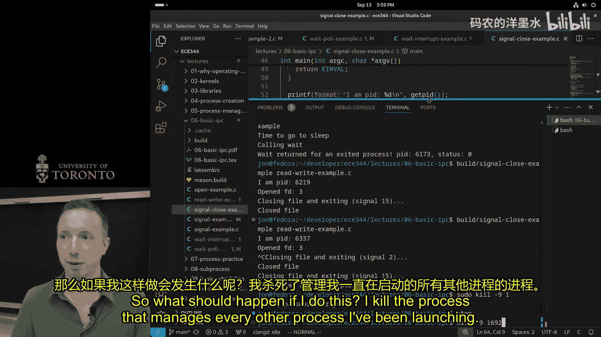

Probably not， probably bad。

Bye。