# 操作系统课程：第6讲：进程间通信（IPC）📡

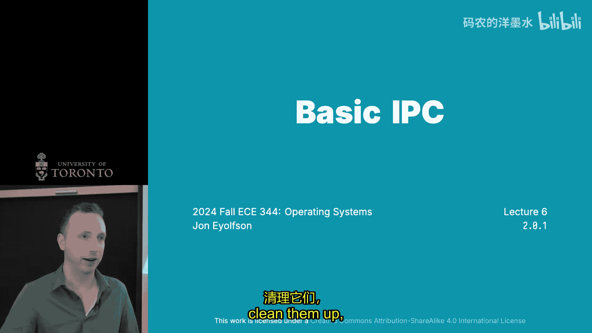

在本节课中，我们将要学习进程间通信（IPC）的基础知识。IPC是进程之间传递字节数据的方式，是操作系统实现协作功能的核心。我们将通过代码示例，探索如何使用文件描述符进行读写，以及如何处理信号这种特殊的IPC机制。

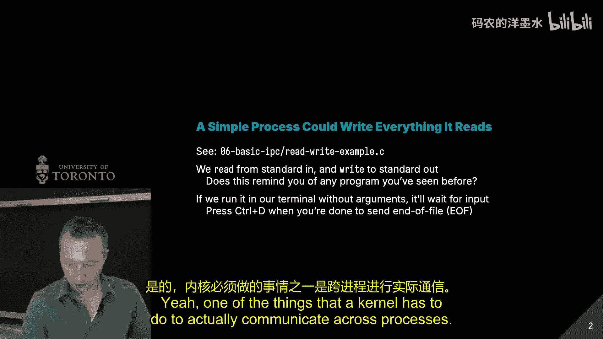

---

## 文件描述符与读写操作

上一节我们介绍了进程的独立性。本节中我们来看看，进程间如何通过文件描述符进行最基本的通信——读写数据。

`read` 和 `write` 系统调用是IPC的主要方式。它们允许在进程间读写任意字节数据。标准输入（文件描述符0）和标准输出（文件描述符1）是预定义的通信渠道。

以下是一个简单的程序，它从标准输入读取数据，并写入标准输出。

```c
#include <assert.h>
#include <stdio.h>
#include <unistd.h>

int main(void) {
    char buffer[4096];
    ssize_t bytes_read;
    while ((bytes_read = read(0, buffer, sizeof(buffer))) > 0) {
        ssize_t bytes_written = write(1, buffer, bytes_read);
        if (bytes_written == -1) {
            perror("write");
            return 1;
        }
        assert(bytes_read == bytes_written);
    }
    if (bytes_read == -1) {
        perror("read");
        return 1;
    }
    assert(bytes_read == 0);
    return 0;
}
```

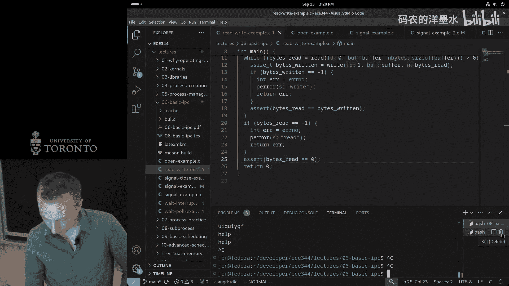

**核心概念解析**：
*   `read(0, buffer, sizeof(buffer))`：从文件描述符0（标准输入）读取数据到 `buffer` 中，最多读取 `sizeof(buffer)` 字节。返回值是实际读取的字节数。
*   `write(1, buffer, bytes_read)`：将 `buffer` 中的数据写入文件描述符1（标准输出），写入 `bytes_read` 字节。返回值是实际写入的字节数。
*   当 `read` 返回 `0` 时，表示已到达文件末尾（EOF），没有更多数据可读。
*   当 `read` 或 `write` 返回 `-1` 时，表示发生了错误。

运行此程序，它会等待用户输入。输入内容并按下回车后，程序会将内容回显到终端。按下 `Ctrl+D` 可以发送EOF信号，使程序退出。

---

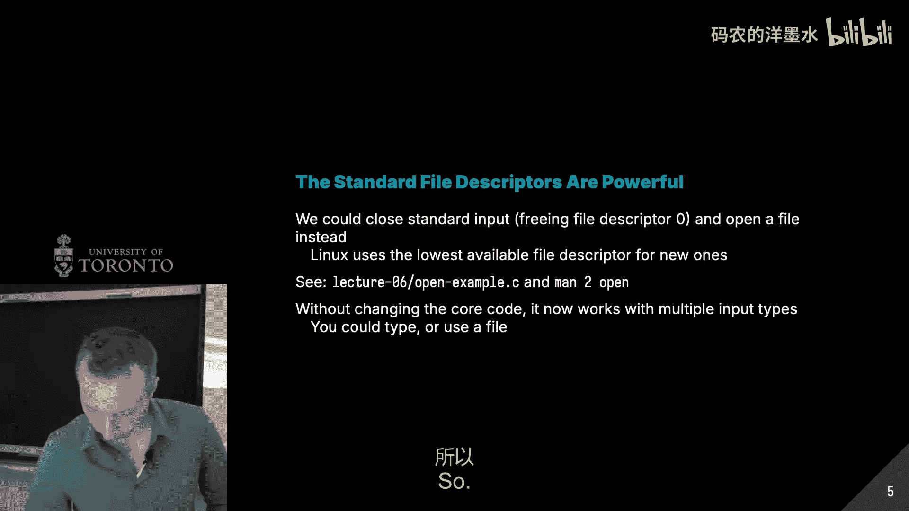

## 重定向标准文件描述符

理解了基本的读写后，我们可以利用文件描述符的特性做更多事情，例如重定向。

在Shell中，我们可以轻松地重定向标准输入和输出，而无需修改程序代码。这实际上是Shell在启动进程前，替我们完成了文件描述符的替换工作。

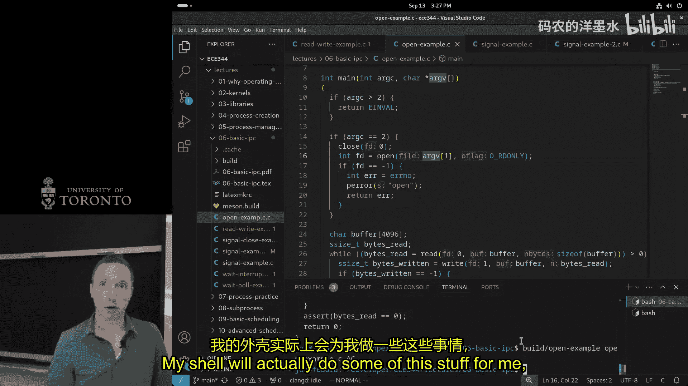

以下是Shell重定向的几种方式：
*   `./myprogram < input.txt`：将程序的标准输入重定向到 `input.txt` 文件。
*   `./myprogram > output.txt`：将程序的标准输出重定向到 `output.txt` 文件。
*   `echo “hello” | ./myprogram`：使用管道（`|`）将 `echo` 进程的标准输出连接到 `myprogram` 进程的标准输入。

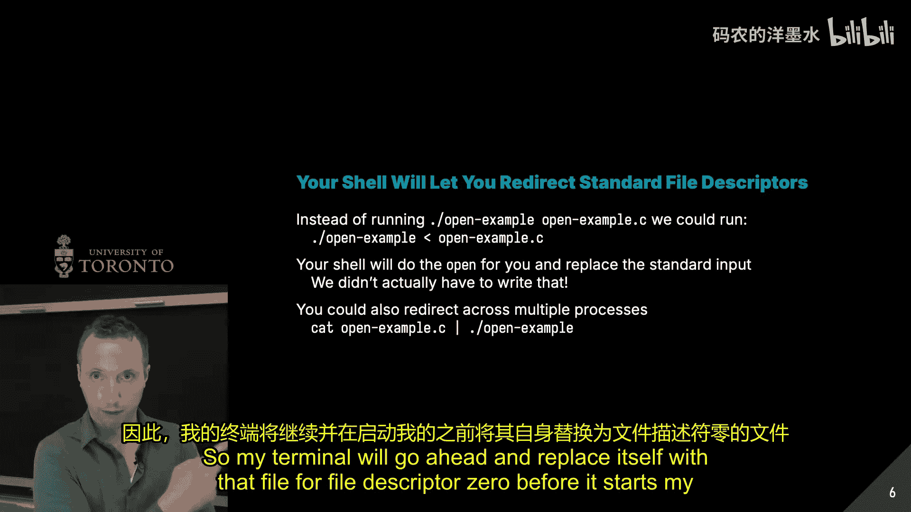

管道是一种强大的工具，它能将一个进程的输出直接作为另一个进程的输入，从而将多个程序串联起来完成复杂任务。

---

## 信号：一种中断式IPC

除了通过文件描述符进行“流式”通信，进程间还有一种异步的通信机制：信号（Signal）。信号类似于硬件中断，可以随时打断进程的正常执行流程。

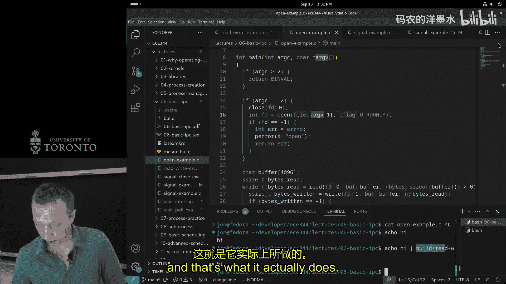

当我们按下 `Ctrl+C` 试图终止一个终端程序时，内核会向该进程发送一个 `SIGINT`（信号编号2）信号。进程对该信号的默认处理行为是终止自己。

以下是常见的信号及其默认行为：
*   `SIGINT (2)`：来自键盘的中断。默认行为：终止进程。
*   `SIGKILL (9)`：强制终止。此信号**不可被忽略或捕获**，用于立即结束进程。
*   `SIGSEGV (11)`：段错误（非法内存访问）。默认行为：终止进程。
*   `SIGTERM (15)`：请求终止。默认行为：终止进程，但进程可以捕获它并进行清理工作。

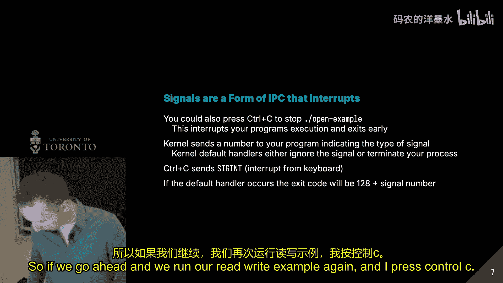

我们可以使用 `kill` 命令向指定进程ID（PID）发送信号：
*   `kill <PID>`：发送 `SIGTERM`（15）信号，请求进程终止。
*   `kill -9 <PID>` 或 `kill -KILL <PID>`：发送 `SIGKILL`（9）信号，强制杀死进程。

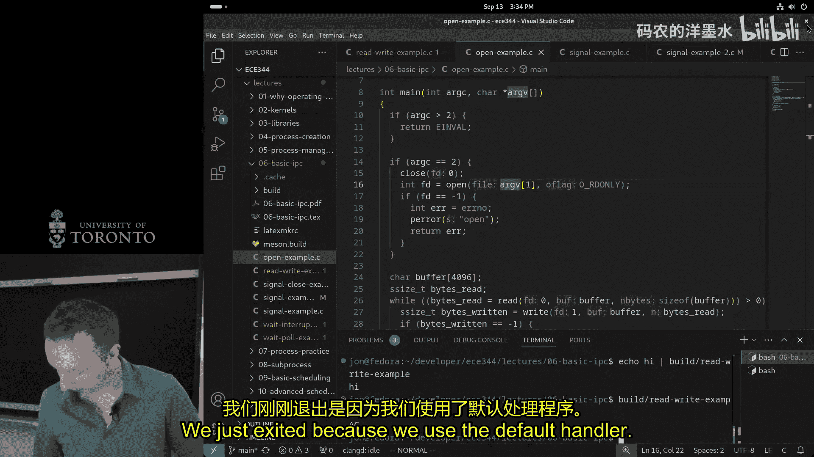

---

## 注册自定义信号处理器

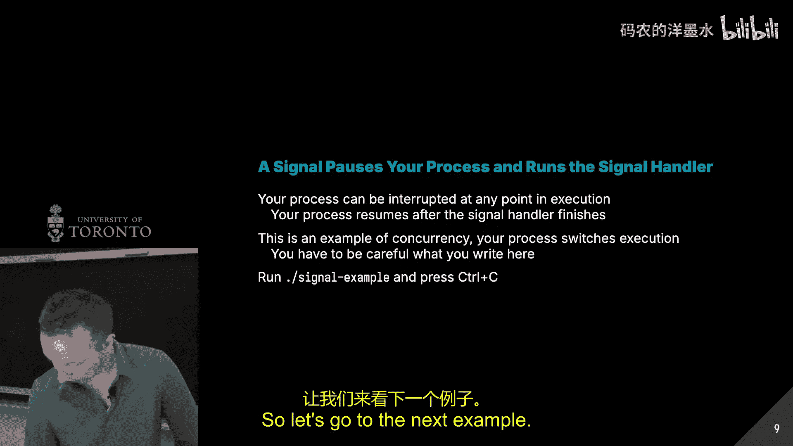

进程可以捕获大多数信号，并注册自己的处理函数，从而改变信号的默认行为。

以下程序演示了如何捕获 `SIGINT` 和 `SIGTERM` 信号，并忽略它们。

```c
#include <signal.h>
#include <stdio.h>
#include <unistd.h>

void handle_signal(int signal_number) {
    printf(“Ignoring signal %d\n”, signal_number);
}

void register_signal(int signal_number) {
    struct sigaction sa;
    sa.sa_handler = handle_signal;
    sigemptyset(&sa.sa_mask);
    sa.sa_flags = 0;
    if (sigaction(signal_number, &sa, NULL) == -1) {
        perror(“sigaction”);
        _exit(1);
    }
}

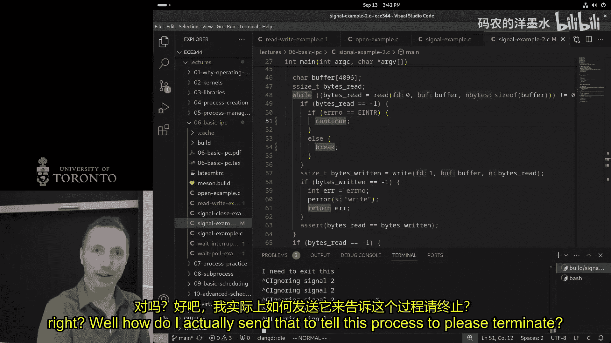

int main(void) {
    register_signal(SIGINT);
    register_signal(SIGTERM);

    char buffer[4096];
    ssize_t bytes_read;
    while ((bytes_read = read(0, buffer, sizeof(buffer))) > 0) {
        // … 写入逻辑 …
    }
    return 0;
}
```

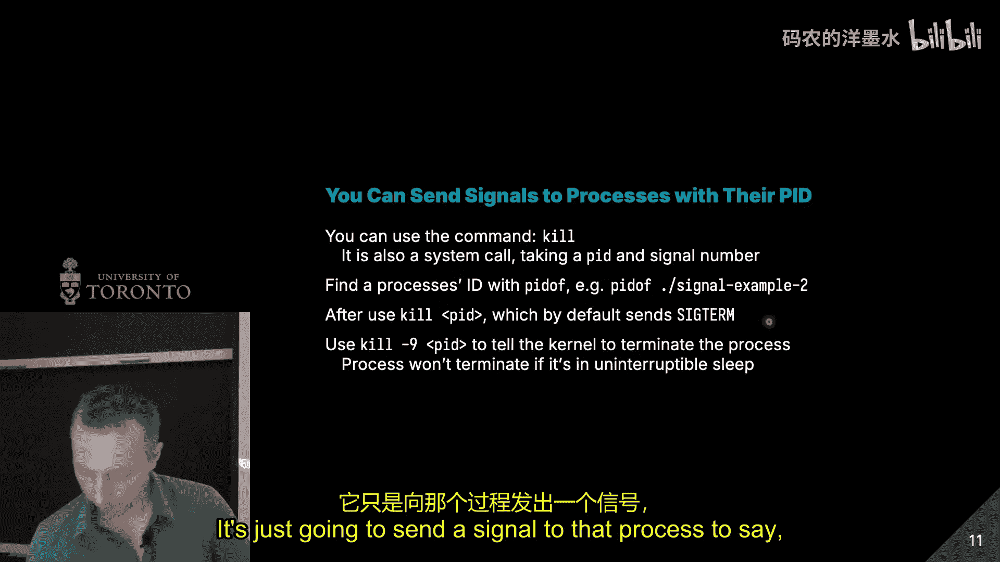

运行此程序后，无论是按 `Ctrl+C` 还是用 `kill` 命令发送 `SIGTERM`，进程都不会退出，只会打印忽略信息。此时只能使用 `kill -9` 来强制结束它。

**重要注意事项**：信号处理器会中断进程。如果一个系统调用（如 `read`）在执行时被信号中断，它可能会返回错误，并将 `errno` 设置为 `EINTR`。健壮的程序需要检查并处理这种情况，通常选择重新执行被中断的系统调用。

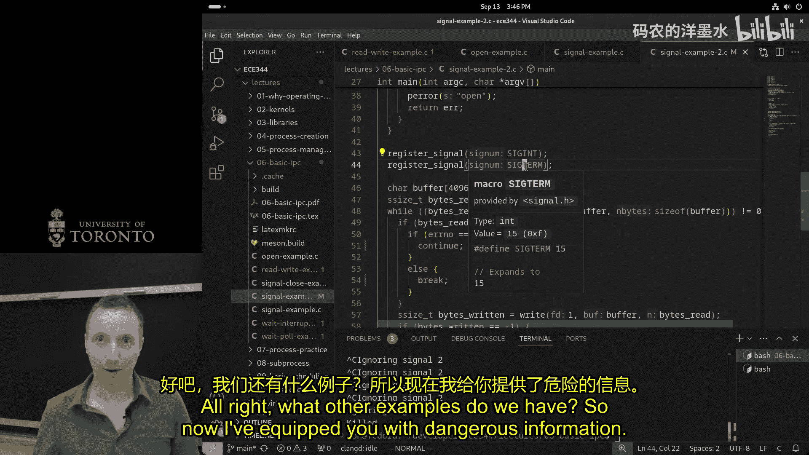

---

## 信号的实际应用：处理子进程终止

之前我们提到，父进程需要使用 `wait` 系统调用来回收已终止的子进程，避免其成为僵尸进程。一种高效的方式是利用 `SIGCHLD` 信号。

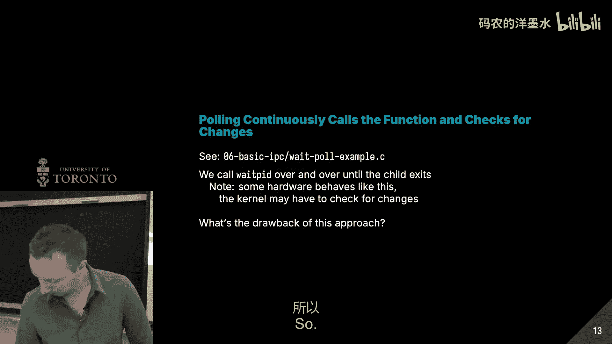

当子进程状态改变（终止或停止）时，内核会向父进程发送 `SIGCHLD` 信号。父进程可以捕获这个信号，并在信号处理函数中调用 `wait` 来清理子进程。

```c
#include <signal.h>
#include <stdio.h>
#include <sys/wait.h>
#include <unistd.h>

void handle_sigchld(int sig) {
    // 在信号处理器中等待子进程
    int status;
    pid_t pid = wait(&status);
    printf(“Child %d terminated.\n”, pid);
}

int main(void) {
    signal(SIGCHLD, handle_sigchld); // 注册信号处理器

    pid_t pid = fork();
    if (pid == 0) {
        // 子进程：睡眠2秒后退出
        sleep(2);
        _exit(0);
    }

    // 父进程：继续自己的工作
    printf(“Parent going to sleep.\n”);
    sleep(9999); // 模拟长时间工作
    return 0;
}
```

这样，父进程无需主动轮询（polling）子进程状态，也无需阻塞等待。当子进程结束时，父进程会通过信号被即时通知并进行处理，提高了效率。

---

## 总结

本节课中我们一起学习了进程间通信（IPC）的两种基本形式。
1.  **基于文件描述符的IPC**：通过 `read` 和 `write` 系统调用在进程间传递字节流。标准输入/输出、文件重定向和管道都是这一机制的应用。
2.  **信号（Signal）**：一种异步的、中断式的IPC机制。用于通知进程发生了某些事件（如用户中断、子进程终止、非法操作等）。进程可以捕获并自定义大多数信号的处理方式。

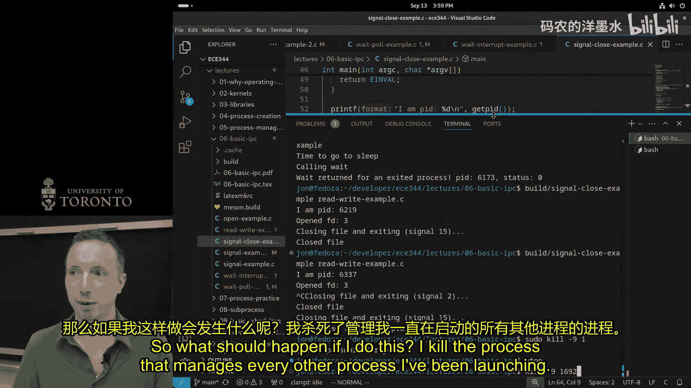


理解这些基础IPC机制，是构建更复杂进程协作模型（如管道、套接字、共享内存等）的基石。