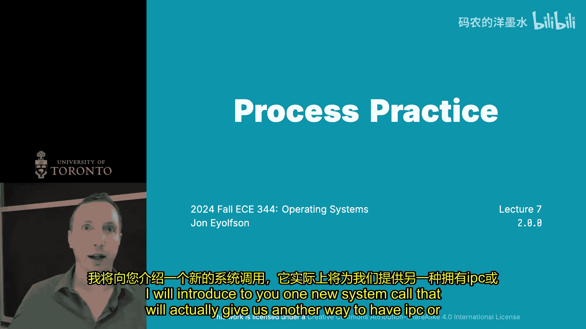
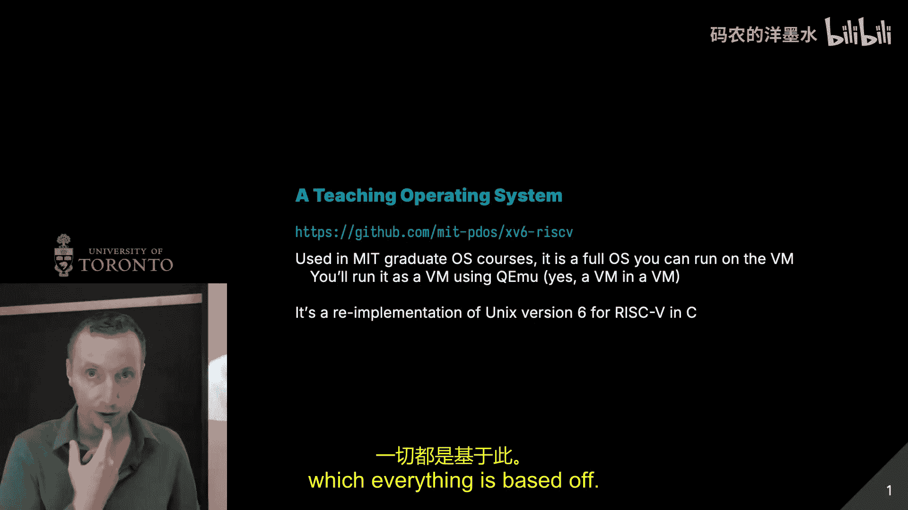
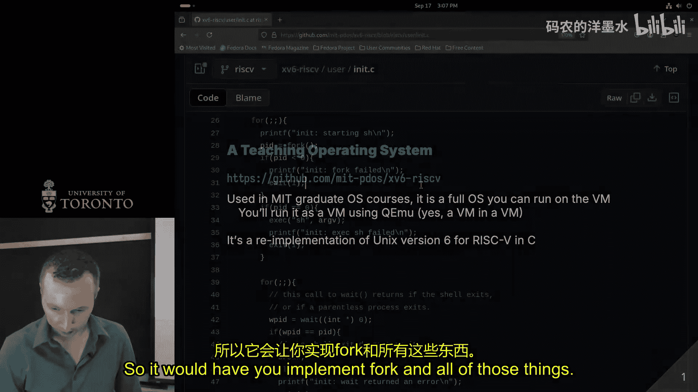
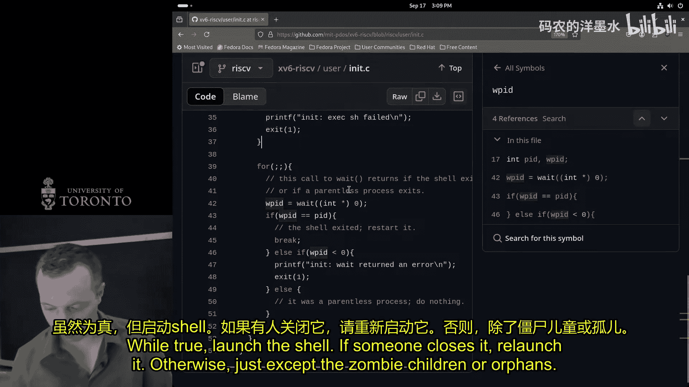
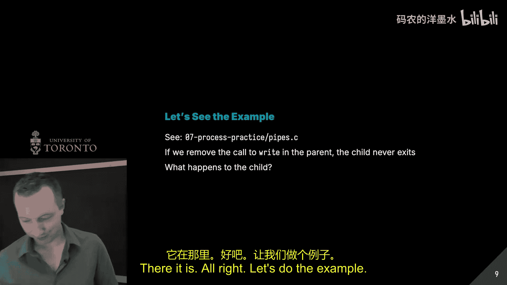
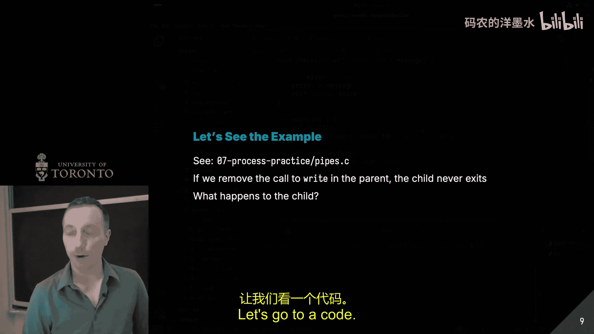
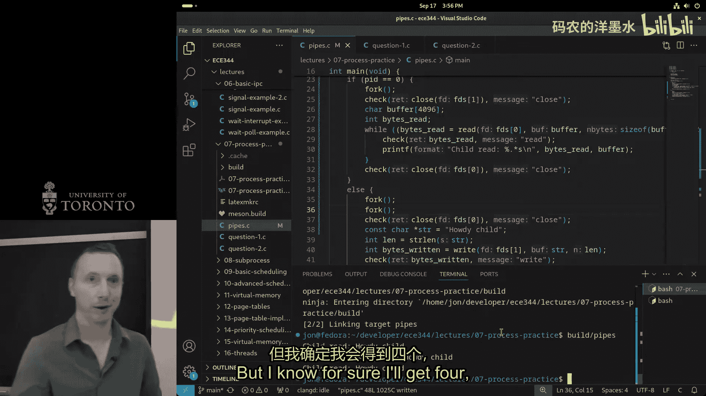

# 【全集】多伦多大学 操作系统 中英字幕 1080P p07 Lecture 7 - 进程实践 -BV1Rbk7ByERc_p7-

嗯。欢然。Okay。🎼All right， how's your laptop， oops， volume。Alrighty， welcome back to operating System。

 So today。We get to have some practice with our processes， we know how to create processes。

 we know how to wait for them。Kind of know how I communicate between them。

 So today we'll be doing more practice with this。 Well I will introduce to you one new system call that will actually give us another way to have IPC or inter processcess communication。

So first off， based off some of your feedback， some of you want to write an operating system as part of this course。

 So not where this course is aimed at， but if you are interested。

 the goal of this course is we kind of hang around at that system call layer。

 we're supposed to you know， figure out what goes on in the kernel without actually writing kernel code。

 if you want to actually write kernel code or go on to grad courses or something like that。

 there's this little MIT kernel that is a full Unix operating system。 So a kernel。

 plus a bunch of programs that by the end of this course， you should at least be able to read。

 even if you don't get some of the implementation details， we can kind of figure it out。

 So it's a reimplementation of like a very old version of Unix， which everything is based off。

 So it would have you implement fork and all of those things。

So。We can read part of it so we could actually read a knit from their code and actually understand what it is doing。

 So they're a knit。 remember a knit responsible for creating every other process on the machine and also being kind of like the orphanage that would wait on any child process So here is their whole version of a knit So it's just for four semicolon semicolon that's just while true and infinite loop。

 So while infinite loop it says print starting S H。 So SH is your shell what you type into it forks。

 so it creates a new process。And here it checks。 Well， if there's not an error， if there is an error。

 then it just exits from a knit and something horrible has happened。

 So it just stops the whole operating system。Then here， if PID equals 0。

Is that the child or the parent， that's the child， so the child process。

 a newly created process that it made execs， so that's a shorthand for exec VE that we saw so it runs another program called SH and well if it is successful。

 it doesn't reach this line if it reaches this line then it means there is a problem and it failed and then it also just dies。

Other than that， it just creates a S H process， and then it has another inner infinite loop that just calls weight over and over again。

 So it's just wall true weight。 So this is it being that orphanage and cleaning up any zombie children it gets。

Which would be very weird in any other context。 But this， of course。

 that's exactly the technical term for it。So it cleans them up。 And then if weight。

 if weight returns the P ID of the process it created， it means the user exited from the shell。

 And what they do is just do a break and restart the loop and just restart another shell。

 So if you run this， it would just even if you exit out of the shell using control C or control D or whatever。

 it would just restart the shell whenever it's done。 Then other than that。

If it gets a process I D lesson， that's an error it exits。 Otherwise。

 it was just a orphan process that it adopted。 That was a zombie and it cleaned up so it doesn't really care about its exit code or anything like that。

 just does nothing。 So we all understand it's a knit。 That's the entire knit。So just。

Bal true launch the shell。 If someone closes it， relaunch it， otherwise， just accept。

 except the zombie children or orphans。

Alright， cool。 So little bit of background and more me yammering at you before we get into the fun stuff。

😊，So because， I don't know， we're talking about operating systems， I have to go back like 50 years。

 Has anyone ever heard of Dos。Probably not。 Allright， Really old operating system。

 That was an example of something called unit programming。

 So that meant the operating system only ran a single process at a time， which would be very。

 very lame right now。 So that means you can only do one thing at once。 So only one core。

 one process at a time。 you can't run two process in parallel or concurrently one process running at a time。

 know if ands or buts about it。Pretty lame。 So most things now， I mean。

 all things now or multiprogramming。 So you lot your operating system lets you have multiple processes that are all running at the same time。

 or it's juggling a bunch of them。 So that's why everyone's able to run hundreds of processes on their machine at any given time。

 So modern operating systems， the whole goal of them is to run everything in parallel or concurrently。

 just depending on your hardware。 So if you have know 8 CPU cores。 It tries to keep all them active。

 all them active doing stuff。 Otherwise， you would have a pretty bad operating system and you would probably install another one。

So。We have to talk a bit about some mechanics。 So the scheduler。

 that is the software in the kernel or the name for the specific type of software in the kernel that decides when to switch which process is currently running。

 So remember to create a process。 the operating system like has to at least loaded into memory。

 and then it goes into that waiting or ready state whenever it's able to run。 and then the scheduler。

 which we will figure out later。 That is the code that figures out what process gets to run。

So before we talk about which process we picked to run。

 we'll go over the mechanics of how we switch between different processes running。So。

The core scheduling loop or how you deal with processes in the kernel is they have a loop that kind of looks like this。

 If I know which processes I want to switch between how I switch it is I pause the currently running process。

 So I take the CPU away from it。 It can't execute anymore。

 I save its state so I can restore it later。 so I'd have to at least save its current register values。

 and then I get the next process to run from the scheduler， and then in order to run that process。

 I restore its registers from whenever it was。Kind of put on the shelf。

 And then I give the CPU to that process， and it can go ahead and run until I do this again and pick a new process to run。

So。Processes that switching between them。 There's also another thing we can do。

 We can let processes kind of。Scheduled themselves or have the operating system maintain control。

 So there is a thing called cooperative multitasking， where in order to give up CPU。

 you have to use a system call and tell the operating system。 Okay。

 you can pause me and run some other process， you kind of opt into it。 So in the system。

 if I want to hog the CPU。 I just don't do that system call。 I get 100% of the CPU until I'm done。

 I can just be a big jerk。So that's not how most operating systems are because you can't trust anyone's processes or that anyone wrote anything correctly。

 So most things， most operating systems now are examples of true multitasking。

 So the operating system maintains control。 And it pauses processes you don't get a say whether or not you get pause。

 So that is how your。Clonnel actually works。 So for true multitasking。

 you have some options in order to maintain control。

 you can just give processes set time slices so they just get 100 milliseconds。

 And then whenever they're done， you get control back or you can set the kernel can set its own interrupt so that it gets interrupted。

 every whenever it wants。 And then it gets control back and then it can tell the current process to just stop running。

 So those are two ways to maintain control at the kernel level。Also。

 the mechanic of switching processes like saving the state and restoring to another that has a specific name。

 and it is called context switching。So at minimum， in order to save all the state and to restore the state of another process。

 I have to save all the current registers。You can imagine the implementation details are slightly tricky。

 So you have to save all the values using the same CPU that you are using to save them。

 So like when you run instructions。You will also be changing registers。

 but you're trying to save the registers。Whatever they currently are without changing them， which is。

As you might imagine from your assembly course kind of tricky。

 so thankfully there's hardware support to help you save the state of the registers。

 Sometimes you might want to save everything though because whatever you context switch between processes。

You're not actually doing any useful work。 You， as a user。

 you only care about your processes running。 So anything else the system's doing。

 you don't care about。 We call that overhead。 It's essentially wasted time。

 time wasted towards other things that aren't running your programs that you actually care about。

 So context switching， pure overhead， you want to be as fast as possible。

 If you're offering system spent like half its time just saving values and switching between processes。

That means， you know， it would be twice as slow as any other operating system that's written by a normal person。

 And you probably just would never use it。 So you want the overhead of context switching to be as low as possible。

 Sometimes you can use a combination of hardware and software to save as little as possible。

 For example。If your process doesn't use floating point registers or doesn't do， you know。

 floating point operations at all， theres special floating point registers on your CPU。

 So if the kernel's smart enough to know that you don't use them。

 it might just not save them as part of switching processes and then doesn't have to bother saving them saves it a bit of time in order to get this down to be as fast as possible。

Alright， onto the fun stuff now。 So we get a new system call today。 It is called pipe。How pipe works。

 pipe works with file descriptors。So。It takes as an argument， a array of two integers。

 and it will assign values to them， assuming that this pipe system call is successful。

 So pipe returns a number。 It's 0。 If it's successful。

 negative one on failure and that sets error no， all that stuff we know from before。

 and it will actually set the elements of this array for you。 and how it sets them is。

It creates a pipe。 What a pipe is is basically it is like a region of memory that the kernel controls that you can actually use the file descriptors to send data to and get data from。

 and you do that through the file descriptors。 So at index 0。Is the read end of the pipe。

 so I'm allowed to use the read system call using that file descriptors to get data out of the pipe。

 and if I want to put data into the pipe， I use the file descriptor at index1 and that is the right end of the pipe。

 so I use the right system call to put data into that pipe。

So the pipe you can think of as a kernel managed buffer， a region of memory， whatever you want。

 but the way it works is that any data you write to it， you can read from the other end of the pipe。

 it's like a one way communication channel。So y。But which how this。東級？でパーテ。So the question is。

 can I like？交咗。Yeah， so can I force the file descriptor numbers it gives me。

 and the answer to that is no， it just returns new unused file descriptors for you。

So we don't have a choice what we get back through this。それじゃ。

So the question is if I give it an array that's bigger than this， will it be okay？Yeah。

 you can give it a larger array if you want， it's just going to write the first two elements of that。

Yeah， but you should typically only use an array of size2 so it fills up。

 and then it describes one pipe。 so it's a bit easier to organize like that。 but it's C。

 you can do whatever silly things you want。Okay， so let's have， oh here， here's a fun， quick aside。

 So remember that wall true fork that like killed my computer。

So here's a fun way to do that that you can send to your first years and essentially trick them into running that without actually writing C code。

So if you've used your shell and you used like an ampersand at the end of your command。

 your shell starts that process， like it just forks， creates that process and returns immediately。

 so whenever it finishes， itll clean up and tell you whenever it exits so if I do sleep one。

 I did like it would return immediately I could type other commands back into my terminal and it will tell me whenever it ends。

So fun thing I can do。 We also saw the pipe character to create a pipe between two processes。

 So in order to write wall true fork in bash。😊，I can actually write this。 And if you execute this。

 that will fork bomb you。 It will do wall true fork。 And how it works is。In bash。

 you can define a function called colonant。 That is a perfectly valid name。Don't ask me why。

 But in order to kind of fool like a first year into running this， they won't know what this means。

 This defines a function called colon。 And in the body of it， kind of like C syntax。 It calls colon。

 which would create another process， pipes it to another colon and throws it in the background。

 So every time it calls colon。 It creates two other colons。

 kind of glues them together and runs them。 And then this just ends a line。 And then this。

Colon calls colon。 so it starts off the recursive call。 and then that's a fork bomb。So。

Don't run this on the lab machines。 but if you want to screw with。

 I don't know why this course is like just screwing with first years。

 but you can tell them to run that。 that will do wall wall true fork。 Otherwise don't run that。

 I don't know。 I don't really know why I showed that to you。

 I probably shouldn't tell you these things， but。There it is。 Alright， let's see the example。

So。Let's go to a code。 So how what we are going to write today is we are going to use a pipe to communicate between two processes that we create。

 So I'm going to use a bunch of system call。 So I'm going to write a little helper function called check that pretty much all these system call wrappers will return negative1 if there's an error and set errorno。

 So in order to save myself from writing， I write this check function。 that checks， hey。

 if the return value is not equal to negative one， do nothing， there's no error。

 Otherwise save errorno because this P error function may set it。

Use P error， print the message， and then exit the process。

 So it just ends the process If there's an error should give me an error message any time。

So that is just my helper function。 A from that， I don't have anything else。

So what I'm going to do is I'm going to create a pipe first off， so say。I'll give it a name。

 I'm running process 100。And by default。Here I'll write out a bigger one。 So by default。

 the convention is that you will have three file descriptors open whenever you start a process。

 so file descriptor0 is standard in， file descriptor 1。Is standard out。Pile descriptor。

Two is standard error。So those are your three file descriptors。

 You always assume that are open whenever your process starts running。

And then what we do is we declare。A in array of two ints called FDs。

 because I am not very creative at naming things。 And then we call pipe。

 So this system call creates a new pipe and then sets the file descriptors whoops。

So it would return new file descriptors and write them to the array so likely we know that it would probably use the next two unused file descriptors。

 so we get file descriptor 3 equal to FDs zero and that is the read end of pipe so sometimes it's good to figure out you know what file descriptors are pointing to what。

Now we have FD4 that would be equal to Fs at zero， which is the right end of the pipe。

So assuming it's successful， I can use these file descriptors to either put data into the pipe or read data from the pipe。

What did the check。The check function， the， the check function just checks if that value is negative  one。

 and then prints an error。So I just use it for my error checking code so that。

If it makes it through the check， there's no error。 My program is working， as I expect。

 So just a little helper function for me。All right， everyone， okay with that。All right。

 So next thing I do is fork。 So I'm creating a new process。

 And then the only difference between them is going to be the return value of fork。

So let's say I create， I don't know， process 100。That's the one that called fork。 So what。

Let's say we created process 101。In process 101， what would the value of PiID be？0。

 so P I D is equal to 0。And because。They are exact copies of each other at the time of the fork。

Process 1，0，1 will have all of those file descriptors open。

 It will have all those variables and everything like that。 So it will have F D。3， F D 4。

 that point to the read and right end of the pipe and same with process 100。

 The only difference is it would get back 101 as that P I D。

And then it would have F D 3 and F 4 open。 And remember， file descriptors are like。

Pointers kind of managed by the kernel。Process 100 has filed descriptor 3 that in file descriptor 3 is pointing to the read end of the pipe。

 Pros 101 also is filed descriptor 3， pointing to the same thing。Yeah。

 if we have like the high optical。we do not have。発生パーです。Yeah， so the question is。

 if I have this in a different order， what will happen。 So if I do。This。

So if I do this and I fork first， well they're exact copies at the time of the fork。

It didn't really do anything， it just started executing main。

 and then each process would independently call pipe。

 which could create a different pipe in each process so they would get probably the same file descriptors。

 three and four， but here instead，Of this。WOops。In one process， oops。

In one process it would point to like。The read end of pipe 1 and the right end of pipe 1。

 And because they're independent after the fork， and it calls pipe after the fork， the other process。

 let's say， process 101。It would be pointing to a completely different pipe。

 So there'd be like two different pipes， Pipe 1 and pipe 2。

 So because it's after they're different pipes。So it'd be slightly useless。

 so we're taking advantage of fork and the file descriptors pointing to files。

So if we create the pipe before we fork， they share， right。

 that's the only way both processes can get a file descriptor pointing to the read and right end of the pipe。

 so we're taking advantage of fork。In order to actually point to the same pipe so we can actually send data between the different processes。

All right， we okay with that？Allright， let's。Let's write some child code first。That sounded weird。

All right， so if PID is equal to zero， that means I'm the newly created process， right？

So how I'm going to set it up is I want the child to write data and I want the child to actually read the data so the parent writes data the child reads data just to show that hey。

 we're actually communicating across processes so here first thing I want to do since I'm doing a read system call I need just a bunch of memory set aside so I'll create a array of characters called buffer。

Give it that magical size， we don't know why yet， but we will learn later。

 and then I just want to do the read system call so I am reading data。

 I can look up for the read end of the pipe so that is FD0。

 So if there's any data in the pipe I should be able to read it。Give it the buffer size of。Bffer。

And of course， I want to check the return values and everything， so bytes red。I can just check。

Make sure I don't have any errors or anything like that， and I would fail from the read。

So all I want to do is read from the pipe。All right， this will be a little bit of magic。

 so I'll write chat whoops。Child of red。All right。So I could read， I could write something like this。

That's probably what you would read。If you're doing like a read system call。

Doesn't mean it's going be null terminated at all。 So I might just get a whole。 like。

 I know how many bytes I get back。 I'm not guaranteed that there's going be。

 It's not going to be null terminated at all， so。You've seen。Percent sign S， right。

 Everyone's seen that before。Has anyone ever seen this？Some of us。

 so what that will do is take an additional argument and it will only print that number of characters。

 It doesn't care if it's null terminated at all， essentially just kind of truncates it if it does happen to be null terminated。

 so this will just read。Use it as a string， but only go up to Btes red characters。

 So even if I don't have a null terminated string， I'm fine。

 So some of you probably ran into this with lab 1 because it wasn't null terminated， so。All right。

 everyone okay with that code。So that is my child process。 It's just reading。

 Hopefully it gets some information from somewhere。So if I run this， what will happen？Nothing。

Kind ofSo let's run it。So if I do run it， it does look like nothing's happening。Makes sense， right？

My process 101， which is like the original process that's running。

 well it just creates a child and then while PID is greater than zero。

 so it just exits so it doesn't do anything。And it dies， it terminates， I can use my terminal again？

Right。Yeah， so。Yeah， here's my question to you， what happened to my poor child？被告国万。Yeah。

 my child was calling Reed。And that's a blocking system call。 So it's waiting for data。 Then I died。

 and。What is the state of my child whenever I die， like right at the point I die。Yeah。

 I'm an orphan or I'm not an orphan。 They're an orphan， so they get repared somewhere。

 and are they a zombie。No， because there might still be doing this read。 So we actually don't know。

 It might be。It might got repared and then maybe read。

 return zero to like indicate end to file or something like that。

 And then it terminated and it was a zombie， and then it got cleaned up by the good old subreaper。

 We don't actually know。Anyone want to tell me what command I would run if I want to see if。

My child is still running。Yeah。We can check if it has a parent。 So all processes do have parents。

 How do I check。It's existence。We used pit of before so I could do pit of pipes and it will return me of any process that is named pipes。

 so that was my poor child that I orphaned， it has not quit yet， it's still running。

 but it's doing read。You might think that like hey。

This is the only process that can actually use the right end of the pipe and might actually give it data。

 So it's not going to do anything。 It's useless。Why didn't it return zero and it stuck there forever。

 so like it's not going to terminate in this case， how would I get rid of it。

 how would I force it to terminate？Kill， yeah， violence。 We want to force it to quit。

 So I know that it's useless。So I can just kill it。So kill it。 I cleaned it up。 It's gone。

It terminated and then the subreaper called weight on it and cleaned it all up。So。

The reason that happened。If you thought that read should just return zero because it's not possible for any data to go into the pipe。

You would be accurate， but not quite， so in that trial process。

And this will be a good hint for lab too， because。You may run into this where your process sticks around for a long time。

 even though it shouldn't。And you will probably take about。If you do manage the debug it。

 you'll take about four hours。So this， if you pay attention and understand this。

 you will save yourself four hours， or if you just listen to my advice。

 you will save yourself four hours。My advice to you is that if your process is done using a file descriptor。

 you should close it。 So the reason why read does not return 0， like end of file is because。

Even though it's unlikely。This child process still has the right end of the pipe open。

 and it is theoretically possible， even though it is currently block doing a read。

 that it could write to the right end of the pipe and fill it up with data and then it could write to itself So you might be like。

 oh， that's weird。 how could it do that。 The answer to that is it might get a signal right in the signal handler it could write to the right end of the pipe and give data to itself it would be kind of silly。

 but it's possible。 So in order to make sure that our child actually gets nothing and we see it actually print nothing。

Trust me， listen to close your file descriptors as soon as you know you're not going to use them。

 so in my child process。I'm only reading from the read end of the pipe。 I'm just getting data。

 I'm not going to use the right end of the pipe， so I should immediately close it。

 I should just immediately close。Close it and we'll check for errors。

So I should immediately close the right end of the pipe because I'm not going to use them。

And now because we did that， whoops。Compile。So now because we did that。

 wherever we run our program now， we actually get output from our child。

So we get output from our child now because， well， whenever the parent。Dies。

And it's done executing as part of that， it will close all of its file descriptors。

 so it will close the read end and the right end of the pipe。And then the child would run。

 maybe or maybe it runs in a different order， but eventually the child would close the right end of the pipe。

 and now there is no process running on my machine that has access to the right end of the pipe。

 and now your kernel can。It's now successfully deduce。

That it is not possible for any data to go into the pipe and it can actually return zero from read indicating end to file or indicating that's not possible to get any data。

 so now because I close the right end of the pipe I'm the only process with it。Read return 0。

 not possible good day data。 So I just returned child read， and then bytes red is0。

 I don't print anything。 I'm all good。 So everyone okay with that。Yeah。

 so you're saying that your happens when nothing can write to the pipe anymore Yeah。

 so Reid will return zero。Typically that you can think of it as end of file， but more。Generically。

Read Re zero means no new data possible。And so if no process has a right end of the pipe open。

 there's no other way to get data into it， right？Yeah。How exactly this like the pipe works。

 like say if multiple things are being written with the shotguet。Yeah。

 so the question is if I have a pipe I write like a bunch of times to it。

 will the child get all the messages and the answer to that is yeah。So yeah。

 so everyone okay with the child side for now， will do the parent side。

 so we'll see that we actually successfully send a message to it。Yeah。如果。

Sa of we to close the right end of the T script so no more implicated go over to the reading。

 right we call it reading。Since read is not block it。reads block。No， read's blocking。

So Re doesn't stop until so Re doesn't really care about milk care。I used it early。呃。Yeah。

 Reed will return a null character if it read one， it will return whatever。

But like if so if we would have cut off in but it would stop wherever。

 it would stop wherever like no more day to be。Yes， well in this case。

 I only do one read system call， so I might read some data or I might get zero out of it。

We can change the code a bit if we want here。Let's just write in a loop so well。Well， but。Red。

Is greater than zero， I think that lines up。So we's do this over and over again。Just read from it。

Same idea。 It doesn't matter。 just read all the information till it eventually gets zero。

 like end of file， no more possible input。That doesn't matter if it reads a null。

 like if it reads a null， it'll just write a null bitete to the buffer， doesn't care， right？

So that's why I use this here because it's not guaranteed to。All right。

 everyone okay to do the parent side？No， that was not a question， okay， so else。Wops。Oh。

 wrong in that。Else， so I am the parent， so oh also。

Remember my advice to you was to close the file descriptors as soon as you're done using them。

Should I do anything else in that if block？通发。Yeah， closed FTs is zero。So in this case。

 you could argue that it doesn't matter because， well， if it eggss inside of the loop。

 it's going to just return。Exit the process， and then all the file descriptors get closed。

You would be correct， but if you change your program and you forget and it's still open。

 bad things might happen。 So just heed my advice and it should be written like that。

 So as soon as you're done， using it close the file descriptors。

 if there's anything you take away from this lecture that will save you hours upon hours upon hours of time。

 do that。 All right， let's write the child。 So const。Car， Ill call it string。

I don't know why I'm Texan today。 I don't know。 I'll just say how to you child。And then say。

 let's get its length because we need to know how many bytes to write to it。

And then in order to give it data， I can just do write F D 0。Char length。

So this one will not write the null bitete because I just asked for the string length。

 not including the null bitete and just write to it。 If I wanted to， I could， but I don't want to。It。

But it's。Written。And then just check bites。Do some error checking， everyone loves error checking。

All right。 now， if I run this， assuming everything works。Shouldn't matter what order they execute in。

 if the child executes first， it will just block on the read， waiting for data。

 And if the parent hasn't executed yet， it still has the right end of the pipe open， so it'll block。

Until there's some data。Then the parent executes， creates a string。Does all that and then writes it。

 So it writes it to the right end of the pipe。 And then hopefully the child can read it so then I can actually get the information from the parent in the child。

 So in the child， since its。Completely independent。

It didn't create anything with Howdy Chil or anything like this。 But here， when I run it。

 it should read it if everything is successful。So if I run it。

 I get print off the child read Howdy child。 So the parent wrote it to the pipe。

 and then in the child， it read it from the pipe。Yeah。Yeah， so the question is。

 what if the parent runs before the child completely？So right where it close。In the child。

So if the child executes first and closes the right end of the pipe， remember， after the fork。

 all the processes are independent， so the child closed its file descriptor。

 which does not affect the parent。So clone at the time of the fork， independent afterwards。

So just because your child closed file descriptor was at 3， No，4。

 just because the child closed 4 doesn't mean the parents's4 is closed。Yeah。

 that's a good thing to keep track of。All right。Any other questions about this？Yeah， we also do the。

We'll also have a what sorry that's a good point。 So even so in this case in the parent right I didn't listen to my own advice and close the file descriptors as soon as I know they're not being used in this case it didn't matter because I wasn't blocking on anything I just wrote and then terminated the process and they all got closed but if I heedated my own advice the parent does not use the read end of the pipe so I should close it immediately and then after I am done writing I should close the right end of the pipe so this would be the safe way to write this and the recommended way that you should write this。

But I can see it doesn't affect anything。 if I run it， does the same things。All right。

 any questions about that？Okay， I'll show you some other weird stuff，For now。

 here's another fun thing。Okay， let's go back to APS 105 or whatever。

And we write something like this， hellello world。All right， way execute。Hard question。

 why I execute this， what happens？Prince hell little world， right。But。So。Okay， well。

 now we know a little bit more。 So print F， that write to file thescriptor 1， right。So。Bin the。

Baain of screwing with first years。If you wanted to。

 you could put that at the beginning of their program。What's that going to do？Yeah。Yeah。

 close standard output， right？If I write to it。I see nothing。This can happen to you in La 2。

 You were playing with the file descriptors， so you might change file descriptor  one which is standard output。

 then use print F。 And then you magically think， like my program didn't make it to that point。

But if you close file descriptor 1 and then call print， nothing happens。Because guess what？

Did I check for errors from print F。No， should Ken print F fail？Yeah。

So if you want to make something impossible to you bug for first years， close one at the beginning。

And especially if they haven't taken this course， how the hell are they going to fix it？

Other than deleting that line。 But tell them that， like。

It makes your program run faster or something they don't know anything。All right。Other things。

All right， any other questions about this fun program？Before it。I make it more challenging for you。

Alright， well， let's see what we have understood。Let's see。Explain。What happens when I run this now？

I added a fork， one little simple line。Can't hurt anything， right？And yeah。

 this is like the kind of stuff you'd have to explain to me and obviously explain on an exam or something like that。

So how closely did you pay attention what will happen？Yeah。I want to write hug child twice。Yeah。

 so what should happen is well。I fork in the parent， it creates another child。

I don't differentiate between them， so they're exact copies of one another。

They would both do the same thing and they would both eventually just write hello child so that pipe would have two hello child or howdy childs。

 again， don't know why I'm Texan， but two howdy childs in it and then the parent， the child。

 since it reads over and over again， it should read howdy child twice， right？Everyone okay with that？

Yeah， all right， well。Aren't I the best？Yeah， we encounter each other four times。

Print howdy child four times。Why would that be？That process that。

Since you're working within the job process。That quote is pretty much going to rest。

He's going to run one or two different。So it's going to run twice in two different processes。

 If running one reads Hello Chil， the other one should read howdy Child 2。

 so it should get four howdy childs。So this is why this course is great。Even weirder stuff happened。

I got two howdy childs， but they were all read by the same process。If I run it again。There。Sometimes。

I see two howy child。But still only two。 I still only see  two。So why is that yeah？用得住。Yeah。

 so like the file descriptor points to a file， right， so both of them are reading。

It uses the same one and it'll just read all the data and read it once。

 So across all of the read calls， no matter how many processes there are， we'll get only two， right？

So。The reason why we get to again is because they they all share。

 there's only two things get written to the pipe。 And if I read， it doesn't backtrack or anything。

 it just keeps on advancing。 So the reason why I get different output is because。I just got unlucky。

 I have two children that are trying to read。I don't know what order they execute in。

What could happen， could have happened here is that one child read， how do you child。

Like it got the first half and then the next one executed and it read the second half。

Or this curve came from the same process， the same child could have read twice。Or in this case。

 one process， both rights happened。 So in that pipe， there was two howdy childs。

 and then one just called read and then read everything。

So because they all happen in different orders， we don't know what exactly the output is going to be。

 all we know for sure is that if we write two howdy Chs into it， we will get two out of it。And。

All right， what happens now， fork fork？I mean， I can just it should be the same thing， right。Print。

Write four howdy Chs to it。 And then I have two children that are reading from it。

 I have no idea what the order is going to be。 oops， I have to compile it first。

 no idea what the order could be， but I know for sure I'll get four so I。

Probably every time I run this now， it'll look slightly different。Yeah， every time I run this。

 it looks slightly different， that has to just do with the order of the operations between the two。

Between processes， you don't know what's going to run， which。Yeah。

 now I know that some of you in 297， you guys had to use threads， right， And they just told you like。

 yeah， try not to do things。 Bad things might happen。

That's like different order every time that basically threads in a nutshell。

 And they didn't tell you how to use them properly。

So it's just a whole disaster because you can't really explain that or depend on anything， so。

Don't worry， by the end of this course， you'll be able to use threads properly。

I don't know why they threw you to the wolves。 That's not good， but。Yeah， all right。

About it unless you want me to do anything else fun with this。

 but I think we threw enough forks into it。Kin of got the idea， All right， I'll hang around a bit。

 but just remember falling4。