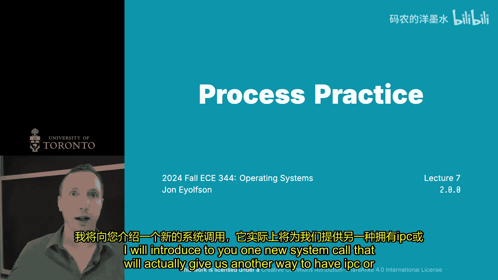
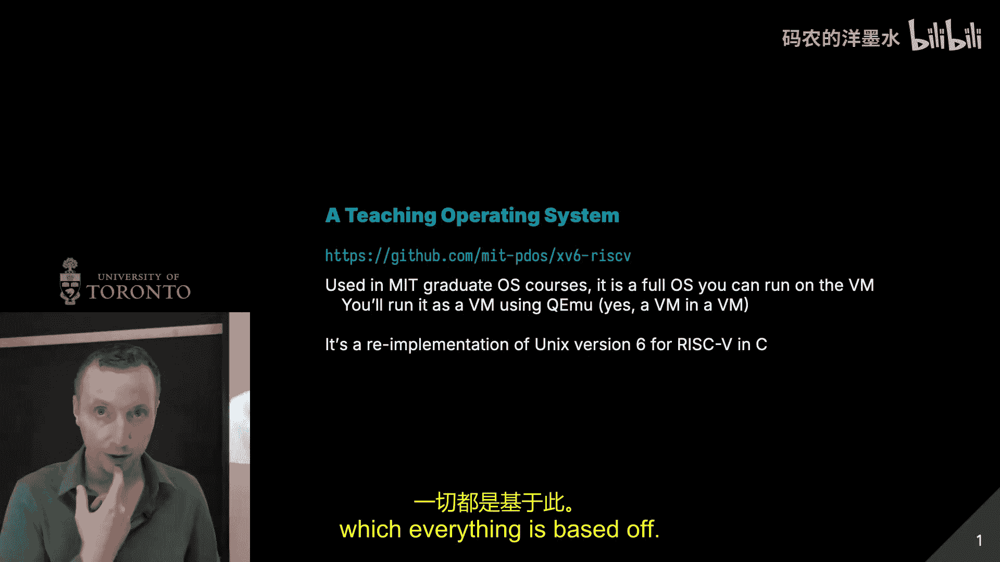
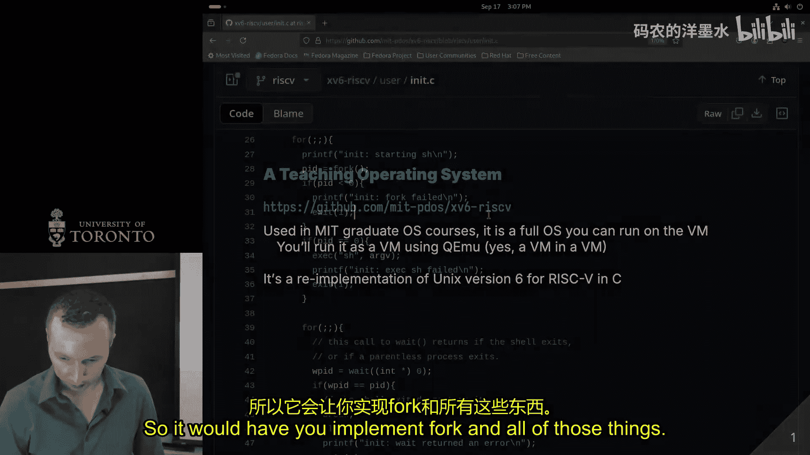
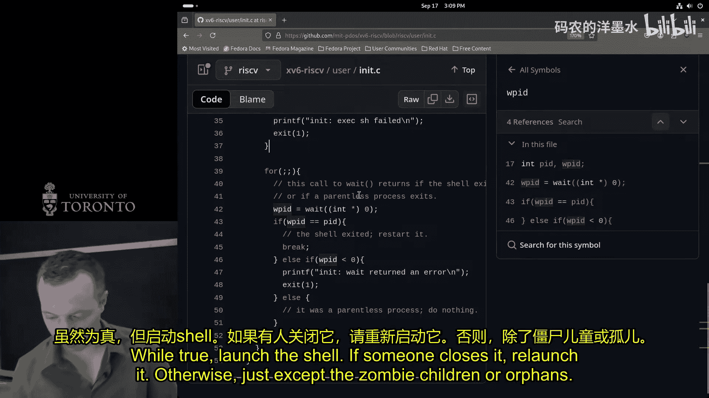
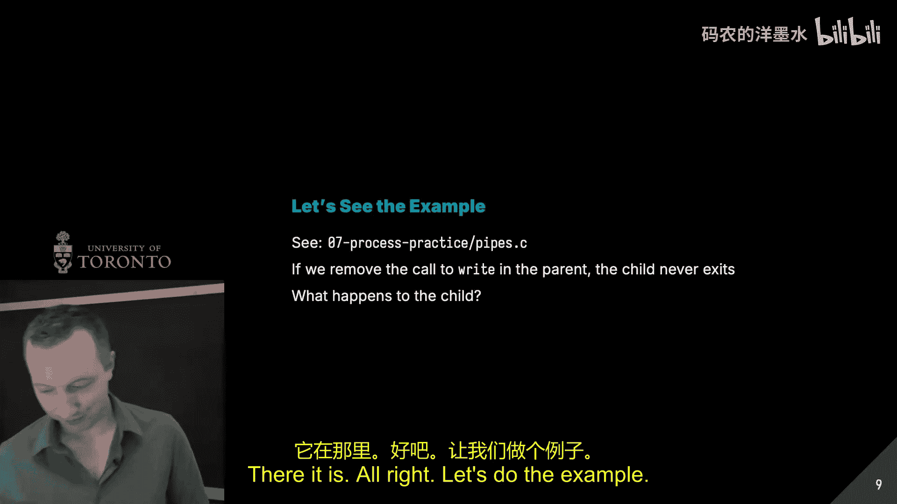
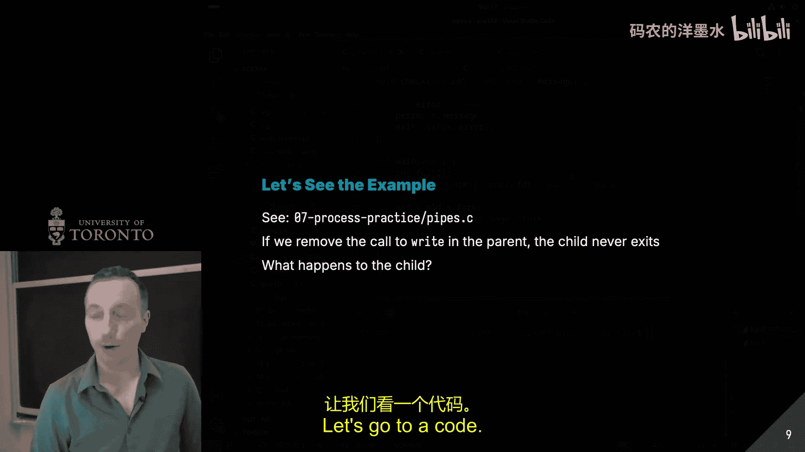
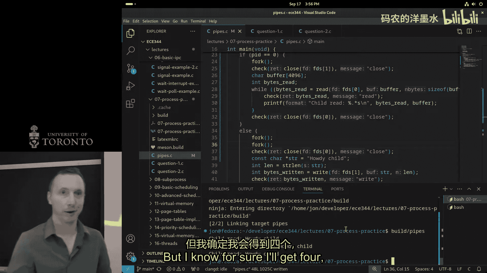

# 操作系统：第7讲：进程实践 🖥️







在本节课中，我们将通过实践来加深对进程的理解。我们已经学习了如何创建进程、如何等待进程，以及进程间通信（IPC）的基本概念。今天，我们将进行更多练习，并学习一个新的系统调用——`pipe`，它为我们提供了另一种进程间通信的方式。

## 操作系统内核简介



上一节我们介绍了进程的基本概念，本节中我们来看看一个真实操作系统内核的简单示例。如果你对编写操作系统内核感兴趣，可以了解一下MIT开发的xv6教学内核。它是一个完整的Unix操作系统内核，包含了我们在本课程中讨论的许多系统调用（如`fork`）的实现。通过阅读其代码，即使不深入实现细节，也能理解内核的基本工作原理。

以下是xv6内核中`init`进程（所有进程的祖先）的简化代码示例：

```c
int main(void) {
    while(1) {
        pid_t pid = fork();
        if(pid < 0) {
            // 创建进程失败，系统退出
            exit(1);
        }
        if(pid == 0) {
            // 子进程：启动shell
            exec("sh");
            // 如果exec失败，则退出
            exit(1);
        }
        // 父进程（init）：无限循环，等待并清理所有僵尸子进程
        while(1) {
            pid = wait();
            if(pid == -1) {
                // 等待出错
                exit(1);
            }
            if(pid == shell_pid) {
                // 如果shell进程退出，则跳出内层循环，重新启动一个shell
                break;
            }
            // 否则，只是清理了一个孤儿进程，继续等待
        }
    }
}
```

这个`init`进程的核心职责是：启动第一个用户shell，并在shell退出时重新启动它，同时充当“孤儿院”，回收所有僵尸子进程。

## 从单道到多道程序设计

早期的操作系统（如DOS）采用**单道程序设计**，即同一时间只能运行一个进程。这极大地限制了计算机的能力。

现代操作系统都采用**多道程序设计**，可以同时运行多个进程。操作系统的核心目标之一就是充分利用硬件（如多核CPU），让多个进程并行或并发执行。

## 进程调度与上下文切换

为了实现多道程序设计，操作系统内核中有一个称为**调度器**的组件。它负责决定在任一时刻哪个进程可以占用CPU运行。

在深入讨论调度算法之前，我们先了解进程切换的机制。其核心循环如下：



1.  **暂停当前进程**：剥夺当前进程的CPU使用权。
2.  **保存状态**：将当前进程的寄存器等状态保存起来，以便后续恢复。
3.  **选择下一个进程**：从调度器获取下一个要运行的进程。
4.  **恢复状态**：将下一个进程之前保存的状态（寄存器值）恢复到CPU中。
5.  **运行新进程**：将CPU控制权交给新进程。



这种保存一个进程状态并恢复另一个进程状态的操作，称为**上下文切换**。上下文切换是纯粹的系统开销，我们希望它越快越好。为了优化，内核可能会根据情况选择性地保存状态（例如，如果进程未使用浮点寄存器，则无需保存）。

关于控制权的移交方式，主要有两种：
*   **协作式多任务**：进程必须主动通过系统调用让出CPU。如果一个进程不这么做，它就可以独占CPU。
*   **抢占式多任务**（现代操作系统采用）：操作系统通过定时中断等方式强行夺回CPU控制权，暂停当前进程，并运行另一个进程。用户进程对此没有决定权。

## 管道（Pipe）系统调用

现在，让我们进入今天的核心内容——`pipe`系统调用，它是一种进程间通信（IPC）机制。

`pipe`系统调用用于创建一个**管道**。你可以将管道想象成一个由内核管理的内存缓冲区，它有一个读取端和一个写入端，数据从写入端流入，从读取端流出。

其函数原型如下：
```c
int pipe(int fds[2]);
```
*   `fds`：一个包含两个整数的数组。
*   **返回值**：成功返回0，失败返回-1并设置`errno`。

调用成功后，`pipe`会创建管道，并将两个**文件描述符**填入数组：
*   `fds[0]`：管道的**读取端**。使用`read`系统调用从这个文件描述符读取数据。
*   `fds[1]`：管道的**写入端**。使用`write`系统调用向这个文件描述符写入数据。

管道是**单向**的通信通道。写入管道的数据可以被另一个进程从管道的另一端读取。

## 实践：使用管道进行进程间通信

以下是一个完整的示例，演示父进程如何通过管道向子进程发送消息。

首先，我们定义一个辅助函数用于错误检查：
```c
void check(int retval, const char* msg) {
    if (retval == -1) {
        perror(msg);
        exit(1);
    }
}
```

主程序逻辑如下：

```c
#include <stdio.h>
#include <unistd.h>
#include <stdlib.h>
#include <string.h>

int main() {
    int fds[2]; // fds[0]用于读，fds[1]用于写
    check(pipe(fds), "pipe failed");

    pid_t pid = fork();
    check(pid, "fork failed");

    if (pid == 0) {
        // 子进程：负责读取数据
        close(fds[1]); // 子进程不写入，立即关闭写入端

        char buffer[128];
        ssize_t bytes_read;
        while ((bytes_read = read(fds[0], buffer, sizeof(buffer))) > 0) {
            printf("Child read: %.*s\n", (int)bytes_read, buffer);
        }
        close(fds[0]); // 读取完毕，关闭读取端
        exit(0);
    } else {
        // 父进程：负责写入数据
        close(fds[0]); // 父进程不读取，立即关闭读取端

        const char* msg = "Howdy child!";
        ssize_t bytes_written = write(fds[1], msg, strlen(msg));
        check(bytes_written, "write failed");

        close(fds[1]); // 写入完毕，关闭写入端
        wait(NULL); // 等待子进程结束
    }
    return 0;
}
```

**关键点与常见陷阱：**

1.  **管道应在`fork`之前创建**：这样父子进程才能共享指向同一个管道的文件描述符。如果在`fork`之后各自创建管道，则得到的是两个独立的管道，无法通信。
2.  **及时关闭未使用的文件描述符**：这是**极其重要**的实践。每个进程在使用完管道的一端后，应立即关闭它。这不仅能释放资源，更重要的是，它决定了`read`系统调用的行为。
    *   只有当管道的**所有写入端**都被关闭后，`read`调用才会返回0（表示“文件结束”，即没有更多数据可能到来）。如果写入端仍被某个进程（甚至是试图读取的进程自身）持有，`read`可能会一直阻塞等待。
    *   在上面的例子中，子进程关闭写入端，父进程写入后也关闭写入端，这样子进程的`read`在读完数据后就能顺利返回0并退出循环。
3.  **通信是字节流**：管道不保证消息边界。多次`write`的数据可能被一次`read`读取。应用层需要自己定义协议来区分消息。
4.  **并发顺序不确定**：当存在多个读写进程时，执行顺序由调度器决定，每次运行结果可能不同。例如，如果有两个子进程同时读取一个管道，数据可能被任意一个读走，输出顺序不确定。

## 一个有趣的“陷阱”

了解文件描述符后，你可以理解下面这个看似无害的程序的真实行为：

```c
#include <stdio.h>
#include <unistd.h>

int main() {
    close(1); // 关闭标准输出（文件描述符1）
    printf("Hello, world!\n"); // 这行输出将无处可去
    return 0;
}
```
`printf`默认向文件描述符1（标准输出）输出。关闭它后，`printf`会失败（虽然我们通常不检查其返回值），导致没有任何输出。这在调试时可能让人困惑。

## 总结



本节课中我们一起深入实践了进程操作：
*   我们回顾了操作系统内核（如xv6的`init`）如何管理进程生命周期。
*   我们理解了多道程序设计与进程调度的基础，以及**上下文切换**的概念。
*   我们重点学习了**`pipe`系统调用**，这是一种基于文件描述符的、单向的进程间通信机制。
*   我们编写了使用管道在父子进程间通信的程序，并强调了**及时关闭未使用文件描述符**这一关键最佳实践，以避免程序出现难以调试的阻塞或意外行为。
*   我们还看到了并发执行带来的不确定性，这是多进程/多线程编程的核心挑战之一。

通过结合`fork`、`exec`、`wait`和`pipe`，你已经掌握了在Unix/Linux系统上进行基本进程管理和进程间通信的强大工具集。