# 【全集】多伦多大学 操作系统 中英字幕 1080P p08 Lecture 8 - 子进程 -BV1Rbk7ByERc_p8-

这。Alrighty， welcome back to operating system。 So at the end of this lecture。

 you will have everything you need to do La too。 So this is purely demonstrative。

 So feel free to ask me to do anything。 and it'll cover all the same things we've been doing file descriptors。

 forking， Execing， all the fun stuff。😊，You'll have to do to create and manage processes。

 so we'll tie everything together today with a fun little example， although fun might be relative。

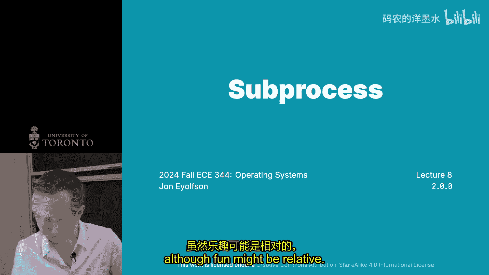

So here's our goal for today。We have one simple task， and it's pretty much。Very， very， very。

 very related to lab2， so we want to send and receive data from a process so what we are going to do today is we will create a new process that launches the command line argument we give it on the command line so we're going to have it spawn another run another program then we will send the string testing to that process to its standard in and then we'll receive any data that process write to standard out in the process that created it so we're going to have to accomplish that well one by creating a process and two we're going to communicate with it by using forks or sorry by using pipes so that is how we're going to do our communication channel to that process and we're going to have to play around with its file descriptors so that when it starts executing that other program。

It would read from the pipe and then write to another pipes， because remember。

 pipes are just one way communication channels。So we saw V Ex VE kind of sucks because it's a pain in the but to use because wall1 you have to create an array which kind of sucks and then you also have to do like user bin LS like you have to give it the entire path to the executable so kind of la to use so there's a more convenient wrapper for it thats the C standard library provides called Exec LP and this version of it takes as an argument just the file name itself。

 it will go ahead and find it for us on the file system。Details why is using an environment variable。

 but we don't have to care。 It's how every program our。

How it finds programs if you just type it on the command line anyways。 And then here。

 it's just a bunch of C strings as arguments。 and you give it null whenever you are done。And again。

 similarly to exact VE。Does not return if it's successful， otherwise， if it's successful。

 this process then runs that program that was given as an argument。If it fails。

 it returns negative one and。Probably something bad happened。

 or likely that file did not exist or something like that。Let's turn me down a little bit。

This more convenient saves us from having to create an array of strings and things like that。

 so we'll use that today and show an example of that。Our final APIs we need for the labs。

 We only really need Do 2。 So that's Dope and Do 2。

 And what this will do is create a new file descriptor that points to the same thing as the first argument there。

 that's called old file descriptor。 So it will always return a new file descriptor that points to the same thing as old file descriptor。

And。For the dupe version， it returns that new file descriptor as a number。

 If I want to control what the new file descriptor is， that's when I can use Dope 2。 So dope 2。

 I'm telling it to， hey。Take whatever old file descriptor points to and point this file descriptor to the exact same thing。

 So how that will work is if that file descriptor is already open。

 it will go ahead and close it forth us。 And it will also do it atomically。

 we don't really know what that word means。 But if we had multiple threads whenever we get there。

We could just， you know， close a file descriptor and then dope and it return the lowest number。

 but if we had multiple threads going on， we don't know the order of the dopes and something else might close before we open again or whatever easier just to use Doop 2 so you can make it point to whatever file descriptor you want so。

For this example， we'll use Dukepe 2 because it handles a whole bunch of conditions for us。

 and it's a lot easier to use。So with that， we just get decoding， so。

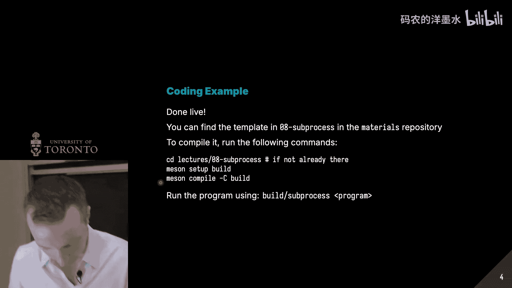

Before we start， any questions about oops。

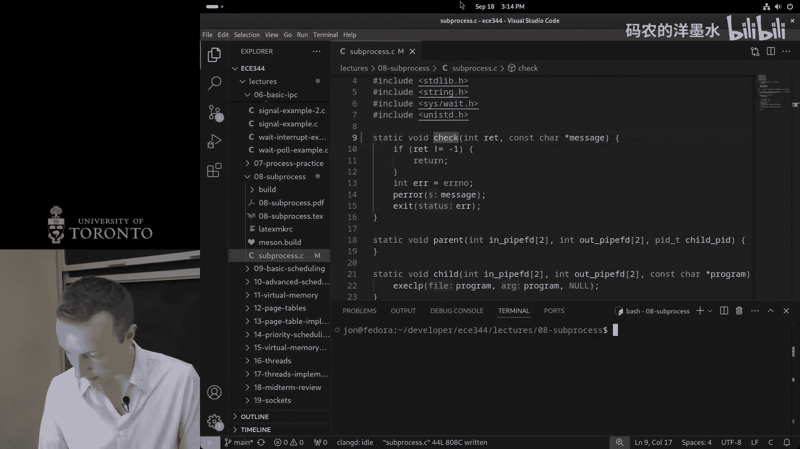

Any questions about our task today。Yeah。The power isn。

So the question is since the file descriptor is an int can I just assign another file to it。

 so the answer to that is no， it is just an int but it's stored in the process control block and the process and you just tell the kernel the number and it knows what it points to so just because you have the number doesn't mean you can create a new number that the kernel knows about and whatever that's supposed to point to。

Right， so if I have。Filed descriptor 1 that points to my terminal， I can't just magically。

 without doing a system call create， don know， file descriptor 5 that points to the same thing。

If I try and use file descriptor 5， the kernel is going be like， what's that？Yeah。

So it is just a number in your process， but the kernel is keeping track of what that means。

 So if you want a new one， you have to ask the kernel。Yeah。Dup2 oh sorry。

 Do 2 returns the same thing as do normal， just a file descriptor。

Like the new file descriptor number。 So in this case。

 it should return the same new file descriptor you asked for unless there's an error and it returns an negative 1。

But Duke 2 should return the new file descriptor， which is exactly what you asked for。

You know' justけ。Yeah。Let started。Yeah。Yeah， if it's not open。

 like if new file descriptor is not open， it doesn't exist， it'll just create it for you。

 So it doesn't have to close anything。 doesn't have to clean up anything。 It didn't exist。

 So it's free free for it to use。Yeah。

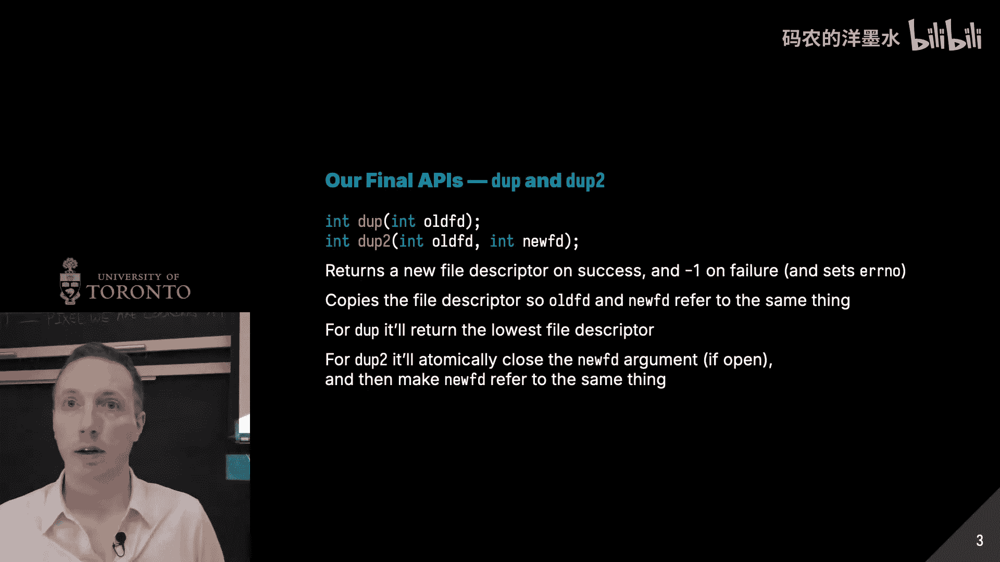

Z。All right。Let's get to coding。 So there's my fun check function that just。

 I Ill error check everywhere。 I don't want to write 10000 if statements。

 So I'll just write this thing that again， checks if the value is negative one， if it is。

 it'll print me my error message otherwise。😊，Otherwise。

 we'll just continue our program as if nothing happened。So here I will split that off a little bit。

So I already wrote some code just to save myself a bit of time。

 So I'm assuming I only have two arguments。 So the name of the program itself and then whatever we want to run in the new process。

I created， since we need two pipes。 I went ahead and created two in arrays for each pipe。

 I called them creatively an in pipe and an outpipe。 And if you haven't seen this equals。

Curly bracket，0， curly bracket。 That 0 initializes the whole array。 In this case， I don't have to。

 But if I write that after my array， I'm sure that the whole thing gets initialized to 0。

 So I've seen some of you have already had problems with this where you just create an array like and then。

You just use it。 And then sometimes your code assumes that it's zero initialized。

 which is not actually true unless you write equals curly bracket 0。

 So that0 initializes them In this case， it doesn't matter because if I do a pipe system called。

 it's going overwrite those values anyways。 But I like doing this to be safe and save myself a bit of headache。

And also just so I can tell you about it if you haven't seen it before。Alright， Otherwise。

 this program calls fork。So calls 4， hopefully， after creating two pipes， which I haven't done yet。

 And then it will check if the P I D， like the only difference is the return value fork。

This should be beat over your head in the new process。 Fork returns 0。

 and the child process would go ahead， create a variable called P ID， assign 0 to P ID。

 and then it would fall into this else branch， And I just separate it out。

 So it's a bit easier to read。 So it will just call this child function。

 which right now just does exec LP。And then the parent right now just does nothing。

 And I give it the process I D of the child。 just so I have it just in case。So。Right now。

 in the child， it just runs the program， which should be the second thing I write in the terminal。

 So any questions about the program as I have it right now。All right， so when I run this program。

Right now， if I do something like this。I see it just displaying Linux。

sSo if you haven't seen the U name program， the U name whenever you run it。

 it will just tell you the name of the operating system you're on。 If it's Linux， it'll say Uniix。

If any of you have Mac OS， a lot of you do and you type your name。What name you can。

See the name it tells you spoiler alert， it doesn't say MacOS。 it says Darwin。

 because that's the name of their kernel that you probably didn't know。 Fun fact anyways。

So any questions about how this program works right now。So we're all okay。Cause things are going get。

Strange ish soon。So just to be clear， right now， what is happening is let's draw out the processes and see how this even works。

 So say we had process 100 that was executing。

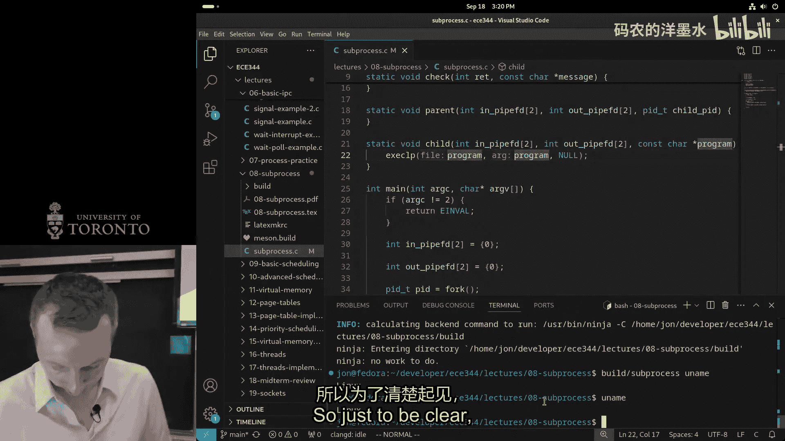

And I'll just draw out its file descriptors。 So here。Oh， it's going to do this again。

So that's the process。 The kernel's keeping track of all this information。

 those are all of its file descriptors。And originally， they're all pointing， I don't know。

 why does this only happened during the lecture。All right， can I write without my palm？Determinine。

So all of the standard file descriptors。0，1 and 2 are all pointing to the terminal， which is just。

Managed also by the kernel。 we don't really have to know the details about。

 We just know that it can send and receive bytes。So in our program， we forked。

 we created a new process， we created process 101。And it will be an exact copy of the parent at the time of the fork。

 So that process will also have file descriptor 0，1 and 2 open。

 and they will point to the same thing as the child。So in this case， this is what it looks like。

And that's why， well， when the child eventually exactec。So this one exact。LP， and when it exact LP。

 it just started running。 in this case， you name。And then that program just ran normally and inside that program。

 it essentially just had like a print F that just said Linux。

So that would have went to file descriptor1， and that's why we saw it on the terminal。

So everyone okay with that。Alright， so remember， we don't want it to print to the terminal。

 We want to be able to read whatever it outputs inside of process 100。

 whatever originally created it。 So how would we get it to read that？

 So it outputted let's see if I can draw a line。So essentially， when it output。

 it went through file descriptor1， and it wrote the string， wow， that looks bad。It wrote the string。

 Linux。So if I want to read。Hello， camera。 There we go。

 If I want to read that string Linux in process 100， what do I need to do。Yeah。

Do more abstractly before you get there，そ。Yeah， so if I want to read its data。

 one way I can do that is create a pipe between them。 So here's my beautiful drawing of a pipe。😊。

Boom， boom。You can tell why I'm in engineering， huh？It's beautiful pipe。Oh， that needs to Yeah。

 whatever。 Allright， so there is my pipe。 So if I want to read data from the pipe in the other process。

 what should， how I want it to work is that whenever this process 101。Okay。

 we're going to do that again。Whateverver this process 101 writes to file descriptor 1。

 So we're not going to change how you names implemented or anything。

 what it's going do is just print links to file descriptor 1。 We have no control about that。

 The only thing we have control about is what file descriptor 1 is before we do that exec。

 So we actually want file descriptor1 instead of point to the terminal to point to the right end of this inpipe。

 So I'll call it the inpipe。And then to get the data out of it。

 I want to just read it in file in process 101 doesn't need to be any standard file descriptors。

 It could be， I don't know，3 or something like that doesn't matter， right。All right。

 let's do that part first then， so this is reading information from that process。So。

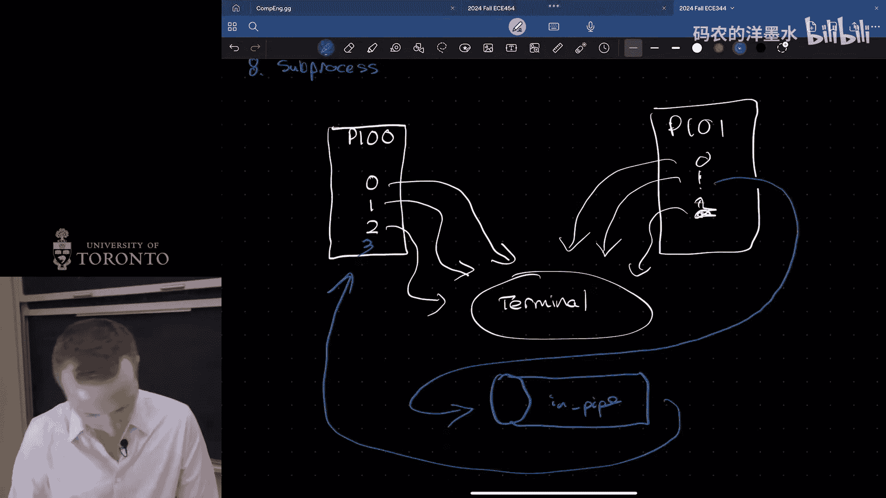

If I want to do that。Well， indeed to create a pipe before the fork， right。

 if I create after the fork。After the fork， the two processes are completely independent。

 I'd have two pipes。Not really going to help me。 I want one pipe。

 one process reads from it or writes to it。 The other process reads from it。 So I will check。Do pipe。

In pipe FD。Pippe is my error message。 So boom， now I have a pipe。

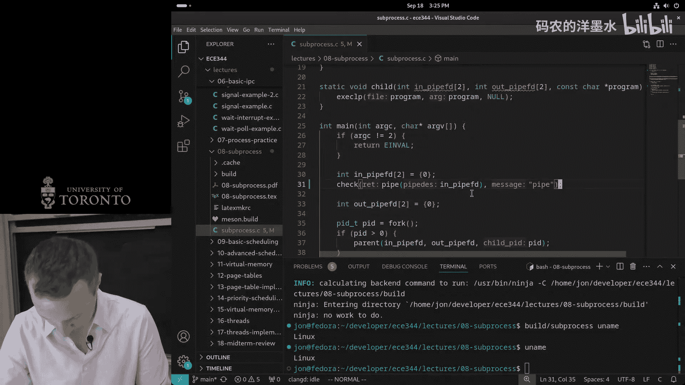

So going back。Let's see if I can draw this slightly better。So， let's restart again。So， now。

This is before the fork， so let's start with our normal process again， so we have process。100。

It has file descriptors 1 or sorry0，1 and 2。 those are all the standard file descriptors， right。

 Well assume they initially point to the terminal。 I won't draw what they point to just to save us a bit of time。

 And then we created a new pipe。That we called in pipepe。Now， in that process。

 just because we know how it assigns file descriptors， file descriptor 3。

Would be the read end of the pipe。 So it would point。Here。And then。Let's move that arrow。

So file descriptor 3 would be the read end of the pipe。

 and then file descriptor 4 would be the right end of the pipe。 everyone's okay with that。All right。

 so yep。01。Yeah， follow the scripture 01 and2， just point to the terminal。

 so right now I don't have to touch them， right？So。This is what happens after my fork call or sorry。

 before my fork call， after I create the pipe。 So everyone's okay with that。All right。

I create process。What I。Process 100。It would have file descriptors 0。

1 and 2 while pointing to the terminal。We'll fix that later。

 and it will also have file descriptor 3 and 4， which are in pipe。What I call it in pipepe FD。Zero。

 of course。My writing is usually not this bad， it's because I'm trying to hover。

So it would have all those and file descriptor 3 points to the same thing points to the read end of the pipe file descriptor 4。

Points to the right end of the pipe。Right。So now our goal is， well， if we want to capture the output。

If we want to capture the output of process 1，0，1， whenever it writes to file descriptor。1。

 what we want to do， right， is to。Make whatever file descriptor four points to。

 So file descriptor  four points to the right end of the pipe， right， So here I'll just do this。

The right。And this is the read。So file descriptor 4 points to the right end of the pipe。

 What I want to do if I want to capture its output is I also before I。Do the exact。

 I want actually file descriptor1 to point to the right end of the pipe， right。

 So that whenever it writes， data goes in the pipe， and I can read it。Right？

So we're going accomplish that with dope 2， and eventually。Whenever we're done with this。

 before we exact the process， if we just exact it after doing that， it would probably work。

 but it's generally considered rude to start running a new program with file descriptors open that are greater than the standard ones。

 So really what I want to do is before it runs I want to close these So I want to close these so that it doesn't have them。

 it only has file descriptors 0，1 and 2， And in this case。

0 would still point to the terminal 2 would still point to the terminal by want one to point to the right end of the pipe。

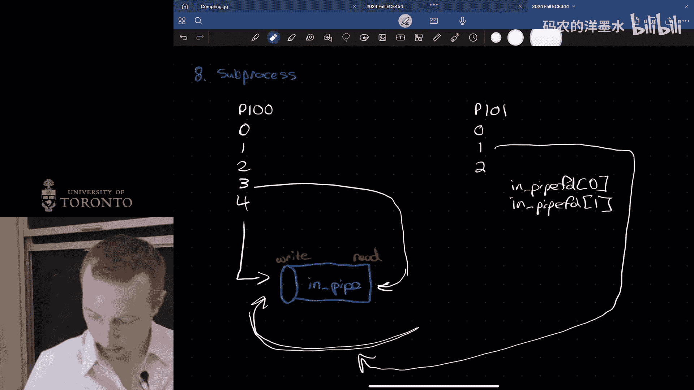

All right， so to do that。What system call do I use that we just learned about。D2， right， yay。

To do the first thing to move， to make sure file descriptor1 points to the right end of the pipe。

I would just do dupe 2。 oops， You can't see what I'm doing。 I would just do 2。

 So the right end of the pipe is in pipe F D 1。

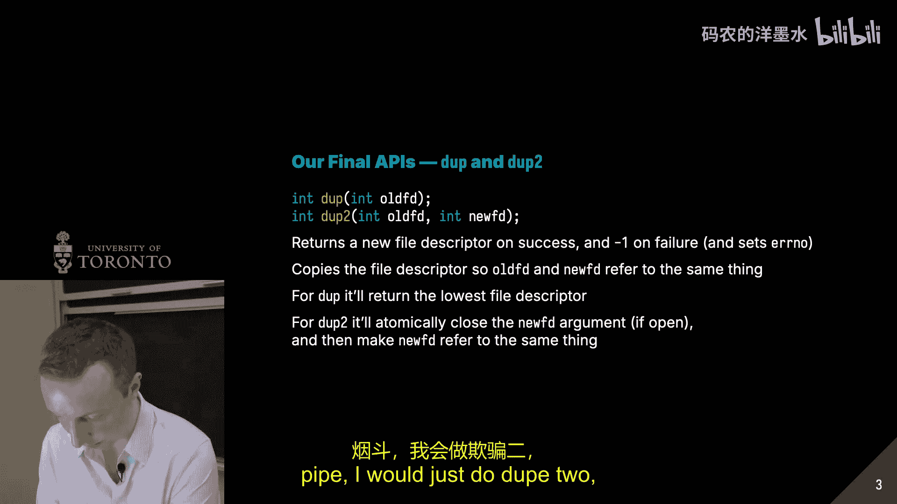

And I wanted to point to file descriptor 1 and file descriptor 1。At this point would be the terminal。

 it would close it。Yeah， it would be open， so it closes it。

 and then it makes file descriptor in this case，4 probably point to the same thing as or one point to the same thing as4。

 So now they're both pointing to the。Right end of the pipe。So， yeah。Yeah。

 and I should probably just do a check check error or my nice little check。

 So I like the way you think。 So always check。 and it's not called dip。All right。Is that good。

 should that work？if we can always execute things and see。So compile， you get some warnings。

 who cares， and let's have it run you name。 So now whenever I run it。I don't see anything。

Does it mean you name is not outputting anything？No， right。 It's going to the pipe。

 but I'm not reading it now。 So it just looks like it does nothing， but really， it's doing something。

 I just can't see what it's doing。 I we haven't read its data yet。So everyone okay so far。All right。

Iops， I forgot to do something。 What did I forget to do。Yeah。Yeah。

 I close the other file descriptors。 So now I don't need them， right。

 So file descriptor 1 points the same thing as the right end of the pipe。 Now。

 I want to make sure when this process actually starts running that I don't have anything open。

 So I need to close both ends of the pipe since I don't need to use those new numbers it gave me。

 which would probably be 3 and 4。 So I would close that。

Which I should probably check for errors just in case， just as a sanity thing。呃。Close。

And then close the other one。All right， everyone good with that， everyone agree with that。Alright。

 so that looks clean。 So that should be our child taken care of。

What about our parent that wants to read that data？What should I write here？Yeah。Duke 2。Pippe 50。

It says zero。Like that。No，你过需。So whenever I do pipe。

 that's just the way the pipe system call works is it creates two file descriptors。

One you you're only allowed to write to and one you're only supposed to read from。

That's just how it works。Yeah。Yeah， just。Read the data from it。 right， It wrote to it。

 I should just read the data from the pipe。 I could， yeah。

 du 2 and make my standard in equal to that。 But I don't have to。 I'll probably just。Generally。

 you just keep your standard file descriptors the same。

 I would highly recommend you keep the standard file descriptors the same unless you're trying to launch a child process and you need to mess with them a bit。

 So here all I need to do is just read from it。 So I'll just do the reading code just because it's slightly boring。

 So we just create a big old buffer。Int bys， red equals， we can just read。Oops。

So we want to read from the read end of the pipe， right， And it was called in pipe FD at0。

Then we just read into the buffer， size of buffer， all kind of code we've seen before。

 And then I'll just print off whatever I read。 So I read。Third。Sure。So I read。Bite thread。But for。

And it's called print F， not print。All right， so if I run this， what should I see？Linux， right， Well。

 if I write with you name。 So now it just says red Linux。 Oh， I don't need that extra new line。

So I'll get rid of it because it already includes a new line。So I run this。

 it just says it red Linux。But I read that from another process that was running， so。You could just。

 if you wanted output from another process to use in your process。

 you can just do something like this。 If you've ever used Python， there's a sub process module。

 and it does this， yeah。Oh， oh， I need to lower the screen。 Allright， don't fall。Is it following me？

不。Oh no， it got stuck。I'm too fast。哦哦。See if I can go rescue it。

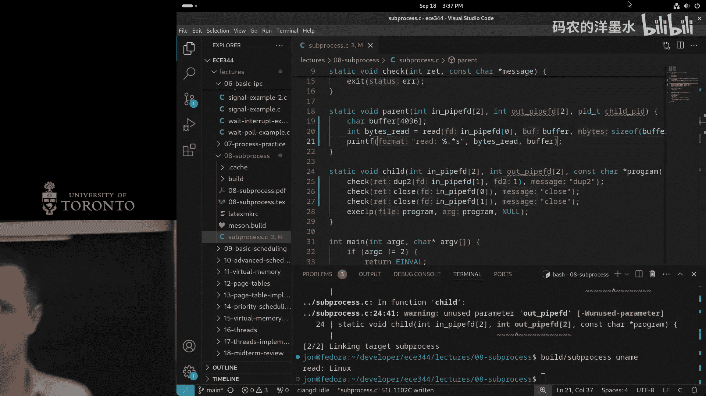

All right， we're good， all right， rescued。OhWhere was I？ Yeah， so this works now， right。Anyone oh， y。

I would like you to know like， why is there a yellow sign？Oh yeah， so one question。

 why is there yellow underlines here？These are warnings from the compilers that I just haven't used those variables yet。

 so the compiler is like， hey， you haven't used them。

You should probably just get rid of them if you're not intending to use them。

 We're going to use them eventually。 but they're just little warnings for now， y。

Why would I get free。If it's an issue。Did you ask。Oh yeah， Yeah， what's the issue。

Hopefully were still think if he can write him。yes， I should heed my own advice from before。

 Close the file descriptors as soon as you are sure you are not going to use them。 So in the parent。

 what is the file descriptor I should close immediately。One that zero。Oh， I heard a pipe FT。Yeah。

Yeah， close the right end of the pipe。 The parentss not using it only the child uses it。

 So I'll do a special。 Just ya it from here。Alright， so first thing I should do， close that。

What about the read end of the pipe， When should I close that。Yeah， after the print F。

Or right after the read doesnt matter doesn't matter they're both close enough。

 but I should technically close it there just so I don't have any issues。This case。

 I didn't have any issues， but。I could easily have issues where if I screw this up and say。

Because I could run any process as a subpro。 I could even run cat。 And if I run cat。

 bad things could happen because that has like the。

Just reading from standard in over and over and over again till you have end of file。

 if I don't close the right end， probably bad things will happen。嗯。Not really in the parent。

 but I don't close the right end And before I fork it bad things will happen。All right。

 so is this good？Okay， well， now we need the flip side of that。

 so we want to send data to the process。So。Let's go back to this。 Not that。 Not that。

 definitely not that。 So we want to send data to the process。 So to do that， we are going to create。

Okay， can I erase those lines， Is that fine， Okay， so all erase those lines。 I'll keep in pipe there。

Give me a bigger eraser。So， now。What's going to happen is let's rewind。

 So we're going to create a new pipe。Cold。Ell pipepe。Wow， my writing takes a noseive， doesn't it？

Alright， so it's going to have a right end。And a read and。And。Of course。

 I'm going to have to create it before I fork because I want to share it in both processes， likely。

When it opens， we would get filed to scriptor 5 and 6。5 would point to the read end。

And six would point to the right end。So whenever I fork process 1，01， Well。

 that would have file toscriptor 3 for。5 and 6 that all point to the same thing。 So 5 points to the。

Breed and6。Points to the right end。So before I exactec LP， what I want it to look like is。

I want all these file descriptors to be closed。And I want right now。

 how I have it set up is file descriptor 1 goes here， right。File descriptor 1 goes to the inpipe。

 and what I would want is that in process 101， its standard n goes to the read end of the pipe。

So it reads from the outpipe。And then。The process 100。

 the original parent process can go ahead and feed data into the pipe。

 and it should read it over its standard N。

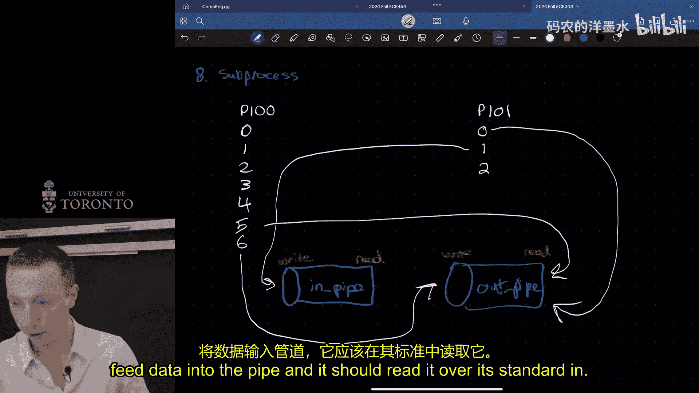

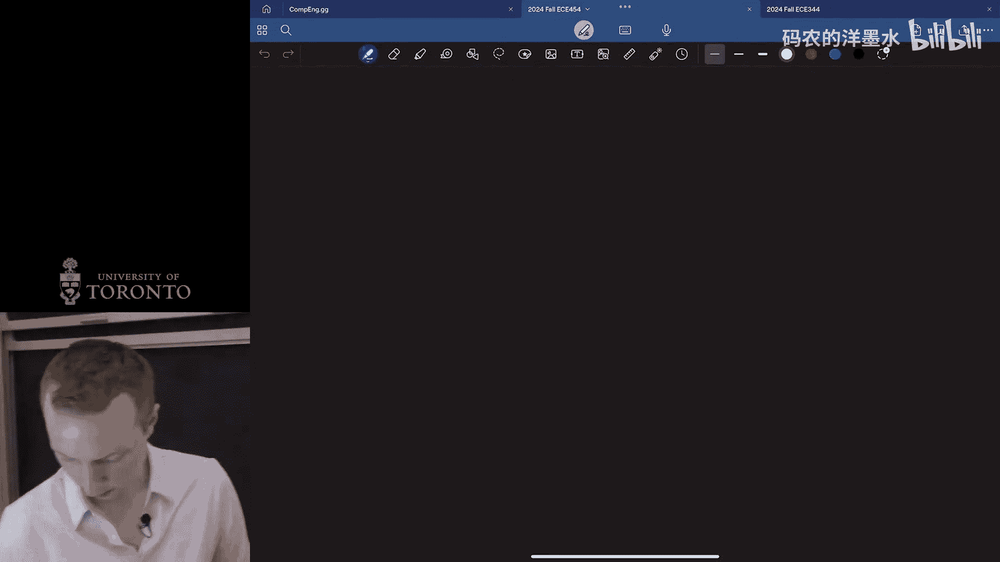

Whoa， that was hit the wrong button。All right。

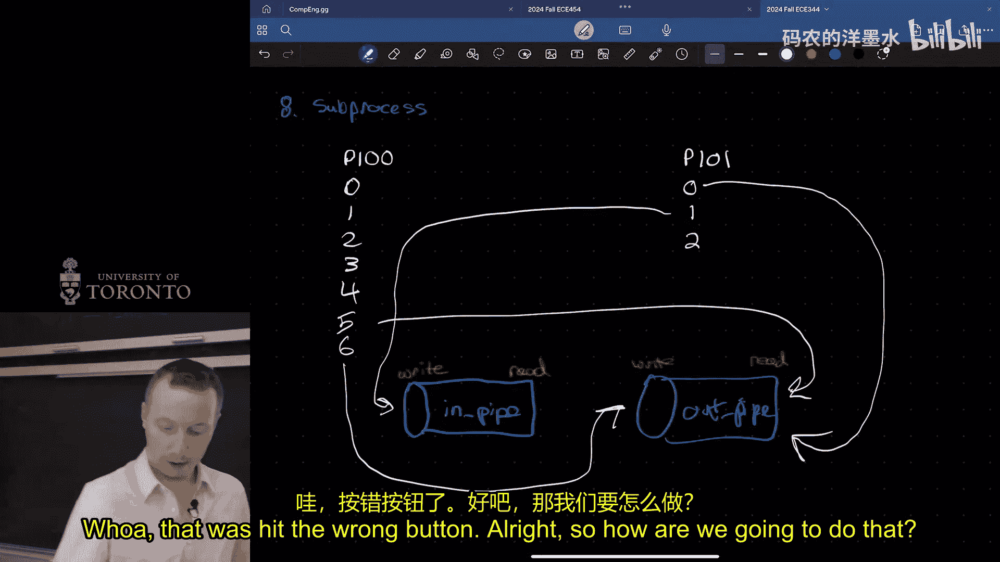

How are we going to do that？So we can start off with our favorite thing。

 so we can just copy and paste a bunch， thankfully。So here I'm just creating， instead of in。

 I'm calling it。So instead of in， I'm creating a new pipe called outpipe， right。

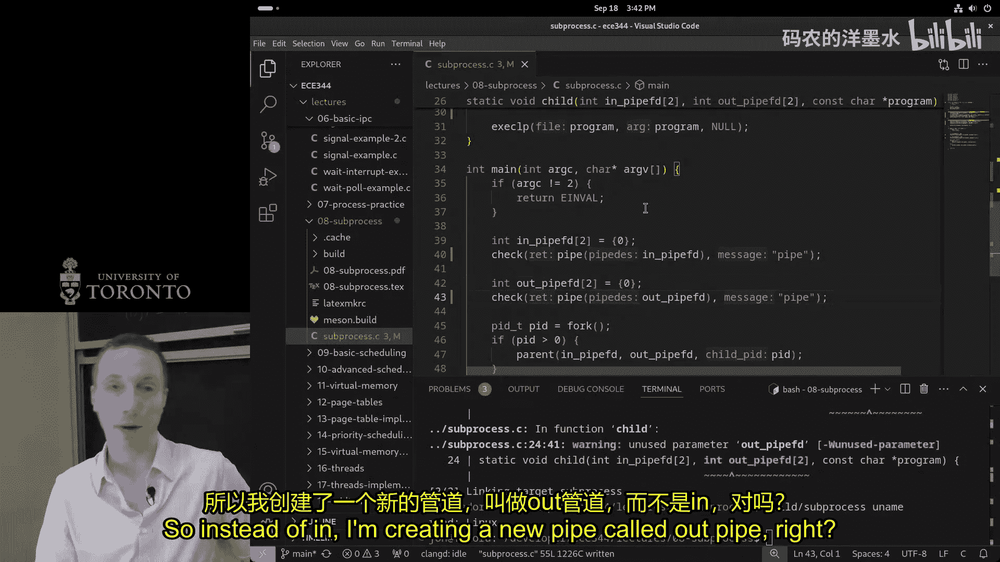

And then here。I'm essentially kind of doing the same thing。

 So what if I do the old computer science special， I just copy and paste。 I change in to out。

 Am I done。哦没。好。No， right。 I wanted the eppipe。So the outpipe I want。The child's process。

 standard file descriptor 0 or standard in to point to the read end of the pipe。

 And when I just copy and pasted my code， I made outpipes right end overwrote standard error again。

 So all I'd want to do to change this is just make the read end of the out pipe。

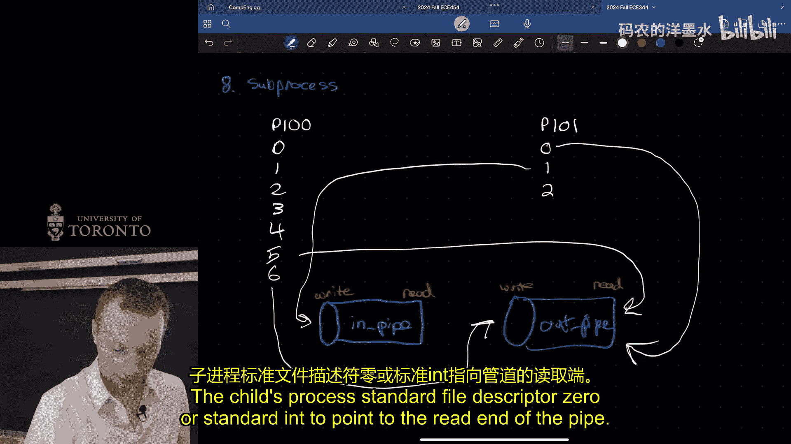

Also， point。Make standard error points of the same thing。 So before I exactec LP。

The standard in or file descriptor 0 is pointing to the read end of out pipe F D。

 And then we close all the other ones because we're good。 We want to make sure that。

Wever we exactec LP， only 0，1， and 2， those file descriptors are open。All right， so is this okay？

Alright， so let's try and send data to it。So let's。A Kant string。Oops。

 so let's send the string testing to it。With the new line。Get the length。

And then we can just write to it。 right， So write to out pipe FD， Which one do I want to write to。

Well， zero or one。One， right？Kind of easy way to remember this one is you can just think of them like the same standard file descriptors standard in you read from。

 So with the pipe FD at index 0， to read kind of acts the same as standard in。

1 is the one you write to， kind of acts like standard out。 So here we would write to one。

And then we could write string， length。And let's just do a bit of error checking。

 oh wet other we didn't check the error for the read。Innkle right， check。

And let's do a bit of error checking for this， too， whoops。

So I'll just add error checking for the read system call as well。All right， so that looks okay。

If I run。It with cat instead， what should happen now？Remember。

 CA is a program that just reads all of the data from Standard in and writes it all to standard out。

 yeah。Yeah， it should just return testing if I do this， right， but in a very roundabout way。

So how it should read the string testing from it standard in that I sent in the pipe and then write testing back out to its standard out。

 which goes into another pipe that I then read from。Roundabout way to get the message across， but。

It works。What did I， Well， in this case， I didn't really screw it up。What should I have done。

Close the file descriptors as soon as I know I don't need them。 So actually。

 I should move this one back up。And then I should close the read end of the outp pipe immediately。

 because I don't use it。And then right after I write to it， I should go ahead and close it as well。

I think that's our code。So， if I run that。It works。Now， knowing everything we know now， am I done。

So as part of being a good， like in the Python subpro， whenever it runs that command。

 it will also wait for it to finish and clean it up。 Have I been a responsible parent。No， so always。

 whenever we fork something， we have to make sure we are a responsible parent。

 So you have to keep that in your head now throughout this course。

 So if I want to be a responsible parent， what should I do。Yeah， I should wait PID conveniently。

 I know my child's process ID has passed in here。So。How I use weight， I could declare intW status。

I can initialize it to zero if I really want， doesn't really matter， and then I can just check。

Call weight PID。The PID of the child is thankfully just child PID。

 then we give it the address of W status and then zero for all the default options。

And then that would be our weight PID。So we're just going to wait for it to finish， clean up。

 make sure that when becomes a zombie whenever it terminates。

 that we go ahead and clean it up and we become a responsible parent and then I can write some asserts W if exited。

 so I'll make sure that it just exited normally and then I dont know I'll make whoops exit Sta。

I'll also make sure that it's exit status。So usually whenever a process exits， if there's no problem。

 it will set its exit status to 0 to indicate no errors。

 So I'll just go ahead and check that as well。 So now compile and run this。

Now this is fully functional， so I closed all the file descriptors whenever I was done using them。

I didn't create an orphan， I didn't create a zombie orphan whenever my process terminated。

I cleaned up all the file descriptors。I seem to do everything right。 So I think that's it。

 So any problems with this or everyone understand that or anything else I need to go through。

Buleller。No one， we're all good。You can use the other 10 minutes and just do La2 real quick。Yeah。Yes。

 sorry， scroll down to child。Because yeah， we could have screwed this up in a multitude of ways if we forgot to close the file descriptors and we ran cat。

 we might got into that thing where it looks like our program stuck hanging forever。 but really。

 we're just stuck in a read system call because we still had a right end open so we could do that。

 but in this case。Seems to work。We don't have any questions I'm here。For nine more。All right。

 this is a new record， so yeah。I guess we're done。 So yeah。

 just open up lab two if you understood this boom you're done， just do lab2。 All right。

 just remember， boom for you， we're on this together。 I will stick around。😊。

