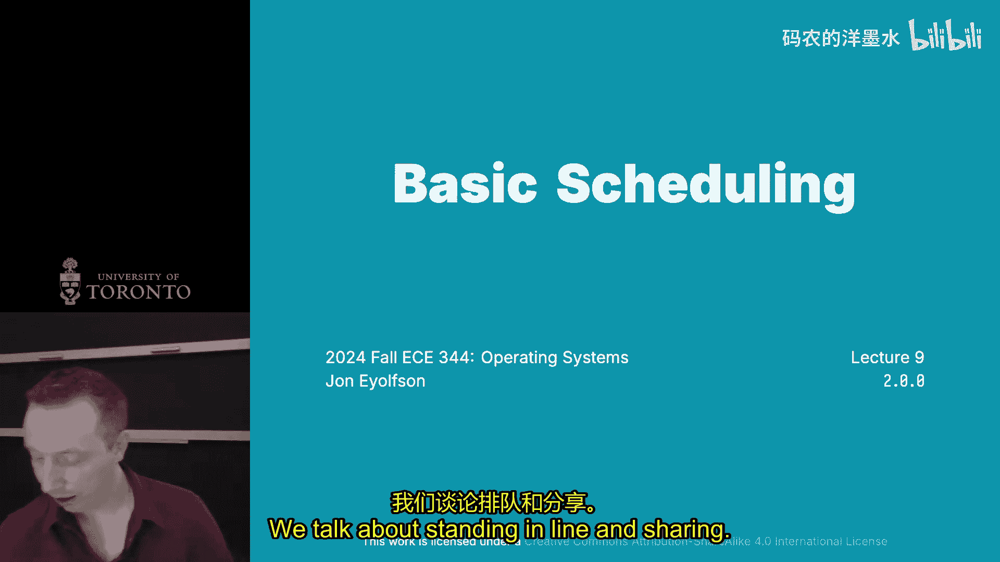
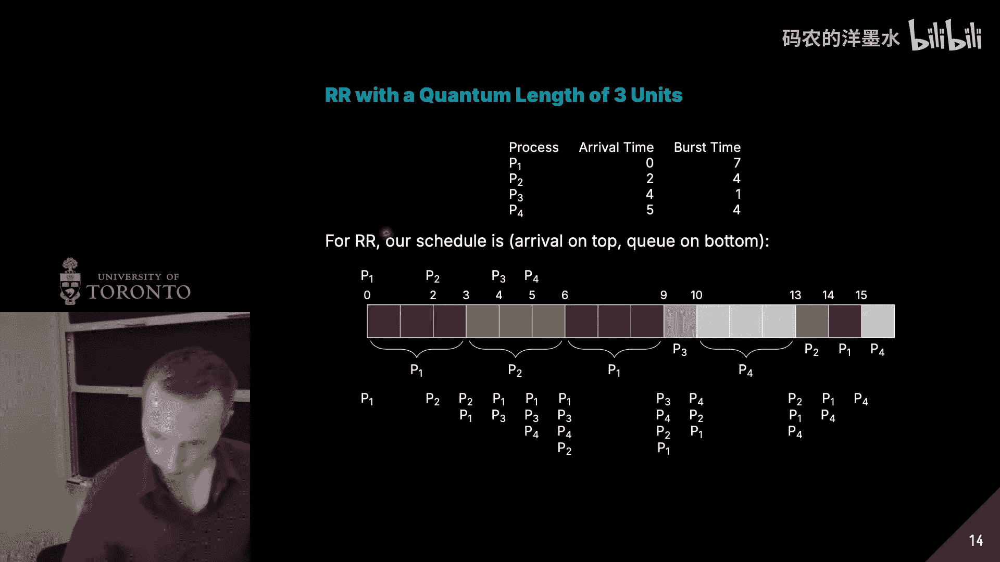
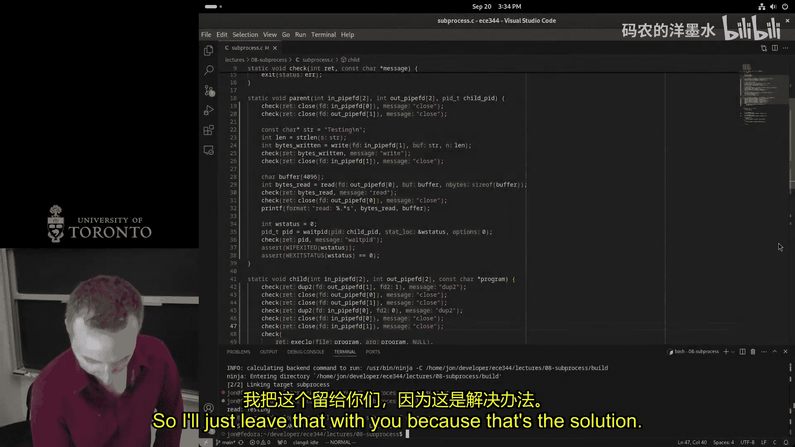
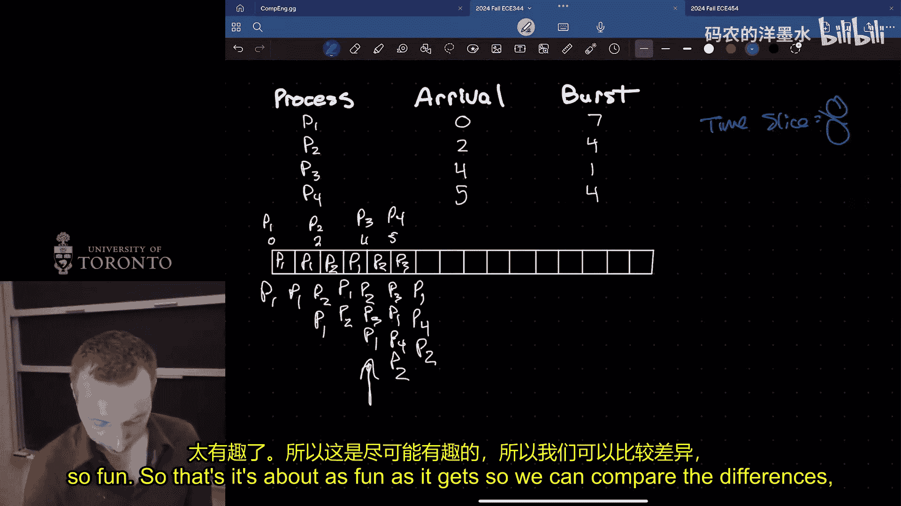
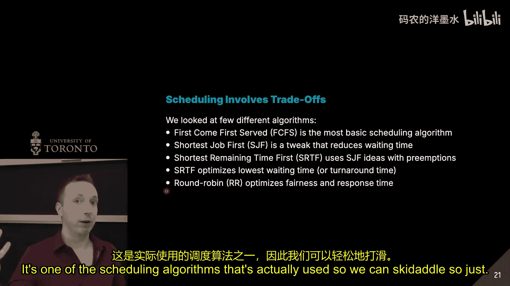

# 【全集】多伦多大学 操作系统 中英字幕 1080P p09 Lecture 9 - 基础调度 -BV1Rbk7ByERc_p9-

🎼Yeah。Alrighty， welcome back to operating Systems。So today， we get to take a。A breather。

So this is more of a standard lecture you're used to。No forking， no multiple things going on at once。

A nice， big， relaxing breath that kind of reset us。 and we should。If I bore you enough today。

 I will even end early as a。Great bonus。So。For now， we can forget。We can forget multiple processes。

 everything like that。 Today， we are talking about scheduling。

 So today gets as complicated as standing in line。 We've all stood in line before， and sharing。

Some of us are probably better at sharing than others。 but that's pretty much what we talked to。

Talk about today。 We talk about standing in line and sharing。

So before I get into that， some computer E terminology， if you've never heard this word before。

 there are resources。 Our operating system is managing resources， namely our CPU memory。

 things like that。 There are two major categories of resources。 One is called preempttable。

 and the other ones are nonpreempttable。 And what differentiates them is a preemptable resource can be taken away at any point and easily reused for something else。

 So， for example， your CPU， you can take it away from a process for another one， nice and easy。

 you can take it away from them without noticing They don't have to acknowledge or anything like that。

And resources that are preempttable。 you can share them through scheduling。

 so you figure out who gets to use that resource at what time Nopreempable resources cannot be taken away at any point of time without some sort of ament。

 So think of dis space， memory is also an example of that。

 So that resource is shared through allocating and delocating it and in parallel and distributed systems。

 you might not be used to this。 but you can actually allocate the CPU in some systems if you go on to work in very like high performance computing thing。

 But for now。CPUus will think of them as preempttable resources and memory。

 And this space would be non preempttable resources。

 You have to allocate them and then delocate them once you are done with them。So the dispatcher。

 which we talked about like actually doing that context switching， the scheduler work together。

 dispatcher that we talked about briefly was like that low level mechanism that is responsible for context switching or actually。

 you know， changing which process is currently running。 The scheduler is that high level policy。

 So that is responsible for deciding which process gets to run。

 And that's what we get to talk about today as a bit of a relief。

So the scheduler will run whenever the process changes of state。 So first。

 if we consider nonpreempttable processes， that means once we start them。

 they will execute until they are finished。 So just runs until it has completed。 So in this case。

 you know， we just can't take the CPU away from them， as soon as we make a decision。

 we have to run it until it's done。 So the decision the scheduler has to make is just which process to run when it's otherwise not running anything。

 So whatever a process terminates， then it has to make a decision， what's the next one to run。

 So if it was preemptive， that allows the operating system to just run the scheduler at will and take it away from a process even without it acknowledging and that has to do with what we talked about before。

 with our cooperative and like true multitasking。 So for now， this would be an example。

Of like cooperative， where they never give up the CPU。

 they just run it until their process completes。So if we talk about schedulers。

 we need to evaluate them somehow。 Luckiily， it's easy math today。 So there are four main metrics。

 Some of them are at odds with the other metrics。 But ideally， as part of our scheduler。

 we want to minimize waiting time and response time。

 So we don't want to have a process waiting too long or it takes too long for it to start。

If you've ever been and went and got food， you want your food quickly。

 You want your order to be complete。 You want to see someone to place your order and you want your order to be complete relatively quickly。

 So that's basically what that is。You also。Schedullers also want to maximize their CPU utilization。

 They don't want a CPU to sit around idle， not doing anything for a single CPU。

 which is all we'll talk about today。 That's pretty easy。

 But once we have multiple CPUs that might be somewhat hard。 It also wants to maximize throughput。

 So it should complete as many processes as possible in the shortest time frame。

 And we also want to be fair。 So we want to try to give each process the same percentage of the CPU。

 So this last criteria is at odds with the other ones。And we'll see that。

 So first scheduling is the easiest thing that you guys have encountered every single day in your life。

 and it is called first come first serve AK stand in line。

 and that is a perfectly good version of scheduling。 So the first process that arrives。

 it gets the CPU first。Processes are stored in FFF order。 So first in， first out， a queue， a line。

 whatever you want to think of it。 And it's just in a rival order。

 So whoever gets there first gets to execute next， it just goes in a line。

Should everyone O with that？ It's just a line， not complicated。I swear no tricks today。

So if we want to actually write out our schedule， we can use a gant chart。 And for example。

 I would write out， you know a table of processes。 So say I'm scheduling these four processes。

 So first column is just process name。 I'm creative。 I'll call them P1，2，3 and 4。

 And then arrival time is just whenever they want to run。 So initially。

 I'll just say they all start pretty much immediately at time 0。 I'll just use time units。

 So everything is a nice whole number。 because I don't want to have to deal with fractions today。

 that would just hurt my head。 And then burst time。Weird term， but it's a term actually used。

 That's how long that process actually wants to execute on a CPU4 before it is finished。

 So process 1 takes 7 time units to execute。 processs 2 takes four time units to execute。

 so on and so forth。 So if our arrival order， if we're told this。

If our arrival order is P1 arrives first and2 then three then4， if we use first come first serve。

 we can actually write out our scheduler where every block here is a singleton， so it would run for1。

2，3，4，5，6， seven time units， and then it is complete。

 so the scheduler would run again and has to figure out the next process to run。

Which one should it run after one's done。2， no trick questions today。 So two runs。 It runs for。

 We look up here。 It runs for four time units，1，2，3，4， And then it's done。

 Now we have to pick the next one to run。 What is it，3， Okay，3 runs。 So we runs for one time unit。

 and then it's done。 Then four runs。😊，For the next four units。 And now。To evaluate this。

 we can calculate the average waiting time。So the average waiting time is。

 how long was the process not running for from when it arrived till when it finished。

So the waiting time for process 1 is 0， right， It started at 0， and it ran immediately。

 So it didn't wait around at all。 It got seen immediately。 process 2， Well。

 it waited for 7 time units because it arrived at 0 and had to wait for process 1 to be done。

 And then process 3 weighted 11， process 4， weighted 12。

 So if I wanted to get the average waiting time。What math do I have to do to do that。

It'ss just 12 plus 11 plus 7 plus 0 divided by4， right？Take the average。

 So if we put all those numbers together， I don know， we get some number。 Who cares。

You can write it as a fraction if you want， so you'll get a question similar to this on the midterm。

Probably or one other type of easy type of question。

 So this should be good free marks if we understand things today。 So would be like， hey。

 what's the average waiting time。 So it's whatever 12 plus 11 plus 7 plus 0 divided by 4 is。

And we can calculate it with slightly different arrival times。 So it might vary quite a bit。

 So if I just say now， assume that。They all arrive at time 0， but to break the ties， we go process 3。

 then2， then 4， then one。 Then our scheduler would be， well， at time 0， we run process 3 first。

 it runs for one time unit， then we run process2 for4， then we when process 4 for four time units。

 And when we run process1 for the seven time units。

 So now if we calculate our average waitinging time now。

 it should be 0 plus 1 plus 5 plus 9 all divided by4。Everyone okay with that？

And this number will be significantly less than before， right， So nothing changed。

 except that I somewhat broke the ties。 So it should indicate to us that scheduling is actually kind of important。

 Making a good decision actually affects our average waiting time quite a bit。

So one thing we could do if we want to lower our average waiting time。

 That's provably the good thing to do is we could change our algorithm to do the shortest job first。

 So it is a slight tweet to first come first serve is you will always schedule the job with the shortest first time first。

 So if someone else joins the line that won't take as much time as someone else。 You bump them ahead。

 So the shortest job is always first line is essentially organized by job size。And at this point。

 we have no preemption。So。Now， I'll change the numbers a slight bit。

 So this is as complicated as it will get。 So we'll use this for the rest of the lecture。

 So I'll have these four processes。But now， instead of all arriving at time 0 and then telling you specifically how to break that tie。

 I will just tell you their arrival times and they'll all be different times。

 So on the little gantt chart， what I like to do， you can do whatever you want。

 is I typically like writing the arrival time right above the number just to make things easier。

 So process 1， that arrives here at time 0， process 2 arrives at time 2。

 process3 arrives at time 4 and process 4 arrives at time 5。 So。Its what Id like to do。

 Feel free to ignore me if you wish。So now if we do the shortest job first。

What's our schedule going to look like？Well， at time 0。The only process that arrives is process  one。

 So what do we have to run， We have to run process 1。 We have no other choice。

 It's the only thing available to run。We wouldn't make the choice to just be idle until the new process arrives or anything like that。

 Wed just run process 1。 And because we have no preemption， it would run for 7 time units， So 1，2，3。

4，5，6，7。While it was executing， all of the other processes arrived。

 and we would put them in FFfo order。 And if something was shorter， then we bump it ahead in line。

 so。Process 2 would be the first thing in our Q。 And then process 3 came in。 Oh， process 3。

 that only takes one second of execution time or burst time。 So it would go to the head of the line。

 So the line would be P3， then P2。 And then P4 finally arrived。 It had the same time as P2。

 So we would just put them in order and FiF order。 P2 came first。 So it would go P3， P2， P4。

 Everyone， okay with that。 Alright， so then the rest of our schedule would look like that。

 So after P1 is done， we do P1 or P3， sorry。Then after P3 is done， we do P2 for four time units。

 and then we do P4 for the last four time units。Now。

 if we want to calculate our average waiting time， we do the same thing again。Again， like I said。

 lecture， hopefully straightforward and boring， probably a good change from our previous lectures。

 So P3 average waiting time was 0， started， arrived at 0， started executing immediately。

 never was sitting around waiting for the CPU。Process 2， what was its waiting time。

It's also kind of on there。6， hopefully， right， it arrived at time 2 and didn't start executing to 8。

 I could either just do 8-2 to get 6。 That's how long I was waiting， or I can count the squares 1，2。

3，4，5，6。 So depends if you want to go fast or slow。 So you can， if you can do subtraction。

 that would be a plus。😊，And。Why we don't really need calculators。 math is pretty easy in this course。

 Thankly。 Allright， waiting time for P3。Well， that's just three time units。

 So it arrived here at time 4。 started executing at 7。 So it was waiting around 4，7-4。 Or we can。

 you know， count 1，2，3。 It's waiting around for 3。 Then finally， P 4 was waiting around for 7。

 If we take the average waiting time。 We get 4。Joy， isn't this fun。Everyone okay with that。有。No。

Fruit。4， oh，For。Oh， for P 4。 sorry， yeah， P 4 waits around for 7。Sorry。批复。No， that's fine。

 P 4 doesn't weigh around。 It should， right， P 4， it's waiting time。 It came in here at time 5。

 and that waited for 1，2，3，4，5，6，7。I said something wrong before。 I said 4。 Okay， I met 7。

 Who I wrote on the slides， right。Okay， hopefully I didn't have number dyslexia。All right， so。

With that。Shortest job first。 Okay， your operating system doesn't do that。 It's impractical。

 for several reasons。Prorovvably， you can actually prove that we'll produce minimize the average waiting time if we don't have preemptions。

But real operating systems， they don't know how long each process is going to execute for， right。

 We don't know the burst times of each process。 You could try and use the past to predict the future。

 throw AI into the mix or something like that。But it's not terribly realistic。

 and you may also starve long jobs and starving。 I don't know why we use these terms。

 but starving just means a process may never execute。 So if you have a really long running process。

 and then just a lot of very， very short running process。

 you are in a situation where that long running process may not ever execute。

So that's what starvation is。 It just means there's a scenario where a process might never execute。

So we can add preemptions so we can do a slight tweak where we do shortest remaining time first instead of shortest job first。

 So we're just going to change shortest job first。To add preemption so that if a shorter job comes in。

 we can kick out the current running process if the new process takes less time。

 So we're kind of kicking people out of line like the Disney Fastpass。

 we adding the Disney Fastpass into the mix。 So we're going to also assume minimum execution time one time unit。

 And this will also minimize the average waiting time。So what does that look like？

So same schedule as before。Process 1 comes in at time 0。 It's the only process to run。

 So that's the one we will run。 So it will run for two time units。 and then process 2 arrives。

So now the scheduler will run again and say， hey， new process。

 do you have a shorter remaining time left than what is currently executing。

So if P1 has executed for two time units， how much time does it have left to execute。5， right。

 So P 1 at that time instant has five time units left to execute。

 Thats its remaining time and process 2。 Well， it has four remaining time units。

 So we kick out process 1。 we say you。We'll leave you and we'll we'll kick you out for process 2。

 So process 2 then executes for two time units。Then process 3 arrives。

 How much time is left for process 2。2。Like I told you today， today is a nice relief， right。

 So process 3 comes in。 It only executes for one time unit。 There's two。😊。

Time units remaining for process 2。 So we kick out process 2 and replace it with process 3。

So process 3 executes for one time unit， and then it's done。 So process 4 arrives。So， at this point。

Everything that wants to execute is process 2 that has two time units left。

 Pros 1 has five time units left， and that new process 4 has four time units left。

So we're going to pick process 2。 It only has two time units left。

 It has the shortest remaining time。 So we pick it。It runs for its remaining two time units。

 And then the scheduler has to run again。 We have two processes to pick between process 4 and process 1。

Process 4 has four remaining。 Pros 1 has 5。 So we pick process 4， runs for4。

 and then we pick process 1。 It runs for the rest。That all right？Alright， so。

Here is where it gets tricky。The average waiting time， we can't just， while we actually。

Can subtractracice just a little harder。Our average waiting time， if we actually count it。

 we count the time from when it arrives and the total time。Until it finished that。

 it was spent not executing。 So for process 1， it was 9 time units， So 1，2，3，4，5，6，7，8，9。Whatever。

 and then for process two。It's total waiting time。 Well when it arrived。

 it started executing immediately。 So it wasn't waiting around for any time， then ran for two。

 And then it was waiting around for one time unit while pre P 3 executed， and then it finished。

So it was only waiting around for one time unit。 And then process 3。

 it started executing immediately。 its waiting time was 0。 And then for process 4。

 it was waiting around for only two time units。 So there's a little bit more overlapping。

 but we can still get our average waiting time。And if it had more complicated thing where it came and went。

 came and went。 Well， if we wanted to do the math， we could calculate its average waiting time by just getting the total time from when it finished to when it started。

 So in the case of process  one。It was totally around for 16 time units。And we know that it ran4 7。

 So 16-7， the remaining left is whatever it had to be waiting around for。

 So if you want to do math that way， you can get calculate the average waiting time like that。

 So it had to be waiting around for nine time units， yeah。Still start long。よプレゲな。Yeah， yeah。

 So this can still starve long long， long jobs。 Also。

 we can't really implement it because we don't know how long it runs， right。

 Whenever I run your code， I don't know if it has an infinite looper if you。Actually did something。

So we need to develop an algorithm that is fair， so。This is as hard as it gets today。

 So this is the sharing。 So one thing we could do is called round Robin。

 So this is where we start being fair and making sure we don't have starvation。

 So what the operating system does or can do is divide execution into time slices。😊。

They have fancy computer science words where they'll call time slices quantanta。

Don't ask me why an individual time slice。 if you use that fancy notation is a quantum。Time thing。

 I don't know。 You can use that term if you really w to be fancy。

 I just say time slice because I't know， I'm a bum or something。

 I don't know or an engineer whatever。 But same idea。

 the idea is fundamentally the same except there's time sharing now。 So you actually have to share。

 So still a Fi0 Q。 So first in first out， similar to first come first serve， except。If you are at。

The end of your time slice， if you're still running at the end of your quantum or time slice。

 then you get kicked out and you get added to the back of the queue。 So this is your turn is done。

 You go to the back of the line。 So are there going to be at any practical considerations for determining a quantum length。

 Like how long should that time slice be。So if it takes one time unit for me to physically switch between processes。

Should I switch off every one time unit？Probably not， right， otherwise。

I'm going to spend like half my time just doing the mechanics of switching。

 So I'm going to waste a lot of time。 and my offering system is going to be very。

 very slow and kind of suck。If my quantum length is。Infinite。Then it's first come first serve， right。

Which sucks。 So too small。 We're wasting too much time。 We're switching so often and too big。

 And it's just first come first serve。 And then we don't really have any fairness。

 So there are some practical considerations for when actually determining this quantum length or length of a time slice。

😊。

But let's just get into it。 So I'll just leave that with you because that's a solution。

 So we're going to do whoops。 That's not the right thing。

So we're going to do round Robin and our time slice。Is going to be three。So。

How the time slice of three works is if， you know， you're finished before your time slice。

 then the other process doesn't get screwed over。 It gets a full three units， otherwise。

You could actually kind of game， game the system and take most of the CPU time if you knew how to do that。

 So that's how it works。 So it's。As soon as you're picked to execute。

 you will execute for at most three time units until we do the algorithm again and figure out who runs。

 So first， let's put right， our processes arriving on the top。 So there is P1。

 we're gonna do this again。 All right， iPad。 whenever I do a lecture， we do that。All right。

 so then at time 2。P 2 arrives at time 4， P3 arrives。At time 5， P4 arrives。Hello， camera。Okay。

 we're going to be stuck。There we go。Alright， so we're doing round Robin。

 Our time slice is three time units。 What I also like to do is at the bottom。 I'll write the Q。

 So I don't forget what it is。 So at time 0， if I draw my Q， the only thing in it is P1， it arrived。

 I have nothing else to pick。To execute， right？So I would just schedule it to run for its three time units。

So。It can run for three time units。 No problem。 It's not done yet or anything like that。

 So we're all good with that。All right， so at time2， wall P2 was or wall P1 was executing。

Process 2 came in， so it would be at the head of the queue。Then at time 3。

 when process 3 was or when process1 was done executing， it got shoved to the back of the Q。

 So my Q at time 3 would look like this。 P2， then P1。

So what process should I schedule next to execute？P2， it's at the head of the line， right？So P2。

 it runs for four time units， so it would run for its three time units。So。At time 4， okay。

Let's not do that camera。So， at time 4。P2 was executing， so it would have been taken off the queue。

So P1 would have been promoted to the start of the Q， and then P 3。Started。

 so it would go to the back of the Q。 It's fifo order。 So we would have P1， P3。Like that at time4。

 but P2 is still executing。Then at time 5， when P 4 comes in， it just goes to the back of the Q。

 So R Q looks like that。Everyone okay K with that。 I didn't screw up anything。Alright。

 so now at time 6， when P2 is done， it shove to the back of the Q。 and our Q looks like P1， P3， P4。

 P。2。So what process should I schedule to run next。P1， it's at the front of the Q。

 So can' it run for the full time3， it's。Full time place， without finishing。Yes， it runs for 7。

 It ran for three， So it's got four left， so it can run for its full time slice。 So P3 or P1， sorry。

 P run runs for three time units。So it still has time left。 So it would just go to the back of the Q。

 So my Q would look like P3， P4， P2， P1。All right， what gets gets scheduled next？P 3。

 how long does it run for。Uo， right。 So it just runs for one time unit， and then it's done。

 Then my Q looks like P4， whoops， P4， P2， P1。So what runs next。P4， right。

 even though my writings terrible。So P 4 runs。 Can it run for its full allotted time。Yeah。

 so we can run it for its three time units， P4， P4， P4， then our Q looks like P2， P1， P4。

So what do we schedule next？P 2， it's the next one。 It only has one time unit remaining。

 So it would just go P 2。Then our Q looks like P1， P4。Then P1 would run。

 it only has one time unit left and then it's done， and now P4 is the last thing left。

 so it would run P4 so that would be our schedule。So everyone okay with that。Allright。

 now we get to do our。Average waiting。So what's our average waiting time here？So how long did？

Process one， weight4。And here， I can write some time units here， so。15，16。14。13。

Kind of chicken scratch rating。But we can do the quick little math trick。So P1。

 it finished at time 15， right and got cud at time 0。 So it was hanging around for 15 time units。

 and we know it ran for 7。Sorry， it's 15 time minutes。Yeah， sorry，15。

 it was hanging around for 15 time units， and we knew it executed for 7。

 So how long must have been waiting around for。8，15-7。 So it was waiting around 4，8。

 or you could just count the boxes， which is kind of difficult with my chickens graduating。

How long was process2 waiting around for。ま。Yeah， so process two it fish at time 14。

And it got queued here at time2。So it started at time two and it finished at time 14。

 so it was hanging around for 12 units in total。And it executed for four。 Therefore。

 its waiting time must have been eight。So we could also just calculate。

 look count the number of boxes you want that。It wasn't executing for whenever it started。

 So that would have been one。Two， three， four， five。Whoa， six。7，8。Same thing。

 just a lot quicker than to count boxes， especially if you have to do this on an exam， cough， cough。

Might be easier just to do some subtraction。And that's and that's also why you get a non programmable calculator。

 if you really want help to do some subtraction。Alright， if we go through this。

 if we do that waiting time for the rest of the processes， Can I just skip it。Alright， good。

 So I'll just skip it 5 and 7 for process 3 and process 4。 And then if we divide by 4。

 we get an average waitinging time of 7。The other thing that you would probably be asked to calculate is the average whoops。

 average response。So how you get the response time of a process is response time is。

The time from when it arrived to when it first started executing。 So it's kind of， you know。

How quickly did it take so it could run a single instruction， get acknowledged。Until it ran。

 So that's a bit easier to find。 So for process one。Well， it ran immediately。 So its average。

 its response time was 0。 process 2。 It arrived at time 2。

And it didn't start executing until one time unit after that because P1 was kind of still hogging the CPU。

 so it was waiting around for one time unit。 P3， well。

 turns out that it's going to be the same as its waiting time so it arrived at time4。

 and then it waited around for1，2，3，4，5 until it started executing so it response time。Was5。

 And then for， for process 4， it was also 5 just to skip a step。So we got average wait time of。2。75。

 something like that。So the other metric we pay attention to， whenever we。

Do scheduling is we also count the number of context switches。

 So we count the number of times we have changed from one process to another。

 So I like doing that by just putting a thick line between them doesn't have to be read。

 I'll use red。 But we have a switch here between process  one and process 2。

Sw here between process two and process one。A switch woolly crab。

A switch here between process1 and process three。Switch here between process 3 and process 4。

 Sw here between process 4 and 2， and then switch here， switch here。

So to count the number of context switches。In this case， we count the number of red lines。

 How many context switches do we have。7even， right。So we just count7。

 So those are our main metrics we want。We want average waiting time。

 average response time and number of context switches， just in case it matters。All right。

 So was that fun， everyone。Alright， everyone had a absolute blast。So。You want to do the same thing。

 but now。有。Ford bill。I'm wondering which one we if I use。At the same time。ととです。Yeah， so the question。

 if you're requeing something and you have a new process come in， what should we pick？So let's。

 we'll answer that。 and we'll start our next example。 So here。

 I want to do the same thing again with the time slice as one。That should be fun， right。Well。

 we'll do it up to the tie。 And then you can tell me if you get bored because it should be the same thing just。

More steps。Again， I like to write the Q at the bottom at time 0， right， P1 starts at time 2。

 P2 starts。At time 4。P3 starts。Time 5， P4 starts。So our Q， Jesus。Our Q at time 0。 Well。

 the only thing in it would be P1。So that's what we have to execute， right？

So it's one unit time place， and then it gets recusd again。Right nothing else is in the queue。

 so just get3 queued。 We're just going to have to write this a lot。And then it executes again。 Now。

 this is the only thing that gets somewhat interesting。

P 2 is arriving at the exact same time that we are requeing P1。 So that's kind of a tie。

 We don't know what one to pick。Any ideas which one we should pick？Doesn't matter。Yeah。P1， Y P1。Yeah。

 just have the other one continue waiting， so。We could pick either。 it won't affect the waiting time。

 the average waiting time， really。But。Our choice actually matters for the average response time。

So if you want to think about what and reason about what you want to do a tie， just think。

 what would the best thing to be for average response time。So in this case。

 we're requeing a process that already ran。 and a brand new process is coming in。

 So we should always prefer the new process in a in。The event of this tie。

 So we should actually Q P2 first instead of P1。That's about the only exciting thing。 So now， right。

 P 1 or P2 executes for its one time unit。 It gets re cud。So then we have P2 or P1。P2， that's it。

 So we execute P1。If we are executing P1， the only thing in our Q is P2。

 So the new process doesn't get to skip over something that is already in the Q。

 So P3 won't skip over P2 because it was already patiently waiting in line whenever it arrived。

 So P2。Keeps on being there。 But now our tie is between requeing P1 again and P3 coming in。

 So we'd prefer P3 ahead of P2 or P1。 Sorry， So our queue would look like this。Shall I continue。

Or do we get the point。Yeah。Over to。把事。Yeah， so the question is。

 is it possible for two processes to be scheduled at the exact same time？Realistically。

Possibly because we have multiple CPUs。 But for this， we won't worry about it for now。

 So we won't consider that as a possibility just one process at a time。 Yeah。Timeight， do take P3 or。

So for the next time place， yeah， let's do another step just to make sure。 So this is our Q。

 So we pick P2 because it's at the head of our Q。So if it's currently running。

It would get tied with P4 coming in and P2 executing。So we wouldn't pass over P3 or P1。

 They're already in the queue。 They're patiently waiting in line。

 Our tie again is between P4 and requeing P2。 So we would prefer P4 over P2。

So it would look like this。Right。And then we're just gonna have things bounce back and forth。 So P3。

Only takes one time unit， so it would execute there。 And then our Q bounces between。1，4， and。1，4。

 and 2 in that order until they're done。 now， since nothing else comes in。Right， I can just。

Bounce between them until they're done。 If I want to make it faster。 But we're all good with this。

Alright， so if I changed it， so。My time slice was， I don't know，8。We could do this again。

 but it look like first come first serve we started out at because the time place is now longer than any running process。

 So yeah， it'll be first come first serve again。 So fun。 So that's it's about as fun as it gets。

 So we can compare the differences。😊。

So， you know， if we use one time unit， we can kind of see the trade off here。

The number of context switches we have goes to 14。 So we have doubled the amount of context switches。

 as we had before when we had a three quantum length。The average waiting time went down a little bit。

 but our response time got much better because we're switching more often。 So now we got down to 。75。

 which is pretty good。😊，And then if we did the quantum length of 10 units and did the whole thing and then recalculate it again。

 we'll see our trade off。 We have less context switches and our waiting time or response time。

Got slightly worse。 So it's got the same It first come， first serve。So， yay， we can end early。

 So I'll just say a few more words， and then we can saddle。

 So the round robin performs depends on the quantum length and the job length。

 So typically round Robbin has， it's like a real scheduling algorithm that's used in some operating systems and sometimes in Linux。

Has， its trade offs。 It has a good， low response time， good error activity。 So， you know。

 if it was drying your user interface， you're good， yeah。😊，Sorry。So in this case。

 we're assuming we can take the CPU away from any process at any time。 So yeah， it can't。It can't。

 It has no say in the matter。But yeah。The thing about round robin is your performance。

 It's gonna to be dictated by that quantum length， too high。

 It becomes first come first serve too low。 there's two main context switches。

 which is just overhead。 In general， round Robbin has poor average waitinging time when the jobs have similar length。

 So you can just simulate it over and over again to see。 But that's kind of。Scheduling。

No right answer， which is both a good thing and a bad thing。 It's all trade offs。Today。

 we saw a bunch of scheduling algorithms first come first serve shortest job first。

 So that was no preemptions。 and we added preemptions。 We got shortest remaining job first。

Then we said， hey， that's not realistic and it's not fair。 Then we introduced around Robin。

 that optimizes fairness and response time。It's one of the suling algorithms that's actually used。

 so we can s outto。

