# 【全集】多伦多大学 操作系统 中英字幕 1080P p10 Lecture 10 - 虚拟内存 -BV1Rbk7ByERc_p10-

Allrighty， welcome back to operating System。Our next fun topic is virtual memory。So。It'Call reset。

Take a nice， big， deep breath and get ready for this。So this will be our next hardest topic。

 Hopefully I've done enough times that will get easier， but let's see。

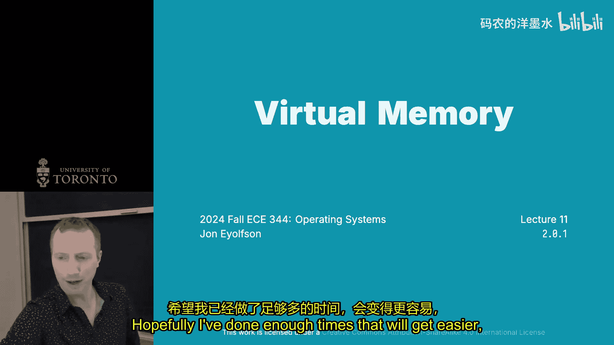

So。Remember， we've argued that virtual memory exists。

 and there is some way to map a virtual address or virtual memory to a physical address or physical memory。

 so。😊。

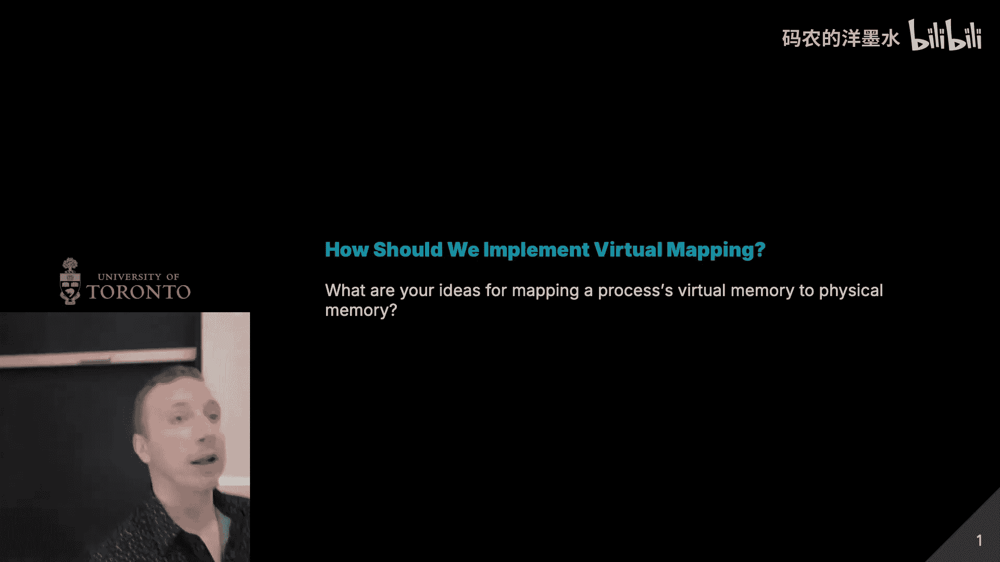

Let's think， how would we do this， How do we get from a virtual address to a physical address。

Anyone have any ideas how you would do this， if you were tasked to do this problem？第二。Oh， sorry。

 behind you first， yeah yeah。A pointer to it。 So like， how would you keep track， Let's say。

 I don't know， let's make up some address， like virtual address。1000 goes to physical address。

 I don't know， whoops， Jesusez。Goes to physical address。 I don't know。7000。

Maybe there's like some fun。So some function。 But how would you actually implement that function。

 How would you。Yeah， I guess maybe have a chunk of memory that。Store the function。 and that stored。

 So all I want to do is translate 1000 to 7000。 Yeah， it will will be like because you're gonna have。

Or detailed the process。ome virtual memory。Don't worry about for each of the processes having its own virtual memory right now。

 which is true， but just how to get from a virtual address to a physical address。Yeah。

Their addresses， So maybe。Yeah， that's an idea。 Maybe I just figure out that that's like 6000 different。

 So just add 6000。 But what about if in that same process， it has virtual address 2000。

 and you want that to map to， I don't know， address。 It's gonna be a thing again。 address。

 I don't know，3000。So now I can't just do take the， take the virtual address and add 6000 to it。

 right， if I。So what's something else we could do。Some of you have done this before， right。Yeah。

A hash map or something that would do our look up step， right， So I could have like， this is my。

 I could have， you know， hashmap。 This is my key。This is my value， something like that。

That would theoretically work， but it wastes a lot of space becauseuse remember。

 memory bite addressable。 So like， maybe I have the address 7001， and then。You know。

 maybe the address，1001 should also map to 7000。 That's the terrible 7。But。

Each of those need its own entry in the hash mapap， right？And then， well。This。

Like the difference between these and physical memory is just one by difference， right。

 But to store just a translation for a single byte， Let's assume I have a 64 B address。

 How many bys is my address。How many bits are in a bite？哦哦哦。8， right， what 64 divide by 8。8。

 so each address is 8 B。So hash table might work， but it seems a bit wasteful that for every single bite of memory I use。

 well， that's just what the key size would be， right， so。That's the key size。

 So I'd also need another 8 by for the value。 So that means for every one by of memory。

 I need 16 by to keep track of what it maps to， which means suddenly you would be wasting so much of your Ram just in accounting。

 yeah。They use a hashing culture instead。Hashing functions of。あ会啊。But I have some function。せも。

something。They always not。Yeah， we're going to have to do some transform Yeah。

 we do something like we did。有啊。And we could divide the address。Thank you。

It indicate the point of it in the actual address。系变位。How we through the translations。Yeah。Yeah。

 we could have like a translation function or kind of a broad lookup function。

 depending on what it is， that's actually one of the first ideas yet。Takeま。Just use the same address。

 So like。Yeah， if it virtual address 1 thousand00。Or 7000。 Thats physical address，7000。So， I mean。

 that'd be an easy way to translate。 I don't have to translate anything。

 But then what about if I have two processes that each use the address 7000。

Then they both mapped the physical 7000 right， and then they're sharing memory and not independent。

 So close， you're thinking fast though。 So I like that。Also， yeah， for。

 also for people who said like a hash。Map。hash maps are just a rays， right。

h hashraps are literally just a raises。But you use the hash function to come up with the index。

To index into that array， because the domain is so huge。 So that's。If you think of hash maps。

Just think of arrays first and whether or not you actually need a whole hashmap or whether or not an array could be okay。

So， these ideas。Fairly good ideas。 It'll lead us into our first one。

 then we'll kind of refine this a little bit， because。

Having 16 B just to translate a single by of information， yeah if。

If you got a brand new computer with 16 gigs of Ram。

 and then I told you you can use less than a gig of that for Chrome。

 can you actually use your Internet browser。Probably not。So。

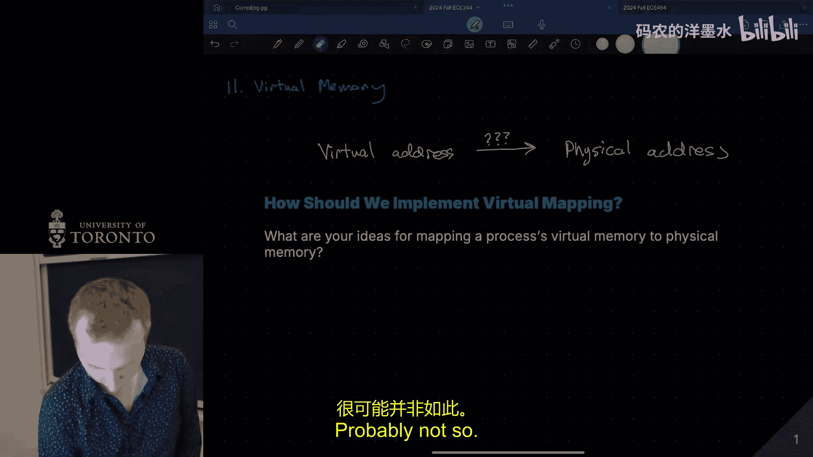

We'll also keep in mind a checklist for things we want for virtual memory。

 So we want multiple processes to coexist。We also want processes to make sure they're not aware they're actually sharing physical memory。

 so one process shouldn't be aware of any other process， if it could read。

 memory and read your banking information from another process。

 that's a giant security risk and you don't want that to happen。So that's why processes， right。

 they shouldn't be allowed to access each other's data unless you explicitly allow that。

 so that's another way to do inter processed communication， to share memory between processes。

 which we will get into much later because it tends to be complicated。Also。

 the big one is we want good performance。About the same as using physical memory， right。

 assume we add that hash function。 That means for every bright I access， I have to。

Do a hash function， Look it up in a table and then figure out the resulting address for every single byte。

 So that's going to turn like one memory access into like。5 or something。

 So you're going slow down your speed by a factor of 5，2 and your capacity。

 So we want it to be as quick as possible and not waste that much space。

Which is the last point there。 we want to limit fragmentation。

 If you ever see the word fragmentation in computing， it just means wasted memory。

So we had some ideas。 Let's go into one of the first ones。And again， throughout this， every year。

 people get very confused about memory。 Just always remember， memory is byte addressable。

 So the view into memory， it's like it is a giant array of bytes。

 and an address is just an index into that array。😊，So the smallest unit you can use is one by。

 So each different address represents a different physical byte。

 You can read or write one byte at a time at minimum。And the address is just an index to array。

 Don't be scared with pointers。 It's just。😰，An index into a big array of bytes。So， everyone。

On the same page， memory by it addressable。Okay。So。

The first idea was like just translate it based off what it represents。

 So that is actually one of the first things called segmentations or segments。

 And they're like a coarse grainin way to translate addresses。

 So have any of you had a segmentation fault。This is where the term comes from， even though。

 as we will learn， this is not how we translate virtual addresses anymore， so。

That name stuck because once you have a name you can't and introduce it to users。

 you can never change it again。So what this does is divide the virtual address base for each program into segments。

 so like one for code or instructions， one for data， maybe one for the stack， maybe one for the heap。

 and it looks a bit like an L file， large sections of memory with different addresses。

So each segment is a variable size。 You can dynamically resize as you if you want。

 but it gets very complicated if you want to share memory between processes。

 which is something the operating system really wants to do for speed reasons。

 So it's not typically used anymore。So segments can be really large and costly to reallocate。

 And you might have fragmentation， large gaps of memory。But how that works。

Is each segment in your program in order to calculate the resulting physical address。

 they have a base address like what address it starts with。

 how big the segment is and like a bunch of permissions。 whether or not you can read。

 write and maybe execute that memory。 So your virtual address looks like a segment selector and then an offset。

 And then you can calculate what the physical address is based off this and the information about a segment。

 So the MM U or the memory management unit is the physical hardware on your CPU that translates a virtual address to a physical address。

 and how it does this with segments。It just calculates like the starting address。

 which would be the base， plus the offset， so plus whatever by you would like to access and then does permission checks and if it fails at any of these points。

 either permission or it's not or you're trying to access memory out of bounds。

 then it will just fail with the segmentation fault and this is where。Your null pointers come sorry。

 your segmentation faults come from。Is not。So the offset is which bite of the segment you would like to access。

 so this would be like in your program。So， for example。

 this weird thing would look like a virtual address in your program。 So this would say。

 I want to access segment 1， and I want to access byte F F， which is 2，55。

 So I want to access byte 2，55。 So in order to translate this weird looking virtual address to a physical address。

 there might be。As part of describing the segment， segment 1 might have a base address of 2000。

 and then a limit or a size if you want， of one FF。

 So in order to translate this weird looking physical address would be like， okay。

 while we want byte 255。Of this segment， the segment starts at address 2000。

 So the physical address would just be 2000 plus this offset。 So it would just be 2000 F F。

 That would be your physical address。Yeah what is the limit like the。あ、最初。Yeah。

 the limit is the maximum offset， or you can think of it as the size of the segment。Yeah。

 so in this case。That would be the translation。 This hardware still exists if you have an X 86 machine。

 but Linux， those sneaky people， in order to just remove this system。

 they set every base to the address 0。 And then the limit to the maximum amount of Ram you have。

 So essentially， this does absolutely nothing anymore。

 So it won't translate anything because of how they have it set up。

 It's an old thing that is no longer used。

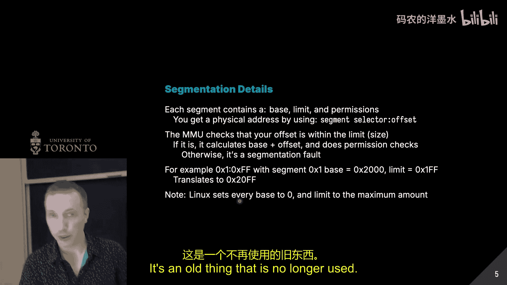

So how memory actually works is the first insight was like， well， I don't want like 16 bytes。

 I want to have to keep track of 16 bytes to just do one byte of translation。

So instead of translating one bite to another by， they thought a bit bigger and they just translate one big block to another big block of memory。

 so that the same。Translation applies to more than just one B。

 So this just divides memory up into big blocks of certain sizes。 So instead of one byte。

 we just do multiple bytes at a time。Is that okay with everyone？Alright。

 so this is where that magical number will come in， too。

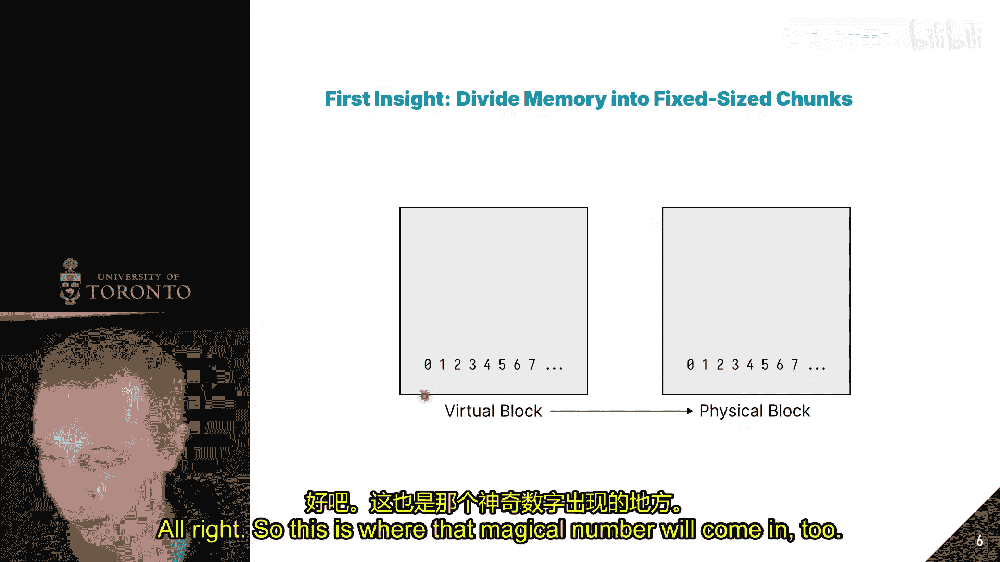

2。So some terminology， first memory management unit， M M U， will come up again。 that， again。

 is the hardware that maps a virtual address。To a physical address。

 And it will do the permission checks and everything as well。 So as part of the operating system。

 we do not have to write the。Software that does a translation。

 You just have to set up some data so that it can actually use that data to figure out what the translation should be。

 So our first technique， dividing memory up into fixed size pages。

 So that's what we call the blocks of memory once we're dealing with or those blocks of byte once we're dealing with memory。

 We just call them pages and they are typically 4096。

 So that is our magic number we've been using before， because well， when I allocated a big array。

 I know the operating system is gonna give me a page anyways。 So I may as well just ask for 4096。

 since that is the unit。 the operating system likes。😊，Some other terminology， that page。

 so page is just a block of memory， typically that 4096 size。

 If you're talking about in the context of a virtual memory， it's called a page。

A page in the context of physical memory sometimes might be called a frame， but。

Depending on the context， I typically just use page all the time。 And hopefully。

 if I need to clarify whether or not I'm talking about physical memory， virtual memory， I will do so。

So that is our job， so。Another insight too， is that you typically do not use all 64 virtual address bits。

What if I want to use all 64 bits？Of memory， how big would my memory be if I was to utilize every single bitete。

Yeah。Yeah， well， two to the power is 64 B， which is what， like 16。Giby bites or not Gibby bites。

 What the hell's a name for it。Exabytes， what's above exa no， not Ter Ter the other way。I don't know。

 some gigantic number， right， We could run so much Chrome。I keep picking on web browsers。

 I probably shouldn't do that， but anyways， so typically。

That is way more memory that's on your machine， typically you don't need to support that much virtual memory。

Virtual memory is just the amount that a single process can use。 And as we'll see as we go through。

 the longer it is， the more you have to translate， the bigger it's going to be。 So typically。

 there's some cutoff where we don't actually translate up to all 64 Bs。So for most modern computers。

 they only support virtual addresses of size up to 39 Bs， which is。Which is 512 GB。

 So that on most operating systems， that is the limit of memory that one process can use。

 So it will have access to all。Up to 2 to the 39 B of information。

 So this is done by Rik 5 and other architectures。In Rik 5， whenever they say S V 39。

 it's talking about how many bits are used for a virtual address。

 And we'll see how to extend this if we want to go further than that。 But for right now，500 gigs。

 a process is good enough for， at least another year。

So its how it is implemented is a big page table， A K， a big array。 So it's just a big lookup array。

 and it's indexed by virtual page number。 So we're dividing our memory up instead of bytes。

 we're dividing it up into big blocks called pages。 And then for every single page。

 we're going to translate。Whatever physical page that should be。 So the virtual page number。

 another way you can think of it as like it is the index of a virtual page。

 And then this physical page number is the index of a physical page。 So actual physical memory。

So another way to， but typically you call them virtual page numbers or VPNs and then physical page numbers or PPNs。

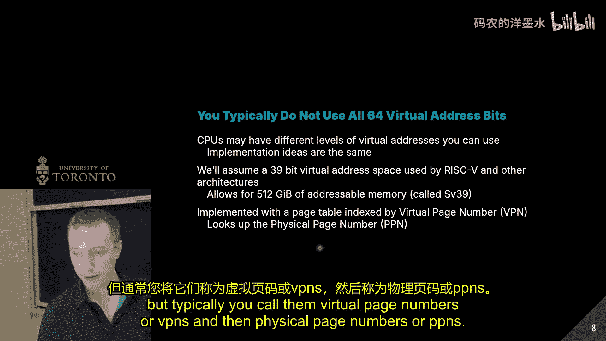

Alright， so how this works。 Let's go through this diagram slowly。 So here is our virtual address。

 We are， we have 64 Bs for it。 But like we argued before， we're only going to use 30。😊，9 bits of it。

So， this offset。This offset is telling us which by on a page we want to access。

 So the number of bits we use for the offset is determined by the page size。 So in this case。

 if our page size is 4096， that is the same as 2 to the 12。

 which means we would have 12 bits that indicate which by on a page we would like to access going all the way from 0 to 4095。

 right。Everyone okay with that。Yeah。Each page will have a length。Yeah。

 so the size of each page will be to the power of 12。In this case。For most systems。

So this is which byte on a page we would like to access。

 And then the nice part of this is we don't have to translate that， right。

 We only have to translate which virtual page goes to what physical page。

 So what we can do is we can take that 39 B address。 These 12 B we do not have to translate。

And then these bits， the other 27， those are used for our index。

 So that there is one for each single。Each single virtual page we could do a mapping to， right。

 So since we have 27 Bs， that means we can support up to2 to the 27 different virtual pages。

So that means our page table， our page table is going to keep track of the mapping。 So for each。

Virtual page， It's going to tell us what physical page we should actually access to look up that information。

 So that is what the page table is。 So there is an entry there。

 So there is an entry for every single virtual page and whatever we translate an address。

 We know it indexed to access base off this information in the virtual address。Okay。Ih。

 we'll have some examples to yeah。まそれに政。17 Bs for the base。So where do you get the 40 Oh。

 like this unused space。Oh， we haven't got to the P， PN yet。 So this is just a virtual address。So。

 yeah index。The index here is the VPN。Virtual， yeah， the virtual page number A K。

 you know what virtual pages it says， Yeah so。Each virtual page has an index。

Or has an entry in this page table。 And then to get the physical address。

 we don't have to translate the offset。 So that tells us what by on a page we're accessing。

 We don't actually have to translate this。 So we're just translating blocks at a time。

 And then it just turns out this 44 Bs here。That is how many physical pages we can actually do translations for。

 So you might notice that this physical address， if I add up the bits。

 how many bits are in this physical address here。Which I think is your question， right？Yeah。

 so there's only 54。Why， well， no computer on the planet I know has more than 54 B of memory or 54。

2 to the 54 B of memory。So why did they pick this number and there's some unused space。

The answer to that is。They don't need it yet， so they just reserved it for future use。

So we we'll have， we'll see what's in an entry in the next slide， but basically。

 they had to keep track of some other information。So let's see what is in this page table。

So each entry in this page table。Well， it has to tell us at least which P PN we have to look up。

 So it needs to tell us at least the P PN we get so we can get a resulting physical address。

 And it turns out these entries also have some other information in them。

So this is what a page table entry looks like。 So this is what's stored for every single virtual page。

So we could look it up。 And then this is our entry。 This is what we get when we look it up。

Since we're translating to a large address， typically， these will， they're like an array， right。

 So typically， these will all be in powers of two。So it turns out that four B is not big enough to hold like a PPN that would be large enough for our translation。

 So the size of this page table entry on most systems is 8 B。

 And then this shows you what every single bit。Of those 8 B stands for。

 So this bit is the valid bit that will tell you whether or not this entry is valid。

 whether or not it should proceed with doing the translation。

 And then there's some permission checks like， hey， am I allowed to read this memory。

 Am I allowed to write this memory。 Am I allowed to execute it， We can skip some of these flags。

 There's like user global access dirty， Sounds weird。

We might get into what that means in this course， might not。

 Then there's two bits that reserved for the supervisor use， A K， the kernel。

 So the kernel gets two bits to use spoiler alert in La 3。 you get to play with virtual memory。

 and you'll be using that information to do some translations and some fun stuff。

 So that those are bits that you're allowed to use for whatever you want。

Then 44 Bs are used for the physical page number。Why only 44 B？ It's just a design thing they picked。

 How don' know why。 And then if。You see， see， there's 10 B that are reserved for future use。

 So if they want to support more physical memory， they can just make this P PN bigger。

 if they want to support different permissions， they could do that。 But right now。

 it's reserved for future use。 So don't use it。 We'll figure it out later。

 just to be slightly extensible。All right。O K， ish up to this point， yeah。Is theical。Yeah。

 so that's a good question。 Why is it。Yeah， why is it 27 verse 44 for virtual to physical。

The short answer is。The size of this entry， like the number of bits here。

That has to do with the PP PN size。Which is either going to be 4 or 8 B。

 So it's not really going to make that much of a difference here。

 Like the entry is always going to be the same size， even if I support more or less。

Physical addresses， it doesn't really matter， right， So say this number was only 40。

What does that change， That just changes。 Les bits are used for there。

 but this would still consume 8 B。So supporting more physical addresses doesn't really cost anything。

 but if I wanted to support more virtual addresses， so say I wanted to change that to a 30。

Then that would increase the size of my page table， too， right。

 And then it would have two to the 30 entries now， which means it got eight times bigger。

So the more virtual addresses I can support。Immediately， the bigger that page table is going to be。

 And the more memory is going get wasted for that。 So I want to keep it as small as possible while still supporting。

Cl。Yeah， why do we need a page table since VM are less than。W now。

So you don't want to do a one to one mapping because virtual addresses exist for each process。

 So even though that only one process can only use up to 512 gig of memory。

I can still use like terabys of memory on my machine and be O with it。

 I just need multiple processes， at the same time。So this doesn't prevent me from using like two terabytes of memory and having fun with it unless I'm just running a single process。

Okay， we O ish。Virtual memory is always the most fun topic。 al right。

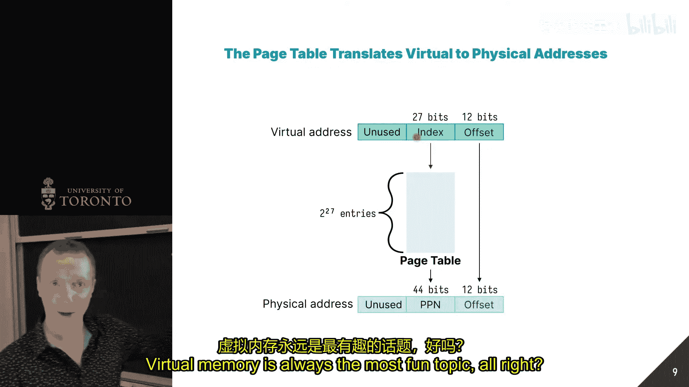

So let's do some translations to make sure。 So here is。What。Our page table could look like。

 So let's just assume that I'm only supporting。2 Bs。For my two bits。

 for the index of the virtual address。And let's do these translations， so。

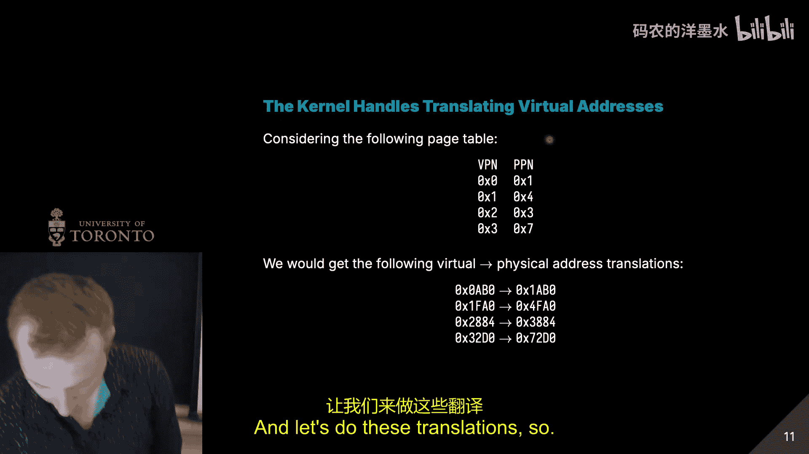

T过。So here is the at。 So here is my page table。Your page table， basically。

 it's just a mapping of virtual page number， which would be used as the index to the P， PN。

 So this is the index。Okay， we're going to do that again。

So this would be the index into the page table。 So we wouldn't actually be storing it。

 That's just how we would access the array。 and then。

The main thing we care about when we're doing translation that we're actually looking up in this page table is our P PN。

 So there'll be some more stuff。 But for now， let's just assume that there's a PP PN。

So this would be what， let's say they translate to this。And I'll make this hex too。 why not？Alright。

 so what this means is that for this process， virtual page 0 in this case should translate to physical page1。

Virtual page  one should translate to physical page 4 and so on and so forth。

 So everyone okay with reading that， even though I'm trying to hover my hand and my writing looks like actual garbage。

My writing is better than that， if。My iPad did not freak out。Okay， so we're assuming our。

 we're going do this。All right， so for this。Our page size is 4096 B。Right。

 which meant whether we're translating an address are offset here。Is。12 Bs。Because， well。

 this is equal to 2 to the 12。啊。To the 12 bytes。Right。

 and it just so happens that that number for 12 B is actually kind of convenient if we are writing things out in Hex。

So。Quick， if I have a single hex digit， how many bits does that represent。4。

 so if I have 12 bits for an offset， how many hex digits or hexits do I need three， right？

 So if we write it out in Hex， we don't have to translate the last three hex digits。 So say。

 let's have our addresses。 So say we are translating this address。B， a 0。

So this is our virtual address。So if that is our virtual address。Right。

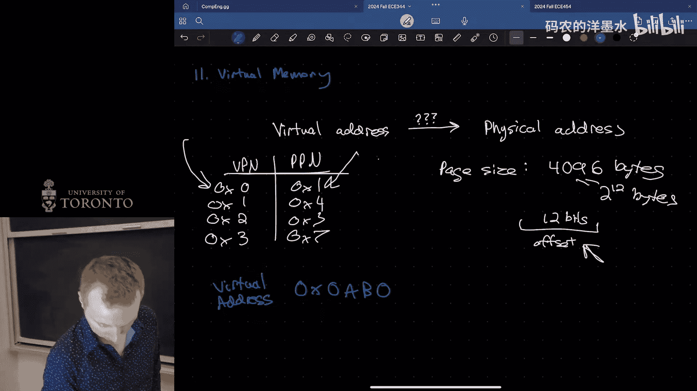

Remember from here that offset or which byte of the page I'm trying to access。

 we do not have to translate it。 So if I'm translating this to a physical address。

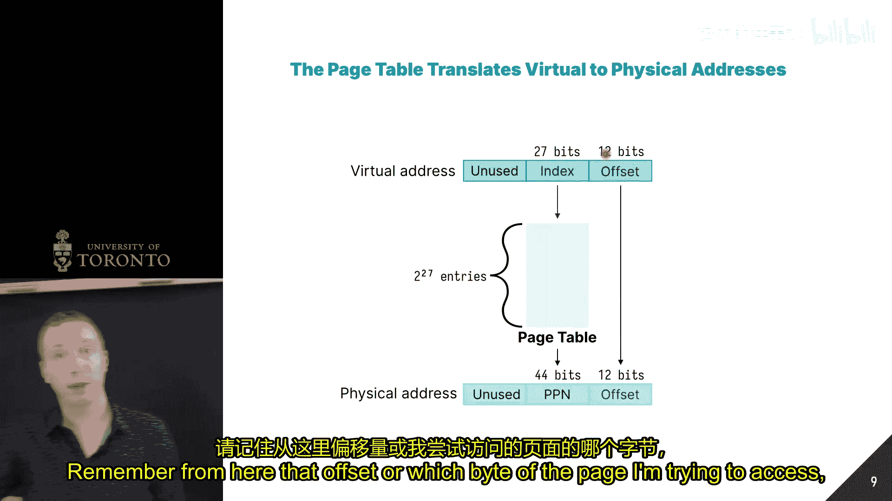

These three hexes， I don't need to touch， right。They're left alone。

 So the physical address I get as a result。We'll end with A B0。Everyone okay with that。Alright。

 then for the rest of it。This is my offset。The other。Bits are used for the virtual page number。

So for this， the virtual page number of this virtual address would be virtual page 0。

 If I want to translate it to a physical page。What is it？1， right。

 So virtual page 0 maps  to physical page 1。 So all we do is we just take this 0。

Figure out what the entry is。 And then we just replace that virtual page number with the physical page number。

 So we simply get。The physical address，1， A， B0。Everyone okay with that？Keg。

 what about the virtual address， What's the next one on here。1， f。A 0。

What would the physical address of that be。Yeah。Yeah， that would be4 F。A0。

Everyone get how we got that。Okay， this year is smarter than last year。 if by a lot。

So what we did there， this。We didn't have to translate。 That was the offset。So that didn't translate。

 This was the virtual page number。So we looked up virtual page 1 translates to what physical page the answer is for。

 So we just replaced the four there。Everyone sure， no questions。 Everything's all good。Okay。

 there's like slight rumblings。Alright， here， let's do hard mode。 What about。3，2。What's this。7，2， D。

0。Right， everyone agree。Yeah， so this part， we don't translate。 It's the offset。 So it ends in 2 D 0。

 And then 3， that's our virtual page number， which we would look up here。

Virtual page 3 means we go to physical page 7， and then it would look like this。

Absolutely sure everyone's okay。The yeses are kind of freaking me out， so I don't know。All right。

Cause we have another two lectures of this because it's going to get slightly weirder。

 but not that much weirder。

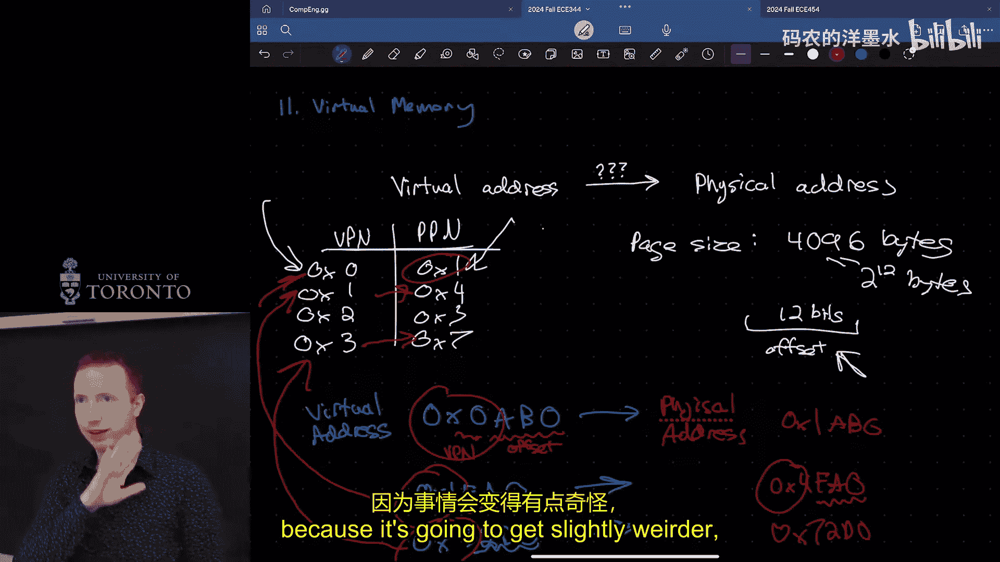

All right。Another problem， since we seem to do well on that。I， that was。Assuming a page size of 4096。

 But in a question， I can just tell you a different page size and you can figure it out so I can give you a whole bunch of information。

 And we can use that to actually do some translation as well。 So， oops， so in this。

 we're assuming an 8 bit。This is a weird system， an 8 bit virtual address， a 10 bit physical address。

 and then each page。Is 64 Bs。 So knowing your powers of two is very。

 very good for this course to make things very quick。Quick， what's 64 in powers of two。

Two to the six， right？So if you're not as good as powers of two and you' are like me and you're not terribly bright at it。

 you can just remember like two numbers and then pass that。

 you can divide by two or multiply by two a couple of times to get it。

 So all I remember is that two to the three is 30 or sorry， wow already screwed up。

Two to the five is 32。So2 of the 5 is 32， and then2， the 10 is 1024。

 and I just figure out the rest from there。 So 64， and it's kind of close to2 the5。

 I have to multiply by 2 once。 Oh， it's2 to the6。What， one way you can do that。All right， so here。

This question asks a few things。 How many different virtual pages are there。

 How many different physical pages are there。 And then given a page table， which is kind。

 kind of ruins the rest of the question， what is the physical address of this。There this。

 what is the physical address of this virtual address。

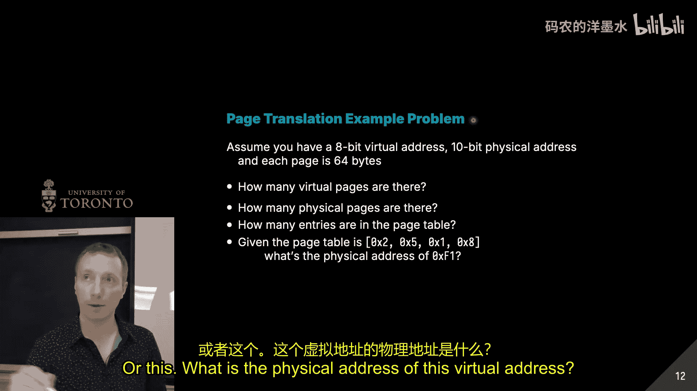

So let's write out the question。 So the details of the question tells me。哎。Have a8 bit。Virtual。

And then I have a 10 bit physical address。And then， page size。

Or maybe I'll just write off on the other side，ops。64 byte。Pages。All right， so。

If I took my virtual address。Right， virtual addresses divided into like some bits for VPN and then some bits for the offset。

Or where I am in a page。 And if we just immediately， ahead of time。

 just noted that a 64 B page was 2 to the 6 B。We should be able to fill in the blanks here。

So for the physical address， whoops。So physical addresses look like PPN and then that same offset。So。

If I have 64 B pages， how many bits do I need for an offset。6ix， right？Everyone okay with six。

Everyone agree？Allright， so we have6。 That's the greatest6 I've ever written。

So we have 6 B for the offset。 So in the question， I also told you how many bits total there were in a virtual address and how many bits total there were in a physical address。

 So how many Bs do I need for the VPN。2， right。 So if  I have，8 total，6 are used for the offset。

 that means this number has to be 2。How many bits do I need for the。PPN。4， right？

So one of the questions said the first question。Was how。Many。Virtual。

So how many virtual pages are there？不。F， right， or two to the two。However， you want to say it。

 So if theres 2 bits used for the VPN， that means there is two to the two different virtual pages。

 So we have four。Okay， well， how many。So how many。Physical whoops， That's a great physical。

How many physical pages？Yeah。Two the four， yep， to the four。Or 16， however you want to think of it。

 So if you're using my trick， hey， it's close to 2， the 5 is 32。 If I divide by 2 once， I get 16。

 So it's2 the 4。Allright。 then the rest says slightly trick question， number 3。How many。Okay。Are in。

So how many entries are in the page table？4。4， right， kind of a trick question。

 So we need one entry for each virtual page。 So for each virtual page。

 we have to know what physical page it maps to。 So for everyone， okay with four。All right。So。

Now we get into the fun part of doing the translation。 So let's see。😊，How we are。 So it says。

 given the page table。So given the page table I write in Python format。 So this is 02，05。

So this is just the shorthand way to write an array。 So this would be the entry at index 0， index 1。

 index 2 and index 3。 So everyone okay with that。 That's my page table。Alright。

 so now let's see how good we are。 So let's say we have the virtual address。😊，F1。

And we want to get the physical address。How do I do this。Someone else。Yeah。Yeah， well。

 I don't need to translate the offset， but it doesn't line up with a hex character。

 So I probably need to write it out in terms of bits first， because。

I want to make your life difficult or something， I don't know。

So this easiest to just do it in bit form。 So another way， if you don't remember。

What hex digit maps to what bits， Another trick you can use。 The only thing I remember is。That， a is。

1，0，1，0， or 10，10， A is supposed to be 10。 You can think of it as two tens。I don't know。 I'm dumb。

 Okay， so that's the way I think of it。 And then I figure out the rest from there。

 So a is the same as 10，10。 Then you can figure out， you know， B is just adding one to it。 So it's 1。

0，1，1。 C is 1，1，0，0。D is one。E 1，1，1，0。 And， you know。

 you can figure out the rest of the hexus from that。 But just remember。

 a supposed to be the digit 10。 Yeah， it's supposed to be the represent 10， so。

Happens that in binary， it's 10，10， looks like1s， lots of tens。 I don't know。

I have a weird way of remembering things。 All right。So， F。What is F in？Binary。1，1，1，1，4，1s， right。

 So this is 1，1，1，1。And。Also。Remember， hex digits above there， there's leading zeros。

 So if it was bigger than that， just remember， it always ends in zeros。What's one in。bitits。Just one。

 I could just write。Yeah，30s in that one， right， It still need 4 for each one。 So it's 0，0，1。Okay。

 if my offset is 6 Bs， that means I do not have to translate the last six bits here， right。

So that means。These。Ones。I don't have to translate， right？Which means for this virtual address。

This is my VPN。What's 1，1 in。Deimal 3， right， So that means in order to translate this virtual page number to a physical one。

 I look up the page table at index 3。And then that immediately tells me what my physical page number is。

 right？ So here I'll write the physical address。The two many Ds， so the physical address。

 it ended with 1，1，0，0，01。And then what is 8 in。Whatever vessel or binary。1，0，0，1， then 3 zeros。

Right， so that is our。Physical address。 Everyone agree with that。Alright。

 what about if we want to translate that back into hex， Well， I start at the back。

 and then I do groupings of four， right， So 4。Next four are 0，0，1。Next41， zero。So。What is 0，0。

01 in hex？1。What is 0，011 in hex？Three， right？What is1，0 in Hex。2。

 so that means my resulting physical address is。2，3， one in Hex。Using this silly setup。All right。

 any questions about that？Cool，Sometimes you have to write things out in binary area。

 which is kind of。Bad。If you look at the past exams。

 I've historically been nice where the page size is at least a factor of four， yeah。How many， oh。

 I wrote6。 sorry， this is4。So， yeah， for how many entries are on the page table。

 there's one entry for each virtual page number。 So it should be the same as question 1。

 I don't know why I wrote 6。 Ive numbered dyslexia or something， which is。

Bad if you're looking at what I do， I guess， yeah。How do like different processes？thatSo。

 so the question is， how would different processes use the same page table and different processes。

 each process would have its own page table。Right， and that was my next slide， but we're out of time。

 So just remember， boom for you。 We're on this。

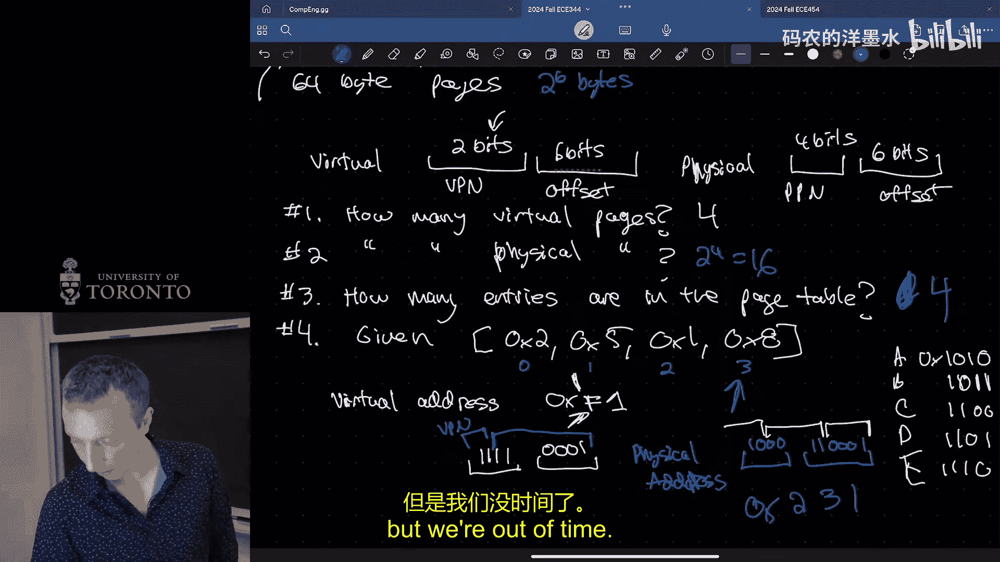