# 【全集】多伦多大学 操作系统 中英字幕 1080P p11 Lecture 11 - 页表 -BV1Rbk7ByERc_p11-

どけ。そういうす。Alrighty， welcome back to operating System So。Any questions， comments。

 concerns about the last lecture， or are we all okay with page tables？

Before we make it approximately three times more complicated。Okay， well。

 we have a little bit a problem on our hands。

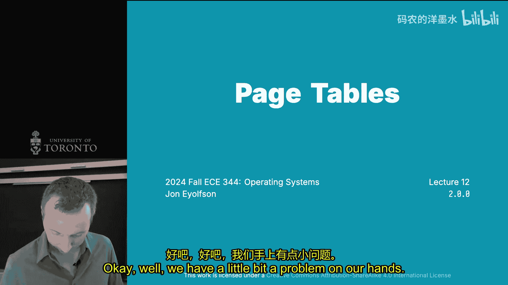

So。We know we divided our memory up into these big blocks。So we divide the whole of memory， okay。

 we're going to do this again。So。If this is all of physical memory。

We divided it up into a bunch of blocks。And then the size of each of these blocks was like 4096。

 but we have a little bit of an issue because we need to also store the page table somewhere in physical memory as well。

 and currently our issue is it is absolutely gigantic。

 so remember for a 39 bit address with our 4K page size。

 our page table needs to have two to the 27 entries。And each of these entries， remember。

 contains at least a valid bit and the physical page number。So this is basically a giant array。

 so there is two the 27 elements and each page table entry in here。So， each。Row。

 if you want to think of it that way。Is eight bytes？Per page。Table entry。

So how big is this page table？In bites。Yeah， to， the power of 30 Bs， right。

 So this is how many entries I have。 And then if each entry is 8 Bs。 if I write that in。

Powers of two， that's just two the three， so the total size of it would be2 the 27 plus 3。

 aka2 the 30， Aka 1 gigabyte。And this page table， that would be the virtual to physical mapping for one process。

So one process at our page table is a gigabyte。So。いや。R 27。

 does it represent the number of pages or the number。So yeah， the question is，2 to 27。

 is that the number of。Virtual pages or number of entries in the page table。

 And the answer is it is both。So it's the number of virtual pages and entry each virtual page needs an entry in the page table to tell us what physical page it maps to。

 so same answer for both。All right， so this is obviously， this is kind of bad。

 so well be solving this problem today because， well， if I had 16 gigs of Ram on my machine。

And I have 16 processes running， and I have a page table per process。

 How much room do I have for applications to use？Zero is that good， no。

 so we're going to have to do something to solve this。

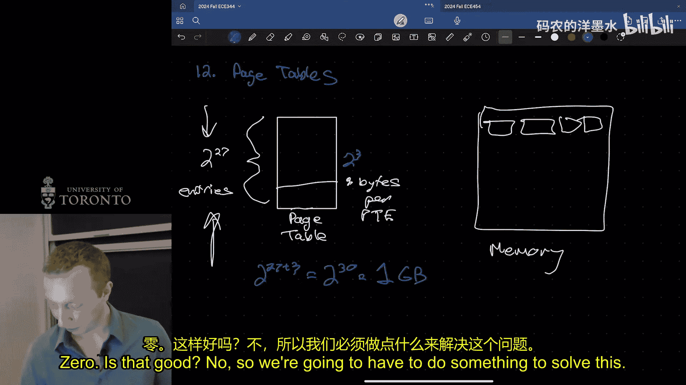

So。The first idea could be that， okay， well， also to make things simpler。

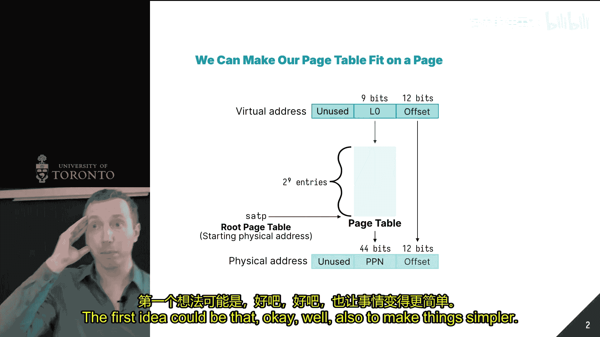

Since， you know， we've already divided our memory into blocks and we need to store them somewhere。

 well， first idea might be like， hey， why don't I just use these pages themselves？Oops。

 why don't I just use these pages themselves to store the page table like it has to be in memory anyways。

 if I've already divided memory up into blocks， I should probably use the blocks to store the page table。

 so our first step is going to be。

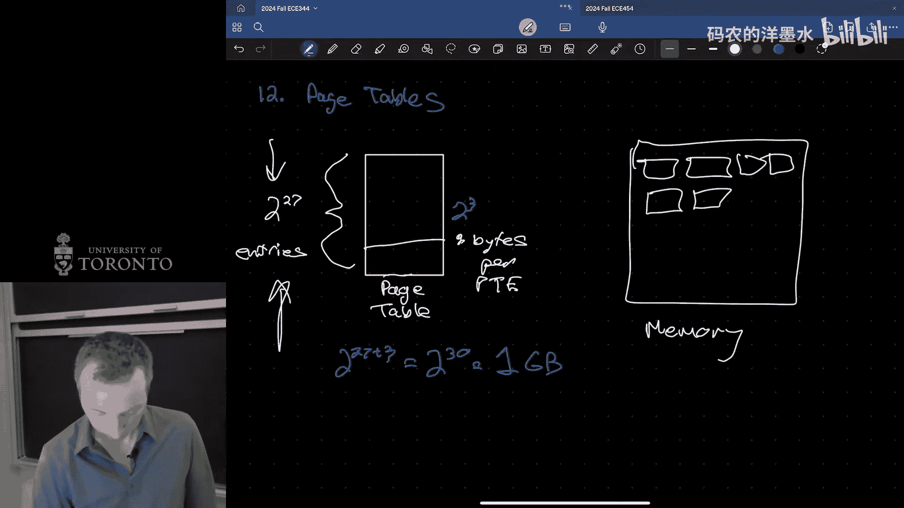

Two just。Make a page table fit on one block。 So that will obviously limit how many entries we can store in the page table。

 So here。I would argue that if my page table is 4K or 2 to the 12。

 then I can only fit like nine different entries in my page table， so why is that so？

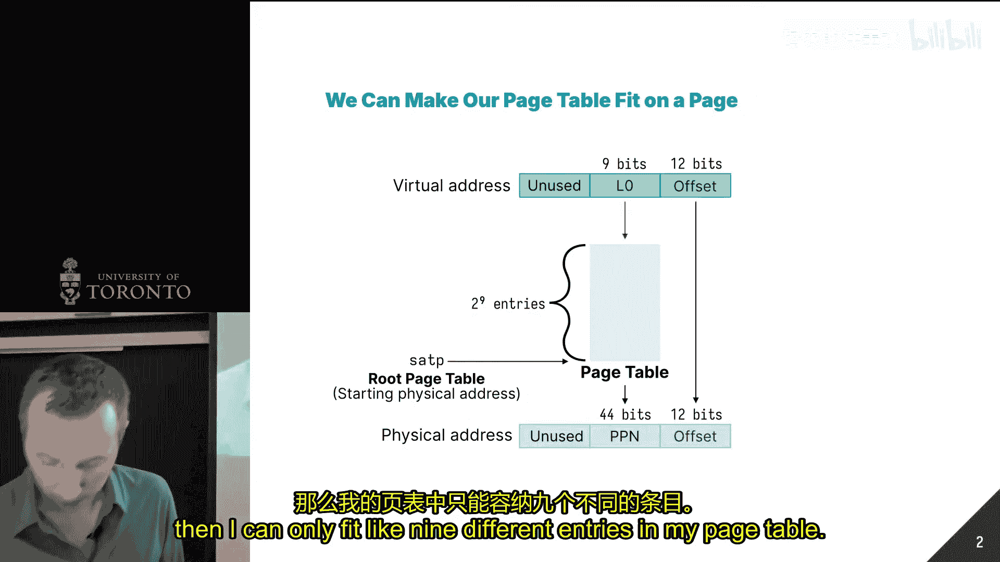

Basically， I'm constraining it so that the total size of the page table now， instead of being this。

I want it to just be the size of a page， AKA， it should be two to the 12 or 4 kilobytes。

So if this is the total size of my page table， I should be able to figure out how many entries I can hold in a page table。

 So I would just take the number。Of。The total size of my page table and then divide it by the size of an entry。

 So in this case， it's 8 by in entry。 So if I keep it in powers of two。

 I can easily do the little exponent law and figure out that it's just the same as to the power of 12-3。

 which I can do mathon and that is2 the 9。 So that means if my page table。

 if the size of my page table is 4K。 that means I can only fit。Two to the nine entries in it。

So everyone okay with that。

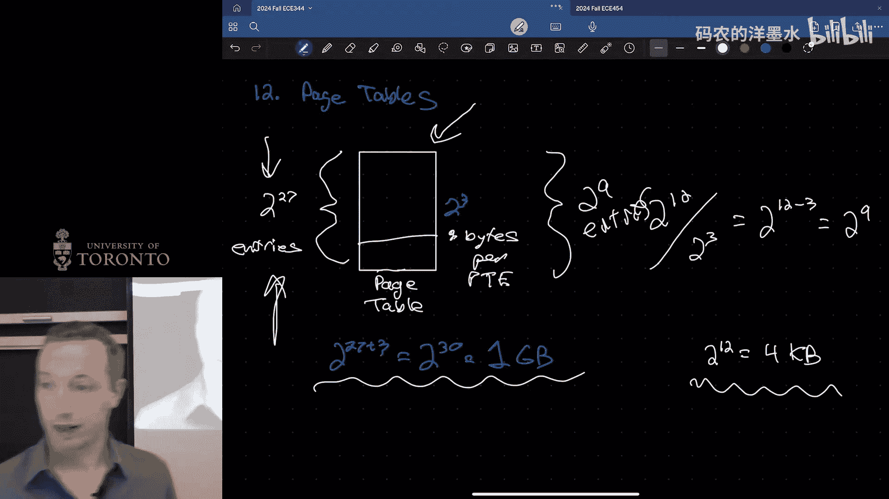

All right。So that is what I'm going to do here。Obviously。

 now how big of a virtual address can I support here？

How many bits can I use for the whole virtual address？Anyone add the two numbers at the top？

So my virtual address here right is just the two numbers at the top so I can only it would be 9 plus 12 which is 21。

 so that means I could only support up to what two megabytes of memory with this system if my page table only fit in a page so that's our major drawback here so we're going to have to do something about it but for now our idea is we want our page table to fit on a page and our physical address since the PPN stored as part of the entry。

It doesn't change。 It would still be 44 bits based off what we argued about before and then。

Since each process has its own page table， there's actually a register on your CPU that the kernel is going to control that tells your MMU which page table to use to translate virtual addresses for this process。

 so before I continue anyone have any problems with this。Same thing as yesterday。

 but now my page table fits on a page， so it is much smaller。All right。

 so now we are going to take an adventure to this。So this is how。

We extend that idea to actually support all 39 bits of virtual address base。

 we have multiple levels of page table， so this will make translating an address a bit more complicated because we split it off。

A few different ways， so now。We take that virtual address。 and instead of。Where is my mouse pointer？

So we take this virtual address and instead of just having all of this for the virtual page number。

 we split it out into multiple levels and each level of this page table will fit on a page so now to translate the address we have to go through a of a bit more hoops so the top nine bits here that will give you the index into the first L2 level page table so we just creatively just give them L number for their names so the root page table would start here I would find based off the index I get from these bits of my virtual address that will tell me which entry to look up here as before and it will tell me what the physical page is for this index but now instead of using that to translate the virtual address to a physical address instead now that physical page。

Tells me where the next page table is。 And then I use the index。The next nine bits for the L1 index。

To find what entry I should look at that entry will also tell me a physical page number and then that physical page number will tell me where my L0 page table is which is the lowest level which actually has the physical page number for this virtual page so L1 or L0 that will have it page table entry it will have a physical page number like the other ones and it gives me the actual physical page for this virtual address and again mercifully we don't have to translate the offset。

So everyone okay with this， yeah。政府をポする。Entry in the L1。So the L2 page table。

 which entry you access depends on this， the bits here。

 just like for before with a single page table。 But instead。

Before the entry told us what physical page this virtual page map to。

 but now in this case it tells us what physical page the L1 page table is on。

So it tells us which page table we need to access。What these bits。イン。page because I they model。

In theres a danger。Yeah。But now， it's。So now before like all the bits together which was the whole virtual page now right。

 but now we've split it up into multiple levels so now instead of just indexing a giant table we split off the index to other tables and they lead us to other ones so for like here。

I use this part of the index to tell me which entry in the first page table that fits on a page goes to。

And then I keep on following it over and over and over again until I eventually hit the last level here。

 so。Drawing it out a bit， so。

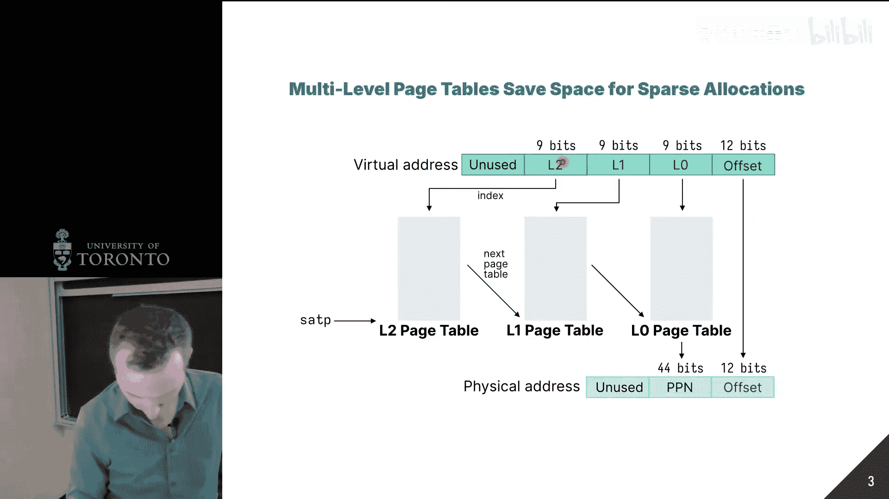

Let let's see if we can draw that a bit。So before assume our memory is just in blocks。

So if we just had a like massive page table， right。

 it might just span every single block and just take up everything right， and then， well。

 it would be easy because。Whatever index we use， it just tells us exactly where we go and whatever page we find it on。

Now。Each page is itself its own little page table， so it can't possibly。Have。

An entry for every single index， right， It can only have two to the nine of them that fit on a page。

 So I have， in this case， two to nine different options here。

And then each of them will point to a different L1 page， so maybe at index 0， it points to this one。

 maybe at index1， it points to this one。And then I have to use the next bits to pick which entry in this page table I need to access。

So this is an L1， this is a different L1， so maybe I'm accessing 188。

And that will tell me which page table I have to access for an L0。

And then maybe that has another entry at entry 5 or something like that that tells us where the actual pages that's used for data。

And this doesn't give me any less indexes I could have。 So before， right， I had。

Two to the it2 the 27 before， right？So this is a bit more roundabout way。

 but I don't have any last indexes because in this L2 page table。

 how many different entries are there。Two the nine， right？And then for each of those two to the9。

 right， this could point up to two the9 things。 What does how many different things could each L1 page table point to。

2 to the9， right， And then how many different pages could each L 0 page table point to。

Two to the nine。What's2 the9 times 2， the9 times 2 the9。2 the 27。 So it's the same thing， right？

I'm just splitting it up a bit differently。Every， yeah。大けたさいなてす。Yeah。

 so what is the benefit of this so。Before when we had that massive， like 1 GB page table。

If I want to translate a single address， I need a gigabyte page table， right。

How much memory do I need to translate a single address now？So to translate a single address。

 I only need three pages now， right， So if I want to translate a single address， Well。

 I could have an L2 that leads me to an L 1 that leads me to the L 0。 And then that has it my final。

Physical page for this virtual address。 So I can actually translate a single address with only three page tables here。

 I only need one for each level to translate a single address。Yeah。さ平7。不。警プ一緒。倒てて relax。

So L2 tells me which L1 page table I access。So， do you automatically know which L two pay ship。Yeah。

 yeah， so the question is how do I know which L2 page table I'm accessing and that's what that SATP register is。

 that tells you your route page table， that tells you what L2 page table you need。

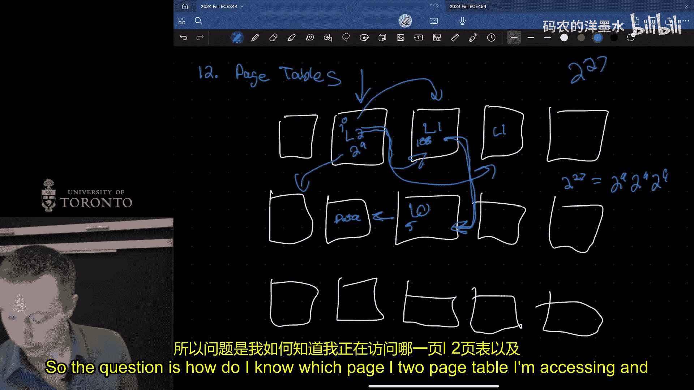

So， I'm mis trying。にあの一だの。So like because that L2 case。to the。Yeah。And we know there's。

Like for each entry， the L is table。There's eight pipetes， right？8 by。 Oh， for each entry。

 but they all fit on page， right。So they're all four kilobytes。so how many。

 like I think the ancient reading the page or how many voice。The entry itself。

 it's the same as before8 bys。But that how many is want。

We can have up to 512 different L1 page tables。 So for this， yeah， it's a good question。 So for this。

 there will always be exactly one L2 page table that's all you need and then。

We can kind of figure out that this will actually waste some space， too， in the worst case。

 So tablet。 So there's always one。

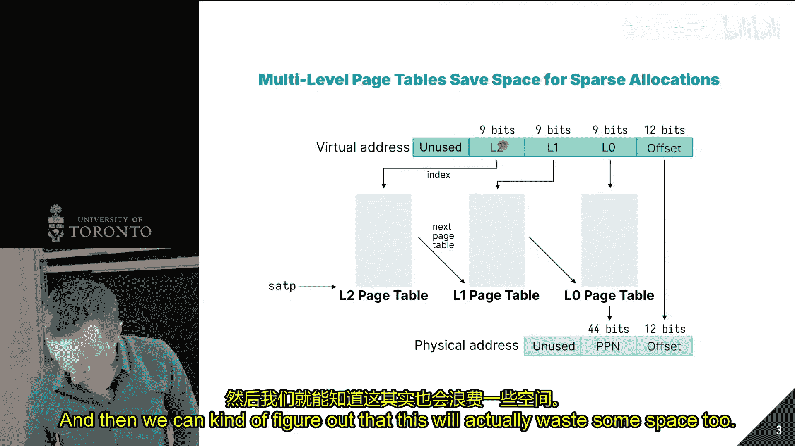

L2 page table。Right。It's always one L2 page table and it can point up to 512 L2。Tables， right？

And then each of those can point up to its own。512 of them， which would be math。To the 18。

Is whatever the hell to the 18 is， so you can have two the 18。Different L0 tables。Right。

 and you might notice here that if this is all full。How much memory does this waste？

So if I had two the 18 different L1 page tables and each of them fit exactly on a page， right。

 and each page is2 the 12， how much memory does it waste？2 the 30 again， right。

 one gigabyte because well。If we had one massive page table。

 we would be wasting one gigabyte if we want to translate the same number of addresses。

We just need to store the same amount of information。

 So this would actually waste slightly more information if we have to translate every single address。

Yeah， so each process would have its own。its own L2 page table。

 and then the operating system can decide whether or not processes share memory or not。

 typically each process will the easiest thing to do is each process has its own unique0 or L0 L1 L2 page tables。

And then the actual entries will the operating system will manage the entries so they can actually share memory if they need to。

So。Everyone okay ish with this。So。Drawback here that we already notice is that， hey。

 if we would need to translate every single address because we have multiple levels。

 we're wasting more memory。 But the big benefit is。

 how many programs do you know that use 512 gigs of memory。Chrome， that's one。Nothing else。

 how much memory does your program use？Probably like a few kilobytes right so instead of having a gig page table I at minimum to translate a single address only need one L2 page table。

1 L1 page table and1 L3 page table so which is if each or four kilobytes。

 then that's only 12 kilobytes for page tables。Everyone see the benefit here。

 We went from 1 GB to 12 k。So。Everyone okay with that。え経しの析にいる。Yeah。

 so the O S will allocate page tables if it needs it。

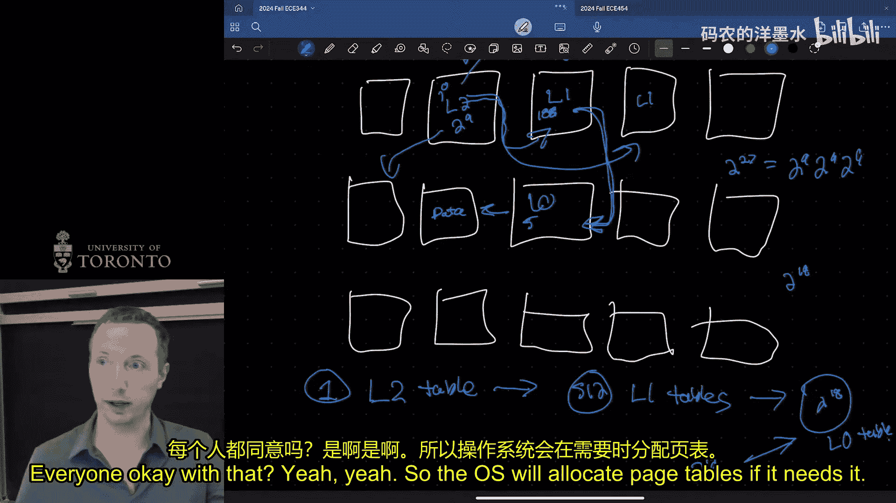

For your process， and we'll see how to manage that a little bit。

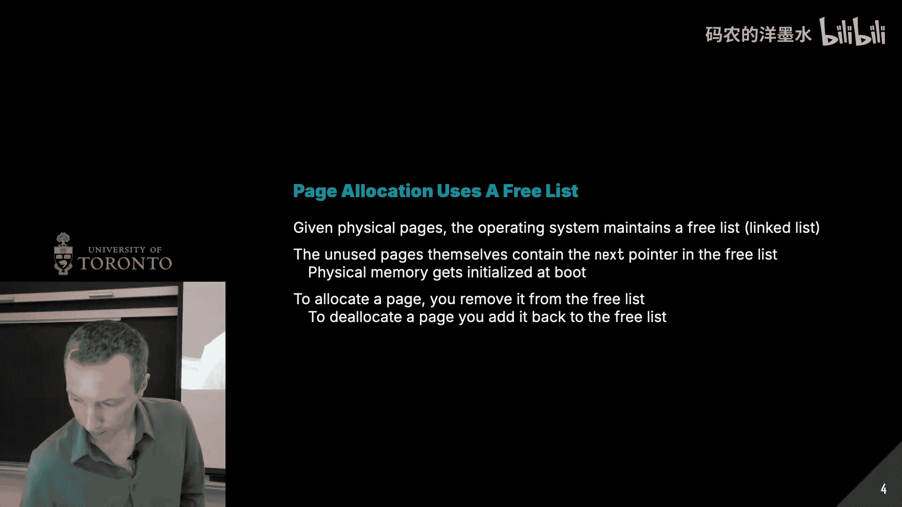

So yeah， oh， yeah。What you get what you mean by one else。Points to5。So。

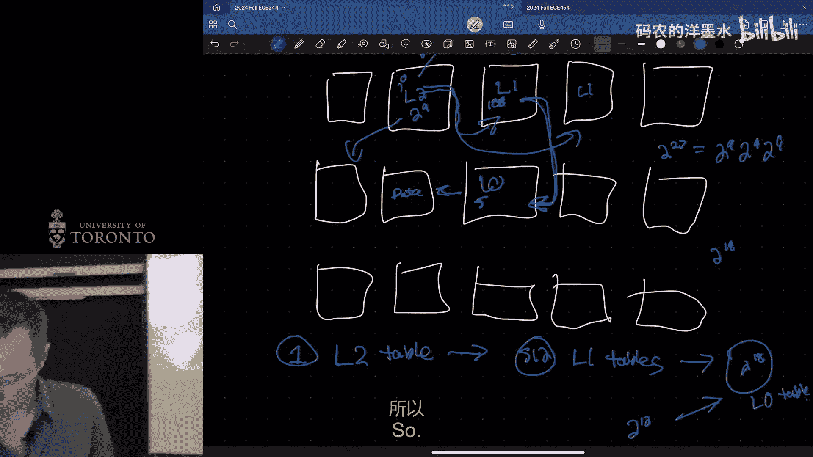

So here in this L2 page table， right， so when we just said everything fits on a page。

That page table can have two to nine different entries， right。

 where each entry points to it has a page table entry， which basically tells us what physical page。

We're accessing right so there's 512。 so that's why I said since there's 512 entries here and they each point to a page and each L1 page table takes up a page I could。

Yeah， from one to one size。Now， everything fits on a page。So every L1 page table， L1， L0， L0。

 all fit on a page。那谢。Yeah yeah， so they each fit two the power nine entries。Yeah。

 and we need three of them。Does that make the memory。So does it make the memory faster。

 So that's a really good question， too。 So when I had a single page table。

 how many memory accesses did I need to actually translate an address。Trick question is two。

But so I have one to look it up， look up the entry right。

 and then I have another for the original access， so you typically count the original access so instead of if I use normal memory it would just be one axis。

 if I use virtual memory in this case， I have to find the entry and then touch the memory so I have two accesses。

How many memory accesses do I need for this sucker？In total。4 right。

 so I have to look up the entry in the L2 page table， that's a memory access。

 look up the entry in the L1 page table， that's a memory access。

 look up the entry in the L0 page table， that's a memory access。

 and then my original memory access once I have the physical address。Four。So。

Remember one of our goals was this should be as fast as using physical memory。

 and I so far have made it。Four times slower。But in making it four times slower instead of two times slower。

 I now do not waste as much space if my processes don't use that much memory if I don't need to keep track of that main mappings。

 but yeah， I've made it much slower， but this is how memory actually works and we will address this problem because this is a fairly easy one to address。

But right now， really slow。All right， everyone okay with our。

Slow system that actually saves space it's the trade off we made。

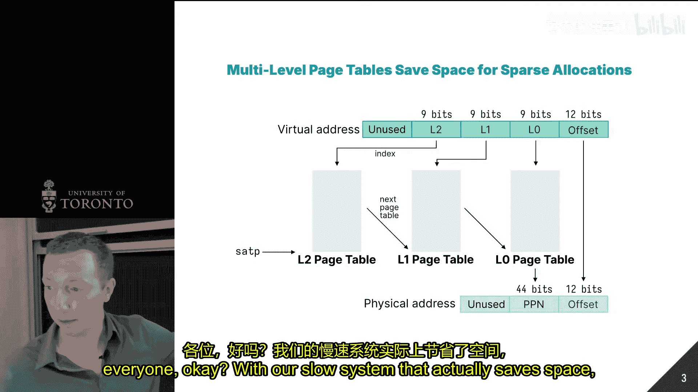

Okay， so。You might have wondered before like how do I allocate memory， Well。

 it turns out if you just allocate in pages or big blocks of memory。

One is as good as any other and you can just write your own allocator you have the skills to do it now you just need a link list so you just have a free list of pages so the unused pages themselves。

 they can actually store the pointer to the next unused page so it doesn't actually waste any space in memory you're using unused memory to store your pointers so this would be initiallyize as boot you can just set initially all of memory being free and then to allocate a page it is very easy for the offering system it just removes it from the free list uses it as a page and then to deallocate it all it does is say okay you're not using anymore more add to the free list so memory allocation really easy if everything is the exact same size and one is as good as any other and you don't have to worry about it being contiguous or anything like that。

So。That was our insight。 We used a page for each smaller page table again for this scenario we would since they all fit on a two to the 12 size page。

 we would have 512 entries， which is2 to the nine and our page table entry size is two to the three so everything makes sense that fits on page。

 So if you get a question for this， just remember。This is how we do multi level page tables。

 so even if I change the。Entry size or the size of the page。

 you should be able to figure out the last variable here。And the general way of doing this is。

No matter how many levels of page tables I have， the page table entry for L to the n always points to L to the n minus1。

 and then you follow these as many levels as you need eventually until you get to L0。

 which contains the physical page number that you actually wanted to translate this virtual address for。

So here are some other ways to think of them， think of them just like an array。

People get very confused about it。 But before， if I had like an。If I had say， an array of 512 ins。

What's the size of that in bites， Anyone remember？Yeah。Yeah， 2048， why because while it's an array。

 there's 512 elements or entries in it。The size of an int is four B。 So it's just  four times 512。

 So it's just 2048。 and then。For offsets， well， if each int is4 Bs and I'm accessing the。At index2。

 what byte does that int start at？2，8， which one。8 right。

 so because a razor zero indexed and computers like you know having zero indexed， the first offset。

 the first byte would be at byte0。 and then since ins are 4 bytes。

 the next byte would start at byte or the next int would start at byte 4 at index1 and then the int at index 2 would start at byte 8。

So same idea for page tables and everything offset is just the number of bytes from the beginning。So。

You will have think of a page table as just， you know， an array of page table entries。

No different than having any other array you've seen in your life， so if we have a page table。

 we have 512 entries in it and it's like an array of page table entries well for this scheme where each page table fits on a page。

 the size of the page table very equal to the size of the page。

And the size of the page table is just simply the number of entries。

 times the size of the page table entry。 So all these numbers。

 those two equations should always be true if we have multi levell page tables。

So everyone okay with those。Yeah。Its like larger than I。Yeah， so in this case。

 my page table entry would be 8 bytes， but older systems。

 the page table entry was actually four bytes， but since we have much more memory now it's 8 bytes。

All right， so let's do some translation with multiple levels， fun。😊。

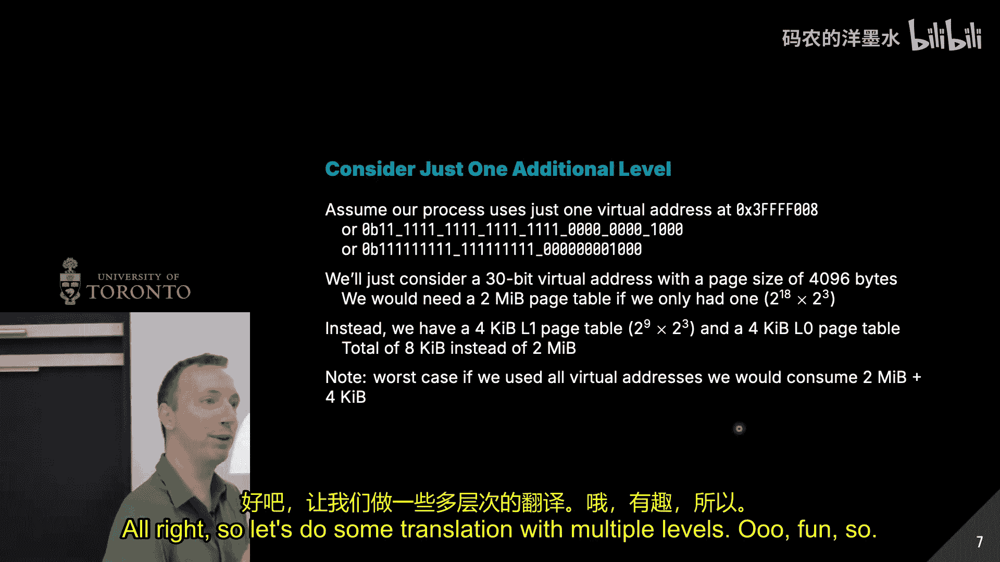

I'll just go and start an example。So we're going to assume a system with just one more level of page tables。

 so if we looked at the virtual address。Okay， we're doing this。

So if we looked at the virtual address， if we just have two levels of page tables where we only have an L1。

That looks terrible。An L1 and an L0。That is longest night， wow， okay。

I'm going to throw a sing in the river。Okay， so if we only have two levels of page tables。

There'll still be nine bits， right？

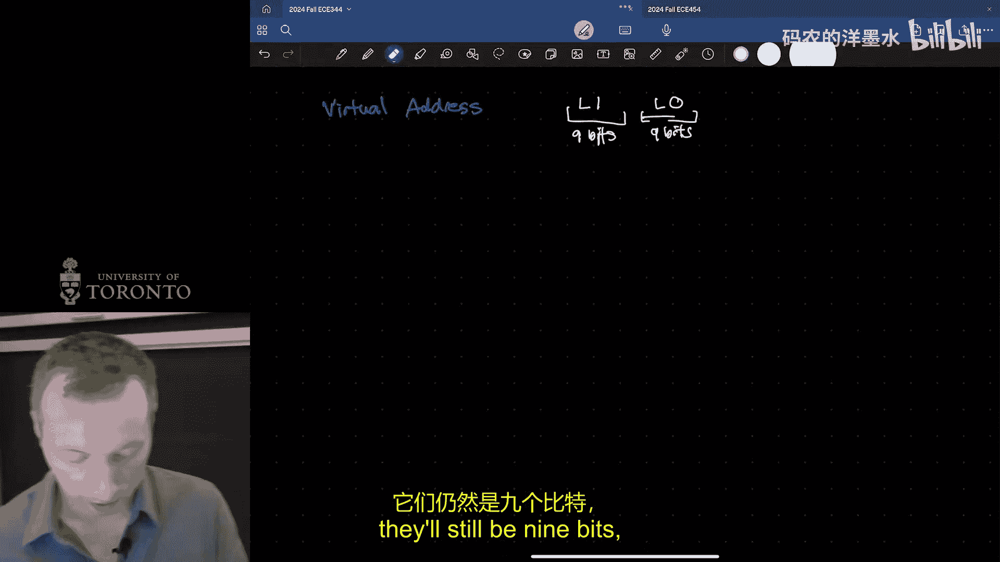

So。Just like here， all I'm doing is I'm chopping off L2 because I don't want to deal with it。

 So everyone okay with that。We can make it just two levels of page tables， so my address。

 I can only support what， a 30 bit virtual address。

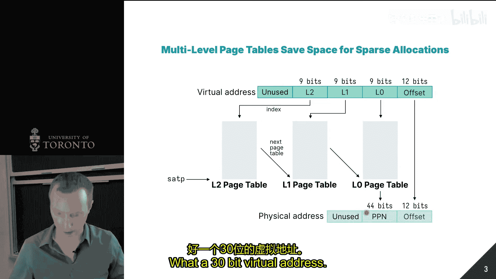

All right。So。Of my virtual address。My L1 and L0 will both be9 bits to tell us where we go。

 and then the last 12 bits is my offset that I don't have to translate。

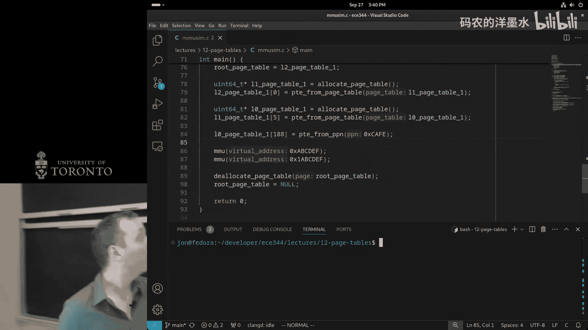

That is the wrong thing， there we go。So。That is how my virtual address is kind of set up。 So now。

 if I have the virtual address， let's say we want to translate3。F， F， F， F。Zero，0，8。

So say we want to translate this virtual address。Well， we have to figure out。What。

Index we use for L 0 and L1。 and we also need。Some other information， right？

So in order to translate this address。I need some more information。 So I would need to have。

As part of my system， I would need to know which L1 page table I need to use for this translation。

 so that would be stored as part of that process as like the root page table。

So maybe my root page table。It has an entry at。I don't know，512。 that equals。

That tells me that the physical page number is。Eight or something like that。So first off。

 from the virtual address， I should probably figure out what indexes I need to use for L1 and L0。

 so how would I do that？Kind of like we did yesterday where I had to write all the binary， right？So。

 for that。My offset is 12 B。 So what do I not have to translate。 Yeah， yeah，0，0，8。

 So this is my offset。 I don't have to translate it。 The rest of them since， you know。

 doesn't line up nice with hex。It's 8 bit or 9 Bs each。

 I probably have to write it out in groups of9。 So luckily，3 is just1，1。Oh it' was raining black。

 so three is just one，1， then F is' just four ones again right， and then four once and41， so one，1，1。

 one，1，1，1， one，1，1，1， one。So that。All those bits represent3 F， F， F， F， F， F， F， F， F， right。

That's a lot have。 So now we group in nine。 So this tells me my L0 index。And then this。

Or the rest of them。I think I oh， I missed an F。One， two， three， four。So this is the other9 bits。

 right， They're all one as well。 And they tell me my L。One index。So as part of translation， you know。

 there would be a register that tells you that tells。The MM M U， the memory management unit。

 What L1 page table in this case do I need to start off my translation。So if in my L1 page table。

 I have an entry at index 511。All want3， or sorry，9 ones is 511。

 So that means in order to translate this， I have to look at the。I have to look at the page。

At page8 to actually look get my information for the L0 page table right， so say don't know。

 say the root page table lives at address， I dont know， say it lives at seven。So in memory。Page7。

 that would have my L2 page table somewhere on it had an entry for 255。

 and that told me here that to find the oh sorry， L1。So to find the L0 page table。

 I have to find it on page 8。 So page 8 would have my L 0。

And then I would also have to tell you that， hey。Consider。L 0 on。Page。eight。

And say it also has an index。It also has an entry index at index 512。That points to physical page。

 I don't know， let's say cafe。It's Cf。C， A F E。 So， yeah。So this is the physical page number。

That's basically just telling me which physical page it is。

 so I can just start naming them from  zero like anything else， right。So you exceed。Oh。

 so I just said initially， I assume that the root page table is on page 7。 so that's where L1 is。

And it could beat anywhere。All right， so in order to get my final physical address for this virtual address here。

 what is my final physical address？So。Before when we had one page table， right。

 all we did is we looked up the physical page number。

 just replaced the virtual page number with the physical， kept the offset the same。

 and that was our address。So this time， the only change the process is I split up my virtual page number into a whole bunch of different indexes。

Because it's stored on different pages， but at the end of the day in the L0。

 I get my physical page number and it's the same thing I just want to replace the virtual page number with the physical page number。

So the entire virtual page number before was this right was3 FFF F FFF。

 and then through going through eventually finding in L0 that my last physical page number was this。

 what is my resulting physical address for the virtual address 3 FFF FFF 0，08？Yeah。Yeah， just see。

 see。AFE with the offset from before， right， we don't translate that。

So my final resulting physical address oops， in this case， is C， A F， E 0，0，8。

 When you get to the entry in the L 0 page table， that tells you what physical page。

Is used for this virtual page number。Yeah。いいですか。D。We didn't need to do any of this。So in this case。

 this C。F E was on。Page。Was on a page， right， part of a page table entry。

 But there's no way you can just immediately leap through it without going through L0 L1。Right。

Because I could change it that this entry。Say I did something silly and had it point to itself。

So if I made it point to itself or something weird， then。My final translation will not be this。

 I'll have to go through the procedure so this would tell me you know where the L0 page table is and it turns out to be itself and then it would look at that entry and then it would get this as the physical page number and our resulting address in that case if I did something that silly would be 7。

7 something like that。So it it depends。 But all I need。Yeah。

 I have to tell you a bunch of information in order to actually translate an address。

 I need to tell you at minimum the root page table。The virtual address。

 and then I have to tell you the contents of every single page。For you to translate it。Yeah。Yep。De。

自月。Yeah。ジ。And what happens that you。Translate that well。No， so from the virtual address。

We only use the indexes。We use the indexes and then the L1 page table and then pass that。

 we don't use the virtual address for anything else。We only get the indexes from that like before。

 So。問題？Yeah。And then we take through X8。So。嗯。We know from the index。

 we have to look at the 511th entry。 and then since it's in the L1 page table。

 that tells us where the L0 page table is。And then。To look up the index for L 0。

 we're going to use that page table and then the index from this virtual address。

 So we have to look at entry 511 from that page table。And then that gives us- since it's L0。

 that tells us where in memory this virtual page maps to。Because you told us that。That go。Age L0 was。

Yeah， I told you that yeah， so I'd have to tell you。What the values are in memory。 Otherwise。

 you couldn't translate it， right， Yeah， I'd have to tell you， yep。I one not tell。Sorry。安倍省。No。

 so just every entry in L1 in this case points to an L0 entry。たに now。Or sorry。

 points to an L0 page table on entry。So by default。

 you're given the L1 page table and then from the virtual address， you know which entry to look up。

 this entry tells you what L0 page table to use， use the virtual address to figure out what entry in the L0 page table you need。

 and then that tells you the physical page number for this whole virtual address。Okay， everyone。

 okayishh。This is everyone's favorite topic every year， as soon as I do three levels， people break。

But so same idea， we'd have the same idea for。This is two levels。

 but it would be the same idea for three levels， just harder。All right， everyone okay ish with this。

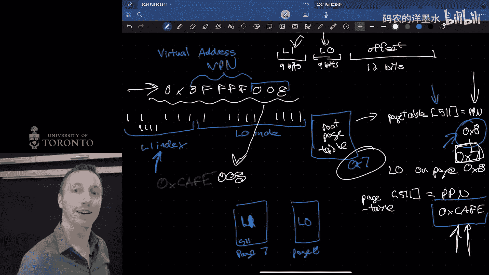

So。In order to help too， I have a little simulator I wrote。So。This will hopefully also help。

So I wrote a function called allocateoc page table， all that does is give me a new page。

 and then I wrote a bunch of helper functions so I can you know create a page table entry for a physical page number。

 so I'm assuming that all of these page tables or all the memory I get their physical addresses。

So in order to do a translation。 So this is going to be three levels of page tables。 So I'm going to。

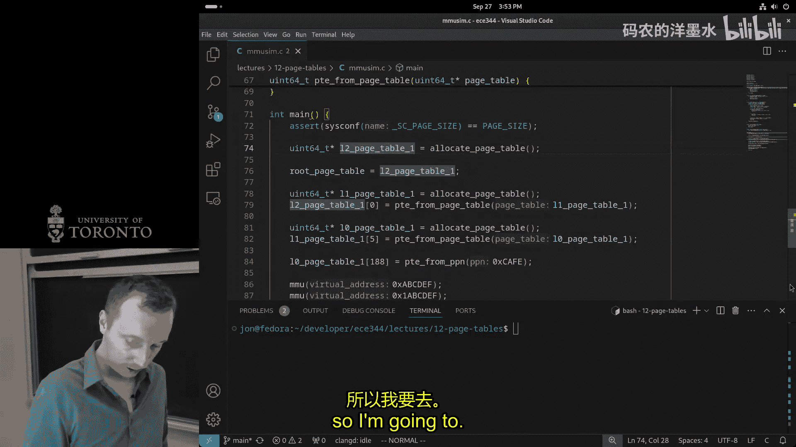

I'm going to do something like this。So I'm going to translate the single address。

 I need an L 2 page table， an L1， and an L0。

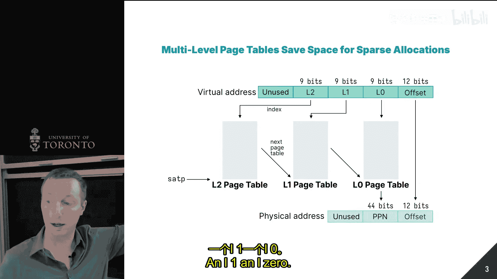

So。Here I'm going to allocate a page table， so in order to translate an address I need like a root page table that would be an L in this case。

 if I have three levels of page tables， it would be an L2， I only have one L2 page table。

 so I would set that as my root page table that will be used to actually do the translation whenever I try and access virtual memory。

So I set it to this page table and then I create an L1 page table。

 so this allocate function gives me a new block of memory。And then in my L 2 page table。

 I have to point to it。 So in this case， at index 0 in the L 2 page table， I have this function。

 page table entry from page table。 So it will basically just take this address for this L 1 page table and then just turn it into a page table entry。

 It basically just extracts the physical page number for me and tells me whether or not it's valid。

Then here， since I'm translating a single address。I need an L0 page table。

And then in the L 0 page table， or yeah， in the。L1 page table。

At index 5 and we'll see why I use exactly these indexes。

 I point to an L0 page table and then in the L0 page table at index 188。

I create a page table entry that points to that tells me that the physical page number is CA A FE。

So now if I。Run this MMMU function， I give it a virtual address and it should spit me back out a physical address using the route page table and the virtual address。

 and that's the only information I give it。So。Any questions before I run this。

 and we figure out why it says what it says。So， if I run this。I get that virtual page， or sorry。

 virtual address， ABC D， EF。Actually maps to CA A FE， D， EF， and then for the other one。

 I get a page fault， AKA， it doesn't have a valid mapping。

 it doesn't actually that would be your SeG fault， that would be you accessing memory you're not allowed to access。

So anyone guess why this one translated， why did this address translate to CFDE knowing how I set up everything here？

そう here。So just looking at that， everyone figure out the indexes all make sense and everything's all good。

All right， let's make sure I wasn't crazy， so same thing is going to happen。

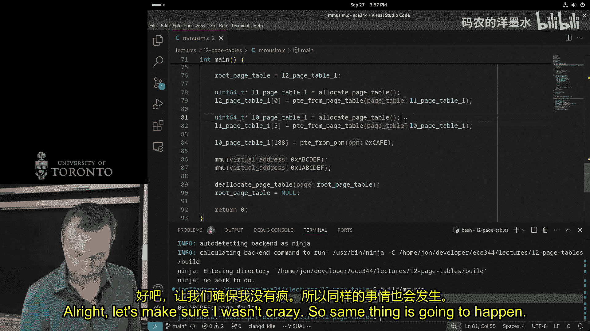

So if this is my virtual address， right， I still have to divide it out the same way。Okay。

And if we run out of time， we'll play with it， so this is my virtual address。

If I have to figure out what indexes it will use， well， this is my offset。It won't change。

And then I have nine bits for the rest them， so I have to turn this whole thing into binary。

 so a was 10，10， B was 1，0，1，1， and C was 11，0，0， right？

So this would of course have leading zeros like everything else in math， so these are all zeros。

 so if I grouped them into nines，This is my L0 index。The next group of nines。Of 91s is my L1 index。

And then the rest is my L0 index， right？So what's my L0 index。If it's all leading zeros， zero， right？

IW the resulting numbers， so that would be0， what's my L1 index？6 or five。The one's calm。

 the two's calm， the threes calm。So it's 5， right。What's my L0 index？

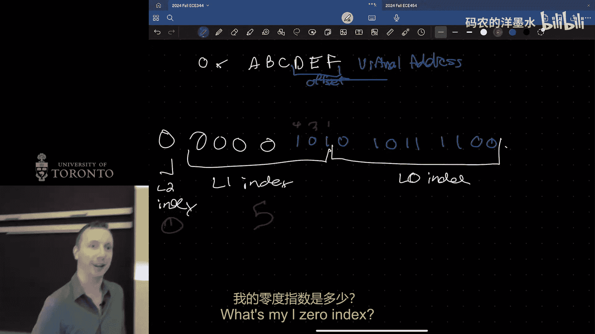

Lot's a lot of ones。Well。Student reasoning， it must be 188。Because it translated correctly， right。

 if it didn't， if I changed this to。What happen if I change that 1，89 instead of 1，88。

It should page fall right it shouldn't have a valid translation so if I compile and run that I get a page fault immediately because it would look at the index for 188。

 it would not have a valid entry so I wouldn't be able to translate this address if I change it I don't no what comes after C so if I change it the C to a D will this translate now。

We have some no faces。Of course， it will。Because。If I just add one to it and the old index was 188。

 if I just add one to it， then it goes to 189， which is what I set。

 so then I would translate that address or that page。

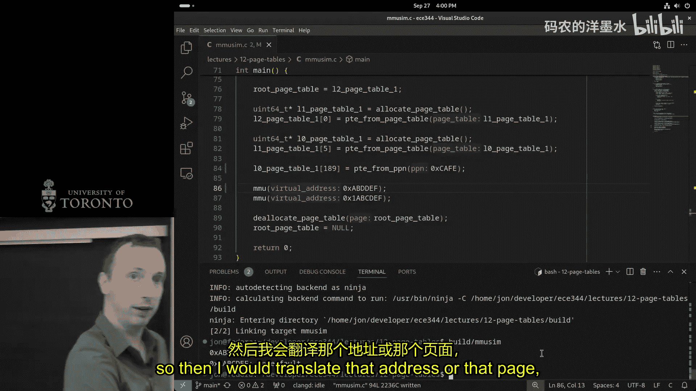