# 操作系统：第11讲：多级页表 🗂️

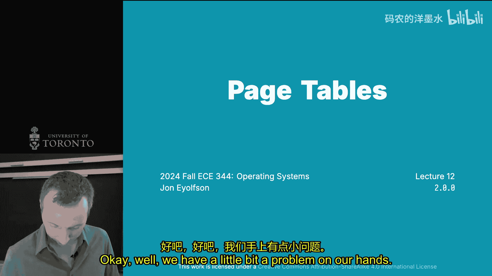

在本节课中，我们将要学习如何解决单级页表占用内存过大的问题。我们将介绍多级页表的概念，了解其工作原理，并通过实例学习如何进行地址转换。

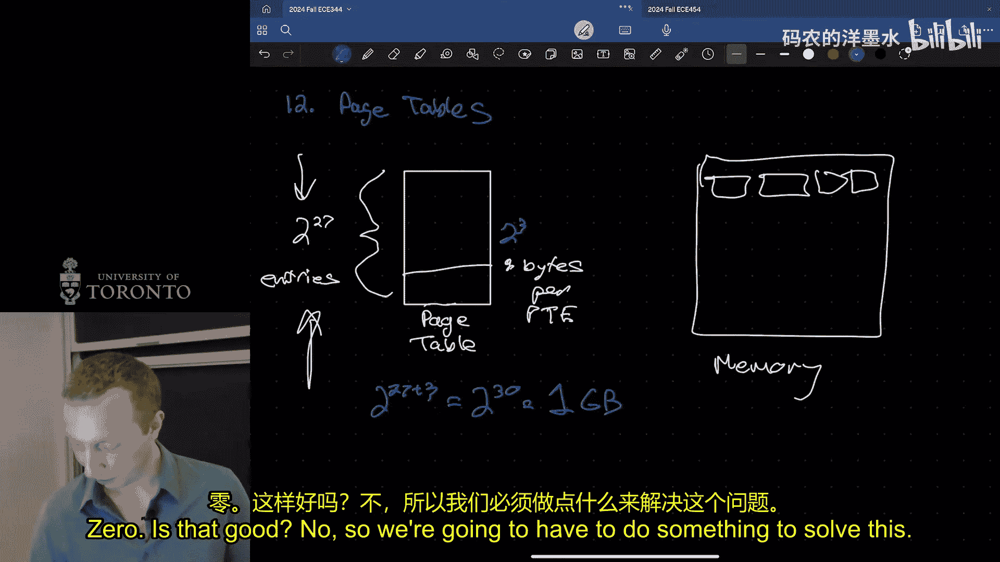

## 概述

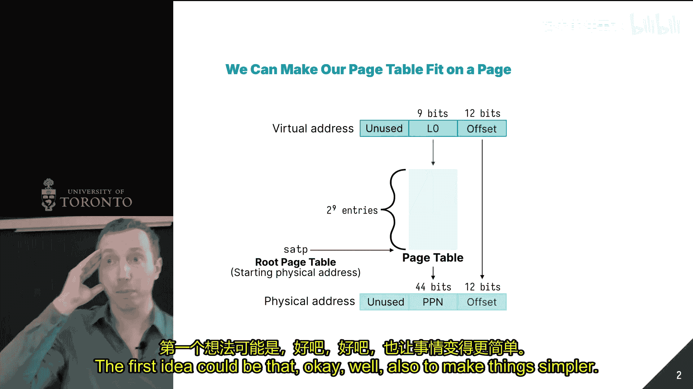

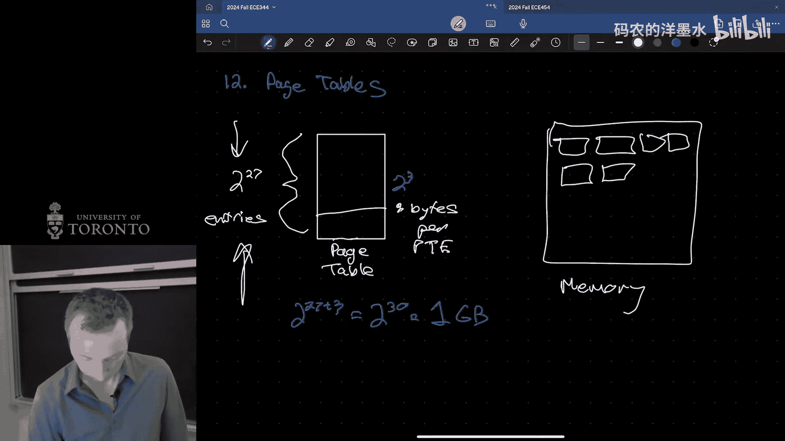

上一节我们介绍了页表的基本概念，它负责将虚拟地址映射到物理地址。然而，一个简单的单级页表可能会非常庞大，占用大量内存。本节中我们来看看如何通过多级页表结构来解决这个问题。

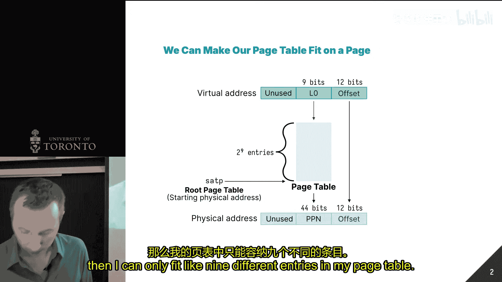

## 单级页表的问题

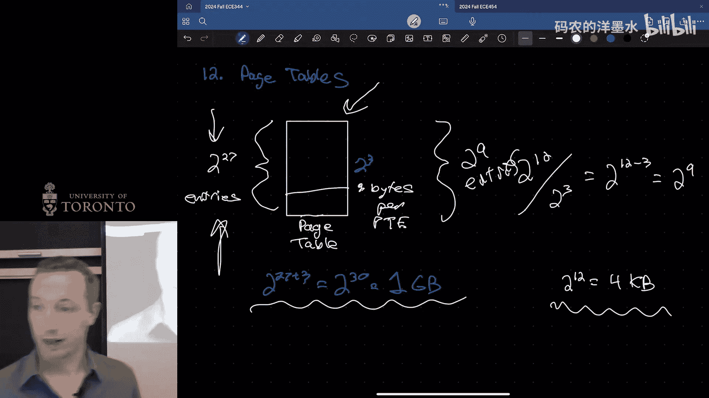

我们知道，内存被划分为许多固定大小的块（页）。整个物理内存被划分为一系列块，每个块的大小通常是4096字节（4KB）。

但是，我们遇到了一个问题：页表本身也需要存储在物理内存中，而目前的单级页表非常庞大。以一个39位地址空间、4KB页大小为例，页表需要包含 `2^27` 个条目。每个页表条目（PTE）至少包含一个有效位和一个物理页号（PPN），通常为8字节。

那么，这个页表有多大呢？条目数量是 `2^27`，每个条目8字节（`2^3` 字节）。因此，总大小为 `2^27 * 2^3 = 2^30` 字节，即1GB。这只是一个进程的页表大小。如果一台机器有16GB内存，运行16个进程，那么仅页表就会占满所有内存，没有空间留给应用程序。这显然是不可行的，因此我们需要解决这个问题。

## 初步构想：将页表放入一个页中

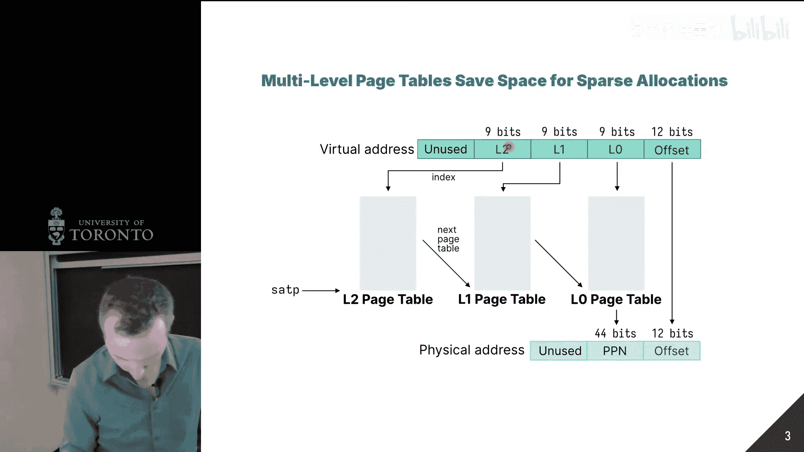

既然内存已经被划分为页，一个自然的想法是：用这些页来存储页表本身。我们的第一步尝试是让一个页表恰好能放入一个内存页中。

这显然限制了页表中能存储的条目数量。如果一个页的大小是4KB（`2^12` 字节），每个页表条目是8字节（`2^3` 字节），那么一个页能容纳的条目数量为：
`页大小 / 条目大小 = 2^12 / 2^3 = 2^9 = 512` 个条目。

这意味着，如果页表大小被限制为一页，那么它只能支持 `2^9` 个虚拟页。结合12位的页内偏移，总共能支持的虚拟地址位数是 `9 + 12 = 21` 位，即最多支持2MB的虚拟地址空间。这是一个巨大的限制，所以我们需要进一步改进。

## 多级页表解决方案

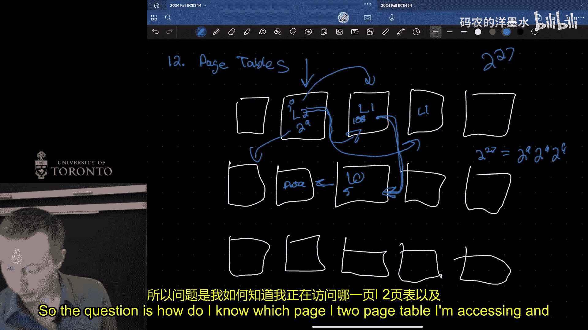

为了支持完整的39位虚拟地址，同时保持页表结构紧凑，我们引入了多级页表的概念。这种方法使得翻译地址的过程稍微复杂一些，但极大地节省了内存空间。

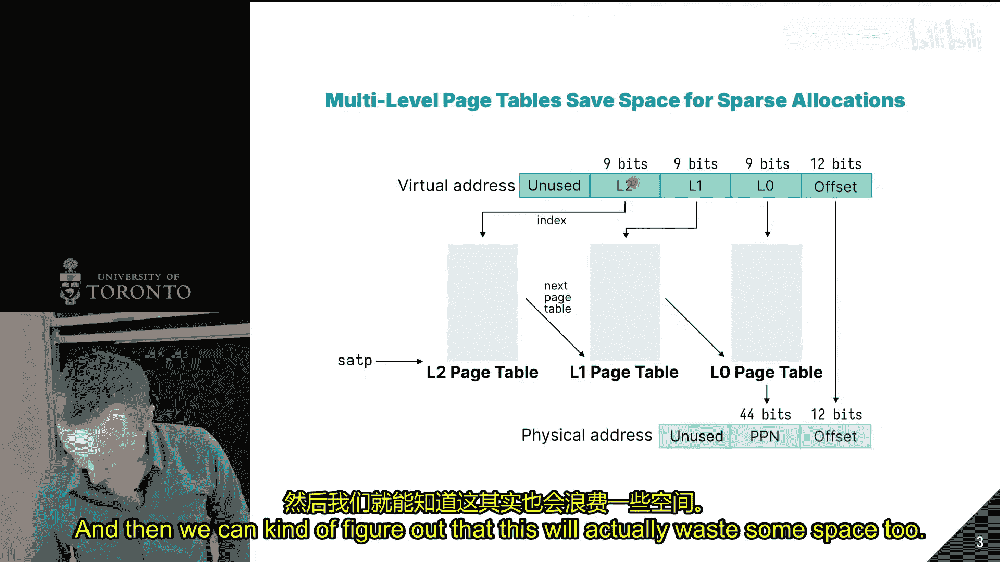

我们将虚拟地址中的虚拟页号（VPN）部分分割成多个层级。每个层级的页表都恰好能放入一个物理页中。现在，翻译一个地址需要经过多个步骤。

以三级页表为例，虚拟地址被分割如下：
*   **L2索引**：最高的9位，用于在第一级（根）页表中查找。
*   **L1索引**：中间的9位，用于在第二级页表中查找。
*   **L0索引**：最低的9位，用于在第三级页表中查找。
*   **偏移量**：最低的12位，直接用于物理地址，无需转换。

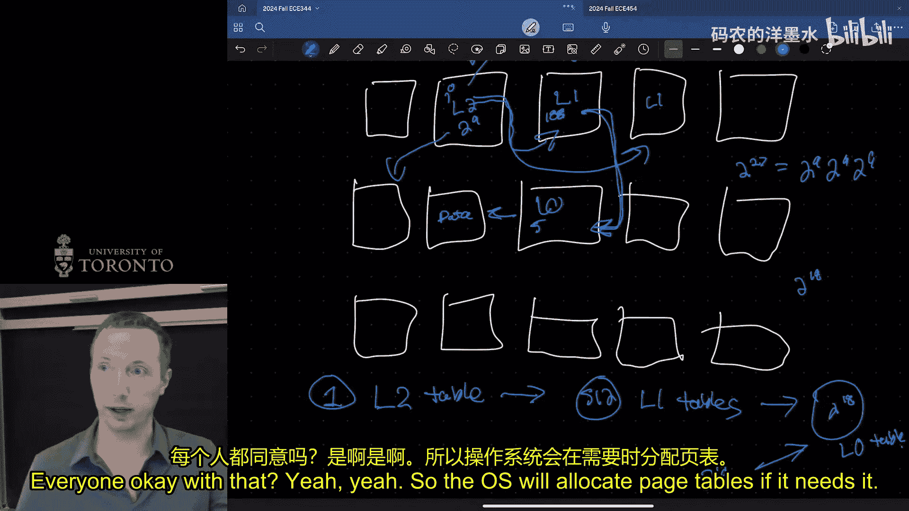

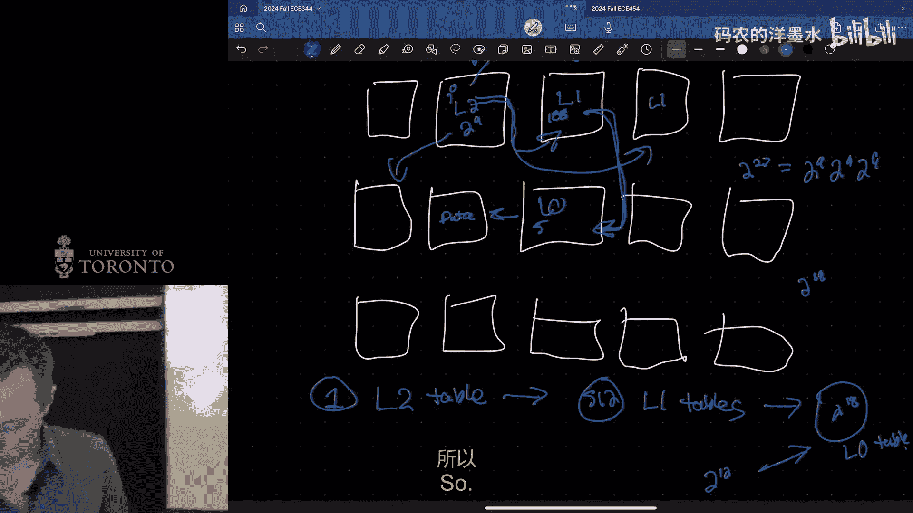

翻译过程如下：
1.  CPU中的**SATP寄存器**存储了当前进程的根页表（L2）的物理地址。
2.  使用虚拟地址中的 **L2索引** 位，在L2页表中找到对应的条目（PTE）。这个PTE不直接指向数据页，而是指向一个**L1页表**所在的物理页。
3.  使用虚拟地址中的 **L1索引** 位，在上一步找到的L1页表中查找条目。这个PTE指向一个**L0页表**所在的物理页。
4.  使用虚拟地址中的 **L0索引** 位，在L0页表中查找条目。这个PTE终于包含了目标数据所在的**物理页号（PPN）**。
5.  将得到的PPN与原始的12位**偏移量**组合，就得到了最终的物理地址。

### 空间效率的优势

单级页表需要为整个虚拟地址空间预留空间（例如1GB）。而多级页表是“按需分配”的。

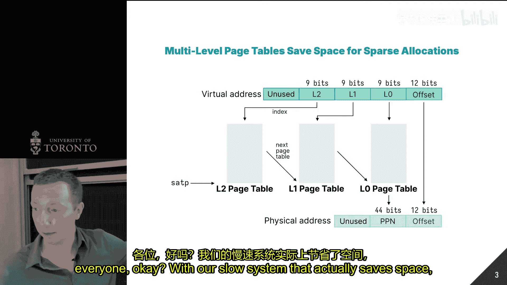

*   一个进程至少需要**一个L2页表**、**一个L1页表**和**一个L0页表**才能翻译一个地址。
*   每个页表大小是4KB，因此最少只需要 `3 * 4KB = 12KB` 的内存来存储页表。
*   只有当进程实际使用更多不连续的虚拟内存区域时，操作系统才会分配额外的L1或L0页表。

这样，我们从每个进程可能需要的1GB页表内存，降低到了通常只需几十KB，这是一个巨大的改进。

### 性能开销的权衡

然而，多级页表带来了性能开销：
*   **单级页表**：翻译一个地址需要 **2次** 内存访问（1次查页表，1次访问数据）。
*   **三级页表**：翻译一个地址需要 **4次** 内存访问（L2、L1、L0查表各1次，最后访问数据1次）。

这使得地址翻译变慢了。我们后续会介绍**转换检测缓冲区（TLB）** 来大幅缓解这个性能问题。

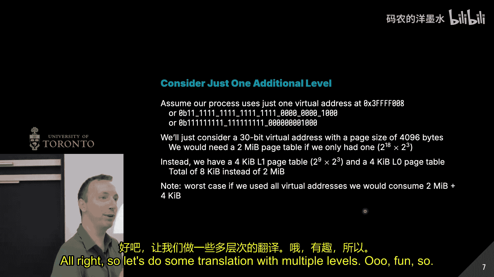

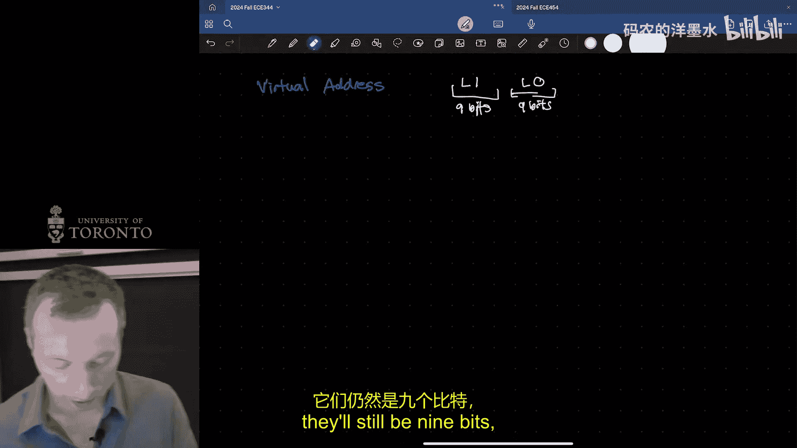

## 页分配与管理

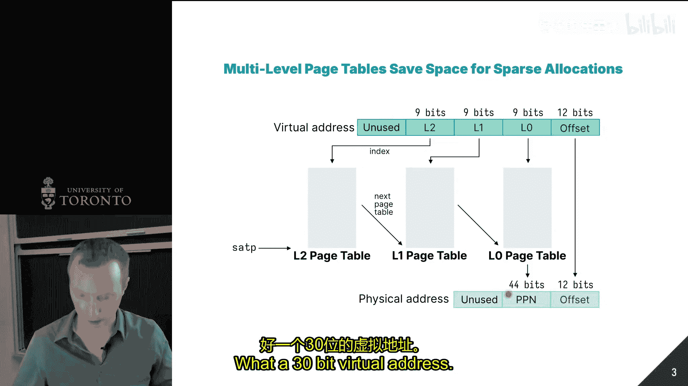

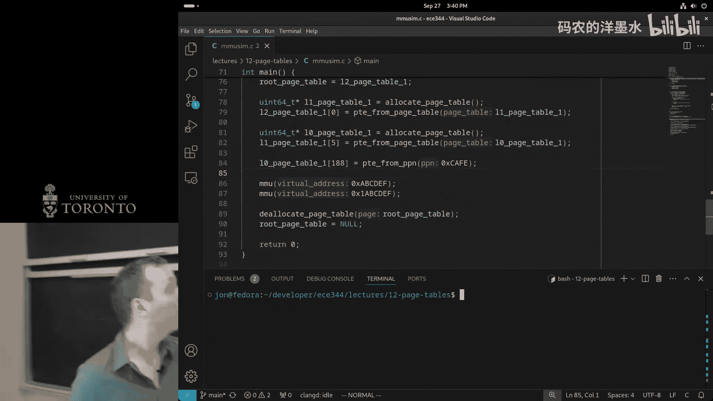

操作系统需要一种方式来管理物理页的分配和释放。由于所有页大小相同，管理变得非常简单。

以下是其工作原理：
*   系统维护一个**空闲页列表**，链接所有未使用的物理页。
*   奇妙之处在于：这些空闲页本身的内存可以用来存储指向下一个空闲页的指针，因此管理结构本身不占用额外空间。
*   **分配一个页**：操作系统只需从空闲列表头部取出一个页。
*   **释放一个页**：操作系统将该页添加回空闲列表的头部。

这种分配器非常高效，因为所有页都是等效的，无需担心碎片问题。

## 核心公式与概念

理解多级页表，请记住以下关键点：

1.  **页表大小**：`页表大小 = 条目数量 × 每个条目大小`
2.  **单页容量**：`一个页能容纳的条目数 = 页大小 / 条目大小`
3.  **地址翻译**：将页表视为一个**PTE数组**。索引 `i` 对应的PTE位于页表基地址 `+ i * sizeof(PTE)` 处。
4.  **多级关系**：第 `N` 级页表中的条目，指向一个第 `N-1` 级页表。第 `0` 级（最后一级）页表中的条目包含最终的**物理页号（PPN）**。

## 地址转换实例

让我们通过一个简化的两级页表示例来实践地址转换。

假设系统参数：
*   虚拟地址：30位（为了简化，只用两级）
*   页大小：4KB（偏移量12位）
*   每级页表索引：9位
*   虚拟地址格式：`[L1索引(9位) | L0索引(9位) | 偏移量(12位)]`

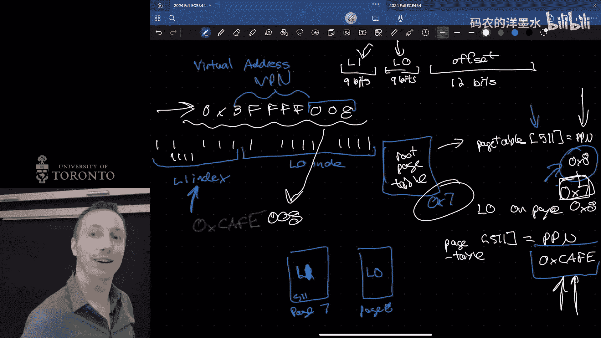

**要转换的虚拟地址**：`0x3FFFF008`

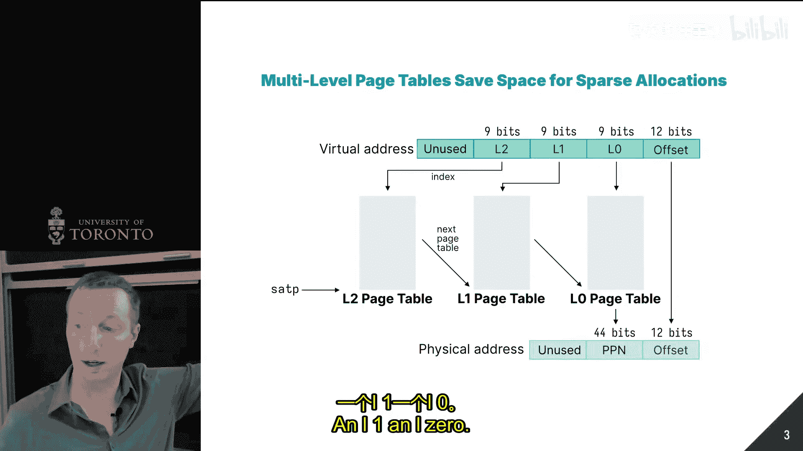

**已知条件**：
1.  根页表（L1）的物理页号是 `7`（由SATP寄存器给出）。
2.  在物理页 `7` 上的L1页表中，索引 `511`（因为 `0x3FFFF` 的高9位全是1）处的PTE指向物理页 `8`（这是一个L0页表）。
3.  在物理页 `8` 上的L0页表中，索引 `511`（地址的低9位也是全1）处的PTE指向物理页 `0xCAFE`。

**转换步骤**：
1.  从SATP获知L1页表在页 `7`。
2.  用虚拟地址高9位（全1，即511）索引L1页表，得到L0页表在页 `8`。
3.  用虚拟地址中间9位（全1，即511）索引L0页表，得到数据页在页 `0xCAFE`。
4.  附加12位偏移量 `0x008`。

**最终物理地址**：`0xCAFE008`

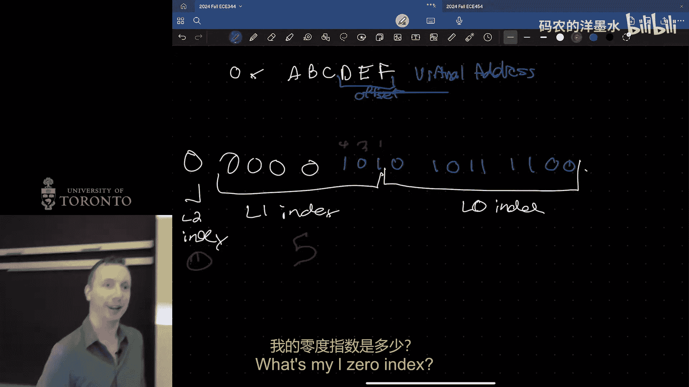

## 总结

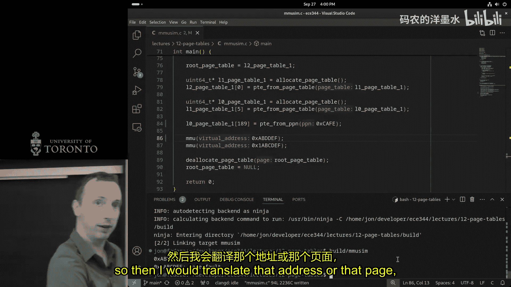

本节课中我们一起学习了多级页表。我们首先指出了单级页表占用内存过大的问题，然后引入了多级页表作为解决方案。多级页表通过将一个大页表拆分成多个小页表，并采用按需分配的策略，极大地减少了对内存的占用。虽然这增加了地址翻译的访问次数，但通过后续将学习的TLB可以高效缓存翻译结果，从而缓解性能影响。我们还学习了物理页的简单分配管理方式，并通过实例练习了多级页表下的地址转换过程。