# 【全集】多伦多大学 操作系统 中英字幕 1080P p12 Lecture 12 - 页表实现 -BV1Rbk7ByERc_p12-

🎼。我认为。Alrighty， welcome back to operating System。Everyone love page tables now。Yay。What was that？

All right， that wasn't me。

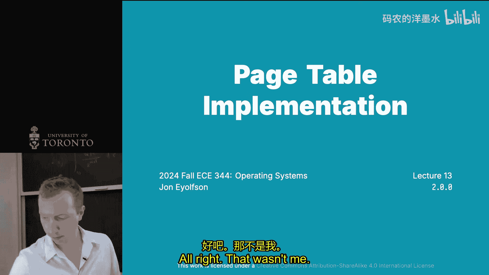

Today， we're just going over page tables again。 So here is how virtual memory gets translated。So。

Any questions， comments or concerns before we dive more into it today？

Or did everything last lecture more or less make sense？A， yesterday。Yeah。えしも。L2。Pase of the L1。

Alocated the，index。Yeah， so you do use the bits to actually figure out which index in the page table you need to actually access and you're given right。

 thered be a register something keeping track of the root page table where to start。

 and then you can figure out the rest from that。And we'll see more examples today because it needs to be stored somewhere。

 so we'll do some more examples just to make sure this is all clear。

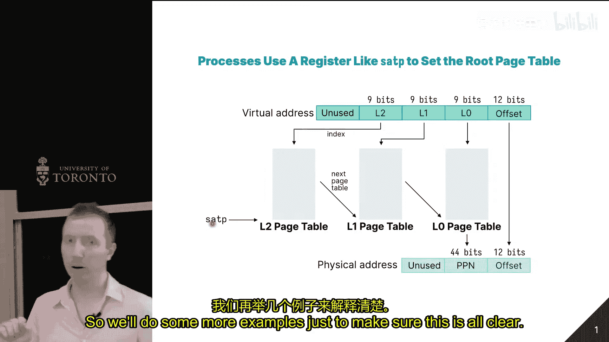

Alright， more or less， okay。 Allright， So so first thing I will talk about is something called alignment。

 So you might have heard this term before。Basically， just means that like eventually。

 all of your allocations eventually line up with byte 0。

 So if I say something like pages are 4096 Bte aligned， that means all of the lower 12 B。

 all of those 12 Bs will always start with 0。 So no matter what the address is。

 it will be essentially divisible， if you just take the whole address。

Convert it to a number and then divide aligned means that everything is divisible and computers like alignment because it's very easy to figure things out。

 So if instead my pages were not aligned， then maybe I have a page that starts at address 7 C 0，0。

 A K  one of the 12 by。 It's like。Starting somewhere within a page。If I started address 7C。

And I have page number of B， so I have 4090。Six。Which means I would have to add 4095 to the number means the last by of the address would be 8。

 B，7 or。8 B， FF， which is not great。 But because pages are all aligned。 so they either start。

 they'll start in a multiple of 4096。A page。I would just say it's on page 7。

 and then it would immediately， I know the lower 12 bit I can immediately just use for the offset。

 which by on the page I need to use。 So the pages would start at the address 7000，0，0，7，0，0，0。

 And the last byte would be at 7， F FF。 So you can verify that that is a page。

 But that's why we don't need to store the offset or anything as part of the page table entry or anything like that。

 because all of the pages are。Page aligned。 so we know exactly where they start and where they end。

So。Since we just take the address and we essentially say it's aligned。

 if it's divisible by that number， say I have the address E C。 So that is a memory address E E C。

 I might be asking you things like， hey， is that8 by aligned and what would you tell me。

 is that8 byte aligned， Yes or no。Which means， hey， if that is their address。

 is it divisible by 8 without any remainder or anything like that。Is it yes or no？See some yeses。

 yet。No， why。私啦。Yeah， so see。The response was， hey， it is not 8 by aligned because this。

Is not divisible by 8。 So since its powers of 2， this represents like， you know。

 the 16 columns and all up there。 that is also going to be divisible by 8。 So I don't need to。

Consider that at all。 I can just look at the lower hex digit here。 So if it's8 byte aligned。

 it means that it ends with a 0 or an 8。 So it will either be 0 or 8 the last bit or byte or sorry。

 the last hex digit， if it's 0 or 8， it's88 by aligned。Led， otherwise， it's not。 So C is 12。

 not divisible by 8。So everyone okay with alignment。Okay K， if it's divisible。

 So that's why we don't need to store exactly where page starts。 We know everything's page aligned。

 So by having the。PP，N， just with the P， PN， we know the whole extent of that page。Alright。

 so we saw that simulating the MMU。 we have that whole code example。 We can keep that in mind。

 We showed it before I made an L2 page table， I made an L1， I made an L 0。

 and then I set the indexes to point to each other such that we could translate that address， ABC， D。

 E F， and if it's not able， if it fails at any step along that translation。

 the MMU that's actually using page tables to translate the address， it'll get a page fault。

 So we do have this example， it is provided for you， but。

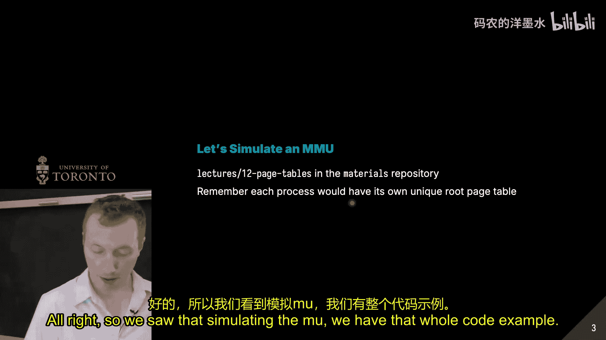

Any questions about this we'll also be able to go back to it at the end。All right。

 let's just move on and do other questions first， just in the interest of time and we'll come with that later。

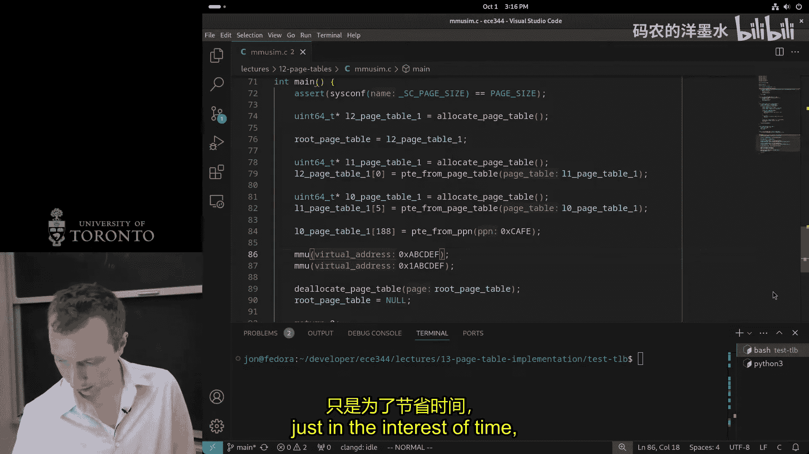

So。A question for you to make sure we have understood things is， let's assume。

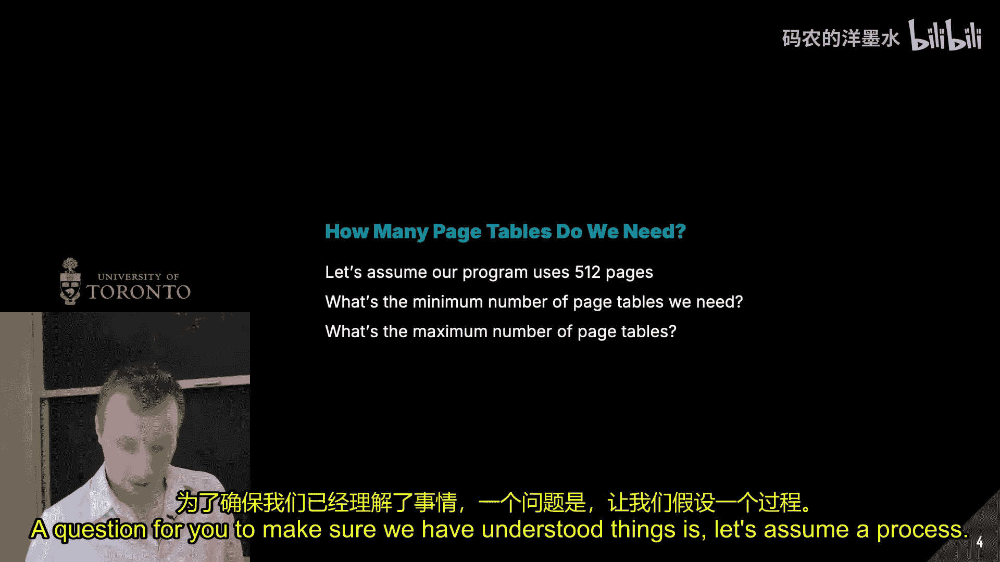

A process。Is we're going to do that again， I thought I fixed you。So process is using。512。

Page is worth of memory。So if a process is using 512 pages worth of memory。

 one question I might be able。Oh， we're going to do this again。So one question I could ask is like。

What。The minimum。We're going to do this。Minimum。Number of。Page。Tables。Required。

So anyone take a stab at that。So my process is using 512 pages worth of memory and well。

 if I am the kernel， I need to make sure that each of those pages of virtual memory map to some physical memory so that it actually works。

So how many page tables would I need to do all 512 translations for this process？At minimum。1。

How would I get away with one？512。 Yeah， can't quite get away with oneton。

 You could like do some recursive stuff and then get lucky。 But yeah。Oh， so just as a reminder。

 we will。Be doing the default scheme we saw before where we have three levels of page tables。

 So essentially， here I'll swap to the slide real quick。

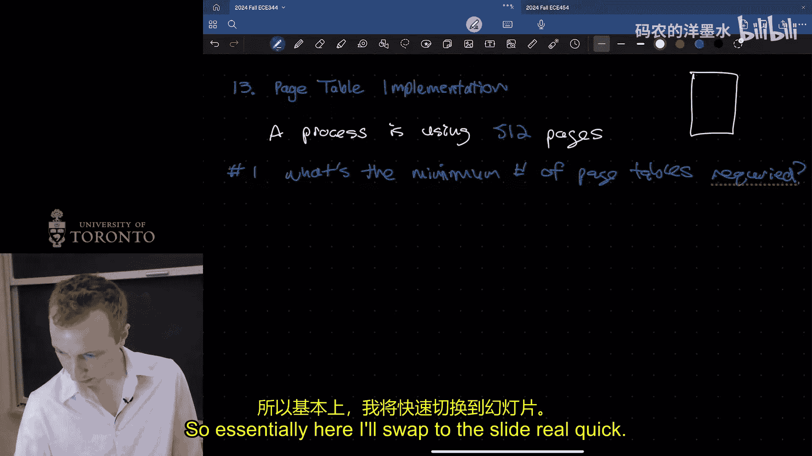

So， yeah， just as a reminder， we are using this scheme where we have three levels of page tables and each one can fit to the9 entries or 512。

 So three levels of page tables and each page table。

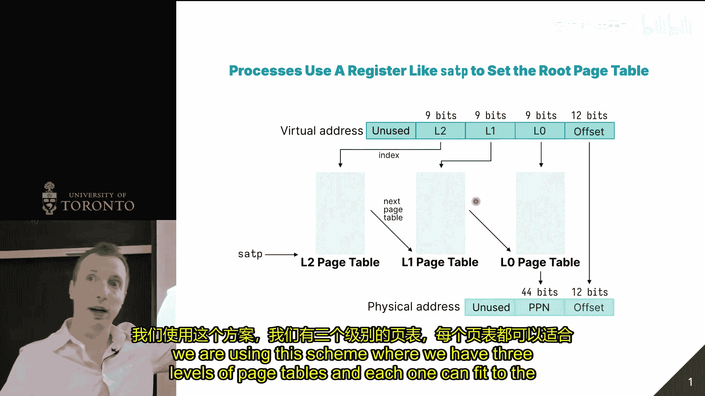

Has 500 or sorry，512 entries or 2 to the 9。 So we have that many entries in our page table。

Each entry just as a sandy check， is two to three bytes。That is our PTE size。

So the total size of this， just as a sandy check， would be two to the 12。

 which is the size of our page。So how many page tables do I need at minimum to translate 512 pages。

 which。Is two the nine。Yeah。513 page tables。Why do I need 513 page tables？The513。拜托。So I have。

 so I always have to have one L2。 So I have an L2， and it points。So two the 9 L1s。So I have this。

And then I have two the9 L1s。And then what？That's it。

So how many peach tables do I need to translate a single address？Or three， right。

 so here let's back up a bit。So even to translate a single address， right？

I would need one L2 page table。It would have one entry。That entry would point to1 L1 page table。

Then it would have， it only needs a single entry that points to an L0 page table。

And then that could go ahead and point to。Whatever the pages I'm using， right？

So the physical page number for this。Virtual page number。To actually give me the translation。

 So I need three page tables at minimum for to translate a single page， right？

So if I had to translate up to 512 of them， could I still only use three page tables or do I have to make more。

Anyone， I need help。Yeah think each page。Iと。Having 512 L0 pages。

They having like five club like L zero。So each page table can fit up to 512 entries by itself， right？

So if this L 0 page table was full of entries that pointed to things。And this is the page table that。

Actually。It's last level translation。 So it's actually the physical page I need for this virtual page。

Then。If that's full， how many entries are in here。512。 So if they're all full。

 all pointing to something， how many different pages is that。512， right， So that's all I need。So。

In this case， the minimum number of page tables I need to do every single translation is just one plus one plus one。

The three。 So I could in L2， it just has a single entry that points to an L 1。

Then that L 1 has a single entry that points to an L。0， and then that L 0 page table is full。

 So what would happen if I need to map another， I don't know。II have like a 513th page I need to use。

Well then at that point I have no choice。 that L0 page table is full。

 so I need another L0 page table right， so I need an L0 page table and then I need whoops。

And then I need an entry in L1 to point to it， right？Alright， I hear rumblings。

 I everyone okay with that。All right。Well， what about if I said the same question what。What's the。

Maximum。If I can spell maximum number of。All right。

 well both if I was actually terrible at doing the mapping。

 What is the maximum number of page tables I have to use？2 to the 27。Worst case。

 if I need to have translations for everything， I need two to the 18 different L0 page tables。But I。

 I'm， I'm only using。I only needed to translate 512 pages。

So that would be if I need to translate like。To the 18， yeah。By2。5，12 times，5，12 times。

OrIt's actually an addition。level one。Addition， so let's see。 how many L2 page tables do I need。One。

 right？So I always have to have one L2 page table， no way around that， it's always just one。

Because I need to know where to start。So。I have1 L。Two page table。 So you're saying that， hey。

 it could be full of entries， right。So it could be full of entries where every entry in the L1。

Or N L2。Points to a separate。L1， right？So how many entries are there in the L2 page table， 512。

 right？So how many L1 page tables would we have？512。 So worst case。

 each of my L 1 page tables just has one entry in it。

 So each one just points to a single L 0 page table。So they all have a single entry， dot。

So if I have 512 L 0 page tables all pointing to a different， unique L 0 page table。

 how many L 0 page tables do I have。5，12。So in total I need one L0 L2 page table。

 so it would be 1 plus 512 plus 512， so the worst case to store the translations for 512 pages is I need 1。

25 pages。Of page tables just to store that。嗯。That seems bad。Does that make sense to everyone。

And also， you can。Tll我。Why they actually picked。The L0， as like being。

So if we just look at the last few bits of an address。Over here。

So if we just look at the last few bits of an address， right。

 if you're accessing memory contiguously。Right， eventually。You know， this might be something。

 something0。 And then if I access memory contiguously and my offset， you know。

 goes from0 all the way up to full。And then I use the next page。 Well， this just increases by one。

 which would make it go to the entry right beside whatever used before。

 So if you use memory contiguously， you're more likely to be in this situation where every all the entries are beside each other。

 everything's nice。That's。One of the reasons why they tell you to use memory contiguously。

 because if you didn't and you're accessing a different page every time。

 especially if you get into this scenario at the bottom。

 you can waste a lot of space because in this scenario， I'm wasting what。

My program is using 512 pages， but I'm using over double that just in page tables。

 if I've screwed up。 While if I accessed everything contiguously。

 I'm more likely to be in this situation where I'm only using3。We'll see other reasons for that too。

 but does this make sense？Some nodding。Okay。So。Another question we can do。

There might be questions of。Like asking you to figure out how many levels of page tables I actually need。

I will。Yeah， so I've discovered from the previous session。

 none of you are young enough to remember 32 bit processors。Right。But back in the day。

 we had 32 bit processors， believe it or not。And。It used virtual memory。Had the same page size。

 So we should figure out how the system worked back in the day。 So back in the day。

 let's just use some numbers。 So back in the day， we had 32 B。Virtual addresses。

So 32 bit that goes up to  four gigabytes of memory。

 so each process can use at most four gigabytes of memory， and if it's 32 bits of physical as well。

 then we can only use  four gigabytes of memory on our machine。So。Back in this day。We still had 4 k。

 or I'll just write in powers of Tutu。 We still had 4 k pages。We're going to do that。

Which is just another way I like to say the page size。And then， well， because。

We had less physical memory， right， We could get away with having a bit smaller page table entry。

 So we had a 4 B。Which is true to the。2。PTE size。Makes sense。 We didn't have quite enough memory。

 We't need a big We didn't need 8 bys of page table entry size。Back。

 they use the same thing like each smaller page table fit on a page。

 So we should be able to figure out how many virtual pages or how many levels of page table entries did they need。

 or sorry， how many levels of page tables did they need in this system。 So first thing。

 if I give you all of this， The first thing you should try and figure out is。好。Hello。How。Many。PTEs。

Alright， looks like I've。So first question is， how many page table entries can I fit on a page in this system。

 So anyone want to let me know。2， the 10， right？Simple。

 so if my page size is 2 to the 12 and each page table entry is two to the two。

 I'm figuring out how many I can fit on each page so I can do that whoa。The last room was fine。

 I don't know why this is so cursed。So this is due to exponent law 2 the 12 minus2。

 which is 2 the 10。I mean， I can of write it out。1024， whatever doesn't matter。So。When we had that。

 remember， we had。We used some number of bits to figure out what index we had to use for our page table。

So。If I can fit。If I can fit two to the 10 page table entries on a page。

How many bits would I need to be able to use that index and be able to select every single one of those page table entries？

10， right？Makes sense before when my page table entry was twice as big， I needed nine of them。

And now it's half as big， so I need an extra bit because I can actually cram double as many page table entries on a page since it's the same。

 it fits the same。So that okay。 That would be the number of index bits we have。

So if we have our virtual address。It always looks more or less the same。So， we ever。

We have our offset at the bottom。How many bits for the offset？12， right。

12 bit that comes from my page size。 So that is what bite on the page am I trying to access and then。

This whole thing。Was for the VPN。 In this case， it is 20 Bs。But if we use multilevel page tables。

 right， we have to break it off into different parts。

 and we have to figure out how many levels of page tables we have。 So we' start at the bottom。

 we have an L 0 index， and then we figured out from here that our index bits。Was equal to 10。

 so this would be 10 bits here。And then， oh， while that only gives us 22 B for a virtual address。

 So we must need another one， so we must need。And oh。One， and we must need two levels。

 And now we have。It looks like we only need two levels。

 So if you want a formula to figure out the number of levels2。

You can calculate that the number of levels you need is equal to ceiling， whatever virtual bits。

Minus offset bits。All divided by index bits。And then you take the ceiling because wealth。

If there's any， I can't have like。Ms。Half a page or anything like that。

 So if I need to support a larger virtual address that needs another level and it doesn't quite fit。

 I have to get a whole another level， even though it might just have one entry。

 So that's why we have a ceiling here。 But for this system， they designed it， virtual bits was 32-12。

 or that whole thing is the number of total bits for the VPN。

Then I divide it by the number of index bits I need， which is 10。 And in this one， thankfully。

 it's a nice number。So。It's just ceiling of two。 ceiling of two is two， so I must need two levels。

And that also makes sense because if I draw it out here。

 I can see that that gives us all of the 32 bits here。So。If for some reason。

 we wanted a 33 B virtual address， well， it makes sense that we would need another level a page table。

 We would need an L2。 And then our L2 would just have at most two entries to tell us which。

Different L1 we should use。 And then that would be full。So that okay with everyone？All right。

This system has two levels of page tables。

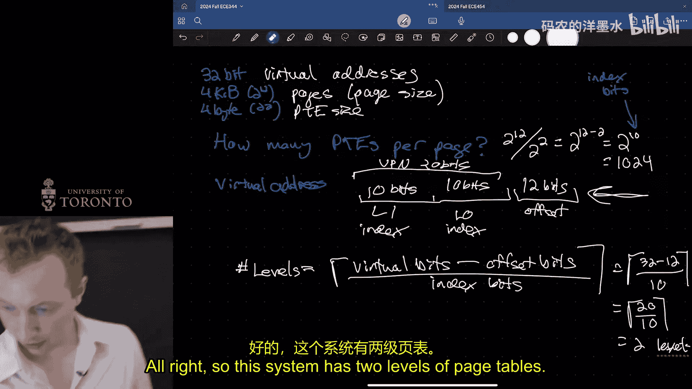

64 B machines， even with the 39 B virtual address， use three levels of page tables。

What is the practical difference between these two if we're using them？Or what will be faster？

The two levels will be a hellve a lot faster， right？Also before your time fun story。

When we first transitioned to 64 B CPUs， they were slower because they had another level of page table primarily。

 And if you didn't have4 gigs of Ram， So you didn't actually like need that。

 Your computer just ran slower for no reason。 then some people would argue you do not need these newfangled 64 B CPUs at all。

 because no one will have more than 4 gigs of memory ever。

 So why would you just want things to be slow。And。People had to be dragged。

 kicking and screaming into 64 B， primarily because of this reason， while it was slower。So。

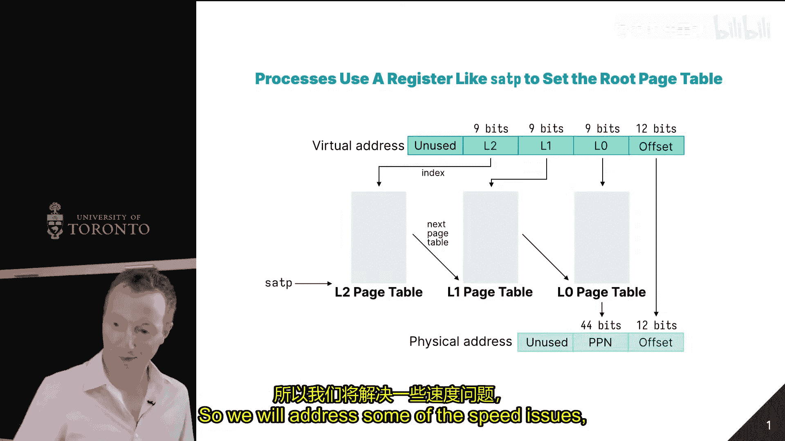

We will address some of the speed issues， but yeah， it is slower and 32 B machines were faster。

 Some people still support them。All right， any questions for that？Fun story time， right？All right。

 so we need to address the problem that。Even with two levels， three levels。

 we're still slowing down our。Slowing down our memory quite a bit。 And remember。

 we want using virtual memory to be almost as fast as using。Almost as fast as using physical memory。

So。Every single address we need to follow pointers across multiple levels of page tables， it's awful。

 it is slow。You might also access the same page every time。 So think of like using an array。

 if you use an array， it's likely every single element is on the same page。

 So you don't need to do the same translation over and over and over and over again。You might only。

 your program might only use a few pages of memory at a given time。

 So the solution to speed this up is one of computer sciences only solutions， and it is caching， so。

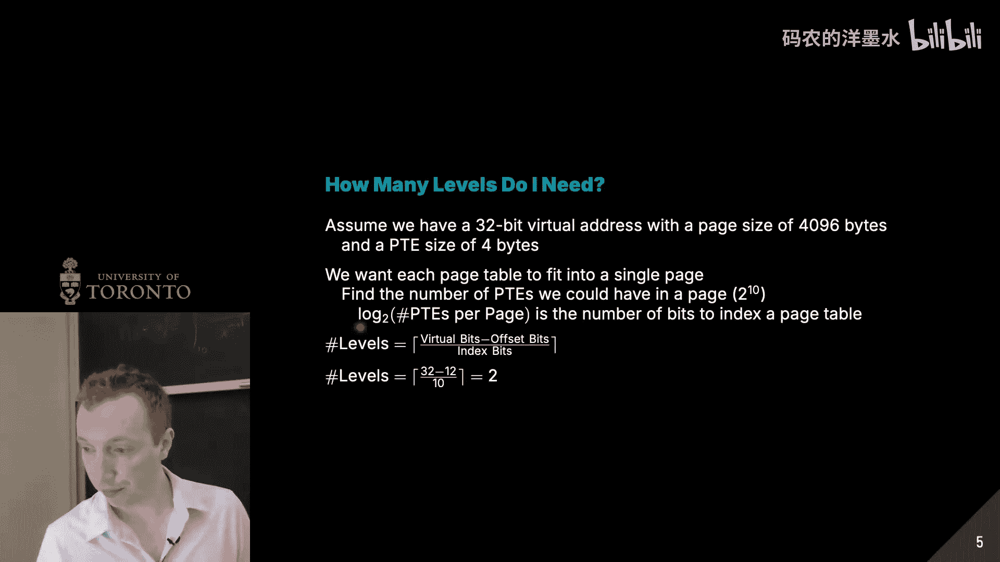

Oops，There is a cache that。Essentially， all caches do is save values and then retrieve them so you don't have to recalculate them。

 That's all a cache is。 So there is a specific cache for doing the memory translations and looking up all the page tables and everything。

 and it is called a T LB or translation， look aside buffer and that caches PTEs at the lowest level at L0。

 So it tells you for the VPN， it actually saves the page table entry。For this VPN。

 So it would match the entry in the L 0 page table and why it would do that。 So you don't have to。

WeHop across L2， L1， L0， and all of that。So we would have our normal address from before。

If we have a 39 bit virtual address with a 4K page size， we have 27 bits for the virtual page number。

This little table， it would save all of the translations for you。 Well not all of them。

 So this is a limited size， but this cache would be a hardware cache on your CPU that is meant to save your most recent translations and the size of this would determine how many it can save so。

If it has made that translation before， there would be something called a T LB hit。

 it would actually scan all these entries to see if I have actually translated this virtual page into a physical page before。

 And if I had， well， it would store the page table entry。

 which has the physical page number and all of the permission bits。

 And then I would just use that immediately。For my address。

 I don't have to actually access any other memory。 The translation is already safe for me。

 I just use it。If that translation was not in this table， I have to you know look it up。

 see if it's in there or not if it is not in there， that is called a TLB miss aK。

 it is not presently cache， and then we have to translate as I showed before。

 so knowing which L2 page table to use， I have to access an entry in the L2 tells me where the L1 is。

 access an L1 entry， it tells me where the L0 is， I access the L0 entry。

 then it tells me what the final translation is。 So if you went through that whole process。

It would be saved in the T LB。 So just a place to save the most recent updates。

 And then we would use it for the translation。 So is that okay for everyone。

 We're not going to waste time。 We want things to go fast。第二。Is this same case of high to。就拜咗诶。Yeah。

 so the three sections using the three levels， that would be the translated using page tables。

 so that is the process that would actually be used is just slow and we want to save the result。

All right， so TLB。I had this come up。During the midterm。

 someone raised her hand and came to me and was like。Ask me the question， what's a TLB？

During the midterm。You should know what TLB is。So that's not a valid question to ask me during a midterm。

 so。T L B， this is what it is。 a cache for all of the virtual memory translations to make things go much faster。

😊。

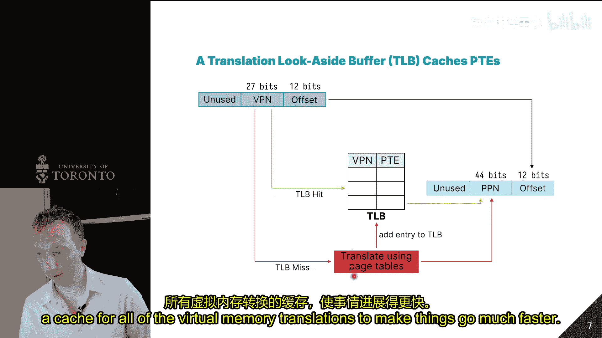

Alright， so to show that this cache actually works quite well。

 we will assume a single page table and figure out the effective access time A K。

 What is the average time to access memory。 So we can assume that there's only one page table。

 So there's only one additional memory access。😊，If we have to look up everything， of course。

 if we have three levels of page tables， there would be three additional memory accesses。

 but for this， this is just considering a single page table。

So we have to calculate the time it takes to translate an address if it is in the T LB。

 Aka A TLB hit time and the time it takes to look up an entry， it's not free。

 that cache is much faster than actual memory， but it's going to have to search。

 see if the entry is already there。 So it's the time it takes to search and find the entry and then we know where in physical memory。

 we have to access。So we just have to do the original memory access。 In the case。

 we have a cache hit。If we have a miss， if we have to go through the whole process， well。

 we have to pay the penalty of searching the T LB， not finding it。

 And then we have to do all the memory accesses。 So if there's only one page table。

 we have to figure out we have to read the page table entry。

 and then we have to do the actual physical memory access。 So we would need to。

 if this was three levels of page table， this number would be a four。So。

The effective access time or the average is alpha is the proportion of hits。

 so the proportion of cash hits。So times a TLB hit time。

 and then plus the proportion of misses times however long a miss happens to get our average time。

 so some numbers。A fairly bad rate is like， hey， there's a hit 80% of the time。

 it takes 10 nanoseconds to search and normal memory accesses take 100 nanoseconds。

Calculate the effective access time。 Well， that would be 08。 So 80% of the times there was a hit。

 So 80% of the time it takes。110 nanoseconds。 So the original memory access plus the search。

 and then 20% of the time， I have to search the TLB， which is 10。 and then the two memory accesses。

 which is。210。 So my effective access time is 130 a As，30% slower than using memory。

 which is a hell a lot better than four times slower， right。So this is why it works。 And this is。

Primarily， doing that translation。Cause you've been told so far that you should use memory contiguously。

 right。Ha thought not irked anyone before， Like it's called random access memory。

 Why doesnt all it all take the same amount of time。It does。

So why do they tell you to access things contiguously。

To avoid this so that if you access things contiguously。

 it's more likely they will be all on the same page。

 And then it's more likely it won't have to do the translation over and over and over again。

 which is slow。とよ？Mo。So it's time to search the T L B2。 So it's not free。

 So you need to look up the entry。And see if it's there or not。 So it's not free。

 So we just assume the to the time search the de table is same。remember。

So the time it takes to search the cache is going to be much faster than memory。 So here。

 the numbers I made up are。Yeah， so here the cache searching is like 10 nanoseconds versus 100。

 So it's like 10 times faster。 So it's worth it。Alright， so this is pre， so。

That's primarily why the lie they told you of like just saying computers like contiguous memory。

That's a lie。 Everything actually wants to be on the same page for things to get fast because all those virtual pages you use。

 if you cross the page boundary。Well， one page might be here in physical memory。

 another page might be here in physical memory。 they might be located very far away from each other。

 but because it's random access memory， they have the same speed。

 The only thing that's actually important is accessing the same page over and over again。

 So it's in the TLB and I don't have to look it up again。

 So now you can answer for the real reason why they tell you to access things contiguously。

Especially since it's called random access memory。 I don't know if it irked anyone before， but。

It should have irked you a little bit。Yeah， also just wondering if the effective access time come like？

Yeah， same thing as the average access time。All right。Quick little note here， too。

 So context switches。 they actually involve handling the T L B because every single process has its own page tables。

 A K A， its own virtual memory mappings。 Well， if I context switch between two processes。

 I also have to do something with the T L B， because that is saving translations。😊。

Maybe old translations for a different process。 So if you context switch me in。

 I shouldn't use any of the cache values because they're only valid for a different process。

 So the options here， if you're the kernel， you have to make sure to flush the cache A K。

 you delete everything in the T LB。 So that has to recalculate again for the new process or with some hardware。

That T LB will also support attaching a process I D to each entry so that if you switch processes。

 it won't try to use that cached value for a different process to save you from accessing its memory。

 Most implementations of kernels， whenever you context switch between processes。

 it just flushes the T LB。Risk 5， there's a certain instruction for it S fence do VMA。

 the VMA ones have to do with virtual memory on X 86。

 whenever you change the base page table or the route page table that lives in a register。

 And whenever you change the register value， which would be done as part of a context switch。

 it immediately flushes the T LB for you。 So you don't have to do anything。

 If you're the kernel developers， it's immediately flushed for you at a hardware level or zeroed out。

 and it's all gone。So let's go to a fun little example。

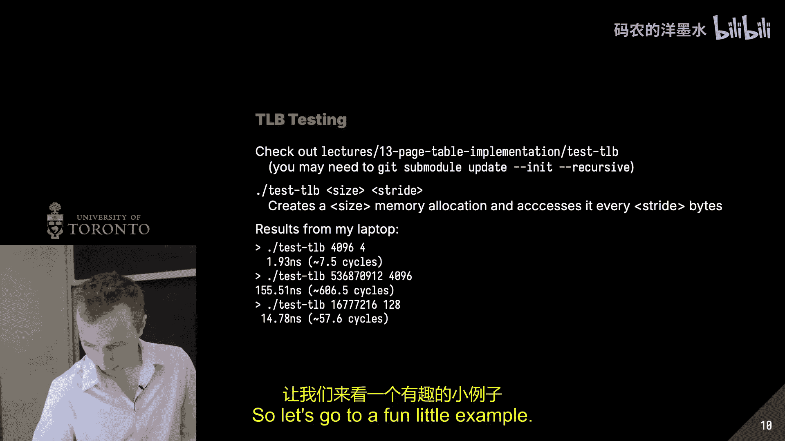

That's a bunch of writing。 So there is this fun program to see the effect of the T L B in terms of memory accesses。

 Funnily enough， it was written by the same guy that wrote。😊，That started the Linux kernel。

 so this program， very， very simple， takes two arguments。It takes a size。

 so it will allocate memory of that size， and then it will access elements every stride bys。

So if strideide is four， it will access by zero of that memory allocation by 4 by 8 by 12 by 16。

 keep on going over and over again。So。If I do it with the argument。Say I do this argument。So 4096。

 so I want。4096 bytes， which should be a page， and then I access every four bytes。

How many TLB hits should I get and how many TLB messageses should I get？

First question you might want to ask yourself is how many accesses happen period？

Here's some rumblings of right answers， they went' brave enough to tell me what's going on。Yeah。

日本の最さ。No。Yeah， two124。W would there be two misses because first of there are 1024？Yeah， so。

Each page is5 12。Each page is 4000。Yeah， so that's one page。Su。Very close。A one for the Sa。Yeah。Yeah。

 one miss at the beginning， right so if I just have one page and I access。1024 different elements。

 Well the first time I I'm accessing a new page， that'll be amiss。

 I'll have to go through the whole process of figuring out。

Which virtual page or which physical pages is virtual page maps too， but all the other accesses。

 the other 1023 are all going to be hits because they're all in the same page。

 I can reuse it over and over again， right。So oops， so if I run this。Each access。

 it takes an average of how long each access takes， so each access takes like 1。3 nanoseconds。

So what if I do this？So here， this is a much bigger number。 So this number is。

I believe that's 512 meby。 So I ask for 512 meby of memory， and then I access every 4096 B。

 So how many misses do I get in this case。Every single time， every access is a new page， right？

Over and over and over and over again。 So should this be a hell of a lot slower。How much slower？

A lot four times， four times is pretty bad。10 times。哦。Let's just send it and see what we get。

 So it was 1。3 nanoseconds before。Ouch。So，30。It was。Almost 30 times slower。

 accessing a new page every single time。 So there's some more overhead associated with this because。

Well， behind the scenes。If we're accessing a new page all the time。

 the kernel actually has to allocate a new page for it and a whole bunch of other things are going to go on。

 which makes it even worse than four times slower， The four times slower is just for translating the address。

Not to say anything about anything else going on， like allocating pages and figuring out where in memory they should go。

 So that is the reason to access memory contiguously。

 It is very bad if you have a new page access every time。So everyone， cool with that。

Cool little experiment。 You can play with numbers and see smaller numbers will have more of an effect on caching and you'll get different results。

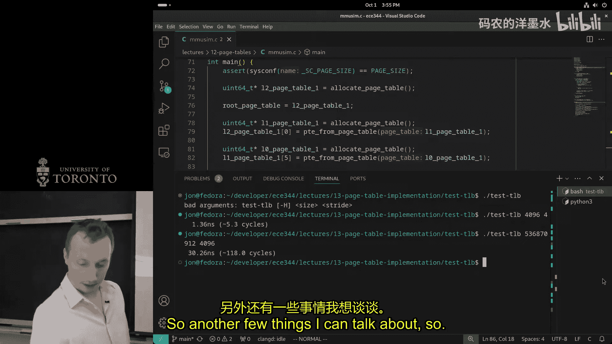

So。Another few things I can talk about。We use a system called like that SBRK for user space allocation。

 That was a system called Lib Cs to manage the Heap。 So Maloc actually gets memory from here。

 So this system called Gros or shrinks your Heap。What the kernel will do is if you make the system call。

 it will just grab pages from the free list to fulfill the request。

 the kernel would modify the page tables， set the pages the page table entry is valid。

 set other permissions and then point it to some new page it allocated and。For memory allocators。

 you might notice that like， hey。If I use a bunch of mallocs and then I free a bunch of stuff。

 my process doesn't use any less memory because it's。Typically。

 you can only shrink the heat from one end of it。 So it'll stay claimed by the process a kernel cannot free pages。

 It's really unlikely that you'll have like a page size empty at the very end so that the kernel can actually reclaim memory。

 So this is also why some processes that use malloc might look like they're using a lot more memory than they're actually using So some memory allocators too。

 there's this Mmap system call that will play with a little bit in the course to actually manage your own virtual memory translation。

 So everything doesn't have to be all in a row for virtual dresses you can kind of modify your own virtual memory and we'll see how that becomes useful later too。

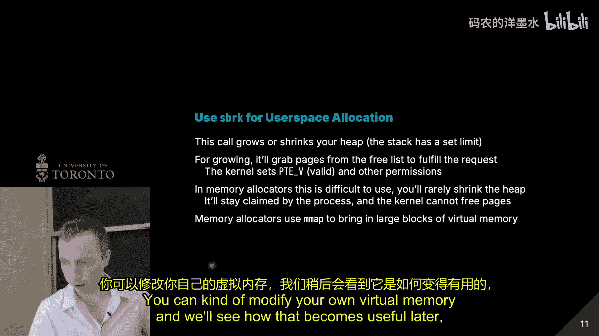

All right， so this is， you don't have to need all the details of this。

 but this is more explaining what happens in your process。

 So here this is your process's virtual pages， so。This is typically how a kernel will map them。

 So everyone's de referenced null and got a page fault， got a seg fault before， right。

How does that work， Well， the kernel makes it so that virtual page zero is always invalid。

So that whenever you dereference null， which is just the number0， that would hit page zero。

 if there's no translation， you get a seg fault because it has no valid entry。

A colon could really screw with you if it wanted to。

There's no reason why it couldn't map page zero to some physical address。

 and then when you dereence null， your program doesn't crash anymore。

Probably not the best thing to ignore errors and things like that。 But you could do that。

 But the way。Lticux sets up things。 And most operating systems things page 0 will always be invalid so that if you try and dereence allll。

 it'll crash immediately， then there might be some pages of instructions。 some pages of data。

 Your stack would actually be a set size。And there's a trick we use because we've probably seen stack overflow before。

 right？Scem stack overflow， Well， how did the operating system differentiate？

A stack overflow from me just using memory invalidly。

 so stacks will be a set size so they'll be using some pages and what they do is at the bottom of the stack。

 they will make something called a guard page so it is just right at the boundary so it's a known invalid page if you overflow your stack it's very likely you will hit this guard page and because it's a known page it will just say stack overflow you likely overflowed your stack。

And that's also why has anyone ever overflowed their stack so bad they just got a Seg fault instead of。

 so， if that has happened to you， I believe it's happened to me before。

 if you have definitely over like。You definitely had to stack overflow。But you just got a sg fault。

 What could have happened is you just jumped straight over the scar page。

 So you overflowed more than a page， in which case you just got a normal sg fault。

 and then it just died。So you can you can stack overflow so bad that you don't even get notified of a stack overflow。

 And then the other information there， not important。

 more for the intricacy of like the kernel having to manage your process with its own virtual memory and manage yours in doing context switches so we can forget about this stuff for now。

 it's not that important。 The main thing is the guard page there and like。

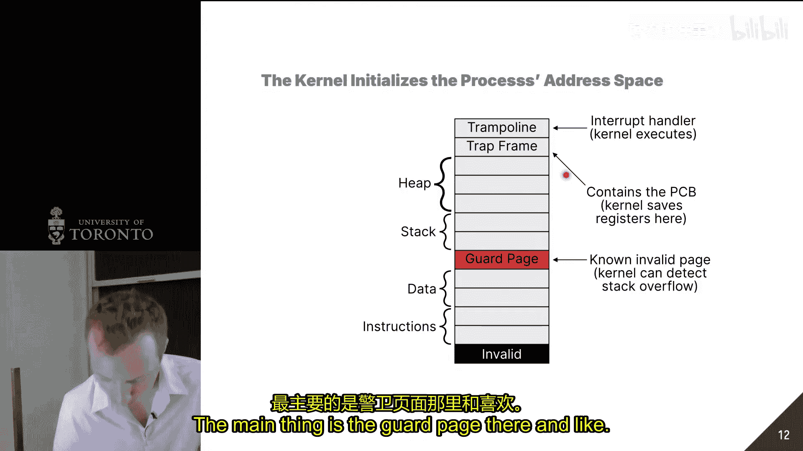