# 【全集】多伦多大学 操作系统 中英字幕 1080P p13 Lecture 13 - 虚拟内存实验 -BV1Rbk7ByERc_p13-

待てる際は。不布布。Alrighty welcome back to operating systems， I don't think the speakers are working today。

 so that's fantastic。So I am going to show you how to do La three。So this lab。

 you are doing virtual memory management， you are as simulating what happens when you fork。

 so you need to create a new process。Just with virtual memory。

Looks exactly the same as the process you are forking from。

 but it should be independent after the fork， so should have all the same virtual addresses。

All the memory should be exactly the same。 but after the fork， they are both independent。

 So we are going to walk through all of the。Coode today， what we should do and everything like that。

 So， yeah， there's no slides。 It's just a big old demo。

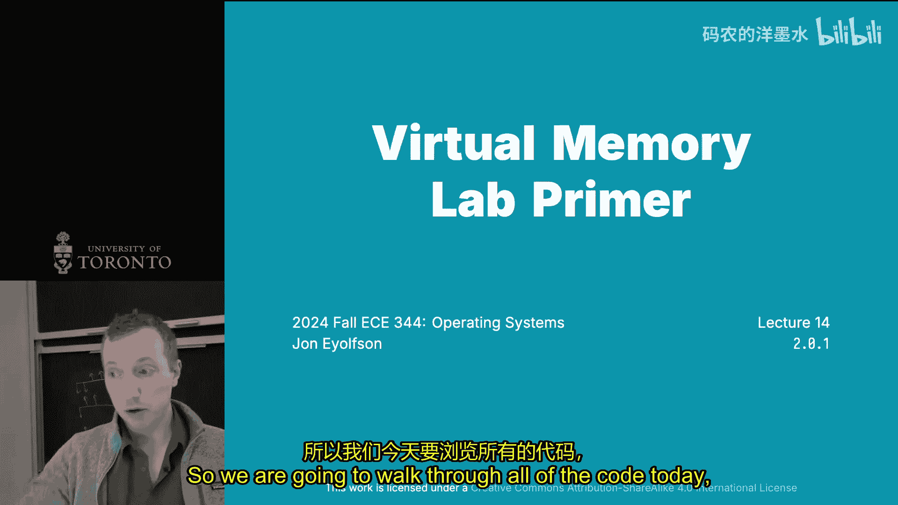

So。What do you want me to start with first， walk through the code or what？Baaguely。

 you're supposed to do。だで。So what we are trying to do is let's see some code here。

So what we are trying to do is。

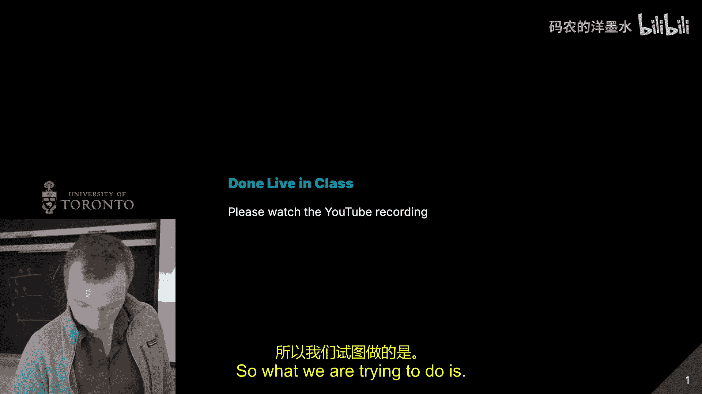

There's going to be some process already running， let's assume some processes running ands it's using virtual memory。

 so it has some page tables allocated to itself。So。Part of translating an address。

 it would need a route page table。 So let's say we're running process 2 or something。

 We're going to do that again。So we're running process 2， and then it root page table。唔 my。哦系。

For some reason， my iPad is like cursed in this room。So we have process two running along。

 it has a root page table。Maybe it is at PPPN0， something like that。 So if it's at PPPN0， that means。

 well， it would translate to this page， right？Page zero， so。Just a reminder all of memory。

 That's all physical memory。 It's all divided up into pages。

 So some pages will be used to store data for the program。

 and some data is going be or some pages are going to be used to store page tables。 So in this case。

If we're running process 2， it has to have a root page table， maybe it is on page0。

 so this would be like process 2 L2 page table。And then maybe it has an entry。

Maybe I should draw that on top。So maybe process two page table， has an entry at let's say zero。

 and each entry will have like a PPN and then at least a valid bit。

 so maybe it has like a PPN of one and a valid bit of one saying that this entry is valid。So。

If we chose to use index zero to translate a virtual address。

Which page would I look at for my L1 page table？Yeah。Page one， right？ So PPN of one means， you know。

 if we had our address。Broken out into different bits， right， We have an offset。And then。You know。

 the PPN。Or VPN。Depending on what we're looking at， and then it's 12 bits， we're going to do that。

So it's 12 bits， so it means well。Everything's going to be page aligned。

 So it's going to start at byte 0， yeah。memory so。No， this is all physical memory。So like。

 the page tables need to exist somewhere， right？ So this is all physical memory。

 They exist in physical memory。So this is physical memory。 And then。

Your processes are going to use page tables， and the MMU is going to use the page tables。

To translate a virtual address to a physical address。 But these are all physical addresses。Yeah。

 so we're going to use some pages for。Page tables， some。

 some pages to actually store data for the program。Right。So here。

 let's say we do something like this。 So this is processesce2s， a one page table。

 say it has an entry for argument's sake。 What entry will we use。For argument's sake。

 let's say it has an entry 5。 the P PN is let's say2， and the valid bit is1。

 So if I was translating a virtual address and I got my L1 index as 5。

Where is the L0 page table for this process？Page 2， right， It was going through it again and again。

 So this would be process2s L 0 page table。 Maybe it has an entry at 188， the P PN。Might be three。

 and the valve bit would be one。Which means that for this virtual page。

 the final translation will actually go to page 3。 So this will be the。Come on， Let's undo。

So this will be used for P2's data。And maybe they， it has， you know。

 an in variableable or something like that。 So 4 B on this page will store like some value X or something like that。

So our goal today is we are trying to do what happens for a fork。

 so we are trying to create a new process。Has all the same virtual addresses and everything like that。

 But it is completely independent from the other one。 So how we accomplish that。

So if this is my root page table for process  two and say I create process  three。

And its root page table is also PPN zero。What happens。Yeah。Right now， no。

 so that's what we're trying to do here。So， we're trying to。Have our own thing。

 So we need this new process should have its own copy of X， right。So if I just leave the root。Oops。

If I just leave the root page table for process 3 as the same as the root page table for process 2。

Will that accomplish that？No， what do I need to do。I need to copy， well。

 I need to copy this probably。I need a copy。 Let's see。 what color should you。Let's use a fun color。

So。I need to at least copy this page， right？So I need to copy this page。 And eventually。

 I want this to be。P3's data。So if I copy it， it'll have an x and everything like that， right？

So now I have to create a whole new set of page tables for process 3。

 such that if I follow the same indexes， right， if I follow index0 from L2。

 index 5 from L1 index 188 from L0， I should reach this new page， right？In that new process。

 so it's going to need its own set of page tables。So I can pick whichever one It doesn't really matter。

 Let's， for fun' sake， let's just pick this one down here。 See， I used page 8 for。

The process3s L2 page table。So I should immediately change this so that the root page table lives at or we do8。

So， it lives。That let's say physical page number8， which means。If we set that as the root page table。

 however we do a translation for this process， it will start at page 8 instead of page 0 now，も。

Sorry we。So part of your code。You're going to set up all of the new page tables and yeah。

 your code is just going to return a new route page table to use for the new process。So， yeah。

 you're doing what's happening with the fork in terms of all the page tables setting everything up。

 and you're returning a new route page table。 Yeah。I think everything like L2 L and L0。Yeah。

 so if they want't be exactly the same， the structures of the page tables should be exactly the same。

 but they should be independent of each other。Right， so if it， so if。Process 2。

Has a valid entry at index 0。 I need a valid entry at index 0， and it's pointing to an L1 page table。

 All。 I also need to do that。So maybe at index0， I make。I have to point it to a new L。One page table。

 So maybe it's at， I don't know，5。So then that means I'm using this page 5 for process threes。

A one page table。 And then， well， if it has an entry of five， I need an entry of five。

It needs to go somewhere。Maybe six。And then the velvet is one， and then。

It needs its own L0 page table。With the exact same index。

And now what should the physical page number of this entry right here be？7。Right， so7。

 that will point it to here， which should be a copy of L2's data。

 so their data would be exactly the same yeah。Pages like cr don change8。

Whats E theN value of like 0 x。Sorry。Page8， yeah。In value you expected。Yep。So if it was 0 x1， yeah。

 so what would happen if this was instead of5， it was1。What？Yeah， which would mean I would use。

P 2 is L 1 page table， which means I haven't， which means eventually。

 if I translate that same virtual address， I will eventually make it to page 3。

Which is supposed to be process2's data， not Pro3's data。

So it's like slightly more right that you make。A new L2 page table。

 but if it points to another processes L1 page table。

 it's going to use that one and eventually end up with the other processes's memory instead of yours。

Do we are we。やとだ。There set。So， for you。All of the page tables and everything in blue。

 that's going to be like the process that called fork。 So those will be given to you。 Well。

 given to you。 you'll have access to them。 So that is the process that called fork that is the parent and you are making a child。

 So you are making a new process。 in this case， you're not like。

Doing anything with trying to run it or anything， you're making a new process in terms of memory that looks exactly the same。

 but is independent。Yeah。We will be in charge of ensuring。こことなって。Yep。

 so you would be in charge of making sure that this。

Like all of your new page tables do not overlap the other ones and don't use them and they're independent。

Yeah， this lab。Bunch of thinking， but like。My solution is less than 100 lines of code。

 I think it's like 80。 So you can do this one and 80 for both parts。

 So the first part is probably like 20。 So the first parts just doing this。

It's about 20 lines of code。Yeah。But next。512 pages max。いい。いや。で keep working。Like in memory。Yeah。

 like if they keep。Yeah， so all the test cases， it assumes you have a set amount of pages。

 we assume physical memory is only so big and none of the test cases will go over。

So you won't run out memory here。

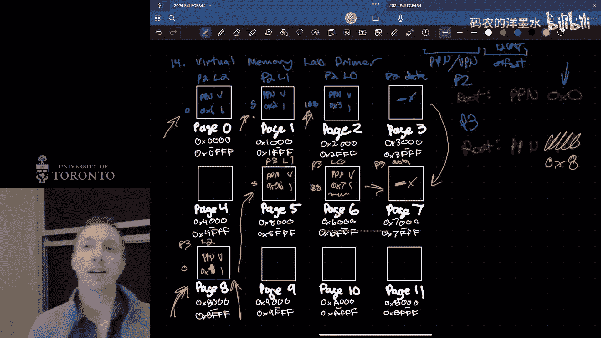

All right。Any quick questions about this before we can walk through the code a little bit。

Kind of makes sense what we're doing。Maybe not how I get in 20 lines， but。Okay。

 so quick walk through of the code。So。There is a。Testing。So there is a testing。 Actually。

 I'll go through the header。 So you are only modifying one file。 So this VMS S dot C here。

 this is the only， only only file you'll be modifying。

And I made a little helper function here to print a page table entry。That you can use。

 but these are the only functions here。So。The only functions you'll be writing is V M S Fork copy。

 So you are returning a new route page table for a new process。 That is an exact copy of the parent。

 All the memory is the same， but it's independent after that point， so。

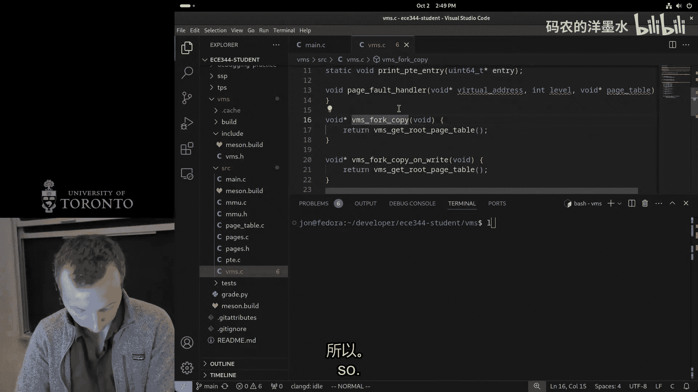

Going back to this， you're essentially if。If Fork gets called and the current parent Ro page table is on0 aK。

 all of the blue stuff， you will create all of the orange stuff and return a new pointer and return the new page table。

So okay with everyone。All right。So that's the first part。 whoops。

 you'll be doing another version of fork。 where try and share memory as much as you can。

 We'll go over that towards the end。 And then there's this little page fault handler。

 So you're allowed to， if you have a page fault。

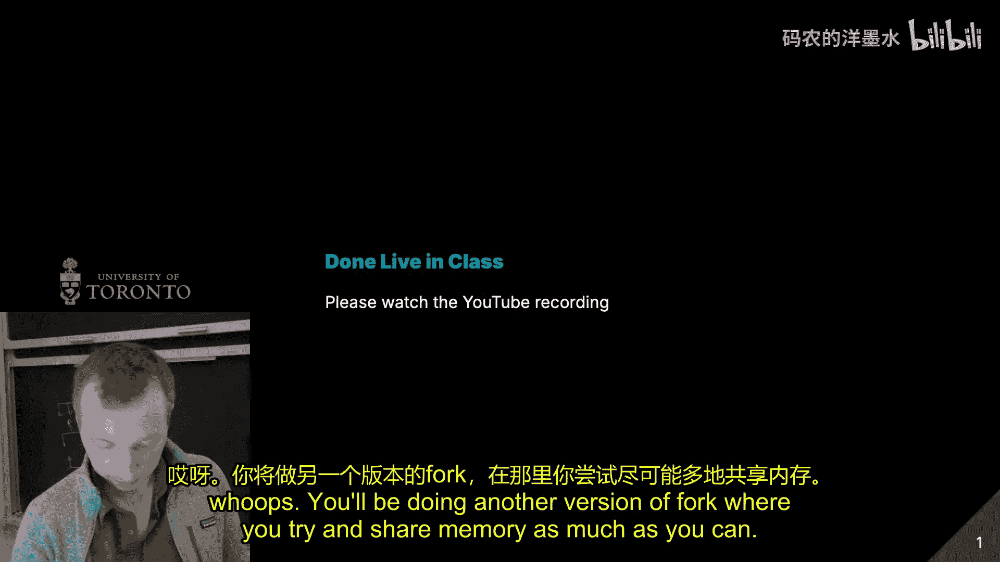

You can go ahead and fix it up， you can go ahead and modify entries， and it will try again。

 You will need this for the copy on right portion， but you can absolutely you can ignore it and try and get this one done first。

 which is what we went over。嗯。And then for there's a question of the discord。

 how did I get the route page table to be 8？

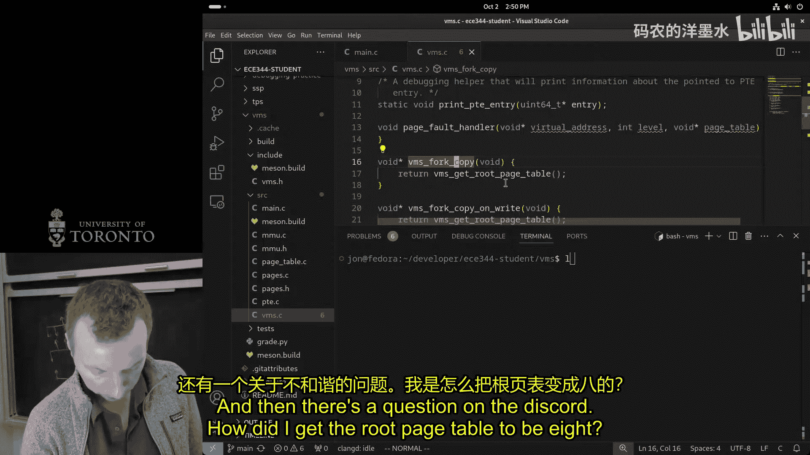

I just。Picked it。I I would ask for a new page if I happen to get8 and I use that for an L2。

 I can use that doesn't matter， I could have used page9 as long as I set it up that looks the same and then if you follow everything it's all right。

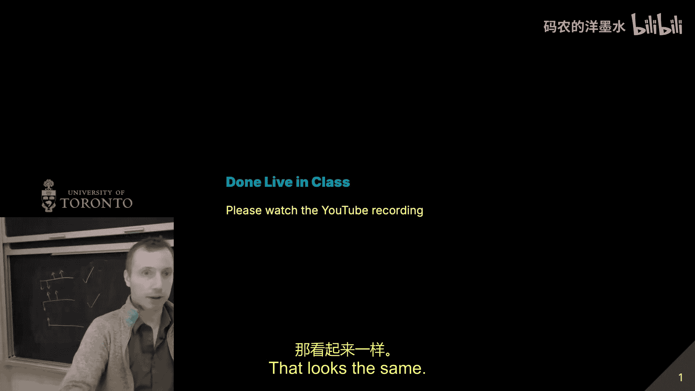

So。2 functions to write。Not too bad， right？Let's see。 Yeah so。mmm。There is this include header file。

 the VMS1， there is I documented the crap out of it because people don't like reading code and like reading comments I guess so document the absolute crap out this one we can walk through it really good so read it These are just testing function so these just take like a virtual address and like simulate what happens to a right trying to update that value and then a read which returns the value again mostly for testing there's this get root page table so that just returns you a pointer to the root page table and everything will be aligned to pages so you won't have to worry about it and then there's a set root page table which you will not be using in your code that's simulating like doing a context which changing the root page table because I'm switching between processes。

So。There's this whole thing here， so there is a set number of page tables or sorry there's a set number of pages so there's a function that you can get the page table index just in case you want to use an array or something hint hint that you'll be probably using for the copy on right。

 but there is a like defined variable called max pages that says how many physical pages there are for this system we're trying to simulate。

A knit you will not use only use for testing the only thing you'll be using is this new page so anytime you want a new page you call VMS new page and it returns you a pointer to a page so if I need a new page to use for an L2 page table。

 I call new page I set it up and then I use it as an L one page table or L2 or whatever。Yeah。

Already ensure normal already。No overlapping how like it's aligned to a page。

 Yeah it points to a we need to check if that page already is。No。

 it would turn a brand new page that's not in use。And then free page。

 we're not going to worry about freeing memory in this lab。 we don't care。 yay。

 so screw freeing pages and then this is mostly for testing to make sure that once you get to copy on right that you're actually sharing pages。

And trying to reduce the number of pages used。 And then there's a few to get a pointer。

 So to get a page pointer from an index and to get an index from a pointer that you might find useful again。

 not from the not for just copying。And then there's some page table functions。

 So these are basically how you get an entry out of a page table。 It does all of the pointer。

 arithmetic and stuff for you。So。To get the page table index。 So remember when we were like。

 we divided up into the L1 index， L 2 index， L 3 index。

 and we had to like count 9 B and all that crap。 Well。

 there's a function here that just gets the index for you。 So given a virtual address and a level。

 it will tell you what index to use。So if you need to use that， you can。

Another function to get a page table entry out of a page table。 So page table entries are 8 B。

 They'll all be。Pointers to this 8 B type。 So you int 64。 It's just 8 B of unsigned memory， so。

It will give you a pointer to an entry。 so you'll find its a bit。

Pointters are generally kind of a pain， but this is actually slightly easier。

 so it'll give you a pointer to an entry。In a page table for a given index。

 And then there's this big one that given a page table and a virtual address and a level。

 it will essentially figure out what index to use。 And then there's just a helper function。

 So you just get the page table entry directly。 And then there's a few little helper functions to get the convert a PPN to a page and a page to PPN。

 But that will just like。Shift it by those three hex characters or put zero at the end。嗯。

And then there is some functions。 So all of these。Well， these ones give you a pointer to an entry。

 And then all of these functions let you modify that entry。 So remember。

 like certain bits were used for certain。Pieces of information。 So that's what this will let you do。

 So you can use all these functions instead of doing bitwise manipulation unless you like super love doing that。

 in which case go crazy。 But like so there's four different bits。 There's a valid bit。

 Each bit will have a clear function that will set it to0， a set function， which will set it to one。

 And then if you want the value， you can just use the name of the bit。

 And then it will return either a 0 or a one。😊，So there's a valid bit， a read bit。

 So whether or not or not I can read memory， a write bit。And then a custom bit。

 So that is you will not be using the custom bit for implementing the normal copy that will only be useful for copy on right。

 And then the last one is like how to get the P PN from the page table entry。

And then let's see there， And then there's just these two functions you need to call。

So questions about all the varying number of functions。

So you don't have to do any bitwise manipulation I could and mean and been like， yeah， you know。

 look at the slide， figure out which bits or what， and then figure it out。

 but law of helper functions。All right， okay so far。Alrighty， so。There is this main dot C file。

 So this main dot C file， you should use 4Dbugging and developing it because the testing infrastructure。

Slightly。Might obscure your messages a little bit。 So this main， this main dot C will compile into。

Like build VMS S won't be used for testing。 won't be used for anything。

 It's just to get you set up and make sure that， hey， your code actually works and help you debug it。

So what it does calls VMS S and knit all the test cases we'll call that。

 You won't have to do anything。 Just make sure it's there。So this simulates， essentially setting up。

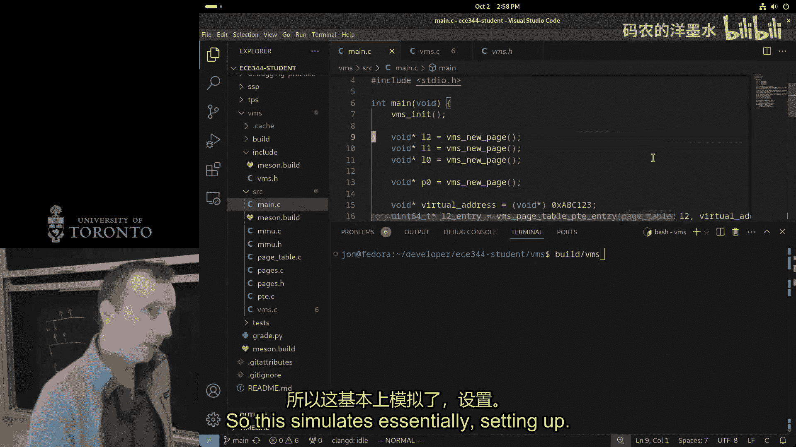

Ohoops。

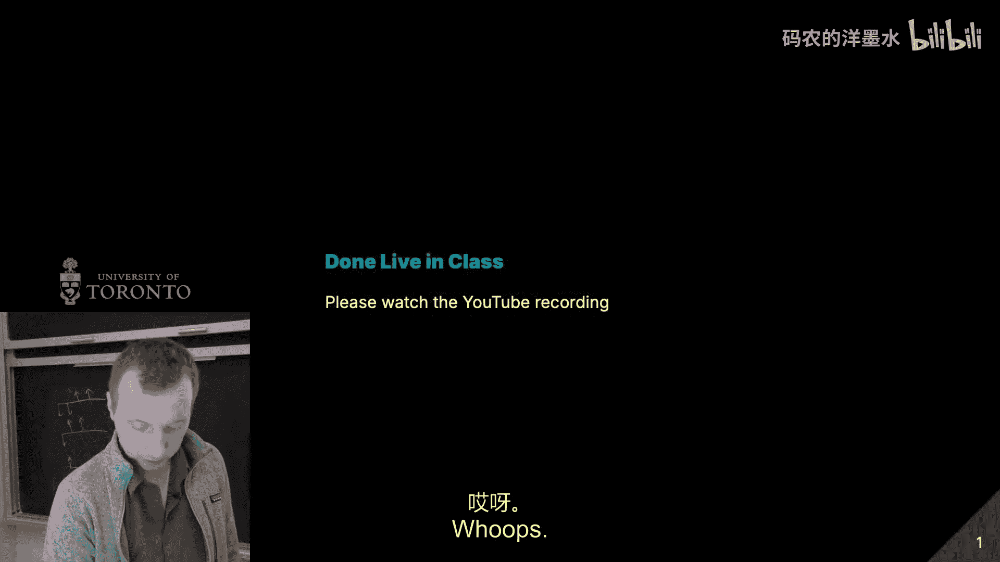

Setting up this all of the page tables here for process 2 that are in blue。 So what it does。

 like what we did before。It grabs a new page for each level of page table for this process and then a new page for the data。

So after that， we're going to say， hey， we're going to translate。

 we're going to set up the page table so we can actually translate virtual address， AB，C，1，2，3。

So in order to set it up， I can。Figure out which entry I need to modify to make this actually work so I can get the page table entry in this L2 page table I have now created for this virtual address I want and then get the level 2 index。

 So that will return to me a pointer。To that L 2 entry that would be used for translation。

 And then I can set the page table or I can set the entriess P PN to point2。

 essentially the L 1 page table here。Right，So set it to point to the L1 page table。

 and they also have to set its valid bit。 Otherwise， it will page fault on us。Then。Same thing here。

 I find the L1 entry I would use。 So same function again， same virtual address。

 But now the level is one。I set up， set its P， PN so that it points to L0。 And then I make it valid。

 And then same thing here。I get the entry for this L0 page table。Now， with this L 0 entry。

 I make it point to that page 0 that I want or my variable called P0 that I just want to use for data for the process。

 And then since it's actually going to be used， I need to set。

The valid bit set the read bit so it can read memory and then the write bit so that can actually write memory。

 and then。This simulates this being the active process。 So it sets the root page table to here。

 So now if I've set this up， I can use this VMS S right to simulate a right to that address。

 So if I write the value 1， I should， if I write the value 1 and then read it。

 what should the value be。1， I sure hope so。 And then if I write the value 2 to it and then read it。

 what should the value be。Two， sure， hope so， so。If we run this， we'll see that each time I write it。

 I see ABC 1，2，3， and then read。And then the value。So okay with this so far。Alright。

 so how you would use， So this is like a process already running， not testing your code at all。

 So if you want to test your code， let's see。So after you set the root page table。

 maybe you simulate it。Forks， so maybe you just say， hey。

So give me a new route page table that simulates the fork。 So that would call like。

Fork copy if you're just starting。So this simulates forking this L2 page table， it gets back。Ohoops。

Should， in this case， point to page 8 because it's a whole new independent。Set of memory that。

Looks exactly the same as process 2， but completely independent of it， right。So。Right now， to， to do。

So right now， if it just runs through， I didn't change the set the root page table。

 so it would go ahead and do the same thing。 So if I run this again。Oops。

 that is not the correct command。呃。Compile。So if I compile this again。And run it。

Nothing's going to happen。 Nothing changed。 I'm still accessing the same processes of memory simulated。

 of course。As before。But now， and that's because the base implementation I gave you just returns the current route page table。

 So it returns the parents route page table， which means they are not independent， right。

So if they are not independent。We can simulate， let's see。Let's simulate。A switching。Actually。

 let's move the。So we'll have the parent write the value 1 to that memory address。

And then we'll have a fork right after that。 So the new child process should also have one at that at that memory address。

 And then the original process still running。 It writes the value  to。

 And then we switch to the new process。 and let's say。We just。Read that value again。

So given that my implementation right now for the new process just spits back out the parent L2 page table。

 if I run this， what will I expect to see？Oh哦。Okay， let's step through it quick。

 So we set up everything right， and we write the value1。 say we update， let's call it X。

 We update x to1， and we print it out。We print out what we read， where are we going to read。

 X is equal to1。 All right， then we fork， so we create a new process。

 it should be a complete clone of the child or the parent at the time of the fork。

 so will it have an X。Yes， what value will it be。One， okay， so we didn't change the root page table。

 So if we use virtual memory right now， we'll be modifying the parent' memory。

 So it updates its value of x to 2。 So if it prints here， x is equal to。2。

 and then if we set the root page table to the L2 page table， we got from our。

Fork called that was really bad。 What is the value of x going to be in this process？One。

It should be one， right？You would want it to be one。 What's it going to be in this case。Two right。

 so if we run it。It's two。Should be one， It's2。 So obviously， we have a bit of an issue here。

We have screwed up。 We're using the same root page table。

 So it means both processes would be using the exact same memory， which is not what we want。

 We want them to be independent。 We want that two to be a one。All right。

 everyone clear what we got to do。Allright， so some quick little things to play with the code。

I'll start you off a little bit。So in this function。Like some things you can immediately do。Is like。

 well， this is like the L2 of the parent， right， so you should keep。This V M S get root page table。

 you're gonna need that because you need to figure out what to start copying from right。

 So I still need that。 I don't want to modify any of the parent page tables。

 I should just be reading them。 So I need to do something like that。

 And then you can start it off by like， hey， I need。 let's call it child so。For this。

 if I want to be completely independent。Does it need a new page or not。

 or should I just reuse something。Yeah， I need a new page right， so I can do VMS new page。

Something like that。 And then return。Is much harder to write standing up apparently。So I can do that。

 It gives me a whole bunch of warnings since I haven't used anything。 But now， if I do that。

This new page will be zero initialized， zero memory， everything like that。

 So if I try and run this now。I'll get a new page from this。This will use， you know。

 the first route page table I had， so this should still work and read too。

 but now I switch over to a new thing and then I try to read from that address and I should page fault。

 right。If it's 0， so let's see what that looks like。If I run it now， I have a fatal page fault。

 So this is。Code that I wrote to help you also try and debug and figure out what happened。

 So if you have a page fault where it can't figure out a translation， itll print fatal page fault。

 What virtual address it was trying to translate。The page table it was currently using the level of translation it failed on and the invalid page table entry it found。

 So it will show you all the flag。 It will show you the PN and all the flags。 If they're all dashes。

 that means they are 0。 Otherwise， the flags are like C for custom W for write R for read and V for valid。

 So this means I failed， because hey， I didn't set up anything。So questions about that。Cool， right。

 all right。 So let's have a little exercise， So say。I was debugging。

So one thing you probably want to do is like， go through all of。The L。The parents L2 entries， right。

 to figure out what I need to copy， what structure I need。 So how I would do that is， well。

 you can just do a simple loop over every single entry。 So I。Goes from 0。

 So if I want to actually look at every single entry， quick。y， remember， top of their head。

 how many entries are in a page table here， yeah。512， so you could hard code it。

 512 or you could just use NP entries， same thing， but it's 512。 You should know why that is。

 but you our number should have meaning so we can do that。So we can iterate over every single one。

And then here we can get each entry。 So each entry， is's going to be a pointer to that。

So we can use VTMS S， and then we can just do oops。So we can do the page table entry from the index。

So in this case。We're trying to get entries from L the L2 parent page table。

 and we're trying to get every index， so that is I from our loop。So if I do something like this。

 print P， So we can also use this print PT TE entry。So if I do something like that。

 that should now print every single entry in the parent L2 page table， right？

So if I compile and I run that。Now I can see that。So now I can see every single entry probably should have printed a bit more。

 but I can see all of the different entries here。And only the first one is valid。

 So that was at index 0。 So here， let's just print off the index 2。Pntf。Oops。

So we can print off the index too。So there print off the index and then。Oh， well。

 if the entry isn't valid， I probably don't have to do anything， right， Don't need to create a new。

Like here。呃。Here。In the parents to， to do。L2 page table。

 I had to create a new L1 page table for each and every valid entry right。

 so this is why I only had to create one。 If it had another index valid。

 I would have to create a new L1 page table for that to be independent。

 So the first thing you might do is like， hey， I probably just only need to do something if it's valid。

So I could add like a little check。So， if。So there is the， if I want to check if it's valid or not。

 I can just use the PT TE。 I have a page table entry。

 so I can just check whether or not it's valid by using this PTE valid one。

So I can say if it's not valid， I'll just skip it， right。

 And this should tell you how many different。L1 page tables I need to use。So here。

 if I just printed out， I only add that one entry that I need to do anything with。Allright。

 any questions before I do the hard part 2。Okay。

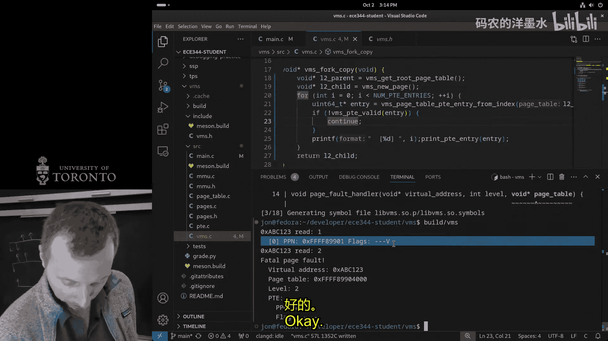

Hard part2。So hard part 2 is going to be copy on right。

And what that means is I want to try to share memory as long as possible。

 So let's just skip some steps。 We'll only just。You will only argue about。

Just one virtual page for now。 So let's say we have an L2。And for this blue process。

 an L 1 and an L 0。 And then this is。Of course。And this is like P2's data。So something like that。

Allright， so that's okay。All right， so copy on right。

It is O for processes to share memory as long as they don't modify it。 So if I have。

If I'm creating a brand new process。It still needs to have its own independent set of page tables。

 so let's have this orange process。It has an L2， has an L1。

 and we're just arguing about the same page so it can go like this。

So the cool thing about copy on right is as long as both process just read， you can do that。

And it behaves perfectly fine， right， They can actually share the same data。

No issues as long as both of them write， so the idea behind copy right is I try to share data。

 share pages as long as possible。And at the last second。

 I will only make a copy then because while copying slow， right。

 I just have to copy a whole page worth of memory and create a new page， so。

This is how it looks initially。 And things are great， right。

 You can share memory as long as there's not any right。 So everyone okay with just saying that。😊。

So what we want to happen is as soon as either process tries to update this x value。Then。

 and only then we are going to， as soon as they try the right at the last second。

 So say this orange process tries to write。What I'm going to do is I'm going to stop it and be like。

 no， no， no， before you do your right， I want to not disturb the other process。

 so I'm going to grab a new page of memory to use for your data。And then do the copy。

 copy all the data， and then I'll do the modification you asked me for。

And how you are going to accomplish this is slightly tricky。 So that is when。

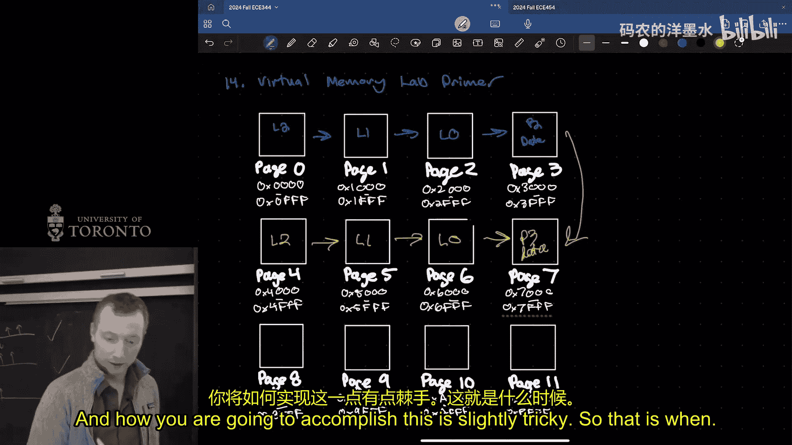

This。Peach fault handler is going to come in。So。How you are going to accomplish this without the processes knowing about it is whenever one process tries to write if you're trying to share a page between them。

You are going to intentionally cause it to page fault if it tries to write。

 and then you are going to do what we just did， create a new page。

 and then you're going to fix up that page table entry so that instead of modifying another processes's memory。

 you point it to modify the current page you just made。So。That kind of makes sense to everyone。

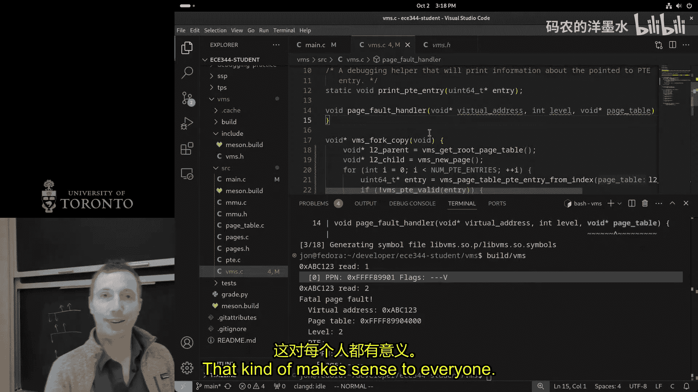

Mechanics bit weird。 So how the mechanics are going to work for that is like， hey， if process2。

 let's。

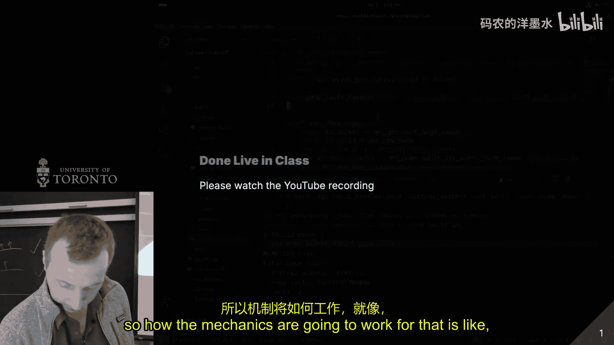

Back up a little bit。業是。Oops。

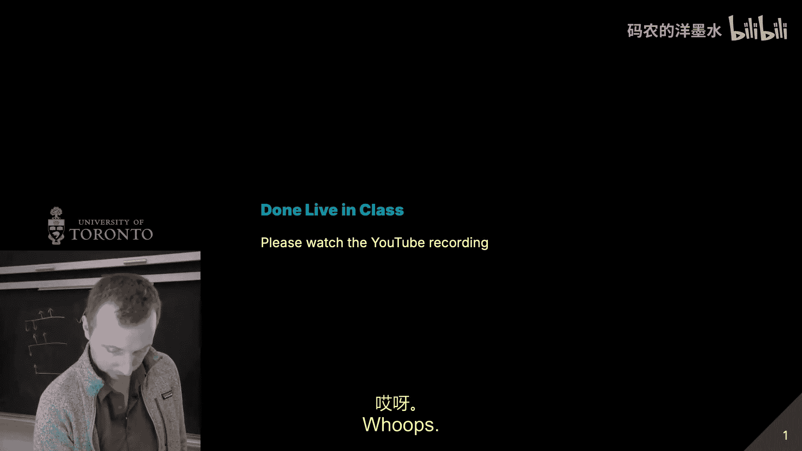

So back up a little bit to when we were sharing memory。So when you were sharing memory。

 if either process could write to this before， what you are going to do in order to intentionally generate a page fault on a right is。

If its right flag was zero or one before， well， too bad。

 it is now zero now and that will if you try to right to it now it will generate a page fault right。

 and then you can see all the information just from a page fault getting generated。

 what you're going to do is be like oh， crap yeah。Either one of the。Yeah。

 so if either one tries to write， it would cause a page fault and then。Whoever tried to write， right。

 it should get a new page。 that's a copy and then be able to do itss right。

 So as soon as you fix it up and give it a new copy。

You're allowed to fix up the page table entry once and itll retry the translation again。

 then it would do the right， and then that right should be for that process。So yeah。

 you would turn off the right。And then when it happens， you have to be like， oh， shoot， oh， no。

 I have to make， you have to go here， modify this。Make it a copy。

And then I need to turn the right back on now because now there is only one process pointing at that page。

 so it should be able to modify it now， it's its own independent copy。So questions about that。So。

 yeah， do we set right back。Yeah， so that's a good question。 So do I set the right back for page 3。

 So in this case。You could， right， the only process。Only one process is actually using that。

 so it should be safe to set it。 but would it be safe to do it if we had， say， a new process。

And then。It was also pointing at it。Probably not so。こな？Because we are always setting nobody。

I we check that it is allowedmic。So it should always be a So， yeah。Yeah， a few other subtle things。

 like was it even allowed to write to it at the beginning？Right，That might be a question。

Or like is this page currently being shared， that is another question you might have。And guess what。

 there is that custom bit that you should probably use for this purpose。

 otherwise this will be actually impossible。So you should use a custom bit to figure out that， hey。

 probably is this page being shared with copy on right or what have you and then。

For the last little bit。So like if there's only one process actually pointing to this data page。

 then yeah， it would be safe to set the right to one from zero if it was actually supposed to be written to。

But it's only safe if there's only one process pointing to it right。

 so you should probably have something like a global variable keeping track of like the number of references to a page。

 okay， how many things are writing to it， which is why there's all those function that gives you an index from a page so it'll tell you what page so you can just create an array if you really want。

And that's pretty much it for the lab， Any other questions？Copy on right。

So you have enough knowledge now。 You should be able to do the。

Version of Fork that just naively copies pages at the time of the fork doesn't try and delay anything。

 you should my absolute advice to you is to write that now。

 make sure you can debug that one because copy on right， you will probably have to think about it。

Think about， oh， I need to keep track of the number of references， how do I use this custom bit。

 What happens if it wasn't rightritable to begin with？Things like that。

So I'll stick around for the other three minutes， but other than that， just remember， boom for you。

 we're on this together。 Oh， wait， yeah。Full floor。There just。Yeah。Copy all the。

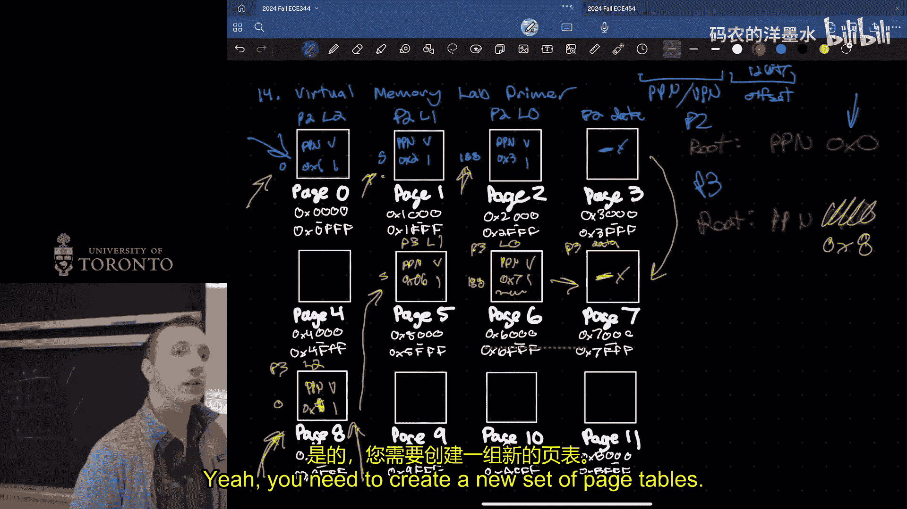

Yeah， you need to create a new set of page tables。If it had 1 L 2 and。5 L1s。 And then。10 L zeros。

You would have to have your own independent copy of all that。

