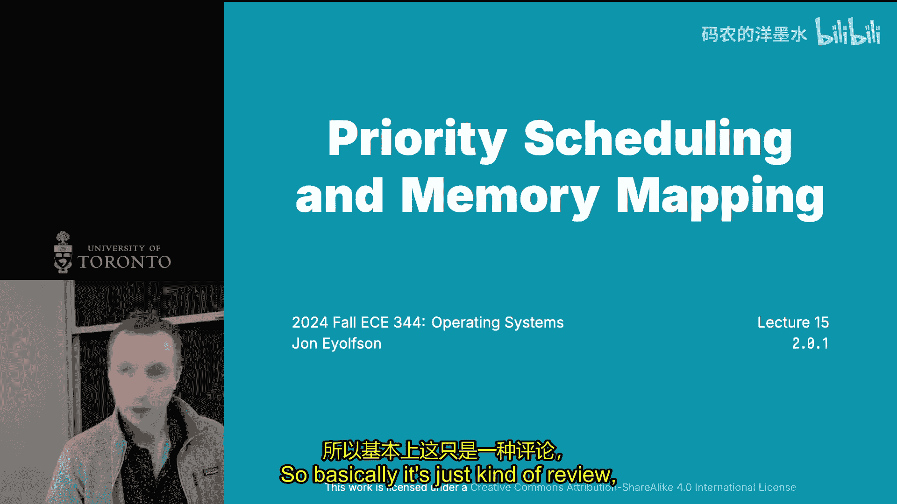
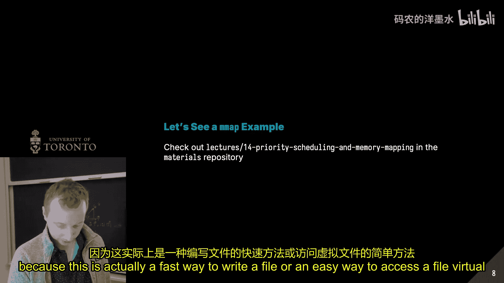
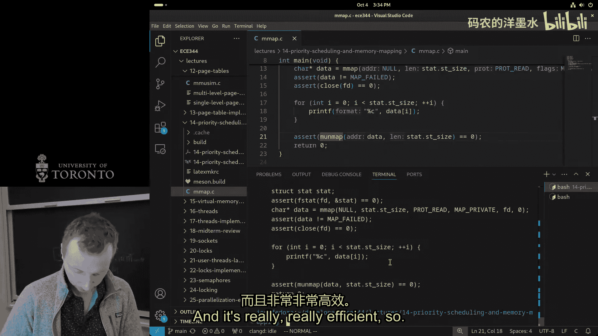
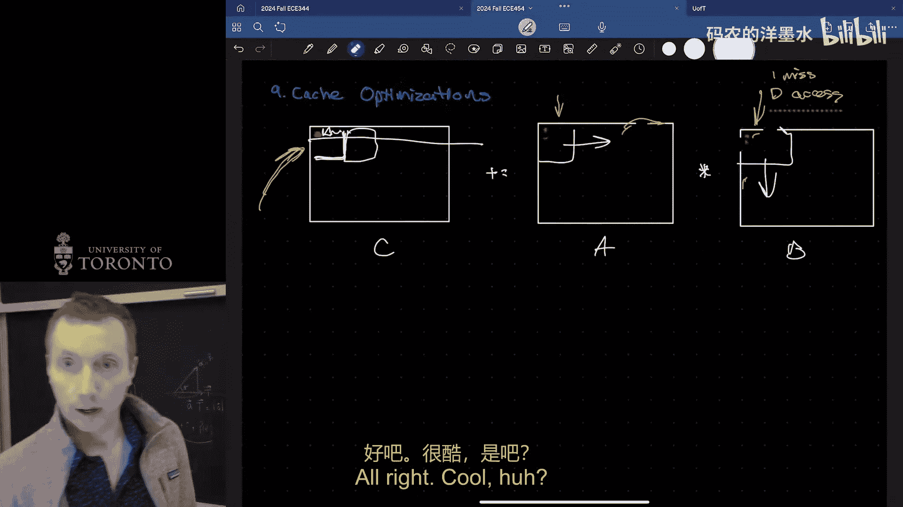
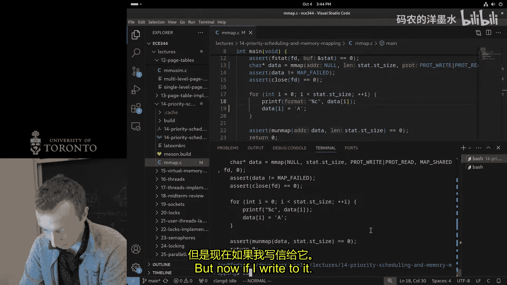

# 【全集】多伦多大学 操作系统 中英字幕 1080P p14 Lecture 14 - 优先级调度与内存映射 -BV1Rbk7ByERc_p14-

Alrighty， Wecom back to operating systems Qui day to day。 What's going on today。

 Exams or something midterms。Career fair， okay。Well。

 we get a riveting day of more operating systems then。 So today， the kind of。Slightly review。

 slightly stuff that won't be tested。 that might be useful for you。 That is relevant。 So basically。

 it's this kind of review， so。

There's。Some easy priority scheduling that's typically taught is something called dynamic priority scheduling might also be called feedback scheduling in some textbooks。

 We went over， you know， having a scheduling algorithm。

 assuming a single CPU that can go ahead and it picks which process to run at any given time。So。

 for this one。We before we went up to round Robin， we didn't see any concrete examples。

 We scheduling with priorities。 So this is an example of one。

 And this algorithm is what is setting the priorities。 So like round Robin。We use timespaces。

But unlike groundund Robbin， we're measuring CPU usage。

 and then what we do is we at the end of a time slice。

 we dynamically adjust the priorities of processes。

 so we'll increase priorities of processes that don't use their time slice and decrease the priority of processes that use their time slice。

 so you can initially say how important your processes is。 but over time， it will degrade。

 and then eventually a low priority process will be able to run。So。In this scheme。

 easiest thing to do is to pick a lower number to mean the highest priority。

 each process gets assigned some priority when it starts。

 let's call it P and how the algorithm works is it literally just picks the lowest priority number to schedule if it yields or gives up the CPU or wants to go to sleep or anything like that we just pick the lowest number so we would break ties of the same process of the same priority upon arrival order。

 and if a lower priority number becomes ready， we immediately switch to it。And then like I said。

 we record how long each time each process executes for during this priority interval or time slice。

 however you want to say it。 And then here， like we would recalculate the priorities every。10 second。

 but the maximum timer process could run。Might， we might do round robin with with that。

 So there could be the possibility that priority interval is different than the time slice of process gets。

 But we'll just assume that they're exactly the same right now。 So every。So often。

 timer interrupts and timer interrupts still occur。 So we keep control over the processes。

 We can preempt them and everything like that。So at the end of the priority interval。

 we update the priority of each process basically just decays。

 so we take its current priority divided by two and then add how long it ran for during that prime interval。

 and then to calculate the next slice sees basically just keeping track of how long a process ran for in this interval。

 So whenever we rec calculateulate the priorities， we reset everything back to0。

So how that would look like is it might be a question like this。

 assume all processes have an initial priority of0。 and then this is their arrival order。

 since they all have the same priority。 We have to run them in this order。 X， then Y then A then B。

 So A and B will call them CPU bound processes。 That means as soon as you schedule them。

 they want to consume CPU and only CPU。 they wouldn't be trying to access files or anything like that or do system calls or block or anything like that。

We can assume X and Y are I O bound processes。 and that means they are doing some operation that blocks like they're trying to read from a file。

 read from a network or anything that is slow。 So we're assuming that if their I O bound processes。

 when we run them， they make a system call and then the kernel is going to。Essentially block them。

 Let something else consume the CPU while it waits for some operation to happen。 So in this case。

 we say that the I bound processes， whenever we schedule them。

 they will execute for only one time unit and then block for five。

 So that means they won't be eligible to run again for at least five time units。 And in this case。

 hey， it might be accessing a file or something like that。

So timeware interrupts would still occur every one time unit just to make things easy。

 That's the unit we can preempt things。 And each time slice in this case is 10 Pri interval is 10。

 So what is the scheduling。 So based off， So if everything has a priority of 0。

 and then we arrive in X， Y， A B， what do we run first。Yeah， X， right。 So in this case。

 since X is one of the IO bound processes， we can only run it for one time unit， right。

 so it runs from 0 to1， and then it's blocked。 So it can't run again for another 1，2，3，4，5。

 So it can't run again until time 6 here。So。If they all have the same priority and X is now blocked。

 what do I run next。Why， so I run why？ It's another one of those I O bound processes。

 So it only runs for one time unit Then it's blocked for5。 Now， what do I run。A， right。

 So that is the last one that's eligible to run at time 2， X is blocked， Y is blocked。

 So the next in line is a。So in this case， a runs。Until the next priority recalculation。

 So it actually runs for。The last next eight time units， even though X is ready here。

 So X is ready at time 6， but it will not preempt process A because they have the same priority。

 So if they have the same priority， it will prefer to just not switch and just run whatever was already running。

 So if X came in and it had a lower priority， it would kick a out。 But in this time。

 they're all tied。 So it wouldn't do anything。 Yeah。That may have a same。

So we just said that initially， they all the priority of 0。So we。

 we'll tweak it and see what the difference is。 So at time 10 here。

 I have to go and recalculate all the priorities again。 So process X， right。It。

All their initial priorities were 0。 So 0 divide by 2 is 2。 So basically。

 their new priority is just going to be however long they ran for。

 So the new priority for x should be one new priority for8 should be or y should be1。

 and new priority for a should be 8。 So here y is ready。 It doesn't matter。

 And we recalculate the priority for every single process。 So everything started initially at 0。

 So 0 divide by 2 is 0。 And then we just add however long they ran for in those 10 time units。

 So x 1， Y 1。A， A and， of course， B ran for nothing。

 So if these are the new priorities for the tasks， what are we going to run now。

And lower is higher priority。Anyone？B， right， B is the lowest priority now of using our new priorities。

 not a trick question。 So we're just going to run B。 Nothing else is the same priority of it。

 We don't really care。 It runs for the next 10 time units。Everyone okay with that？Allright。

 let's make it spicy。 and that really make it interesting。Probably not that interesting。

 So let's say processes， A And B initially have a priority of 6 and the others。

 So X and Y have a priority of 0。So we still assume the same arrival order all at time  zero。

 same rules apply A and B are our CPU bound。 X and Y are I O bound and same setup as before。

 So what are we gonna run first this time。Hey。W what？So what's the priority of A？6。

WhatWhat's the priority of why？0ero and lowest， lower number means higher priority， right。

So we'd prefer to run。X or y over a。But we'd also prefer to run X above them all， right。

 because it arrived first。X and Y of the same priority。 X came first， so we would schedule X first。

 Everyone okay with that。All right， so now in this case， we schedule Y next， so x blocks。

X will block for those five time units， so we are not able to execute it。

Next process is Y runs for one， and then it would block 4 or5 time units。 Now， just like before。

 we can only pick between A and B， they both have the same priority of 6。

 So we would just pick a because it arrived first。So we would pick a。 And in this case。

 it would only run for four time units because at time 6， that's when x is ready again。

 So in this scenario， since x has a much lower priority than a， it would immediately kick it out。

 So it would immediately kick it out and run for its one time unit and then block again for5。😊，Now。

 at time 7。Y is also ready。 Y has a lower priority than well， higher priority， lower number than a。

 So why would run when it's ready， run for the one time unit and block for five。Now。

 what gets to run。A， so a would run until time two time units， because at 10。

 we have to recalculate all the priorities。Now， this time， I use the old priority number， right。

 My new priorities would be， well， X and Y had a priority of 0。 So I just divide that by  two。

That gives me 0。 And then they each ran for two time units。 So their new priority would be 2。

And in this case， the priority of a。 Well， it started off at 6。 We divide it by 2。

 and it also ran for six time units。 So its new priority is 9。 And then for process B。

 its priority was 6。So divide by  two， and then it ran for zero time unit。

 so its new priority is now three。So。Now， here's the tricky part at time 10。

 what do we schedule to run。B， right because？X and Y are both blocked at that point，1，2，3，4。

 So x isn't ready until。Until this time here。 So we would actually run or sorry，12。

 So we would only run B for。1，2，3，4，5。 Yeah， Okay， sorry。

 So we run B for four time or two time units。 And then at 12， that's when x becomes ready again。

 X still has a lower priority or higher priority， lower number than B。 So it's gonna kick B out。

 right， So it's gonna kick B out。 We're gonna run X for one time unit Then y is ready。 Oh， okay。

 well， y is ready， It has a lower number， higher priority than B。 So we would prefer to schedule Y。

 And then at this point。Both x and Y are blocked。 so we're back to just picking B。

 It would run for four time units until eventually x is ready again。 still lower priority。

 We haven't recalculated it。 X runs， then y runs。Joy， wasn't that fun。

So you could do this if I asked you to， right？So scheduling， yay。

 any questions about scheduling or anything like that。 Yeah， what is the time。

Appcres everyone and each time。So that means like。Like it kind of acts like round Robbin。

 So if for some reason， whenever we recalculated here and。Process A was still running。

Process A would at most run for 10 time units by itself until it tries to pick anything else。

 but it would probably pick itself again and just keep off and running。 So it doesn't really matter。

So what does the time interrupt prove to everyone？every one time size。

So timer erups occur every one just means that I can only kick a process out every， every time unit。

お開催。Yeah， I can't switch in like half time units just to make it easier to calculate。

 Yeah So the are only calculated at the priority intervals and。CP bank processes。No。

 you only recalculate the priority in this case every 10 time units。And that's it。G could win AN。

And1 the priorities the interval not over。So， at。So at 10。

 that's when we would recalculate everything。Yeah， but that's not end。

So priority interval just starts at  zero， and then it's every 10， no matter what。

So just recalculates every 10 time minutes。はいライス。系俾黑。

So time flies would be like the most one process can run for before the scheduling algorithm runs again。

In this case， it's not going to matter because it's probably the same priority。

It's not going to matter in this case。It's kind of like an implementation detail。

 It doesn't actually matter。 but like the scheduling algorithm would kind of be round Robin。

 And then every so often， we'd also recalculate priorities。

 And then if something has a lower priority now， then we'd kick it。

 kick whatever's currently running out。Yeah， okay。 so that's my question。

Where the priorities rec calculated at sync？At the point at sixth think the perenent will go。No。

 they were not recalculated at 6。 So at 6， we were using the same priorities before。

 The only difference was at 6。This we said x is I O bound。 So if it executes for one。

 it's blocked for five here。So right now， x is blocked， blocked， blocked， blocked。

 and then x can run again at times 6。And then it kicked a out because it has a higher priority or lower number。

But we didn't recalculate everything。 So we were using these numbers。 So X had a priority of 0。

 And at that time， a had a priority of 6。 So we X had a lower number。

 So we kicked a out immediately whenever it wanted to execute again。All right， Any other questions。

Scheduling fun。 Alright， so I'll show you some magic now。 So let's see if this link works。

 So L O Ms Yeah， kind of a cool topic， right， so。😊，30 billion parameters of an LLM。

 That's like lots and lots and lots of memory， like。

I forget how much is that like 32 gigs or something like that？

But someone made this magical commit to one of the libraries that actually uses L O Ms in just a single line change。

😊，They changed the code from actually using 32 gigs of memory to only using 6。8 gigs of memory。

 And someone thought they were an absolute wizard， but we can actually figure out this。

 We can actually figure out what was going on。 So if I do this， can I make the same bigger。

I don't know if I can make it any bigger。But yeah， there's a link to this。

 There's a lot of discussion here of like， hey， what the hell is going on。 How do you do this magic。

 whoops， I exited my slides。 that's not good。 So we are going to figure out what is actually going on here。

So。

In order to start unraveling this mystery。This one。In order to start unraveling this mystery。

 we get to learn a new system call so we can actually control our processes virtual memory。

 So there is a system call called memory mapap or Mmap because of course we want smaller function names naming it memory map would be way too long。

 and that is a way for you to control your own virtual memory in your process。So。

The pointer you get back is， of course， a virtual address。 and that some using this system call。

 you can actually set it up so that a virtual page instead of just mapping to a physical page in memory。

 you can set it up so that it actually maps to a file instead So if you try and access that memory。

 Instead the offering system allocating a new page for you that has no data on it。

Grabs a new page for you and then copies the information from the file instead of just getting random bytes。

 So you can actually use this to read and write a file without any of those pesky read and write system calls。

 which is kind of neat， so。The way M map works， we'll see an example。

 But it is a function that takes a almost confusing amount of arguments。 It takes six arguments。So。

 the first argument is。A pointer to an address。 Well， just an address。 And you can actually say， hey。

 Colonel， I want to start at this exact virtual address。

 set up the mapping for this exact virtual address。

 you can also pass null if you don't actually care what specific virtual address you get returned。

 then the length， the number of bytes to map， then some protection flags that should look familiar to you that looks like you know the bits on a page table entry。

 So whether or not I can read， write or execute a page。 So you can imagine how this is implemented。

 then some flags， So mapping flags。 So shared means that I can when I fork this virtual mapping is actually the same in the parent and the child。

 And that way you can actually share memory between two processes and do inter process communication without any system calls。

 So that is a very quick way to do in process communication。 or you can set up as。

Prate and private will ensure。That even if you fork。

 the fourth process will be independent from your process。 So everything is independent again。

 And then you can also say anonymous。 And that just means the mapping is not backed by a file， so。

The fifth argument here is a file descriptor。 If you want just want anonymous memory you don't want initialized with the contents of the file。

 you can just ignore it。 But otherwise， it's the file descriptor that you want to start reading data from and populating all of those virtual pages with。

 And then the third one is an offset。 So that's the offset。 How many bytes to start the mapping from。

 which must be a multiple of the page size。So let's just see an example。

 because this is actually a fast way to write a file or an easy way to access a file。

virtualirtual machine。So。Yeah， so。Before this， how you would read the whole contents of a file。

 Anyone describing me how you would read every single byte in a file before knowing about this。

We kind of did it before。Yeah。Yeah， you would just open the file and then do。However。

 many read calls into a buffer until eventually Reid returns 0。

 And that means you've read everything， but。You know， if you would only fill a buffer at a time。

 Who knows how many times you have to call， read。Can you fit the whole file in memory。

 iss your buffer big enough for the file， Do you really want to deal with parts of a file。

 You've got a whole bunch of questions there， right。

 It's kind of annoying if you actually need to read a really big file， so。

You can actually use memory map to make this a whole lot easier。 So instead。

 we still need to open a file。 So we'll be meta and open this file。 So we'll open this file itself。

 We'll open it for read only。😊，We'll just make sure that we get the file descriptor。

Just review by default。 each process should have file descriptor 0，1 and2， standard in， standard out。

 standard error。 So this is just sandy checking for me。 So the next available one should be3。

 Then there is a stat structure。 So that will that's astruct that will actually tell you information about a file。

 So if we call the system called Ftt。 give it a file descriptor and an address to stat。

 It will go ahead and populate it for us and some things it will tell us about the file that we care about here is the size of the file。

 So using that， we can emm it。 So first argument， we don't care where it goes。 Second one。

 the length of the mapping is going to be。 We want to map the entire file into memory。

Then we're just going to say， hey， we only want to read it。 and then we'll just say， hey。

 we just want to be private only for this process。 Then we want the initial data to come from the file descriptor。

 not anonymous memory， and then offset 0。 So we just want to start at the beginning。

So after we do this。We get a pointer back， right， Just a pointer to the start of the mapping。

 So here， I'll just。I'll just read characters from the file so here we can error check。

 make sure if MMap fails， it returns map failed， which is basically a null pointer and then we can close the file descriptor because now we don't need to use it through the file descriptor we used it so that we can tell the kernel that hey。

 I want to actually map the file using these virtual addresses so we can。Probably guess。

 this M map would be modifying the page table entries as many as。

 as many pages as it needs for the file and essentially mapping。

The first one to the first page of the file， second one to the second page of the file。

 and how this works is as soon as we access it， then it will actually read from the file for us。So。

If we want to read the contents of the file instead of having read system calls now。

 we just treat it as a big old array now so we can just iterate over every single byte of the file and just print out the characters。

 And this should just print out the entire contents of the file， right， And then for M map， you know。

It's kind of like Maoc， you have to free， so the equivalent free for MMAP is M unmap。

So if we run this，We see the contents of the file， no pesky read system calls or anything like that。

And it's really， really efficient， so。

How it kind of works。Is， well， it returns， you know， some new virtual pages for you。

So let's say we have two entries， say， my file is big enough for two blocks。

So here would be like physical page。I don't know give it a number。Give it the number。So。

What's actually happening here is that initially， like if you've kind of started doing copy on right。

 it would set up this。It would essentially set up this page table entry that's supposed to map to。

 this should be like the first。呃。Okay。First。Page bytes of the file， right。

So it should map for the first page bytes of the file。

 how your how the kernel actually implements this is it will just set the valid bit equal to 0 and then essentially write a bunch of bookkeeping information。

 the rest of the page table entry that keeps track of what file and which page this entry should represent。

 So similarly to the copy on right。Whenever you try to first， like access the first byte of the file。

 you'll get a page file， right。So in this scenario， you will get a page fault。 And then the kernel。

 like your copy on write stuff， will be like， oh， no wait， I can fix this so then it will take。

You know， take read the first page of memory from the file。 Let's say this is the whole file。

Say it only consumes two blocks。So let's say we have a file that spans two blocks somewhere on a disk or something like that。

 So page fault would happen。 And then the kernel would be like， oh， okay。

 I can fix this so I copy all the data。 Let's say it starts with like an include or something like that。

 I would copy all of the data onto this page， this physical page。 And then just you know。

 set the valid bit to one。 Now， it's a valid mapping。

 It actually has all the data and then set the rest of the entries based off of based off of the permissions you set like now it's readable or something like that。

 And then。The next， you know。4095 B I read from the file doesn't actually have to access the file system or anything like that until I read。

The next byte that would start on the next page。 and then transparently。

 it would page fault in the kernel。 It would go ahead， fix up like populate the physical。

 like grab a physical page， copy all the data from the file。

 fix up the page table entry and then just carry on over and over again。

 So it doesn't matter how big your file is。I'll just keep on doing this and。

The nice thing about this is even if I map a file that was like。

Say I map a file that is four blocks big， which would take four different entries。If I never access。

 you know， one of these two blocks， then it will actually never copy all that data from the file and bring it into memory。

 and it won't actually use any memory。 So essentially， when you M map。No pages get allocated for you。

 It just sets up the page table to keep track of everything。

 and it will only grab physical memory whenever you try and use that memory。 Yeah like。

T of knowing which。Welcome to file back to。The kernel keeps track of which block of the file maps to what。

Allright， coolhu。

So what easier way to read a file， Ain't it and。Less system calls。

 stuff just transparently reads from the file for you。Kind of neat。

 Any questions about this thing or anything you want to try with it。Yeah。全班。Yeah。

 if you pass an anonymous， it's essentially the same as malloc。 except little difference。

 malloc will use the heap， and this can be anywhere。 So sometimes。Spoiler alert。

 if you're implementing malloc yourself and you ask malloc for a large piece of memory。

 It will not allocate it on the heap。 It will em map it。

And will M map with anonymousous because that's just way easier than using the heap。

So some meic here might actually just use Mmap instead of the heap。Need。So， here。You know， I could。

Try and modify it too。我在。whoops。So I could try and modify it。Bun it， hey， segmentation fault。 Oh， oh。

 why that happen。Well。What was the protection here？It's supposed to be read only， right？

So if I try to write to it。Like， exactly， you probably haven't seen read only things before。

But there is such a thing as read only memory。And they will se fault。 So like。

Has anyone tried to modify like a string literal， and it's s faulted， And you don't know why。Just me。

Okay， well。You can try this yourself and see if you have a string literal and you try to modify it。

 It's seg faults。 It's not because the address isn't valid。 It's because。

All of your global variables are they're all read only strings。 They're all in read only memory。

 So if you try to modify it。You get the se fault， even though you're not。Using invalid memory。

 You're using memory invalidly。So。Any other fun things you want me to break here。No。

 we're not terribly fun today。U。So if I wanted to， I can do other fun things。好。I could open it。

 I could。Let myself modify it， right， so I could put a right flag on there。

 So now I can actually modify the memory。 So now if I run this。Well。

 here I read the contents of the file。Because I， I read it first before I modify it。Now。

 if I kept on updating it over and over and over again。One question you might have is like， hey。

 did I just fill my file full of A's。So if I look at the actual file。

 V S code doesn't immediately refresh it。 If I look at this file， is it going to be full of A's。Yes。

No。Hm。So， turns out。That if you ask for private。So here are these protection flags。

 if you ask for private， that means only in this process， even if I modify the contents of it。

 I won't actually change the file。 I won't actually affect anything else。 But if I wanted to。

 I could do it shared。And then this will effectively bring this example to a close。 So now。

 if I have it as shared， now， when I modify it， it's actually going to modify the file as well。

 So now when I run this， again， I print it out。 But if I look at it。It's not full of A's。 Oh， Oh。

 right。So this time， it failed for a different reason。So the original file I opened was read only。

So I didn't get an error， and I saved myself a little bit。

 So I actually also have to open this for O， what was it。So I'll open it for reading and writing。

 So now， now I should brick it。Jeez， sometimes it's really hard to cause yourself an error。So now。

 if I run it。Now I get the content back out。 That makes sense because I read it before I wrote to it。

 But now， if I write to it。

It's full it A。So I didn't have to do any right system calls or anything like that， right？

Much easier than read and write Em map and learning about virtual memory， actually good。嗯。

And it's like， oh， no， I just drew this example。 Well， I mean。We have Gi， so Git restorestore。

No no harm， no foul， its back。So。Based off that。 Yeah， a few other things to know。 M map， It's lazy。

 Like I said before。 when I explained how it works。 It just sets up page tables。

 It just sets up entries， doesn't actually read the file until you actually use it， Like I said。

 it just creates an invalid PT T E with some bookkeing information to figure out that if you actually try to use this virtual memory address。

 how should I populate the data for the page when I grab a new one。😊。

So the remaining bits can be for bookkeeping where on disc is this entry。

 It's basically got like the valve bits only one。 So it has 63 Bs to play with。

 So you can see how they format it， but it's really not that important。

Big thing to know is first access。 that generates a page fault。

 The kernel then reads the file into memory only at that point and gets the page。

 And this ensures only parts of the file。That get read， actually get brought into memory。

So back to this big question。For this L， O M， yeah， the model was 20 gigs。

 The implementation before that did write system calls over and over and over again to finally fill 20 gigs of memory。

But。Somehow。They made use of this entire 20 gig model while only using 6。

8 gigs of memory on a real system。 So whenever you do model inference， typicallyyically。

 models are like really sparse when you do inference。 So you don't use all of the model。

 So what did they likely do to get such a improvement on memory usage。No big guesses。Yeah。

 they em map the entire model instead of reading it。 And that way。

 not only is it easier than reading it several， several， several times。

 it's also much more efficient。 So it would only load into memory the parts of the model that actually get used for free。

 You don't have to do any silly checking or anything like that。So that's all they did。

 that one thing that someone said they were some type of wizard and did the impossible。

 All the person did was delete a whole bunch of things and put one M map call in there。So you， too。

 can be a wizard。With the help of this course。 So we can actually kind of argue about it。

So。如s。So just by doing the M map call， we should be able to figure out that if we had like。A whoops。

 that's a highlighter。If we had a 20 gigabyte model。How many。P TEs。Need。To be modified。

Moified flashlash added addeds probably a better word。So how would we even begin to figure this out。

Yeah。Yeah， find out first。 How many different pages does that 20 gigabytes。Take。

 because that's how many entries I need in my L。0 table， right。

 because they actually do the final mapping。 So I need。To divide this up into pages。

 oops and figure out how many pages I need。 So 20 GB is the same as 20 to the power times。

2 to the power of 30， because that is 1 GB。And then divide by the size of a page。

 which should be 2 to the 12， right。So that means we need 20。Times 2 to the 18。Pages。Which is aka。

 same oops。Same as。The number of PTEs， right。In L0。everyone agree with that。All right， so。

Is that all we need。 So in total， let's see。 if I crunch the numbers。And figure out that， hey。

 you know。This is how many pages I need， how many page table entries I need。

Then I can divide them by however my entries I can fit on a page。Right。

 so this is how many entries on a page， which means that I would have。2，20 times 2 to the 9。

Essentially， full L 0 page tables， right？Everyone kind of agree with that。So， this is something like。

Like 10004。1000。1240。呃。For。L，0 page tables。So is that all the extra memory that would get used for doing that mapping for that 20 gig file。

Yeah。Yeah， so if I have this many full L0 page tables。Well。

 I need some L 1 page tables to point to them， right， which probably don't exist anywhere， so。Also。

 this gets to being pedantic because this is like， hey。

How much extra memory is required to keep track of the mapping。It's at least 40 gigs。

 but realistically， right， we need some L 1 page tables so we can point to these ones。

 So how many L 1 page tables do we need， Well， essentially， we just。Have that 1000。Ohoops， sorry。No。

 that 10240 and then divided by 512。 That's how many entries we can fit per L1 page table or just how many entries in a page table in general。

 if we crunch that number， it is 20。Which kind of makes sense。Because， well。

 if we draw out our virtual address， right。On the normal scheme， 12 bits。9 bits。9 bits。So basically。

The L。The L1 and L0。If we just consider them， they're like 30 B of the virtual address。

 which is just a gigabyte， right， So if they were all full， well。

 each full L 1 page table essentially maps an entire gigabyte。Makes sense。And also， makes sense。

You know。If we had every entry in L 0 fold， that would be 512 GB， which would be all of our memory。

 So makes sense。 so technically。Technically， the total usage that we use in this M map call would be 40 MBby for the L 0 page tables plus these 20 full L 1 page tables。

 and each one of them take up， you know， a page。And， of course， each one take up a page。

 and then being super panantic。 if you calculate it， it's like， actually， we take up 40 point。0。

7 MB of memory for the M map call to map everything that includes the L 0 and the L1 page tables。

Why did we go through all that to be correct。I don't know。Doesn't really matter。 First。

 approximation， just keeping track of the L zeros is all you really need。没有。2 to 12。

 It's just every X 86 will be 4 kB。Fun story。 if you have Apple Silic kin。

 you're using it on your phone or your tablet or your laptop， your page size is actually 16 kiloB。

Neat。That， that has some implications， right， If your page table has the same number of entries。

What's good about having a 16 K page instead of a 4K。Well， if your cache is only 10 entries。

 you cover four times as much memory than those people on X 86。

 So you Apple people can be smug that your page size is bigger， fun。All right， any other questions？

