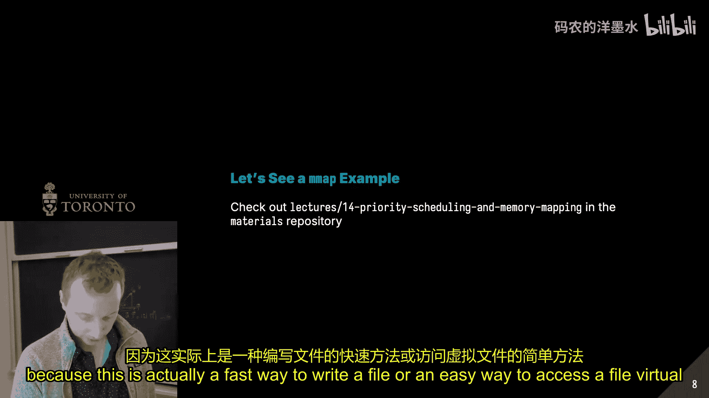
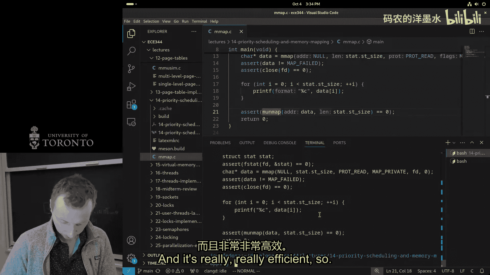
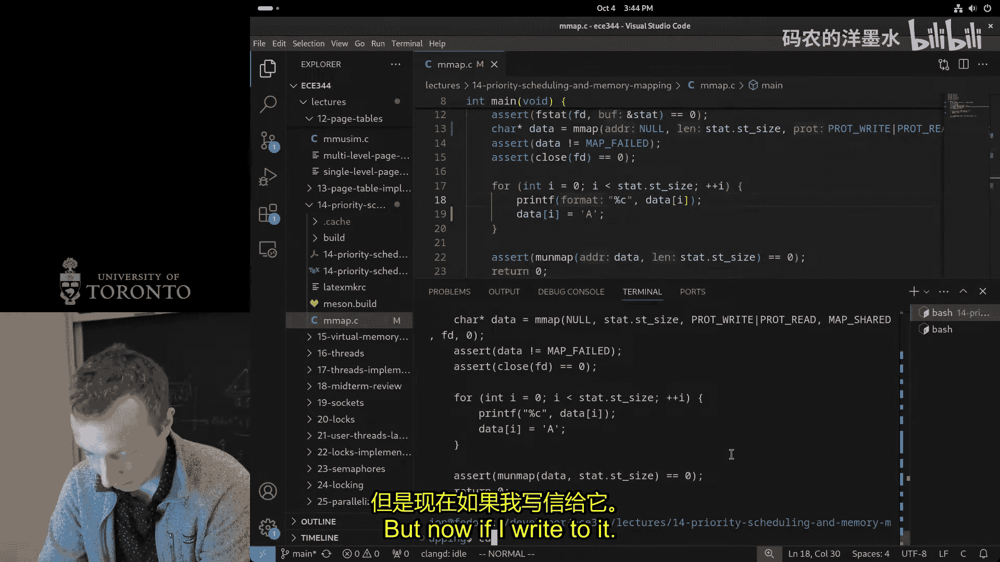

# 操作系统课程：第14讲：优先级调度与内存映射 📚


在本节课中，我们将学习两种重要的操作系统概念：动态优先级调度和内存映射文件。我们将通过具体的例子来理解调度算法如何工作，并探索如何使用`mmap`系统调用来高效地处理大文件。

---

## 动态优先级调度 🔄

上一节我们介绍了基本的调度算法。本节中，我们来看看一种更高级的调度策略——动态优先级调度，有时也称为反馈调度。

这个算法用于在单个CPU上决定在任何给定时间运行哪个进程。与轮转调度使用时间片不同，动态优先级调度会测量CPU的使用情况，并据此动态调整进程的优先级。

### 算法核心原理

该算法的核心是：**在时间片结束时，动态调整进程的优先级**。具体规则如下：
*   我们会**提高**那些没有用完其时间片的进程的优先级。
*   我们会**降低**那些用完了其时间片的进程的优先级。

这意味着，即使一个进程初始优先级很高，如果它持续占用CPU，其优先级也会逐渐降低，最终让低优先级的进程有机会运行。

### 算法工作流程

以下是该算法的具体步骤：

1.  **优先级设定**：为每个进程分配一个初始优先级。通常，**数字越小表示优先级越高**。
2.  **调度选择**：调度程序总是选择**优先级数字最小（即优先级最高）** 的进程来运行。如果优先级相同，则按照到达顺序来打破平局。
3.  **优先级调整**：在一个固定的“优先级间隔”（例如每10秒）结束时，重新计算所有进程的优先级。计算公式为：
    `新优先级 = 当前优先级 / 2 + 在此间隔内的CPU运行时间`
4.  **时间片与中断**：进程仍然在时间片内运行，定时器中断会定期发生，以便操作系统可以抢占进程。

### 调度示例分析

让我们通过一个例子来理解这个算法。假设有四个进程：X, Y, A, B。
*   **初始状态**：所有进程优先级均为0，到达顺序为 X -> Y -> A -> B。
*   **进程类型**：
    *   X和Y是**I/O密集型进程**：每次被调度只运行1个时间单位，然后会阻塞5个时间单位（例如进行文件读取）。
    *   A和B是**CPU密集型进程**：一旦被调度，就会一直运行直到被抢占或时间片用完。

**调度过程推演**：
1.  时间0：所有进程就绪，优先级相同，按到达顺序先运行X。
2.  时间1：X运行1个单位后阻塞。接下来运行Y。
3.  时间2：Y运行1个单位后阻塞。接下来运行A。
4.  时间2-10：A一直运行，即使X在时间6再次就绪，但因为它们优先级相同，不会抢占A。
5.  时间10：**优先级重新计算**。
    *   X的新优先级 = 0/2 + 1 = 1
    *   Y的新优先级 = 0/2 + 1 = 1
    *   A的新优先级 = 0/2 + 8 = 8
    *   B的新优先级 = 0/2 + 0 = 0
6.  时间10后：B的优先级最低（数字0最高），因此调度B运行。


通过这个例子，我们可以看到I/O密集型进程（X, Y）因为运行时间短，优先级得以提高；而CPU密集型进程（A）因为长时间运行，优先级下降，从而让等待的B获得了运行机会。

---

## 内存映射文件 🗺️

理解了进程调度后，我们转向内存管理的一个强大工具。内存映射允许我们将文件直接“映射”到进程的虚拟地址空间，从而像访问普通内存一样访问文件。



### 为什么需要内存映射？

传统读取文件的方式需要使用`read`系统调用，可能需要多次调用并管理缓冲区，对于大文件来说比较繁琐。内存映射提供了一种更简洁、高效的方法。

### `mmap`系统调用

`mmap`是一个功能强大的系统调用，用于创建内存映射。其函数原型如下：
```c
void *mmap(void *addr, size_t length, int prot, int flags, int fd, off_t offset);
```
以下是其主要参数的含义：
*   `addr`: 建议的映射起始虚拟地址（通常传`NULL`，由内核决定）。
*   `length`: 要映射的字节数。
*   `prot`: 保护标志（如`PROT_READ`、`PROT_WRITE`），类似于页表项的权限位。
*   `flags`: 映射标志，例如：
    *   `MAP_SHARED`: 映射可被其他进程共享，对内存的修改会写回文件。
    *   `MAP_PRIVATE`: 创建写时复制（Copy-on-Write）的私有映射，修改不会影响原文件。
    *   `MAP_ANONYMOUS`: 创建匿名映射（不与文件关联），类似于`malloc`。
*   `fd`: 要映射的文件的文件描述符。
*   `offset`: 文件中的起始偏移量（必须是页大小的倍数）。



### 使用示例：读取整个文件

以下是如何使用`mmap`读取一个文件的完整内容：

```c
#include <sys/mman.h>
#include <sys/stat.h>
#include <fcntl.h>
#include <stdio.h>
#include <unistd.h>


int main() {
    int fd = open("example.txt", O_RDONLY);
    struct stat sb;
    fstat(fd, &sb); // 获取文件大小

    char *file_in_memory = mmap(NULL, sb.st_size, PROT_READ, MAP_PRIVATE, fd, 0);
    close(fd); // 映射建立后，可以关闭文件描述符

    // 现在可以像访问数组一样访问文件内容
    for (off_t i = 0; i < sb.st_size; i++) {
        putchar(file_in_memory[i]);
    }

    munmap(file_in_memory, sb.st_size); // 解除映射
    return 0;
}
```

### 内存映射的工作原理

`mmap`的实现非常巧妙：
1.  **延迟分配**：当调用`mmap`时，内核并**不立即**将文件内容读入物理内存。它只是修改进程的页表，在相应的页表项中设置“无效”位，并记录该虚拟页对应文件的哪一部分。
2.  **按需页故障**：当进程第一次访问映射区域的某个地址时，会发生**页故障**。
3.  **内核介入**：内核的页故障处理程序会识别出这是一个文件映射页。然后，它会分配一个物理页框，并从磁盘文件的对应位置读取数据到该页框。
4.  **更新页表**：最后，内核更新页表项，使其指向这个新的物理页，并设置“有效”位。此后，对该页的访问就不再需要磁盘I/O。

这种**按需调页**的方式非常高效，它确保只有实际被访问到的文件部分才会被加载到物理内存中。



### 实际应用案例：大型语言模型（LLM）的内存优化

这解释了课程开头提到的“魔法”：一个更改将LLM的内存占用从32GB减少到6.8GB。秘诀就是使用了`mmap`来加载模型文件。

*   **传统方式**：启动时通过`read`调用将整个巨大的模型文件（如20GB）读入内存。
*   **`mmap`方式**：使用`mmap`将模型文件映射到内存地址空间。
*   **优势**：在模型推理（inference）时，通常不会用到模型的全部参数。`mmap`的按需加载特性意味着只有被激活的模型部分才会被实际读入物理内存，从而大幅降低了内存占用。


这个“单行更改”带来的巨大提升，正是操作系统虚拟内存和内存映射机制强大能力的体现。

---

## 总结 📝

本节课中我们一起学习了两个关键的操作系统机制：
1.  **动态优先级调度**：一种通过监控进程CPU使用情况来动态调整优先级、平衡I/O密集型和CPU密集型进程的调度算法，有助于提高系统响应速度。
2.  **内存映射文件**：通过`mmap`系统调用，可以将文件映射到进程的虚拟地址空间，实现像访问内存一样访问文件。这种方式不仅编程更简洁，而且通过按需调页实现了高效的内存使用，在处理大文件时优势明显，正如在优化LLM内存占用中所展示的那样。


理解这些概念有助于我们写出更高效的程序，并深入理解操作系统如何管理资源和抽象硬件细节。