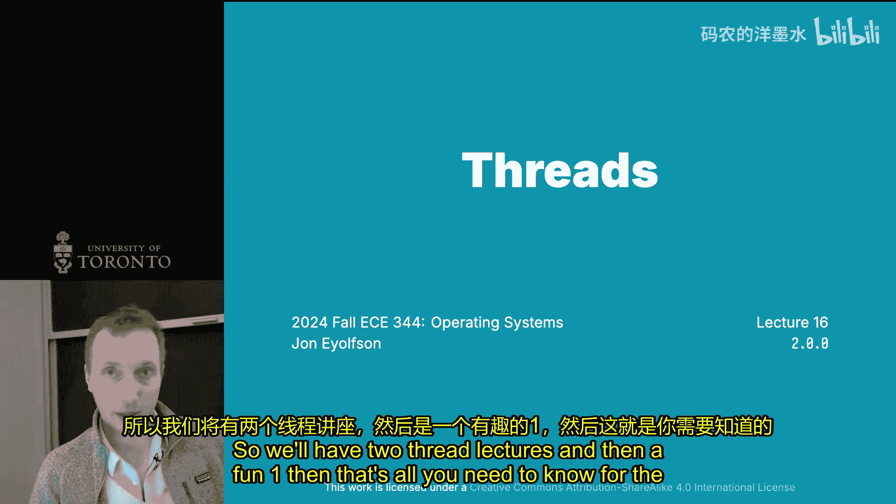
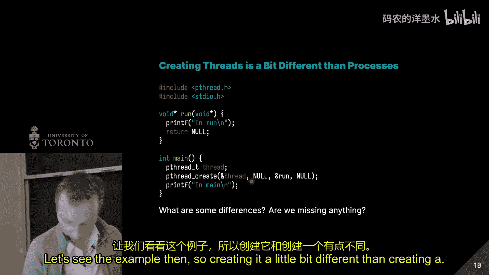
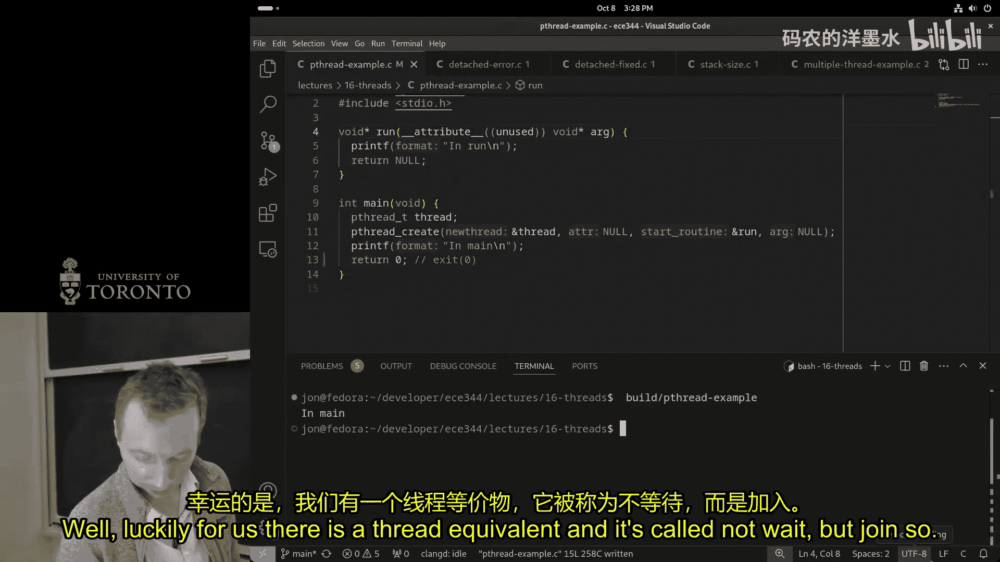
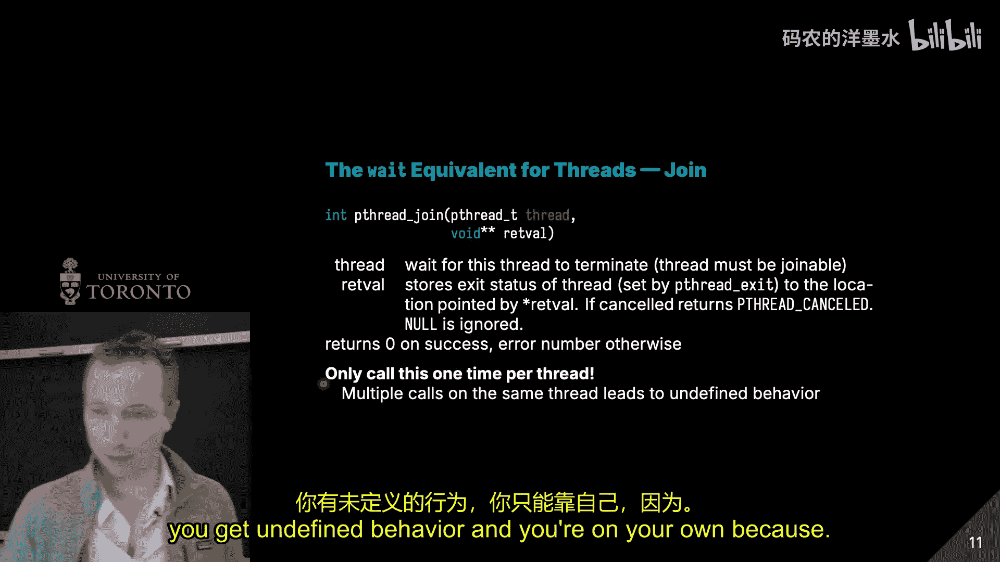
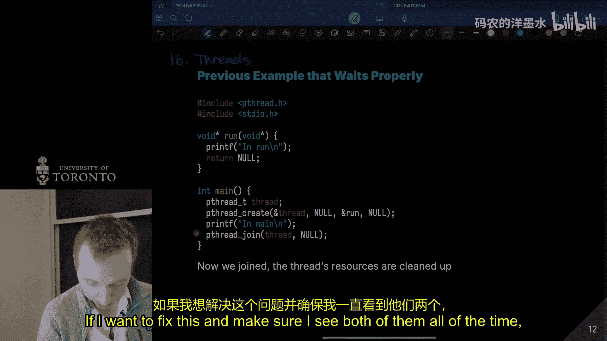
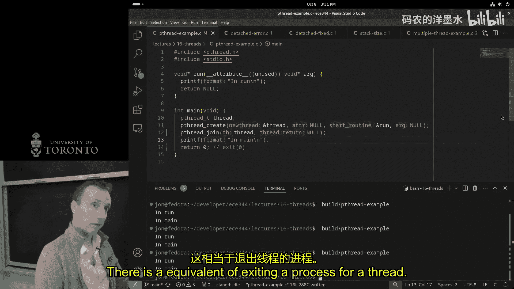
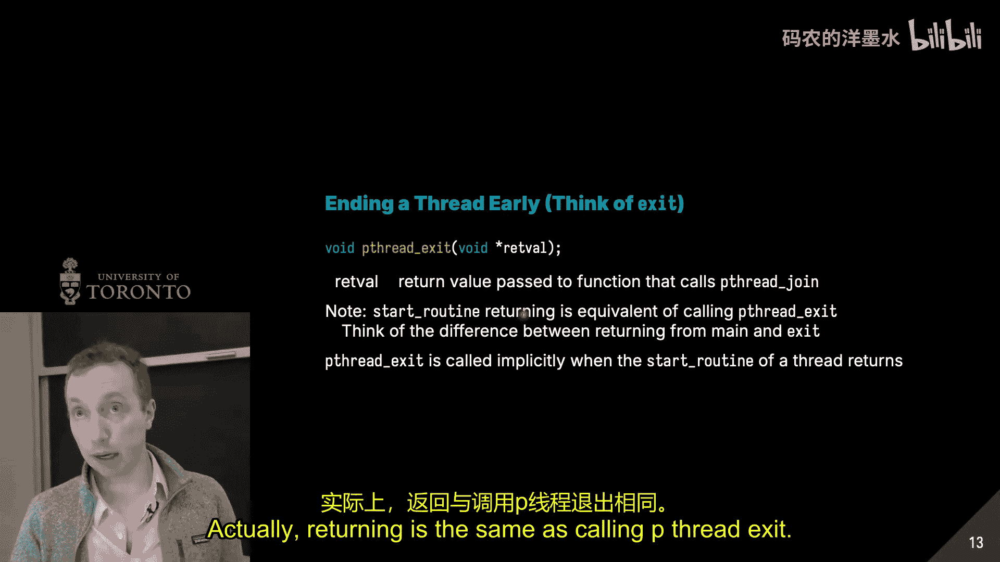
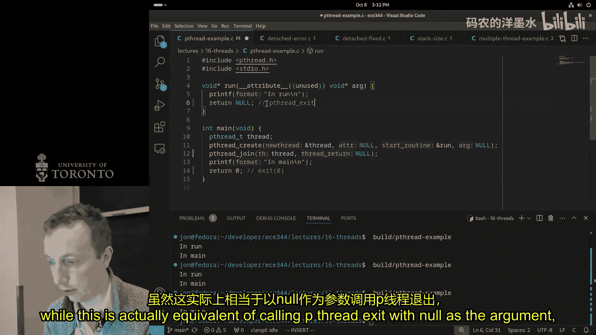
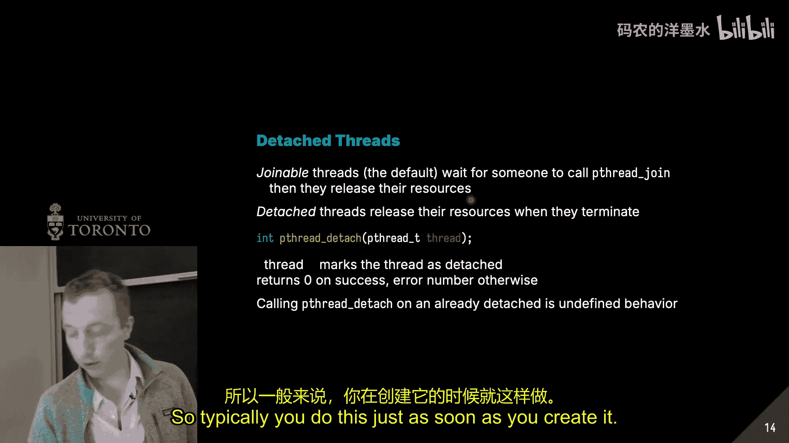
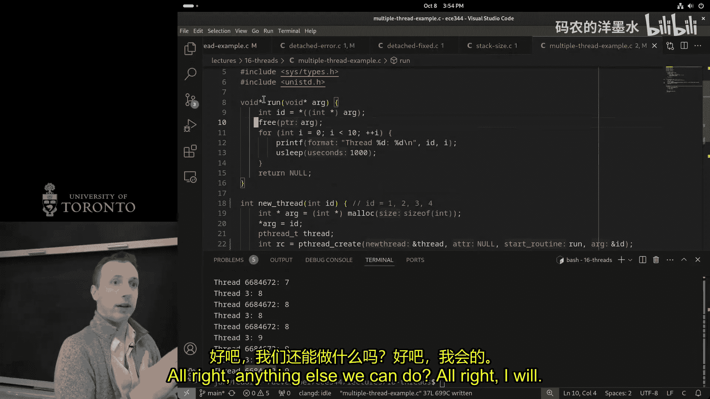

# 【全集】多伦多大学 操作系统 中英字幕 1080P p15 Lecture 15 - 线程 -BV1Rbk7ByERc_p15-

🎼Yeah。じやない。Okay。Allrighty， welcome back to operating System。Threads our next fun topic。

 which some of you are an expert on threads。 so we'll test that。嗯。Midterm content。

 just because I guess guys all started midterms， we cut off this that like lecture 18 is the last one you have to know for the lecture。

 Then after that， all that content is save for the final。 So threads next hardest topic。

 we will get into it and start off。 So we'll have two thread lectures and then a fun one。

 And then that's all you need to know for the midterm。

So before I start talking about threads， I have to talk about concurrency and parallelism being different。

In English， they are Cyms， they mean the same thing in computer science。

 they are not because we are weird and we like to make things complicated。

 so they are actually suddenly different。Concurrency is just switching between two or more things so I can get interrupted。

 and the goal of that is to make progress on multiple things so I can do something。

 do a little bit of it， switch to something else， do a little bit of it， switch to something else。

 do a little bit of it。 So between two time periods。

 I can do multiple tasks by switching between them。Parallism， on the other hand。

 is actually doing two things at the exact same time。 oops。

 so parallelism doing two things at the same time。 They're independent。

 I can do them at the exact time instant， two or more things are going on。

 and that goal is to be running as fast as possible。 I have multiple cores on my machine。

 I want to run all of them at the same time。So。To explain the difference between them。

 we'll have a silly real life example because maybe that will make things a bit easier。

 So let's assume we are sitting down for dinner and we have four options， we can either eat， drink。

 talk or gesture with our hands but we have this weird caveat where we're so hungry that if I start eating。

 I'm not going to finish so comparing any two tasks like just taking any two tasks。

 I should be able to say whether I could do those two tasks concurrently or in parallel so let's think so drinking and talking。

Can I do those concurrently？Yes， right， I have one mouth I can either drink or talk。

Not at the same time， but I can switch between them。 And this is， you know。

 assuming we are not savages and we are you know， somewhat polite。

But can I talk and drink in parallel if I'm being a dignified human being。No， right， one mouth。

 I can't talk while I'm drinking， only one mouth， only one mouth hole can't do anything about that。

What about talking and gesturing， Can I do those in parallel。Yes， can I do them concurrently？Sure。

 I could switch between them。 I could only do one at a time if I really wanted。

 What about gesturing and eating。 Can I do those concurrently。No。

 because I've that weird caveat where I'm so hungry， I won't stop eating until I'm done。

 so I can't switch once I've started eating。 so I cannot do it concurrently with gesturing。

 Typically， this wouldn't happen in a computer system。 That's why this example is kind of weird。

 but I could do them actually in parallel。 I could eat and jest with my hand at the same time。

 I just can't stop eating once I've started due to this weird caveat。

 So could happen in computer systems。 but generally。Not required。

 So parallelism doesn't imply concurrency other way around doesn't imply the either。

 So you can have both。 you can have one。 You could have neither。

So everyone okay with this different between them， even though this is a weird real life example。

So slightly different things。 And here's all the combinations， if you want， just to show that， hey。

All of the different combinations can happen。But we get to， and the reason。For that is like， hey。

CPU switch really， really quick。 So sometimes concurrency can look like parallelism。

 You don't know if you just have one CPU core like back in the day and you switched really， really。

 really fast。 Well， given enough time， you don't know if things are going in parallel or just switching really。

 really fast。 So like， I't know， assume。I was sitting at the dinner table with a blue cup。

 like I had a blue drink and a red drink。 I told you to close your eyes for 60 seconds。

 And then when you opened your eyes again， they were both empty。Do you know what I did。

 Did I drink one， drink the other， maybe switch back and forth between the two times。

 or did I just double fist it and just drink them both at the exact same time。 You don't know， right。

 if given enough time， concurrency can look like parallelism。 So that's back in the day。

 what we had to do。So。Threads， they are like processes。 They have equivalents。

 We'll go over all the equivalents， but you can think of them initially as like processes。

 but with shared memory， same principle， same everything， except by default。

 They share all of those virtual addresses。 So they have their own registers program counter and stack space。

 So this is actually going to be the first time， remember hopefully in 105， you had to say， oh。

 this variable， where is it stored the heap， the stack， global variable， Where is it。

 Well it's going to start to matter now， because each thread has their own stack。

 but global variables， heap space that is all shared。So they have the same address space。

So changes appear in any other thread。 If you actually change a global variable or something like that。

 you assign a new value to it。 The other thread could read that value。

 They're all using the same virtual address space。 So if I want to explicitly make any memory associated specifically with a thread。

 either I can。Make my own space with malloc or something and be careful about it。

 or there's actually a way that we won't get into this course called threadread local storage。

 and that can allocate some space specifically for a thread that will die with the thread。So。

A process can have multiple threads in it， so by default。

 a process just executes code in its own address space。

 you can think of it as like when a process starts。

 it has one thread and that one thread is doing all the execution and。

What if I have multiple threads， I can have multiple executions in the same address space going on possibly at once。

 depends on my hardware or just concurrently， So unlike processes， they're lighter weight。

 less expensive to create since they share code， data file descriptors。

 all of that when you create a new process or sorry， when you create a new thread。

 you just need a new set of registers and a stack while if you create a new。

Process like you're learning in La3， while it needs its own set of page tables。

 needs its own virtual memory， it would need its own set of file descriptors if you are really doing it and all sorts of things to make two processes independent。

So assuming again， once CPU threads can express concurrency process can appear like it's executing in multiple locations at once。

 but the OS is just context switching within a process so one thing it might be do it might be actually easier to program concurrently so web servers will get into how to do IPC and sockets and all that in a few lectures but this is basically the code for a web server it's like while true get requests so that would be some blocking operation waiting for someone to connect to them。

That。Would block， wait for a connection， and then this would return whenever someone has connected to it。

 and then it might create a new thread to go ahead and serve that request and it can actually。

 even with a single CPU handle hundreds or thousands of requests all seemingly at the same time。

 but we're switching back and forth really fast。 So any web server you connect to。

Pretty much looks like that。 Of course， it's going to be a little bit more complicated than that。

 but that's like the gist of it。So how to compare them together， their lighter weight。

 processed right， completely independent code data heap， a thread， it's all shared。

 threads live within a process， a process has completely independent execution， it lives by itself。

 a thread lives within a process so as soon as a process is dead， all the other threads will be dead。

 which we'll see in a little bit process would have its own stack and registers。

 a thread has its own stack and registers or you can think of it like a process just starts with one single thread in it。

 it's probably an easier way to think of it。Process， expensive to create。

 expensive to context switch to， right， whenever I context switch。

 not only do I need to swap in some virtual registers and things like that， I need to change the。

Which page table I'm using that cause a T L B flush， all that thing， because all that stuff。

 because I'm changing。To a different address space。Threads， on the other hand。

 pretty cheap to create all it needs is a stack virtual registers and boom。

 easy to contact switch to， assuming we're switching between threads in the same process。

 I don't have to mess with virtual memory or anything like that。 I just keep it exactly the same。

A process， whenever it terminates right， it completely lets go of all of its resources。

 all of its memory file descriptors， everything like that。

 it will stay around for a zombie a little bit， consume save at least like its process ID and exit status。

 but otherwise it just disappears when it terminates。Everything associated with it。

 Well if a thread just terminates， its stacks removed， whenever it actually finally exits。

 and the important part here is when the process dies， well， since threads slip within a process。

 all threads within it die as well。So。This course will be using Pos threads for Windows。

 There's win 32 threads。 They're pretty much same idea， different。Slightly different APIs。

 but same idea， So we're going to use UniX threads。 this is MacOS Linux， they both use P threads。

 So how you use them， you just include P thread in your source file that brings in all of the declarations for all the functions which will go over some today and then when you compile and link you just do dash P thread。

 the build system does that for you so you don't have to worry about it and they all have documentation on the man pages or on the internet。

So。When we create a new process， we used fork， right。

 and then we had to figure out who was who from the return value。

Creating threads is slightly different。 So to create threads。It takes four arguments。

 the thread create， the first argument it takes is a pointer to this P thread type。

Whenever you see P thread underscore type， you can think of it as if it was a process。

 the equivalent would be a process ID。 you can think of it as a thread ID if you want。

 so it will this function will if it successfully creates a thread will write the thread ID to this thread variable or。

Dereference it and then update that value。 Then we get a pointer of attributes。

 We'll see some generally for this。 It's kind of a pain to set。 So we can just。Set all for defaults。

 And then the next function is a start routine。 That's a fun type。 A。😊。

Can anyone tell me in plain English what the type of start routine is。A function。

Any more information than that， a function that does what。Ping。That takes no argument。

 returns no argument。The pointer。Yeah， yeah， so the type of the start routine is it is a pointer to a function。

 and that function takes a single argument， which is a pointer。

Bod Star just sees way of saying it's a pointer， don't really care， and it also returns a pointer。

And then the next argument here is a pointer value。

 So the way it works is whatever value you give here will be passed to this function as that one argument。

So whenever you successfully create a thread， it will create a new thread that wants to start executing that function that you give called start routine。

 you can name it whatever you want， and it will give you a set the single argument to whatever this value is。

 so if it's successful it returns zero， otherwise it directly returns an error number and if there's an error。

 the contents like if you dereference thread， it's undefined because it wouldn't have updated it。

So let's see the example then。 So creating it a little bit different than creating a。

Creating a process。 So here again， we would start executing at main。 So we create a new thread。

 So we just get some create a local variable called thread。

 So we'll have the P thread create function update this value for us。

 So we'll give it a pointer to this thread variable as the first argument attributetris will set as null to get the default Start routine is this run function。

 So this run function takes a single argument。 And here all this attribute unused does is just tell the compiler not to give me a warning。

 I know I'm not going use it。 So we're just going to ignore it。 And then it would set that value。

 If we did read it。To null。 So not even going bother reading it。 And then。

After assuming P thread create successful， we will have another thread that wants to execute this run function and should run。

😊，Print F in main or sorry in run。 And then the main thread。

 we don't know what order they'll execute in。 It wants to execute in main。 So if I run this。

 what should I see。Yeah。In run then in Ma。Is that my only option？Or the other way around， right。

 I don't know。Any other？Any other things I could see yeah？the same problem。

Try to print them at the same time。Could depend how you write print F。

 But I should see one then the other right， or maybe in different orders。 Like if that was a fork。

If I essentially you know change create with a fork and then just had if else。

 and then in one branch I did in Maine and then the other I did in run。

 I would see both print statements right， but I don't know what order。

 so I should see the same thing here， right。All right。 And some of you have used threads before。

 right， So you're all experts。All right。I trust you。Hey， look， we got in inrun and then in Maine。

 Joy。Hundred percent were all good。 Oh， I'll just run it again just to make sure though。Okay。

 I got in Ma and then in run， that was lucky。Oops， do have to recompile it。Yes。

 I have to recompile it。 Why bad。 The other class messed it up。 Allright， so I recompiled it。

And now I'm running it。I'm supposed to see both， right。You guys are experts in your view thread。

 What the hell just， what the hell just happened。Yeah。I'm not waiting on a thread， Yeah， yeah。Yeah。

 exactly。 So you're right for the fix。 So here。What happened I only saw in Maine because here I did set up another thread to execute this。

 which would print in run。But what happened is the main thread。

 I don't know what order they'd happen in。 It seemed to be that the main thread executed first printed in Maine。

 and then。Hit this return 0， which is the same thing as。The exact same thing as just oops。

As just exit 0， right， So exit 0。 What does that do， It just mixes the process， right？ Well。

 if it mixes the process， the process terminates all the other threads in it die。

 So it just ended before the other thread actually executed this in run。Makes sense。 And yeah。

 to fix it。 Well， if this was processes， I want to make sure the other one was done。

 what I would do is wait for it。Well， luckily for us， there is a thread equivalent。

And it's called not wait， but join， so。works pretty much the exact same way。

 so because we are getting a pointer value from it。

 so for processes we return an integer right which is the exit status for threads we're returning a pointer but otherwise aside from that everythings exactly the same。

 so to join you join on essentially a thread ID which。Would be a process I D。

 And then here you give it a pointer to a pointer， and that will actually write the pointer return value to this memory location specified by return Val。

 So if it's canceled， we won't go into that， itll be canceled or you could just set to null to just ignore it or just set to some valid memory address so it can actually update that value so。

Unlike weight， so if you call weight on the same process multiple times。

 you just get an error from weight， no harm， no foul。

 you just have to maybe handle that error or anything。

 but for threads since they live within the process。

 while you're only allowed to call join one time per thread， if you call it twice。

 you get undefined behavior and you're on your own because。

Cs like that。So。If I want to fix this and make sure I see both of them all of the time。

 what I can do here is in the main thread， I can justd join on the other one。

 which will essentially just wait for it to finish。

So if I do P thread， join， I can join on that thread and then just give it null saying I don't want the return value or anything like that。

So now， when I execute this， no matter what I should see both print statements， right。

 So no matter who executes first， if the main thread runs first， it prints in main。

 and then it'll hit this join， which will block until the other thread has exited wait until the other thread runs。

 it would。Run this print statement。Print in run and then return null， which would。Stop this thread。

 So if we run this now， we should see every single time， no matter what we get both lines。

 We don't know what order。 We saw one order We're in run came first。

 but just up to luck at this point。 So make sense so far。Alright， threads are fun， so。Oh， yeah。あプ。

Will that ensure the order？Yeah， so if we just move this。Here。

If we just move the print statement here。Yeah， so if we just move the print statement here right。

 we create a thread， we join it， so we're waiting until it's done。

 so we'll always see in run and then in main because we're actually waiting on it。

 so no matter how many times we go here， always print in run and then in main。All right， so。

There is a equivalent of exiting a。

Process for a thread。Called well， thankfully， it's also called exit。 So there's P thread exit。

 So how exit just takes an integer， This takes a pointer。

 which is whatever value you want this thread to return。 So otherwise， it's exactly the same。

 And if start routine actually returns just like main returning is the equivalent of calling exit。

 The routine you give it。Actually， returning is the same as calling P thread exit。 So here。

This return in this run， while this is actually equivalent of calling P thread exit with nullla the argument。

 so they mean the exact same thing and it's always implicitly there at the end。

 just like for process， whenever you return from Ma， same idea。

Alright， so the fun thing about it is well。😊，There's such there's such a thing as zombie threads。

 right， If I don't join it and it's terminated， it might stick around， consume some resources。

 essentially be a zombie thread well。That is just the default。 So joinable threads。

 which are the default。 wait for some other thread to join them before they completely release all of their resources。

 Probably like their thread I D and that whatever value they have to hold on to。

 But unlike processes， we can decide we don't care。

 So there is such a thing with threads called detached threads。 And this prevents any zombie threads。

 So what this does is as soon as that thread exits。

 It just poof disappears from the planet cleans up all its resources itself。 The drawback， of course。

 is that well， you can't actually get any return value from it because it just completely gets wiped off the face of the planet。

 but。If you don't need the return value and you don't want to have to join on threads or it's difficult to know when you should join。

 you don't know how long they're going to last。 Detached is the way to go。

 It will not create any quote unquote， zombie threads。 So just takes an argument。

 a thread to mark as detached。 You're not allowed to call detaach on an already detached thread that's undefined behavior。

 So typically you do this just as soon as you create it。

So we can do the same thing now， so。Here。Heres that same example。 So I just create a thread。

 And now I'm going to say it is a detached thread。So detached thread， I don't care about this 1。

 I don't want to get its return value。 Don't care。 Just have it clean itself up。 So same thing。

 the main thread will continue on to print in main and the other thread wants to print and run。

 So now if I run this one， what happens。Should see both lines again？Maybe let's see。

 it's called detached error。Oh no， I saw in Maine again， right？

Same reasons before the main thread hit this hit exit。

 And how I fixed it before was I waited for the other thread to actually finish。Well。

 if it's a detached thread， I can't join it。 So how do I make sure both things print now。嗯。Hm。Well。

 turns out。To do this。My problem here is that this exit。

 it's like when the main thread reaches this return， which calls exit， essentially does exit  zero。

 So what I can do is I can actually just terminate the main thread。

 So if I just put a P thread whoops。If I just put a P thread exit here。

That terminates the main thread。 So the main thread will cease to exist whenever it calls exit here。

 And the way this P thread library is organized is。Well。

 if a thread exits and there's something else to execute， then the process will stay alive。

 So the process will stay alive until all threads have exited。 So in this case， if main runs first。

 it would print in main， then exit， then the main thread is dead。

 but there's still the other thread that wants to execute this run。

 eventually it will get picked to run。 it will print in run， then return from its function。

 which willll call its P threadread exit。 Now it was the last thread alive。

 So the P threadread library is going to be smart enough to realize nothing else can execute。

 I'll just exit the process。 So if we do this and now run it we'll see both lines printed every single time wed not sure the order。

 likely itll be in main first every single time， but we could also see in run first likely we are not going to get that lucky。

え？But any questions about that？Fhu。Maybe not that fun。All right。So other things we can do。

 I have this in the lecture slide。 I'll just show it quickly。If you wanted to。

 you can actually see that there is a set stack size for each individual thread using this attributes。

 So this is just in case you want to in this course， you won't have to use this attributes。

 But if you want to use this like attributes thing， then you just define your own。

 I'm going to also declare stack size because I want to get information out of this。

 So in that will initialize all the attributes to the default values。

 and then I can just use an accessor function。 there's a ton of them。

 you can look at the documentation if you're really bored。

 but if I want I just give it the pointer the attributes and then a pointer the stack size so that it writes the stack size to this memory location。

 and then I can print off whatever the stack size is just to show you that， hey。

 there's a default stack size。 And then after that we should free it。They just call it destroy。

 So if we run that， we can see that。The stock size is。That many B， which is 8 MB。

 That's your default stack size。 So if you wanted to。You know。

 if you want to fix a stack overflow air or something like that， just boom。

 just give yourself more stack space。 and then you'll be fine， right。Could do that。

 So something you can do， likely， if you overfill 8 MBby， you're probably doing something wrong。

All right。So we can have a more complicated example here。 So you can ask questions for this example。

 This is where it gets fun。😊，So let's have something way more complicated。So。

Let's go over this function really quick， so in mainine， what I am going to do is have this for loop。

So this four loop will go through I will be equal to1 then 2 then3 then 4， right， So go。

 go into this loop， execute I will be equal to 1，2，3 or 4。

 And each time it will call this new thread function with I。 So 1，2。

3 or 4 should be different every time。So it's just going to create four different threads and then exit the main threads so that we don't kill the process。

 Otherwise， we might not see anything。In this new thread， what we do is here。

 I show you how to actually pass data to that new thread。 So because。Well。

It doesn't have its own stack space， it doesn't exist yet。In order to pass a value to it。

 I need to use some other memory like the heap in order to pass a value to it。

 We'll see what happens if we don't do this and explain why。 But here I malloc space for an int。

 Then I get back a pointer to an int。 And then I actually update that memory location with the value of I D。

 So I can give each thread its own internal I D。 Then in this P thread create。 Well。

 I'm initializing this thread variable， I'll use all the default attributes。

 which will make sure it's a joinable thread technically， I get zombies。

 I could just detach them if I wanted to。 We'll just do that just for argument sake。Touch。

So for argument sakes， we can detach it， then start routine。

 So each thread wants to execute this run function。

 and then it will get a as the value of the first argument。

 which should be whatever it got from Maloc。So。In the run function， right， it gets a pointer value。

 which should be whatever got returned from Maoc。Here it creates a variable called ID。

 ID is where is this local variable allocated in memory。Think 1，0，5。Is this on the stack。

 is it on the heap or is it the global。Stack， right？ So each thread has its own stack。

 So each thread will have its own I D variable that's independent of any other thread。

 So they create their own local variable here and they initialize it to， well。

 they take the argument。 It's a point or to an it。 They dereence it to get the value。

 And then after that， I don't need that memory anymore。 I can just go ahead and free it。

 And then here。I have a loop that goes from zero all the way up to and including nine。

 where I just print off thread ID equals I and then sleep for a little bit just for a dramatic effect and then return null should finish it。

So I create four threads。 So if I run this program， what will I see。

So what should I see from a single thread， Let's just assume that we have thread I D 1。

 What do I see from a single thread。10 print S statements all in the row， right。

 I should see thread 1，0，1，2，3，4，5，6，7，8，9 in that order。Okay。

 so each thread should do 10 print statements。Is there going to be any order between the threads？No。

 right。 I have no idea what it's gonna be， but I know each thread by itself will print in order 0，1。

2，3， da da da da da da。 So if I run that， this is what I see。So。Here， right， they all printed off0。

 I just put a sleep in there for dramatic effect just to try and jumble it up a bit more。

 But I see every thread print 0。 It went thread 1，2，4，3 just happened to be that way。

 then they all printed one seemingly in the same order and then for two， hey。

 we got a bit more jumbled thread2 seemed to have passed thread1 for whatever reason and thread 3 fell right way behind thread2 actually printed three before it。

 but of course it printed two before it got there and so on and so forth we don't know the order between them。

 but between all in one thread it is consistent。 So any questions about that before we screw up things。

Yeah。Scroll down the code。And this new thread function would be called four times with。Id equals 1，2。

 3， and 4。Yeah does。说 that。AA诶诶。なだない。だな。So this sleep， yeah， is mostly for dramatic Mac effect just。

See a bunch of zeros and then a bunch of ones。 Otherwise。

 this goes fast enough that I might see here。 We can just remove it and see what happens。

So if we remove it。It might be the case that one thread just complete completes before any other ones。

 Oh no， we get， No， no， kind of。 So if we remove the sleep， right， thread1 print fast enough。

 that thread 1 just finishes completely。 Then thread 4 finishes completely。

And then thread 2 finishes completely， and then thread 3 finishes completely。

 So I just put the sleep there mostly for dramatic effect。

 just to make the jumble up the output a bit more， but doesn't really need to be there。 Same rules。

 just make things consistent。 Just jumbles it up between the different threads a bit more。All right。

 everyone， okay with that before I try and get you to explain something even weirder。All right。Well。

 let's do something weird。 So let's。Assume。That you did not listen to me and that you just kind of play with types and make sure everything goes。

 So you， you might be like。Why the hell are you doing this malloc thing， I have an integer。

 I can just take the address of it。 like it just needs a pointer。 What's wrong with that。

 So here I will change it。 Let's get rid of this。 and then Pthread create instead of passing that stupid thing from Maloc。

 Who cares about malloc。 We'll just give it the address of Id。 That's a pointer。 and then of course。

 we don't need to free it anymore。So。Let's assume。You were trying to be smarter than me。

And you did this。Any idea what is going to happen now when I run this。Hm。Anyone think it。

I just malled for no reason。Yeah。So all the four processes will get the same ID。

OrAll the threads will get the same ID。So like all four or all one or all。2 or all three。Yeah。

 could happen。Well， maybe any other guesses， it's a good guess。All right， well。

 we can send it and just see what happens。嗯。Kin of worked， like half worked。We got thread 2。

 thread 3。And then while each thread only prints one thing individually。 So one thread。

These two threads have the same ID。嗯。I run it again。No，4 and 3。We just have a little bug here。

 no problem。Seems to be different every time。 What's going on here。

Any guesses what what caused the output that I have seen。And。This is why threading is hard。

 It kind of worked， right， Sometimes ish2 outputs would were。Bgly， right？So what happens here is。

Well， the main thread that's calling new thread， this I D variable。

 Where is it allocated or where does it live in memory。On the stack， who stack？The main thread stack。

 right？ So it lives on the main thread stack creates a new thread。

 This pointer is a pointer to the main thread stack。 And then whenever this function returns。

 what happens to that memory that held the I D variable。😊，Freed， but， I mean。

 operating system is lazy。 So it just resets the stack pointer， and it probably won't be used again。

 So what's actually happening here is these two threads。This thread。3 was probably actually thread 0。

 And what happened here was by the time it started reading， right this。

It would the main thread would have constantly called new thread over and over again。

 that ID happened to be the same memory address， every single function call here， and whenever it。

Return from that function。 It just reset the stack pointer。

 So it would just leave an old value there。 So likely， what happened is thread 0 read the value 3。

 So whenever it executed， it actually just read here is like a memory read。 So that would have read。

The main thread stack at the time it started and it probably read three， then thread。

 I'm assuming this is probably thread1 or whatever thread started second。It read old value4。

 and then what happened is well。The main thread eventually called P thread exit。

 which demolished its stack。 And it probably， it looks like it got filled full of garbage。

 And then it we this， these threads just read garbage the whole time。

 And that's why it was slightly different every single time。 So that time。We read what we read。

 It looks like we read the same value in two threads Now。

 we got really unlucky where we read the same value twice of 3。

 And then we read this garbage twice there。 So if you。So each thread has its own independent stack。

 If you give another thread because we're all in the same address space， If you give another thread。

 an address to your stack， really， really， really bad things will happen like。Good luck。

 debugging that， so。Any other questions or anything you want me to do here。

 since we have a few minutes。Yeah。Right。Where in the main property？Yeah， so where's。

 where's the thread stack。 So as part of P thread create。

 it would probably just allocate some stack space。 It might do it through Mmap。

 It might do it through Kaelloc， whatever。 and then。

It would have to set up the stack pointer so that it used it。 and then。Spoiler alert， La 4。

 you will be implementing threads yourself。 So I'll give you some functions that create a stack for you。

 but you'll be managing threads in Lab 4。 Lab 4 will be fun。 Lab 4 is the infamous one。😊，That took。

80 hours in previous years。I have changed it。 Do not worry。 I sing your bright eyes。

 It does not take that long anymore。 It is now fun。But。Fun ish。

So it does not and it does not take 80 hours。 So it takes anywhere near that long。 let me know。

 I made it much simpler to still get the point， but you essentially are creating your own threading library here where you'll have to manage threads and all that fun stuff。

 I swear it's fun。But any other questions， but yeah。

That stack lives in virtual memory since every other thread can access it， you give a pointer to it。

 you can access it， it's supposed to be independent， but you can of course break those rules。

 which sets off all sorts of bad things。So mallocc prevents the issue here because， well。

 each time through here， I'm malloced。Each time。And each time I malloc， I get a new chunk of memory。

 right that lives in the heap。So I just。Like， I declare four integers and then pass that pointer。

 a different pointer to each thread。 Then each thread only reads that value and then freeze it。

So I only have one thing， I put that data on the heap so it can read it。

 I don't try and screw with anyone's local variables or anything like that， write it to the heap。

 it reads it from the heap， and then it can go ahead and free it。All right， anything else we can do？

All right。