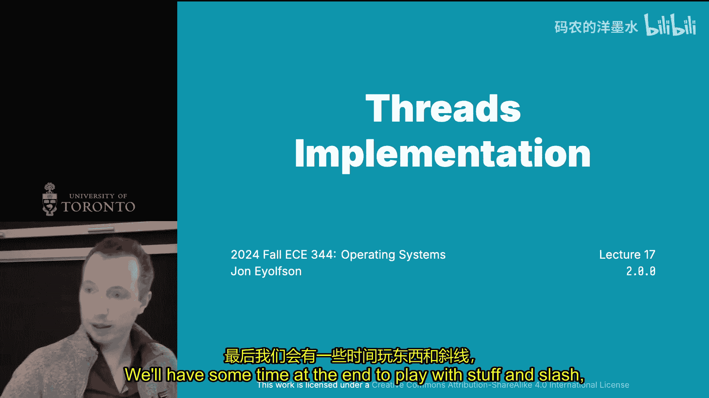
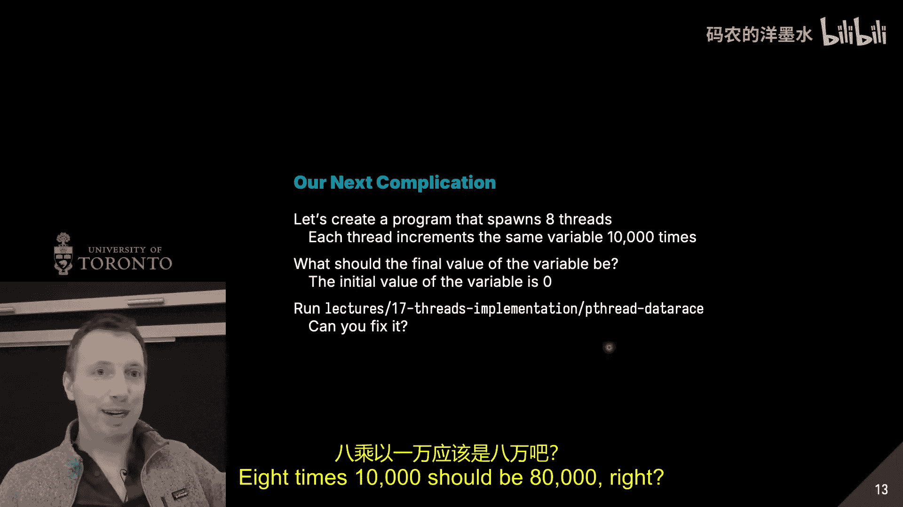
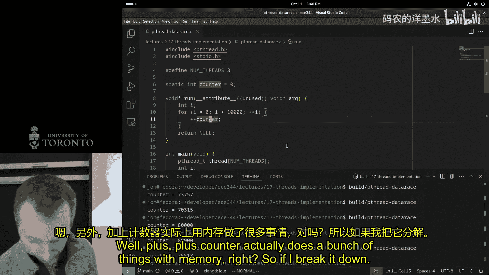
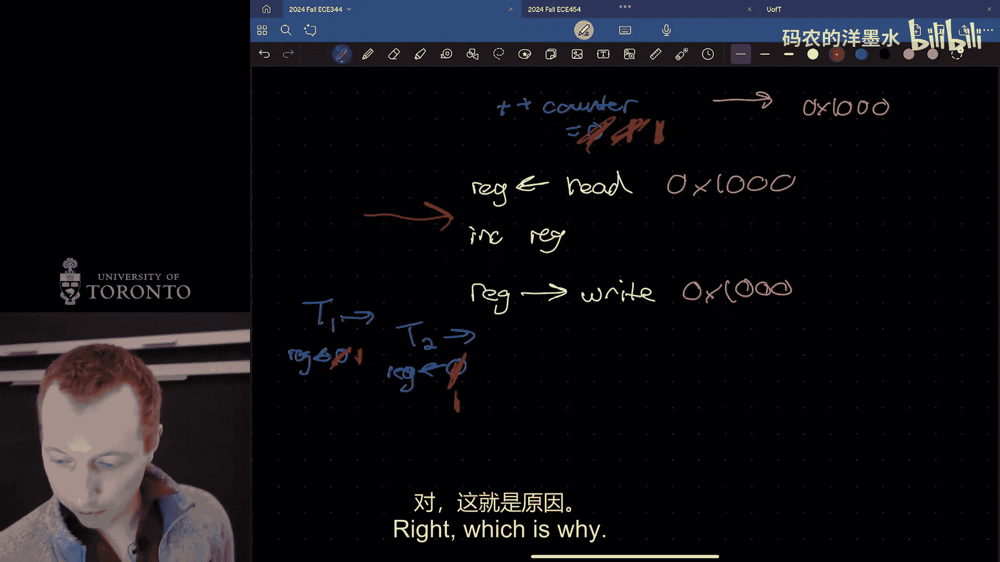
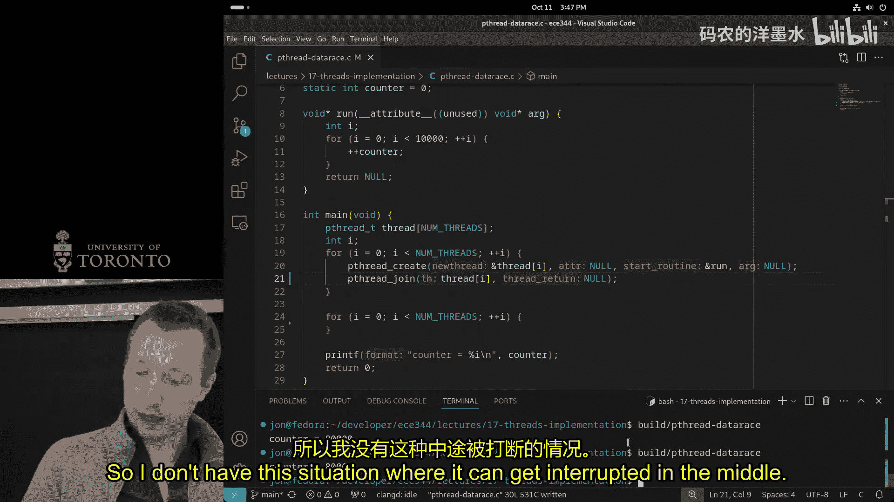
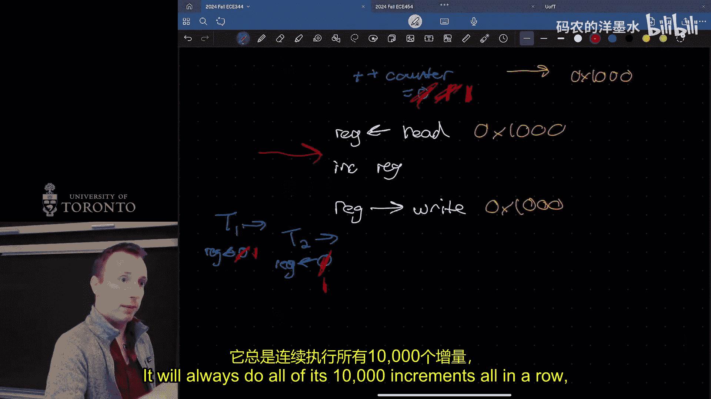
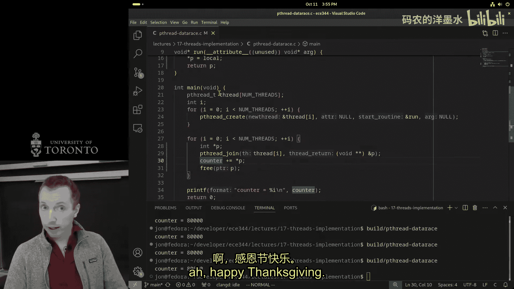

# 【全集】多伦多大学 操作系统 中英字幕 1080P p16 Lecture 16 - 线程实现 -BV1Rbk7ByERc_p16-

我や。れ。All right， welcome back to Operaing System， our Go Home Thanksgiving lecture。

So this will be the last lecture you need for the midterm。So let's get started。

 It won't take us the whole time。 We'll have some time at the end to play with stuff and slash leave early for Thanksgiving。

So。Threading， there are different ways to implement it。

 and this will be especially useful because guess what you are going to implement threads in lab for。

 I will help you a little bit， But you should know what the two main approaches are。

 So if we have to implement threads， cough， cough。 you can either do user threads or kernel threads。

So user threads are completely in user space。 That means the kernel is not aware you are using them。

 So by default， your process starts with a single thread。

 and then with user threads since the the kernel does not know about any other threads you create you are all you're doing is passing around that thread。

 you are doing concurrency。 you're switching what it executes， maybe really fast。

 maybe whenever it wants to。 and the kernels aren't going to treat your threads any differently than it would just treat the overall process。

Colonnal threads， on the other hand， are implemented in kernel space。 So to create them。

 you need to do a system call。 System calls are slower than function calls in C。

But the nice thing about kernel threads is the kernel manages everything for you。

 It would allocate stack waste for， keep track of the registers， everything like that。

 and it can treat threads especially。 So if you have multiple cores on your machine and multiple threads。

 it can actually do parallelism， it could run all of those threads on different cores at the same time。

 While if I just have pure user threads， Well， if the kernel doesn't know about them。

 the prospect of parallelism is just not going to happen， which is very bad， especially now。

 when even my watch has two cores on it， so。😊，You pretty much can't get away from it now。 maybe。

 you know， when I was taking this course back in my day。

 single CPU cores were all were everything we didn't have to worry about this。 But for you。

 your life is now threaded。 You need perism otherwise。😔，You're not programming anymore。

Thread support， if we want to implement threads， we need some type of a thread table similar to a process table we saw before that process control block。

That's。Someone moving a piano？Alright， so similar to like having a process control block。

 while we have a thread control block or we're keeping track of all the threads。

 This could either be done in user space or kernel space。

 depending on if I'm doing user threads or kernel threads for user threads since you are the one that is implementing everything and you're sharing the single thread。

 You also need some runtime system to do scheduling right。

 you can't depend on the kernel to schedule between your threads if it doesn't know about them。

 It will just schedule your process to run or not。 and you have to do your own scheduling between threads。

 So both models， same idea。It's just the process can contain multiple threads。

 it's just whether or not the kernel knows about those threads or not。So。

If we want to avoid system calls and do user threads。 So for pure user level threads， again。

 the kernel is not aware of them。The big advantages of them are theyre going to be fast to create and destroy no system call。

 no context switches， no fuss， no mus。 But the major drawback， while the second major drawback。

 the major drawback is that they will never run in parallel。

 the second major drawback is that since the kernel does not know about them。

 that if one thread does a blocking system call， that entire process is just blocked。

 no other threads can make progress anymore， even if the next thing they want to execute is not a system called not something that is blocking。

 they could actually make some type of progress。 So even if I have， you know。

 I create eight threads and one of them calls a weight or something that blocks。

 that entire process will be blocked， even if my seven other threads could make progress。

 if I have user threads。 and again， the kernel does not know about them。

If I have kernel level threads， that means they're slower to create， I have to do a system call。

 but the great thing about them， even with the single CPU core back in my day。

That if one thread blocked with doing a weight or something like that。

 since the kernel would be aware of the other7 threads that could make progress。

 it can just switch to execute one of those other seven threads。

 And then your program is still doing something useful， even though one of those threads is blocked。

 so。😊，Clonnal threads still good。 Even if you only have a single CPU core。

 they just get better and better the more you have， because， of course， we want some parallelism。So。

All the threading libraries you use run some type in user mode， even if they use kernel threads。

 you still interact with them by creating a thread doing a function call， even if under the hood。

 they do a system call or something like that。 So the way we like to think about them is that your threading library。

 whatever you use will have some type of mapping to the thread you create。

 and then either a user thread or a kernel thread generally you care about what the mapping is between the threads you create。

 So all the user threads to kernel threads。 So if you have a many to one。

 that means all of the user threads that you have created map to a single kernel thread。

 That is the pure user space implementation， kernel only sees your process with that one thread。

 whatever you do with that one thread is up to you。

So that will be what you implement for lab for to make your life a lot easier so you don't have to deal with parallelism or anything like that。

 And things are a bit more deterministic。 It will also be cooperative。

 which will get into the diagram in a second， but you'll have an easier time if you won't have to deal with kernel threads or anything like that。

 You're just sharing and I'll help you。So the other one is one to one。

 That means one user thread maps directly to one kernel thread。

 and then the kernel handles basically everything。 So this is what P threads are。

 P threads are one to one， one P thread maps to one kernel thread so that things can run in parallel and the kernel is actually aware of them。

 So if one thread blocks。 The other ones don't block your process can make some other。

Progress through the other threads。And then there's a mix and a match。

 There's a system called many to many， which generally。

 you have more user threads and kernel threads。 It wouldn't make sense to do the opposite。

 But generally， you have a less kernel threads than user threads。 and then。

Through some complicated mapping， you map multiple user threads to one of the kernel threads。

 and you do them in different groups。 So you might have different mappings。

 but you'll have less kernel threads than user threads。 idea behind that is that， well。

 if they're expensive to create。Yeah， I just won't create as many of them and I'll try and share them。

Is that idea。So many to one， that's the pure user space implementation that you're going to do really fast。

 portable， it's just a library， so it's just a bunch of C code if you just write it in C。

Doesn't need any special kernel support or anything like that。 You could run it on Windows， Mac O。

Lux， whatever you want， but the big drawback， of course。

 is that thing I have said already that if one thread blocks， the entire process is blocked。

 can' execute any threads in parallel that's probably what you care about most now and that is again because the kernel just schedules the process to run yes or no。

 isn't aware of any of the other threads。1 to one。 that just uses the kernel implementation。

 So that P thread create function is basically just a thin wrapper around a system call that makes it easier to use。

 So Pth create will do the system call for you and then return you a P thread underscore T。

 which is basically a thread I that it gets from the kernel and the nice thing about that is if you have multiple cores on your machine。

 Well， if the kernel is not crappy， then it can just run things in parallel。

 run everything simultaneously in parallel， use all of your hardware that you actually paid for。

 but the big drawback here， which isn't that much of a drawback as it needs to use that system call interface is slower and you might argue that you lose some control So because the scheduling is handled by the kernel。

You don't have any control over what runs in what order anymore。

 And maybe with some user thread libraries that， you know。

 since you can make the scheduling deterministic， maybe you can exploit it somehow and get some better performance。

 But typically， that's like。Not really one of our considerations。But for most things， if you use it。

 especially nowadays， if you use any threading library， it will generally be one to one。

 So one thread you create maps to one kernel thread means they can run in parallel or concurrently or a mixture of both。

So many to many is that hybrid approach idea here。 generally， this comes and goes。So generally。

 there's more user level threads and kernel level threads。 And the idea here you might have is， well。

 if I only have8 cores on my machine， that is the most amount of things I might be able to run in parallel at a time。

 So maybe I only create8 threads and8 kernel threads。 And then if the user creates  a000 threads。

 then I just map one of those thousand threads to one of those8 kernel threads。

 So I could get the full parallel of my machine without creating as many kernel threads。

 which might take a while to create。 So might be able to get the most of multiple CPUs and reduce the number of system calls。

 However， this idea generally comes and goes because it ist generally a very， very complicated thing。

So it is now coming in again。 So if you have heard of the new Java virtual threads feature。

 that is exactly what Java virtual threads are。 They are this approach。

 And that leads to a very complicated library and also very undeterministic results for you。

 depending on。How your threads get mapped to a kernel thread。

So because you generally have no control over it， depending on your luck。

It's still the same idea that if a kernel thread blocks， well that is blocked by the kernel。

 and then all those other user threads I got mapped to that kernel thread are now also blocked。

 They can't make progress even if they could run。 So depending on your luck， assume we have。

 I don't know， those。Thous0 different。Yeah， we have those thousand different threads and we have 8 kernel threads and say8 of those000 threads did some blocking operation。

 Well， if all eight of those threads that did some blocking operation all got mapped to the same kernel thread。

 we might be okay。 So even if they all block over and over again。

 we can still run like the other seven threads all in parallel use our full CPU and。😊，I mean。

 we'll lose essentially a single core that will be blocked a whole bunch of the time。

 but it won't be that bad。But if we get really unlucky where each of those threads that blocks get mapped to a different kernel thread。

 then we could be in the situation where we can't make any progress on any of the other。992 threads。

One of those each just blocks。All eight of those kernel threads， then we're stuck。 werere screwed。

Then good luck debugging that one。 If you get a user。

 if you just get a report from a user that's like， hey， one time out of 100， your program is really。

 really slow and I don't want to use it。 And it just came down to luck with Java virtual threads。

 How do you fix it。You don't。 You don't use Java virtual threads。

 You probably want to do your own thread management。Also， once we talk about kernel threads。

 we get to talk about how they interact with forking too。 that sounds fun。

 So if I have a process with eight kernel threads and it forks。

 Does a new process also have eight kernel threads。

 that would be a giant pain and that would also cause that fork bomb we did before to be super effective。

 if I had eight different threads， you know， I can just multiply it by 8。😊。

Turns out that that gets out of hand really quickly， especially if you call。

 if one of the threads calls fork， you don't know what the other7 threads are doing。

 They could be in the middle of an operation。 You have no idea what they're doing， so。

The rule on Linux is。If you fork in a process with multiple threads。

 a new process gets created like before， but that new process only has a single thread in it。

 and that single thread that's running in the new process will be a copy of whoever called fork。

And then the other rules happen as they normally would。

 So if that one thread eventually hits P thread exit because it wasn't the main thread and doesn't return from main。

 then it'll have the same rules as before。 if it is the last thread to call P thread exit。

 And there's nothing else， no other thread to run。 then that process will just exit with the status of 0。

 that P thread library will be smart enough to know that， hey， there's no other thread to run。

 I'll just terminate the process for you， there's some other things you can do。

If you want to make sure that the other seven threads are at some consistent state when you fork because maybe they're modifying some global data or something like that。

You can use P thread at fork to control what happens in the other thread way beyond the scope of this course。

 We're just going to start touching on the threading errors that we will encounter。

 But just know that there are things like that。 if you ever have to refer to this course， yeah。

会初とあえず。Y。We thought the setturns schedule processes。Yeah。

 so before we said kernel schedule processes and now we'm seeing kernels schedule threads。

 so technically the easiest way to think about it is that the kernel does not schedule processes。

 it only schedules threads and by default， whenever you create a new process there's a main thread that to running。

So by default， whenever you start probably an easier way to think about it instead of trying to figure out what's a process and what's a thread。

 Just assume that whenever you start a process， a single threads running and the kernel only schedules threads。

 yeah basically。公诉人。Yeah， so processes we had before processes。

 processes hold like the virtual memory and stuff like that。

 and then you can think of it as just having a one main thread and that thread has like stack and registers。

And by default， we scheduled that。 and we'll。During review。

 we'll have a little diagram to tie everything together， too。All right。

 any other questions before we start more fun stuff？2。So other complication。

 if we have a process with multiple threads in it， what happens when we send it a signal。

So some options。Which thread should receive the signal， all of them， the main thread。What happens。

 Well， the main thread may not exist by the time you get sent a signal， so that's not an option。

 Having all threads get sent a signal probably isn't the best either because they might all try to do the same thing and depending how many threads I have you know by try and do eight of the same thing or 16 of the same thing doesn't seem that fair。

 So what Linux does is whenever a signal gets sent to your process with multiple threads。

 it just picks one at random and that one handles the signal。Isn't that fun。

So not only do you not know when the signal handler gets called。

 do you have no idea what thread will actually have the signal handler called on it。

 So that makes your life。Essentially， a living hell。

 And why is why people really do not like signals。So。Maybe the many or Java virtualr threads。

 like I said before。Generally， a bad idea。Easest thing to do is if you have a lot of really。

 really like really short running tasks that you threw up in a thread before。Generally。

 what you can do instead is do a technique called a threadpo。

 generally there's libraries for this and C plus plus Python。

 all that where a thread pool will just create a certain number of kernel threads that match probably the number of cores on your machine。

 and then it will also have a bit more mechanics where it will also have maintain a queue and instead of creating a new thread that does a little task。

 you just cue your task and then part of the thread pool。

 it will just pick a idle thread to run your task and just keep feeding your task to threads as long as there are task to do。

 So if a request comes in， you say threadpool， please run this function。

 it will wake up one of those threads， gives it work to do。

 and then that way we only have as many kernel threads as we can run in parallel we don't have to worry about creating thousands and thousands of threads。

This is generally what you want to do if you really want parallelism。 but we have a really。

 really short task。 So this concept of a thread pool is available in there's libraries that everyone's written。

 You might actually use this when you actually go to industry or try and write programs that are actually fast because you might find that creating threads just aren't worth it。

So in La four， you get to implement many to one。These， this is that process state diagram。

 It's the same as the thread state diagram， so。What you will be creating is a library called instead P thread。

 It's called what W U T stands for Wacky user threads。

 because I just thought it was funny if everything started with what。I mean。

 I have to take my humor where I can get it in this course doesn't take much to entertain me。

So all of these functions are what you will be implementing so whenever someone calls what create。

 that means you will create a user thread for them so just worry about the state diagram for now I'll show you how to do some stuff but in this you're creating a new thread so you're creating a new stack I will give you a function that will create allocate a stack for you and you also need to keep track of some registers and set it up so that it executes a function whenever we start running this thread and again I will show you how to do that before the lab so you can actually do that。

Then what's up to you to implement is， well， you're going to figure out which thread I should run at any given time。

 so you will have this waiting state， you'll probably have a queue of threads to run and whenever you pick a thread to run。

 it will go into this running state， it will start executing。

 and then because you are doing cooperative user threads。

You will actually have control whenever it stops running。

 So the only way to get it to stop running is by terminating the thread by calling what exit。

 which should do the same as P thread exit， Just terminate this current thread。

And then you'll be terminated and have to pick another thread to run。

Or you can call what yield and what yield will just give up the CPU。

 put you on the back of this waiting or ready queue and then pick the next thread to run and you go to the back of the line so that you can run next and then the other thing you are going to implement is whatever it's running it might call what join so it can join on another thread and then it would go to this block state。

 this thread cannot make progress anymore because it's waiting for another thread to terminate and then whenever that thread terminates either by calling what exit or not pictured here is you will also implement what cancel。

 what cancel will be the equivalent of kill9 where you can just pick a thread and boom terminated so you can terminated off the face of the planet so if that's the case whatever mechanism that process got terminated by if you join now you can be unblocked and actually finish completing that join because。

Whatever thread you are waiting for is now terminated。So that's what you'll implement。Oh， yeah。

See that in the minutes one implementation。Yeah， so。Yeah， so in the main to one implementation。

 if one's blocked， they're all blocked， but that's blocking due to system calls。

So this will be a thread is blocked because a threads waiting on another thread。

 So this will just be blocked for your library。So the kernel is not going be aware of this。

 It just means my user thread is waiting on another user thread。

 So I have to also have the concept of blocked， but the kernel will still run another thread， right。

So yeah the kernel will still be running your program。

 it won't know that one of your user threads is blocked。

 but you'll have a block state you have to keep track of。All right。

 so a schedule you'll use is just going to be round Robin。

 you're just going to create a queue or list。I'll show you how to create。

 you don't have to write your own link list， I will show you how to use a built in link list right before this lecture too。

It's going to be fairly straightforward， it's just going to be round robin or first in first out。

 so you just run whatever the thread is at the front of the list when it yields。

 you throw it to the back。If you have to do a context switch。

 So you'll have to save the registers and everything like that。 Again， I'll show you how to do that。

 And these are cooperative threads。 So they have to be nice。 If you wanted to make this preemptive。

 you could set up some mechanism where you actually。

Register to the kernel to send your process a signal and then in the signal you can force a thread to call what yield and then that way you would have actual preemptive threads。

 but that would make debugging your programs an absolute mess so we're just going to do cooperative threads if you wanted to do change your library to do preemptive threads All you have to do is force a call to what yield and essentially just make the yield to another thread。

So。Our next complication。 So that's the end of the midterm stuff。

 This is the next fun stuff to make sure that you guys know how threads work， yeah。即佢要里面。exits。No。

 yield is just let another thread execute if another threads in the ready queue waiting。Okay。

 so we're all experts at threads， right？We've all used them in 297。 If you have taken that course。

 they just told you to use threads， and we're all。We're all experts， so if we're all experts。

 I'm going to create a program that spawns or creates eight threads。It's a silly program。

 but bear with me。 So in each of the eight threads。

Each of the threads are just going to increment a global variable 10000 times。

 So if the initial value of that global variable is 10 or sorry， sorry。

 if the initial value of that global variable is 0。And I have eight threads each incrementing it 10。

000 times。What's the final value。Yeah， 80，000， everyone agree with that。No one's too sure。

8ight times 10，000 should be 80，000， right？

All right， well， let's see。So here is our program，Our program。It's a wonderful program。

So we have Maine initially， we process gets created。

 The main thread is the thing that starts executing Maine， We'll call it。

It creates an array of P thread Ts called thread， because I don't have an imagination of size numb threads。

 And that just so you can see is 8。 So numb threads is equal to 8。Then here。

I declare an int called I that I'll use for both loops。

Don't know why I didn't just declare it in the loop， but whatever。

 Then here I loop from 0 to I is less than numb thread。 So this will loop 8 times 0，1，2，3，4，5，6，7。

So I'll create 7 threads。 Then at this point or sorry， create 8 threads。 Then at this point。

 all of the8 threads are active。 I have no idea what will execute when。

 Then my main thread joins all eight of them。 So it will wait for them all to finish。

 So if I make it out of this loop。 All of the threads are terminated。

 I've waited for them all to join。 It means they should have all incremented that variable。

 however many times they did。 So all I do here is print off what the final value is。

And then the last thing is the run function。 So what each thread will do。

 So what each thread will do， We're not going to use the argument or anything。

 We're just going to loop 10000 times and increment this counter。 And what this counter is。

 It's just int counter。Static。Doesn't mean anything that special aside from static on a global variable just means I can only access this global variable in this C file。

 so if I don't use it， my compiler will actually warn me that I don't use it instead of assuming another C file will use it and make sure that the only modifications to this global variable happen in this file。

That's my program， right， each thread。Has an eye that's on its stack。

 So each of them are independent， should loop through 10，000 times，8 of them， 10，000 times 80000。

 right。All right， let's run it。Yeah， any concerns I didn't looks 80000， right？

I thought you guys know how youth threads。嗯。嗯。No， no bugs。It worked。But yeah， so worked one time。

 but， you know， could got lucky。 And then I try and recalculate your grades。 Oh， no。

 you're good good。 recalculate your grades。 Oh， no。 Suddenly， it's a lot lower。

So what is going on here？Yeah。The most recent value。これ場よか。Yeah。

 one of the threads is not getting the most recent value。 why。

 why would it not get the most recent value？Yeah。Yeah they're accessing the same memory right so this plus plus counter is a bit deceptive right it's a global variable so it only exists in one place and all of my eight threads are trying to modify that global variable and if I break it down well plus+ counter actually does a bunch of things with memory right so if I break it down。

😊。

Oh， it's this room that does that。So plus plus counter。

Does plus plus counter just magically change a value？By one。No。

 so plus plus counter if this is a global variable， well， it has to live somewhere in memory right。

 so our compiler spoiler alert will just pick a random virtual address for us。

 so let's say this global variable for argument's sake。Lives at address 1，0，0，0。

 just lives on physical page 1 or something like that。

 So let's just assume this global variable lives at this memory address。

 This plus plus counter is actually a few different operations。

 So plus plus counter actually gets divided into first。Well。

 we can't just increment a memory location right， we have to load it into a register。

 we can only increment a value in a register， so the first thing we're going to do is do some memory read so we're going to actually do a memory read。

Of address 10，000 for those four bytes， loaded into some register。

And then we would go ahead and the next instruction， we would increment that register。

And then the last part of plus plus。Counter is we have to update that memory location with the new value。

 So we would have to do。Take the register， whatever the value is in the register。

 and then write it to memory。At that same address。So because。They are three different instructions。

 even with two different threads。Well， it could get interrupted。

 We could have concurrency between any of these steps。 So let's assume we have thread1。And thread2。

So we don't know which one is going to execute first。

 so in this scenario where we get the wrong answer。

 if we have two threads each incrementing that counter once， the final result should be two right。

 each thread increments at once。But what can happen is if we get unlucky。

Thread1 reads that memory location， and let's assume the counter starts off equal to 0。

 So if thread1 starts executing， it loads from memory， whatever the value is of the counter。

Into a register， which is local to the thread。 So thread 1 would load the value 0 into its register and then be done that instruction。

 Now， we might actually execute threadread 2。 Tread 2 would do the same thing。 It would。

Read that memory address and load that value into its register。

 which is independent from the other thread。 So it would read the same value again， right。

 so it would read the value 0。And then at this point， it doesn't matter what。What executes next。

 if thread one executes next， it would increment the value in the register from a0 to a1。

And then it would write the value in that register to that memory address。

 so it would update that counter from0 to1。Then threadread2 could execute。

It would increment its register， so it would increment it from a0 to a1。

And then now it would write whatever is in that register。To that memory location。

 So we would update it from a1 to a1。 And now we have the wrong results。

 So that is essentially what happened。So we got lucky sometimes where we didn't get interrupted in the middle of this。

They didn't interleave in such a way where we didn't see this。So。We were lucky sometimes yeah。

It for like 10，000 times，Yeah， the four loop iterates， so this is just two threads。

 one iteration each， you can see how much worse this would get if we had eight threads 10。

000 times each。whichch is why。

The example is a little bit silly， because。It runs so fast。 but if we run it a whole bunch of times。

 oh， See really unlucky that time，68000 shouldn't have calculated your markques in that run， right。

Oops， so how would we fix this so that I always see 80000。

 Anyone have any ideas how I would fix this。Since you've used threads before。

So silly ways I could do this。Yeah。I can join immediately right， so if I do something like this。

Would everyone agree that that would always get 80，000？So if I did that， right。

 I have to argue about it because just because I run it and I see the correct result。

I see it a whole bunch of times doesn't necessarily mean I don't have a problem， but I'm。

The more times I run it， the more confident I am that I don't have a problem。

I have to actually argue about it， which is what makes。Programming with threads hard。

 And these are the types of bugs that even kernel developers。Wait， well， take about7 years to fix。

Yeah。Yeah， so the bad thing about this is， yeah， I can't paralyze this operation because。

In order for this to be safe， I only have one thread running at a time， right， I create a thread。

 Let it do all of its 10000 times。 Wait for it to finish， create another thread。

 It does all of it 10000 times。 So only one thread is actively incrementing that at a time。

 So I don't have this situation where it can get interrupted in the middle。

 It will always do all of its 10000 increments all in a row。 So I won't have any parallelism。

So any ideas how I could fix this so that I have parallelism， but I get the same consistent answer。

 yeah。Bak deal for the number of。Or that you have。Break the array into the number of whos。

an equal slice of the arrayI don't have an array。嗯。Yeah， I don't have an array to break off。

 but that is something we could do if we did have an array。

 Usually your problems are kind of like that。 and the other things I could do， yeah。没。

Wait after the first for loop。I am waiting after the first four ofre， I'm joining。

's waiting for threads。Yeah。A luck， we don't know what that word is yet。4。Anyway。

 I can do it without this mystery lock that is foreign to us right now。What about if I did？All。

 what about if I did？Os。So I'll create a local variable because I know that's local to the thread。

 and maybe I increment that 10，000 times and then。Do that。Oops equals zero， my bad。What about that？

No， why， what's bad with that？jump closer。Yeah， I still have a potential， right。

 If I have8 threads active， even if I。Reduce it。 So essentially。

 I'm changing that plus plus counter to counter plus equals 10000。 Well。

 I could get unlucky and get interrupted in the middle of it。

And my number will be off by a factor of 10000 or some multiple of 10000 right。

 But now I have eight threads each only fighting at the end。

 So if I run this likely I'll see the correct answer， mostly。 so 80000，80000，80000，80000，8000080000。

So many 800。In fact， I still have a problem。I just won't see it。

And this bug will now exist for seven years until someone actually sees the wrong answer。

 but we still have a slight issue where it could happen。In the other class， I swear it did 70。

000 once。I guess we're just better programmers。So yeah， we're solved。 Actually， well。

 how would I actually solve this if。I wanted it to be always consistent。Using the same idea。Yeah。

Very。The threadread is accessing。Makeing your right up。Yeah。

 maybe I can check if another threads in the middle of doing an update and not do it。

Kind of the same thing as locked。 There's another concept we'll get into later。

 but we don't know any of this magic。Yeah。pass。Yeah， so I could allocate like malloc some space。

Give each thread a number。 have each thread increment its own individual number。

 So they're all independent and then have the main thread just add everything back together at the end。

Yeah， that's basically the idea。If I wanted to， I could do it a little shorter where。Instead of that。

 I could have just the thread return a new result in some malloc space。

 so I could just not give it memory。 You're right。 I could just。Hocate space ahead of time。

 but I could also just return a new pointer so I could just， you know。Add everything together。

 I could say， let's say， well， malloc。Space for an integer。We need to include。Standard Lib。

So of mallc size of。So we need a malloc space for an integer and then instead of updating counter。

 maybe I just write my final result to this malloc space and then I return that as a pointer right so I return that as a pointer and now my main thread can actually access that so when it joins。

I can have it actually like capture that return value。

 so I would have to here declare an pointer to an int P。

 and then as part of the return just like with weight。

 I give it the address of this pointer so it actually updates the address。So instead of null。

 I'll give it the address of P， and then I'm going to get compiler warning because of course I'm giving it。

The type of P is now pointer to a pointer int。But it wants avoid star star because。

 of course it does。 It's C。 So I can just say， hey， C， shut the hell up。 Here is your type。So。

I can do that and now at the end。My main thread can just increment the counter with that value that each thread return。

 right？And then of course， after I'm done using it， I should， of course， free it。

So everyone agreed that that should be 80，000 every single time。 Everything runs in parallel。

 We're all good， don't have any issues， so I can run it 80，000 again。

 not had a problem before it worked all the time， so I can argue that this one is actually correct because only one thread is modifying this counter at a time。

And we'll get into more details about it。 But basically， what this is is if you were。Around。

 I guess when you were born。And you worked at Google。

 They invented this as a way to speed up computation across multiple machines。

 So this is basically the idea of something called map produce。You independently， in parallel。

 do an operation in parallel， maybe across multiple machines all at the same time， super， super fast。

 all independently。And then at the very end， whenever everything is done calculating in parallel。

 you do in functional programming a reduced step， or you can think of it as just a step to combine all of the results。

 So you combined all of the results and then you get the final result。

 which is mostly done all in parallel。 So if you ever hear map reduce， making things go room。

 room fast， basically the same idea。 this example is a bit silly because it's just incrementing。

 which is generally fast already。 but hopefully you get that picture。 So with that。

 happy Thanksgiving。😊。

