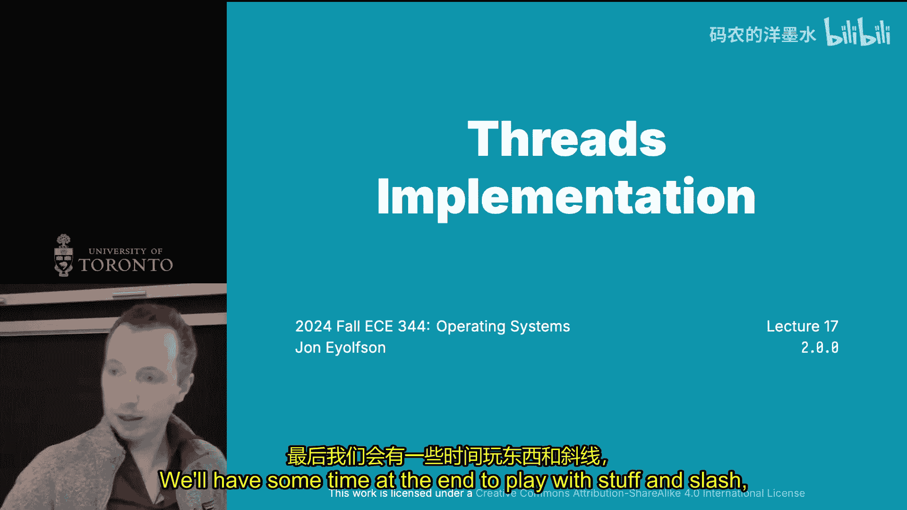
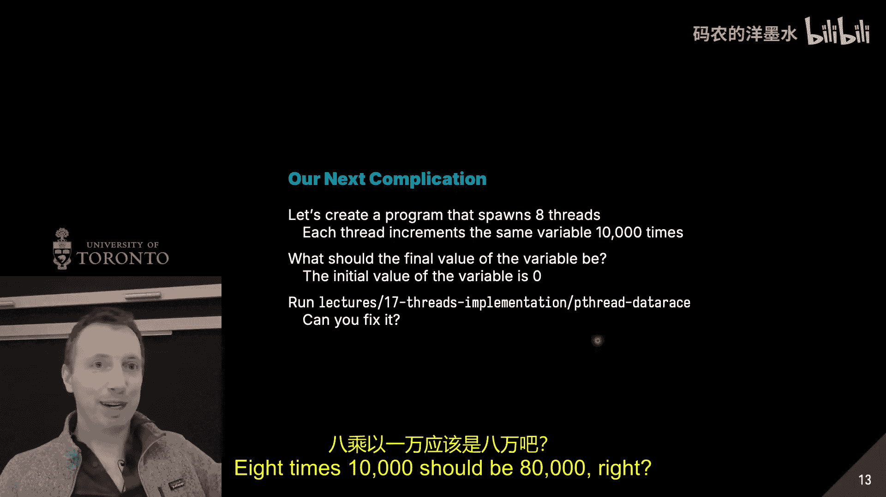
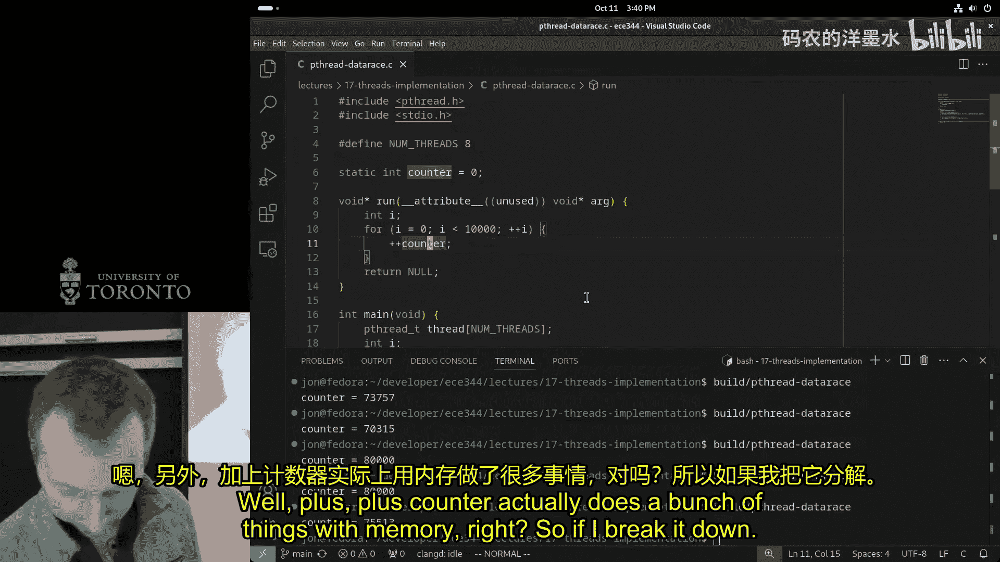
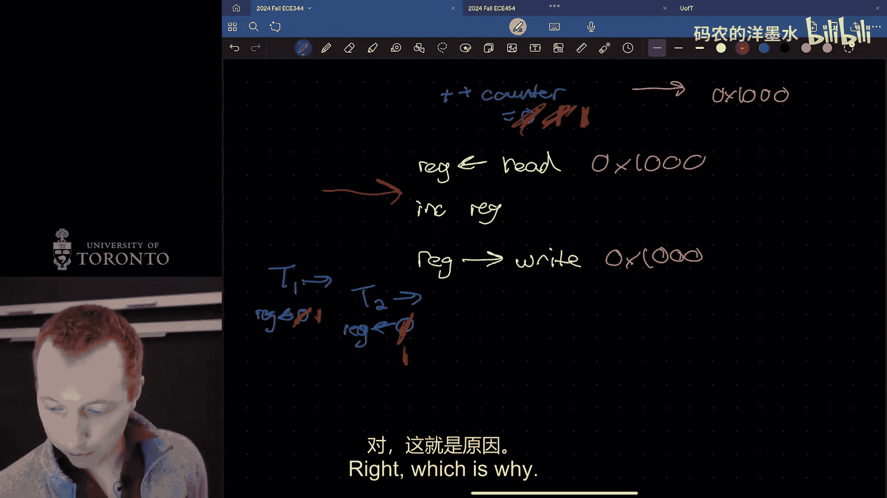
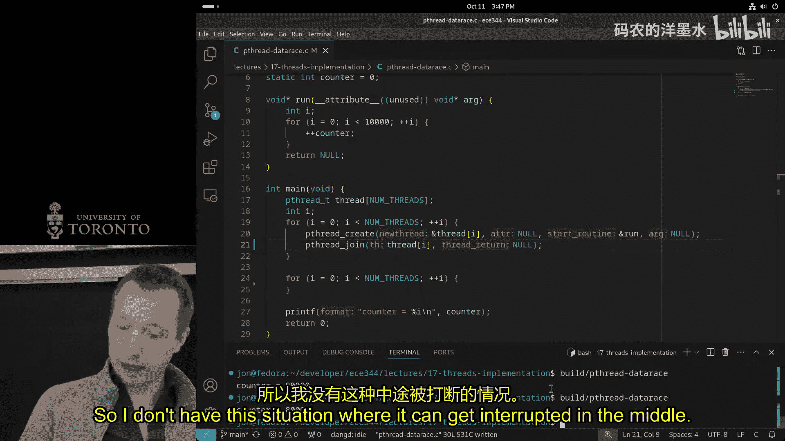
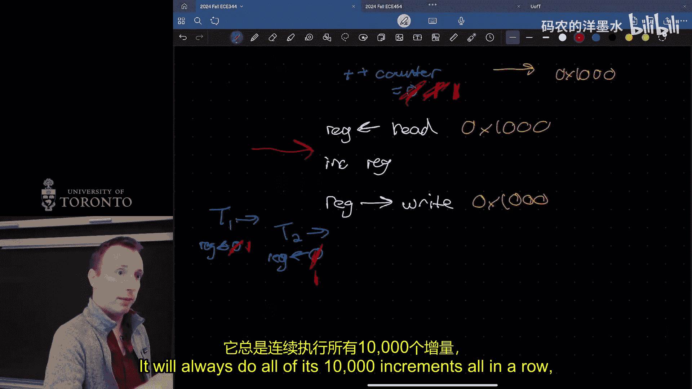
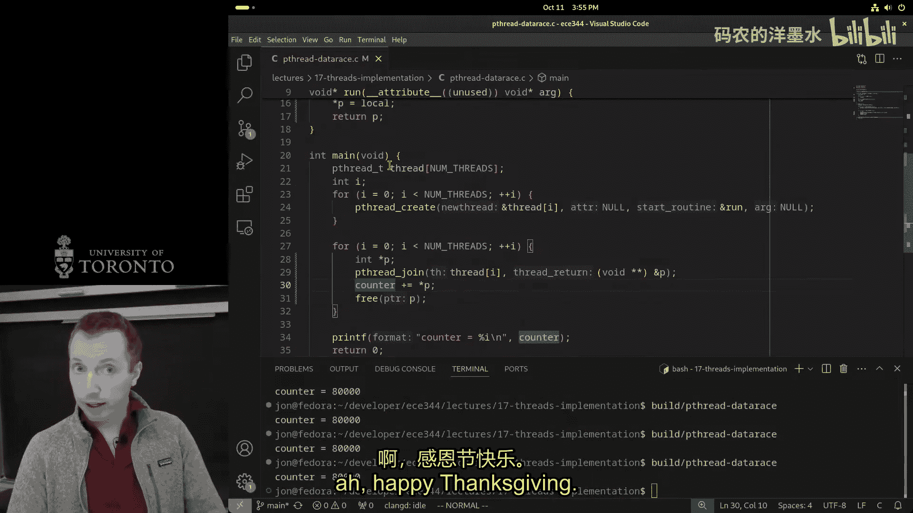

# 操作系统：16：线程实现 🧵



在本节课中，我们将学习线程的两种主要实现方式：用户线程和内核线程。我们将探讨它们各自的优缺点、不同的映射模型，并通过一个实际的编程示例来理解多线程编程中常见的并发问题。

## 线程实现模型

上一节我们介绍了线程的基本概念，本节中我们来看看如何具体实现线程。实现线程主要有两种方式。

*   **用户线程**：完全在用户空间实现。内核不知道这些线程的存在，它只将整个进程视为一个调度单元。
*   **内核线程**：由操作系统内核实现和管理。创建线程需要通过系统调用，内核负责调度每个线程。

以下是两种模型的核心区别：

*   **用户线程**
    *   **优点**：创建和销毁速度快，无需系统调用或上下文切换。
    *   **缺点**：
        1.  无法实现真正的并行（即使有多核CPU）。
        2.  若一个线程执行了阻塞式系统调用（如`wait`），整个进程都会被阻塞，即使其他线程可以继续工作。
*   **内核线程**
    *   **优点**：
        1.  内核可以调度不同线程到不同CPU核心上运行，实现真正的并行。
        2.  一个线程阻塞不会影响同一进程内其他线程的执行。
    *   **缺点**：创建和销毁涉及系统调用，开销比用户线程大。

## 线程映射模型

所有线程库（如Pthreads）都在用户模式提供接口，但其底层可能映射到不同的内核实体。理解这种映射关系至关重要。

以下是三种主要的映射模型：

*   **多对一模型 (Many-to-One)**：所有用户线程映射到单个内核线程。这就是纯用户线程的实现方式。**优点**是快速、可移植；**缺点**是无法并行，且一个阻塞全体阻塞。
*   **一对一模型 (One-to-One)**：每个用户线程直接映射到一个独立的内核线程。Pthreads采用此模型。**优点**是可实现并行，线程阻塞互不影响；**缺点**是创建内核线程开销较大。
*   **多对多模型 (Many-to-Many)**：多个用户线程复用到数量较少的一组内核线程上。这是一种混合模型。其**目标**是在不过度创建内核线程的前提下，获得一定的并行能力。但实现复杂，且调度不确定性高（例如Java的“虚拟线程”）。

## 多线程进程的特殊情况

当进程拥有多个线程时，一些传统单线程进程的行为会变得复杂。

*   **`fork()`系统调用**：在多线程进程中调用`fork()`，新创建的进程只包含调用`fork()`的那个线程的副本。其他线程不会出现在新进程中。
*   **信号处理**：当信号被发送给一个多线程进程时，内核会随机选择一个线程来接收并处理该信号。这给编程和调试带来了很大不确定性。

## 线程池概念

创建大量线程（尤其是内核线程）可能带来显著开销。一种常见的优化模式是使用**线程池**。

线程池预先创建一组固定数量的工作线程（通常与CPU核心数相关）。任务被提交到一个队列中，空闲线程从队列中获取并执行任务。这样可以避免频繁创建和销毁线程，并能有效利用多核资源。

## 并发问题示例

现在，我们通过一个具体例子来看看多线程编程中典型的并发错误。假设我们创建一个程序，它启动8个线程，每个线程都对一个全局变量`counter`执行10000次递增操作。

```c
#include <pthread.h>
#include <stdio.h>

static int counter = 0;
#define NUM_THREADS 8



void* run(void* arg) {
    for (int i = 0; i < 10000; ++i) {
        ++counter; // 问题所在！
    }
    return NULL;
}

int main() {
    pthread_t threads[NUM_THREADS];
    for (int i = 0; i < NUM_THREADS; ++i) {
        pthread_create(&threads[i], NULL, run, NULL);
    }
    for (int i = 0; i < NUM_THREADS; ++i) {
        pthread_join(threads[i], NULL);
    }
    printf("Final counter value: %d\n", counter); // 预期是80000
    return 0;
}
```



理论上，最终结果应为80000。但由于`++counter`并非原子操作，它实际上包含三个步骤：

1.  从内存读取`counter`的值到寄存器。
2.  将寄存器中的值加1。
3.  将新值写回`counter`所在的内存。

如果两个线程的执行序列交错如下，就会导致更新丢失：



```
线程A：读取 counter (值=0)
线程B：读取 counter (值=0)
线程A：增加寄存器值 (值=1)
线程A：写回 counter (counter=1)
线程B：增加寄存器值 (值=1)
线程B：写回 counter (counter=1) // 错误！应该是2
```

因此，程序运行结果可能小于80000。这就是**竞态条件**。





## 解决方案思路

要解决这个问题，必须确保对共享变量`counter`的更新操作是**互斥**的。以下是几种思路：

1.  **串行化**：依次创建和等待每个线程，放弃并行性。这能保证正确，但性能差。
2.  **局部变量累加**：每个线程先将结果累加在局部变量，最后再一次性加到全局变量。这减少了冲突概率，但未根本解决。
3.  **互斥锁**：使用锁（如`pthread_mutex_t`）保护`counter`，确保同一时刻只有一个线程执行`++counter`。这是标准解决方案。
4.  **无共享设计**：每个线程操作完全独立的内存区域（例如，通过`malloc`分配），最后再由主线程合并结果。这类似于**MapReduce**编程模型的思想，从根本上避免了共享数据的冲突。

## 总结



本节课中我们一起学习了线程的两种核心实现方式及其优劣。我们了解了用户线程与内核线程的区别，以及多对一、一对一和多对多三种映射模型。我们还探讨了多线程环境下的`fork()`和信号处理等复杂情况，并引入了线程池的概念。最后，通过一个生动的编程示例，我们揭示了多线程并发编程中典型的竞态条件问题及其解决思路。理解这些内容是编写正确、高效并发程序的基础。