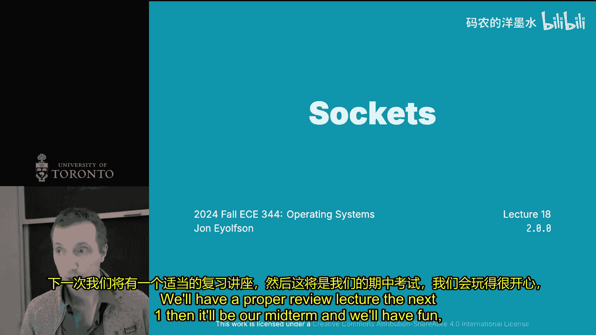
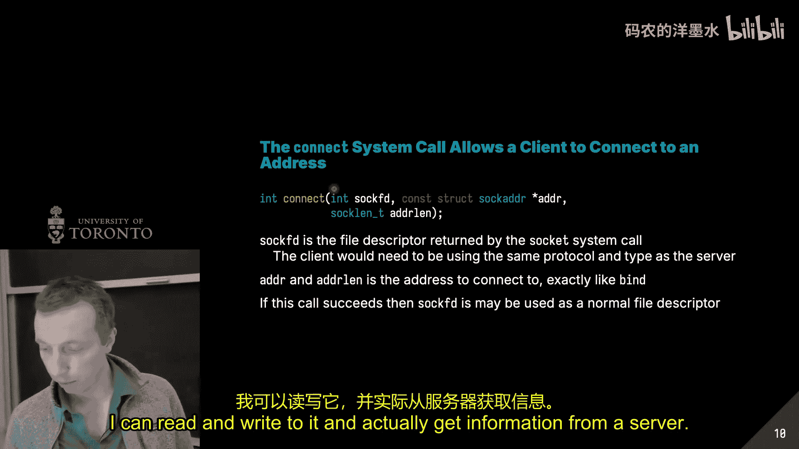
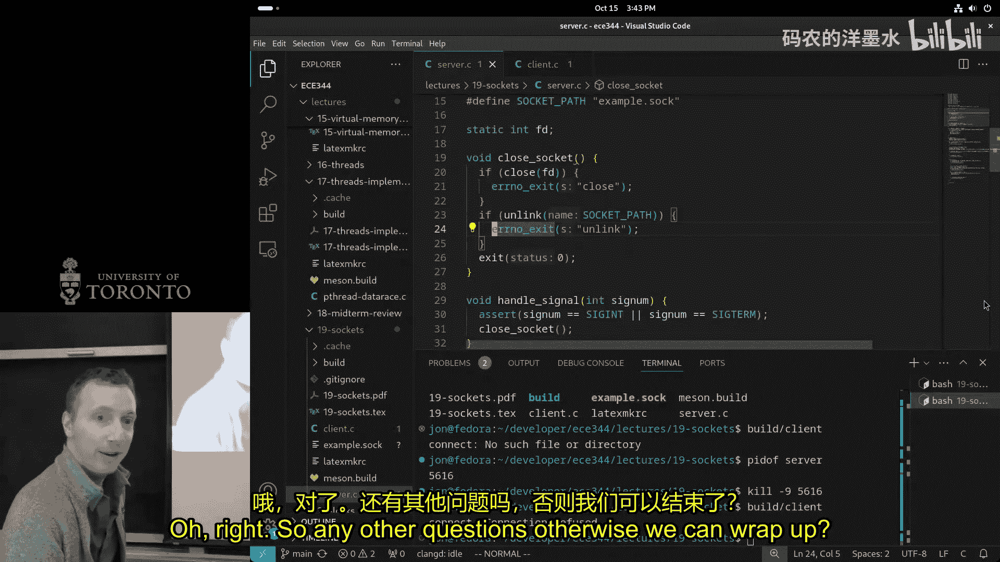
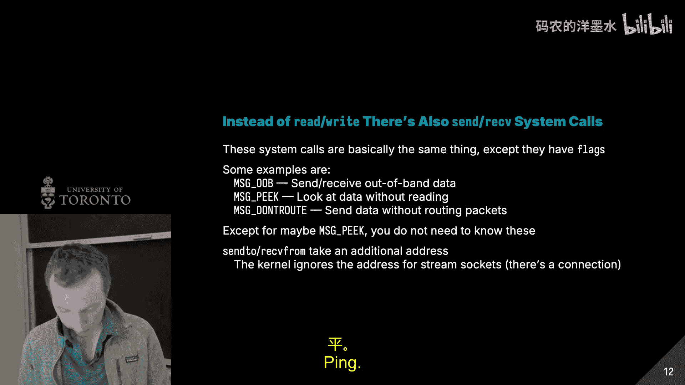
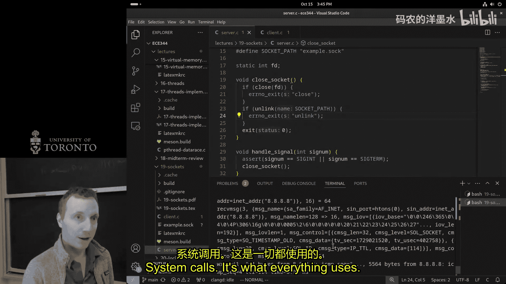
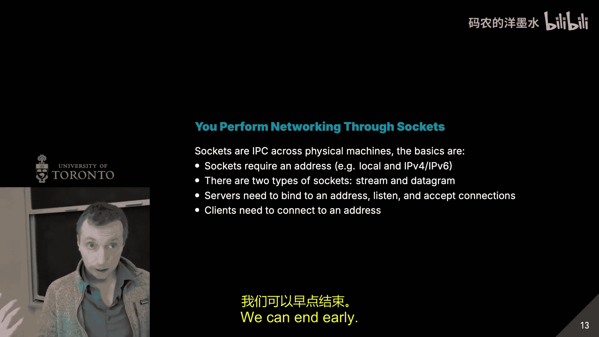

# 【全集】多伦多大学 操作系统 中英字幕 1080P p17 Lecture 17 - 网络套接字 -BV1Rbk7ByERc_p17-

🎼Yeah。Allrighty。 Welcome back to operating systems， room speakers， slightly broken。

 so we might have to。Try a bit harder to concentrate。 So today， we're going to learn the Internet。

Yay， so this lecture pretty much just review， pretty much just fun。

 don't learn anything new except for a few system calls and how the internet works so ask me any questions you would like as they come up for interest this is just so I know the labs do tonight。

 probably people aren't are doing that and this is pretty much review we'll have a proper review lecture the next one。

And then it'll be our midter and willll have fun。Lets get into it。 So sockets。

 they are just another form of IPC。 they are a fourth type of IPC。 So we've seen pipes。

 everyone loves pipes。 We've seen signals， everyone absolutely loves signals。

 and we've talked a little about shared memory， we haven't actually used it。

 but that is another type of IPC explicitly sharing memory between processes。

 So one thing all of those three things have in common is that your processes are all on the same physical machine。

 Sockets are same idea。 Inproces communication。 But now we can communicate between physical machines。

 typically over a network。 So if you connect to Google do com， you turnca。

 whatever that is a process running on another machine。 and you can just connect to it。

 get some bite。From it， it is just another form of IPC。

So if we are writing essentially the Internet today， there are essentially two types of。

Pieces of software， the first is a server， so a server that uses sockets needs four steps。

 basically all the server is going to do is allow you to connect to it and accept a bunch of incoming connections。

So if you were to write a server， while the system calls you have to use。There's four of them。

 They all have the usual C wrappers。 If there's an error or return negative one。

 set that global variable error no and all of those fun things so。Other than that。

 they use the same concept of file descriptors so the first system call you have to make is called socket。

 that's how you create a socket。 you basically get a file descriptor back。

 Second step is you have to bind that socket to some location so depending on how you want to use the socket。

 it might map to a file if you actually want to use a socket on the same local machine might be an IP or with a port if you're using the internet。

Or whatever else you want to bind it to。The third， oh， yeah。IP port。 So that is just。

A normal I P address， like if I connect to。Any server on the internet。So， like。

If you connect to Google dot com。There's actually a service that translates Google dot com to an I P address。

 an IP P address will look like something like 8 dot 8 dot 8 dot 8。

Something like thatll just be a series of four numbers from 0 to 255。

 and that's generally how you connect to another machine。 Everyone right now。

 if you go go to what ismyI dot co， they will tell you what your IP address is。

 It will probably be one that is owned by Toronto since you're on their wfi。

 It's just a way to actually talk between different servers。Alright， third step here。

 you have to listen， In that you are accepting incoming connections。

 The kernel will have a certain queue limit as to how many connections it will hold onto you before it starts dropping them。

 So if you've ever got connection cannot be established or whatever。

 That's probably why that server did not want to actually accept your connection because the last step in order to form a connection is the accept system call that returns the next incoming connection for the server to handle so it will return a new file descriptor to you that represents a connection to someone else that you can send and receive data to through those read and write system calls that we know and love。

If you are the client， you have an easy job， you just need two stuff to use sockets。

 so you just need to do the socket system call that creates a socket and then you have to connect to some location that should correspond to whatever the server is listening to so you connect to some location and now you can use that socket file thescriptor you got back to do read and write systems calls and now you can either read data from the server or send data to the server depending on whether you use read or write。

Again， we're moving that piano， nice。So the socket system call， it essentially uses two arguments。

 It has three arguments， but this last protocol one is not used。 The first argument is domain。

 So that tells you what type of thing you would like to eventually listen to。

So it has three options we typically use today， AF underscore Uni that's for local communication on the same machine。

 so it will expect a file name whenever you try to bind and listen to it。

 we'll see that in the next step。 and then if you want to use a normal IP address， it's INe。

 that's an IPV4 address， like most people use。But the Internet。

Is kind of moving to IPV6 because while a 32 B IP address can only handle like 4 billion things and everyone has multiple computers。

 everyone connects their toaster to the internet， so we are running out of IP addresses。

 so we use IPV6 basically just gives us 64 bits a lot more options。And then this type here。

 the second one。As generally one of two options， it's either stream or datagram sockets。

 which probably means nothing to you， even if you know a bit of networking or played with your router or anything like that。

 so they are very general names stream， another thing to call them is TCP。

 you probably heard of TCP before。So the rule of TCP is all data sent by the client appears on the same order of the server。

So。As you will discover in your networking class， just because I send data。

 let's say my machine connects to something I don't know in Los Angeles。

And I send it a bunch of information。 Well， the Internet is a very complicated beast。

 Some bites I send。 they might not all take the same path to get there。 Some might go through It O。

 Chicago。 Some might go through。So。Florida， I don't know。

Different packets might take different paths for different reasons。 and on the server。

 that server in Los Angeles might get them in different orders because while one path might be longer than the other might have slower equipment。

 something like that。 So the actual complexity， you might not know what order you get data in。

 But if you use TCP or stream sockets， what it will do is add a bunch of information and reconstruct the same order on the server so that behaves kind of more like you expect。

And there'll also be a persistent connection between the client and the server。

 It will keep asking it， hey， are you still alive， are you still there， am I still connected to you。

 And if the connections lost， you will actually know about it。 So this is a reliable connection。

 but you might imagine there's some overhead associated with it if it needs to you know keep track of the order。

 things should be in， wait for things that are slow， constantly acknowledge。Blah， blah， blah。

 might be a bit slower， y。一TCP。Regular sorry。こテピ。You can show。Ws。So for sockets。

 you can use either option。So I can use sockets with essentially TCP。

 or the next option is this UDP thing。 So sockets can be one or the other， and then you can pick。

So stream sockets are essentially this thing。 They'll be in the same order。 It'll be more reliable。

Yeah，So that protocol for the socket generally is not used。Allright， so the other thing。

 the other way to use sockets， I can use them in a reliable manner， everything's in the same order。

 everything like that。The other option is the Datagram Sockets， which is also called UDP。

 and what that does is just send messages between the client and the server。

There's no persistent connection， there's no guarantee you will get things in the same order。

So it's going to be way faster。But。If you send information to a server。

 you might not even know that it has received it。 There's no acknowledgement。 There's no nothing。

 You just send information out in the ether， and you just hope it arrives there。

 So this is a lot faster， no overhead， but you won't know if anything goes wrong。

 but for some applications， it might not matter， yeah。Use。

So when would I use this one example video streaming。 So if a packet doesn't arrive there。

 doesn't make sense to resend it because。Like if I'm live streaming， it's already happened。

 so you would just skip over it， it would just be a skip frame and it would just keep on sending。

 so it wouldn't make sense to resend it and retry probably so video streaming would use this。

I don't know， video games would use this because resending the same packet。

Maybe the state of the worlds already changed， so it doesn't make sense to resend it。

 you already lost it， it's gone。So depends on your application。

So usually if it doesn't make sense to retry anything or things change， you use this。

 it's a lot faster。 you don't really care about the order。 but for most things， web servers。

 anytime you go Google do com or anything like that， it would be TCP or anytime you use SSH。

 that's TCP， everything like that。All right。Next step， so that's the socket one。

 the next one is the bind that binds a socket to an address。ItTake as an argument， the socket。

 you want to bind to some type of address。 And then because it's C。

 you have to give it the a structure of sock address by pointer。 So there's different structures。

 depending on what you want to listen to And because it's C。

 you have to tell it the length of that structure in order for it to not you know use invalid memory。

 So the structures， there's different ones depending on what you want to listen to。

 They all have very dumb， shortened names for reasons I don't know。

 So the Unix 1 is socket address underscore on。Why did they feel like they needed to shorten it by two characters？

Don't ask me， save someone typing I guess a little bit。

 but that's what you use for local communication， it wants the address to be a path。

 sos something that looks like a file。For I net， they cut off two letters。 It's in。 look stupid。

 but that's Internet normal IP before address。 So， for example，8 dot 8 do 8 dot 8。

 If you don't know what that I address is， that is a Google DNS server。

 So that is a valid I address you can connect to。 And that's basically。

How your computer figures out that if you type in Google dot com。

 what I P address does that actually want me to connect to。

 So that will have all of the translations for pretty much every single。

Internet address you can think about。And then there's sock address in6 short for INe V6 for IPV6 addresses。

 they look a lot longer because they're 64 bits， typically they're in Hex。

 IP V4 addresses are typically just in decimal， so separated by periods and then。

Each one of those are 0 to 2，55， because each of these is a byte。Well， four bytes。Alright。

 the listen system call wallba sets。The queue limits for the kernel for incoming connections。

 how many connections the kernel will hold on to waiting for you to accept them。

 So first argument a socket。 And then second argument is a backlog or how big the queue should be until it starts dropping connection so you get not accepted or connection refused or whatever。

 So if you just set it to zero， the kernel uses whatever default it's going to use And unless you're writing your own web server or something like that or something。

Way more complicated just set to zero and let the kernel figure it out for you。

Then the last step is that accept system call and what this will do， it's a blocking system call。

 so it will wait until。Someone has tried to connect to you whenever someone tries to connect to you。

 it will unblock and return to you a new file descriptor that represents that connection。

 So the first argument socket。 That's the socket。 You're actually listening on。

 And then this address is completely optional if you want it to be a datagram socket。

 You don't have to bind or anything。 you can just or you can just accept on a particular address。

 If you have a stream socket， you can just set them as null。

 You don't have to use them because you do have that persistent connection。

 So here returns you a new file descriptor will have an example of it。 Don't worry。

 And then that new file descriptor represents the connection。

 I can do a read and write system call using that。Allright。

 the last piece of the puzzle is for the client。 It just needs the connect system call to actually connect to an address so。

Starts off again。Calling socket returns a new file descriptor representing the socket。

 And then I just connect to an address， and then in the client。

It returns or it will just return success or failure。 If it returns success。

 then I can use a socket file descriptor as a normal file descriptor。

 I can read and write to it and actually get information from a server。

So let's see our example。 And again， let me know if you have any questions。 So here is our client。

So all our clients going to do， is like this is basically a simplified version of your web browser。

So this is what a very， very simplified version of your web browser would look like。

 So here we're going to connect to a socket。 We're just going to use a Uni socket。

 So it's going to be given by a file name。Both my server and my client will have to agree。

 I'll just call it example dot Sock。As my file name。So in my client。

 what I'm going to do is create a socket。It's domain or type。

 it's a Unix socket because I want on this local machine， I just want to give it a file name。

 so I'll say AF UniX type is that stream socket， I want to be that reliable one that forms a persistent connection because I don't want to deal with things out of order or anything like that and then protocol just zero not really used。

Here， I'll check if I have an error， so negative1 indicates an error。

 and then I'll just print out some that error， I'll read that error no。

 print out an error and then just exit from this process。Otherwise， here， I want to connect to it。

 so I need to create a sock address， underscore un， again， really dumb name。

 I'll do equal curly bracket 0。 that will0 initialize that whole stretcher。

 make sure I initialize all my memory with all zeros。And then the way these socket addresses work。

Well， I guess Sun was the first one to develop this。

 I don't even know if sun microsystems exist anymore。But， you know。Someone。

 that company made it up in the 70s。 Everyone used this as socket。

 So now we're stuck with that name forever because， well， we can't change it because。

That's the name we've always used。 We don't want to break a whole bunch of software。

 So we have to set Sun family to match the domain， so it has to be set to AF Unix because it has to actually know what type of address it is。

And then we just have to set the file name in the sun path here。 So it's just。

A array of chas so I'll use string copy to copy this socket path， this name into that field。

 so again the name is just going to be example dot sock and I'll write it to this array of characters called Sunpath。

And then I'll try to connect to it using that address。 So I give it the address of that structure。

 say how big it is。 So just size of that。 And then after that。

 hopefully I have connected to the server。 and then if I want。

This is essentially you going to Google。 co and getting the web page back so you would just read from that file descriptor。

 read from that socket here I'll just read it into a page size buffer of characters over and over and over again till eventually it's empty and there's no more information and then I'll just print off whatever I receive close the file descriptor so if I run this right now。

My client would be whoops， connection refused。 actually， I should just remove that。

 That was from last lecture。So if I run it right now。Ignore what I did before。

 I get no such follow or directory because there's no server right now。 So if I look at my directory。

 there's no example dot sock， there's no server。 There's nothing listening to it。

So I need to connect to something over here， I have a tab for my server。In my server， same idea。

Except this time I have a global variable called FD because I'm going to want to clean up my server whenever it exits。

 as we'll see shortly we won't have any other way to do it。 so here I create a socket。

It's a UniX type， it's a stream socket so agree with the client。Then like before same socket address。

 I'm binding to the same path， everything like that， but now instead of connect。

 I use bind otherwise it's exactly the same。And then I listen， so I say to the kernel。

 I would like you to listen for people to connect to this。

 and then this is basically what a web server looks like while true， except。

So except that's that blocking system call that will wait for someone to connect to your server。

 wait for you to connect to Googleogle。com， wait for you to connect you to connect you to connect every time someone new connects。

Except we'll return a new file descriptor that represents the connection to that person。

So here I'll check for errors。 And then other than that， I'll just create a string called。

A string with the content hello there with an exclamation mark。

 this was a web server would send you the web page instead。Figure out how long that string is。

 and I'll send it with the null byte and then just write to it。

 so I just write to that file descriptor that represents the connection。

 and now this information goes possibly over the network to some machine。

 somewhere else on the planet。Then here I can check whether or not write was successful。

 check that I wrote all the information， and then I could close that connection。

 so just close that file descriptor， and then my loop would run again。

 I would accept wait for the next person to connect to me over and over and over again。

So now if I switch over to this terminal and run the server。Doesn't look like it's doing anything。

 But right now， it would just be blocking on that accept system call， right。

 waiting for someone to connect to it。 So now， if I switch back over to the other tab with my client。

And I run my client， it will connect to it。That server will send it hello there。

 And then it says it received hellello there。 So that would be。

 that would be you receiving the website。 And now I can run however many clients I want， whoops。

Where is my mouse？Oh， I need a scroll。So。If I run my client again， no matter how many clients I run。

 I always get hellello world because it's just doing well true。Connect to it。 blah， blah， blah， blah。

 blah。 Allright， any questions about this。 This is the Internet。It's really not， I mean。

 it's somewhat more complicated than this， but not really， right。

 just another machine somewhere doing this。So questions about the internet， yeah。Yep。Yeah。

 it like your。Yep， yeah。 so static websites， any website。嗯。Whenver you go to a website。

 you just get a HTMLM page back， possibly with ja， possibly with CSS。

 and then your web browser just takes that and then renders it into something you can see。

 But if it's a static website， that just means。The Web server doesn't have to use a database or anything。

 It just spits back out the same thing to you at every all the time。 So static website。

Wouldn't actually look that much more complicated than this。 But instead of sending hello there。

 it would send H TM L。But。If you knew how to talk HTTP， you could write a web server like this。

 any web server。Has to use if it's written on Lis， has to use system calls。

 this is the only way to use networking it has to use sockets。 if you Strace your internet browser。

 it uses sockets， if you Strace ping， it uses sockets。

 everything uses sockets that connects to the internet。Yeah。TCP are just。Yeah。

 so TCP will make it so like under the hood， but you'll discover in the networking classes are like if I send it if I send it like a gigabyte of data。

 if I just do write system calls， it won't just take a whole gigabyte and try and send that over the network。

 it'll break it up in a certain way。 and then that has to do with the networking part。

 but if you use TCP。The system calls you use， you just ignore all that detail。

 you'll see it received in the same order。But if you want to know the nitty gritty of that。

 that's the networking course。How would you education。How would I what， sorry？

How would I Strace my router？Of。Your router probably runs Linux。

Just connect to your router and e tracece whatever it's doing。You could。

 but like you probably don't have access to your router， but if you did。It uses sockets。

 it doesn't do anything more complicated， most writerss use Linux。They all all do the same thing。

Yeah， it's all Linux all the way down for the most part。

 like what specifically do you want to know about your router？All the price of you。

To get access to your router， I mean， typically， I mean you can just go to your router's IP address。

 usually there's like some addresses set aside for internal networks。 So if you go to IP address。

Usually it is 192。168。1。1 if you go to that at your home that's probably your router's homepage and you can access your router and if you never change your default admin password。

 someone else can connect to it。Log in admin admin， and then block you out of your own internet。

So yeah， that's why you should probably take something like this。

Or just connect to your friend's network if they don't know anything about it。

 connect to their router。It's running Linux， they'll probably have like a web interface and then you can change all their settings。

 you can block them from their own internet and you can laugh at them and do whatever you want。

But yeah， it's typically connect to a router。There's。

A whole website that will tell you all the default， username and passwords。

So different manufacturers have different ones， but if they never changed it。Look it up。

What are they going to do。We learned all sorts of terrible things in this class， don't we？

I didn't tell you that， by the way。Yeah。Yeah。呃，能。We were。あで。Yeah。

 so the question is how would it look if I was running on different machines。

 so if it was running on different machines， the only difference here would be this address thing。

 So this address uses a file name so here if I look at it right now it's like this example dot sock that got created。

If I was actually using it across machines， I would have to use an IP address。

 so I would just have to know the IP address that I need to connect to。

Usually that's why DNS service exists。 So if you go to Google。com。

 all that does is there's another service that translates Google。

com to an IP address so you don't have to remember dumb numbers。But。If you're using this， you could。

If you knew the DNS library to use， you could use Googleogle。

com and then that gives you an IP address and then you connect to that IP address。But。

That it's just one step removed。 You just need an I address。 So if you wanted to。

8 dot 8 do 8 is Google's DNS server that is accessible by the Internet。

 I could just put in here 8 do8 dot 8 and send it random data and see what Google。Does with it。

Probably what will happen is it will just close the connection immediately if it just thinks you're talking gibberish。

 like if I just。Came up to you on the street and started talking I to you。

 youd probably just ignore me。 servers would probably do the exact same thing and probably leave quicker because they have less manners than people。

But yeah。Any other fun questions？All right， well， last thing here。

 So I have two signals here because， well。If I want to clean up the server。 So this example dot sock。

 maybe I want to clean this up because， well， if I exit the server， I want it to。Exit gracefully。

 so this is a reason why you would want signals because otherwise it's mostly spending its time in this while true loop just constantly doing except over and over and over again so if I want exit gracefully then I have to use signals and here I could just handle signal register int and Sig term normal ways to exit and then I could close that socket so as part of my signal handler。

 I can just close that socket and unlink that will get rid of that file name kind of like removing that file so that I don't see this example do sock anymore and then just exit normally so if I go here there's example do sock now if I go to my server and hit control C。

 I send it a signal to close nicely and do this I can see that cleaned up that example do sock file and now when I try and connect to it with my client just says no such file directory it's not there。

Otherwise， if I want a realistic error message。Let's say I'm running my server and then someone decides to violently kill me so like see。

 I can find the pit of my server。And then I can violently kill it， so kill9。

So this won't clean up a damn thing right， This will violently kill my server process。

 it won't close anything or do anything。 So I go here， it's killed。

 and then I see there's this example dot sock file but my server is not running so the kernel does not associate it anymore with a socket so now in my client if I try and connect to it。

 that name exists， but when I tried to connect to it。

 I'll see that I get connection refused which probably looks like a normal message you've seen if you tried to connect to a web server which is currently down。

Definitely not corucus or anything like that， right。Message we've seen before。

So any other questions about the Internet or anything else， I' probably taught you too much already。

But basically， this is IP PCC， yeah。Can you fork bomb， Yeah。

 for works like you can fork bomb yourself if。If you knew the server forked as part of it。

 right could just if you knew if you sent it some bytes， it would fork。

 just send it over and over and over again。 that is what's called a denial of service attack so you just try and overload a server byte sending it some crap to do even if it's useless work and overload the server and it doesn't work anymore。

So。You can， but should not do that。We'll be a return of the un socket。😔，So the return of the unlink。

So it's just successor failure。Yeah， and that's basically just how we'll see more of it when we get into file systems if is。

Yeah， so if unlinked successful， it returns zero， which means false， so it won't print an error。

 if it returns negative 1， which is an error， I'll see this error message。Yeah， just a shorthand。

All right。I you think it or yeah， return zero on success？Yeah。All right， well。

 that's the internet in a nutshell。Deally， difference is。Using IP addresses is a bit of a pain。

 so you use name to IP address that's called a DNS server or domain name server。

 And if you want to buy your own one， you can go to a website and register whatever the hell you want they'll sell you cos for like 8 bucks a year。

So， but they'll。Do that， they'll give you a name， and then you can point it to whatever IP address you want so you can point it to your house。

 whatever。I ownelsson。com that points to my home， yay， do not send me random stuff， thanks。Oh right。

 so any other questions， otherwise we can wrap up。

3。Alright， so if you e things， if you e things that use sockets。You might not see read and write。

 but。You might see send and receive basically these are special reads and writes iss the same idea but they have some more options specifically to deal with sockets。

 so they have some more options like out of bound so I can receive out of bound data。

 something of higher priority again you won't know what this is until a networking course。

Peak means like I can read some data without actually advancing that internal pointer so I can peek out some data。

 maybe decide what part of my function or what part of my program should read it and then read will read the whole thing from the beginning and then there's this don't route which seems a bit weird if I'm using sockets to connect to some other。

Some other machine。 I probably need packets to route between different computers in order to make it there。

 Turns out you would use this option because guess what， your router。

 like the question came up is probably written in Linux。

 So your router would use a don't route because it's doing the routing。

 So it needs to know what to send it to。If it had routing to implement routing。

 that would be a pain to debug because you might get like an infant route loop。

 So you would want to say， don't route， because I'm doing the routing。

 I want to make sure it goes directly to whoever I intended it to。

Without going in some roundabout way， so you don't have to worry about this one unless you are implementing your own router。

 so if you could eRA on a router， they probably use it with this route option。

So aside from maybe peak you will never use these， you probably don't have to use a rotr and there's also send to receive from that take an additional address。

 so if it's using datagram sockets， then you might use something like this， so if you S trace，Ping。

I think if I S trace like ping。Dot dot dot 8 dot8 dot8 dot8。

 I can see that oh So that right is to file descriptor 1。 So that is to standard out。

 And I can see this system call here is receive message。 So it's paying 8 dot8 do8。

 which is one of Google servers。 and I'm actually receiving all of this data here。

 So you can see innet。Some other crappy information and then just a bunch of random data here。

 that's the Ping request， but you can Strace whatever。Strace Firefox， if you really want。

 it's going to have a whole bunch of send and receives and a whole bunch of garbage but。

System calls's what everything uses。

Al right， any other fun questions？ We've discovered the Internet。Neat， so。Same idea。

 so you can do networking through sockets， that is the interface a kernel presents to you。

Realistically， it's just another form of IPC， it is nothing we haven't seen before aside from the setup steps。

 which you just look up anyways， and then other than that。

Same concept except now we have IPC across physical machines instead of the same machine。

 so sockets they'll require some type of address， local on the same physical machine or an IP address。

Two types， stream and datagram， and then servers， if you're a server， you have a bunch of steps。

 you need to create a socket， bind it to an address， listen to it。

 say you're accepting incoming connections and then actually accept。

The connections that will return a new file descriptor for each connection。

 you can read and write to it， and then if you're the client you just need to connect to an address。

 that would be your web browser， you connect to Google。 co， you get an HDMl page back。

Your web browser would go ahead and render that。 So that's it。 We can in early。

 I'll stick around for some minutes until。

