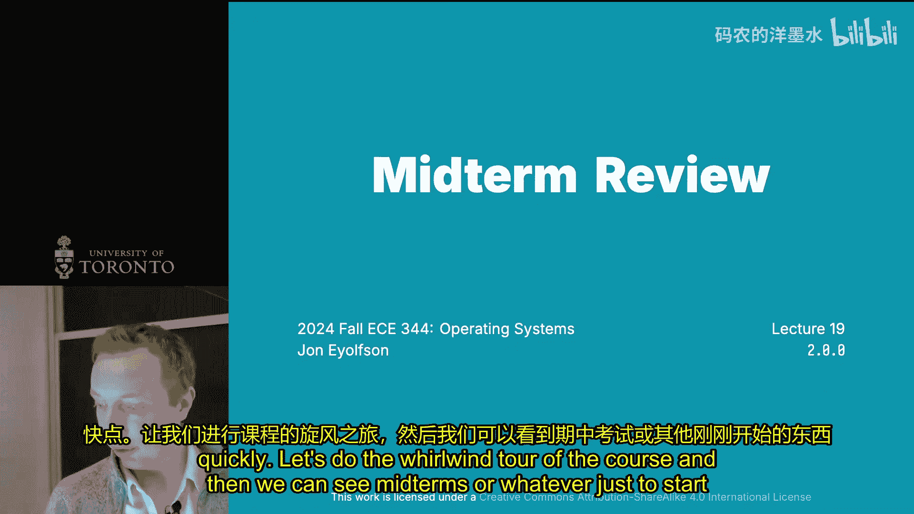
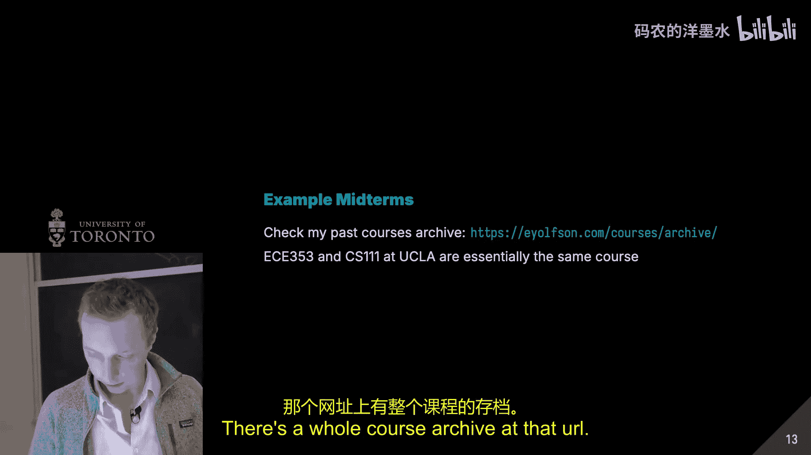
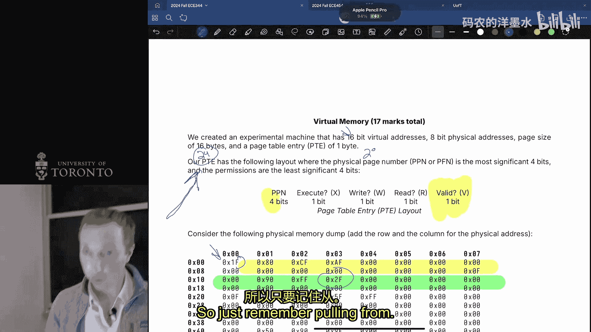

# 【全集】多伦多大学 操作系统 中英字幕 1080P p18 Lecture 18 - 期中复习 -BV1Rbk7ByERc_p18-

🎼，🎼Yeah。Al alrighty， whoops。 Welcome back to operating systems， so。Midterm review， yay。

 so choose your own adventure What you want me to do， I can whirlwind。Review the entire course。

 I can do a past midterm。 This is a choose your own adventure。 What would you like me to do。

 What would be the most helpful。Whirlwind。All right， whirlwind。

You can stop me if we have any questions。 or if I go too fast。 So quickly。

 let's do the whirlwind tour of the course。 And then we can see midterms or whatever just to start us off。

 so。

Pretty much。Started the course， right， we have three major concepts that applies to operating system virtualization。

 the big one， oh yeah。Past midterms， I'll do this really quick and then do a past midterm。

 so I'll try and speed run this since you got out votedted a little bit so。Virtualization。

 main concept， we've been learning so far， we have virtual memory。

 we have threads that kind of virtualize registers。

And we haven't touched on concurrency or persistence yet。 so we don't have to worry about them。

So from the first lecture， kernel interface's main thing we should know about is that there are two modes on your CPU。

 there is kernel mode and user mode， all of the stuff that actually all of the instructions to actually interact with your hardware are all done in kernel mode。

 the kernels responsible for managing virtual memory， which you now know a bit more about。

 that would be responsible for managing the page tables for each process。And figuring out scheduling。

 and I think that's pretty much all we've had so far far managing processes， things of that nature。

 and your processes are running in user mode。 the only way to actually request the kernel。

 do something for you is to do a system call。 that transitions you from user mode to kernel mode。

 make a request to the kernel， it does something。 yada yada yada。

 hopefully it does something you want， could return you in error。

 whatever you can Strace it if you want to figure out what your programs are doing。

 That's the only important things from this， don't worry about API， don't worry about A。

 that whole confusing thing about breaking As don't worry about that。

Then we went on to talk about libraries， right， we learned about dynamic libraries。

 static libraries because well， depending on your application。

 you might consider libraries part of the operating system。 for instance。

 a standard C library that implements malloc， things of that nature probably be considered part of the operating system We saw just little fun things you could do to manipulate dynamic loader。

 we saw how to like load our own dynamic libraries again， don't worry about it。

 don't worry about the API， A changes。Don't have to worry about that。

And then we got into creating processes。 And that's where this fun part of this course finally began。

 right， So on UniX， we always clone processes。 That's the only way to make a new process。

 We do it with what system call。I't know if it's on the side fork， right。

 the first of our weird terminology。 So you can only create a new one with fork。After the fork。

 both processes are exactly the same。 You can think of it as well。

You have an exact copy of the process at the time of the fork。

 The only difference is going to be what the return value is of the fork。

In the newly created process， it gets a zero。In the parent process。

 it gets the process I D of the child。 and there's a parent child relationship between them。 right。

 So we'll just assume always that there's no errors with fork because if fork returns an error you're probably screwed at that point。

 And then the scheduler decides what to run after forking， creating two processes。

 you do not know what order they're going to run in is up to the scheduler。

Then we had to be responsible for managing processes， right。

 There's that parent childil relationship， and then we should be able to talk about and identified zombies and orphans。

 And then this was using that weight system call as well。 So pretty important。

 You'll probably get a question that has to do with。That was also lab2 primarily， right？

So after that， we did basic IPC， who did a bit of read and write， redirecting file descriptors。

 doing that dope stuff again， had to do with lab2， learned a little like about signals。

 basically interrupts for user processes。 kernelon has three kinds of interrupts。

 don't need to worry about the implementation details of it。

 that was mostly to tie it to your second ear course， but signals。

 they're just interrupts for user mode， that's what your processes see。 You can go ahead。

 you can interrupt them or you can handle them。Like what we did to ignore control C。

 control C sends a signal。 You should know some signals that get sent to courses or。Processes。

 you don't need to know the numbers or anything like that。 Yeah，script。

 what is the three kind of here。The three kind of as are the three kind of like hardware interrupts。

 So like an actual real interrupt from hardware， like a trap。

 like a requested thing or like an illegal instruction， things of that nature。

So don't have to worry about them， that's more to tie it together with your other course。All right。

 then we got into scheduling， we got a reprieve right we talked about first come first serve。

 shortest job first， added preemption， the shortest remaining time first。

 and then realized that those were impossible to actually implement because you had to know how long each process was running for which isn't realistic and then we got into our first real scheduling algorithm with round Robin and everyone enjoyed that right。

 nice and easy， you'll probably get a scheduling question， so know how to do that。

 especially if you look at the past midterms。And then we introduced some more stuff to it。

 we introduced priorities， we had a question later on about dynamic feedback priorities。

 same idea we just had to keep track of another number。

Might be different processes we want to trade treat differently。

 scheduling is just a whole bunch of trade offs， talked a bit briefly about multiple CPUs and what considerations we would have to have for our scheduler there。

Real time， you know， hard real time， soft real time， having some predictability。

 You have to meet some deadlines with real time。 Basically just give them a much higher priority。

 So they always run on Linux because has soft real time。 It's a complicated system。

 Then we talk briefly about the completely fair schedule。

 which is basically the scheduling algorithm。 That Linux actually uses。

Don't have to worry about the details or anything like that， just high level， tries to be fair。

 tries to give each process， its own kind of fair share of the CPU keeps track of how long they run for。

 tries to even them out a little bit。Then we switched to virtual memory。

 and then people got sad again。 So we had to deal with page tables。 It started off。 Okay。

 we deal with memory in big blocks。 We called pages， typically， they're 4 kB。

 And then we talked about。How we would do the mapping。

 just using a single big page table to keep track of a B PN to a P。

 PN mapping figured that they were kind of waste wasteful， but。The kernel was pretty easy。

 It just allocates some pages。 we talked a bit about， hey， well。

 since it's kind of wasteful to have a giant page table。

 we had multilevel page tables and then everyone got really sad。 So then well， that's how it works。

 So。 And then we figured that， hey， that would be slow if I have to do memory accesses for every level。

 So in real hardware， we used the TLB just to cache all those lookups just to make it really。

 really fast。And then after that， we got threads， so threads。Related them to processes。

 they pretty much have a one to one。Translation， like weight。

There's a version of wait for threads called join， there's an exit called P thread exit。

 they return from their function， it implicitly calls P thread exit。

 the only difference is creating them is a bit different you tell them what function to run instead of just being a clone of each other and threads live within a process so if a process dies。

 all the threads die。And then we talked about how you would implement them， kernel threads。

 process threads， so each process can have multiple kernel threads。

Most implementations P threads would be one to one。 So one P thread is equal to one kernel thread。

If you have user threads like what you'll do in La4， that's many to one。

 you'll only have one kernel thread that you're sharing。

 and then the operating system has to determine what happens during a fork if you have multiple threads。

The main thing that you should know here is that the new process。

That gets created is a clone of whatever thread called fork。

 So the new process will just have a single thread running。 That's a copy of whoever called fork。

 So if that thread。Exit or does a P thread exit。 then the whole process is gone。

 if it's the only one running。 Then we had synchronization issues where our count didn't line up。

 We kind of fixed it a little bit， but we stopped there because that's where your life gets very。

 very complicated。 So on that we have that sample question。 we can go over midterm。

 So that was the whirlwin。 And just so I can direct you to pass midterms to maybe generate more questions。

There's a whole course archive at that URL。

Or if you go to my website and hit courses。And then go to archive。3，5，3。

 essentially the exact same course， C S111 at UCLA， essentially the exact same course。

 these midterms are a bit weird because they're the COVID ones。

 This one was the first written one that was closed book。 this was closed book。

 This was one page and this was maybe open or one page I think too。

 and this one I didn't write so it doesn't have a midterm， but you have one。2，3， four。

 at least four good examples of past midterms I've written。So， and。

Don't be confused about the UC L A one。 This course was not a first year course。

 The way they label courses is really silly。 So if it start， if it has three digits。

 it means it's a third or a fourth year course。 Don't ask me why I didn't name it。

 It's a third year course。 still。 It's just named Sil， Silly。So we want to do past midterms。

 That's what we want to do。All right， so。I have one queued up。 So the most recent one。

That is relevant。 is probably this one。 So this one's done in the winter。 This is 3，53。

 It's the same course it's just given to Ms students and W V C students。

 It's literally the same thing。So this was the exam that was closed book。

 Most people like that instead of a page spoiler alert。

 having what a onep cheat sheet is just a way for us to make you study because you study by making the cheat sheet。

 and then you don't use it anyways， so。I don knowMy friend's dad did an experiment where we did open book。

 one page and closed book， and there was literally no difference between the mark， but students。

Fed than happiness。じけし。No， this midterm is going to be。Yeah。

 your midterm is going to be exactly like this one。Cllosose book。 You get nothing。So。

 while you don't get anything。 I made a one page cheat sheet for you。 So you'll get this。

 There's a list of functions for you， just in case。You need it。

 So I basically made it one page sheet sheet for you。 So if you look at this one， it is all provided。

 I use the same template for this year。 You get all these functions。

 So you get what fork is exact dupe， weight P I D， pipe， exit， right， read P thread create。

 P thread eggs that P thread join P thread detach。So you'll get all of those。2。

If you have to constantly refer to this， you might run out of time。 Typically。

 I like you thinking more on the midterm than writing。So let's go。

 So do we want to start with this question， Fun little process questions。

Or do we want to do virtual memory？This one。Alright， let's start with this one。 then。

 Let's see what we get。So。Most of my things， I just give you code and say。

 tell me what the hell happens。 So here， consider the following code。

 assume all system calls are always successful。 So first thing to do。😊，Let's well。

 the first question is， you compile and execute the program and your terminal appears to return immediately。

 Why， well， let's just see what the program does， Let's。Assum， oops。

 let's assume we just have some process。 We're going to do that again。

 Why does this happen this room。So we have process 100 running。It's doing something。

It creates a pipe。So calls pipe， create some type of pipe。

Itll probably have filed descriptor what three， which would be the read end。

Which would be equal to FDs0。And then4， which would be the right end。Which is the same as FDs1。

And if you forgot， you know， it should say here。What the pipe is， so creates Unidirectional pipe。

 pipe FD1 or zero for read， one for writing， don't have to remember it。

It's given to you if you need it。All right。So。We have process 100 going， and then we fork。

 So we fork， we create a new process， right， So at the top， let's assume here， we have process 100。

And then it would create something like， I don't know， process 1，01。

So then we would have process 101 at the same point。It would have filed descriptor 3。

And4 open pointing to the same thing， right， So read and。Right。Alright。

 what's the only difference between these two processes。The return value of fork， right？

 So in process 100， what's fork going to return。1，10，1， right？ So in process，100 P I D。

Is equal to 101 process 101 PID would be equal to0， so fork returned0。

 then after both of them would create a variable called PID and assign whatever fork return to it。

So the first question says your terminal appears to return immediately。

 So your terminal is the one that created process 100。 So let's see what process 100 would do。

 Pros 100 would。P I D would not be equal to 0， right， So it would jump to the else。

 The else just has a comment that does nothing。 And then it just hits return 0。

 which exits the process， right。So first answer。Your terminal appears to return immediately。 Why。

 well。Original。Process。Does。Nothing。After。Fork。But。Call exit。That's a perfectly acceptable answer。

Kind ofT and be short and concise with your answers， if you can。So everyone's okay with that one。

All right， next one explains what happens in the child process。

Recall that the cat program reads from standard in and writes to standard out。

 Your answer should include whether or not it is possible for the process to be an orphan or a zombie process。

 So let's see what oops。Let's see what the child process does。 So process 101 after the fork， right。

 P I D is equal to 0。 So it's going come in here。And then do a dope 2。

 So it's going to make file descriptor1 or sorry， file descriptor 0。Also， point to this。

Also point to the read end of the pipe and make file descriptor 1。

 Also point to the right end of the pipe。 and then it's going to call cat。

 So what is this process going to do。Yeah。It's pretty much just going turn into connect with。

They're reading with the lake inside in。Yeah， well， the process Ka will just read from Standard in。

Wver we exact standard in is the read end of the pipe right。

 so it's just going to block on the read end of the pipe。

 it's never going to get an end of file or anything like that because it also has the right end of the pipe open。

 so it's just going to sit there and block forever on that read。Right。

And because it blocks forever on that readed， will it ever terminate？No， right。

 so it will never be a zombie。Is it possible that it's still alive when the parent process exits？

Yeah， so it could be an orphan。 In fact， it will definitely be an orphan because it never terminates。

 Eventually the parent's going to terminate， and then it's going to become an orphan。Right。

So everyone okay with that？All right。 next question。 So that was all six marks just to know， oh。

 yeah， what still order。Which process goes？You don't know what the order is who goes through the code first。

 but in this case it doesn't matter。 so if process 101 goes first。

It becomes cat with its standard in pointing to the reed end of the pipe and it's just going to block there forever right。

 so assuming those are the only two processes to run。

 your kernel has no choice but to run process 100， which does nothing but egg but terminate。

Or process 100 could terminate before process 101 even runs， like even starts executing more。

 in which case it would still just be an orphan， right， that doesn't matter what order。

Some questions and might。Depend on what order， right。Process 101， I don't know。

Just just died immediately。 it could be an orphan or a zombie or an orphan zombie at the time 100 quits right。

 but in this point it can only be a orphan because it never terminates。All right。

 everyone good with the next part or that part。Alright， so that was it。 A bunch of text。Wh。

 assume we insert the following code at point A。 Wait。

 what would you observe when running the executable and the terminal with this change， Why。

 So all we're doing。Is in the L this gets replaced by weight P I D。P， I D。Whatever and null。

So what happens if I do that？jobper still blocking on。Yeah。

 so the child process becomes cat and then blocks forever on that read and now if the parent process waits for it。

 it's waiting for it to terminate， it never terminates so the parent process is also going and block forever so the answer to this one is what do I observe well nothing happens it blocks forever it looks like I'm in an infinite loop or something like that or I just never get to type on my terminal again until maybe I hit control C or I kill D9 in it or whatever。

All right， everyone okay with that。Alright， next part。

 assuming there is a problem with the child process。

 what is something you can do to make it terminate。Yeah。Yeah， if you want to forcefully kill it。

 you know， kill D 9。Sure， send a signal to it， violently murder it， Sure， that's fine。

 only two marks。And then， next one。Yeah， I was assuming you can't change it。

 I also accepted the answer where it's like， hey， we should probably fix the child process a little bit。

 So if you said， just close all right ends of the pipe， I think I gave some marks。

 but like this is something you shouldn't change。So。Technically。

 I think I gave some part marks for that one for like， hey。

 we should close the file descriptors as soon as we don't need the anymore technically you do need it。

 the person that set this up was just a bit silly。So the answer I wanted there was killed D9。

 All right， the fun one is， assume。😊，At point A， I do this right instead。And then it says。

 how would this affect the execution of the child process， De now what happened in the child process。

Specifically， mention if there would be any difference in CPU usage if you looked at the program running at H top。

 So we're placing line A here。With instead， a right。Two FDs，1。X。1。So。If I did that。

 what would happen？第二。Youジシ x。我在我第一步。X print out twice， and it will be walking forever。

Why twice like。Everyone agree with that， I see two x's and then it terminates。Yeah。他管我的。Yeah。Yeah。

 it won't terminate what will it do。Yeah， I saw that。 It will loop forever， right， So this pipe here。

 if I draw my beautiful pipe。😊，This is the right end of the pipe。 This is the read end of the pipe。

 So what will happen if I write an X to it， Well， I write an X that goes into the pipe。

 The information is now in the pipe。 This cat process will be reading from the read end of the pipe and writing to the right end of the pipe。

 So now the child cat process。 As soon as I write an X。 What it will do is it will read that X。

And then because it's cat， it will write that X into the pipe， then it'll read that X。

 write it into the pipe， read it， write it into the pipe， read it， write it into the pipe， write it。

 you can kind of get this whole picture Now it just goes around and around and around and around like that。

 so you would have essentially 100% CPU usage because it would constantly be reading an X and writing an X over and over and over and over again。

Everyone good with that。So that was inspired because I think someone that year asked。

 I think you guys asked it too， why can't I just use a single pipe？

With cat and then send data to it and get data from it。Because of that。

If you use one pipe it has to read and write to that pipe， send a single bitete to it。

 it will loop forever。All right， that is a fun question。

 Do we want to do the threads question and go to virtual memory？Threads。All right。Oh， we go， oh。

 we still got plenty of time。 All right， threads。 So consider the following code。

Num threads is form main， creates an array of numb threads。So we have one process running here。

We can also call it our main thread。 So main thread。So it starts。

 it starts executing somewhere there。Creates an array of four threads and then has a loop that loops over numb threads time。

 So I all the way to， well，0， all the way to3。So here we malloc some size of an int。

Wite the current value of I to that location。 And then we check whether I is even or odd。

 So if it is even， we just create a thread that wants to execute this even function。And then。Well。

 let's go through it the first time。 So the first time。Of I would be equal to 0。

So we would create thread 0。 threadread 0 wants to execute this function here。

So this would be process 100。Tread。Zero。It wants to execute this even function。

 It would get a pointer to some malloc space where if we dereence P， it would be equal to 0。

 And here we read that value and then we free it is our first step， so。

That's the first time through the loop， what the main thread would do。

And then next time through I is going to be equal to one， maloc the more space， write one to it。

 then we would create a odd thread here。Alright， we create an odd thread。

 So this would be P 100 thread。1。And then if we dereence P， that would also be equal to one。

And then we join it。Process 100。 That main thread can't make any progress until this thread actually runs to completion。

 right。So one of the questions might be good to scope out what the questions are asking。

 So the first one， why is it necessary to use malloc in the main thread to allocate memory for the integer pointer pass to thread create rather than passing the address of the loop variable directly。

 Well， that's because the loop variable is on the main thread stack you do not want to give a address to the main thread stack to another thread because the main thread is going to be using its stack you're not going to know what that value is。

 it is a very bad idea， So that's why we have to malloc some space and give it to that。

Then the next one said， is there a guaranteed order to which print statements from the odd and even threads will execute in the provided code。

 Explain your reasoning。 So here。So far。There is no reason why， oh， sorry。

 this threads executing odd。 My bad。So right now both threads are set up to run。

 we don't know what order they're going to run in， and right now anything could happen。

 there's no order between even printing zero and odd printing one， right。

 don't know what order they could happen in。Doesn't matter。So， now。

The only thing we know is that this main thread since it's joining on thread one in this case。Well。

 it can't make any progress until eventually this thread calls。It's print and terminates。

 So we would see odd。Oops。So here is whatever is printed。So we would definitely see odd。

Od  one printed， right。 So thread1 would have to terminate completely in order for the main thread to continue。

To， to do。 So everyone， alright， with that， yeah。So are you saying that。So the odd one right now。

 it could print before or after the odd， the even zero prints。 we don't know。

 So I usually just like keeping them there if they could print and no maybe you want。Put。

 putut here in the column， Let like， you know。Wow， okay。So， like， even。Zero。Even zero。

It could print at any of those locations。 doesn't matter there's no strict requirement there。

So the only thing we know， the only constraint we have is that the main thread has to wait until odd  one gets printed before it could continue。

 Now， it would go here。 I is equal to 2 Maloc some more space writes 2 there。 It's even。

 It would set up thread 2。To call this function。 So this would be thread。2。If we do reference it。

P would be equal to2。Could run。 Could not。 I don't know。

Then it would go again for the last iteration。Create。I would be equal to 3。Then it would， you know。

 malloc some space， write the value 3 to it， come and create an odd function。So we would create。

Process 100 thread。Again， sorry for my poor writing， I'm trying not to make it freak out。

So this would be thread three。De referencing P would give us 3， and then。It would join。So， if。

The main thread continued。 We know this one has to fit finish printing。So， it would get odd。

So our only constraint， because of that join is we have to see odd1 before odd 3。

So odd  one always has to come before odd 3， Other than that， the evens could print in any order。

 It doesn't matter。 Yeah odd one must come。Even to。Od one， come before， even two。Yeah。Yeah。

 so also odd one。Would have to get printed before even too。

So it's not possible for even two to come before odd one。 That's our other constraint here。So。

 because while we joined， we waited for thread one to finish before we created thread 2。

 So we have to have even two printed before odd 1， but even two could come before or after odd 3 doesn't matter。

 odd 0 could come before all of them after all of them again doesn't matter， yeah。Passed by value。

 Yeah， if you pass by value， you essentially get another copy of it。

So the pointer is passed by value right， which is fine。But it's passed by value， because。Yeah。

 it's passed by value that way。 It's like slightly more roundabout。

But it is still passed by value because of C。All right， okay with that one。Alright， the the the。

Can a zombie thread exist when the process terminates。

 explain the concept of zombie threat and how it might or might not apply to this？Context。

 So can this have a zombie thread。Yeah。那我れ。Even odd three。没。なで？

So zombie thread means the thread's done， right， It's terminated， but we haven't joined it yet。Yeah。

 so even zero。And even two could be zombie threads because we never join them。

 it's possible that they terminate before the process terminates， right？So。That's it。

 So zombie thread can exist。 Zom thread is just a thread that is terminate that hasn't been joined yet。

Possible here， they're not detached threads or anything like that。Also says。

 is it possible that not all print F statements are executed when running the program explain any scenarios where this might occur and the reasons behind that。

 Well， what we gathered here。Is that odd1 has to print before odd。3。

 and both of those have to finish before the main thread can continue。

 But if the main thread continues， right。Before any evens get printed。

 what might happen is it just returns 0。 that exits， that exits the process。 So when I run this。

 I might only see odd1， odd 3。 And then the whole thing terminates。

 And I never see any of the evens get printed at all， right。So also a possibility。That it says。

 address the issues identified in the previous questions。

 including the potential for zombie threads and the possibility of not seeing all print F statements executed。

 propose a solution that ensures all threads are properly managed and all print F statements are executed without altering the order in which the threads run。

Yeah。Could join after out。So if I put join after the Es， right？So if I put join after the evens。

 then I'm altering the order that they have to。Finishing， right？Because if I put a join there。

 that means that thread that even0 has to finish before odd1 and then even2 has to finish before odd 3。

 So I'm technically changing the order。Thanks at the end of the。Yeah。

 so the first one to make sure that all of them eventually print。

Is just to put a P thread exit here instead。On the main thread。So that fixes issue 1， right。

 What about the issue of the other threads。Becoming zombies。So if I can't， yeah。Yeah。

 just detach them， right， I don't use the return value anyways。 So here I could just do P thread。

And I wasn't terribly picky about the syntax or how you describe it。Perfectly valid answer。

 Just put a thread exit or P thread exit before main returns and detach the。What are they detached。

 the even threads。That fixes both issues， right。Allright。 So scheduling。

 I'll just assume we can do that virtual memory。 I start virtual memory。

 see if we can finish it in 11 minutes。😊，All right， virtual memory is always everyone's favorite。

So we create a weird experimental machine with a 16 B virtual address， an 8 bit physical address。

The page size of 16 B。 So whenever I see a page size in bys， I always like。

 I just immediately write it in powers of 2。 So what 16 B and powers of 2。Two to the four， right？

So number to， remember。2 to the5 is 32。 So if you divide it by 2 once you get 16。

 So this is two to the4。And the page table entry is one by。 and I can write that in powers of 2，2。

 That looks like2 to the fish。Okay，2， the 0。 It's really hard to write without making it freak out in this room。

 I don't know why freaks out in this room。Allright now it says our page table entry has the following layout where the physical page number or physical frame number is the most significant four bits and the permissions are the least significant four bits。

 so our page table entry always has at least two pieces of information it will always have at least a PPN and a valid bit that's something you should always know in this it tells you the entire layout of it。

 So four bits are used for permissions， four bits are used for a PPN。Then， it says。

Consider the following physical memory dump， Add the row and column for the physical address。

 So I believe this has a typo。 So， for example， it says the bite at address。2，4。

 So that should mean that 2，4 would be in this column or this row and this column。 So it should be。

This。Is the byte at address 2，4。 There is an error here。 It says 3， F。 It should say F F。

So there is a slightlate typo there。Okay。Other than that， it says。

 how many bytes would we need to store a single level page table if we used it。

So how would we begin figuring out how many bytes we use to store a single。

Level page table if we used it。第二。16 B。No， so this is like a single huge page table。

Like just one level。 So if we have one huge page table， right。

 we need an entry for each virtual page number， so。

How do we get how many bits we need for a virtual page number。Well。

 it depends on the size of the virtual address， right？So if we have a 16 bit virtual address。

 so our entire virtual address。Is。16 bits。What are the two parts that make up a virtual address？对呀。

Yeah， the offset and then the VPN， right， the virtual page number。

How many bits are in our offset for this question？4， right， it's log page size。 So our page size。

Is 16 B。 So we need 4 B to decide which by of the page we would want to access。

 So our offset would be 4 B。Okay， well， then how many bits do I have left over for my VPN then。12。

 right？So if I had a single level page table， just one big page table。

 I would need one page table entry。For each of these entries， right， So it would be 2 to the 12。

 I need one entry for each VPN。To the 12 possibilities there。

 And then I need an entry for each one of them。Thankfully， there are one by each。

 so it's just two to the0。 So that is2 to the 12。 So that is how many bytes I would need for a single big page table。

Which， if you want write that out， that is 4096。So everyone okay with that？All right， next one。

 what is the minimum level number of levels of page tables that we need in our system。

 Because it says for the remaining questions。Assume you use multi levelve page tables and assume each page table fits in a physical page or a frame。

Wu。Well multileve page tables， what do we always do for multi levelve page tables。

 what's the whole idea behind that？To make， yeah。Not L2， L 2， not maybe not L 2 L 1， L0。

 That's if we have three levels， right。What's like the main driver of figuring out how many entries we can fit on a single level。

Yeah。equation？パ。The equation， Well， how many bits do we need for the。

How do we get the number of index bits？电话嘅。the logo。Yeah， well。

 the main idea for multileve page table is always， always， always， always， I want to fit everything。

 I want to fit each level exactly on a page。 So the first thing you always have to ask yourself for this question as well。

I need to know。Two of the three things。 I need to know my page size。 I need to know the entry size。

 and then I need to know how many entries I can fit。 So for this， I know the page size。

 I know the entry size， so I need to figure out how many entries I can fit on a single page， right。

 the number and the number of entries。Is just the page size。Divided by the PTE size。

 so it's how many entries I can fit on a single page。In this question， my page size is 16。

 my PTE size is one， don't even have to do it in powers of two。 It's a nice number。

I would have 16 entries， which is to the power of four。

And the number of index bits I need is determined is log 2 of this， right？

 So therefore I need four index bits。Then if we need to figure out the number of levels of page tables。

 that's where we have that equation we can pull out。 That number of levels is equal to， I mean。

 you can kind of shortcut this， but it is。Seealing。The number of virtual bits。Minus offset bits。

Or this whole thing is just the number of VPN bits if you just don't want to do math and carry it on from the last question。

Divided by the number of index bits。So， in this case。The number of VPN bits we got from before。

 it's here。 It's 12， so it's 12。 The index bits are 4。So it's ceiling 12 divide by 4。 Thankly。

 that's a nice number。 It's just 3。 So we need three levels of page tables， right。Alright。

 only two minutes got a speed run。 So with this， it says we're going to translate the virtual address。

In this case。3，4， C， our highest level page table is currently at。P， PN 0。

 answer the following questions。 What is the value of the offset of the V， A， Well。

 if we take our whole virtual address and divide it into all the different levels， virtual。

We have an L2 index。An L1 index。An L0 index。Ohoops。Come on。L zero index。And then， an offset。

And they're all four bits。So。Nicely，4 bits is exactly a hex digit， right。

 So this actually fits in nicely with this。 So if I have the virtual address。😊，3， fourth。3，4， C。

It would have a leading zero like normal numbers， so the offset would be C。L 1 index would be 4。

 L 1 index would be 3。 L 2 index would be 0。So the first question was the value of the page offset in the virtual address should just be C。

 right， just。Then it says what is the index and decimal the highest level page table in the virtual address that should be0。

 so the highest level is L2。So that's our highest level， the index we use there。

 there's a leading zero， then it says what is the index in decimal， the lowest level。

 so it's this one， L0 is the lowest level， so that would be four。And then， okay， Go wrap up。

 Then for that virtual address， it says detail every step of the translation process。

 including the specific level of page table and what the access is at every step。 So if we did that。

 it says that our L 2 starts at。at PPPN0， so PPN0 is just the first 16 bytes。

 So the first 16 bytes is our L2 table。We access the first element here。

That tells us where our L L1 table is。 this bit here that has the permission。 F means all ones。

 It means it's valid。 So that means our L 2 page table or L 1 page table starts at。Page。

Physical page one， so that means it would start here。And then we use index 3， which would be here。

 so on and so forth。 So we got to end slightly over。 So just remember pulling for。

