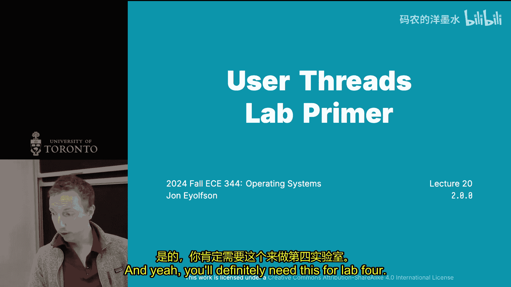
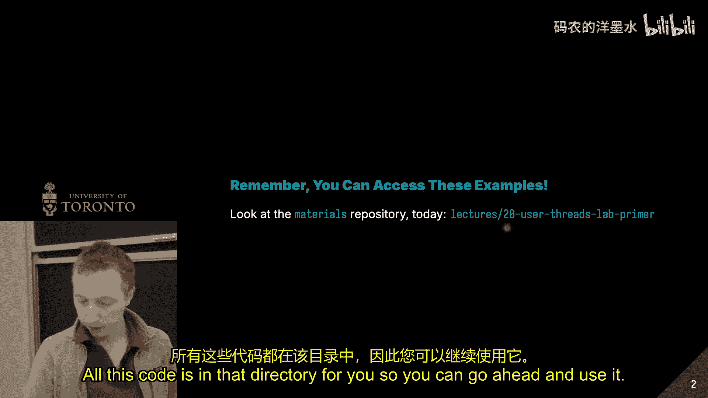
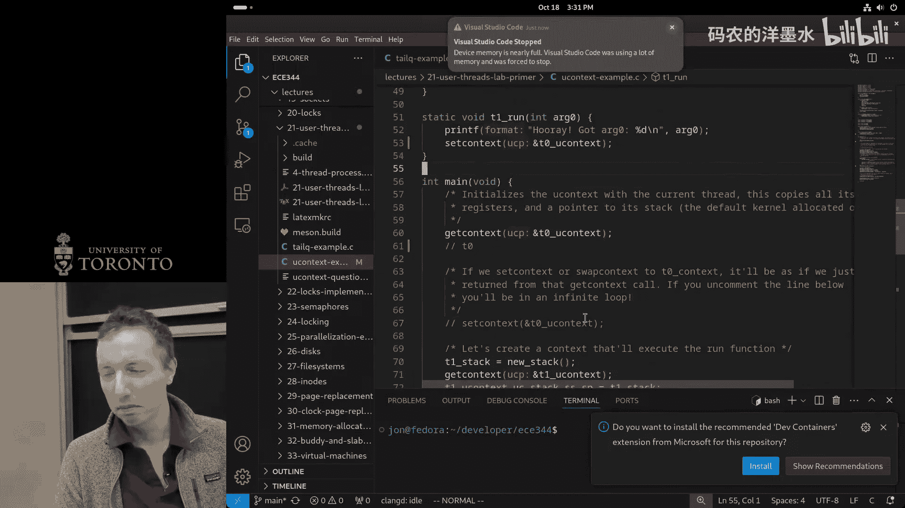
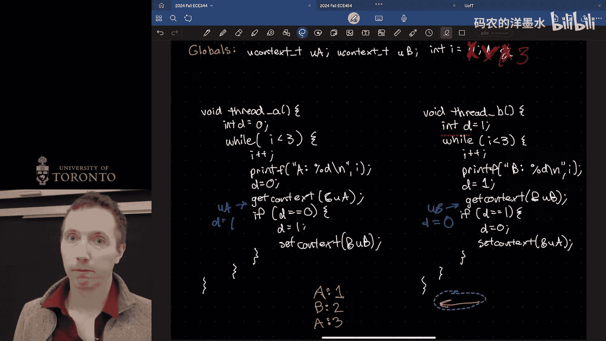
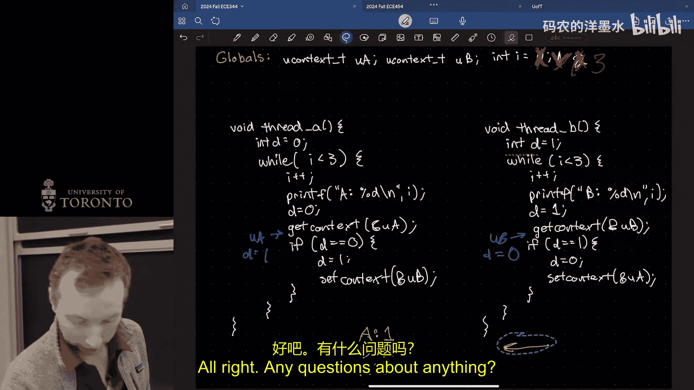
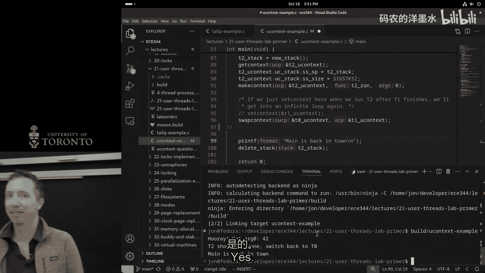

# 【全集】多伦多大学 操作系统 中英字幕 1080P p19 Lecture 19 - 用户线程实验 -BV1Rbk7ByERc_p19-

Allrighty， welcome back to operating System， so you will need this lecture for La four。

So it's also review E， it has to do with user threads and threads。So let's get into it。 And yeah。

 you'll definitely need this for La 4。

So here's kind of a review thing。To look how you can think about a process with four threads。

 so in a process。Right we know a few more things about what's living in a process now。

 so a process that has open file descriptors specifically for this process and then the process will also have virtual memory。

 So virtual memory is where the stack， the heap and everything is and we have expanded that a little bit So your Google variables and heap will be in virtual memory and then so well your stack。

 but a stack is specific to a thread So before you had only one thread the main thread but now you might have a process with four thread so in that case each thread would have its own independent set of registers and its own independent stack and each of those stacks would be in virtual memory。

 So kind of a review to tie everything together that is what a process how you can think of a process。

With everything。 and that's like basically the whole review， right？

So we did a whole bunch of virtual memory， it's all page tables， everything like that。

To figure out what process to run that scheduling。 And then now we're dealing with the threads。

So remember， you can access all these examples。 So you have access to materials directory specifically。

 there's。This。All this code is in that directory for you so you can go ahead and use it。

 So first example， actually， let's first start with list。

So。In the lab right you're managing a bunch of user threads so you have to schedule them。

 you are scheduling them in just FIF order， so first in， first out。

 so that means you should probably use a linked list。I know you guys love linked list。

 but you do not have to implement one yourself。 You can use one of the built in ones。

 So how you use one of the built in ones is it's you just include the cis Q dot H。

 This Q is basically。Gives you a whole bunch of ugly C macros that will go ahead and implement link lists for you。

 So to make your own element of a link list， you make your ownstruct， call it whatever you want。

 I call it entry。 And then you put in whatever you want to keep track of in the link list。

 So if you're just keeping track of。Threads and which one should run。 you might only need which an I。

 like which thread I。 So in this case， all I have is an int I。 But if you want to add more things。

 just add them to thestruct。And then。To use a doubly linked list so that you can access the head and a tail in constant time。

 they call it a tail cu， so it's a cu that you can access from the tail as well as the head or the beginning。

For entry。In order to initialize the pointers， you use this tail Q entry macro。

 the argument you give it is the name of the structure so it should match this and then you can give it whatever name you want I just call it pointers because basically what this will do is declare a previous and a next pointer for you So I just call it pointers and then your list structure itself well there's this tail Q head macro so that will create the link list structure itself。

 This is the name of the structure you want it to create so it will create thatstruct with that name for you and this last one is just what is the type of every single entry So after that you can use thisstruct list head and that will represent your list So this will represent a link list。

So it has a few other macros。 So how you actually access it is you just access it。

By this list head by pointer because of course it's C and then this has a whole bunch of macros so you know how before you had to iterate over a list you had to follow the next pointers until the null blah。

 blah， blah blah， blah while they simplify that for you they give you this macro tail Q for each so you just have to make a pointer to an entry and then use this macro it will assign。

A pointer value to this variable you give it。 so in this case E。

 so that will get populated once for each individual element。

 this is a pointer to the list head and then you have to give it the name of this tail Q entry so it just has to match this pointer's name and then each time you go through here now E will point to each individual element。

And then if I wanted to just get the last element， I can use tellelQ last， you'll have this example。

 there's man pages and you can search the internet for how to use it， but as a simple example。

To create a new list， use tail Q and knit， give a pointer to the list head。

 so it will initialize that for you。 Basically it will make sure that the first thing it points to and the last thing it points to are null initially。

 And then there's like these macros that will tell you whether or not the list is empty。

 so I can check that assert that the list is actually empty after I initialize it。

 you would expect that no elements to be on there。Then here I can create a entry of the list。

Just on the stack， so I would just call it E1。If you're creating elements of a list。

 you'll probably have to mall them because they'll live longer than a function。

 you'll probably have to have a run queue managed between threads， so this will not work for you。

 but here I'm just showing you how to create an element。

Here I set its ID equal to1 and then to insert it at the end， use tailQ inserts tail。

 again you give it a pointer to that list head that you initialized a pointer to this entry and then the name of that tail Q entry used before and that will insert it to the end。

 so if I print it out， it should just print one。Now here I'll create another list entry。

Call it2 and then insert it at the back。 So now if I print the list， it should have。

Be in order because I put them both at the end so it should be one then two and then the last element should just be a  two。

 and then if you want to remove an element by default， it will remove it from the beginning。

 there's also a method to remove it from the end if you want so this will remove a specific element so this will remove E2 So after that it will be removed from the list。

 So if I print the list it will no longer be in it。 So if I go ahead and run this now。I can see that。

 hey， after I insert one the list has one， after I insert two， it's 1，2。

 and then the last element is two， if I remove one， then it' no longer in the list anymore。

So highly recommend you use that for instead of implementing your own linked list， again。

 I can't tell you what to do so feel free to ignore me。

 but you'll probably have some debugging you need to do。

So questions about how to use this before we go into the fun part。All right， use this。All right。

 the fun part is I told you there is some type of structure that will go ahead and save all the registers for you so you don't have to individually save them yourself。

So。That is what we're going to go into the specific C structure that saves all that information that you would associate with a thread like all of its virtual registers and where its stack is。

 they call it a u context or they just call a context So the specific type is called U context。

 So I have a whole bunch of functions， but the main thing you need to use that represents the state of a thread is this u context do H and it gives you a whole bunch of functions and then a structure called U context underscore T So it's supposed to be user context。

So in this example I have a bunch of little helper functions。

 I just called it die to check for errors， and then there's this new stack。

 so this is the function I give you。That you should use。

 this is what you should use to get a new stack from for a thread。 It just uses Mmap。

 You don't have to worry about it。 The nice thing about it。 This is。

I added some calls to register with Valalgrind， otherwise。

 if you try and run Valgrind with yours and you switch to something where it doesn't know that that's a stack。

 is's this going to assume you're using invalid memory and then throw up at you。

 so if you want to use Valgrind， I highly suggest you just use well， if you want to allocate a stack。

 you just use new stack and then everything will be handled for you。

And then of course I have a delete stack that will just make it easier to get rid of a stack。

So for this example， I am going to kind of simulate three different user threads。

 so I'm going to have a u context type for each so they're going to keep track of the state of each user thread。

 So again。The kernel， I only have one kernel thread。

 There's only going to be one kernel thread that runs my process。

 and then I'm going to create three user threads on top of it。 I have creative dame。

 so they're going to be called T0， T1 and T2。Then。Here， well。

 that kernel thread is going to have a stack， so I can reuse that stack for thread 0。

 I can just say thread 0 is the main kernel thread。 So I'm going to need two additional stacks。

 one for thread 1 and one for thread 2。And then other than that。

 I'm going to try and set it up to look like P threads。

Except that my run functions are going to take no arguments and return no arguments instead of taking a pointer and returning a pointer。

 So here here's a thread to run。 We'll see what these calls look like in a bit。

 but it just prints some information and does some stuff we don't know of。So let's start with me。

So to initialize a U context， whenever you so you give all the arguments just a pointer to a U context and what this git context will do。

 I tried to add comment。 So if you read this is it will initialize this context structure with the state of the thread that is currently running。

 So it will save a copy of all the registers at their current values at the time that this is running。

 So everything would be saved to this context。Program counter， all the register values。

 literally everything where the stack pointer is and everything。

So the other part of Git context is you can set context to go back to the last safe state。

So if I do something like this。What that will basically do is if I save。

If I do get context on thread 0 here， that means whenever I。Set context to it。

 It will literally resume at this line， so it will resume execution wherever you actually last called get context。

 So set context will immediately restore whatever the state was。Using that u context。

 so in this case， if I do a set context to thread zero， it would come here。And then well。

 it should set context， come here， set context， come here， so if I run this。

 I probably expect that literally nothing will happen， right？So if I run this and press enterter。

It's actually running right now， but this。What's going on？Looks like an infinite loop， right。

 so just to verify。I can print F。Throw an F in there and see that when I run this now。

 I get flooded with F's。Yeah， it said context going to go back in。Da conference point or。

I go to the maximum。So the git context， it saves the context and if you set context to it。

 it will resume at the line after Git context。So in this case。

 if I set context here or get context here， and then set context， it'll resume here， print F。

 then set context， go back up here， print F， set context， go back here， print F， so on and so forth。

Everyone get that first infinite loop。 So when you start implementing user threads。

 this might be the first thing you do。 You might infinite loop yourself without a while loop。

 So that's fun。 So don't do that。 So that should save you a few hours of debugging right there。😊。

So any questions about that， does that make sense that everyone that that's a bad， infinite loop。

Okay， so。How you're going to actually create a thread is。Through a call called make context。

 So that will do a whole bunch of nice things for you。

 like initialize a stack pointer and also initialize your instruction pointer。

 So it starts executing a function you tell it to。 So it will look kind of like P thread create a bit uglier your。

😊，The function you're going to be writing should just take a。

Single function to run so it should be a bit nicer than that right the idea behind the threading library is you're supposed to hide little details like this。

 but if we were to create a user thread well called thread1 while it needs its own stack so I would create it by using that new stack call you should do that too。

 and then if you look at the documentation for make context。

The U context it initializes has to be first initialized by using a call to gett context even though it will rewrite it and fix it up。

 so in order to initialize it I have to just do a get context that will save this current thread but don't worry about it we're going to make context that's going to fix it up so it runs something else and doesn't continue from here you just have to initialize it with this gett context it's a bit weird。

And then in order to modify the stack for this U context， this is how you do it。

 So there's a field called UC stack。 you set the stack pointer to point to this new stack and you tell it how big it is which is just this defined variable sig stack size。

 so there's just a defined stack size whenever you call new stack， it creates a stack of that size。

 so just use that value。Then。Don't worry about the comment for now。 Then make context。 We take。

Those modifications you did。 So you're trying to change the stack pointer。

 so it will take those modifications。Modify this context， you give it by pointer。

 so I'm trying to modify thread one to run a different function。

You tell it what function you would like it to run。 So now if I set context to thread1。

 it will start executing this thread1 run function instead of resuming from this git context call。

 So it will start running this thread1 function。I can pass that function different arguments。

 So the next argument is ag C。 so that's how many ints。

 it's defined as ints you want to pass it so you can only pass it ins。 So in this case。

 I'll just demo passing it a single int of 42， so pass it one integer so。

The number of integers you specify after that RrcC has to match。

So here I'll give one integer and it will be 42。And then。Now oops。Now with that。

 I could just do a set context。Two T1 ucon。So what that will do is swap the current kernel thread swap all the registers with whatever is in that thread 1 U context。

 and it's set up to use its own stack and it's set up to execute this。This thread one run function。

 So it should just print Hooray got arg 0， and that arg 0 should be equal to 42。

So questions about that， when I run this， I should see that printed。Okay。

Hopefully no tricks this time。So I run that。Yay， it actually runs。

 so that's a different user thread running。So it's using a entirely new stack。

 it's using that new context we set up， it executes this。Everyone okay with that？

So one question might be。Well。My program just kind of ended what happened to the main thread， right？

So。You might imagine if this is your library， you know， the main thread still exist。

 maybe when I'm done with this T1 run， I don't know， maybe I just want to go back to it， right？

Something like that。Is that cool？Yeah， that's cool， right？So if I do that。

 what's going to happen if I set context back to T0 U context。It just continues， right？

So it should continue。 And what would it do， just create another thread too and carry on and do all that stuff。

Well， let's run it and see。嗯。What the hell is happening？Oh。So that wasn't good。

What the hell happened？Yeah。Yeah， we kept just making thread one over and over again， right。

 because the last time we called。Get context to thread0 U context we did it here。

 so if we do a set context back to it， it would resume here right， so what we did。

 we used our initial thread， created thread1， created a new stack。You can see where we got here。

 created a new stack。Set up this context so that it would start executing set context to it。

 it ran this function printed hoay， and then we set context to thread0， which would resume from here。

 restore its stack。whereverver it was， so it would resume here and then make a new stack。

 recreate threadread one over and over again， and then eventually I ran out memory and visual Studio crashed。

So we did the same thing， we infinite looped again， but we made it worse。

 we waste memory every time until eventually we crashed。So everyone see how we screwed that up。So。

 some。Cooler thing I could do。Is。

嗯。Yeah， so what I would like to happen is if I want to resume that thread zero right。

 I would have to do like a git context right， so I'd have to do like a git context here。Oops。

Is that good？No， what's going to happen there？Go right for Sean。Yeah。

 I'm going to infinite loop again， right？I'm going to do it more efficiently。

So I'm not going to create a new stack every time but。

Like I'm not going to recreate thread zero every time。

 but I'm going to have an infinite loop here where。I don't ever come back from， right。

 and this kind of sucks。I would rather。Like what I really want is I want to save。

Thread zero such that it would resume from here， right， just after the set context。

So there is a way you can implement this， the past lab。Made you implement this yourself？

So you had to figure out how to do this， they give you a function to do it， so I let you use that。

 So there is a function called swap context。So what swap context will do is fudge things a little bit such that well the first argument it will do a get context on that so it will save the current state into this context but it will save it such that it resumes right after this swap context so thread zero would resume right after this line which is kind of what we wanted before and the second argument here is what it will set context to。

 so instead of those two lines we want something like this。

So what that will do is it will do a gi context to this such that it resumes right after the swap context call。

 and then it will do a set context to thread1。So what should happen now is that we start off with thread zero。

 we do a gi context here。Didn't actually need to do that。 so we could actually remove that now。

 But who cares， then we set up thread1。Do a git context to initialize its context。

 set up its new stack， sett it up so that it executes a different function。

 And then we do a set context swap context， which will， again do a git context here。

 So thread 0 will resume there。 Do a set context to thread 1。 So we' would start executing。

This function with thread1 stack， then it would print and then do a set context to thread0。

 which should resume right after this swap context call， and then after that。

 it should hopefully just make thread2， And then in this case， I don't show any argument。

 so I just create a new stack for it， set it up and then tell it to run this thread2 function。

 don't give it any argument so it's a bit smaller。 And then I could just do a swap context here。

If I wanted to， so I could make it more fun and actually do the swap context there。

So if I remove this。Yeah， actually， let's just send this， see what happens。So we resume there。

 we create a new thread。Current directory， that that the wood we do， we broke something。Oh right。

 VS Studio crashed。So if we just send this。In this case， because we didn't do things carefully。

 we swap context。So that thread zero would resume。The set context on thread1。We printed this。

 we set context back to thread zero， which brought us here。Which created thread2。

And then we did the same thing。 We swap context again to thread1， So it called threadread1 again。

 which again just printed Hooray。I got that argument again。

 and then whenever it get context back to thread zero， it resumed here。

Which said Maine is back in town， and then it just immediately deleted threadhread2 stack and didn't do anything。

So threadread2 didn't actually run。All right， okay with that weird sequence of events。So， yeah。

Please explain what。So swapb context will do a gi context on the first argument。

 but fudge it a bit so that。Thread zero would resume just after the swap context call and do a set context on the second argument。

 so it switches to that context。All right， so。So。That's okay， right？Some other things we could do。

 sorry， let's get rid of this。So if we get rid of that line， we make two threads。

 and then we do a swap context from thread 0 to thread 1。 And in this case。Let's get rid of a line。

 So in this case， we have thread1 run that just prints something and then doesn't do anything。

 So ideally， we have other threads to run， right， we would expect after that's done。

 it resumes executes thread2 or thread1， whatever we decide。 But if we run our program now。

We just see Hooray got 42， and then it exits。Why。Well， turns out。

That if any of the threads finish the function， you tell it to run if it returns from it。

What this you context library will do will just exit the process。 So there's nothing else to run， so。

You can't do anything。 So in order to resume something， you have two options for the lab。

 you can pick whatever you want before the thread dies。

 you can just set context to whatever thread that should run next。

 or the other option you have is you can have kind of like a cleanup thread because as part of the make context。

 What you can do is you can add something。callled a UC link and what that will do is instead of exiting your process whenever it's done running that function。

Of V S codes， it will instead do a set context。 Okay， VS code。 we know you died。

It will instead do a set context when you。Return from that function to whatever you context you tell it to。

 so if I set you see link equal to thread2 context。

 that means whenever that thread one function is done。

 it will automatically do a set context to thread2 so。If it does that。

When this is done after Prince Hooray got Arg0， it would set context to thread2， which would be。

 should say thread2 should be done。Switch back to thread 0 in your threading library。

 What you should take care of is now thread， I know thread1 is done， So I should clean up its stack。

 right， It's done。 I should just clean up its stack。 So here you'll have to do something。

More general， but here I just delete it stack and then I use the other option。

 I just set context back to whatever should run next， which is the main thread again。

 so the main thread would come back to wherever it last got a get context called on it which would be here so it should print main is back in town and then thread2 is done so I can delete it stack before cleaning up so。

Now， if I run this， I should see all of my three user threads running。 it says Hooray got arg0。

 that was from thread1， then says thread 2 should be done， switch back to thread0。

 that was from thread2， and that it says main is back in town from thread。Z。

 so any questions about that？Fun， so you just need to package that up， make it a bit nicer to use。

 clean up some stacks and have a link list of and keeping track of what order threads should run in。

So。Much better than the 80 hours this lab used to take， so I let you use swap context。You're welcome。

And give you examples and。Show you how to create a stack and everything。All right， so。

Fun ways to make sure we understand what is on a stack。 This is from some exam from before。

 And it asks you， basically， what will this program print。

 So it assumes that we have two global variables。For U context called U A and U B。 And initially。

 they're set up so that they run each individual function。

So UA is set up so that it would run this thread A function。

UB is set up so that it would run this thread B function。And then there is a global variable I。

 And then the question says， assume initially that thread A executes what will be the output that I see。

So to trace it line by line， I'll have this orange marker that says what line we would start executing at。

So。All write in the columns that blue UA， that's where we would resume from if we did a set context to UA。

 if we did a context to UB， the blue arrow on the right is where we would resume from。

 and then the orange line is the current line we're executing。So。In here， well。

This would create a variable called D。The variable D， where does that live？On the stack。

 specifically on thread A stack or the stack for。You context A， whatever you want to think about it。

It lives on the stack and it is assigned the value 0。 So I'll just put it there with U A。

 So it's already there on its stack。So then we go ahead， check the value of the global variable。

 I is currently equal to0， so that is less than3， so we would come in here I plus plus that would increment the global variable right。

 so it would change it from a0 to a1。Okay， so far before things get weird。Okay。

 nothing is different yet。 So this line， this print F， what will that print。ペじの？No。A1， right？

The current value of i is 1。So we will see。A。One printed。Everyone with me so far。Okay。So， next line。

Oops， it updates the value of D。So it would change the value of D from a 0 to a 0。 It's on its stack。

 right。Then it does a git context。 So gett context， U A。

So that makes it such that if we did a set context on it。

 it would resume right after the get context line。 So I'll move it so that it resumes there。Now。

 it checks the value of D。 Is it 0， Yes， so that's true。 So it sets the value of D to1。

So now D is equal to1。And then it does a set context to UB。

 So now we start executing here using B stack， so first line it executes is D equals1。

 So D equals1 Oh， I have a D1， it changes1 to1。No， that's a stack， not B stack， right？

So that's not what would happen。 D would be created on B stack and then assigned to one。Right。

 and it has a different stack than a。 So it's different。Everyone okay？All right。So now is， oops。

 is I less than three。Yes， I is less than three， so we'll go in here plus plus I。

 So that will change I from one。To2。Then it will do the print F。 What will this print F show me？Yeah。

B colon one。No， what's the current value of I？2， so yeah， we just updated I， so B。2。

Everyone okay with B2？All right， so next line。It assigns D， it's D from1 to one。

 so it doesn't change anything， and then does a git context of UB。 So now if we do a set context。

 it would resume right after that git context line。Now it checks if thread Bs D is equal to 1。

 is it equal to 1， yes， so it will reassign it from 1 to a0。

Then we will do a set context back to U A。 So now we will switch back to thread zeros。 sorry。

 thread A's stack in everything。 So now is D equal to 0。No。So D is not equal to 0 for thread A。

Because right before we did this， we got into this if branch when D was equal to 0。

And then after we got into it， we changed it。Which only changes it on my stack。

 So when I came back here， it's still one。 It's still the most recent value。

 So it saved the stack pointer， right， It saved and restored the stack pointer。

But that doesn't change what is on the stack。 So it's still whatever the value was on the stack。

 if I recreated it and readjusted the stack pointer， while it would restore the old stack pointer。

 But D existed before I did that。 It doesn't allocate any new variables or anything like that。

 So D would actually be equal to one now。 So now it's going to come back and do something different。

 So basically this whole trick is basically how swap context works。

 it would use this trick to do that。 So knowing how to do this， if you really wanted to。

 you could ignore swap context and basically do this trick。 So check the value。

 change its set context come back and then it would be changed。So in this case， D is not equal to0。

 so it would skip over that， right， come back up。Is I less than 3， yes， it's currently two。

Then it would do plus plus I， so it would increase I from 2 to3。Now， the print line。

 what will this print？A 3 now， right， I updated I from 2 to 3。 its current value is 3。

 So it would print a。3。Now I set。D equal to0 on thread A' stack， so D gets updated to0。

I would do a gi context。 In this case， it's not really doing anything。

 It was already going to resume from there anyways。

 didn't really change any registers or anything like that， so。If it makes you feel better。

We can move this back here。Or just keep it there， whatever makes you feel good。Then here。

 does D equal 0？Yes， so go in here， change D equal to 1。And then do a set context to UB， oops。

Still too much。 Do we set context to U B， which will resume here。 So now does D equal 1。No。

 so it will skip over this。Come back up here is I less than 3。No， I is equal to three， right。

 so it's false， so it would go here。It would。Finish threadBs function and then just finish the process。

 if it didn't say you see link got set or anything， soon as it returns from threadbes function。

 you just assume the process is done。 So the final answer is it will print A 1， B2， A 3。 That's it。

Questions about that or kind of makes sense and that's。Again。

 same idea is how you would implement a swap context。

Yeah。Gs are updating。

呃。Sorry。確手に？No， each thread was updating only its Dvalue because it's on its own stack。

So that's why I drew the D value right under the context to keep track of that thread's value of D。

All right， any questions about anything， otherwise I'll just hang around for any general midterm questions。

 but yeah， your midterms what， Monday， X？

这是。It's not。Your midterm's not too bad。

Yes。