# 002：程序库 📚

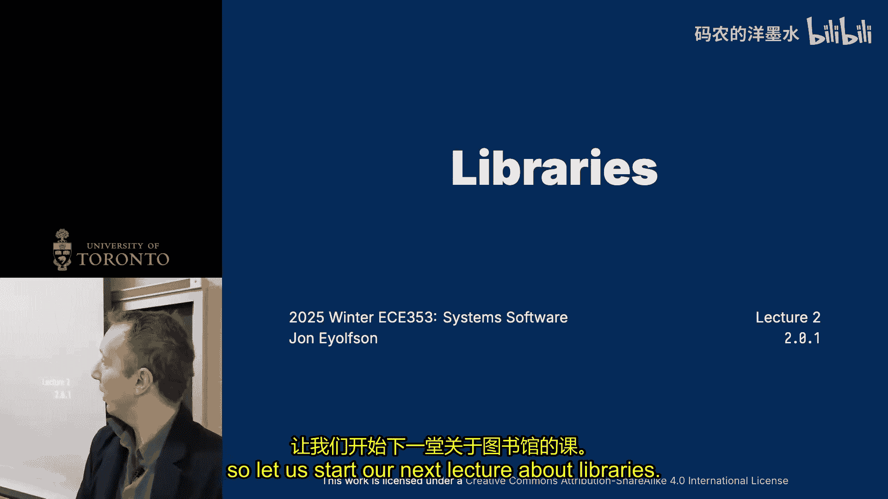

在本节课中，我们将要学习操作系统中的程序库。我们将探讨什么是程序库，它们与内核的关系，以及静态库和动态库的区别。我们还将通过一个具体的例子，了解动态库更新时可能遇到的问题。

## 什么是操作系统？🤔

上一节我们介绍了内核是操作系统的一部分，它运行在内核模式。那么，操作系统的其他部分是什么呢？例如，苹果公司的Mac OS、iOS、iPadOS、watchOS都使用相同的Darwin内核，但它们通常被认为是不同的操作系统。这是因为我们通常根据操作系统能运行什么样的应用程序来定义它。一个iPhone应用、一个Mac应用和一个TV应用是不同的，因此，即使它们共享90%的代码，技术上也可以说它们是不同的操作系统。

应用程序在运行时可能会经过多层库的调用。我们昨天提到，内核位于内核空间，负责与硬件交互等重要任务。但你的应用程序通常并不直接使用系统调用接口，而是依赖于像C标准库这样的库来为你调用和使用它。

以下是应用程序可能依赖的库的层次结构：
*   **C标准库**：提供基本的系统调用封装和标准函数。
*   **系统守护进程库**：抽象硬件细节，例如网络管理器使用它来识别以太网或Wi-Fi设备。
*   **GUI工具包**：提供用户界面，例如GTK，它本身会使用另一个库（如Wayland）来将像素显示到屏幕上。
*   **应用程序**：如Firefox，可能会混合使用上述所有库。

因此，什么构成操作系统的一部分，取决于你的应用程序。Android和Debian都使用Linux内核，但应用程序不同。如果你只关心一个简单的控制台“Hello World”程序，你甚至可以将这个可执行文件传输到Android手机上运行，在这种情况下，你可能会说Debian和Android是同一个操作系统。

所以，操作系统的定义是：**内核加上你的应用程序所需的所有库**。唯一确定的是，内核绝对是操作系统的一部分，而一个库是否属于操作系统，则取决于你的应用程序。

## 编译过程回顾 🔄

在深入库之前，我们先快速回顾一下正常的C语言编译过程。希望这对大家是复习内容。

你有一个 `.c` 源文件，通过 `gcc` 或使用 `make`、`Meson`、`CMake` 等工具进行编译。每个 `.c` 文件都会被编译成一个包含所有机器码和函数定义的 `.o` 目标文件。然后，在一个单独的链接步骤中，所有这些 `.o` 文件被“糅合”在一起，形成一个单一的可执行文件。这些 `.o` 文件本质上就是包含函数代码的ELF文件。

## 静态库与动态库 ⚖️

有两种类型的库：静态库和动态库。

### 静态库

静态库在**链接时**被包含到可执行文件中。假设你有多个 `.c` 文件，并且希望在不同的应用程序中重用它们。复制粘贴代码是非常糟糕的做法。为了创建可重用的代码，你可以将它们编译成一个库，然后多个应用程序都可以使用这个库。

静态库的创建过程如下：将多个 `.o` 文件通过归档工具打包成一个 `.a` 文件（即静态库）。然后，你的应用程序在编译时链接这个 `.a` 文件，而不是直接链接原始的 `.c` 或 `.o` 文件。最终生成的可执行文件包含了库中所有代码的副本。这意味着，如果你更新了库中的代码，你必须重新编译链接了该库的所有程序，才能获得更新。

### 动态库

动态库包含可重用的代码，但其具体使用在**运行时**才确定。C标准库就是一个动态库。在Linux上，它通常是一个 `.so` 文件。

动态库的创建过程与静态库类似，也是将 `.o` 文件集合起来，但使用“共享链接”的方式生成 `.so` 文件。这个文件包含了一些额外信息，帮助操作系统在运行时找到函数（例如 `printf`）的位置。

对于使用动态库的程序，在编译链接时，编译器只需要知道使用了哪个库，并在可执行文件中记录这个依赖关系。当程序运行时，操作系统才会动态加载所需的 `.so` 文件。

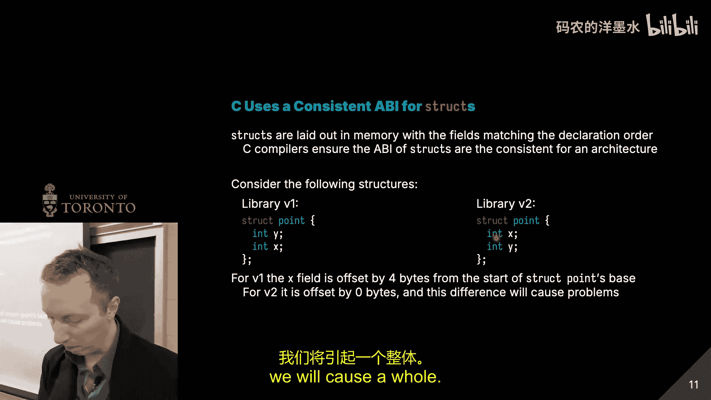

动态库的主要优势在于**代码共享**。几乎每个你写过的程序都使用C标准库。如果每个程序都静态链接自己的 `libc` 副本，将会浪费大量内存。使用动态库，操作系统可以将 `libc` 只加载到内存一次，然后让所有使用它的程序共享这份内存。此外，更新动态库（例如修复 `printf` 的bug）后，所有使用它的程序在下次运行时都会自动使用新版本，无需重新编译。

检查一个可执行文件使用了哪些动态库，可以使用 `ldd` 命令，例如 `ldd a.out`。

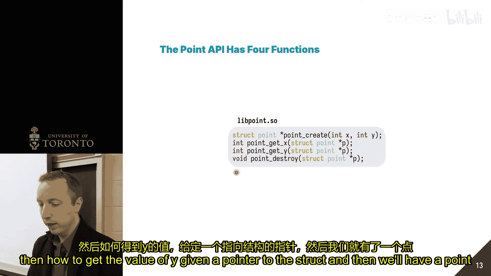


## 静态与动态库的权衡 ⚔️

上一节我们介绍了两种库的基本概念，本节我们来深入看看它们各自的优缺点。

### 静态链接的缺点

静态链接基本上就是将库的所有 `.o` 文件直接复制粘贴到你的可执行文件中。
*   **无法复用库**：许多常用库（如C标准库）会在每个使用它的程序中产生重复副本，浪费磁盘和内存空间。
*   **更新困难**：如果库中发现bug并修复，你必须重新编译所有使用该库的程序，才能将修复应用到这些程序中。

### 动态链接的风险

动态库虽然节省资源且便于更新，但也带来了风险。
*   **可能破坏程序**：如果动态库的新版本引入了不兼容的更改，可能会直接导致依赖它的程序崩溃或行为异常，而你并没有修改自己的程序代码。这给调试带来了巨大挑战。

问题的核心在于 **ABI（应用程序二进制接口）** 的变更。即使库的 **API（应用程序编程接口）** 看起来没变（例如，一个结构体仍然有 `x` 和 `y` 两个字段），但如果库的内部实现改变了这个结构体在内存中的布局（例如调换了 `x` 和 `y` 的顺序），就破坏了ABI。编译时使用旧结构体布局的程序，在运行时链接到新布局的库，访问字段时就会得到错误的数据。

## 示例：ABI破坏演示 💥

让我们通过一个具体的例子来理解ABI破坏。假设我们有一个名为 `libpoint` 的库，它定义了一个表示点的结构体。

**版本1的头文件 (`point.h`)** 定义如下：
```c
struct point {
    int y;
    int x;
};
```
在内存中，`y` 位于偏移量0字节处，`x` 位于偏移量4字节处。

**版本2的头文件 (`point.h`)** 仅仅调换了字段顺序：
```c
struct point {
    int x;
    int y;
};
```
现在，`x` 位于偏移量0字节处，`y` 位于偏移量4字节处。API没变（都有`x`和`y`），但ABI变了。

库提供创建点、获取x、获取y、销毁点的函数。

现在，我们写一个程序 (`example.c`)：
1.  使用 `point_create(1, 2)` 创建一个点。
2.  通过库函数 `point_get_x(p)` 和 `point_get_y(p)` 打印坐标。
3.  直接通过结构体指针 `p->x` 和 `p->y` 打印坐标。

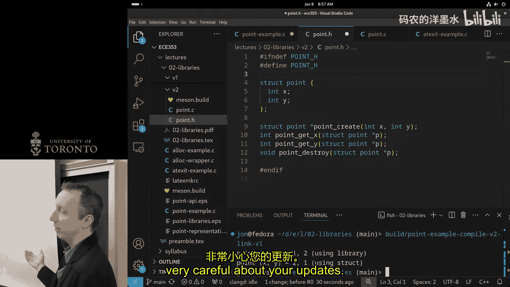

**场景分析：**
*   **场景A**：程序用 **V1头文件** 编译，并链接 **V1库**。运行结果：`(1, 2)` 和 `(1, 2)`。一切正常。
*   **场景B**：程序用 **V1头文件** 编译，但运行时加载了 **V2库**（模拟库更新）。运行结果：库函数打印 `(1, 2)`，但直接访问结构体打印 `(2, 1)`。

**原因：**
程序在编译时认为结构体是 `{y, x}`，所以 `p->x` 会去访问内存中第二个整数（偏移量4）。而V2库在创建点和获取值时，是按照 `{x, y}` 布局来操作的。因此，库函数内部协商一致，能正确工作，但程序自己的直接内存访问就错位了。

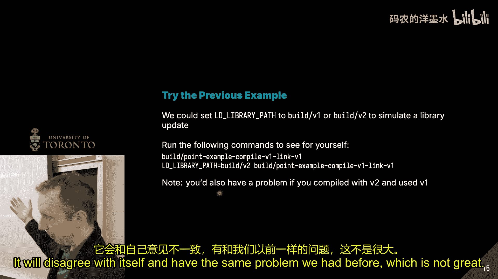

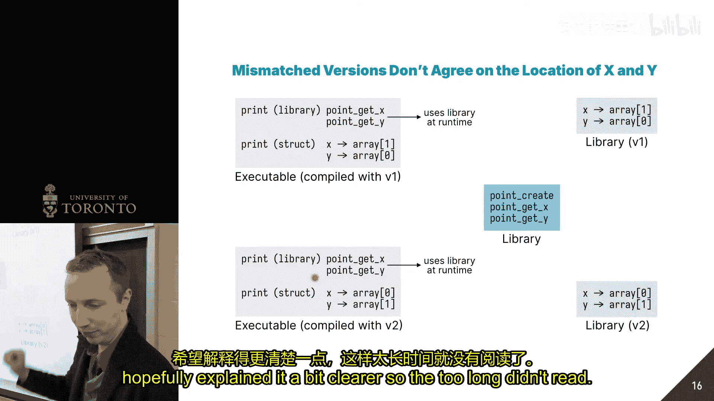

这个例子展示了：**如果你在头文件中公开了一个结构体的定义，那么它的内存布局就成为你API/ABI的一部分，以后就再也不能更改它了，否则会破坏所有使用它的客户端程序。**

一个保持ABI稳定的正确做法是：在头文件中**只声明**不透明的指针类型（如 `typedef struct point point_t;`），而将结构体的具体定义隐藏在 `.c` 源文件中。这样，库的内部实现可以自由修改，只要公共函数接口不变即可。

你可以使用环境变量 `LD_LIBRARY_PATH` 来指定运行时优先搜索库的路径，从而模拟不同版本库的加载。

## 语义化版本控制 🏷️

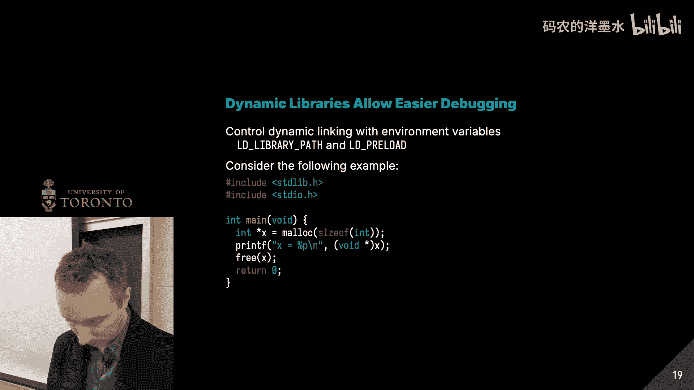

为了管理库的变更并明确告知开发者兼容性，社区采用了**语义化版本控制 (SemVer)**。

版本号格式为：`主版本号.次版本号.修订号` (例如 `2.1.3`)。
*   **主版本号**：当你做了**不兼容的 API 或 ABI 更改**时递增。从 `1.x.x` 升级到 `2.x.x` 意味着很可能需要重新编译客户端程序。
*   **次版本号**：当你以**向后兼容的方式添加新功能**时递增。从 `1.1.x` 升级到 `1.2.x` 是安全的，新程序可以依赖 `1.2` 的新特性，而旧程序依然能工作。
*   **修订号**：当你做了**向后兼容的问题修复**时递增。从 `1.1.1` 升级到 `1.1.2` 是安全的，通常建议用户更新。

遵循此规则，使用动态库的用户就能通过版本号判断升级是否安全。

## 动态加载器的其他用途 🛠️

动态库加载机制还有一些有趣的用途，例如调试和性能分析。

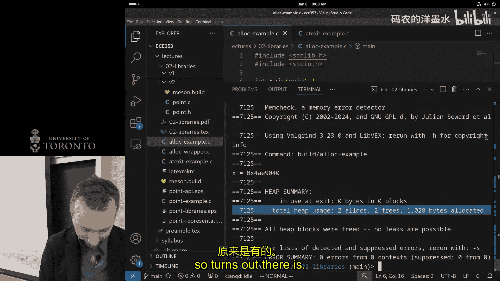

### LD_PRELOAD

环境变量 `LD_PRELOAD` 可以强制在程序运行前先加载指定的库。这常被用于：
*   **调试**：包装（Wrap）系统函数如 `malloc` 和 `free`，在自定义版本中打印日志，以追踪内存分配和释放情况，检查内存泄漏。
*   **性能分析**：替换关键函数以进行性能计数。
*   **安全研究**：拦截函数调用。

例如，你可以写一个 `libmalloc_wrapper.so`，在里面定义自己的 `malloc` 和 `free`，它们会先打印分配/释放的大小和地址，然后再调用真正的 `malloc`/`free`。通过 `LD_PRELOAD=./libmalloc_wrapper.so ./my_program` 运行你的程序，就能看到所有内存操作。

### 关于内存泄漏的一个说明

一个有趣的现象是，C标准库（如 `printf`）内部也可能会调用 `malloc` 来分配临时缓冲区，并且通常**不会释放**这些内存。这是因为这些内存在进程生命周期内会被重复使用，并且在进程退出时，操作系统内核会回收其所有资源，因此显式释放它们只会降低性能且无必要。

像 `Valgrind` 这样的内存检查工具知道这一点，它会将来自 `libc` 的这类分配标记为“已释放”，从而避免误报。但如果你在自己的库或程序中出于类似原因不释放某些内存，`Valgrind` 会报告泄漏，你需要有充分的理由来解释其合理性。

除了 `Valgrind`，你也可以使用编译器内置的**地址消毒剂 (AddressSanitizer)** 来检测内存错误，它通过编译时插桩实现，运行速度比 `Valgrind` 更快。例如，在 `clang` 或 `gcc` 中使用 `-fsanitize=address` 选项。

## C库函数与系统调用 🔗

你可能注意到，在C语言中直接进行系统调用很罕见，通常都是使用C标准库函数。这是因为C库函数在系统调用之上提供了更友好、更强大的抽象：
*   **错误处理**：系统调用通过返回值指示错误，而C库函数会设置全局变量 `errno`。
*   **缓冲**：如 `printf` 会对输出进行缓冲，可能积累多次写入后才进行一次实际的 `write` 系统调用，以提高效率。
*   **简化接口**：一个C库函数可能组合多个系统调用，或添加新功能。例如，`exit` 系统调用会立即终止进程。而C库的 `exit()` 函数则允许你通过 `atexit()` 注册一些清理函数，在进程真正终止前运行。

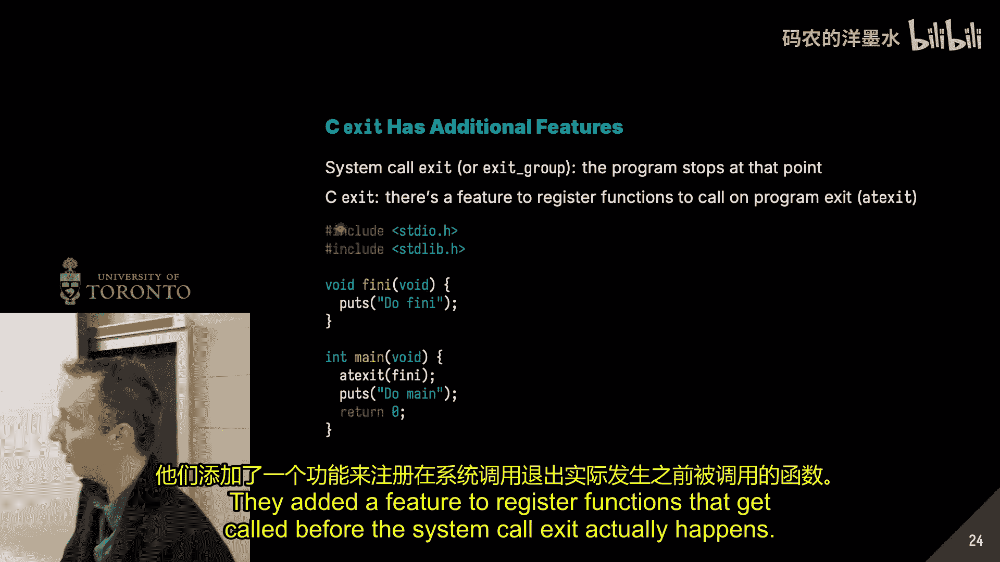

## 总结 📝

本节课中我们一起学习了程序库的核心概念。
*   操作系统由内核和应用程序所需的库共同构成。
*   **静态库** (`.a`) 在编译链接时被整合进可执行文件，导致代码重复但部署简单。
*   **动态库** (`.so`) 在运行时加载，允许多个程序共享代码，节省内存，便于更新，但存在因ABI不兼容而破坏现有程序的风险。
*   ABI破坏可能由看似无害的更改（如结构体字段重排）引起。保持ABI稳定的一个关键方法是**隐藏实现细节**（如使用不透明指针）。
*   **语义化版本控制 (SemVer)** 为库的版本管理提供了清晰的规则，帮助用户判断升级的兼容性。
*   动态链接器提供了 `LD_PRELOAD` 等强大工具，可用于调试、性能分析和函数拦截。
*   C标准库函数在底层系统调用之上提供了缓冲、错误处理和额外功能（如 `atexit`）等便利。

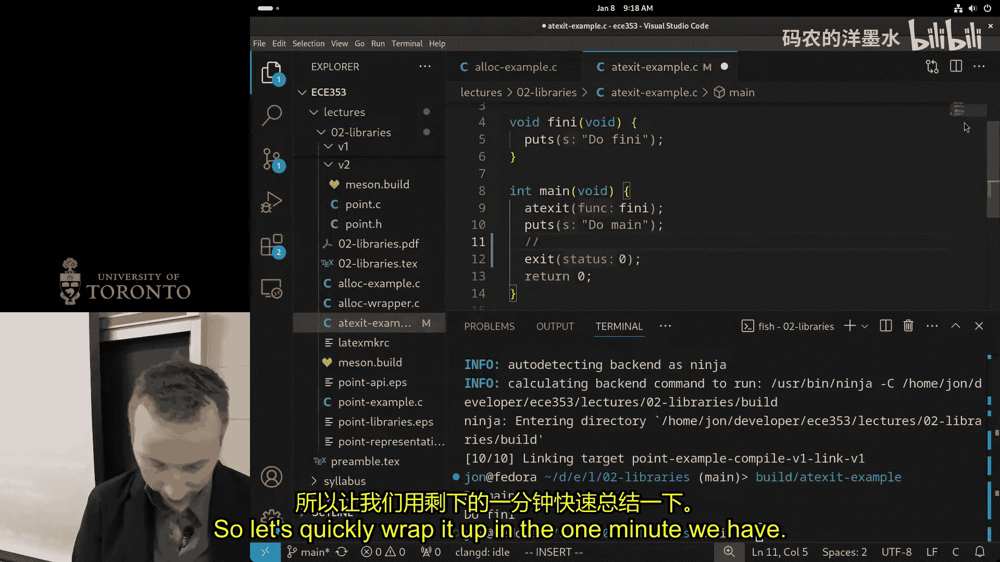

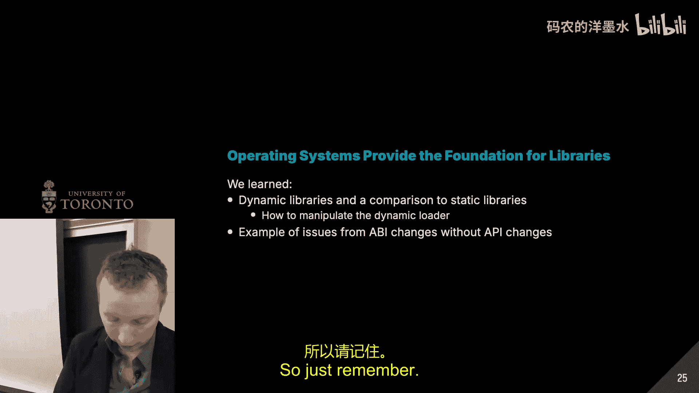

理解这些库的工作原理，对于构建稳定、高效且可维护的软件系统至关重要。