# 003：进程 🖥️

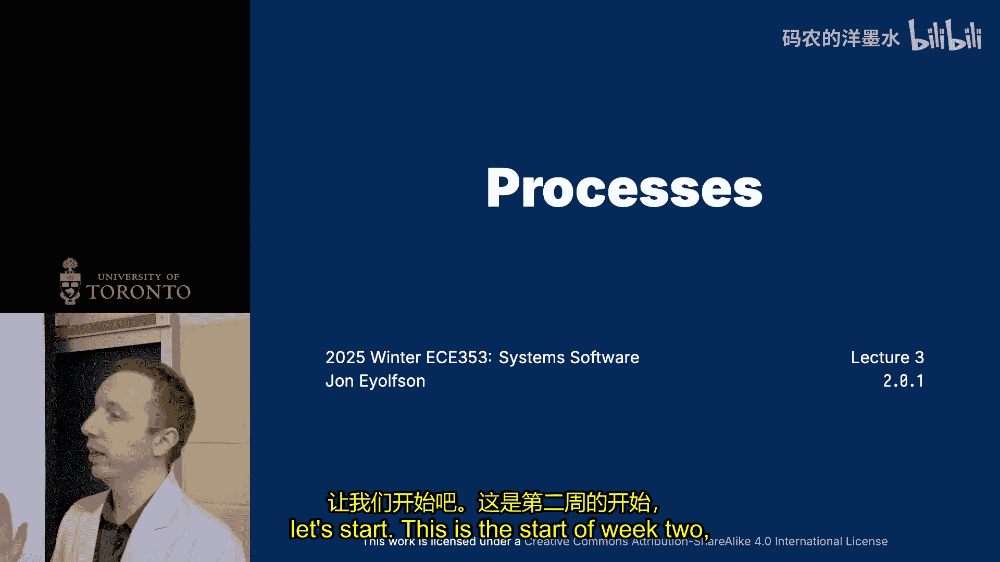

在本节课中，我们将要学习进程的核心概念，包括进程是什么、如何创建和管理进程，以及进程的生命周期状态。我们将通过简单的示例和清晰的解释，帮助初学者理解这些复杂的概念。

## 概述

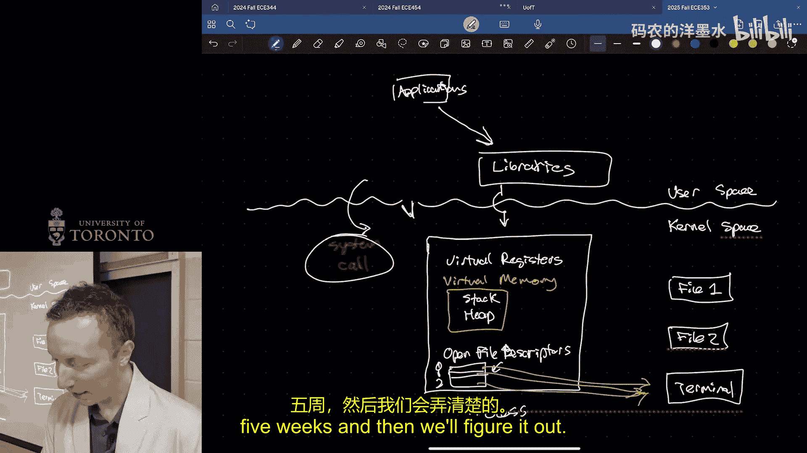

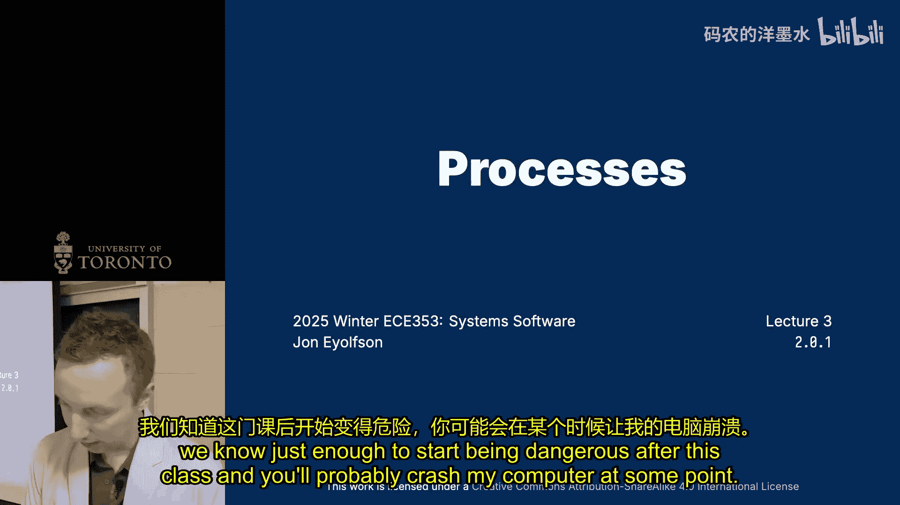

进程是运行中程序的一个实例。操作系统通过进程来管理和执行程序。每个进程都有自己独立的内存空间、寄存器和文件描述符。理解进程是理解操作系统如何工作的基础。

## 进程的构成

上一节我们介绍了进程的基本概念，本节中我们来看看一个进程具体包含哪些组成部分。

一个进程需要跟踪以下信息才能运行：

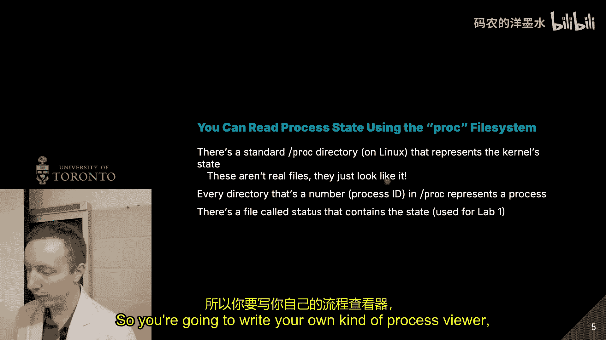

*   **栈 (Stack)**：用于存储函数调用和局部变量。
*   **堆 (Heap)**：用于动态内存分配。
*   **寄存器 (Registers)**：存储CPU的当前状态。
*   **虚拟内存 (Virtual Memory)**：进程拥有的独立地址空间，栈和堆都位于其中。
*   **打开的文件描述符 (Open File Descriptors)**：指向内核中资源的指针数组（如文件、终端）。文件描述符是这个数组的索引。

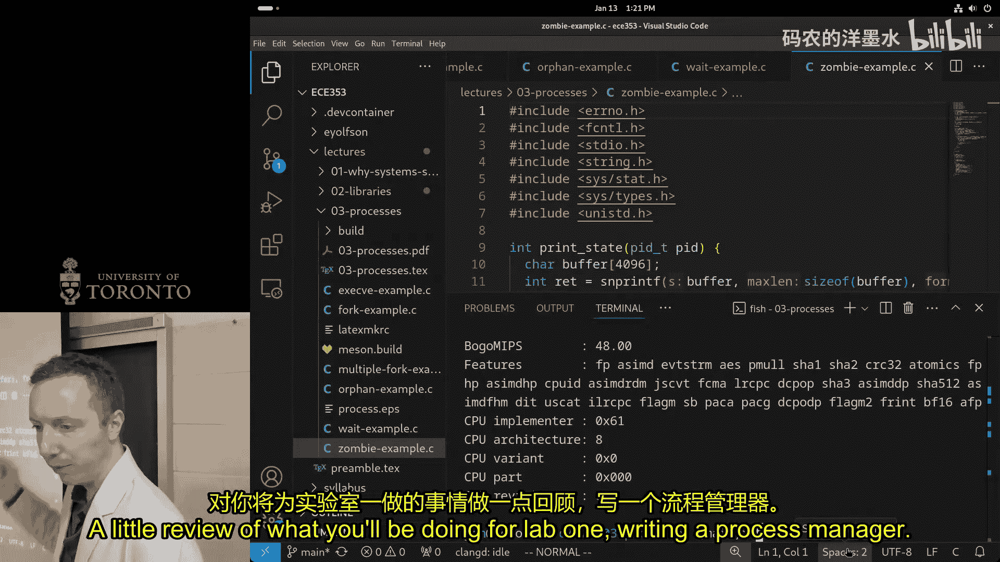

进程由内核管理，运行在**用户空间 (User Space)**。当应用程序需要内核提供服务（如读写文件）时，需要通过**系统调用 (System Call)** 跨越边界进入**内核空间 (Kernel Space)**。

应用程序通常通过标准C库等包装函数来使用系统调用，这些库可能添加额外功能或组合多个系统调用。

## 进程控制块与生命周期

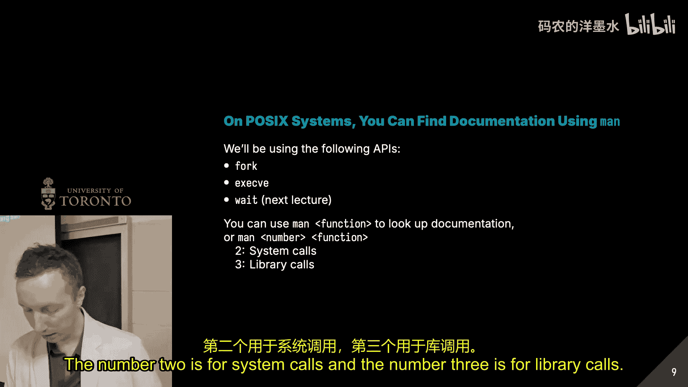

我们已经了解了进程的组成部分，现在来看看操作系统是如何在内部表示和管理一个进程的。

所有关于进程的信息都存储在一个称为**进程控制块 (Process Control Block, PCB)** 的数据结构中。在Linux中，它被称为 `task_struct`。PCB包含：
*   进程状态
*   CPU寄存器的保存副本
*   调度信息
*   内存管理信息
*   I/O状态信息
*   各种统计信息

每个进程都有一个唯一的**进程ID (Process ID, PID)**，用于在运行时标识该进程。

进程有其生命周期，可以用状态图表示：

1.  **创建 (Created)**：内核为新进程分配资源，准备执行。
2.  **就绪/等待 (Ready/Waiting)**：进程已准备好运行，等待内核调度。
3.  **运行 (Running)**：进程正在CPU上实际执行。
4.  **阻塞 (Blocked)**：进程因等待系统调用完成（如I/O操作）而暂停执行。
5.  **终止 (Terminated)**：进程执行完毕，通过 `exit` 系统调用结束。

进程可以在运行、就绪和阻塞状态之间转换，最终进入终止状态。

在Linux上，可以通过 `/proc` 文件系统查看进程状态。每个PID对应一个目录，其中的 `status` 文件包含了该进程的详细信息。

## 创建进程：`fork` 系统调用

了解了进程的生命周期后，本节我们来看看如何实际创建一个新的进程。

在Unix/Linux系统中，创建新进程的主要方式是使用 `fork()` 系统调用。与Windows一次性创建新进程不同，`fork` 的工作方式是**复制当前正在运行的进程**。

调用 `fork()` 后，会创建一个新的**子进程 (Child Process)**，它是调用者**父进程 (Parent Process)** 的**完全克隆**。两个进程拥有相同的变量、内存状态，从 `fork()` 调用之后的位置开始独立运行。

`fork()` 的API非常简单：
```c
pid_t fork(void);
```
它返回一个整数：
*   在**父进程**中，返回**子进程的PID**（一个大于0的数）。
*   在**子进程**中，返回 **0**。
*   如果创建失败，返回 **-1**。

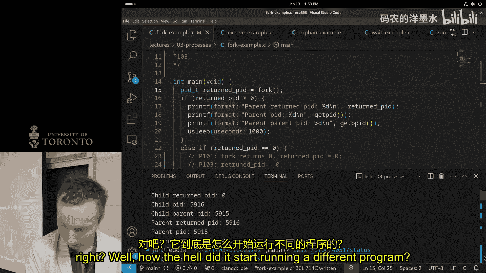

因此，程序通过检查 `fork()` 的返回值来区分当前是在父进程还是子进程中运行。

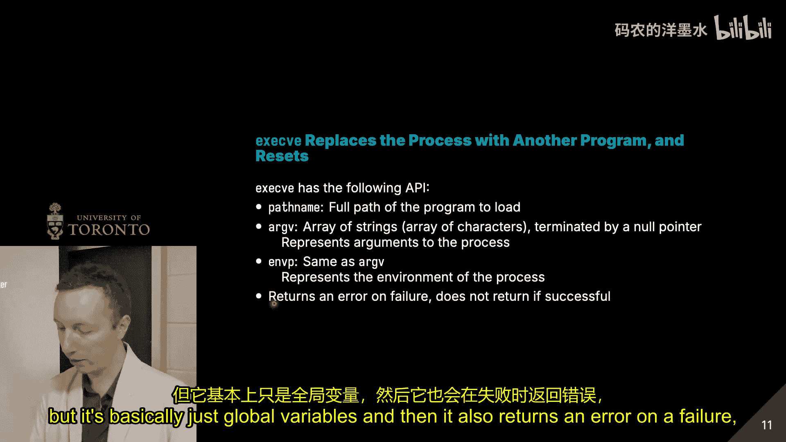

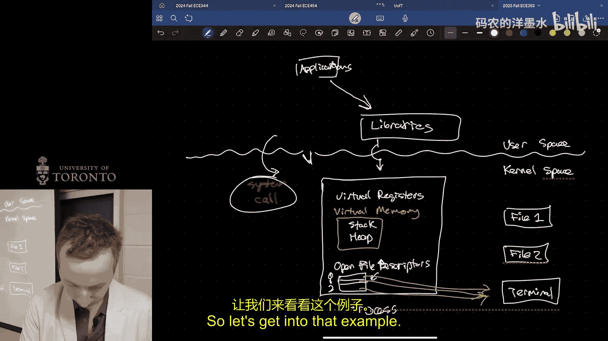

## `fork` 示例与特性

现在我们已经知道了 `fork` 的基本原理，让我们通过一个具体的例子来观察它的行为，并理解一些重要特性。

考虑以下简单程序：
```c
#include <stdio.h>
#include <unistd.h>
int main() {
    printf("Start (PID: %d)\n", getpid());
    pid_t pid = fork(); // 从这里开始“分裂”
    if (pid > 0) {
        // 父进程代码
        printf("Parent: My PID is %d, Child‘s PID is %d\n", getpid(), pid);
    } else if (pid == 0) {
        // 子进程代码
        printf("Child: My PID is %d, My Parent‘s PID is %d\n", getpid(), getppid());
    }
    printf("End (PID: %d)\n", getpid());
    return 0;
}
```
运行此程序，输出可能类似于：
```
Start (PID: 100)
Parent: My PID is 100, Child‘s PID is 101
End (PID: 100)
Child: My PID is 101, My Parent‘s PID is 100
End (PID: 101)
```
或者父进程和子进程的输出可能交错出现。

关于 `fork` 需要理解的关键点：
*   **两个进程返回**：一个进程调用 `fork`，两个进程从 `fork` 返回。
*   **独立与并发**：父进程和子进程是独立的，它们并发执行。**操作系统决定它们的运行顺序**，程序员无法预设。
*   **写时复制**：出于效率考虑，现代操作系统使用**写时复制 (Copy-On-Write)** 技术。子进程与父进程共享内存页，只有当任一进程试图修改某个内存页时，才会复制该页。

## 执行新程序：`exec` 系列系统调用

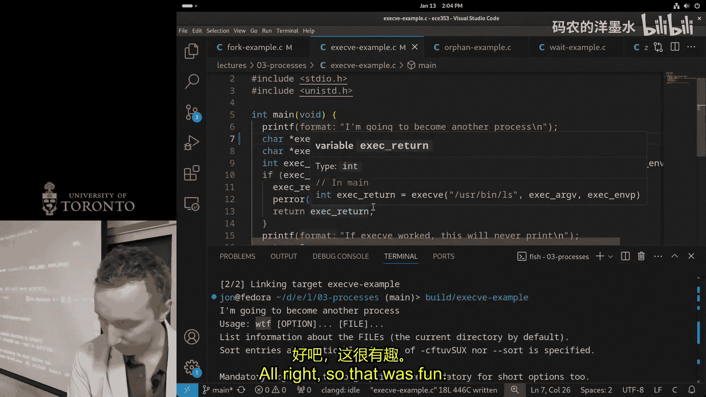

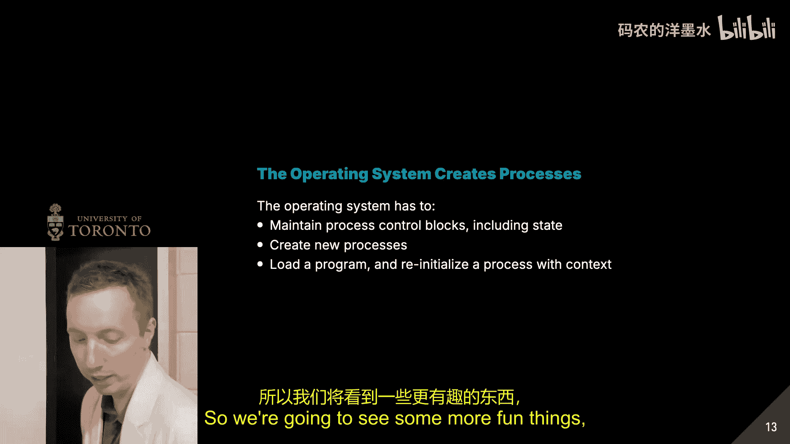

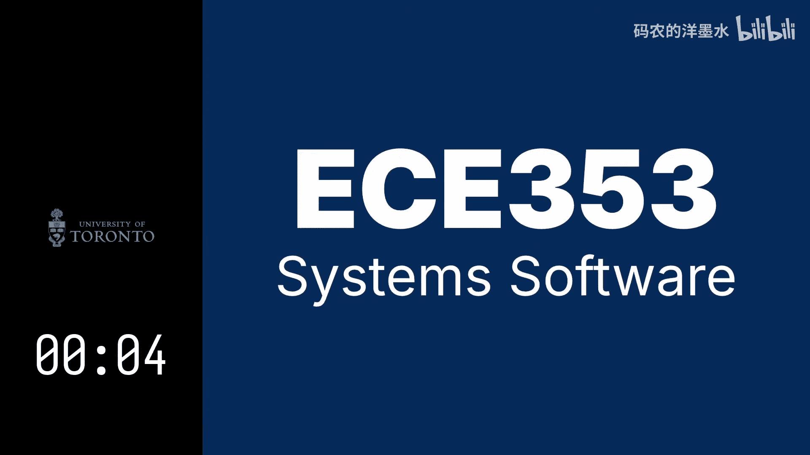

`fork` 创建的是当前程序的副本，但通常我们想运行一个全新的程序。这时就需要 `exec` 系列系统调用。

`exec` 函数会用指定的新程序**替换**当前进程的内存空间（代码、数据、堆栈），然后从新程序的 `main` 函数开始执行。**进程的PID保持不变**。

一个常用的 `exec` 函数是 `execve`：
```c
int execve(const char *pathname, char *const argv[], char *const envp[]);
```
*   `pathname`：要执行程序的全路径。
*   `argv`：传递给新程序的参数数组（类似于 `main` 函数的 `argv`）。按照惯例，`argv[0]` 通常是程序名。
*   `envp`：环境变量数组。
*   如果成功，**该函数不返回**（因为原程序已被替换）。如果失败，返回 -1。

一个简单的例子：
```c
#include <stdio.h>
#include <unistd.h>
int main() {
    printf("I‘m about to run ls...\n");
    char *args[] = {"ls", "-l", NULL}; // 参数列表，以NULL结束
    execve("/bin/ls", args, NULL);
    // 如果execve成功，下面的代码永远不会执行
    printf("This line will never print if execve succeeds.\n");
    return 0;
}
```

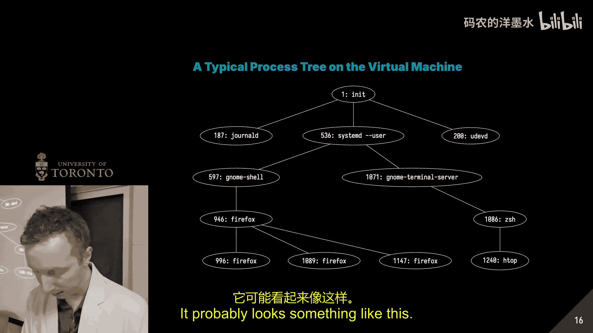

## 组合使用 `fork` 与 `exec`：Shell 的工作原理

单独使用 `fork` 或 `exec` 都有局限，将它们组合起来才是创建和运行新程序的完整模式。这也是Shell（命令行解释器）运行命令的基本原理。

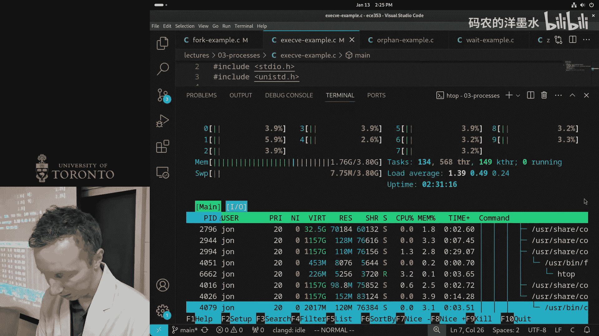

典型模式如下：
1.  **父进程**调用 `fork()` 创建**子进程**。
2.  **子进程**调用 `exec()` 系列函数，**将自己替换成**想要运行的新程序。
3.  **父进程**可以继续执行其他任务，或者调用 `wait()`（见下一节）等待子进程结束。

示例代码：
```c
#include <stdio.h>
#include <unistd.h>
#include <sys/wait.h>
int main() {
    pid_t pid = fork();
    if (pid == 0) {
        // 子进程：执行 ls
        char *args[] = {"ls", "-l", NULL};
        execve("/bin/ls", args, NULL);
        // 如果execve失败
        perror("execve failed");
        return 1;
    } else if (pid > 0) {
        // 父进程：等待子进程结束
        printf("Parent waiting for child (PID: %d) to finish...\n", pid);
        wait(NULL); // 等待任意子进程结束
        printf("Child finished.\n");
    } else {
        // fork失败
        perror("fork failed");
        return 1;
    }
    return 0;
}
```
这就是Shell的工作方式：你输入一个命令（如 `ls`），Shell进程 `fork` 出一个子进程，子进程 `exec` 成 `ls` 程序，Shell父进程则 `wait` 子进程结束，然后重新显示提示符。

## 进程同步：`wait` 系统调用

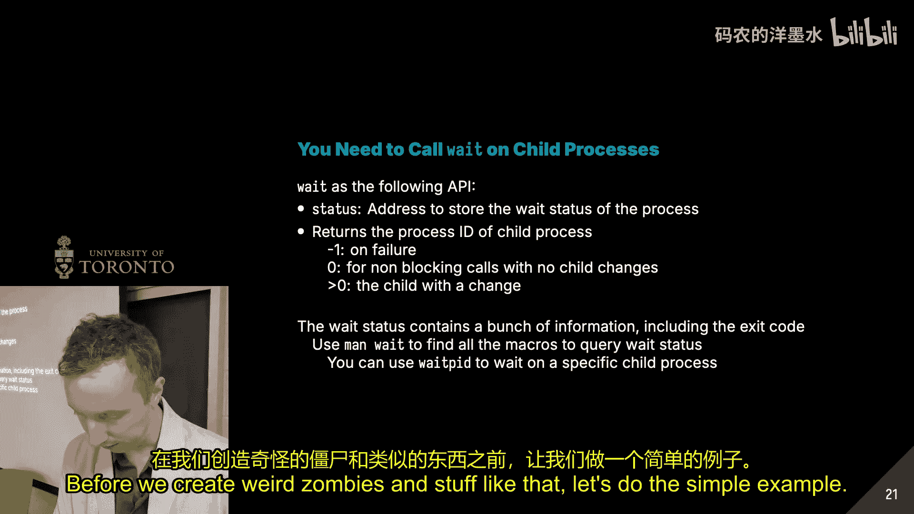

在并发环境中，父进程通常需要知道子进程何时结束以及它的退出状态。`wait()` 系统调用就是用于此目的。

`wait()` 使父进程**阻塞**，直到它的一个子进程终止。然后它回收该子进程的资源，并获取其退出状态。

基本用法：
```c
pid_t wait(int *wstatus);
```
*   `wstatus`：一个指向整数的指针，用于存储子进程的终止状态信息。
*   返回值：成功时返回**被终止子进程的PID**，失败时返回 -1。

可以使用宏来检查 `wstatus`：
*   `WIFEXITED(wstatus)`：如果子进程正常终止（通过 `return` 或 `exit`），则为真。
*   `WEXITSTATUS(wstatus)`：如果 `WIFEXITED` 为真，此宏提取子进程的退出码（`main` 函数的返回值或 `exit` 的参数）。

示例：
```c
#include <stdio.h>
#include <unistd.h>
#include <sys/wait.h>
int main() {
    pid_t pid = fork();
    if (pid == 0) {
        // 子进程
        sleep(2);
        printf("Child exiting with code 42\n");
        return 42; // 或 exit(42);
    } else if (pid > 0) {
        // 父进程
        int status;
        printf("Parent waiting for child...\n");
        pid_t child_pid = wait(&status); // 阻塞等待
        if (WIFEXITED(status)) {
            printf("Child (PID: %d) exited with status: %d\n", child_pid, WEXITSTATUS(status));
        }
    }
    return 0;
}
```
还有 `waitpid()` 函数，可以等待特定的子进程，并设置非阻塞选项。

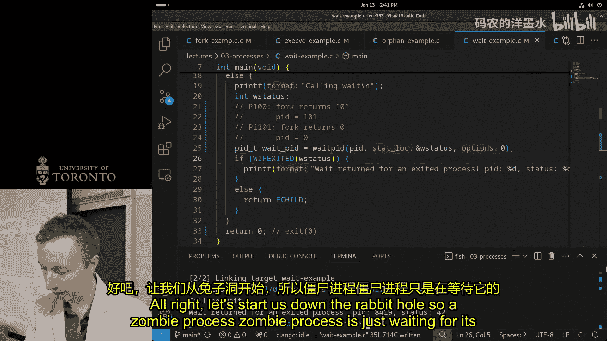

## 特殊进程状态：僵尸进程与孤儿进程

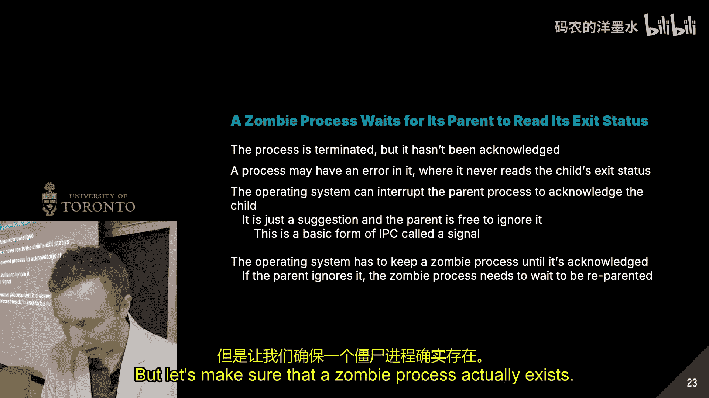

进程的生命周期并非总是完美的父等子。当进程间关系处理不当时，会产生两种特殊状态：僵尸进程和孤儿进程。

### 僵尸进程 (Zombie Process)
当一个子进程**已经终止**，但其父进程**尚未调用 `wait()` 读取其退出状态**时，该子进程就成为一个僵尸进程。它已经不再运行，消耗极少资源，但仍在进程表中占有一个条目（PID）。其目的是保留退出信息供父进程查询。

如果父进程一直不 `wait`，僵尸进程会一直存在。直到父进程也结束时，它会被“收养”（见下文）并最终被清理。

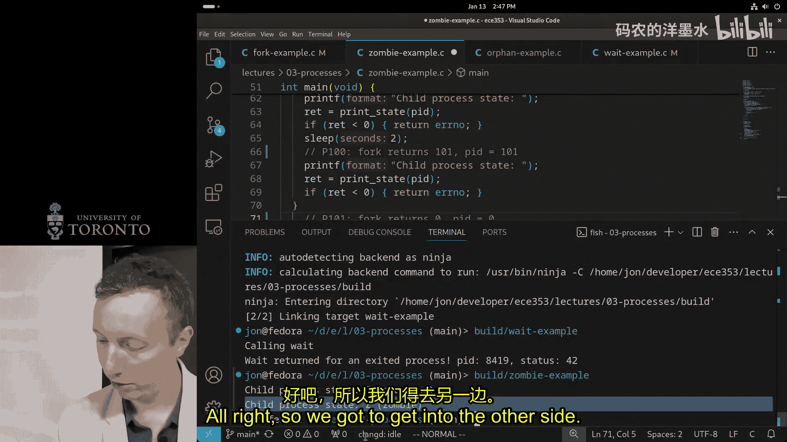

### 孤儿进程 (Orphan Process)
当一个**父进程先于其子进程终止**时，剩下的子进程就成为了孤儿进程。

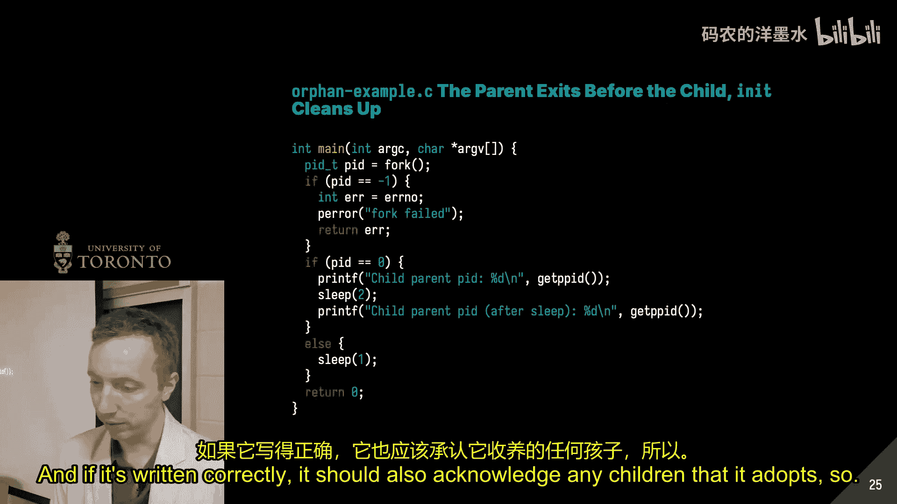

Unix/Linux 系统为了解决孤儿进程的问题，设定了一个规则：**孤儿进程会被进程ID为1的 `init` 进程（或 systemd 等现代替代品）“收养”**。`init` 进程会负责为这些孤儿进程调用 `wait()`，从而清理它们，防止它们变成永久的僵尸进程。

任何进程都可以通过设置使自己成为一个“子收割者 (subreaper)”，来收养其子孙进程变成的孤儿，而不是交给 `init`。

## 总结

本节课中我们一起学习了进程的核心知识：

1.  **进程是程序的运行实例**，拥有独立的内存、寄存器、文件描述符等资源，由内核通过进程控制块管理。
2.  使用 **`fork()`** 系统调用可以创建新进程，新进程是原进程的克隆。
3.  使用 **`exec()`** 系列系统调用可以让一个进程“变身”去执行一个全新的程序。
4.  **`fork` 和 `exec` 的组合**是Unix/Linux系统创建和运行新程序的标准模式，也是Shell的工作原理。
5.  父进程使用 **`wait()`** 系统调用来等待子进程结束，并获取其退出状态，这是负责任的进程管理方式。
6.  不正确的进程管理会导致**僵尸进程**（已终止但未被回收）和**孤儿进程**（父进程先终止），系统有相应的机制（`init` 收养）来处理这些问题。

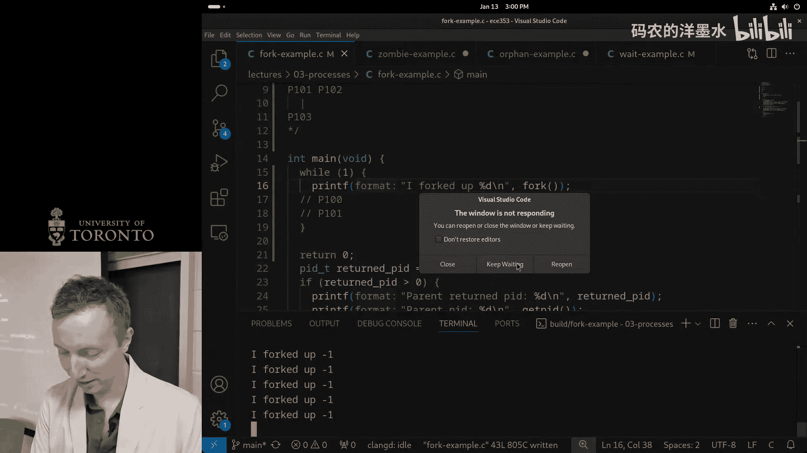

理解进程的创建、执行、同步和清理，是进行系统级编程和理解操作系统行为的基础。