# 004：基础进程间通信 🧩

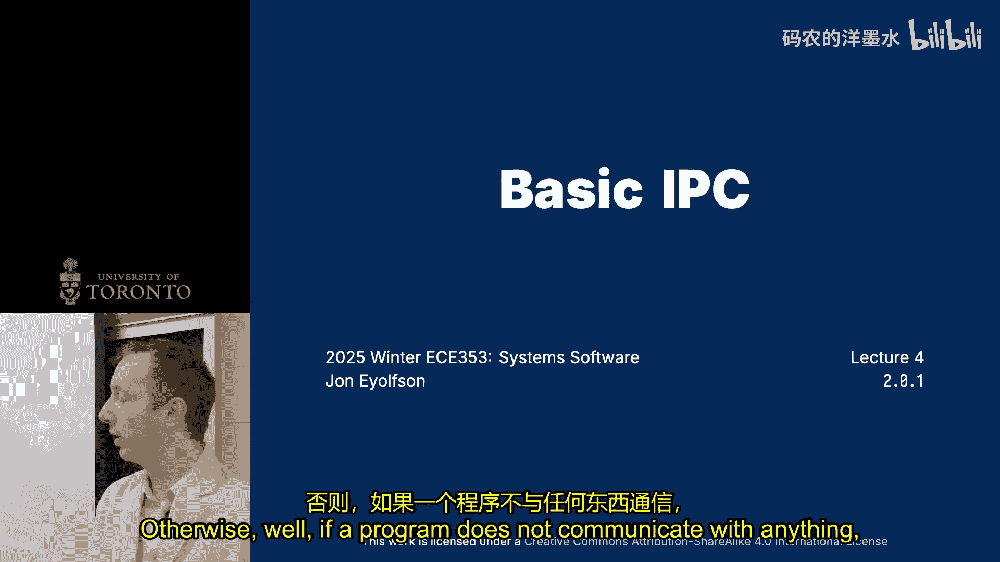

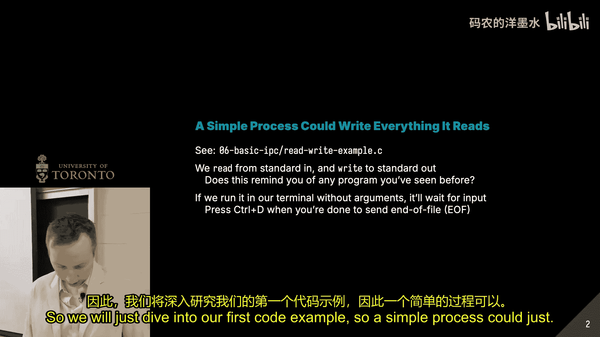

在本节课中，我们将要学习进程间通信的基础知识。进程是独立的，因此需要一种机制让它们能够相互通信，这就是进程间通信。我们将从最简单的文件读写开始，逐步深入到管道、信号等更复杂的通信方式。

## 进程间通信概述

进程间通信是在两个或多个进程之间传输字节的过程。从技术上讲，读写文件就是一种进程间通信的形式。进程不需要同时存活，一个进程可以写入文件后结束，另一个进程随后可以读取该文件。

读写系统调用允许传输任何字节序列，只要写入的是字节即可。

## 一个简单的程序：模仿 `cat` 命令

上一节我们介绍了IPC的基本概念，本节中我们来看看一个具体的例子。以下是一个简单的程序，它从标准输入读取数据，并写入标准输出。

```c
#include <assert.h>
#include <stdio.h>
#include <unistd.h>

int main(void) {
    char buffer[4096];
    ssize_t bytes_read;
    while ((bytes_read = read(STDIN_FILENO, buffer, sizeof(buffer))) > 0) {
        ssize_t bytes_written = write(STDOUT_FILENO, buffer, bytes_read);
        if (bytes_written == -1) {
            perror("write");
            return 1;
        }
        assert(bytes_written == bytes_read);
    }
    if (bytes_read == -1) {
        perror("read");
        return 1;
    }
    return 0;
}
```

这个程序的行为类似于 `cat` 命令。如果不带参数运行，它会从终端读取输入，并回显到终端。输入 `Ctrl+D` 可以发送文件结束符，使 `read` 返回0，程序正常退出。

## 使用命令行参数打开文件

我们可以修改上面的程序，使其能够通过命令行参数指定要读取的文件。

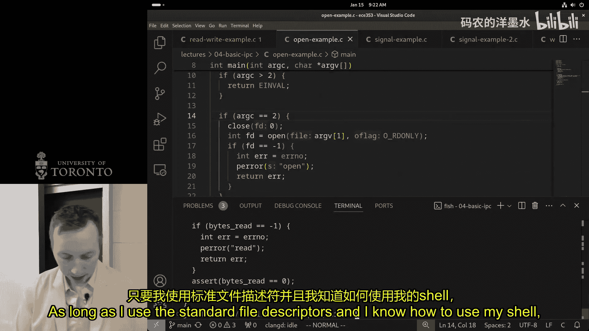

```c
#include <assert.h>
#include <fcntl.h>
#include <stdio.h>
#include <unistd.h>

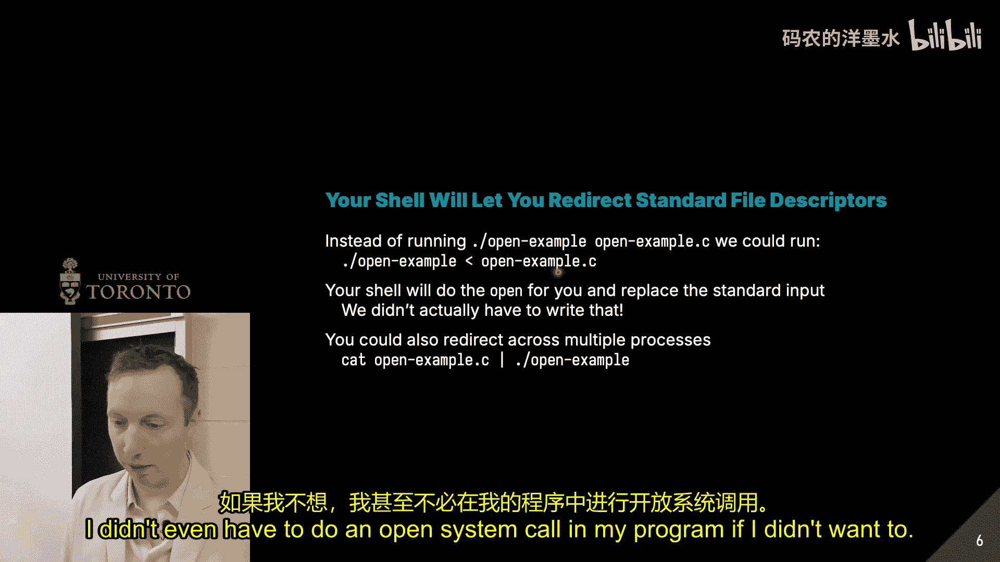

int main(int argc, char *argv[]) {
    if (argc != 2) {
        fprintf(stderr, "Usage: %s <filename>\n", argv[0]);
        return 1;
    }

    close(STDIN_FILENO);
    int fd = open(argv[1], O_RDONLY);
    if (fd == -1) {
        perror("open");
        return 1;
    }

    char buffer[4096];
    ssize_t bytes_read;
    while ((bytes_read = read(STDIN_FILENO, buffer, sizeof(buffer))) > 0) {
        ssize_t bytes_written = write(STDOUT_FILENO, buffer, bytes_read);
        if (bytes_written == -1) {
            perror("write");
            return 1;
        }
        assert(bytes_written == bytes_read);
    }
    if (bytes_read == -1) {
        perror("read");
        return 1;
    }
    return 0;
}
```

程序通过关闭标准输入文件描述符（0），然后打开指定文件。由于系统总是分配最小的可用文件描述符，新打开的文件会获得描述符0，从而成为新的标准输入。

## Shell 重定向

实际上，利用Shell的重定向功能，即使程序本身没有文件处理代码，也能处理文件。只要程序使用标准文件描述符，Shell就可以在进程启动前重定向它们。

例如，使用 `<` 可以将文件内容作为标准输入：
```bash
./read_write_example < open_example.c
```

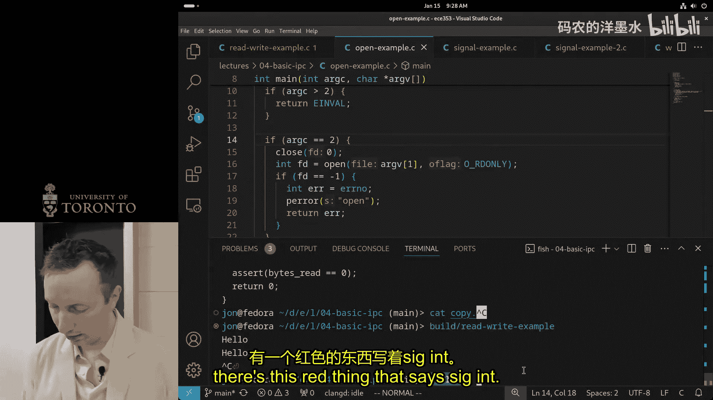

使用 `>` 可以将标准输出重定向到文件：
```bash
./read_write_example < open_example.c > copy.c
```

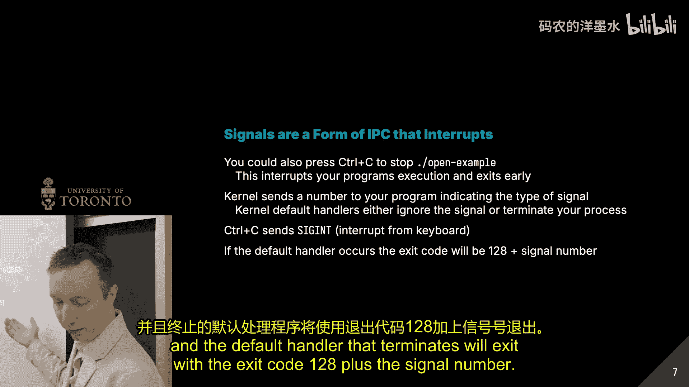

这相当于用 `cat` 命令复制了一个文件。

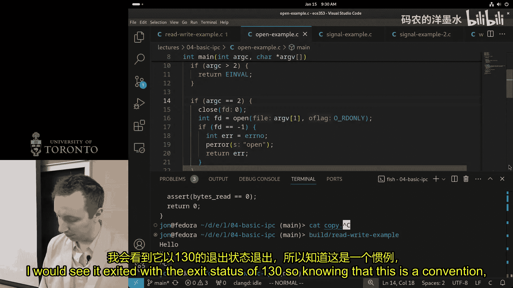

## 管道连接进程

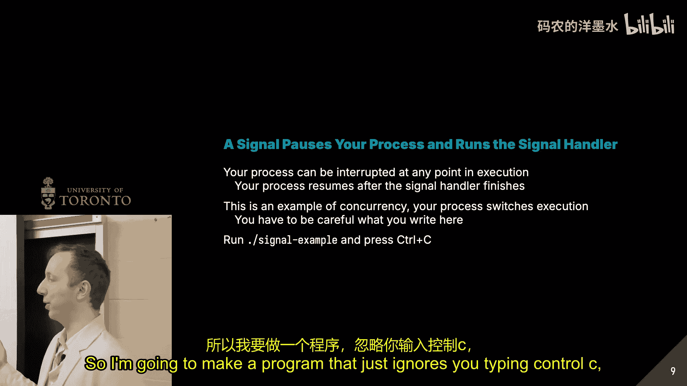

我们可以使用管道符 `|` 将一个进程的标准输出连接到另一个进程的标准输入。

```bash
./read_write_example < open_example.c | cat
```

这个命令会将第一个进程的输出（文件内容）作为第二个 `cat` 进程的输入，最终结果还是输出文件内容。可以连接多个进程，尽管效率不高。

## 信号处理

当我们在终端按下 `Ctrl+C` 时，会向当前前台进程发送一个 `SIGINT`（信号2）信号。默认情况下，这个信号的处理方式是终止进程。

进程可以自定义信号处理函数来改变对信号的反应。以下是相关的信号编号（在Linux x86-64上）：
*   **2**: `SIGINT`（键盘中断）
*   **9**: `SIGKILL`（强制终止，无法被捕获或忽略）
*   **11**: `SIGSEGV`（段错误，非法内存访问）
*   **15**: `SIGTERM`（请求终止，可以被处理）

以下是一个忽略 `SIGINT` 和 `SIGTERM` 信号的程序示例：

```c
#include <signal.h>
#include <stdio.h>
#include <unistd.h>

void handle_signal(int sig) {
    printf("Ignoring signal %d\n", sig);
}

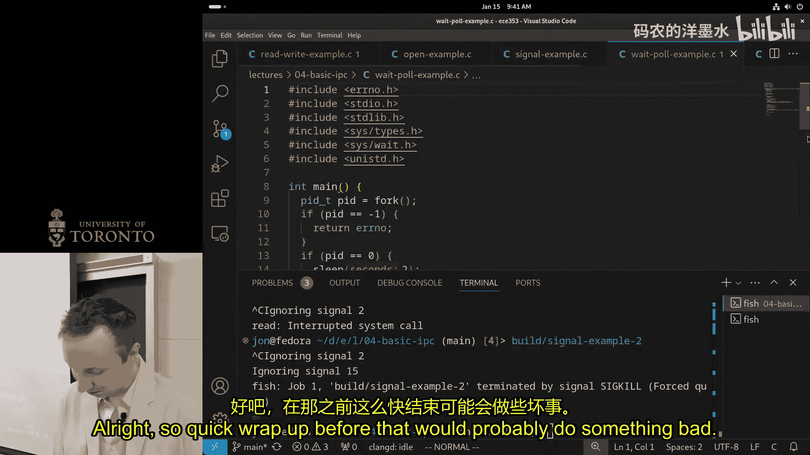

int main(void) {
    struct sigaction sa = {.sa_handler = handle_signal};
    sigaction(SIGINT, &sa, NULL);
    sigaction(SIGTERM, &sa, NULL);

    char buf[4096];
    ssize_t bytes_read;
    while ((bytes_read = read(STDIN_FILENO, buf, sizeof(buf))) > 0) {
        write(STDOUT_FILENO, buf, bytes_read);
    }
    return 0;
}
```

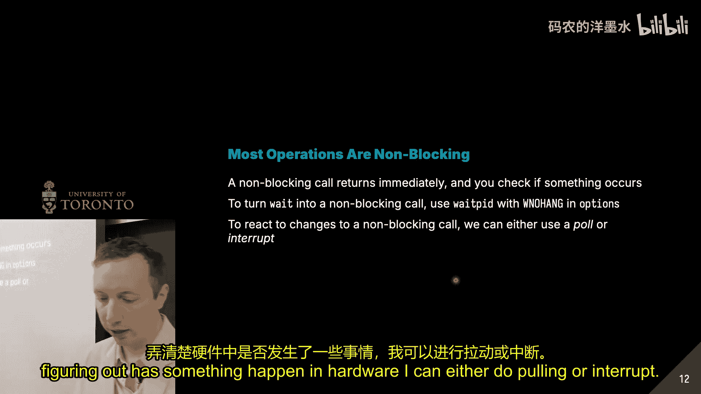

运行此程序后，`Ctrl+C` 将不再退出程序，而是打印提示信息。要终止它，可以在另一个终端使用 `kill` 命令。

`kill` 命令默认发送 `SIGTERM`（15）信号：
```bash
kill <PID>
```

要强制终止进程，需要发送 `SIGKILL`（9）信号，该信号无法被进程捕获或忽略：
```bash
kill -9 <PID>
```

## 非阻塞等待与信号

大多数系统调用是阻塞的，但也可以使用非阻塞版本。例如，`waitpid` 可以使用 `WNOHANG` 选项变为非阻塞，它立即返回，如果子进程尚未结束则返回0。

轮询（不断检查）的方式效率较低。更好的方式是使用中断机制：当子进程终止时，内核会向父进程发送 `SIGCHLD` 信号。父进程可以注册一个处理函数来立即清理子进程，避免产生僵尸进程。

```c
#include <signal.h>
#include <stdio.h>
#include <unistd.h>
#include <sys/wait.h>

void handle_sigchld(int sig) {
    (void)sig;
    pid_t pid;
    int status;
    while ((pid = waitpid(-1, &status, WNOHANG)) > 0) {
        printf("Child %d exited with status %d\n", pid, WEXITSTATUS(status));
    }
}

int main(void) {
    signal(SIGCHLD, handle_sigchld);

    pid_t pid = fork();
    if (pid == 0) {
        sleep(2);
        return 42;
    }

    printf("Parent sleeping...\n");
    sleep(9999);
    return 0;
}
```

在这个例子中，父进程可以长时间睡眠或做其他工作。当子进程在2秒后退出时，`SIGCHLD` 信号会中断父进程，触发处理函数来清理子进程。

## 信号处理的复杂性

信号处理函数需要是**可重入**的，因为一个信号处理函数可能在执行时被另一个信号中断，从而再次被调用。在信号处理函数中访问全局变量或调用非异步信号安全的函数（如 `printf`）可能导致不可预知的行为。

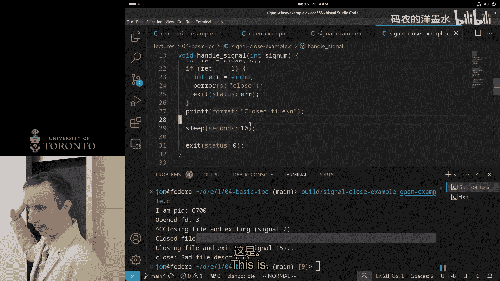

例如，在一个信号处理函数中关闭文件描述符时，如果另一个相同的信号到达，处理函数再次被调用，可能会尝试关闭一个已经关闭的描述符，导致错误。

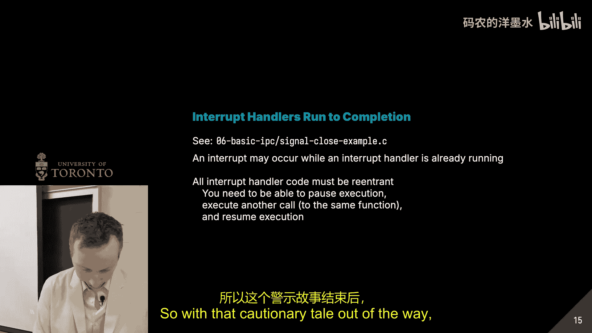

## 总结

本节课中我们一起学习了基础进程间通信的几种方式：
1.  **文件描述符与简单读写**：通过读写标准输入输出来实现进程间通信，模仿了 `cat` 命令。
2.  **Shell重定向与管道**：利用Shell特性连接进程的输入输出，无需修改程序代码。
3.  **信号**：理解了如何发送、捕获和处理信号，包括 `SIGINT`、`SIGTERM`、`SIGKILL` 和 `SIGCHLD`。
4.  **进程等待**：比较了阻塞等待、非阻塞轮询和基于信号的异步等待子进程终止的方法。
5.  **注意事项**：认识到编写信号处理代码的复杂性，特别是可重入性的要求。

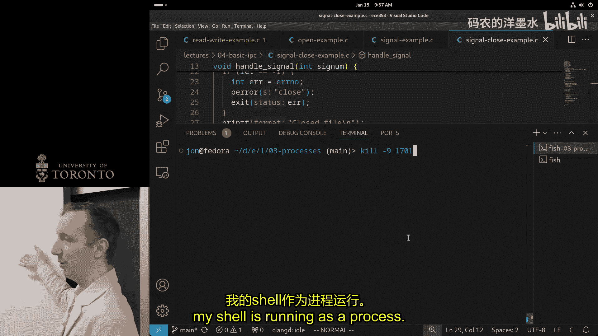


这些是构建更复杂并发和通信系统的基础组件。