# 005：进程实践 🚀

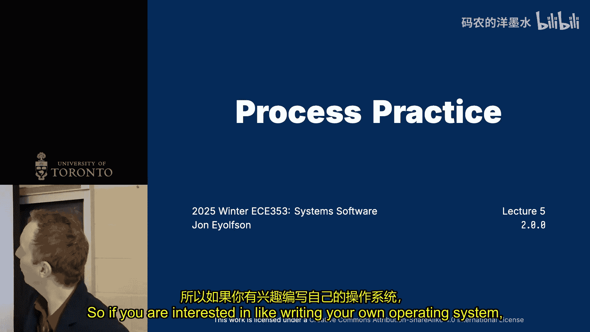

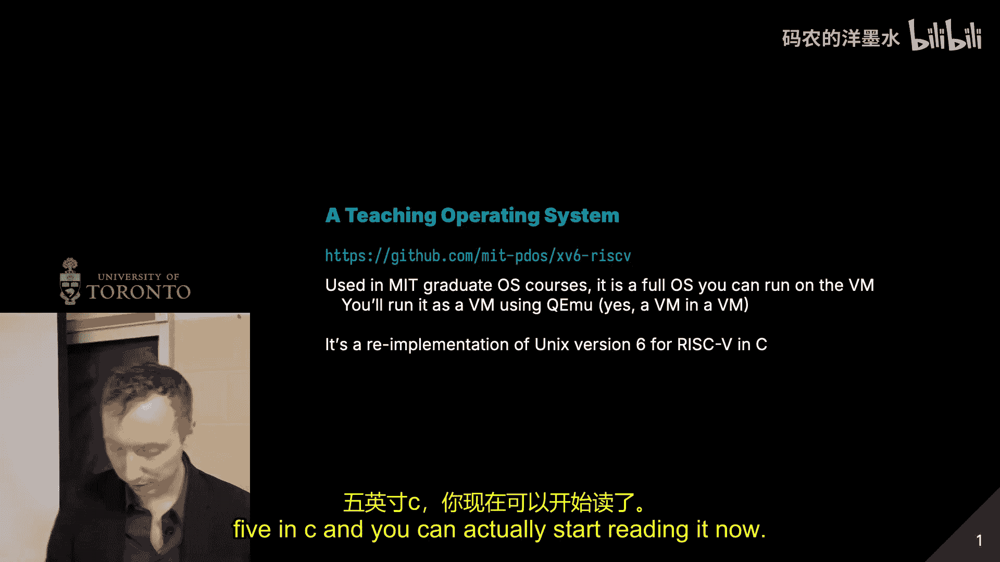

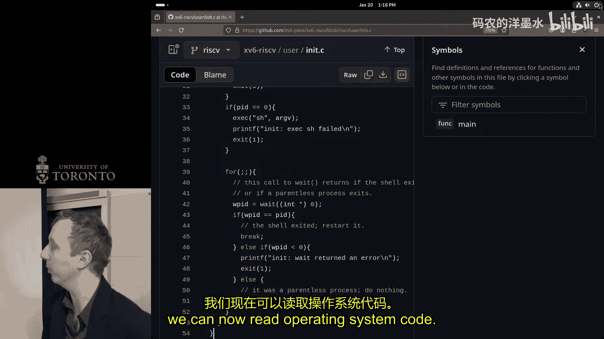

在本节课中，我们将深入学习进程管理的实践操作，包括进程间通信（IPC）的核心机制——管道（pipe）。我们将通过阅读简单的操作系统内核代码来理解进程的创建与孤儿进程管理，并通过编程示例掌握管道的创建、使用以及与`fork`、`exec`、`dup2`等系统调用的配合。

## 操作系统内核中的进程管理 🔍

上一节我们介绍了进程的基本概念和状态。本节中，我们来看看一个真实但简化的操作系统内核（如XV6）是如何管理进程的。

内核的第一个进程（init进程）负责两个核心任务：启动用户交互程序（如shell）和作为“孤儿院”收养并清理已终止但未被父进程回收的进程（僵尸进程）。

以下是XV6内核中init进程的简化逻辑：
```c
int main(void) {
    int pid;
    // 打开控制台（终端），设置标准输入、输出、错误
    if(open("console", O_RDWR) < 0) {
        // 处理错误...
    }
    dup(0); // 复制文件描述符0到1（标准输出）
    dup(0); // 复制文件描述符0到2（标准错误）

    for(;;) {
        printf("init: starting sh\n");
        pid = fork();
        if(pid < 0) {
            printf("init: fork failed\n");
            exit(1);
        }
        if(pid == 0) {
            // 子进程：执行shell程序
            exec("sh", argv);
            printf("init: exec sh failed\n");
            exit(1);
        }
        // 父进程（init）：无限循环等待子进程结束
        while((pid = wait(NULL)) >= 0) {
            if(pid == /* shell的PID */) {
                // 如果结束的是shell，则跳出循环重新启动一个
                printf("init: shell exited, restarting\n");
                break;
            }
            // 否则，只是清理了一个孤儿进程，继续等待
        }
    }
}
```
这段代码清晰地展示了init进程的双重职责：启动初始shell并持续调用`wait`来回收终止的子进程。

## 从单道到多道程序设计 🔄

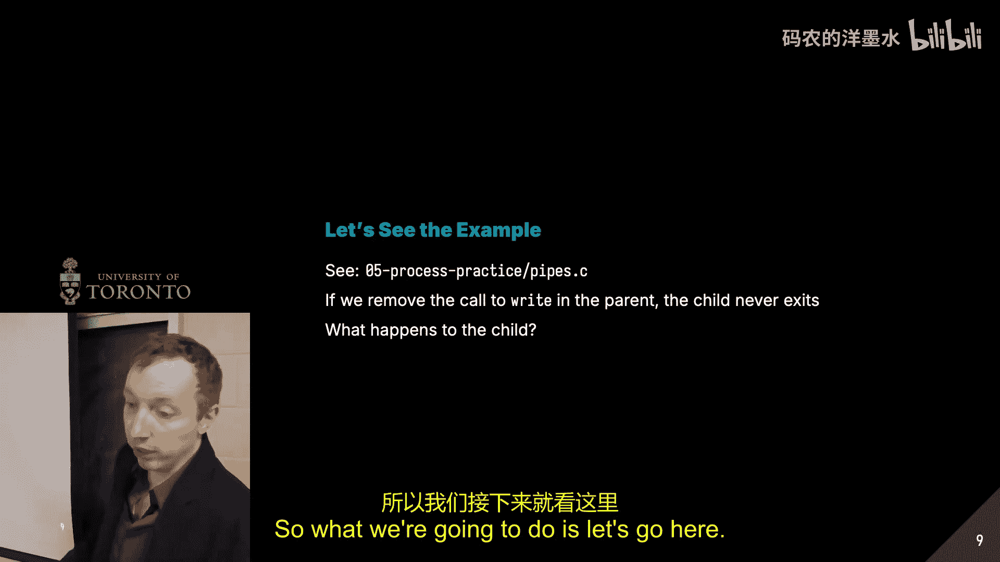

早期的操作系统（如DOS）采用**单道程序设计**，即同一时间只能运行一个进程，这极大地限制了系统资源的利用率。

现代操作系统都采用**多道程序设计**，可以同时管理成百上千个进程。这些进程可以**并行**（在多核CPU上真正同时运行）或**并发**（通过快速切换，在单核上模拟同时运行）地执行。

操作系统内核中负责在多个就绪进程之间决定切换时机的组件称为**调度器**。

## 进程切换与上下文切换 ⚙️

调度器的核心是一个无限循环，它控制着CPU在进程间的切换。这个过程称为**上下文切换**，其核心步骤如下：
1.  **暂停当前运行进程**：停止正在CPU上执行的进程。
2.  **保存进程状态**：将该进程的当前状态（主要是所有CPU寄存器的值）保存到内核内存中。
3.  **选择下一个进程**：调度器根据算法决定接下来运行哪个就绪进程。
4.  **恢复进程状态**：将选中进程之前保存的状态（寄存器值）加载回CPU。
5.  **恢复运行**：CPU开始执行该进程的代码。

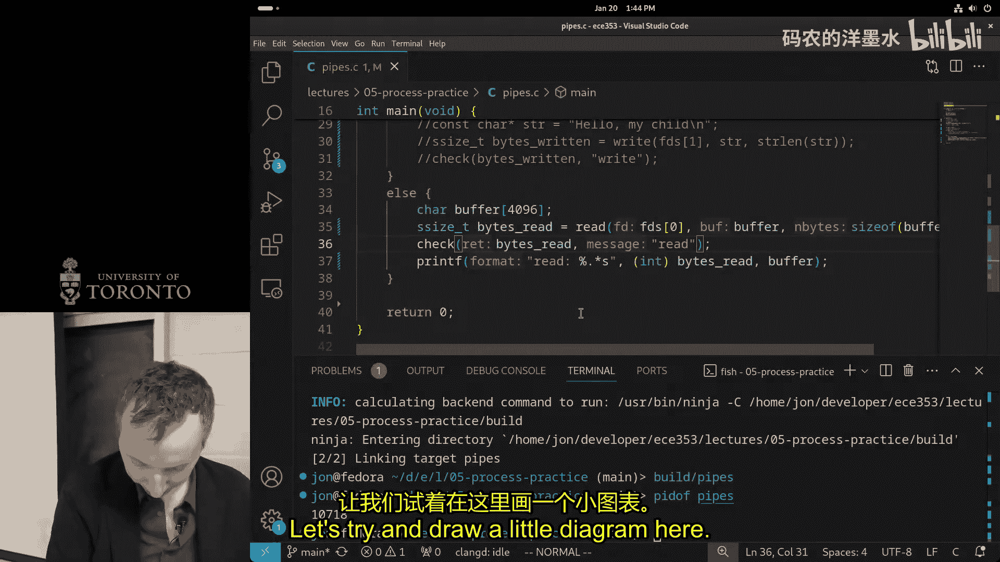

上下文切换是必要的**系统开销**。高效的操作系统会通过软硬件结合的方式（例如，仅保存程序实际用到的寄存器）将此开销控制在总运行时间的1%以下，使其几乎可以忽略不计。

## 进程间通信：管道（Pipe） 📞

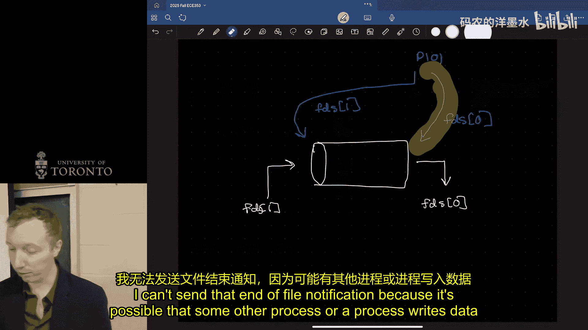

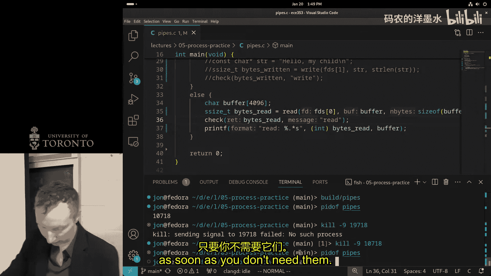

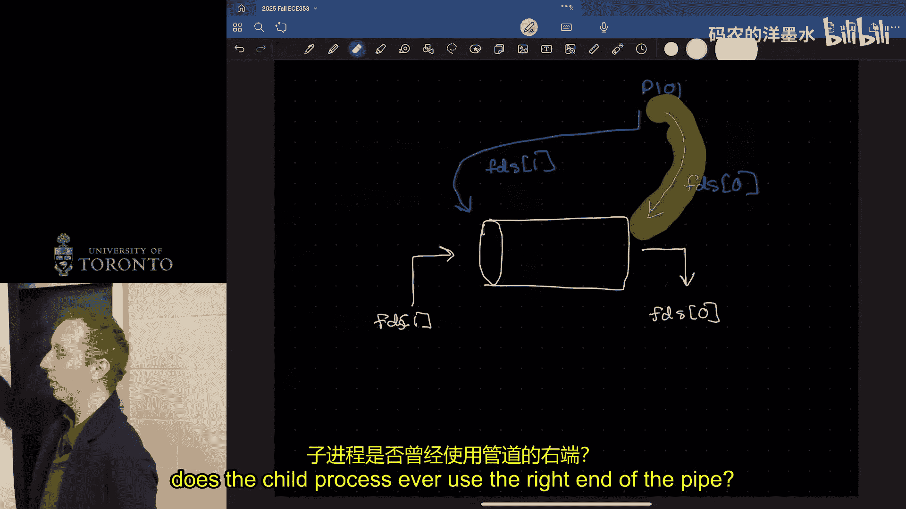

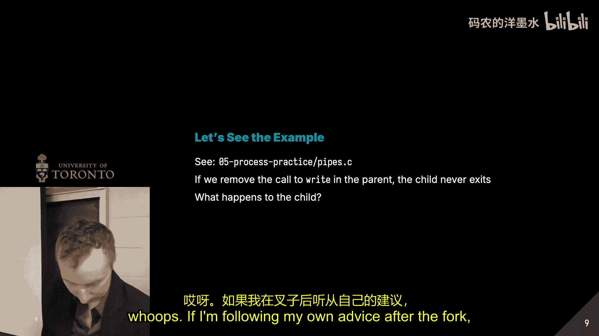

在Shell中，我们使用竖线 `|` 来连接两个命令，将一个命令的输出作为另一个命令的输入。这个功能在程序内部是通过**管道**系统调用实现的。

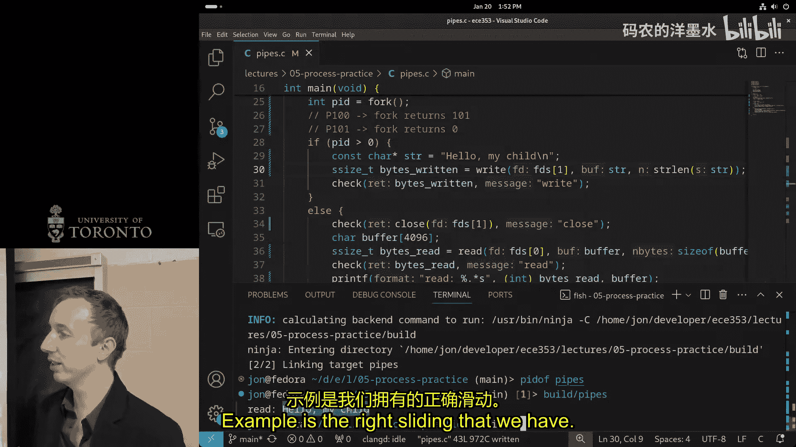

`pipe`系统调用创建一个**单向的通信通道**。你可以将它想象成一个由内核管理的先进先出（FIFO）字节缓冲区。

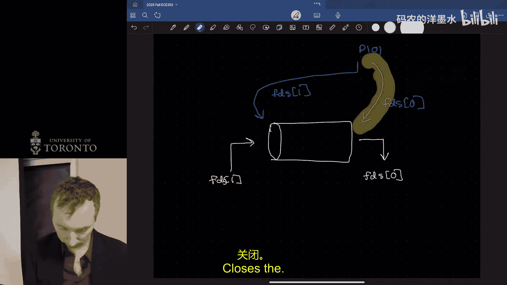

以下是`pipe`系统调用的基本用法：
```c
#include <unistd.h>
int pipe(int pipefd[2]);
```
*   `pipefd`：一个包含两个整数的数组。
*   **返回值**：成功返回0，失败返回-1并设置`errno`。

调用成功后，`pipefd`数组会被赋值两个新的文件描述符：
*   `pipefd[0]`：管道的**读端**。只能从这个文件描述符读取数据。
*   `pipefd[1]`：管道的**写端**。只能向这个文件描述符写入数据。

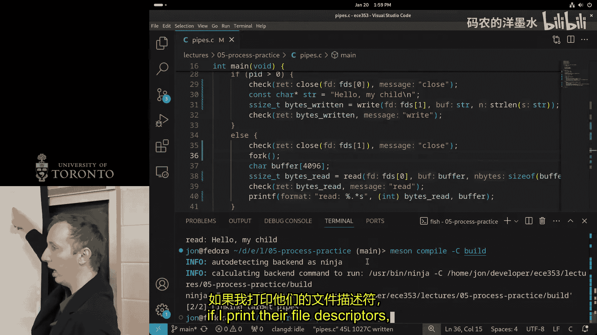

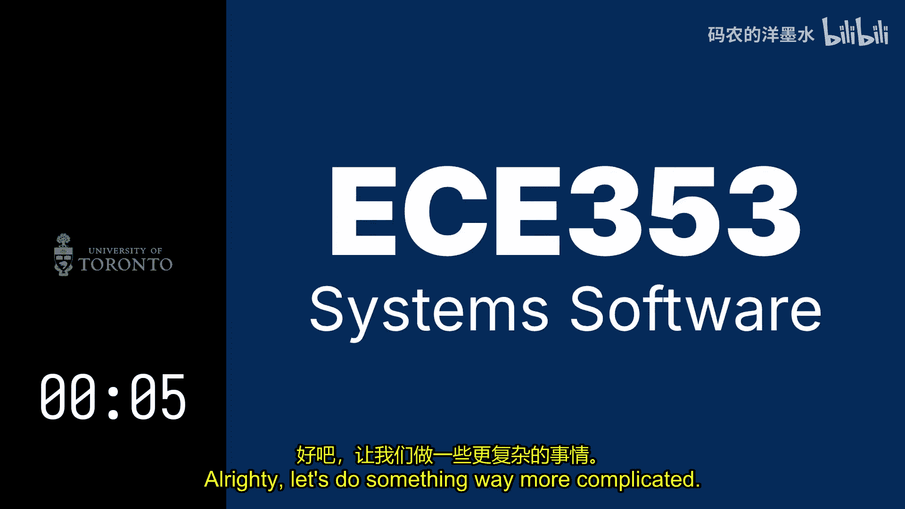

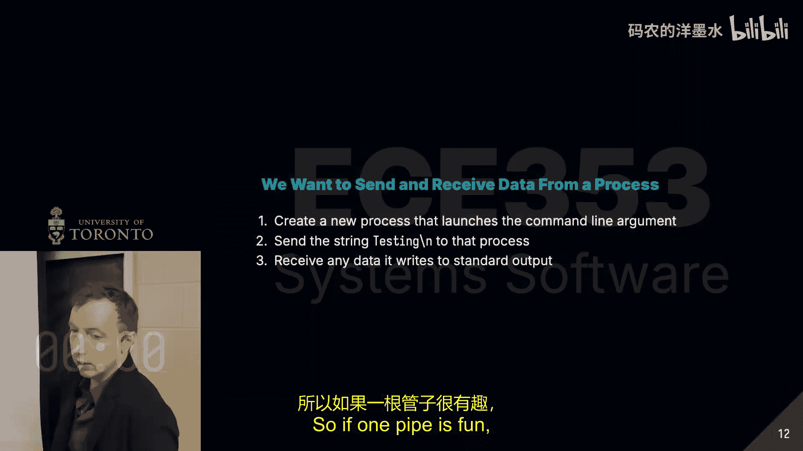

通过`fork`创建子进程后，父子进程将共享这些打开的文件描述符，从而可以通过管道进行通信。

## 管道编程实践 💻

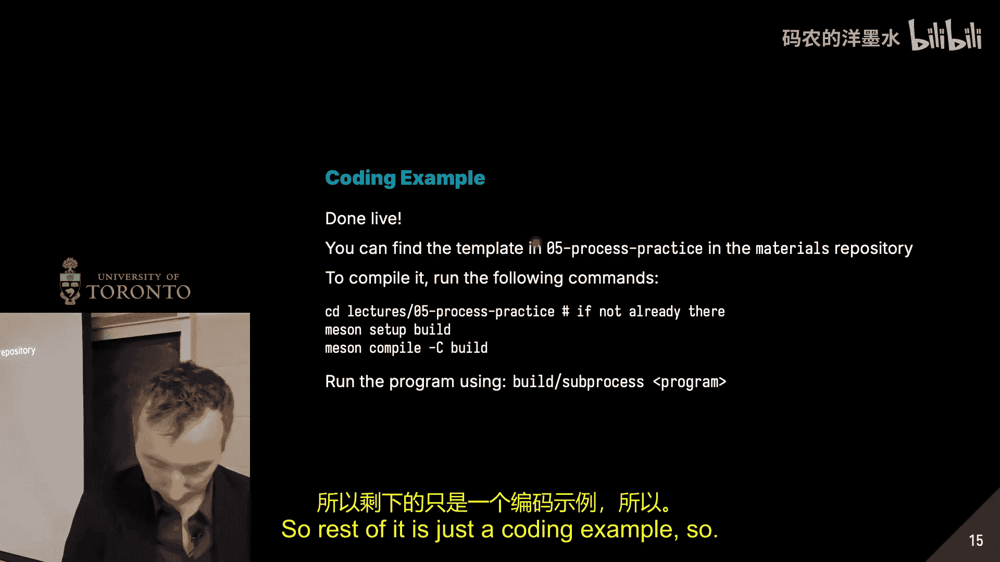

下面我们通过一个例子来演示如何使用管道在父子进程间传递消息。

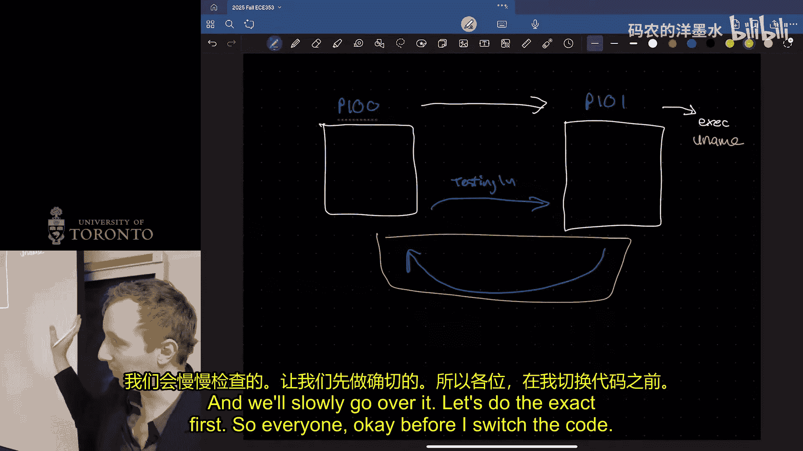

以下是创建管道、写入和读取数据的基本步骤：
1.  在`fork`之前调用`pipe`创建管道。
2.  在父进程中，向`pipefd[1]`写入数据。
3.  在子进程中，从`pipefd[0]`读取数据。

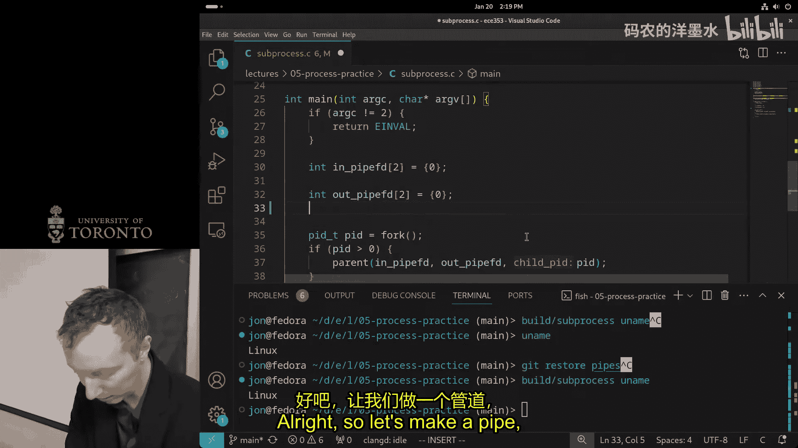

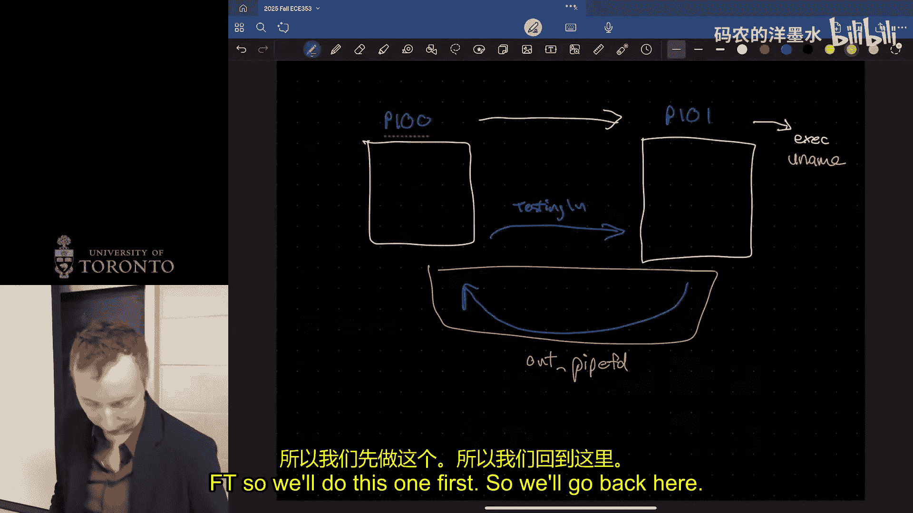

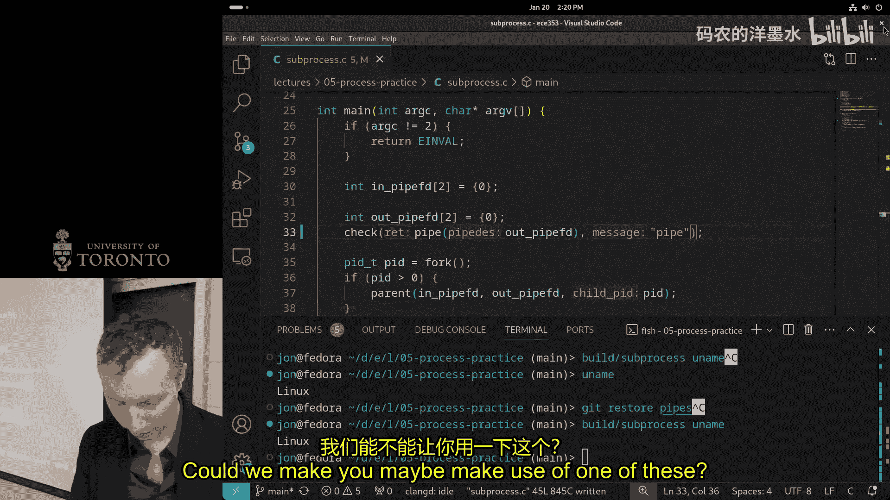

```c
#include <stdio.h>
#include <unistd.h>
#include <string.h>
#include <stdlib.h>

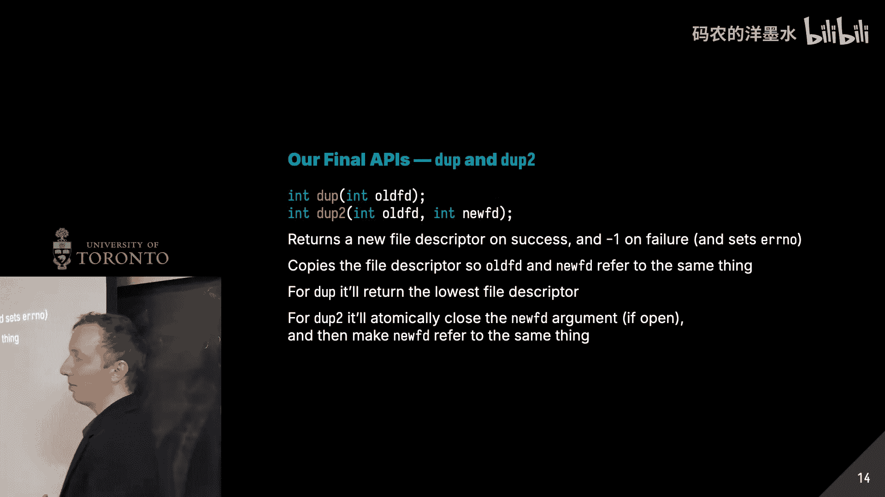

void check(int ret, const char* msg) {
    if(ret < 0) { perror(msg); exit(EXIT_FAILURE); }
}

int main() {
    int fds[2];
    char buffer[128];

    // 1. 创建管道
    check(pipe(fds), "pipe failed");

    pid_t pid = fork();
    check(pid, "fork failed");

    if (pid > 0) { // 父进程
        close(fds[0]); // 父进程不读，关闭读端
        const char* msg = "Hello from parent\n";
        ssize_t written = write(fds[1], msg, strlen(msg));
        check(written, "write failed");
        close(fds[1]); // 写入完毕，关闭写端
        wait(NULL); // 等待子进程结束
    } else { // 子进程
        close(fds[1]); // 子进程不写，关闭写端
        ssize_t bytes_read = read(fds[0], buffer, sizeof(buffer)-1);
        check(bytes_read, "read failed");
        buffer[bytes_read] = '\0'; // 确保字符串终止
        printf("Child received: %s", buffer);
        close(fds[0]); // 读取完毕，关闭读端
        exit(EXIT_SUCCESS);
    }
    return 0;
}
```
**关键点与常见陷阱**：
*   **文件描述符管理**：进程应**立即关闭**它不需要的管道端。例如，父进程只写不读，就应关闭读端（`fds[0]`）。这不仅是良好的资源管理习惯，更是避免程序阻塞的关键（例如，读端未全部关闭会导致`read`无法返回0）。
*   **阻塞行为**：`read`系统调用在管道为空时会**阻塞**，直到有数据可读或所有写端都被关闭（此时`read`返回0，表示EOF）。
*   **数据一致性**：内核保证写入管道的数据是顺序的，且每个字节只会被读取一次。即使多个进程同时读取同一管道，数据也不会重复。

## 综合示例：与子进程进行双向通信 🔄

我们常常需要与创建的子进程进行**双向通信**：既向子进程发送数据（模拟其标准输入），又从子进程接收数据（捕获其标准输出）。这需要用到**两个管道**以及`dup2`系统调用。

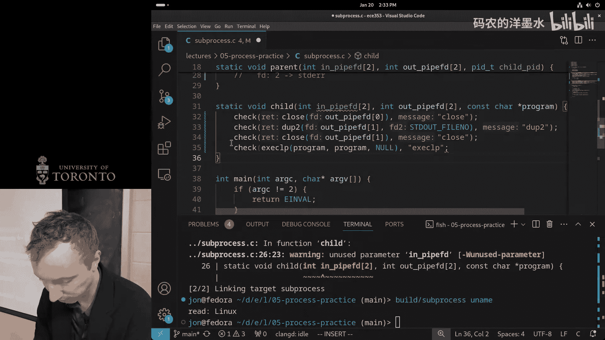

`dup2`系统调用的作用是复制一个文件描述符：
```c
int dup2(int oldfd, int newfd);
```
它使`newfd`成为`oldfd`的副本（指向同一个资源）。如果`newfd`原本已经打开，则会先将其关闭。我们可以利用它将子进程的标准输入（文件描述符0）和标准输出（文件描述符1）**重定向**到我们创建的管道。

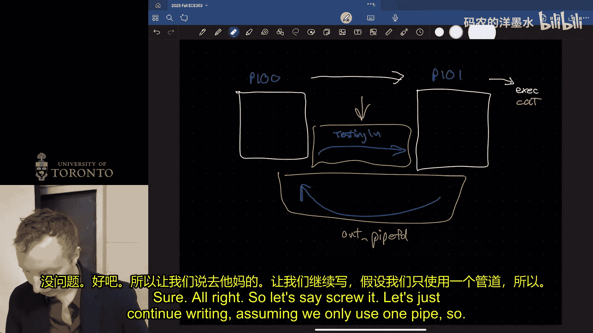

以下是实现双向通信子进程的框架：
```c
#include <stdio.h>
#include <stdlib.h>
#include <unistd.h>
#include <sys/wait.h>
#include <assert.h>
#include <string.h>

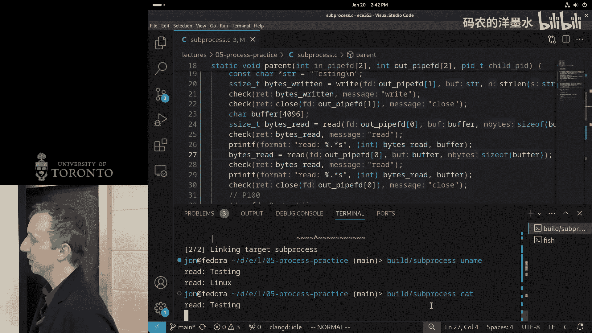

void check(int ret, const char* msg) { if(ret < 0) { perror(msg); exit(EXIT_FAILURE); } }

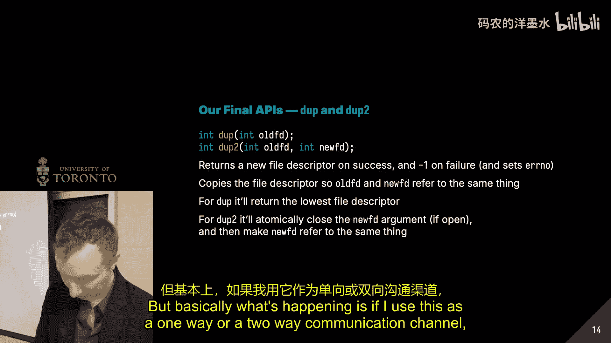

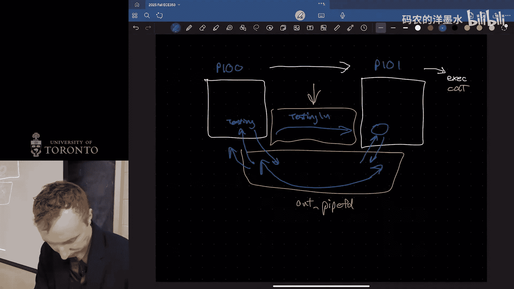

void child_proc(int in_pipe[2], int out_pipe[2], const char* program) {
    // 关闭父进程使用的管道端
    close(in_pipe[1]);  // 子进程不从in_pipe写
    close(out_pipe[0]); // 子进程不从out_pipe读

    // 重定向标准输入到in_pipe的读端
    check(dup2(in_pipe[0], STDIN_FILENO), "dup2 stdin failed");
    close(in_pipe[0]); // 重定向后，关闭原文件描述符

    // 重定向标准输出到out_pipe的写端
    check(dup2(out_pipe[1], STDOUT_FILENO), "dup2 stdout failed");
    close(out_pipe[1]); // 重定向后，关闭原文件描述符

    // 执行目标程序（例如 "cat"）
    execlp(program, program, (char *)NULL);
    // 如果exec成功，不会执行到这里
    perror("execlp failed");
    exit(EXIT_FAILURE);
}

void parent_proc(pid_t child_pid, int in_pipe[2], int out_pipe[2]) {
    // 关闭子进程使用的管道端
    close(in_pipe[0]);  // 父进程不从in_pipe读
    close(out_pipe[1]); // 父进程不向out_pipe写

    // 1. 向子进程的标准输入发送数据
    const char* input = "testing\n";
    ssize_t written = write(in_pipe[1], input, strlen(input));
    check(written, "write to child failed");
    close(in_pipe[1]); // 发送完毕，关闭写端

    // 2. 从子进程的标准输出读取数据
    char buffer[1024];
    ssize_t bytes_read = read(out_pipe[0], buffer, sizeof(buffer)-1);
    check(bytes_read, "read from child failed");
    buffer[bytes_read] = '\0';
    printf("Parent received from child:\n%s", buffer);
    close(out_pipe[0]); // 读取完毕，关闭读端

    // 3. 等待子进程结束
    int status;
    waitpid(child_pid, &status, 0);
    assert(WIFEXITED(status));
    assert(WEXITSTATUS(status) == 0);
}

int main(int argc, char* argv[]) {
    if(argc != 2) { fprintf(stderr, "Usage: %s <program>\n", argv[0]); exit(1); }

    int in_pipe[2], out_pipe[2]; // in_pipe: 父写 -> 子读， out_pipe: 子写 -> 父读
    check(pipe(in_pipe), "pipe in failed");
    check(pipe(out_pipe), "pipe out failed");

    pid_t pid = fork();
    check(pid, "fork failed");

    if (pid == 0) {
        child_proc(in_pipe, out_pipe, argv[1]);
    } else {
        parent_proc(pid, in_pipe, out_pipe);
    }
    return 0;
}
```
**程序逻辑流程**：
1.  创建两个管道：`in_pipe`（用于父进程向子进程写数据）和`out_pipe`（用于子进程向父进程写数据）。
2.  `fork`创建子进程。
3.  在**子进程**中：
    *   关闭不需要的管道端。
    *   使用`dup2`将标准输入（0）重定向到`in_pipe[0]`（读端）。
    *   使用`dup2`将标准输出（1）重定向到`out_pipe[1]`（写端）。
    *   调用`execlp`执行目标程序（如`cat`）。该程序将从重定向后的标准输入读取，并向重定向后的标准输出写入。
4.  在**父进程**中：
    *   关闭不需要的管道端。
    *   向`in_pipe[1]`写入数据（这些数据将成为子进程的输入）。
    *   从`out_pipe[0]`读取数据（这些数据是子进程的输出）。
    *   调用`waitpid`等待子进程结束。

**重要调试技巧**：
*   始终保持标准错误（文件描述符2）不被重定向，以便接收`exec`失败或断言错误等调试信息。
*   严谨地检查每个系统调用的返回值。
*   使用`strace`工具跟踪程序执行的系统调用，是诊断文件描述符问题的利器。

## 总结 📝

本节课中我们一起深入探讨了进程管理的实践：
*   我们通过阅读XV6的init代码，理解了操作系统如何启动和管理进程生命周期。
*   我们学习了**管道**作为进程间通信的基本机制，掌握了`pipe`、`read`、`write`的用法。
*   我们通过编程实践，熟悉了`fork`、`exec`系列函数以及强大的`dup2`函数。
*   我们完成了一个综合示例，实现了与子进程的**双向通信**，这是许多高级工具（如Shell本身）的基础。
*   我们强调了**文件描述符管理**的重要性，不当的管理会导致程序阻塞、资源泄漏或数据混乱。

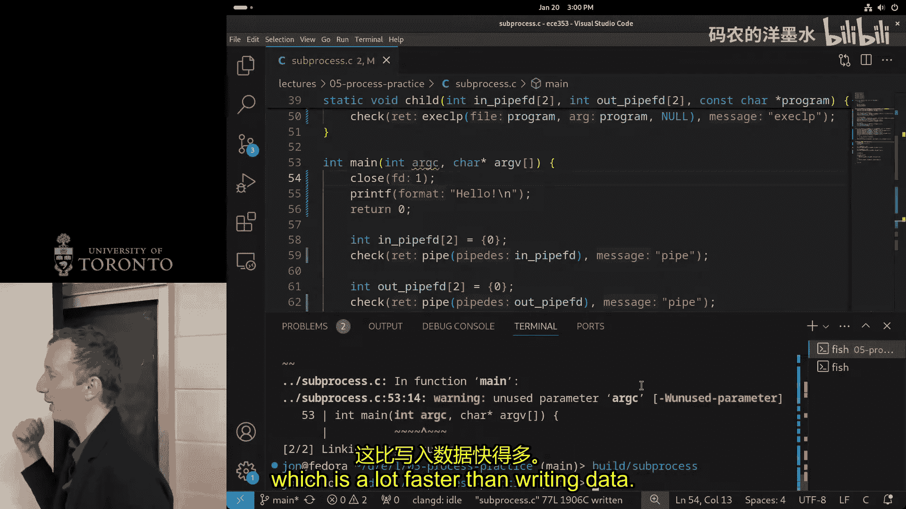

掌握这些概念和技能，是理解复杂软件系统交互和进行系统级编程的基石。