# 008：页表

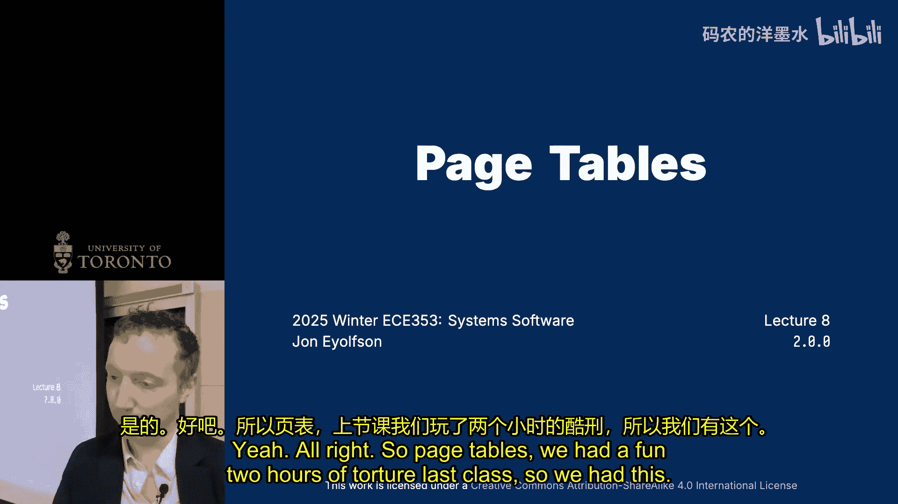

在本节课中，我们将要学习虚拟内存的核心机制——页表。我们将回顾其基本结构，探讨多级页表如何节省空间，并了解地址转换的实际过程。最后，我们将讨论页表带来的性能挑战及其解决方案。

## 页表回顾

上一节我们介绍了虚拟地址到物理地址的映射。每个进程都有自己独立的页表，由内核管理。虚拟地址被划分为页号（VPN）和页内偏移量（Offset）。

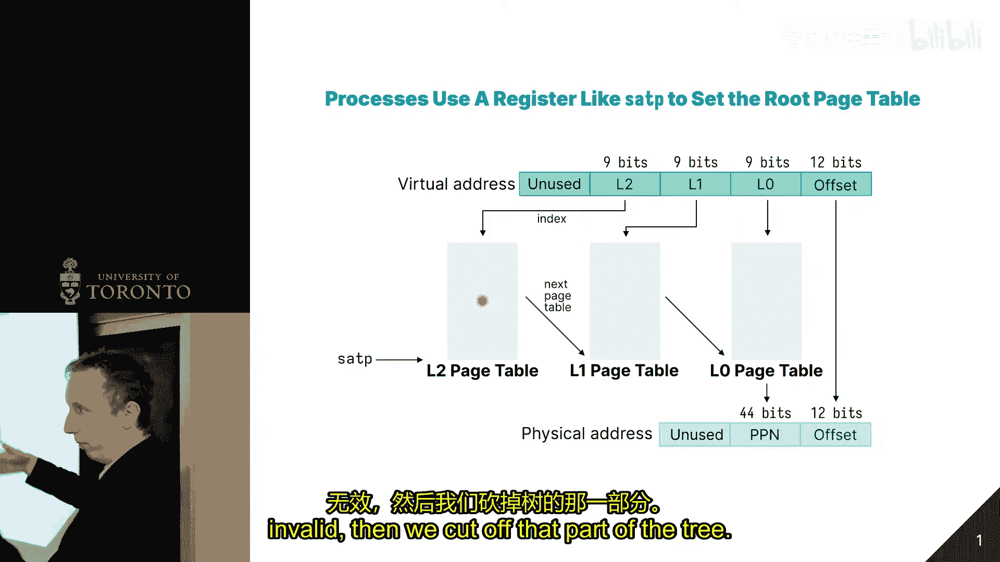

**公式**：`虚拟地址 = VPN + Offset`

之前我们设想使用一个巨大的页表，将所有VPN到物理页号（PPN）的映射都存储在其中。但这会占用过多内存（例如1GB）。因此，我们引入了多级页表的概念。

## 多级页表结构

为了解决单一大页表占用空间过大的问题，我们将其拆分为多个层级，每个层级的大小恰好为一页。

**核心思想**：将VPN进一步拆分，用不同层级的页表索引来逐级查找最终的PPN。

以下是构建多级页表的关键步骤：
*   首先，确定单个页面上能存放多少个页表项（PTE）。这决定了每一级索引的位数。
*   接着，将VPN按索引位数拆分成多个部分，每一部分对应一级页表的索引。
*   内核设置根页表（例如L2），其项指向L1页表。
*   L1页表的项指向L0页表。
*   L0页表的项包含最终的物理页号（PPN）。

**地址转换过程**：
1.  从根页表寄存器获取L2页表的物理地址。
2.  使用VPN的第一部分（L2索引）在L2页表中找到对应项，该项指向一个L1页表。
3.  使用VPN的第二部分（L1索引）在L1页表中找到对应项，该项指向一个L0页表。
4.  使用VPN的第三部分（L0索引）在L0页表中找到对应项，该项包含最终的PPN。
5.  将PPN与原始的偏移量（Offset）组合，得到最终的物理地址。

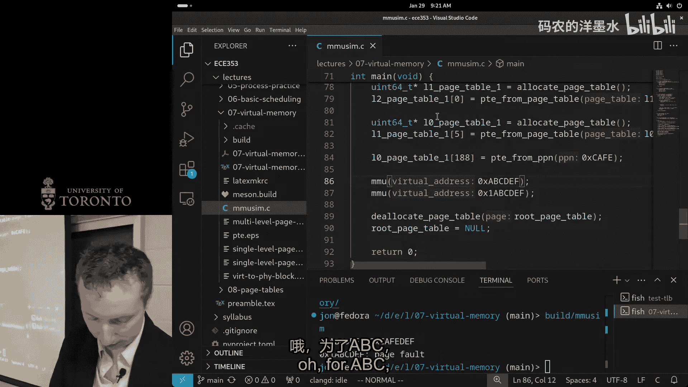

这种树状结构允许我们“剪枝”。如果某个高层页表项无效，其下的整个子树都不需要分配，从而为稀疏的内存使用节省了大量空间。

## 地址对齐

本节中我们来看看一个重要的硬件优化概念：地址对齐。对齐意味着内存地址是某个值的整数倍。

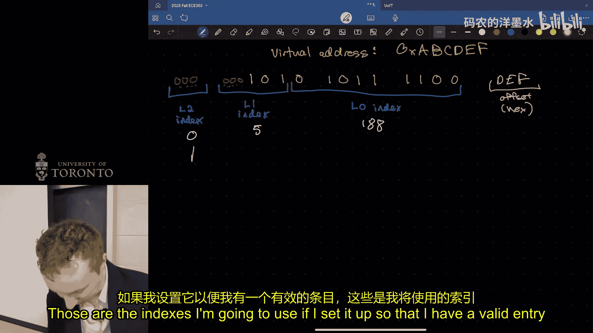

**核心概念**：页面是页面对齐的，即页面起始地址的低12位（对于4KB页）总是0。这意味着我们无需在页表项中存储页面的起始偏移量。

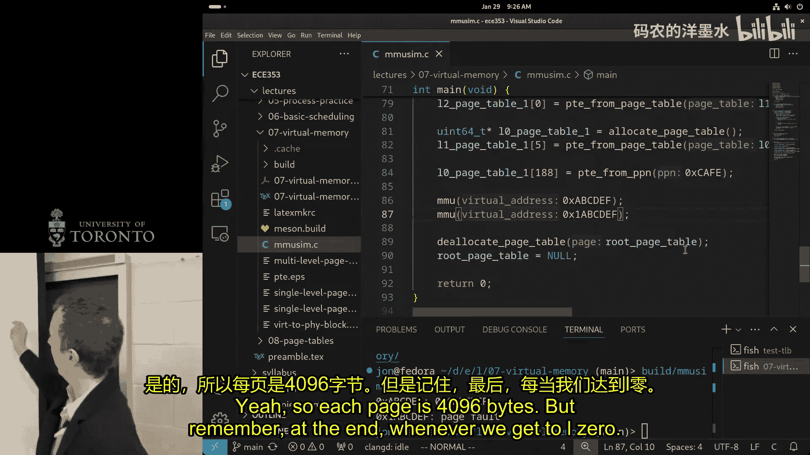

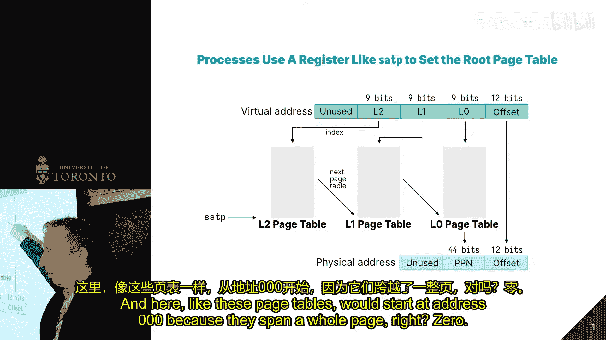

**判断对齐的简单方法**：对于一个以2的幂次方（如4、8、16字节）对齐的地址，只需检查其二进制表示的低若干位是否为0。例如，8字节对齐的地址，其十六进制表示的最后一位必须是0或8。

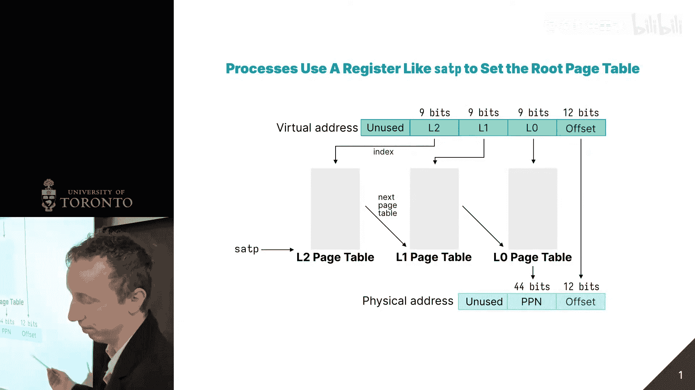

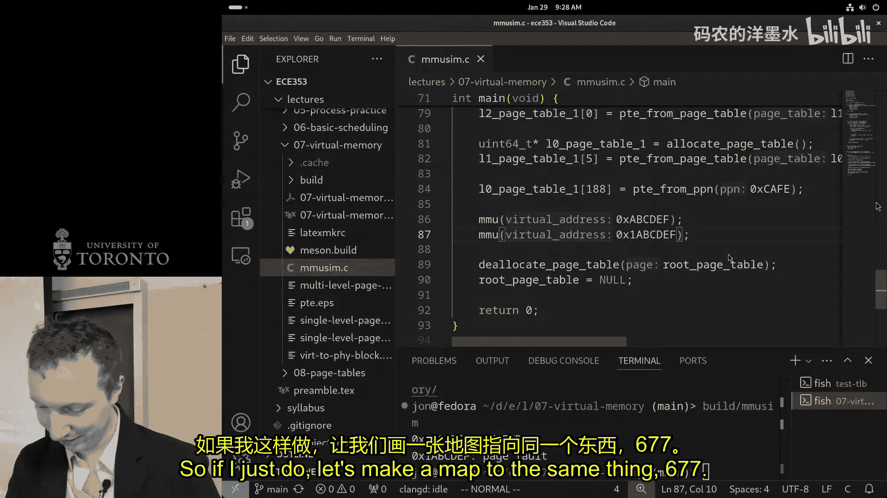

对齐简化了硬件设计，因为给定一个PPN，我们可以直接计算出其对应的物理页起始地址（PPN << 12）。

## 地址转换示例

让我们通过一个具体例子来巩固多级页表的转换过程。假设我们有一个虚拟地址 `0xABCDEF`，采用SV39三级页表结构。

**转换步骤**：
1.  将地址 `0xABCDEF` 转换为二进制，并划分为三部分9位的索引（L2, L1, L0）和12位的偏移量。
2.  假设根页表（L2）位于PPN 7。使用L2索引（值为0）找到L2页表中的第0项，该项指向一个L1页表（假设位于PPN 8）。
3.  使用L1索引（值为5）找到L1页表中的第5项，该项指向一个L0页表。
4.  使用L0索引（值为188）找到L0页表中的第188项，该项包含最终的PPN（假设为 `0xCAFE`）。
5.  最终的物理地址为 PPN 连接 Offset：`0xCAFE` + `0xDEF` = `0xCAFEDEF`。

如果在此链中的任何一级页表项无效，访问将触发页错误（Page Fault）。

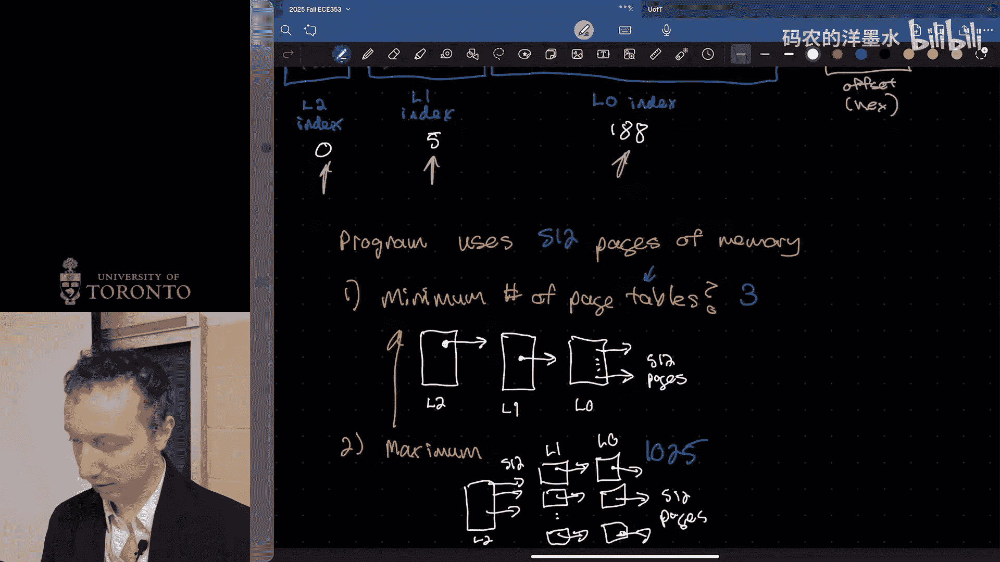

## 页表数量分析

了解一个进程需要多少页表很重要。考虑一个使用512个页面的进程。

**最少页表数量**：3个。需要一个L2页表、一个L1页表和一个L0页表。L0页表可以容纳512个项，刚好映射512个页面。

**最多页表数量**：1025个。这是最坏情况，假设内存访问极度分散：
*   1个L2页表（必须存在）。
*   L2页表有512个有效项，每个指向一个不同的L1页表，共512个L1页表。
*   每个L1页表只有一个有效项，指向一个L0页表，共512个L0页表。
*   总计：1 + 512 + 512 = 1025个页表。

## 转换后备缓冲器（TLB）

上一节我们介绍了多级页表，虽然节省了空间，但导致每次内存访问都需要多次访问内存（走页表），速度很慢。本节中我们来看看如何解决这个性能问题。

**解决方案**：增加一个缓存，即转换后备缓冲器（TLB）。TLB缓存最近使用过的VPN到PPN的映射。

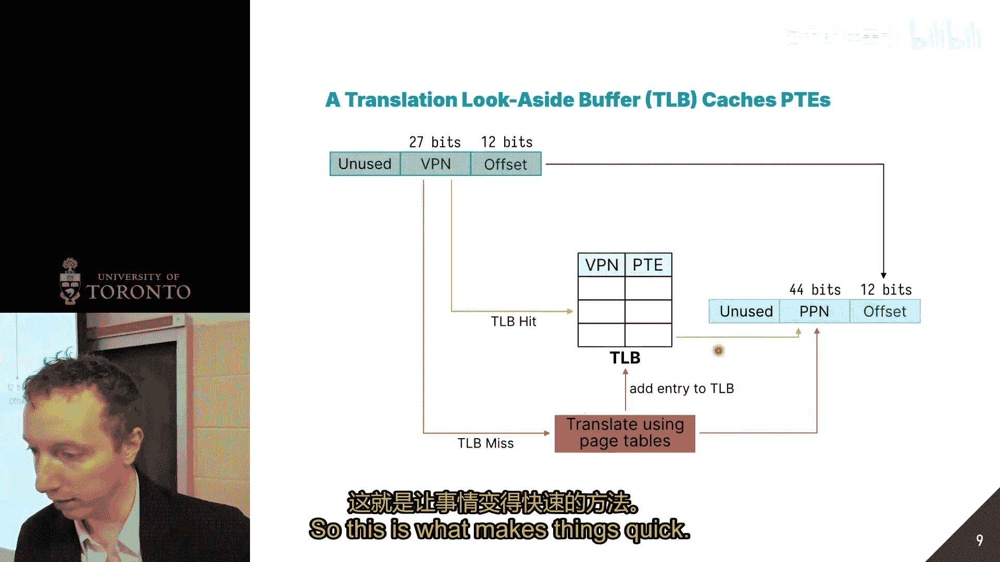

**工作流程**：
1.  CPU需要转换虚拟地址时，首先用VPN查询TLB。
2.  如果命中（TLB Hit），则直接获得PPN，无需访问页表，速度很快。
3.  如果未命中（TLB Miss），则必须通过多级页表进行完整的地址转换。转换完成后，会将这个新的映射存入TLB，以备后续使用。

**有效访问时间计算**：
我们可以用以下公式估算平均内存访问时间：
`EAT = (命中率 * TLB命中时间) + (未命中率 * TLB未命中时间)`

其中，TLB命中时间 = TLB查找时间 + 一次内存访问时间。TLB未命中时间 = TLB查找时间 + (页表层级数 * 内存访问时间) + 一次内存访问时间。

例如，假设命中率80%，TLB查找10ns，内存访问100ns，采用二级页表（访问需2次额外内存访问）：
`EAT = 0.8*(10+100) + 0.2*(10+2*100+100) = 0.8*110 + 0.2*310 = 88 + 62 = 150ns`

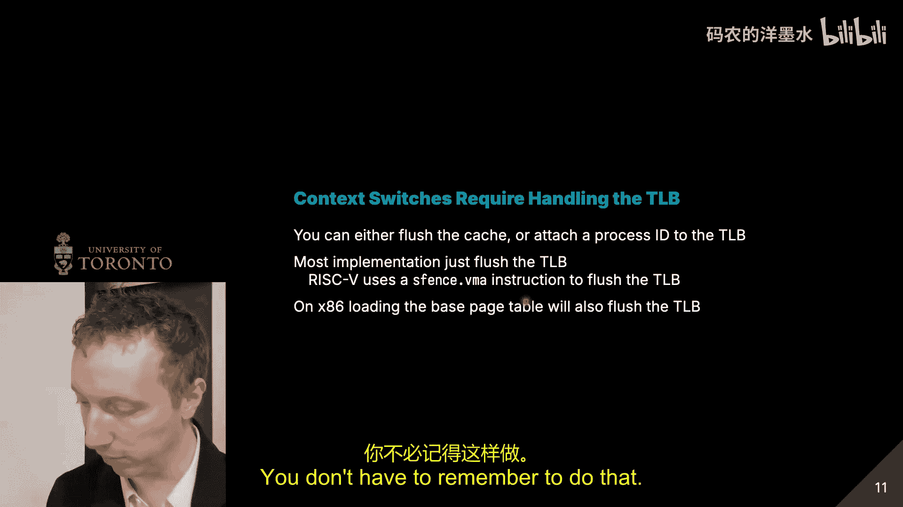

如果没有TLB，每次访问都需要310ns。TLB将平均时间降低到150ns，显著提升了性能。

**TLB与上下文切换**：当CPU切换到另一个进程时，TLB中缓存的映射对新进程无效。常见的处理方式是清空（刷新）整个TLB。有些系统会在TLB项中附加进程ID（ASID），从而避免每次切换都刷新TLB。

## 为什么“顺序访问”更快

一个常见的编程建议是“顺序访问内存以提高性能”。这与RAM（随机存取存储器）的名称似乎矛盾。TLB揭示了其原因。

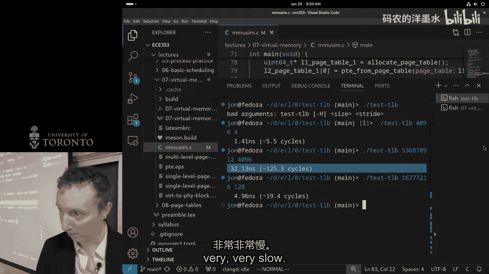

**根本原因**：速度差异主要源于TLB，而非RAM本身。RAM的随机访问速度确实是均匀的。

**示例分析**：
*   **顺序访问一个页面**：首次访问该页面会触发TLB未命中，但随后的访问（只要在同一页面内）都会是TLB命中，速度极快。
*   **以页面大小为步长跳跃访问**：每次访问都位于不同的页面，几乎每次都是TLB未命中，需要走完整的页表查询流程，速度非常慢。

因此，“顺序访问更快”的本质是提高**空间局部性**，使得更多的内存访问能命中TLB（以及CPU的数据缓存），从而避免昂贵的页表遍历。

## 进程地址空间与内核交互

最后，我们简要了解内核如何利用页表管理进程的地址空间。

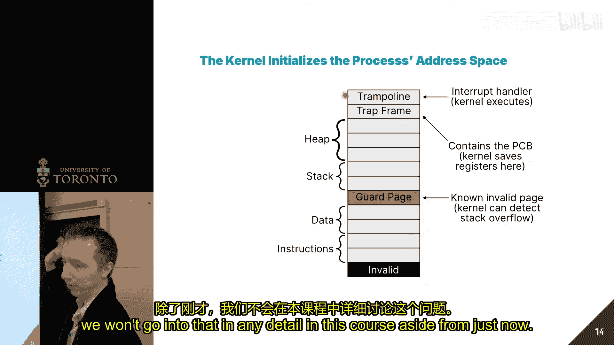

**进程地址空间布局**：一个典型的进程地址空间从低地址到高地址包括：
*   **代码段**：存放可执行指令，标记为可读、可执行。
*   **数据段**：存放全局变量等。
*   **堆**：动态分配的内存区域，通过 `sbrk` 或 `mmap` 系统调用增长。
*   **栈**：用于函数调用，通常向低地址增长。内核会在栈末尾设置一个**守护页**（Guard Page），用于检测栈溢出。
*   **内核区域**：包含一些进程不可直接访问但内核使用的页面，如陷入帧（Trap Frame，用于保存寄存器状态）、蹦床页（Trampoline，用于安全进入内核态）。

**内核的页表技巧**：
*   **惰性分配**：当进程请求内存（如`malloc`）时，内核可以先仅标记页表项有效，但不分配实际物理页。当进程首次访问该页面触发页错误时，内核再分配物理页并建立映射。这提高了效率。
*   **内存映射文件**：通过页错误机制，将文件内容动态加载到内存。
*   **写时复制**：用于`fork`等操作，初始共享页面，仅在写入时复制。
*   **固定虚拟地址**：内核可以将一些只读数据（如系统时钟）映射到进程地址空间的固定位置。用户程序通过普通内存读取即可访问，无需系统调用，极大提升了性能（例如读取时间戳）。

## 总结

本节课中我们一起学习了虚拟内存的核心——页表系统。我们从单一大页表的问题出发，引入了多级页表结构来节省内存空间。我们详细分析了地址转换的过程、地址对齐的概念，并计算了进程所需页表的数量。接着，我们探讨了多级页表带来的性能挑战，并介绍了通过TLB缓存来加速地址转换的解决方案，这也解释了为何顺序访问内存效率更高。最后，我们概述了进程地址空间的布局以及内核如何利用页表机制实现惰性分配、写时复制等高级功能。理解页表是理解现代操作系统内存管理的基础。