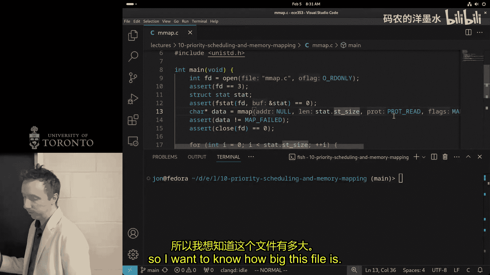
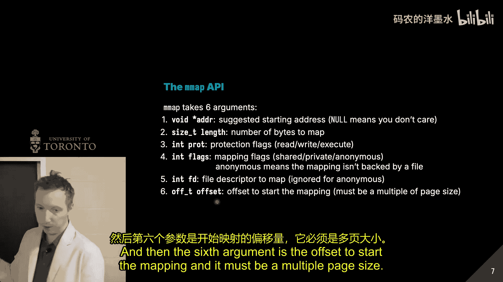
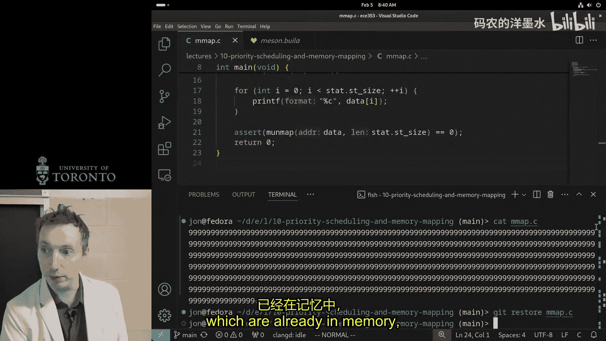
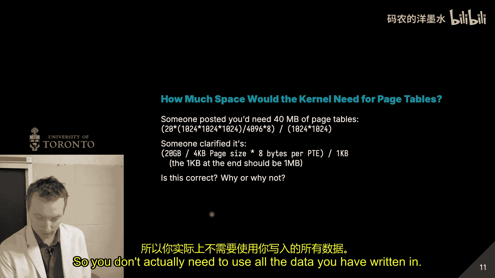

# 010：优先级调度与内存映射 🧠


在本节课中，我们将学习两种重要的系统软件概念：动态优先级调度（也称为反馈调度）和内存映射（`mmap`）。我们将了解调度算法如何根据进程行为动态调整优先级，以及如何使用 `mmap` 系统调用高效地将文件内容映射到进程的虚拟内存中，从而避免频繁的读写系统调用。

## 动态优先级调度 🔄

上一节我们讨论了基本的调度算法。本节中，我们来看看一种更动态的方法——反馈调度。这种算法的核心思想是让系统根据进程的实际CPU使用情况来动态管理其优先级，而不是使用固定的优先级。

### 核心算法

在反馈调度中，**优先级数字越低，表示优先级越高**。每个进程在启动时被赋予一个初始优先级 `P(N)`。调度器总是选择优先级数字最低（即优先级最高）的进程来运行。如果出现平局，则按进程到达的顺序（FIFO）来打破。

算法会记录每个进程在当前“优先级间隔”内的执行时间 `C(N)`。在每一个优先级间隔结束时，会使用以下公式重新计算所有就绪进程的优先级：

**`P(N) = P(N) / 2 + C(N)`**

计算完成后，`C(N)` 会被重置为0。这个公式的含义是：
*   `P(N) / 2`：将当前优先级减半，这相当于奖励那些近期没有占用太多CPU的进程（使其数字变小，优先级变高）。
*   `+ C(N)`：加上进程在本间隔内的运行时间，这会惩罚那些占用了大量CPU的进程（使其数字变大，优先级变低）。

### 调度示例分析

为了更好地理解，我们来看一个具体的例子。假设有四个进程 X, Y, A, B，它们都在时间0到达。
*   **A 和 B** 是 CPU 密集型进程，一旦获得 CPU，就会一直执行直到时间片用完或被抢占。
*   **X 和 Y** 是 I/O 密集型进程，它们每次只运行1个时间单位，然后会阻塞（例如等待I/O）5个时间单位。

此外，我们设定：
*   计时器中断每1个时间单位发生一次。
*   优先级重新计算的间隔是每10个时间单位一次。

**场景一：所有进程初始优先级为0**


1.  **时间 0-1**：所有进程优先级相同(0)，按到达顺序选择 X 运行。X 运行1个单位后阻塞。
2.  **时间 1-2**：选择 Y 运行。Y 运行1个单位后阻塞。
3.  **时间 2-10**：只剩下 A 和 B（优先级仍为0）。选择 A 运行。即使 X 在时间6、Y在时间7恢复就绪，但它们的优先级(0)并不比正在运行的 A(0) 高，因此不会发生抢占，A 一直运行到时间10。
4.  **时间 10**：重新计算优先级。
    *   X: `0/2 + 1 = 1`
    *   Y: `0/2 + 1 = 1`
    *   A: `0/2 + 8 = 8`
    *   B: `0/2 + 0 = 0`
5.  **时间 10+**：B 的优先级(0)最低（最高），因此 B 被调度执行。


这个例子展示了算法如何开始“惩罚”长时间运行的进程A，并“奖励”等待的进程B。


**场景二：初始优先级不同（X,Y为0，A,B为6）**

进程行为不变，但初始优先级不同，这会导致更频繁的抢占，因为 I/O 密集型进程 X 和 Y 的初始优先级更高。

这个动态调整的过程，使得 I/O 密集型（交互式）进程能够获得更好的响应性，而 CPU 密集型进程则不会完全独占资源，这是一种公平性的体现。

---


## 内存映射与 `mmap` 系统调用 🗺️



之前我们学习了虚拟内存和页表。本节中我们来看看一个强大的系统调用 `mmap`，它允许我们将文件直接映射到进程的虚拟地址空间，从而像访问内存一样访问文件。

### `mmap` 的核心概念

`mmap` 的基本思想是：**让进程虚拟内存中的某些页，直接对应到磁盘上文件的某些块**。



当调用 `mmap` 时，内核并不会立即将整个文件读入物理内存。它只是**惰性（lazy）地**设置好页表项（Page Table Entries, PTEs），并将这些PTEs标记为无效，同时记录下它们应该映射到文件的哪个部分。

当进程第一次尝试访问（读或写）这个内存区域时，会发生缺页异常（Page Fault）。此时，内核的缺页处理程序会：
1.  分配一个物理页帧（PPN）。
2.  从磁盘上对应的文件块中读取数据，填充到这个物理页中。
3.  更新PTE，使其指向这个物理页帧并标记为有效。
4.  恢复进程的执行。

这样，只有实际被访问到的文件部分才会被加载到物理内存中，非常高效。

### 使用 `mmap` 读取文件

以下是使用 `mmap` 读取整个文件内容并打印的简化示例，与传统的 `read` 循环方式对比：

```c
// 传统方式：使用 read 系统调用
int fd = open(“file.txt”, O_RDONLY);
char buffer[4096];
ssize_t bytes_read;
while ((bytes_read = read(fd, buffer, sizeof(buffer))) > 0) {
    write(STDOUT_FILENO, buffer, bytes_read);
}
close(fd);
```

```c
// 使用 mmap 方式
#include <sys/mman.h>
#include <sys/stat.h>
#include <fcntl.h>
#include <stdio.h>
#include <unistd.h>

int main() {
    int fd = open(“file.txt”, O_RDONLY);
    struct stat sb;
    fstat(fd, &sb); // 获取文件大小

    // 核心 mmap 调用
    char *data = mmap(NULL, sb.st_size, PROT_READ, MAP_PRIVATE, fd, 0);
    if (data == MAP_FAILED) {
        perror(“mmap”);
        return 1;
    }
    close(fd); // 映射建立后，可以关闭文件描述符

    // 像访问数组一样访问文件内容
    for (off_t i = 0; i < sb.st_size; i++) {
        putchar(data[i]);
    }

    // 解除映射
    munmap(data, sb.st_size);
    return 0;
}
```



### `mmap` 参数详解

`mmap` 的函数原型和关键参数如下：
```c
void *mmap(void *addr, size_t length, int prot, int flags, int fd, off_t offset);
```



以下是主要参数的含义：
*   `addr`: 建议的映射起始虚拟地址。通常设为 `NULL`，让内核自动选择。
*   `length`: 要映射的字节数。
*   `prot`: 内存保护标志，决定如何访问这块内存（如 `PROT_READ`、`PROT_WRITE`）。
*   `flags`: 控制映射行为的标志。两个重要的标志是：
    *   `MAP_PRIVATE`: 写操作不会修改底层文件，而是创建一份私有副本（写时复制）。
    *   `MAP_SHARED`: 对内存的修改会同步到底层文件（最终由内核决定何时写回磁盘）。
*   `fd`: 要映射的文件的描述符。
*   `offset`: 文件中的起始偏移量，必须是页大小的倍数。

### 实际应用：大型模型加载的启示

这解释了课程开头提到的“魔法”：如何用更少的内存运行大型语言模型（LLM）。一个20GB的模型文件，如果使用传统的 `read` 将其全部加载到内存，显然需要至少20GB的RAM。

但使用 `mmap` 后：
1.  程序只需 `mmap` 这个20GB的文件。
2.  在实际进行模型推理（计算）时，很可能不会用到模型的全部参数（访问所有页）。
3.  只有被实际访问到的模型参数所在的文件块，才会被惰性地加载到物理内存中。
4.  因此，物理内存的使用量可能远小于文件总大小（例如仅需6GB），从而实现了巨大的内存节省。

### 关于页表开销的计算

使用 `mmap` 映射大文件时，需要关注虚拟内存页表本身的开销。对于一个20GB的文件：
*   假设页大小为4KB（2^12字节）。
*   需要的虚拟页数（也是页表项PTE数）为：`20GB / 4KB = 20 * 2^30 / 2^12 = 20 * 2^18` 个。
*   每个PTE在64位系统上通常占8字节。
*   因此，**仅存储这些PTE就需要大约 `20 * 2^18 * 8 = 40 MB` 的空间**。
*   这还不包括多级页表中中间各级页表（L1, L2）所占用的少量额外页面。在最佳连续映射情况下，额外开销很小（约0.07MB），但这是必须由内核管理的元数据开销。

---

## 总结 📚

本节课中我们一起学习了两个核心的系统软件概念：

1.  **动态优先级调度（反馈调度）**：算法通过公式 `P(N) = P(N) / 2 + C(N)` 动态调整进程优先级，奖励I/O密集型或等待的进程，惩罚CPU密集型进程，从而改善系统整体响应性和公平性。

2.  **内存映射（`mmap`）**：这是一个强大的系统调用，允许将文件直接映射到进程的虚拟地址空间。它通过惰性加载机制，让进程可以像访问内存一样高效访问文件数据，并且只将实际使用的部分载入物理内存。这种方法在处理大文件（如大型机器学习模型）时能显著节省物理内存消耗，其原理是内核延迟分配物理页，并在首次访问时通过缺页异常处理程序从磁盘加载数据。


通过结合调度策略和高级内存管理技术，我们可以构建出更高效、更灵活的系统软件。