# 011：线程 🧵

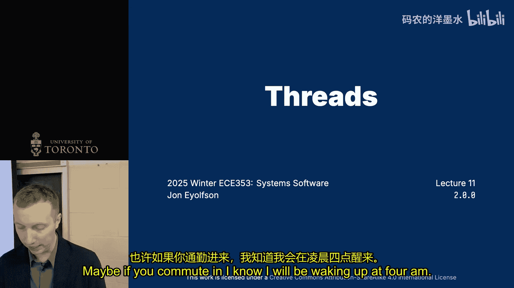

## 概述
在本节课中，我们将要学习操作系统中的核心概念——线程。我们将探讨线程与进程的区别，学习如何使用POSIX线程（Pthreads）库来创建和管理线程，并初步了解并发编程中可能遇到的问题。

---

## 并发与并行

上一节我们回顾了进程，本节中我们来看看线程。但在深入线程之前，我们需要区分两个常被混淆的概念：并发与并行。

*   **并发**：意味着在两个或多个任务之间切换。虽然同一时间只能在一个任务上取得进展，但可以在任务间快速切换，从而在宏观上同时推进多个任务。其目标是**同时推进多项任务**。
*   **并行**：意味着两个或多个任务在**完全相同的时刻**同时发生。这要求任务相互独立，其目标是**尽可能快地运行**。

现代系统通常利用并行性（多核），但并发性同样重要，尤其是在处理大量I/O操作的场景（如Web服务器）。

为了更清晰地理解，我们来看一个现实生活中的例子。假设你在餐桌上，可以执行**吃**、**喝**、**说话**、**打手势**这几个任务，并且有一个奇怪的设定：一旦开始吃，就必须吃完才能停下。

以下是任务组合的分析：
*   **喝**与**说话**：可以并发（交替进行），但不能并行（不能同时进行）。
*   **吃**与**喝**：不能并行（只有一个嘴），并且由于“开始吃就不能停”的设定，也不能并发。
*   **吃**与**打手势**：可以并行（用另一只手），但不能并发（不能停下吃）。
*   **打手势**与**说话**：既可以并发，也可以并行。

这个例子说明，**并发和并行并不相互蕴含**。在计算机中，如果并发切换的速度极快，从宏观上看就像并行一样。

---

## 线程简介

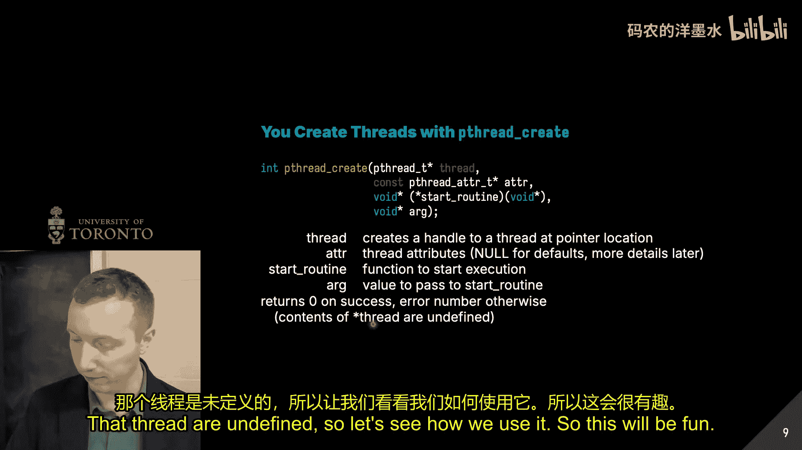

线程与进程原理相似，都能实现并行。但关键区别在于：**线程默认共享内存**。

*   **进程**：创建时拥有全新的、独立的虚拟地址空间。
*   **线程**：属于同一进程的线程**共享相同的地址空间**。每个线程独立的部分仅包括其当前的寄存器、程序计数器（也是一个寄存器）和栈。

线程与进程的关系是：**一个进程可以包含多个线程**。默认情况下，一个进程只有一个执行`main`函数的线程（主线程）。我们可以创建更多线程，实现同一地址空间内的多个执行流。

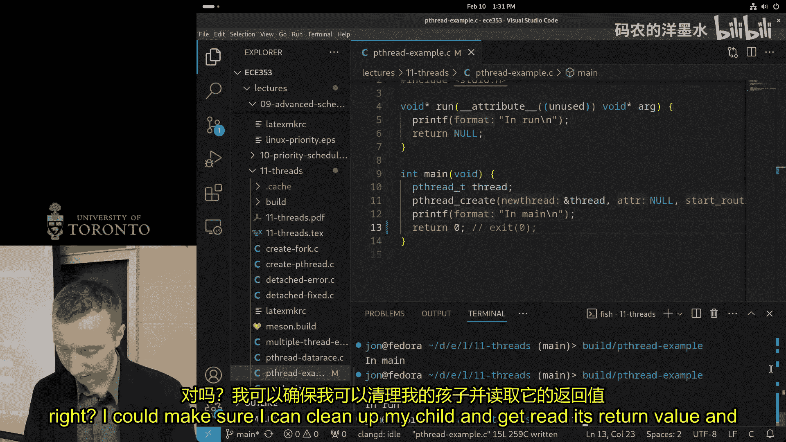

线程的优势在于：
*   **更轻量**：创建和上下文切换开销更小，因为不需要创建新的地址空间或刷新TLB。
*   **通信开销低**：共享内存使得线程间数据交换无需系统调用，速度更快。

线程的劣势在于：
*   **缺乏隔离性**：一个线程崩溃（如非法内存访问）可能导致整个进程崩溃，影响所有其他线程。
*   **编程复杂**：共享内存带来了数据同步和一致性的挑战。

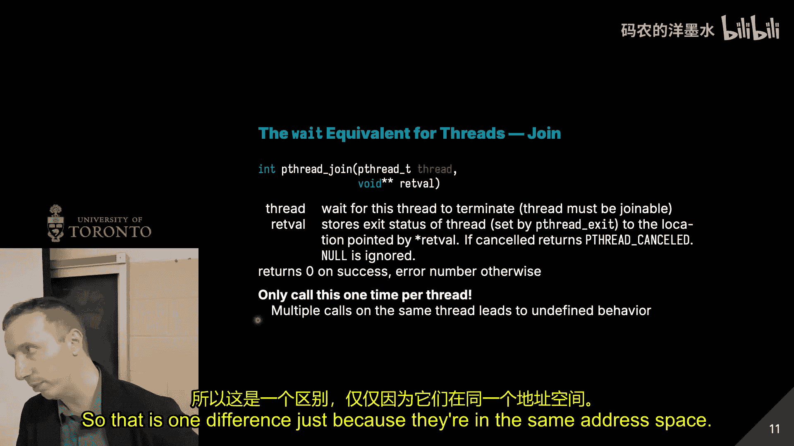

一个典型的应用场景是Web服务器：
```c
while (true) {
    int client_fd = accept(request); // 获取新连接
    create_thread_to_process(client_fd); // 创建线程处理请求
}
```
服务器主线程快速接受连接，然后为每个连接创建一个工作线程进行处理。由于网络I/O较慢，CPU可以快速在众多线程间切换，实现高并发。

**进程与线程对比总结**：
*   **独立性**：进程完全独立；线程共享代码、数据和堆，仅栈和寄存器独立。
*   **创建与切换开销**：进程开销大（需新地址空间、页表等）；线程开销小。
*   **通信**：进程间通信需通过IPC机制（如管道）；线程间可直接通过共享内存通信。
*   **生命周期**：进程终止时，其所有线程也随之终止。

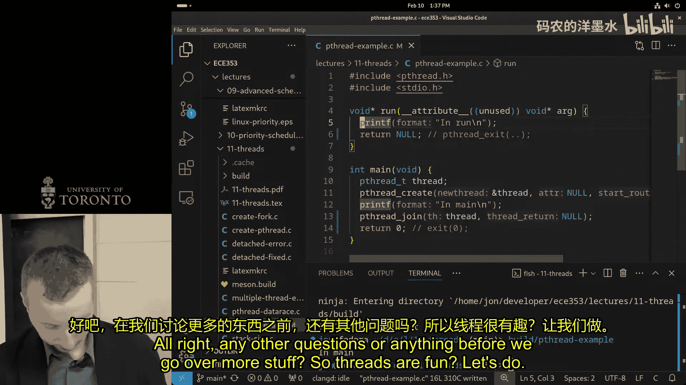

---

## Pthreads 基础

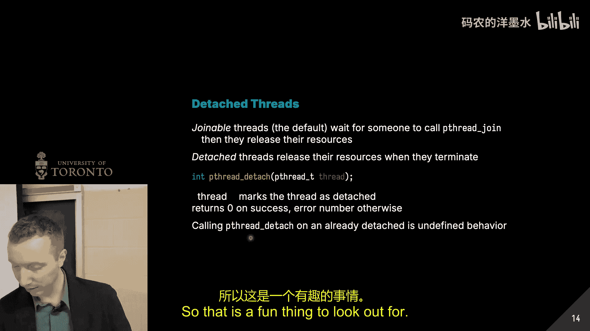

在本课程中，我们将使用POSIX线程（Pthreads）。在源代码中包含头文件`#include <pthread.h>`，编译时需添加`-pthread`标志链接库。

### 创建线程：`pthread_create`

创建线程使用`pthread_create`函数，其原型如下：
```c
int pthread_create(pthread_t *thread, const pthread_attr_t *attr,
                   void *(*start_routine) (void *), void *arg);
```
*   `thread`: 指向`pthread_t`类型变量的指针，用于存储新线程的ID。
*   `attr`: 指向线程属性对象的指针，通常设为`NULL`使用默认属性。
*   `start_routine`: 线程启动后执行的函数指针。该函数必须具有`void* func(void* arg)`的形式。
*   `arg`: 传递给`start_routine`函数的参数。
*   **返回值**：成功返回0；失败直接返回错误号（不设置`errno`）。

以下是一个简单的创建线程示例：
```c
#include <stdio.h>
#include <pthread.h>

void *run(void *arg) {
    (void)arg; // 避免未使用参数的警告
    printf("In run\n");
    return NULL;
}

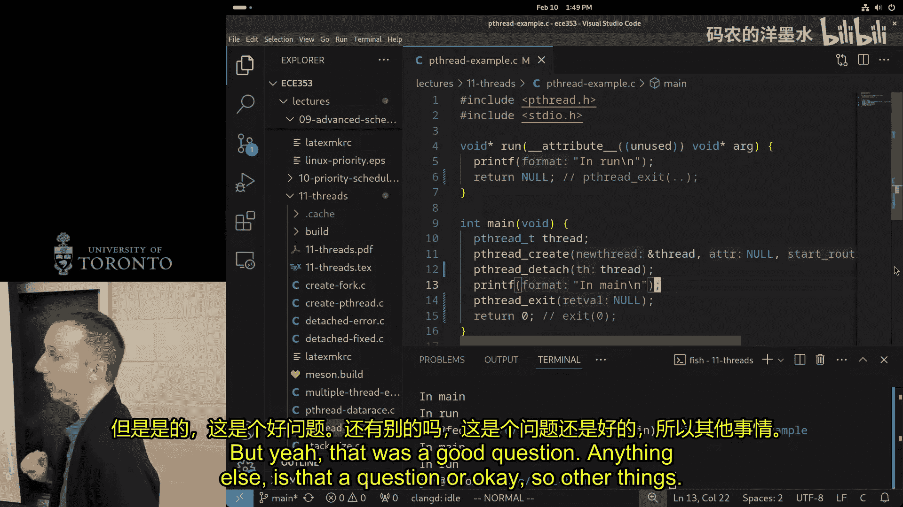

int main() {
    pthread_t thread;
    pthread_create(&thread, NULL, run, NULL);
    printf("In main\n");
    return 0;
}
```
运行此程序，输出顺序是不确定的，可能是“In main”然后“In run”，也可能是相反。更常见的情况是，主线程打印后立即退出，导致整个进程终止，新创建的线程可能根本没机会运行就被“杀死”了。

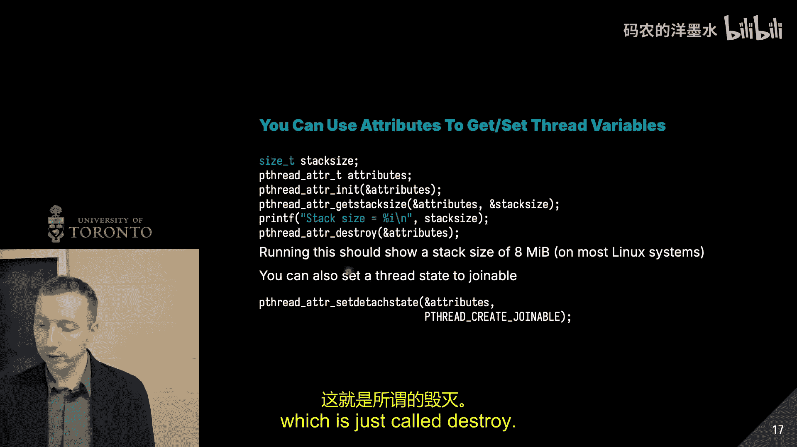

### 等待线程：`pthread_join`

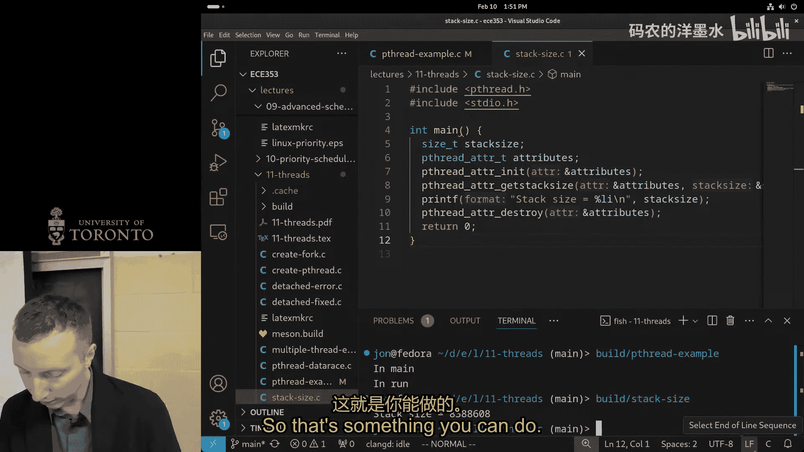

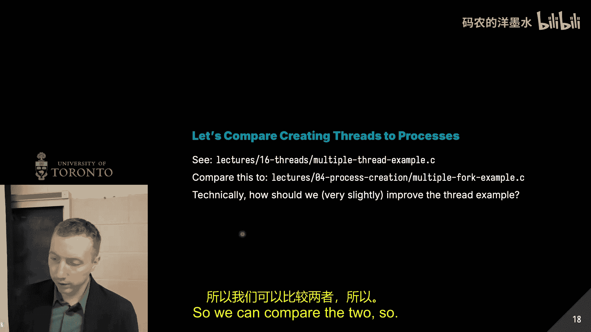

为了确保主线程等待新线程完成，我们需要使用`pthread_join`，它类似于进程的`wait`。
```c
int pthread_join(pthread_t thread, void **retval);
```
*   `thread`: 要等待的线程ID。
*   `retval`: 指向指针的指针，用于接收目标线程的返回值（即`start_routine`的返回值或`pthread_exit`的参数）。
*   **返回值**：成功返回0；失败返回错误号。

修改上面的例子：
```c
int main() {
    pthread_t thread;
    pthread_create(&thread, NULL, run, NULL);
    pthread_join(thread, NULL); // 等待新线程结束
    printf("In main\n");
    return 0;
}
```
现在，程序总会先打印“In run”，然后打印“In main”（因为主线程在join处阻塞，等待新线程完成）。但两个线程内部的执行顺序仍由调度器决定。

### 线程终止：`pthread_exit`

线程可以通过以下方式终止：
1.  从`start_routine`函数返回。
2.  调用`pthread_exit`。
3.  被其他线程取消（`pthread_cancel`）。

`pthread_exit`函数原型：
```c
void pthread_exit(void *retval);
```
它终止调用线程，并将`retval`作为返回值传递给任何等待该线程的`pthread_join`调用。

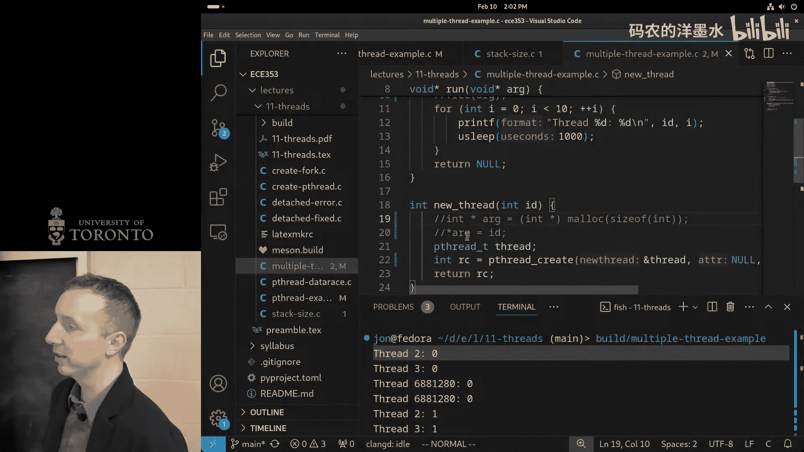

一个重要的技巧是：如果主线程希望在所有其他线程结束后再终止进程，它不应该从`main`返回（那会调用`exit`终止整个进程），而应调用`pthread_exit`。这样，主线程终止，但只要进程中还有非守护线程在运行，进程就不会结束。

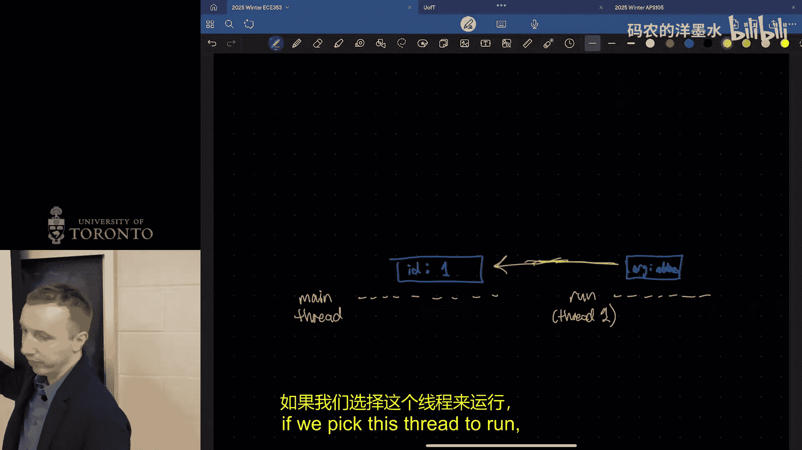

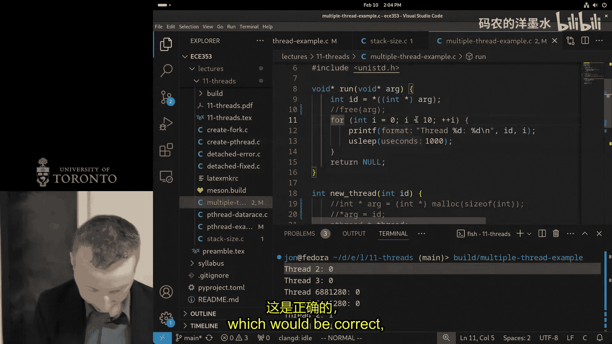

### 分离线程：`pthread_detach`

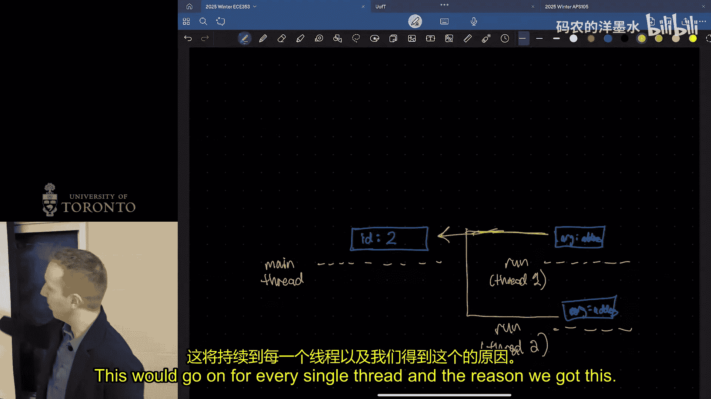

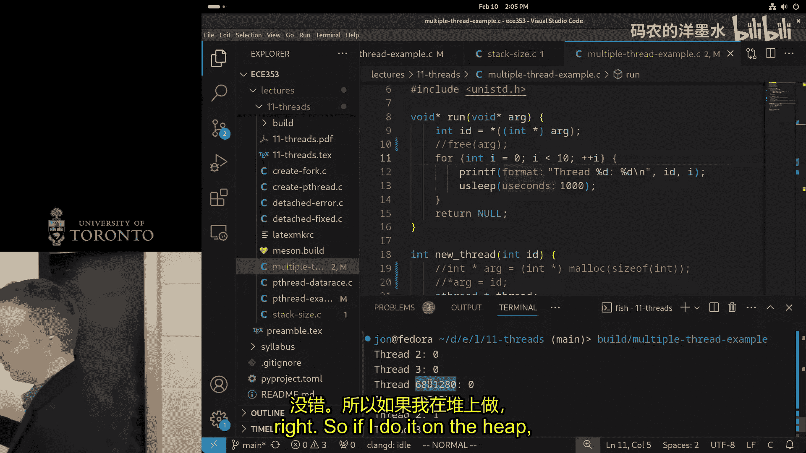

默认创建的线程是“可连接的”（joinable），必须有人对其调用`pthread_join`来回收资源，否则会变成“僵尸线程”。

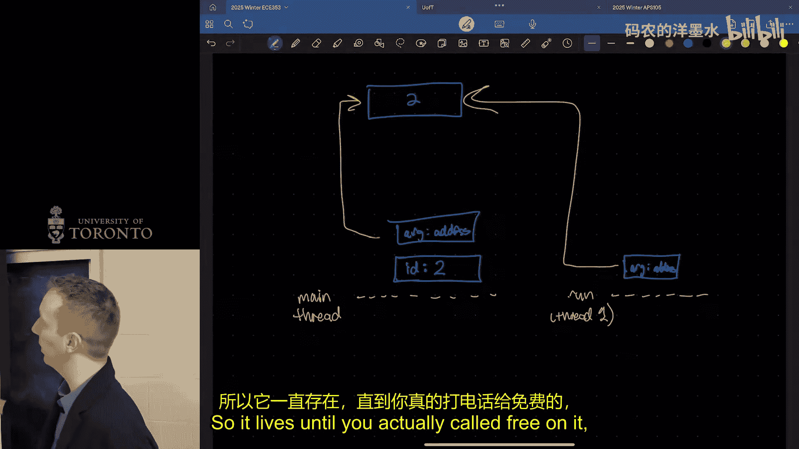

我们可以创建“分离的”（detached）线程，它们会在终止时自动释放所有资源，无需被连接。但这也意味着无法获取其返回值。
```c
int pthread_detach(pthread_t thread);
```
分离线程后，不能再对其调用`pthread_join`。

---

## 向线程传递参数

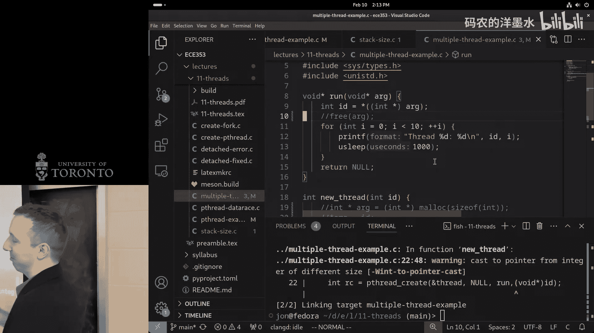

向线程函数传递参数需要小心，因为参数是通过指针传递的，必须确保指针所指向的内存在线程使用时依然有效。

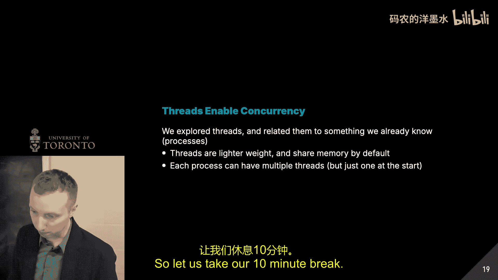

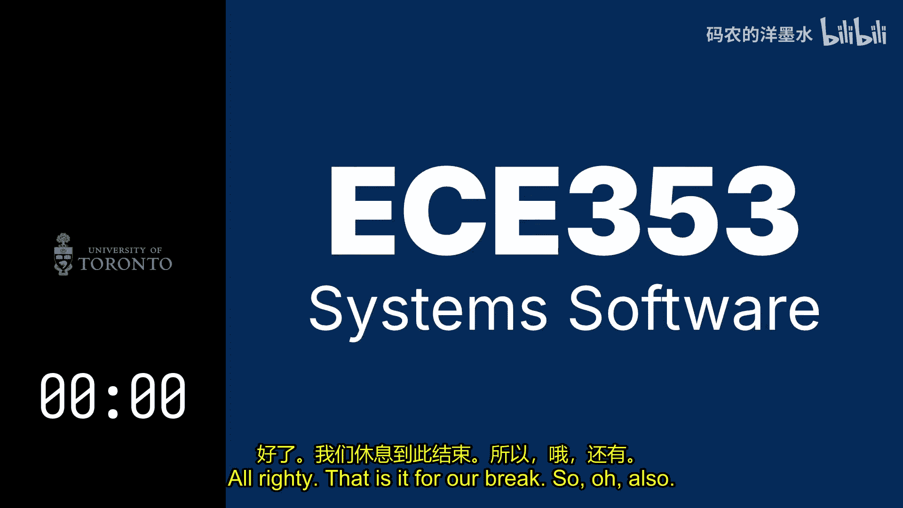

**错误示例**：传递栈变量的地址。
```c
void *run(void *arg) {
    int id = *(int *)arg;
    printf("Thread %d\n", id);
    return NULL;
}

int main() {
    pthread_t threads[5];
    for (int i = 0; i < 5; i++) {
        // 错误！传递了局部变量 i 的地址
        pthread_create(&threads[i], NULL, run, &i);
    }
    // ... 主线程可能很快结束，栈被回收
    for (int i = 0; i < 5; i++) {
        pthread_join(threads[i], NULL);
    }
    return 0;
}
```
这里，所有线程收到的都是局部变量`i`的地址。主线程循环很快，`i`的值不断变化，并且主线程可能在线程运行前就结束了，导致线程访问无效的栈内存，得到随机值。

**正确示例**：为每个线程动态分配内存。
```c
void *run(void *arg) {
    int id = *(int *)arg;
    free(arg); // 使用完后释放内存
    printf("Thread %d\n", id);
    return NULL;
}

int main() {
    pthread_t threads[5];
    for (int i = 0; i < 5; i++) {
        int *arg = malloc(sizeof(int));
        *arg = i;
        pthread_create(&threads[i], NULL, run, arg);
    }
    for (int i = 0; i < 5; i++) {
        pthread_join(threads[i], NULL);
    }
    return 0;
}
```
每个线程获得自己独有的堆内存块，从而安全地传递参数。

---

## 线程实现模型

线程的实现主要有两种模型：

1.  **用户线程**：完全在用户空间实现，内核对此一无所知。优点是创建、切换极快（无需系统调用）；缺点是**一个线程阻塞（如I/O）会导致整个进程阻塞**，且无法利用多核实现真正的并行。
2.  **内核线程**：由操作系统内核直接管理。优点是可以实现真正的并行，一个线程阻塞不会影响其他线程；缺点是创建、切换涉及系统调用，开销较大。

常见的映射关系：
*   **多对一**：多个用户线程映射到一个内核线程。即纯用户线程模型。
*   **一对一**：一个用户线程映射到一个内核线程。Pthreads通常采用此模型。
*   **多对多**：多个用户线程映射到多个内核线程。试图结合两者优点，但实现复杂，调试困难。

在接下来的实验（Lab 4）中，你将实现一个**协作式的用户线程库（Many-to-One）**。线程必须主动调用`yield`让出CPU，而不是被强制抢占。

---

## 同步问题初探

线程共享内存带来了强大的能力，也引入了复杂的同步问题。考虑以下程序：
```c
#include <stdio.h>
#include <pthread.h>

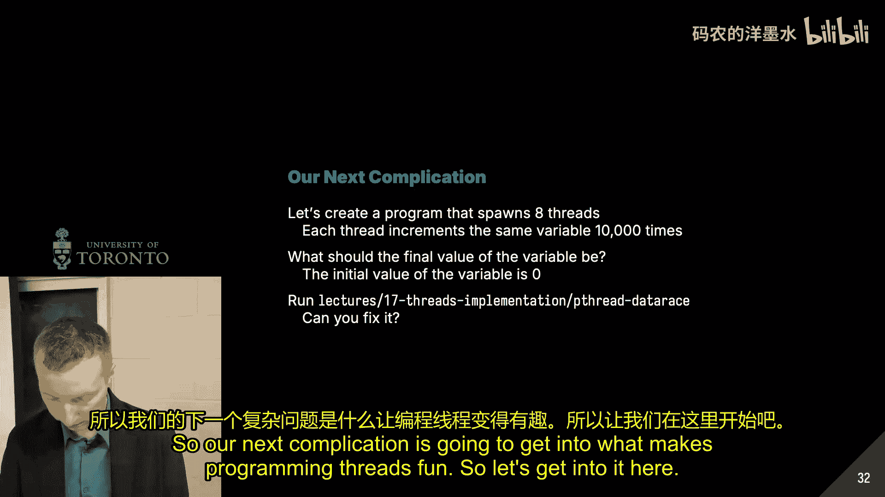

static int counter = 0;
#define NUM_THREADS 8
#define ITERATIONS 10000

void *run(void *arg) {
    (void)arg;
    for (int i = 0; i < ITERATIONS; i++) {
        counter++; // 隐患所在！
    }
    return NULL;
}

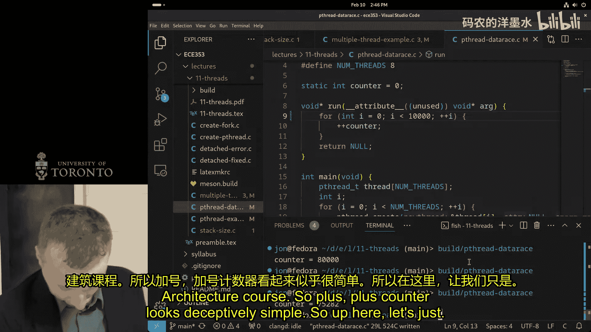

int main() {
    pthread_t threads[NUM_THREADS];
    for (int i = 0; i < NUM_THREADS; i++) {
        pthread_create(&threads[i], NULL, run, NULL);
    }
    for (int i = 0; i < NUM_THREADS; i++) {
        pthread_join(threads[i], NULL);
    }
    printf("Final counter value: %d (expected: %d)\n", counter, NUM_THREADS * ITERATIONS);
    return 0;
}
```
我们创建了8个线程，每个线程对全局变量`counter`递增10000次，期望结果是80000。但实际运行结果往往小于80000，且每次运行结果可能不同。

**原因分析**：`counter++`这个操作并非原子操作。它通常对应三条机器指令：
1.  `LOAD`：将`counter`的值从内存读入寄存器。
2.  `ADD`：将寄存器的值加1。
3.  `STORE`：将寄存器的值存回内存。

如果两个线程交错执行这些指令，就可能发生以下情况：
1.  线程A加载`counter`（值为0）。
2.  线程B加载`counter`（值仍为0）。
3.  线程B递增其寄存器（值为1），并写回内存（`counter`变为1）。
4.  线程A递增其寄存器（值从0变为1），并写回内存（`counter`仍为1）。

这样，两次递增操作只使`counter`增加了1，导致结果错误。这种现象称为**竞态条件**。

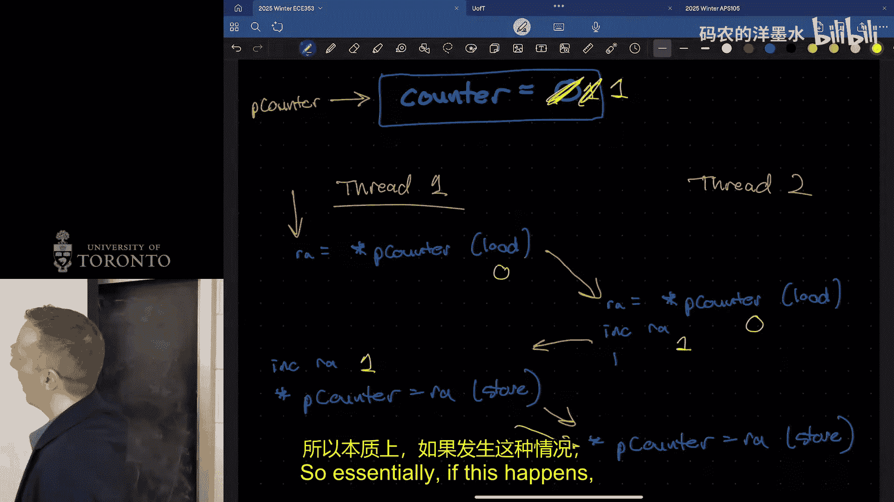

**临时解决方案**：
1.  **串行化**：创建线程后立即连接它，这实际上失去了并行的意义。
2.  **避免共享**：每个线程操作自己的局部变量，最后汇总结果。这类似于MapReduce模式。

在后续课程中，我们将学习使用**互斥锁**、**信号量**等同步原语来正确、高效地解决这类问题。

---

## 总结

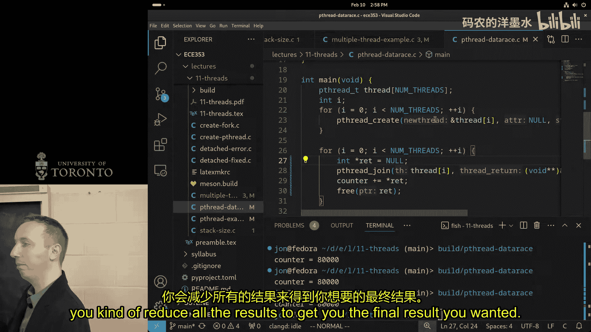

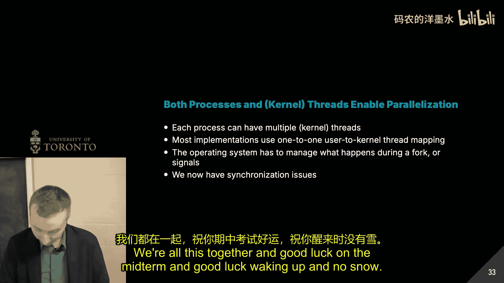

本节课中我们一起学习了线程的核心概念。我们首先区分了并发与并行，然后深入探讨了线程作为轻量级执行单元的特性，及其与进程的根本区别。我们掌握了使用Pthreads库创建、等待、终止和分离线程的方法，并特别强调了向线程安全传递参数的注意事项。我们还了解了线程的用户级与内核级实现模型及其利弊。最后，我们通过一个计数器递增的例子，直观地认识了多线程编程中最大的挑战——**竞态条件**，为后续学习同步机制奠定了基础。线程是强大但危险的工具，正确的同步是编写可靠并发程序的关键。