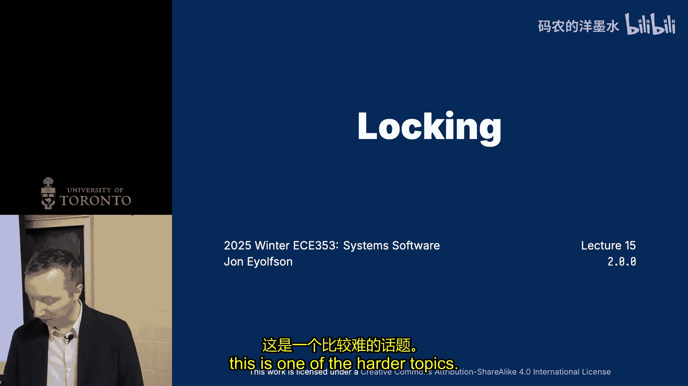
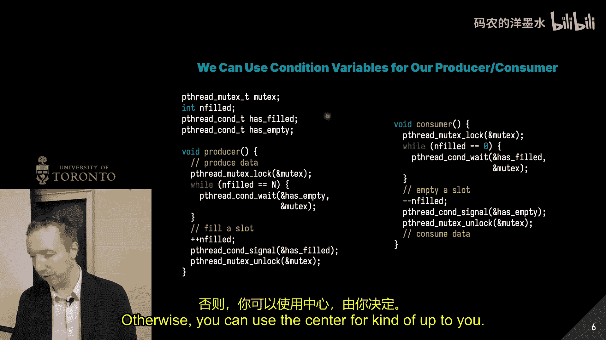
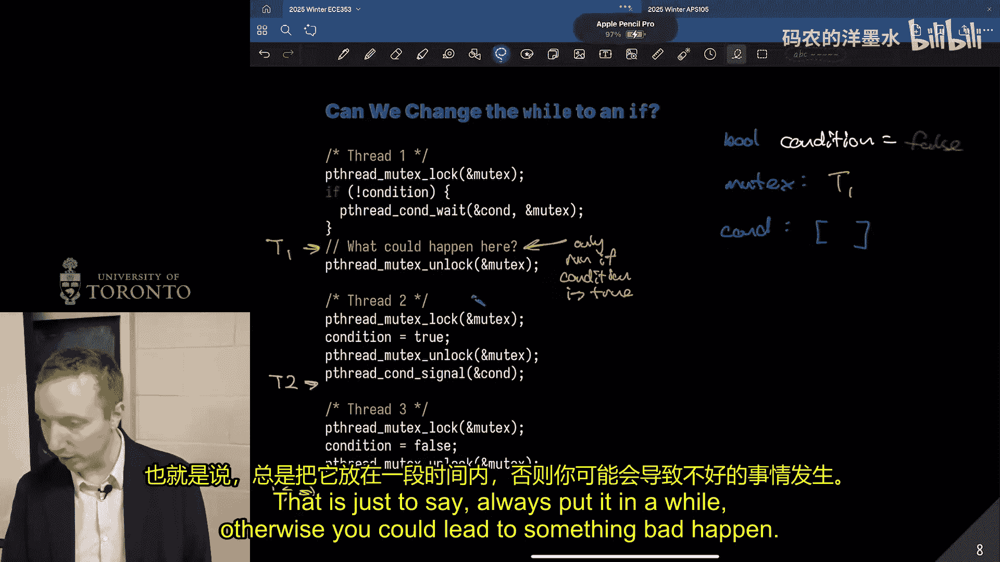
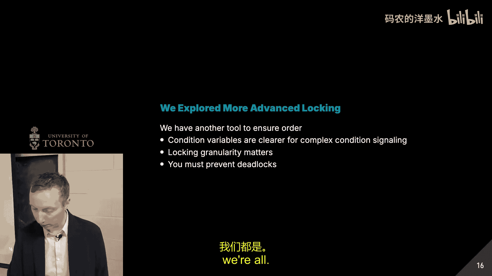

# 015：加锁机制



在本节课中，我们将学习多线程编程中的核心同步机制——锁。我们将从高级语言（如Java）内置的锁机制开始，深入探讨操作系统级别的条件变量，并分析使用锁时可能遇到的性能问题和死锁风险。

---

## 🧱 监视器：Java的内置锁机制

上一节我们介绍了互斥锁的基本概念。本节中，我们来看看一些编程语言如何通过内置机制来简化锁的使用。

在Java等面向对象语言中，开发者希望有比原始互斥锁更易用的工具。因此，它们引入了“监视器”的概念。开发者可以将一个方法标记为 `synchronized`（同步的），编译器会自动处理加锁和解锁。

这意味着，一个对象的所有同步方法中，同一时间只能有一个线程处于活动状态。本质上，编译器会为每个对象创建一个互斥锁，并在每个同步方法的开头插入加锁调用，在返回前插入解锁调用。

以下是Java中的一个示例，我们创建一个表示银行账户的类：

```java
class Account {
    private int balance;

    public synchronized void deposit(int amount) {
        balance += amount;
    }

    public synchronized void withdraw(int amount) {
        balance -= amount;
    }
}
```

在这个例子中，`balance` 变量可能被多个线程同时读写，导致数据竞争。通过添加 `synchronized` 关键字，编译器会将其转换为类似以下伪代码的形式，确保互斥访问：

```java
// 编译器生成的伪代码
public void deposit(int amount) {
    lock(monitor);
    balance += amount;
    unlock(monitor);
}
```

然而，这种机制粒度较粗：每个对象只有一个锁。如果你需要保护对象内的多个独立字段，这种方法就显得力不从心，因为它会序列化对所有字段的访问。

---

## 🚦 条件变量：更灵活的等待队列

上一节我们看到了Java的监视器。本节中，我们来学习一个更基础、更灵活的同步原语——条件变量。

条件变量这个名字可能有些误导，它本身并不存储条件状态。更好的理解方式是将其视为一个**线程等待队列**。它的类型通常是 `pthread_cond_t`，并配有初始化 (`init`) 和销毁 (`destroy`) 函数。



条件变量有三个核心操作：
*   **`wait`**：将当前线程放入队列并阻塞。
*   **`signal`**：唤醒队列中的一个线程（通常是队首）。
*   **`broadcast`**：唤醒队列中的所有线程。

**关键点**：条件变量必须与一个互斥锁配对使用。调用 `wait` 时，**必须已经持有该互斥锁**。这是因为：
1.  线程需要安全地（无数据竞争地）将自己加入队列。
2.  `wait` 会在阻塞前自动释放该互斥锁，以允许其他线程执行。
3.  当线程被唤醒并从 `wait` 返回时，它会自动重新获取该互斥锁。

因此，在调用 `wait` 前后，你都可以假定自己持有这个互斥锁。

---

### 🔄 生产者-消费者模式：条件变量实现

还记得我们用信号量实现的生产者-消费者问题吗？使用条件变量同样可以清晰实现。

我们使用一个互斥锁 (`mutex`) 保护共享的“已填充槽位”计数 (`filled`)，并使用两个条件变量分别表示“有空位” (`cond_empty`) 和“有数据” (`cond_filled`)。

以下是生产者的逻辑：

```c
// 生产者
lock(mutex);
while (filled == BUFFER_SIZE) { // 缓冲区满，等待空位
    wait(cond_empty, mutex);
}
// 生产数据并放入缓冲区
filled++;
signal(cond_filled); // 通知消费者有数据了
unlock(mutex);
```

以下是消费者的逻辑：

```c
// 消费者
lock(mutex);
while (filled == 0) { // 缓冲区空，等待数据
    wait(cond_filled, mutex);
}
// 从缓冲区取出数据
filled--;
signal(cond_empty); // 通知生产者有空位了
unlock(mutex);
// 消费数据
```

与信号量版本相比，条件变量版本更清晰地表达了等待的**条件**（如 `filled == BUFFER_SIZE`），而信号量的正确性更依赖于初始计数值。两者功能等价，选择哪种取决于代码清晰度。对于复杂的条件判断，条件变量通常是更好的选择。

---

## ⚠️ 条件变量的经典陷阱：虚假唤醒与检查

上一节我们实现了条件变量的基本用法。本节中，我们来看一个使用条件变量时极易出错的场景，并学习如何避免。

假设我们有一个共享条件 `bool condition = false`，线程1等待条件为真，线程2负责设置条件并通知。

一个**错误**的实现可能如下：

```c
// 线程1 (错误示例)
lock(mutex);
if (!condition) { // 使用 if 判断
    wait(cond, mutex);
}
// 执行需要condition为真的操作
unlock(mutex);

// 线程2
lock(mutex);
condition = true;
unlock(mutex);
signal(cond);
```

这个实现存在严重问题。考虑以下线程交错执行顺序：
1.  线程1获取 `mutex`，检查 `condition` 为假，进入 `wait`。在调用 `wait` **之前**，线程被挂起。
2.  线程2执行，获取 `mutex`，将 `condition` 设为 `true`，释放 `mutex`，并调用 `signal`。但此时线程1还未进入等待队列，所以 `signal` 没有唤醒任何线程。
3.  线程1恢复执行，调用 `wait` 并阻塞。此时再也没有线程会调用 `signal` 来唤醒它。**程序死锁**。

问题根源在于，对 `condition` 变量的检查和修改没有在同一个互斥锁的保护下**原子地**完成。线程2在错误的时间点修改了条件。

**正确的模式**必须遵循以下两点：
1.  **修改条件的一方**（线程2）也必须在持有相同互斥锁的情况下修改变量。通常，在锁内修改，在锁内或锁后发信号均可。
2.  **等待条件的一方**（线程1）必须使用 **`while` 循环**来检查条件，而不是 `if` 语句。

正确示例如下：

```c
// 线程1 (正确示例)
lock(mutex);
while (!condition) { // 使用 while 循环
    wait(cond, mutex);
}
// 执行需要condition为真的操作
unlock(mutex);

// 线程2 (正确示例)
lock(mutex);
condition = true;
unlock(mutex); // unlock可以在signal之前或之后
signal(cond);
```

使用 `while` 循环至关重要，因为：
*   **避免虚假唤醒**：某些系统实现中，线程可能在没有收到 `signal` 的情况下被唤醒。`while` 循环能确保被唤醒后再次检查条件是否真正满足。
*   **处理条件状态变化**：在被唤醒和重新获取锁的间隙，其他线程可能已经改变了条件状态。如上例所示，如果存在第三个线程在线程2之后又将条件改回 `false`，`while` 循环能迫使线程1继续等待。

**核心原则：总是将 `wait` 放在检查条件的 `while` 循环中。**

---



## ⚖️ 锁的粒度与死锁

上一节我们确保了条件变量的正确使用。本节中，我们讨论锁的性能影响和一个致命风险——死锁。

**锁的粒度**指的是临界区的大小。大粒度锁（保护大量代码或数据）会严重限制并发性，降低性能。小粒度锁（使用多个锁分别保护独立数据）可以提高并行度，但会增加复杂性和开销（如锁本身的内存和管理时间）。

引入多个锁时，最大的风险是**死锁**。死锁指两个或以上线程互相等待对方持有的锁，导致所有线程都无法前进。

死锁发生需要四个必要条件：
1.  **互斥**：资源不能被共享。
2.  **持有并等待**：线程持有一个资源，同时请求另一个资源。
3.  **不可剥夺**：资源只能由持有者释放，不能被强制抢占。
4.  **循环等待**：存在一个线程资源的环形等待链。

要预防死锁，只需破坏其中至少一个条件。对于互斥锁，我们无法改变条件1和3。因此，主要策略是破坏条件2或4。

**破坏循环等待（条件4）——锁排序**
确保所有线程以**相同的全局顺序**获取锁。例如，规定必须先获取 `lockA`，再获取 `lockB`。

```c
// 线程1和线程2都遵循此顺序
lock(lockA);
lock(lockB);
// 操作...
unlock(lockB);
unlock(lockA);
```

**破坏持有并等待（条件2）——尝试锁**
使用 `trylock` 函数，它尝试获取锁，若失败则立即返回而非阻塞。这样，线程在无法一次性获取所有所需锁时，可以释放已持有的锁，破坏“持有并等待”的状态。

```c
while (1) {
    lock(lockA);
    if (trylock(lockB) == 0) { // 成功获取lockB
        break; // 进入临界区
    }
    // 获取lockB失败，释放lockA以避免死锁
    unlock(lockA);
    // 可选：让出CPU，给其他线程运行机会
    sched_yield();
}
// 临界区：持有lockA和lockB
unlock(lockB);
unlock(lockA);
```

---

## 📝 总结

本节课中我们一起学习了多线程编程中关键的加锁机制。

我们首先了解了如Java监视器这样的高级抽象如何简化锁的使用。然后，我们深入探讨了底层但更灵活的条件变量，它本质上是一个线程等待队列，必须与互斥锁配合使用，并且**务必使用while循环来检查等待条件**以避免竞态条件和虚假唤醒。

最后，我们讨论了锁的粒度对性能的影响，并分析了死锁产生的四个必要条件。我们学习了通过**固定锁的获取顺序**来预防循环等待，以及使用**尝试锁**来破坏持有并等待条件，从而编写出既安全又高效的多线程程序。



记住，锁是强大的工具，但需要谨慎使用以确保正确性和性能。