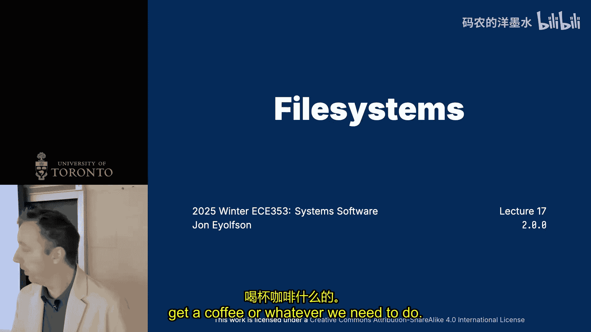
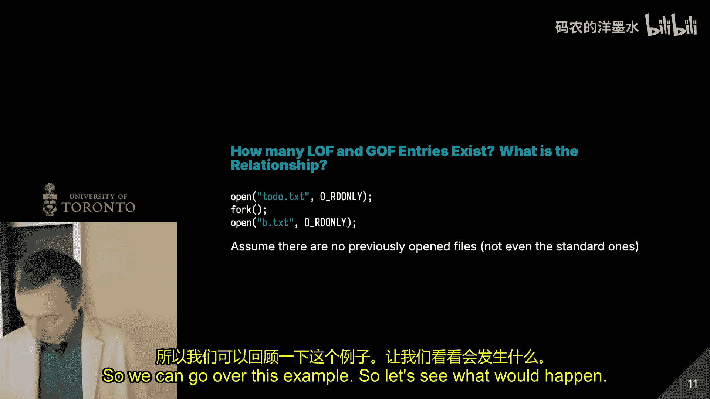
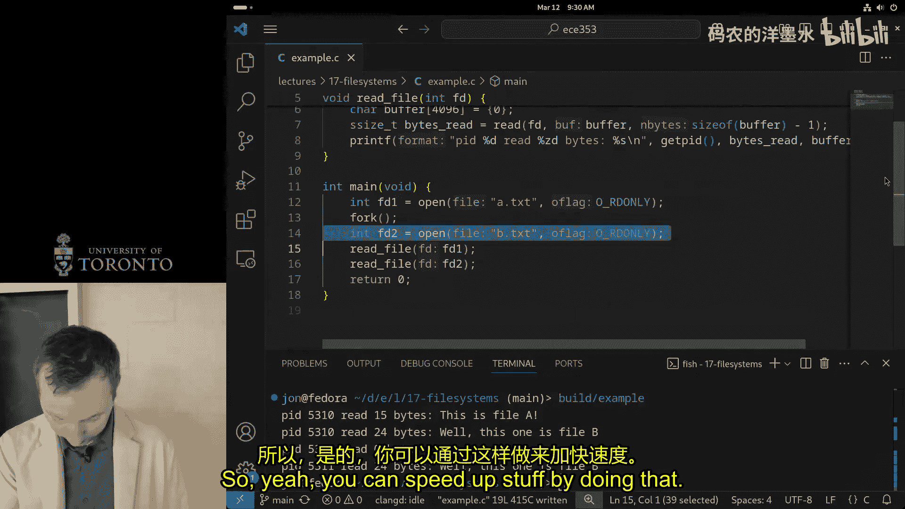
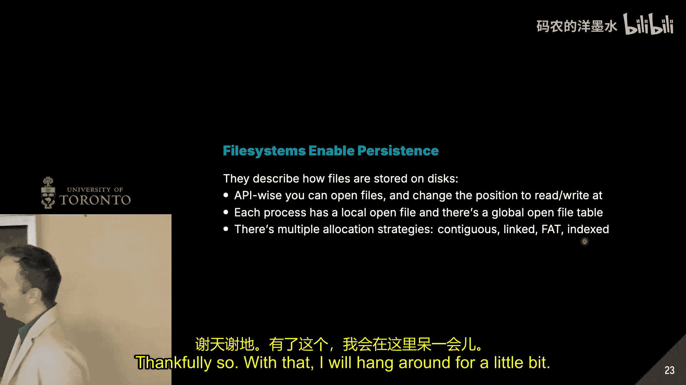

# 017：文件系统基础



在本节课中，我们将学习文件系统的基础知识，包括文件路径、文件访问方式、文件描述符的内部结构以及文件在磁盘上的存储策略。

## 文件系统布局与路径

上一节我们介绍了操作系统的基本概念，本节中我们来看看文件系统是如何组织的。在类Unix系统（如Linux或macOS）中，文件系统遵循一个标准的层次结构，称为文件系统层次结构标准。

*   所有目录的起点是一个特殊的**根目录**，用单个斜杠 `/` 表示。
*   根目录下包含一系列标准目录，例如：
    *   `/bin`：存放可执行文件。
    *   `/dev`：存放内核提供的设备文件。
    *   `/etc`：存放系统配置文件。
    *   `/home`：存放各个用户的个人目录（在macOS中是`/Users`）。
    *   `/mnt`：用于挂载外部存储设备（如USB驱动器）。

当你在终端或程序中操作时，你总是位于一个**当前工作目录**中。要定位一个文件，可以使用两种路径：

*   **绝对路径**：从根目录开始，完整描述文件位置。例如：`/home/john/todo.txt`
*   **相对路径**：相对于当前工作目录。例如，如果当前目录是`/home/john`，那么`todo.txt`或`./todo.txt`就是相对路径。

要访问上级目录，可以使用特殊符号 `..`。例如，从`/home/john`到根目录下的`/mnt/usb`，相对路径是`../../mnt/usb`。

关于特殊符号有一个有趣的历史：最初，程序员为了在列出目录内容时隐藏`.`（当前目录）和`..`（上级目录），写了一个判断条件“如果文件名以点开头就跳过”。这个“优化”导致所有以点开头的文件（如`.bashrc`）都被隐藏了，这个错误后来变成了一个功能，即Unix系统中隐藏文件都以点开头。

另一个特殊符号是`~`，它代表当前用户的**家目录**，其路径也存储在环境变量`HOME`中。当前工作目录的路径则存储在环境变量`PWD`中。

## 文件访问方式

理解了文件的位置后，我们来看看如何访问文件内容。文件访问主要有两种模式：



*   **顺序访问**：这是最常见的方式。每次读取操作都会从文件的当前位置开始，并自动将位置向后移动已读取的字节数。写入操作通常默认是追加模式，即写入后位置移动到文件末尾。
*   **随机访问**：允许你从文件的任意字节位置开始读取或写入。这需要你明确告诉操作系统起始位置。

为了实现随机访问，POSIX系统提供了几个关键的系统调用：

*   `open`：打开一个文件，返回一个**文件描述符**。参数包括路径名、标志（如`O_RDONLY`只读、`O_WRONLY`只写、`O_RDWR`读写、`O_APPEND`追加）和模式（设置文件权限）。
*   `lseek`：改变与文件描述符关联的文件的当前访问位置。其函数原型为：
    ```c
    off_t lseek(int fd, off_t offset, int whence);
    ```
    其中`whence`参数决定`offset`的含义：
    *   `SEEK_SET`：`offset`是相对于文件开头的绝对位置。
    *   `SEEK_CUR`：`offset`是相对于当前位置的偏移量。
    *   `SEEK_END`：`offset`是相对于文件末尾的偏移量。
*   `read` / `write`：进行实际的读写操作。
*   `opendir` / `readdir`：用于读取目录中的条目。



## 文件描述符的内部结构

之前我们简单地将文件描述符比作指向文件的指针，实际上它的结构更精细。每个进程都有一个**本地打开文件表**（是其PCB的一部分），文件描述符就是这个表的索引。

本地打开文件表中的每一项并不直接指向文件，而是指向一个由内核管理的**全局打开文件表**中的条目。全局打开文件表的每个条目（GOT entry）包含：

*   **当前文件偏移量**（访问位置）。
*   **打开文件的标志**（如读、写、追加权限）。
*   一个指向**vnode**的指针。

**vnode**是内核用于抽象任何可以读写字节的对象的通用结构，它可以代表普通文件、目录、管道或网络套接字等。

当进程调用`fork()`时，子进程会复制父进程的整个PCB，包括本地打开文件表。这意味着父子进程的文件描述符指向**同一个**全局打开文件表条目。因此，如果其中一个进程通过`lseek`或`read`/`write`改变了文件位置，另一个进程看到的文件位置也会改变，因为它们共享同一个全局条目。

如果进程在`fork()`之后**再**调用`open()`打开同一个文件，那么`open`系统调用会为每个进程创建一个**新的、独立的**全局打开文件表条目。这样，两个进程对该文件的访问位置就完全独立了。

让我们通过一个例子来巩固理解：假设文件`A.txt`内容为“this is file A”。父进程先打开`A.txt`得到文件描述符`fd1`，然后调用`fork()`。在子进程中，两者都通过`fd1`读取文件。由于它们共享同一个全局条目，谁先执行`read`，谁就读走全部内容，后执行者读到0字节。如果子进程在`fork`后**再**打开`B.txt`得到新的`fd2`，那么每个进程对自己的`fd2`都有独立的访问位置，互不影响。

## 文件存储策略

以上我们讨论了如何通过API访问文件。接下来，我们看看文件内容是如何在物理磁盘（或SSD）上存储和组织的。核心问题是：如何记录一个文件占用了哪些磁盘块？

以下是几种主要的策略：

**1. 连续分配**
文件的所有数据块在物理上必须连续存放。只需记录起始块号和块数即可。
*   **优点**：描述信息非常简洁（只需起始块和长度），随机访问速度快（通过偏移量可直接计算物理块号）。
*   **缺点**：文件难以增长（需要挪动后续文件或寻找足够大的连续空间），容易产生**外部碎片**（即磁盘上存在许多小的、不连续的空闲块，无法被大文件使用）。

**2. 链接分配**
将文件的数据块组织成一个链表。每个数据块末尾存储下一个块的指针。
*   **优点**：文件可以轻松增长和缩小，没有外部碎片（任何空闲块都可用）。
*   **缺点**：随机访问性能极差（必须从链表头开始遍历），且每个块需要额外空间存储指针。

**3. 文件分配表**
这是链接分配的一种优化，用于FAT32等文件系统。它将所有块的“下一个指针”集中存储在一个单独的、连续的区域（即FAT表）。
*   **优点**：继承了链接分配的所有优点（易增长、无外部碎片），且指针集中存储更利于缓存，随机访问比普通链表快。
*   **缺点**：FAT表的大小与磁盘总容量成正比，对于大磁盘会占用大量空间。

**4. 索引分配**
为每个文件创建一个**索引块**，该块是一个数组，数组的每个条目直接指向文件的一个数据块。这类似于页表的概念。
*   **优点**：随机访问速度极快（通过偏移量可直接在索引块中查找），文件可以非连续存放，无外部碎片。
*   **缺点**：每个文件都需要一个额外的索引块。更重要的是，**单个文件的大小受限于索引块能存储的指针数量**。

让我们计算一下索引分配的局限性：假设磁盘块大小为8KB（2^13字节），指针大小为4字节（2^2字节）。那么一个索引块可以存储 `2^13 / 2^2 = 2^11` 个指针。因此，一个文件最大能寻址 `2^11` 个数据块，总大小为 `2^11 * 2^13 = 2^24` 字节，即16MB。这对于现代文件系统来说显然太小了。

---



本节课中我们一起学习了文件系统的基础。我们了解了文件系统的标准布局和路径解析方式，掌握了顺序访问和随机访问的区别以及`lseek`系统调用的用法。我们深入剖析了文件描述符的本质，明白了它通过本地和全局两级表与vnode关联的机制，并清楚了`fork`与`open`对文件共享的影响。最后，我们探讨了四种主要的磁盘文件存储策略：连续分配、链接分配、文件分配表（FAT）和索引分配，分析了它们各自的优缺点，并指出了简单索引分配在文件大小上的限制。在下一讲中，我们将学习如何通过多级索引等方法来突破这个限制。