# 018：索引节点 📂

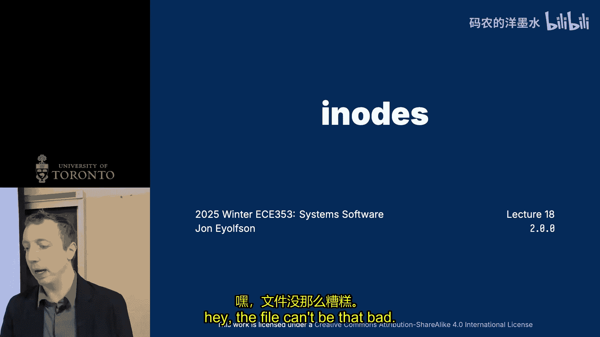

在本节课中，我们将学习文件系统中一个核心的数据结构——索引节点（inode）。我们将了解它如何高效地管理文件数据块，以及它与我们熟悉的`ls`、`ln`、`rm`等命令之间的关系。

## 概述：什么是索引节点？

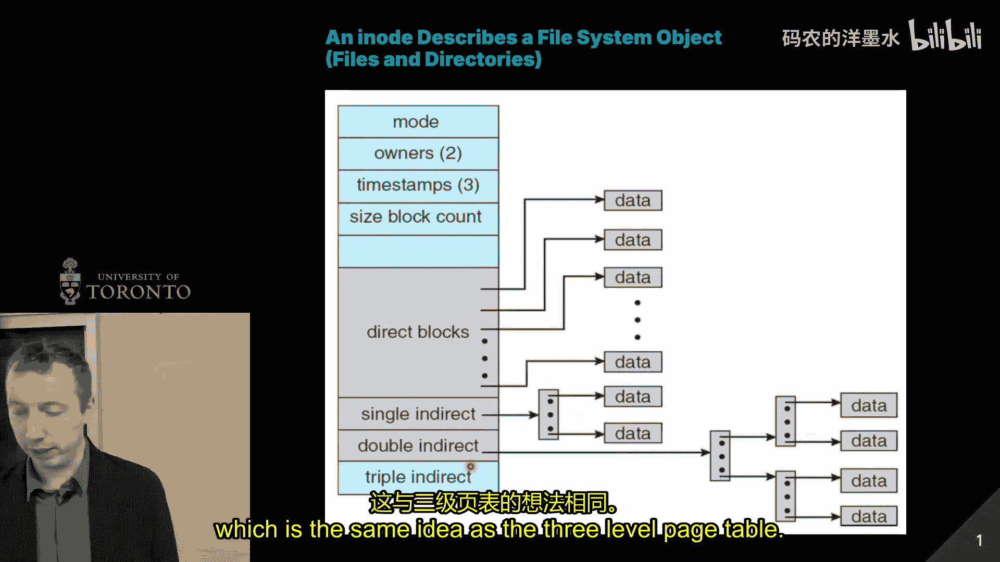

索引节点是内核中用于描述文件在磁盘上存储位置及相关元信息的结构。它记录了文件的所有者、权限、时间戳、大小以及最重要的——指向文件数据块的指针。

## 索引节点的结构

上一节我们介绍了文件分配的几种基本方法（如链表、FAT表）。本节中我们来看看Unix/Linux系统采用的更灵活的混合策略——索引节点。

一个索引节点通常包含以下信息：
*   **文件元数据**：如权限（`mode`）、所有者（`user/group`）、时间戳（创建、修改、变更时间）、文件大小、占用的块数等。
*   **数据块指针**：这是一个指针数组，用于定位文件内容实际存储在哪些磁盘块上。

为了在支持大文件的同时，高效处理小文件，索引节点采用了多级指针结构：
*   **12个直接指针**：直接指向存储文件数据的数据块。对于小文件（≤12块），无需额外开销。
*   **1个一级间接指针**：指向一个磁盘块，该块本身是一个指针数组，数组中的每个指针再指向一个数据块。用于中等大小的文件。
*   **1个二级间接指针**：指向一个指针块，该块中的指针再各自指向一个一级间接块。用于更大的文件。
*   **1个三级间接指针**：原理类似三级页表，用于支持巨型文件。

这种设计是空间与效率的权衡，类似于虚拟内存中的多级页表。

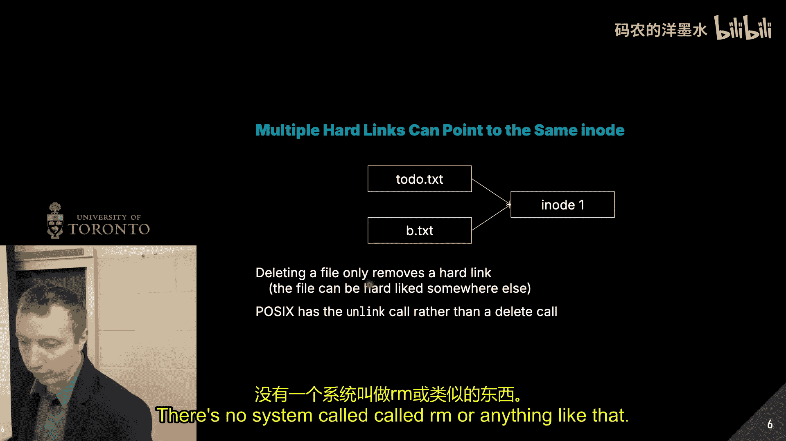

## 最大文件尺寸计算

了解了索引节点的结构后，我们可以像计算虚拟地址空间一样，计算它所能支持的最大文件尺寸。

假设以下参数：
*   磁盘块大小：`BlockSize = 8KB = 2^13 Bytes`
*   指针大小：`PointerSize = 4 Bytes = 2^2 Bytes`
*   每个间接块仅包含直接指针（即数据块指针）。

那么，一个间接块能存储的指针数量为：
`PointersPerBlock = BlockSize / PointerSize = 2^13 / 2^2 = 2^11`

可寻址的数据块总数为：
*   **直接块**：`12` 块
*   **一级间接**：`2^11` 块
*   **二级间接**：`(2^11)^2 = 2^22` 块
*   **三级间接**：`(2^11)^3 = 2^33` 块

显然，三级间接块占主导。因此，最大文件尺寸近似为：
`MaxFileSize ≈ 2^33 * BlockSize = 2^33 * 2^13 = 2^46 Bytes = 64 TB`

这个尺寸对于绝大多数应用已经足够。如果需要支持更大的文件，只需增加**四级间接指针**即可。

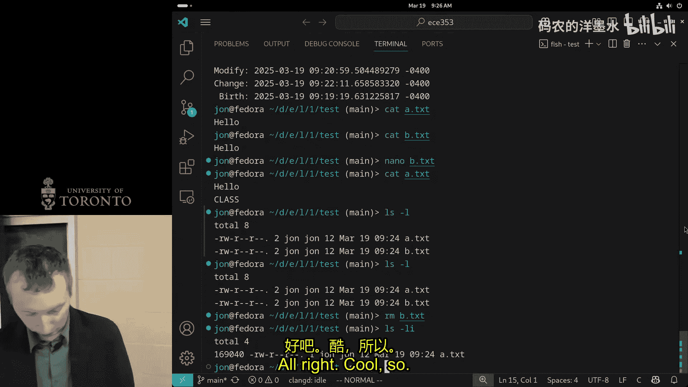

## 硬链接与软链接

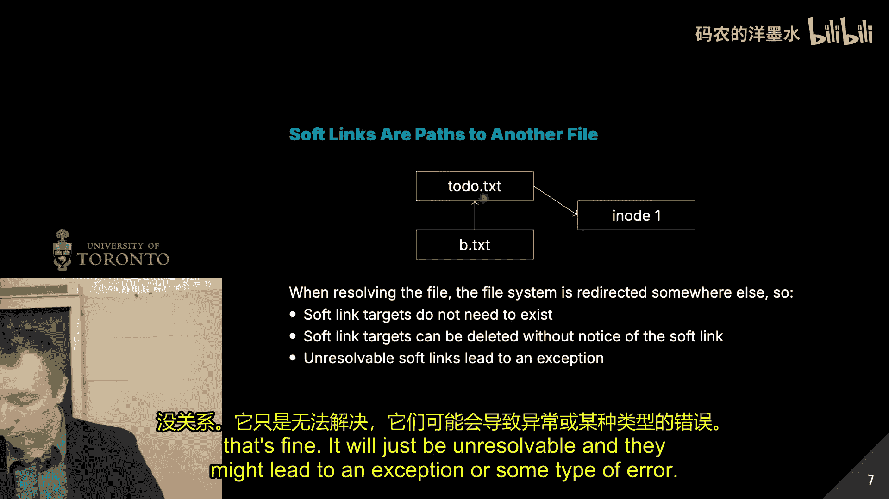

索引节点是文件在磁盘上的唯一标识，而文件名则是我们访问它的方式。这就引出了“链接”的概念。

### 硬链接

一个硬链接就是一个指向索引节点的目录条目（文件名）。多个不同的文件名（硬链接）可以指向同一个索引节点。

创建硬链接的命令是 `ln`：
```bash
ln source_file hardlink_name
```
例如，`ln a.txt b.txt` 会创建一个新文件名 `b.txt`，它与 `a.txt` 指向同一个索引节点。

**关键特性**：
*   删除文件（`rm`）实际上只是删除一个硬链接（系统调用是 `unlink`），只有当指向某个索引节点的硬链接数降为0时，该文件所占用的空间才会被真正释放。
*   通过任何一个硬链接修改文件内容，所有指向该索引节点的硬链接看到的内容都会同步更新。
*   **回收站原理**：回收站本质上就是保留了一个指向文件的硬链接，所以“删除”和“恢复”操作都非常快。

使用 `ls -li` 可以查看文件的索引节点号（第一列）和硬链接计数（第二列）。`stat` 命令可以显示更详细的索引节点信息。

### 软链接（符号链接）

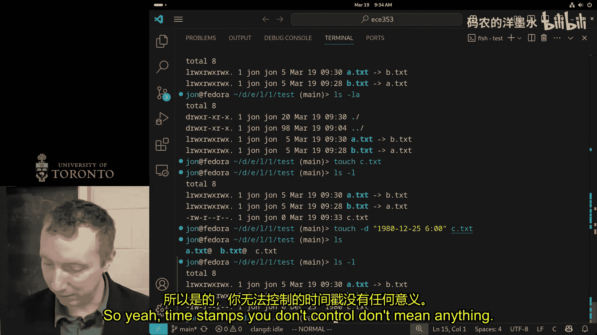

软链接则是一个特殊文件，其内容存储的是另一个文件的**路径名**。可以理解为“指向名字的名字”。

创建软链接需要 `-s` 选项：
```bash
ln -s target_file symlink_name
```

**关键特性**：
*   软链接有自己的索引节点。
*   如果目标文件被删除，软链接会成为“悬空链接”，访问时会报错。
*   可以创建循环软链接（如A指向B，B指向A），内核会检测到这种循环并返回 `ELOOP` 错误。
*   可以跨文件系统创建。

## 目录与文件类型

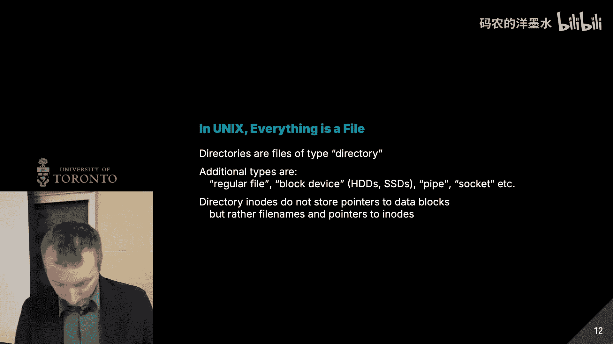

在Unix哲学中，一切皆文件。目录本身也是一种特殊类型的文件。

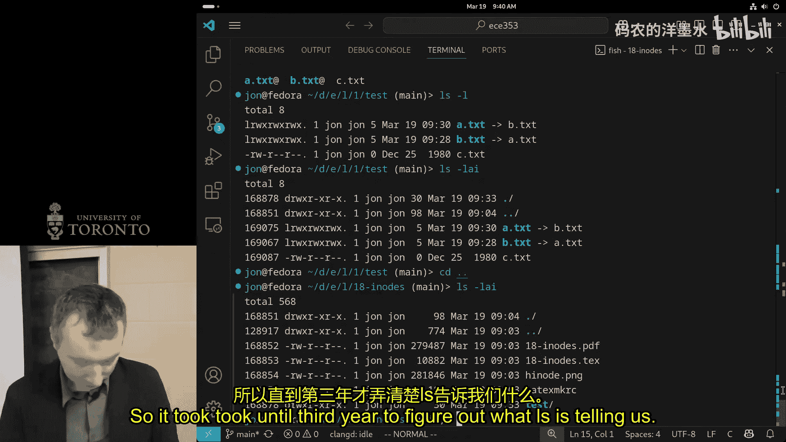

目录文件的内容非常简单，它不存储数据块指针，而是存储一个**（文件名，索引节点号）** 对的列表。此外，还包含两个特殊条目：
*   `.` ：指向目录自身的索引节点。
*   `..` ：指向父目录的索引节点。

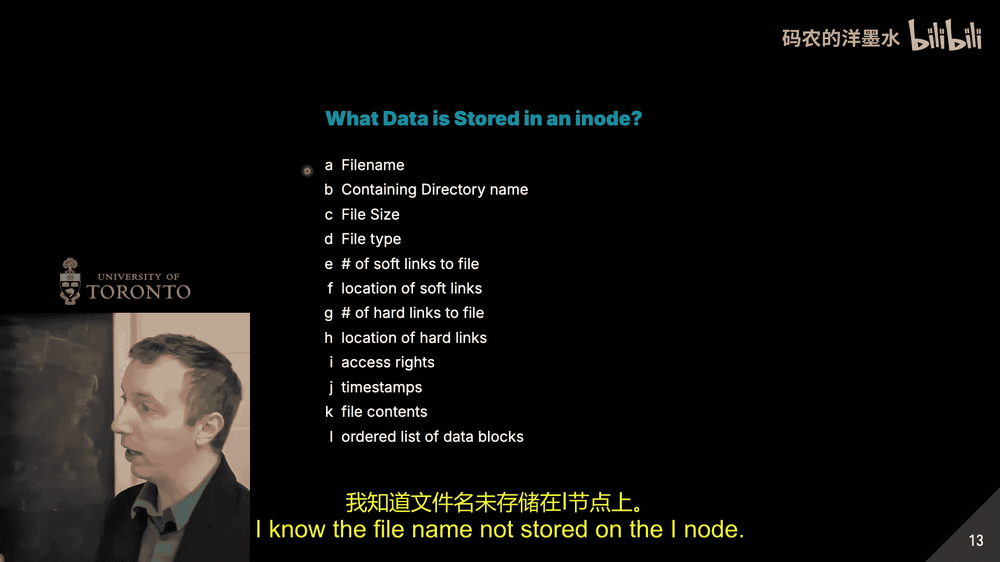

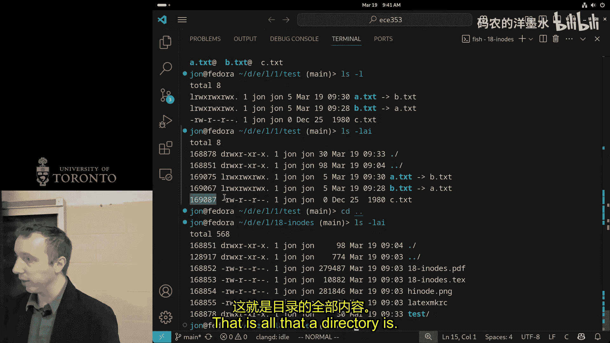

使用 `ls -lia` 可以查看包括 `.` 和 `..` 在内的所有目录条目及其索引节点号。

除了常规文件和目录，索引节点还可以表示其他类型：
*   **符号链接** (`l`)
*   **块设备** (`b`)，如硬盘 (`/dev/sda`)
*   **字符设备** (`c`)
*   **管道** (`p`)
*   **套接字** (`s`)

## 文件系统缓存与日志

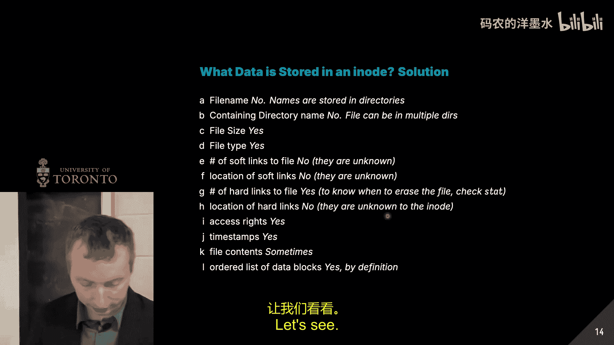

### 文件系统缓存

由于磁盘读写速度远慢于内存，操作系统会使用**文件系统缓存**来提升性能。
*   **时间局部性**：刚被访问的数据很可能再次被访问。
*   **空间局部性**：访问某个数据时，其附近的数据也很可能被访问。

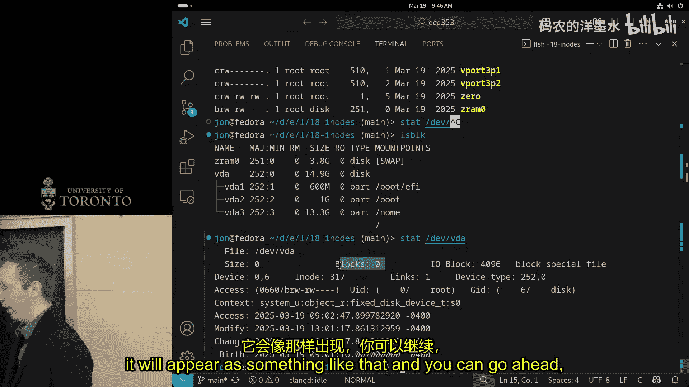

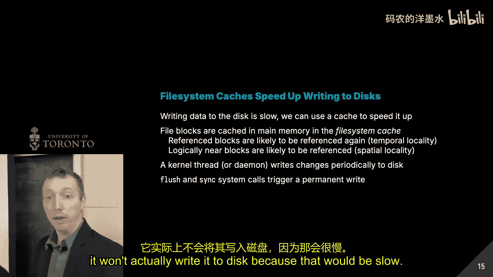

因此，对文件的修改通常会先写入内存中的缓存，由内核后台线程定期或显式调用 `sync`/`fsync` 时，才将缓存中的数据刷回磁盘。这提升了速度，但也意味着突然断电可能导致数据丢失。

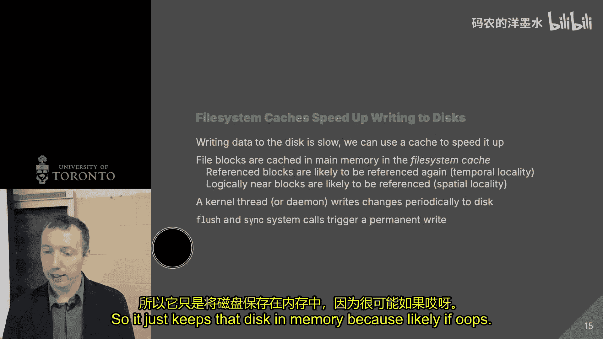

### 日志文件系统

文件操作（如删除）通常涉及多个步骤（如从目录删除条目、释放索引节点、释放数据块）。如果系统在步骤之间崩溃，会导致文件系统处于不一致状态。

**日志文件系统** 的解决方法是：
1.  **日志记录**：在真正执行操作前，将“准备做什么”作为一条记录写入一个专门的区域（日志）。
2.  **执行操作**：按步骤执行实际的文件系统操作。
3.  **提交日志**：所有操作成功后，在日志中标记该事务完成。

如果系统在步骤2中崩溃，重启后文件系统会检查日志，发现未完成的事务，并重新执行或回滚这些操作，从而快速恢复一致性，无需漫长的全盘扫描 (`fsck`)。

## 总结

本节课我们一起学习了文件系统的核心——索引节点。
*   索引节点采用**混合多级指针**结构，巧妙平衡了小文件的高效存储和大文件的容量支持。
*   **硬链接**是多个文件名指向同一个索引节点，**软链接**则是一个存储目标路径的特殊文件。
*   **目录**本质是（文件名，索引节点号）的列表。
*   通过**文件系统缓存**提升性能，通过**日志机制**保证崩溃后的一致性。

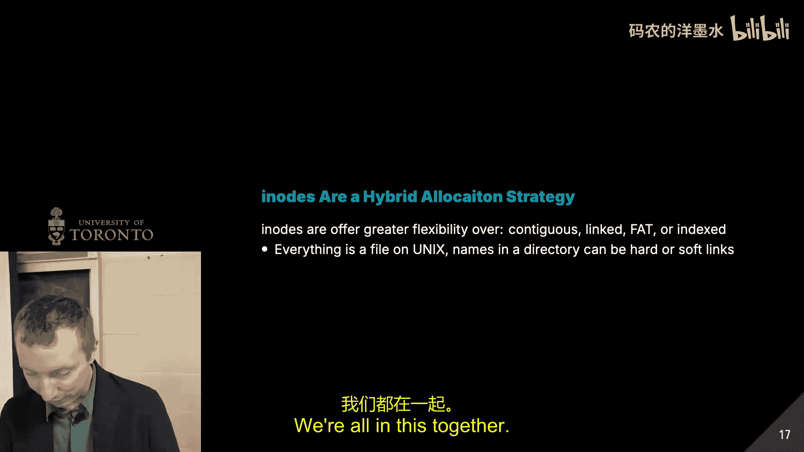

理解索引节点是理解文件系统如何组织和管理数据的关键一步。