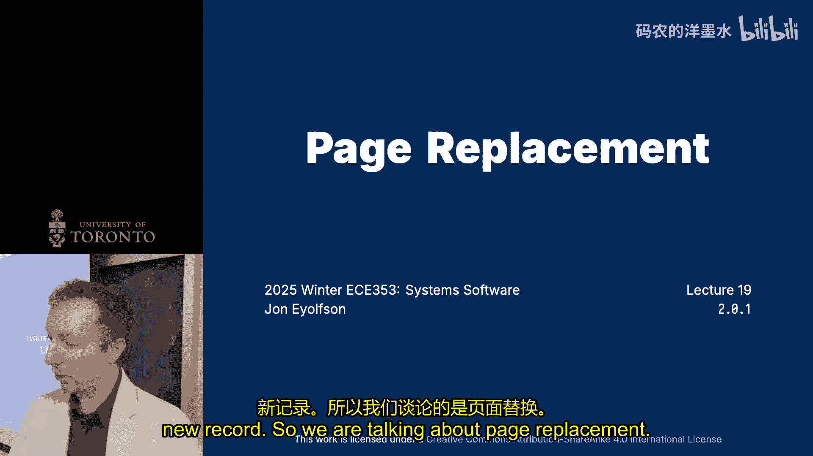
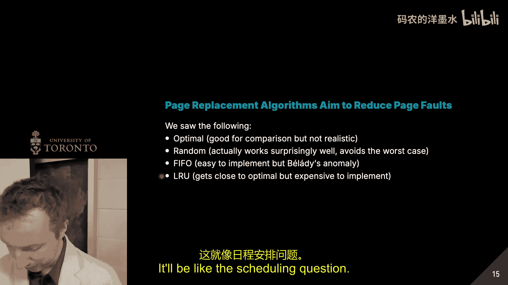
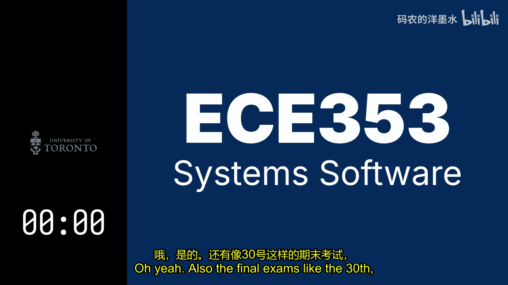
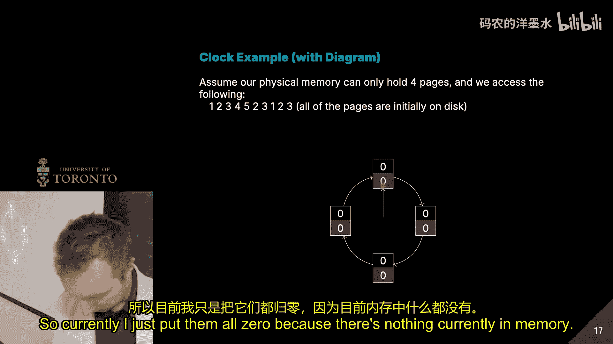
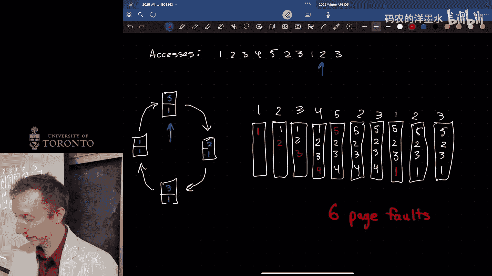
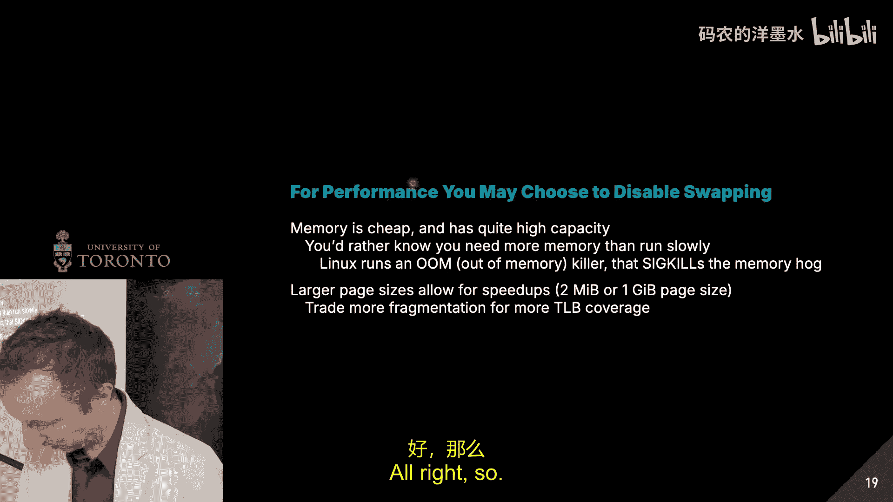
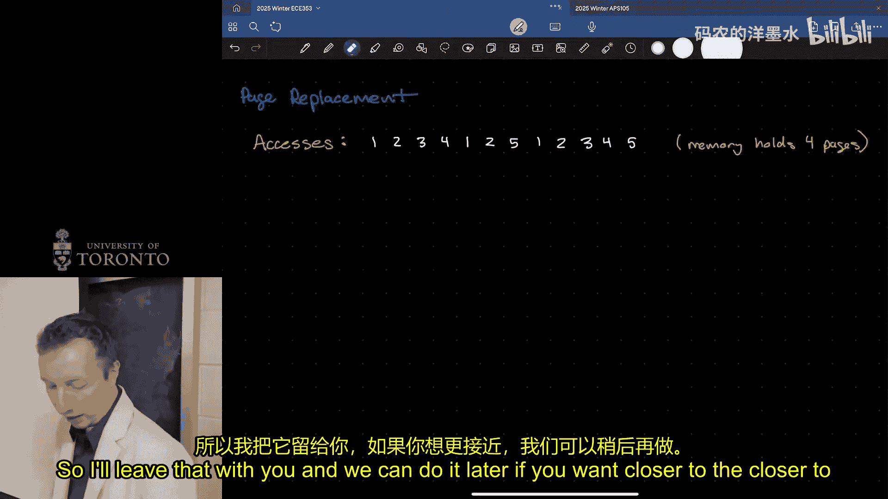
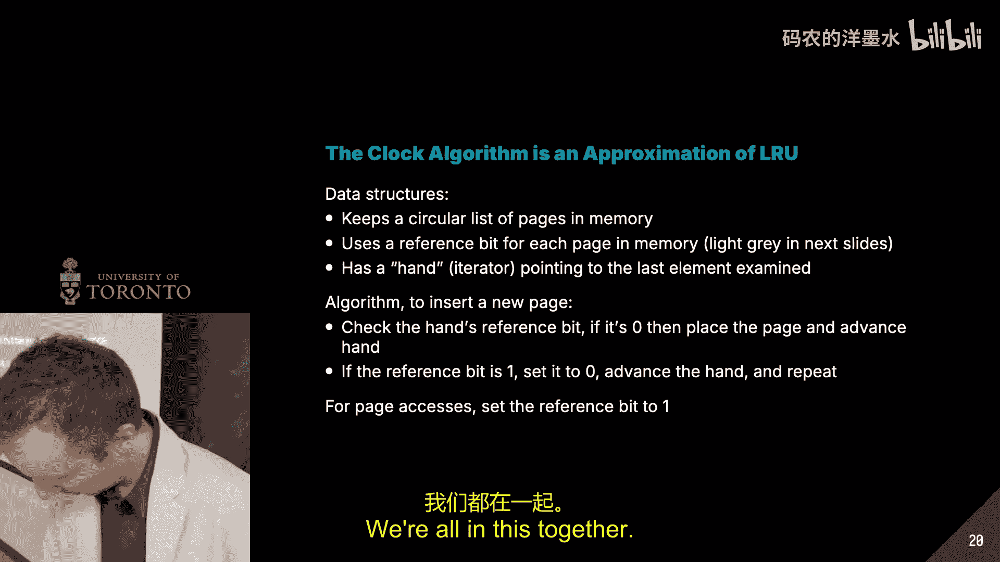

# 019：页面置换 🧠

在本节课中，我们将要学习操作系统中的页面置换算法。当物理内存空间不足时，操作系统需要决定将哪些页面移出内存，以为新页面腾出空间。我们将探讨几种不同的置换策略，并学习如何评估它们的效率。

## 内存层次结构回顾

上一节我们介绍了虚拟内存的基本概念，本节中我们来看看支撑虚拟内存的硬件基础——内存层次结构。

计算机的内存层次结构总是在容量和速度之间进行权衡。金字塔的顶端是速度最快但容量最小的部件。

*   **CPU寄存器**：速度最快，数量有限。
*   **CPU缓存（L1, L2, L3）**：速度次之，容量更大。
*   **内存（RAM）**：易失性存储器，可视为CPU的缓存。
*   **非易失性存储（NVM/SSD）**：速度较慢，容量大。
*   **硬盘驱动器（HDD）**：速度更慢，容量更大。
*   **磁带驱动器**：速度非常慢，但单位容量成本极低，用于海量数据归档。

整个层次结构的目标是对用户隐藏其复杂性。每一层都试图表现得像拥有上一层的速度和下一层的容量。对于内存管理而言，这意味着我们希望所有进程使用的内存总量能够超过物理内存的实际容量，因为我们利用了并非所有页面都会同时被使用这一事实。

## 按需调页与交换空间

我们可以将磁盘用作内存的缓存。如果一个页面在内存中长时间未被使用，我们可以将其“踢出”到磁盘上存储。当再次需要该页面时，再从磁盘加载回内存。这个过程使得计算机能够使用比物理内存容量更多的虚拟内存。

在典型的现代系统中，我们使用**按需调页**。我们将内存页面映射到文件系统的块。只有当一个页面被实际访问时（通过触发**页面错误**），操作系统才会将其从磁盘加载到内存中。如果该页面不代表一个文件（例如，只是进程分配的匿名内存），则可以将其映射到**交换空间**（Swap Space）。这就是你在Windows（页面文件）、macOS或Linux上看到的那个大文件的作用。

## 工作集与颠簸

一个进程的**工作集**是指在给定时间间隔内，该进程活跃使用的页面集合。进程的工作集必须能够放入物理内存中。如果工作集无法全部装入物理内存，进程就会陷入**颠簸**状态：页面频繁地在磁盘和内存之间来回交换，导致程序运行极其缓慢。我们必须不惜一切代价避免这种情况。

## 页面置换算法

现在，我们进入核心内容：页面置换算法。我们假设页面最初都在磁盘上，而内存中只能容纳固定数量的页面。当内存已满且需要加载新页面时，我们必须选择并“踢出”一个旧页面。

以下是几种主要的页面置换算法：

*   **最优算法（OPT）**：置换在未来最长时间内不会被访问的页面。这是一个理想化的算法，因为需要预知未来，仅用于理论比较。
*   **随机算法（RANDOM）**：随机选择一个页面进行置换。实际效果出人意料地好，通常优于FIFO。
*   **先进先出算法（FIFO）**：置换最早进入内存的页面。实现简单，但性能较差，并且存在“Belady异常”。
*   **最近最少使用算法（LRU）**：置换最长时间没有被访问的页面。它用过去的行为来预测未来，性能接近最优算法。

### 算法评估示例

为了评估这些算法，我们通常假设一个很小的物理内存容量（例如，只能容纳4个页面），并给定一个页面访问序列。我们的目标是计算在整个访问过程中发生的**页面错误**（即需要从磁盘加载页面）的总数，数量越少越好。

假设访问序列为：1, 2, 3, 4, 1, 2, 5, 1, 2, 3, 4, 5。
物理内存容量为4个页帧。

**最优算法（OPT）分析**：
1.  访问1，2，3，4：均为页面错误，加载入内存。`[1, 2, 3, 4]`
2.  访问1，2：已在内存中，命中。
3.  访问5：内存已满，需置换。查看未来访问序列：1和2即将被访问，3在稍后被访问，4在最久之后才被访问。因此置换4。`[1, 2, 3, 5]`
4.  访问1，2，3：均在内存中，命中。
5.  访问4：内存已满，需置换。未来序列中，5是下一个被访问的。因此可以置换1、2或3中的任意一个（只要不置换5）。假设置换1。`[4, 2, 3, 5]`
6.  访问5：已在内存中，命中。
总页面错误数：**6次**。

**先进先出算法（FIFO）分析**：
1.  访问1，2，3，4：加载入内存。`[1 (最早), 2, 3, 4]`
2.  访问1，2：命中。
3.  访问5：内存已满，置换最早进入的页面1。`[5, 2 (最早), 3, 4]`
4.  访问1：页面错误，置换最早进入的页面2。`[5, 1, 3 (最早), 4]`
5.  访问2：页面错误，置换最早进入的页面3。`[5, 1, 2, 4 (最早)]`
6.  访问3：页面错误，置换最早进入的页面4。`[5, 1, 2, 3]`
7.  访问4：页面错误，置换最早进入的页面5。`[4, 1 (最早), 2, 3]`
8.  访问5：页面错误，置换最早进入的页面1。`[4, 5, 2 (最早), 3]`
总页面错误数：**10次**。比OPT多。

### Belady异常

有趣的现象是，对于FIFO算法，**增加物理内存页帧数有时反而会导致更多的页面错误**，这被称为Belady异常。例如，将内存容量从4页帧减少到3页帧，用FIFO处理同样的序列，可能只产生9次页面错误（少于4页帧时的10次）。这违背了“内存越多，性能越好”的直觉。但请注意，这种异常**仅存在于FIFO算法中**，LRU等算法不存在此问题。

**最近最少使用算法（LRU）分析**：
1.  访问1，2，3，4：加载入内存。`[1, 2, 3, 4]`
2.  访问1，2：命中，更新访问顺序（1和2变为最近使用）。
3.  访问5：内存已满，需置换。回顾过去，最近最少使用的是3（接着是4）。置换3。`[1, 2, 5, 4]`
4.  访问1，2：命中。
5.  访问3：页面错误，内存已满。回顾过去，最近最少使用的是4。置换4。`[1, 2, 5, 3]`
6.  访问4：页面错误，内存已满。回顾过去，最近最少使用的是5。置换5。`[1, 2, 4, 3]`
7.  访问5：页面错误，内存已满。回顾过去，最近最少使用的是1。置换1。`[5, 2, 4, 3]`
总页面错误数：**8次**。介于OPT和FIFO之间。

### LRU的实现挑战与时钟算法

LRU虽然性能较好，但精确实现成本高昂。它需要为每个页面维护精确的访问时间戳或在每次访问时调整一个链表，这在每次内存访问时都会带来不小的开销。

因此，实际的操作系统使用LRU的近似算法。最著名的一种是**时钟算法**。

时钟算法需要以下数据结构：
*   一个由内存中所有页帧组成的**环形链表**（像时钟一样）。
*   每个页帧关联一个**引用位**。
*   一个“指针”（或称为“时钟臂”），指向当前检查的位置。

算法规则如下：
*   **快速路径（页面访问）**：当某个页面被访问时，硬件（MMU）自动将其**引用位设置为1**。这是唯一且非常快速的操作。
*   **慢速路径（页面置换）**：当需要置换页面时，算法开始工作：
    1.  检查指针当前指向的页帧的引用位。
    2.  如果引用位为 **0**，则选择该页帧作为受害者进行置换。将新页面放入此位置，并将其引用位设为1。然后将指针**向前移动一位**。
    3.  如果引用位为 **1**，则**将其置为0**（给予该页面第二次机会），然后将指针**向前移动一位**。重复此步骤，直到找到一个引用位为0的页帧。

**时钟算法示例（简略）**：
假设内存有4个页帧，初始为空，访问序列：1, 2, 3, 4, 5, 2, 3, 1, 2, 3。
1.  加载1，2，3，4：每次置换时，指针移动并设置引用位为1。
2.  访问5：需置换。指针循环查找，将遇到的引用位为1的页帧都置为0，直到找到第一个原本就是0的页帧（或刚被置为0的页帧）进行置换。假设置换页面1，放入5，引用位置1，指针后移。
3.  访问2，3：命中，仅将其引用位置1。
4.  访问1：页面错误。指针开始查找，跳过引用位为1的2和3（并将它们置0），最终找到引用位为0的页面4进行置换。
整个过程产生的页面错误数介于LRU和FIFO之间，但开销远小于精确LRU。

## 其他高级话题

*   **禁用交换**：在内存充足的服务器上，有时会完全禁用交换功能，以避免不可预测的性能下降。当物理内存耗尽时，Linux内核的“OOM Killer”会直接终止消耗内存最多的进程。
*   **大页**：使用大于传统的4KB的页面（如2MB的“大页”或1GB的“巨页”）。这可以减少页表级数和TLB未命中次数，提高性能，但代价是可能增加内部碎片。

## 总结

本节课中我们一起学习了操作系统中的页面置换。我们了解了内存层次结构的目标，以及按需调页和交换空间如何让系统使用比物理内存更大的虚拟地址空间。我们重点探讨了几种页面置换算法：作为理论基准的**最优算法（OPT）**、简单的**随机算法**、存在Belady异常的**先进先出算法（FIFO）**，以及性能较好但实现代价高的**最近最少使用算法（LRU）**。最后，我们学习了实际系统中常用的LRU近似算法——**时钟算法**，它通过一个环形链表和引用位，以较低的开销实现了接近LRU的效果。理解这些算法对于分析系统性能和进行系统编程至关重要。