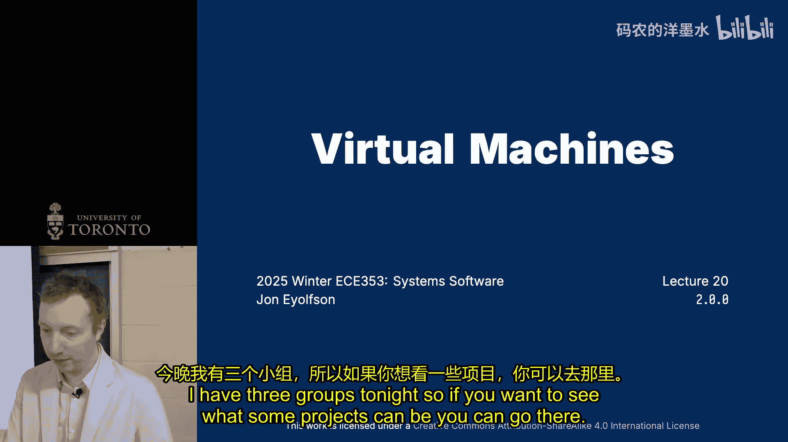
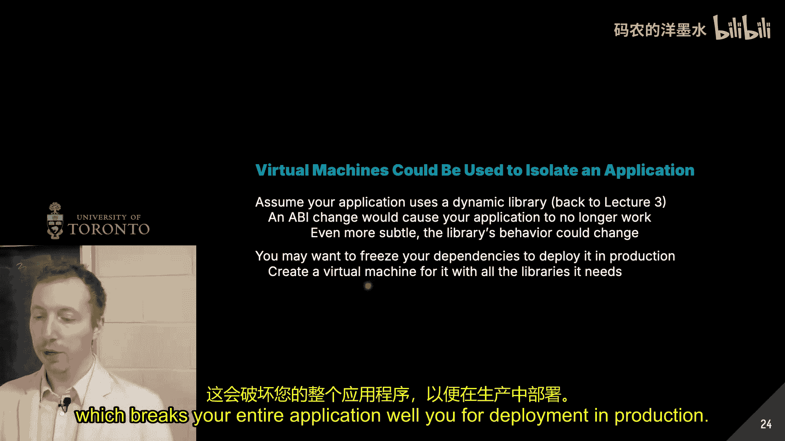

# 020：虚拟机 🖥️

在本节课中，我们将要学习虚拟机的核心概念。虚拟机是一种强大的技术，它允许我们在单个物理计算机上运行多个独立的操作系统。我们将探讨其工作原理、不同类型以及它们带来的优势。

## 概述

虚拟机的核心思想是抽象整个计算机硬件。与进程抽象单个程序的运行不同，虚拟机抽象了整个机器。这使得多个操作系统可以共享同一台物理硬件，而每个操作系统都认为自己独占所有资源。

## 虚拟机与进程的对比

上一节我们介绍了虚拟机的基本概念，本节中我们来看看它与我们熟悉的进程模型有何异同。

进程模型（左图）中，硬件之上是运行在内核模式的操作系统内核，再之上是通过系统调用接口与内核交互的用户模式进程。

虚拟机模型（右图）则在物理硬件之上增加了一个**虚拟机监控程序（Hypervisor）**。Hypervisor之上是多个**客户机（Guest）**，每个客户机都包含自己的内核和用户进程。客户机看到的是由Hypervisor虚拟化出来的硬件。

## 虚拟机的类型与工作原理

了解了基本模型后，我们来看看虚拟机的具体类型及其运行机制。

虚拟机监控程序（Hypervisor）是创建和管理虚拟机的软件。它控制虚拟机的创建、资源分配和隔离。Hypervisor主要分为两种类型：

以下是两种主要Hypervisor类型的说明：
*   **类型1 Hypervisor（裸机Hypervisor）**：这种Hypervisor直接运行在主机硬件上，需要特殊的硬件支持（如Intel VT-x或AMD-V）。它通常性能更高。
*   **类型2 Hypervisor（托管式Hypervisor）**：这种Hypervisor作为一个普通应用程序运行在主机操作系统之上。它不需要特殊硬件，但性能通常较低，因为它需要模拟内核模式操作。

**关键抽象：虚拟CPU（vCPU）**
虚拟机的关键抽象是**虚拟CPU（vCPU）**。它类似于进程控制块（PCB），但存储了整个CPU的状态，包括仅在内核模式下可访问的寄存器。当客户机不运行时，Hypervisor会保存vCPU的状态；恢复运行时，则加载这些状态。

## 虚拟化面临的挑战与解决方案

上一节我们介绍了虚拟机的基本运行方式，本节中我们来看看在实现虚拟化时遇到的具体挑战及其解决方案。

对于类型2 Hypervisor，客户机操作系统实际上运行在用户模式。当它尝试执行特权指令（内核模式指令）时，会产生非法指令异常。Hypervisor必须捕获这个异常，模拟该指令应有的行为，更新vCPU状态，然后恢复客户机执行。这个过程称为**陷入与模拟（Trap-and-Emulate）**。

然而，某些CPU指令（特别是在x86架构上）的行为会根据CPU模式（用户/内核）而改变，但指令本身并非特权指令，因此无法通过“陷入”来捕获。这些被称为**特殊指令**。

处理特殊指令需要**二进制翻译（Binary Translation）**。当客户机vCPU处于内核模式时，Hypervisor必须在执行前检查每一条指令。如果发现是特殊指令，就将其翻译成一组具有相同效果的非特殊指令序列。

## 硬件辅助虚拟化

由于软件模拟的性能开销很大，现代CPU提供了硬件支持来简化并加速虚拟化。

硬件辅助虚拟化（如Intel VT-x和AMD-V）在CPU中引入了一个新的特权级别，通常称为**Hypervisor模式**（在x86上称为环-1）。这允许Hypervisor以比客户机内核更高的特权级别运行，从而能够直接、高效地控制硬件，并处理客户机的特权操作，无需复杂的二进制翻译或陷入模拟。这就是类型1 Hypervisor能够高效运行的基础。

## 虚拟机的调度与内存管理

现在我们已经了解了CPU的虚拟化，接下来看看如何调度虚拟机以及如何管理更复杂的虚拟化内存。

**调度**
虚拟机的调度与进程调度类似。Hypervisor需要将多个虚拟CPU（vCPU）映射到物理CPU核心上。如果物理核心足够，可以一对一映射。如果vCPU数量超过物理核心（称为**过量使用**），则Hypervisor需要使用调度算法（如轮转调度）在物理核心上分时运行vCPU。

**内存管理**
内存虚拟化更为复杂。客户机操作系统认为自己管理着整个物理内存，但实际上它看到的是Hypervisor提供的“虚拟物理内存”。因此，我们需要**嵌套页表**。

**嵌套页表**的工作流程如下：
1.  客户机进程使用虚拟地址（VA_G）。
2.  客户机页表将VA_G翻译为客户机认为的“物理地址”（PA_G，实为中间物理地址）。
3.  Hypervisor维护的嵌套页表将PA_G翻译为真实的机器物理地址（PA_M）。

硬件辅助虚拟化（如扩展页表EPT或快速虚拟化索引RVI）可以缓存整个翻译过程（VA_G -> PA_M），从而显著提升性能。

此外，Hypervisor可以在不同客户机之间使用**写时复制**技术来共享相同的内存页（例如，相同的内核或库文件），以提高内存使用效率。

## 虚拟机的输入/输出与设备

除了CPU和内存，输入/输出设备的虚拟化也是关键一环。

Hypervisor可以虚拟化I/O设备，例如：
*   **复用**：将一个物理设备（如网卡）复用于多个虚拟机。
*   **模拟**：提供虚拟机中不存在的虚拟设备。
*   **直通**：通过**IOMMU**技术，将特定物理设备（如GPU）直接分配给某个虚拟机独占访问，从而获得近乎原生的性能。

## 虚拟机的应用与优势

最后，让我们总结一下虚拟机的广泛应用场景和主要优势。

虚拟机通过磁盘镜像文件（包含完整的操作系统和文件系统）来启动，这使得它们易于迁移和分发。

以下是虚拟机的主要优势：
*   **隔离与安全**：每个虚拟机相互隔离。如果一个虚拟机被攻破，不会影响主机或其他虚拟机。
*   **资源整合**：在数据中心，可以将多个轻量级服务器整合到少数物理机上运行，提高资源利用率，降低成本。
*   **灵活性与可迁移性**：虚拟机可以轻松暂停、恢复，并迁移到不同的物理主机上，便于维护和负载均衡。
*   **测试与兼容性**：可以安全地测试软件、不同操作系统甚至恶意软件。也可以运行仅兼容特定操作系统的硬件或软件。

## 总结

本节课中我们一起学习了虚拟机技术。我们从虚拟机与进程的对比入手，深入探讨了Hypervisor的类型、虚拟CPU的抽象、以及虚拟化在CPU指令、内存管理和I/O设备方面面临的挑战与解决方案。我们还了解了硬件辅助虚拟化如何提升性能，并总结了虚拟机在隔离、整合、灵活迁移和测试等方面的强大优势。虚拟机是现代云计算和数据中心的基石技术。