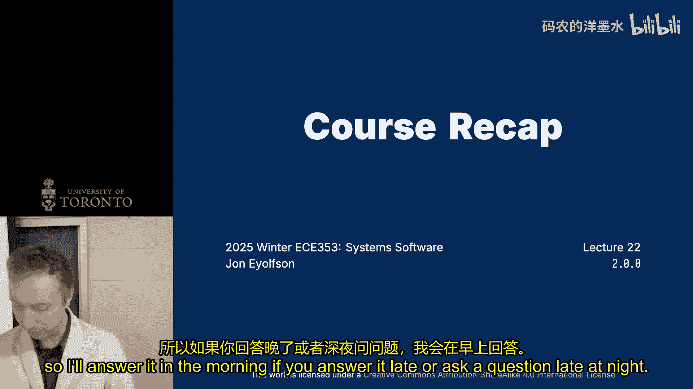
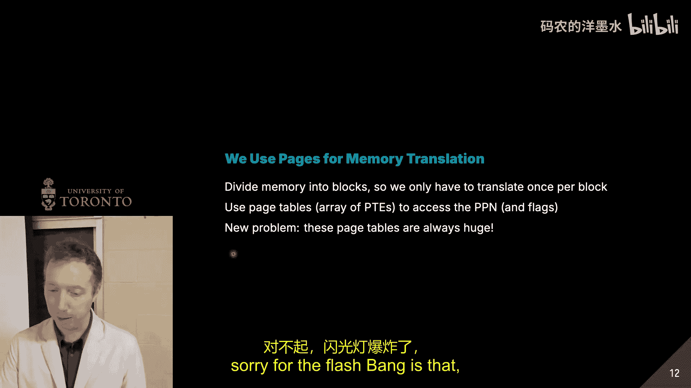
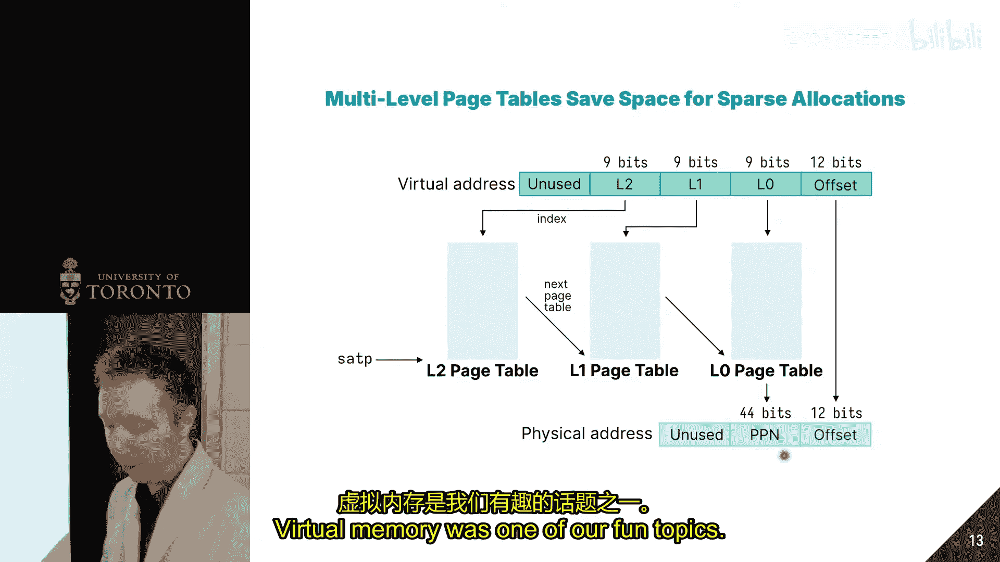
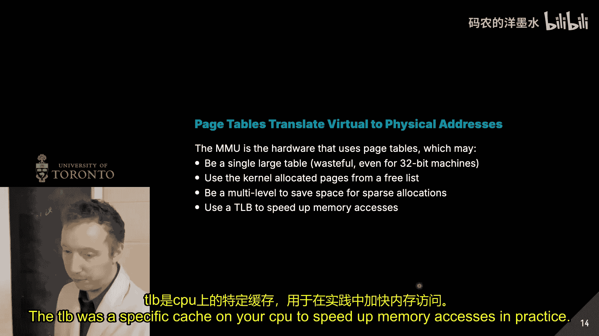
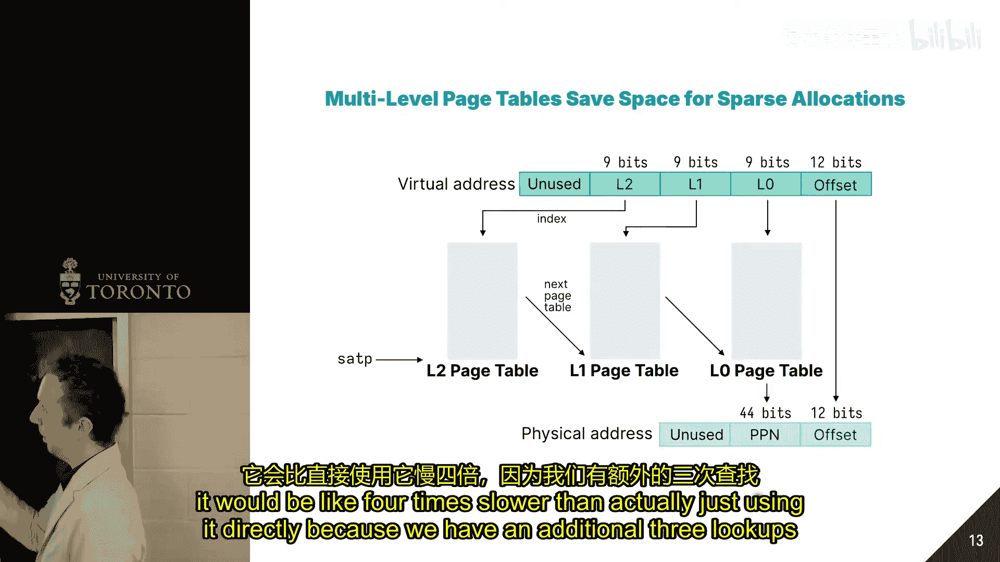

# 022：课程总复习



在本节课中，我们将对整个操作系统课程的核心概念进行一次全面的回顾。我们将梳理从操作系统基础、进程管理、虚拟内存、并发控制到文件系统和虚拟化等所有关键主题，帮助你为期末考试做好准备。

## 操作系统概述与角色

上一节我们介绍了课程的整体框架，本节中我们来看看操作系统的核心角色。

操作系统是介于应用程序和硬件之间的软件层。应用程序通过系统调用或库函数与操作系统交互，而内核是操作系统中唯一能直接与硬件交互的部分，运行在特殊的CPU模式下。

以下是操作系统的三个核心概念：
*   **虚拟化**：通过模拟多个独立副本的方式来共享单一资源。我们虚拟化了几乎所有东西：线程是虚拟化的CPU执行单元，内存被放入进程中，甚至整个机器都可以被虚拟化。
*   **并发**：处理多个同时发生的事件。这使得编程变得真实，因为程序不再是简单的顺序执行。
*   **持久性**：确保数据在断电后依然保持一致。这涉及到文件系统如何存储文件，以及确保数据一致性的硬件方法（如RAID）。

## CPU特权模式与内核架构

理解了操作系统的角色后，我们来看看支撑它的硬件和软件结构。

CPU存在多种特权模式：
*   **用户模式**：应用程序和库在此运行，无法直接访问硬件。
*   **内核模式**：操作系统内核在此运行，可以执行直接与硬件交互的指令。
*   **虚拟机监控程序模式**：比内核模式权限更高，用于运行虚拟机。
*   **其他模式**：在某些架构中，还存在权限最高的模式（如用于引导加载程序）。

内核是操作系统的核心。根据组织方式，主要有两种内核架构：
*   **宏内核**：将所有与硬件相关的功能（如虚拟内存管理、进程调度、文件系统、设备驱动）都运行在内核空间。例如Linux内核。优点是性能高，缺点是代码庞大，潜在漏洞多。
*   **微内核**：仅将最少的服务（如虚拟内存、基本进程调度、进程间通信）运行在内核模式。其他如设备驱动、文件系统等运行在用户空间。优点是更安全、模块化，缺点是因频繁的系统调用导致性能可能下降。

实际系统中常采用混合架构，例如macOS将设备驱动放在用户空间，而文件系统放在内核空间。

## 进程管理

内核架构决定了系统的基础，而进程管理则是其核心职责之一。

进程是运行中的程序实例。内核通过**进程控制块**来跟踪和管理进程。创建新进程的唯一系统调用是 `fork()`，它会克隆当前进程。`execve()` 系统调用则用于加载并执行一个新程序。

内核维护严格的父子进程关系，需要防止两种问题进程：
*   **僵尸进程**：子进程已终止，但父进程未通过 `wait()` 系统调用读取其退出状态。
*   **孤儿进程**：父进程终止时，其子进程仍在运行。孤儿进程会被 `init` 进程（或 `systemd` 等）接管。

一个进程可以同时是僵尸进程和孤儿进程（例如，父进程尚未 `wait` 子进程时就自己退出了）。

## 进程间通信与调度

管理好单个进程后，我们需要让多个进程协同工作。

最基本的IPC（进程间通信）是通过文件描述符进行读写。标准输入（`fd 0`）、标准输出（`fd 1`）和标准错误（`fd 2`）可以被重定向以实现进程间通信。**信号**是内核向进程发送的异步通知，类似于硬件中断。

接下来是**进程调度**。调度算法的目标是优化平均等待时间、平均响应时间，并保证公平性。

以下是几种经典调度算法：
*   **先来先服务**：最简单的算法。
*   **最短作业优先**：减少平均等待时间。
*   **最短剩余时间优先**：可抢占的版本，进一步优化。
*   **轮转调度**：优化响应时间和公平性。
*   **完全公平调度器**：现代Linux内核使用的算法，试图给每个进程平等的CPU时间份额。



引入优先级后，会出现**优先级反转**问题（低优先级进程持有高优先级进程所需的资源）。解决方案是让持有资源的进程临时继承等待它的最高优先级。

## 虚拟内存

调度解决了CPU资源的分配，而内存资源的管理则通过虚拟内存实现。



虚拟内存将内存划分为固定大小的**页**。地址转换通过**页表**完成，页表项包含物理页号（PPN）和标志位（如有效位、读写权限）。



如果为每个进程的每个虚拟页都维护一个页表项，页表会过于庞大。因此采用**多级页表**，像树一样组织，使得每一级页表的大小恰好能放入一个物理页中。例如，一个39位虚拟地址、4KB页大小的系统，其多级页表转换过程如下：



```
虚拟地址 = [L2索引 (9位) | L1索引 (9位) | L0索引 (9位) | 页内偏移 (12位)]
1. 从MMU寄存器获取根页表（L2）地址。
2. 用L2索引在L2页表中找到项，该项指向一个L1页表。
3. 用L1索引在L1页表中找到项，该项指向一个L0页表。
4. 用L0索引在L0页表中找到项，该项的PPN就是目标物理页号。
5. 物理地址 = PPN + 页内偏移。
```

由于多级页表查找慢，CPU使用**转译后备缓冲器**来缓存最近的虚拟页到物理页的映射，以加速访问。

## 线程与并发

虚拟内存为每个进程提供了独立的地址空间，而线程则在进程内部实现了更细粒度的并发。

线程是轻量级的执行流，共享进程的内存空间。一个进程启动时只有一个主线程，可以创建更多线程。线程库的实现模型主要有：
*   **一对一模型**：一个用户线程对应一个内核线程。
*   **多对一模型**：多个用户线程对应一个内核线程（内核无感知）。

使用线程时，需要注意：
*   `fork()` 系统调用创建的新进程只复制调用 `fork()` 的那个线程。
*   信号会发送给进程中的任意一个线程。
*   线程默认是可连接的，必须调用 `pthread_join()` 来回收资源，否则会产生“僵尸线程”。可以设置线程为分离状态来自动清理。

## 同步与数据竞争

当多个线程并发访问共享数据时，就会引发同步问题。

**数据竞争**的定义是：两个或更多线程并发访问同一内存位置，且至少有一个是写操作。

防止数据竞争的基本工具是**锁**（互斥锁、自旋锁），它确保**互斥访问**。实现锁需要硬件支持（如**比较并交换**指令）和可能的操作系统支持（用于实现非忙等待的锁）。

锁只能防止竞争，不能保证执行顺序。为此我们使用：
*   **信号量**：一个具有原子 `P()`（等待/减一）和 `V()`（发信号/加一）操作的整型变量。
*   **条件变量**：与互斥锁配合使用，用于在复杂条件下等待和通知线程。

使用多个锁时，需要注意**锁粒度**（锁保护的代码范围）和**死锁**。死锁发生的两个必要条件是：
1.  **循环等待**：线程之间形成一个等待资源的环。
2.  **持有并等待**：线程在持有至少一个资源的同时，等待获取其他资源。

打破其中任何一个条件即可预防死锁，例如规定全局的锁获取顺序（打破循环等待），或使用 `trylock` 并在失败时释放已持有锁（打破持有并等待）。

## 存储系统、文件系统与页面置换

解决了CPU和内存的并发问题，我们转向数据的持久化存储。

**固态硬盘** 以页和块为单位访问，需要操作系统配合（如发送 `TRIM` 指令）以获得最佳性能和寿命。**RAID** 技术用于组合多个磁盘：
*   **RAID 0**：条带化，提高性能，无冗余。
*   **RAID 1**：镜像，提供冗余，读性能提升。
*   **RAID 5**：带分布式奇偶校验的条带化，允许一块磁盘故障。
*   **RAID 6**：双重分布式奇偶校验，允许两块磁盘故障。

**文件系统** 管理文件和目录。内核通过全局和每进程的**打开文件表**来跟踪文件访问。文件数据的磁盘分配策略有：
*   **连续分配**：像数组一样存储，易产生碎片。
*   **链式分配**：每个数据块存储下一个块的指针，缓存不友好。
*   **FAT**：将链式指针集中存储在文件分配表中。
*   **inode（索引节点）**：类Unix系统使用，是一种混合策略。inode包含：
    *   12个直接指针。
    *   1个一级间接指针。
    *   1个二级间接指针。
    *   1个三级间接指针。
    这支持从很小到极大的文件。

当物理内存不足时，需要将一些页面换出到磁盘。**页面置换算法** 的目标是减少缺页中断。

以下是几种页面置换算法：
*   **最优算法**：未来最长时间不被使用的页被换出，仅用于理论比较。
*   **随机算法**：简单，避免最坏情况。
*   **先进先出**：实现简单，但可能出现Belady异常（分配更多页框反而导致更多缺页）。
*   **最近最少使用**：接近最优，但实现开销大。
*   **时钟算法**：LRU的近似，实际常用。它维护一个页的环形链表和一个“指针”。检查页时，如果其访问位为1，则置0并指针前移；如果为0，则置换该页。访问页时，硬件将访问位置1。

## 内存分配与虚拟化

最后，我们探讨内核自身的内存管理以及系统的虚拟化。

内核需要动态管理内存，面临**外部碎片**（空闲内存分散）和**内部碎片**（分配块内部未利用的空间）问题。通用动态分配策略有：
*   **首次适应**：找到第一个足够大的空闲块。
*   **最佳适应**：找到大小最接近请求的空闲块。
*   **最差适应**：找到最大的空闲块。

此外还有：
*   **伙伴系统**：所有分配大小向上对齐到2的幂，通过分裂和合并“伙伴”块来管理，操作高效。
*   **slab分配器**：针对固定大小对象（如inode）进行分配，减少碎片。

**虚拟化** 允许多个操作系统共享同一硬件。**虚拟机监控程序** 负责资源分配和控制硬件。
*   **类型1（裸机）**：直接运行在硬件上，性能好。
*   **类型2（托管）**：运行在宿主操作系统上，通过陷阱模拟或二进制翻译实现虚拟化，性能较低。

现代硬件为虚拟化提供了支持（如CPU的VT-x，IOMMU）。虚拟机监控程序可能**过量使用**资源（如CPU、内存），这带来了与普通操作系统类似的调度和分配问题。

**容器**（如Docker）旨在获得虚拟机的隔离性好处，同时避免其开销。容器共享宿主操作系统的内核，因此更加轻量。

## 总结


本节课中我们一起回顾了整个操作系统课程的核心内容。我们从操作系统的角色和三大概念（虚拟化、并发、持久性）出发，深入探讨了进程与线程的管理、CPU调度、虚拟内存与地址转换、并发编程中的同步与死锁、存储系统与文件组织、内存分配策略，最后涵盖了虚拟化与容器技术。希望这次总复习能帮助你巩固知识体系，为期末考试做好充分准备。如有任何疑问，请随时通过课程讨论区提出。