# 【全集 2025】多伦多大学 系统软件设计与编程 中英字幕 1080P p01 Lecture 1 - 导论 -BV1YrkYBQEeL_p1-

🎼Yeah。自。Allrighty， welcome to ECE353 System softwareft。So。First lecture。

 well I guess this is the first in the second lecture since we're here for two hours。

 so let's start it off easy。

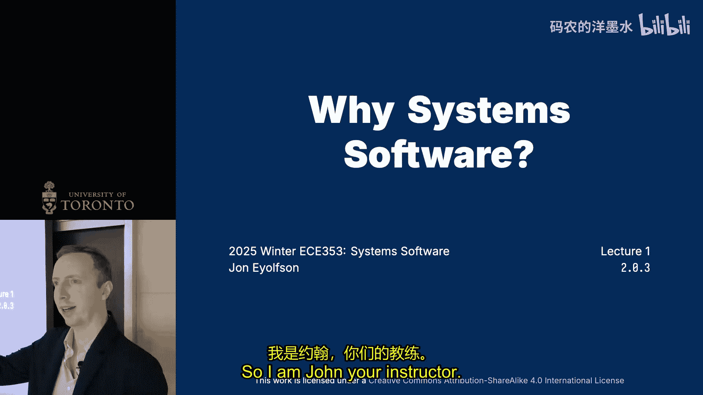

So I am John， your instructor。 That is my last name。 It is a bit of a disaster。So。

If you don't know how to pronounce it， just looking at it， do not feel bad。

 I didn't even know how to pronounce it myself until I was done with undergrad。

And I had a nice trip to Iceland， where I gave the nice Ice man my passport。

 And he asked me to pronounce my last name for him。 I did。 And he said it was wrong， so。

I pronounce it。 the good way or the perfectly acceptable way to pronounce it for me is Elfson。

 So Elf， it's just Christmas。 Elf should be still kind of in your head。😊，Speakers are weird。 okay。

 So elf still in your head。 and then S Elf in boom easy， everyone can pronounce that right。

 especially just off of Christmas。 And then if you're in the unfortunate scenario where you have to spell it。

 the easy way to spell it is to take the L and the F shove it over and then shove a Yo in there and boom。

 that's how you spelled my last name。 So hopefully you don't have to spell it。

 but if you have the unfortunate， if you're in the unfortunate situation where you have to spell it。

 that is a good way to remember how to spell it。All right。

 why are we doing system software more specifically for this course， operating systems？

So understanding operating systems will make you a better programmer。

 no matter what type of software you write in， no matter what language you write it in because。

This is universally true。 There are only two types of software in the world。

 You either are writing software that interacts with the operating system or if you're not writing or software that's interacting with the operating system。

 guess what you're writing an operating system。 So this course is relevant。

 no matter what type of software you write。So some important URLs for course resources I've seen like over a quarter view have already found the links and have gone into the discord and signed up for everything so that's great。

 but very important go to compensch。gg that will tie all of our resources together The lectures are all available on my website which iselpson。

com again you can use the link everything's also on Corucus so these links are also on corucus so you don't have to actually spell my last name。

But you can just goelsson。com， it'll be a button there or go to courses， ECE353。For the labs。

 all of the content for the labs are on that site there again it is provided for you from Corucus so all the other links and information that should be private which is basically just my email address are all on corucus other than that braids will probably sync to corucus other and that I don't really use corucus I do use labs on Github so you'll need a Github account discussion I don't like piazza I use discord so Discord is there again like a quarter view are already in there there is a bot if you like an message there's a bot on there you can type slash anon and then a message and the bot will anomymize you so then I don't have to do piazza and then if you like piazza forms there discord forms you can use those and then lastly there is a YouTube so。

Things are recorded。 They're live streamed。 If you're sick， you don't have to come in。

 but please still come in， so。For the anonymous discord message， again， I know some of you。

 it's like。Weird， as soon as I started doing discord。

 I assume all of you were anonymous to each other， but it turns out your friends outside of class。

 which is weird and have other discord servers so again。

 if you want to be an a as we fix that it's just slashing on your message bo anomaize is you and it will do that in the current channel you are in。

Lecture attendant still important， much faster for me to get feedback from you and clarify if anything is unclear。

 even if you just sit there， I can see if your face is confused I get very。

 very quick feedback just looking at your faces。Or if you want to ask a question really easy。

 if you are in class， I also have Discord， the Discord lectures channel open beside me。

 I can also take questions from Discord。 although if no one starts using it， I will stop reading it。

 and I will probably miss any questions are on discord throughout the course。

 the reason I am here and all the fun stuff is there's built in time for live coding。

 we'll be able to explain like Bob Ross， any happy accents we make， try and break my system。

 you get bonus points。 if you break my computer So that is an incentive for you。

 So if there's anything else I can do to make attending a better experience， please let me know。

 First thing that thing's annoying。Is that loud enough？That's still loud enough， okay。

 that's probably better than that thing， right？Okay， good。 Scew that thing。 This room's weird。

 All right， so for evaluation for the course。There are six labs。

 lab zero is basically just intro to the environment。😡，Porth 1%， you just have to answer five very。

 very very short questions on sorry on Crowmark， you should have gone invite for that as well after you do La zero which is just setting up your development environment and then we have six labs all were 4% and then I originally had a midterm。

The， I guess you guys aren't。EGS is not a department where you the division。

 the division of EnngS was like， yeah， their midterm week is absolute hell， so I'm like， well。

 I can move it and then I just got rid of the midterm instead we'll do two tests。

We'll do them in lecture time and we will split it out。

 we'll do one in week I think that's week four and week eight so instead of midterm we have a tri term tri term I guess so we're going to have two tests worth 12。

5% each instead of just one midterm worth 25% each so your midterm week is not absolute hell and you might actually enjoy reading week at least for this course。

Then final exam worth 50% because it has to be worth a lot of grades， yada yada， yada and then。Again。

The tests， the split midterm。Is done in lecture time。 Unfortunately it's the Wednesday one hour slot。

 so it will only be like 45 minutes， but it will be already February 12th and March 12th。

So also academic honesty again， this is like standard boilerplate you should be used to it by now so you can study together。

 discuss concepts on discord， please don't post your code on discord。

 please don't airdrop your code to your friend and then claim you did not airdrop your code to your friend that leads to a very lengthy discussion with me that I do not want to have with you。

 I am happy to talk to you in my office， I just don't want to be forced to talk to you in my office because of some academic integrity thing。

Always just ask for help instead， or if you're trying to submit things the last minute。

 just take the L， they're only worth 4% or something like that。Take it。

 you do not want to do the academic integrity thing。

 it is a pain for me and you and everyone involved。

And it will only hurt you because the majority of the marks are from the exams where you have to explain why and not just spit out some code。

So if you need this course is done mostly and well pretty much always in C。

 so these are recommended books if you need some catching up to do。

 you shouldn't need any external materials， this is only if you need it to really catch up。

 there's operating systems three easy pieces which can help complement the lectures if you want another point of view or you just happen to like books instead。

 more or less the topics pretty much match up the。😡。

Topics are pretty much the same as the topics we have。

 you should be able to find exactly where the relevant material is， and if you don't know C， well。

 there's the C programming language book in case you need to have a refresher on C。

Everyone's you see before， right？Ih， okay so we should be all right。

 C is a fairly simple language and if you need more practice on it， you'll get it in this course。

So again， skills， you should practice again if needed see programming and debugging。

 mostly thinking through your program， knowing that computers do not execute magically and that things happen in a very logical fashion。

 your CPU does not have a bug in it， your compiler doesn't have a bug in it。

Very likely you won't encounter that， so anything you should be able to reason through there is a reason why things are happening and the great thing about this course is this is a force course where you can actually explain what the hell is going on when things go awry。

Being able to convert between binary hex and decimal。Probably should know how to do that。

Probably it doesn't actually matter， but。Actually， knowing hecx will probably help you a bit understanding things since that's how computers express information。

 some parts will be slightly low level to explain it。

 so being able to do those conversions will be very， very helpful。

You did kind of a lower level course， you should know you see big Indian， little Indian。

Won't actually come up with this course， but as some background knowledge。

 you should know what those things are。This is an important one because I don't know why students。

 especially in the operating system course， do not know this one， but memory is byte addressable。

 a pointer。Is just basically an address， memory is basically an array of bytes and a address is just like an index into that array of bytes。

 so you can only address memory， one byte at a time， so an address or pointer。

 just an index into an array and memory just stores bytes。

 so index zero or memory address zero is one byte， one is the next byte， so on and so forth。

Computers have a lot of memory， so the number of addresses is very， very large。And again。

 please provide feedback this course can be quite challenging since we are going into the nitty gritty details。

 well not really nitty gritty details of how software actually works and please let me know if anything is unclear the great thing about this course is you can pretty much ask any question about any software you like because。

Like I said at the beginning， you either write programs that interact with an operating system or you are writing the operating system。

 so you should be able to explain what any other programming。

 what any other program is doing no matter what language it is written in。

So you can ask lots of fun questions again， all programs interact with the operating system。

 we will see a bit of that today and。By the end of this course， you will be a better programmer。So。

Diving into a bit of the content， so what the hell is an operating system well。At the core of it。

 an operating system just manages resources， so you have your operating system sitting in the middle of your application in hardware。

 these are EC specific numbers， you can convert them for ES but。

In first year you've written applications， if you've used Python or anything like that。

 you've written applications that interact with the operating system and request some types of resources。

 memory CPUU， maybe disk， maybe network， something like that and they interact with the operating system and youre the operating system。

 some magical black box that just did the right thing then in second year you had more of the hardware courses where you had the assembly and things like that。

 and that was how to actually interact directly with the hardware with memory mapap IO and all those fun things and registers and everyone remembers all that fun stuff right。

 interrupts。All that joyous， joyous stuff so we won't really ish get into interrupts and all that we will be tying both pieces together so the operating system sits in the middle here。

 some of it interacts with the hardware again we won't go into too much detail and then applications interact with your operating system and the operating system return some result。

Back to them。So in this course there are three main concepts。

 the first one which will come up again and again and again and again is virtualization。

 and that is where I share one resource。😡，CPU memory， something like that。

 by mimicking many independent copies， and then everyone thinks they are accessing something like all of RAM or they think they have exclusive access to the CPU even though they just have a fake copy of that。

 that they think they can just use independently without worrying about any other programs running or anything like that。

In a few weeks we'll get into concurrency that's handling multiple things happening at the same time。

 that is where real programming starts to take place and where our brains will start to break a little bit and where we will be enlightened by the world of real programming。

Then。After we're enlightened， we get to end the course with persistence， retaining data consistency。

 even without power， that will be a nice kind of palate cleanser by the end of all the hard topics。

So。I was introduced to this quote in my fourth year and it rings really， really， really， really true。

 so I'll introduce this to you in third year， so all problems in computer science can be solved by another level of indirection。

What does that mean Well， if I have a really hard problem。

 I just make up some name for how to solve that problem， I describe what it should do。

 and then I solve that problem instead and try and map all the difficult things onto that problem。

So the first abstraction we have is if we are the operating system。

 we need to figure out how to actually run a program， so the first abstraction is called a process。

We've all had a program before， our C program， our Python program that we want to run。

 that's our file containing all the instructions and data required to actually run this program。

 and then if we actually run it，We give a name for the task of actually running it and that is a process。

 it is just a instance of running a program and the offering system takes care of managing processes。

 so this will be the main abstraction we visit over and over and over again。

I'm trying to demystify exactly what is in a process。So the basic requirements for a process。

 everyone I hope knows what a stack is and what a heap is， yes。Good， some thumbs up。

The stack and the heap memory associated with that。

 they're all managed within a process and then a process。

 this is going to be the first virtualization we use it's basically each process has its own set of virtual CPUs because well。

That CPU core with a set of registers may be running multiple processes。Independent or concurrently。

 so you don't have to worry about in your program if your registers change it from under you in which case。

 if your registers randomly change， your program probably would never work。

 so your process actually uses something called virtual registers。

 so it thinks it's the only one changing the registers。

 that's how it can actually argue that you know the program is actually running correctly。

So my first question for you is how are you able to run two different programs at the same time where the programs themselves are the exact same。

 so for example， hellello world and another one that counts up every second。Oh， in this case。

 there are two different programs， so if I have two different programs running at the same time。

And you were the operating system， given you know nothing。

 how might you try to run these two things at the exact same time or using only one CPU？

So each of these programs that needs their own stack and heap， right？

Well I only have a certain amount of memory， so maybe if I'm the operating system。

 I say where the stack is and the heap is for the Hello World program。

 maybe I say where the stack and the Heap is for the count program and then just let them just run their code。

Maintain some virtual registers or anything like that so that they actually run successfully and then I just let them run right that seems reasonable to everyone。

Reasonable how our computer could work。But。Some questions we might have as well as that actually true。

 does the operating system allocate different stacks for each process？So the stacks。

They use memory is a physical memory， one option is that like I said the operating system just allocates。

 you know， just chooses， hey， you use this physical memory， use this physical memory。

 and here's some unused memory you guys can use from the stack。

Is there some issues with that if I just say， hey， program one， use this physical memory。

 program two， use this physical memory？Is anyone you see before？

And had a segmentation fault or anything like that。Where you just randomly use memory addresses。

So if I do something like this， is there anything preventing one program from reading another program's memory？

Probably not right， which is probably bad for a number of reasons， mostly security， isolation。

 all that wellbelf one of these programs with Chrome。

 and you just download a random program from the internet and then it can actually read the memory Chrome's using。

 read your bank account and all of that fun stuff， probably no good for security。So。

What about some global variables？Before I go， actually， it's already ruined here。

 so global variables。You might think they are some magical thing that。

 you know you define a global variable whenever you run your program， the operating system decides。

What address to use for it and some magical stuff happens， none of that actually happens。

 what actually happens for global variables is the compiler just picks a random memory address for each global variable when you compile it。

 when you compile it， it's the same program， so you run it。

 it's the same memory address every single time。Well。If I was using physical memory I。

Could still deal with global variables， like my compiler would probably need like a global registry of addresses to use。

There'd be some issues with that if if the compiler had to know of every single。

Global variable across every single program on my computer that's probably really bad。

 So what that would maybe look like is hey， let's say process one when it runs uses this region of memory。

 process two gets this region of physical memory that it can use and then。

Those two processes only get that much memory if they want more too bad。

 and they also have to share with other programs。 And then you might have other programs you want to run on your computer be like。

 oh， no， while I want to run Chrome and Firefox。 Chrome needs a lot of memory。 So maybe I just。

Alloccate a whole bunch of memory for Chrome to use for its global variables and everything like that。

 and then maybe I have some space for Firefox for its global variables and everything like that。

This also wouldn't work for several reasons， one being， well。

 this memory would have to be reserved for Chrome， no matter if it's running or not， right。

 because you don't want any collisions， you don't want some other program modifying Chrome's memory。

 so you have to make sure it's in a different physical address or it's using different physical addresses。

 no matter if it's running or not。😡，Second problem is you couldn't actually run two instances of Chrome because they would both be trying to use the same memory addresses and nothing would actually work。

 so let's actually demonstrate what happens if we are running two instances of the same program。

 so let's switch over here。

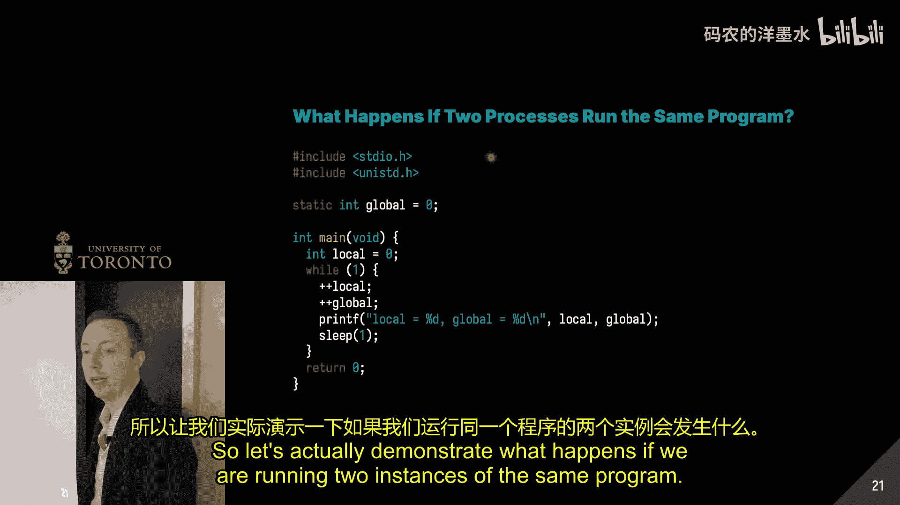

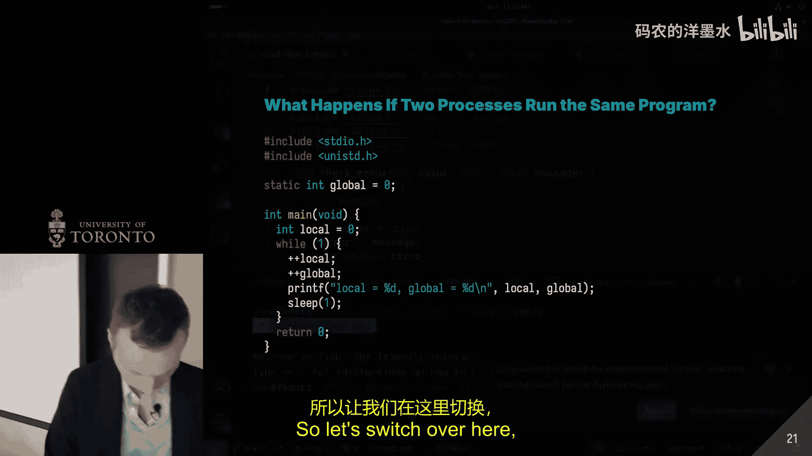

So。First off， let's see how well we know C。Whoops， that is not the right one。Come on。うう。

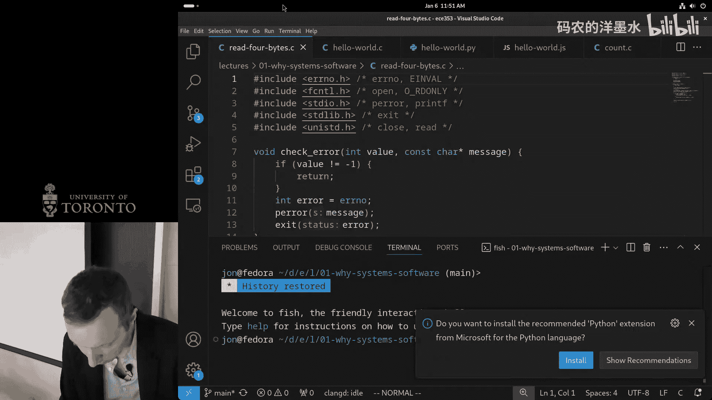

What。Display。

There we go all right， so let's see how well we know C， so we got to include standard IO include。

 I'll show you what why I'm using this for and then now we have static int global equals zero。

So let's see how well they thought you see anyone tell me what static means here。No Googling。Yeah。

 sure。I saw you Google， no no。Okay。たらいある。Well I mean， when it's in a function。Yeah。Global scope。Yeah。

あ、そのさけ。Static is almost like a constant。Nope。Yeah。Accessed by all instances of class。

 so we're using C， there is no such thing as a class。Yeah。Have something to do with like other files。

Other files being able to see the file。Close enough， so if I didn't have static there。

 it'd be int global， right， it'd be a global variable。

If I put static in front of a global variable in C。

 that means in fancy terms it means no external linkage in plain in English。

 it means no other dot C file can use that global variable。

 so only this file can use that global variable。🤢，Basically C's scuffed way of doing like C+ plus private things。

 ish。But C++ or C doesn't have classes or anything like that。

 so that is what static does there just in the habit of using。

 you know if I just use that global variable in only this C file， good idea to use static here。

Another reason why if I stop using it the compiler will give me a warning that I'm not using a static variable because it knows it can only be used in this file so it'll tell you if it's actually unused anyways that was a brief detour so the rest of it we should be able to read okay so we got int main here so takes no arguments and then returns an int we'll be learning what that is too。

Then first line， int local equals zero， anyone want to tell me what that does。Oh oh， yeah。Yeah。

 initializes a new variable called local and initializes zero to it where in memory is local。Yeah。

The stack， right， it's on the stack， so local variables are always on the stack。So。

You might have thought that was like a detail or like a quiz thing for you and see before， Trust me。

 in this course， it will become very， very relevant， not super relevant right now， but it will be。

 All right， now I have well one。By default， C doesn't have know true or false。

 I have to import true or false， if you don't want to import true or false。

 you can just use one for true， zero for false， so wall1 infant loop。I do plus plus local。

 plus plus global。Well I wonder who taught you see。

 anyone know what the difference between plus plus local and local plus plus is？Yeah。顔い。

The value access。The value access。So if local is zero。And I do local plus plus。

 this is an plus plus locals an expression， right， Everyone knows what I mean by expression。See。

 so what is the result of that expression plus plus local if local is equal to zero？哦哦。Yeah。One。

 incorrect。OhWait， no， correct， sorry。Incur， sorry， it is one。

 so what is the value of local plus plus？Zero， I confused it， see， I confused myself。

 so that is the only difference between plus plus local and local plus plus it's the value of the expression。

 whether it comes before or after both of them actually do increment local by one。

 it's just whatever the value of the expression is。So。

Basically for a number of reasons you should always use the prefix version instead of the postfi version because the postfi can actually introduce weird performance issues。

 we won't be going over to this that in this course， but don't worry about it for now。

Know that you should probably prefer this form， then here I just print off the value of the local and the global variable and then sleep for a second。

 so that will just pause for a second and then go again， this is an infinite loop。

 it should increase it from one to two and keep on going。So if I run this。 I mean。

 it works how you think it should， right， local 6，7，8。So here is our first thought experiment。

 I can open a new。A new terminal here and verify that this is still running。

 so it's all the way up to 25 now。Now， what should happen？If I run the program again。

Should it still will this print？like start at 30 or whatever it is up to now， or restarted zero。

Restart at0 is what you would expect， right， even if they're running at the same time。

 so it restarts at zero， then we got global equal 1，5。7even。8，9， so on。

 while the other one is still running， so the other one's up to like 50 by now。

 but it's the same program。Still running。HWell， what's。Try and get into how this is running。

So I said for global variables， the compiler just kind of picks a random memory address if it's physical memory address addresses。

 well， this global variable right。85 over here and 41 here， they are clearly independent。

 so they must be different physical memory addresses， right？That's the only way this would work。

 otherwise it' would be the same value。Well， if I was inquisitive， what I might do is， well。

 I can see， lets me take the address of stuff， let's just print the address of the pointers。🤢。

So let's say I modify the program and actually let's just do a little copy pasta。嗯。

So instead of just the value of the local， I will print the address of the local whoops。

And then the address of the global。So I'll change the format specifier from D to P to indicate pointer。

Then I have to typecast it to voidd Star to make the C gods happy because voidd Star is basically pointer。

 I don't care。Because really if we take the pointer to。Local， it's a pointer to an int。

 but C is dumb， so we have to tell it that it's a void star。

So now I'm going to print the address of local and global。

From seeing both of them run has to be a different memory address， right？So actually。

 let's start off。Let's start off less interesting。So let's only print local first。Sou。

So we'll print local first。And then here I will do。This， and then comment it out。All right。

 so let's compile。All right， so oops。So now let's run it again。

 so I get this ugly address where it's something something 6 C。

If I go to the other terminal and run it here， it's something， something， something， something。

 something 0 C， so different memory addresses。Could be different physical memory addresses。

 I don't really know at this point， but this makes sense， right， have to be different。

Addresses because， well， they're not interfering with each other， right？

So that makes sense to everyone。All right， then let's。Try and find our first mystery。

So let's print the address of the global variable， so we will recompile。Oops。What do I do。Oh。

 I felt Bill wrong， okay。All right， so now I'm printing off the address of the global in this one。

 it is 440030。It's all the way up at， let's see， 10 now。Now I will run it in this terminal。It is440。

030。嗯。Is that the same address？Yeah， any guesses as to what is happening here？

Two running programs use the exact same memory address， but clearly the values are different， right。

 they're independent in each process。Yeah。Yeah， they must be using virtualization。

 so they must have access to virtual memory， so each of your programs when they run。

 they think they have access to all of memory but really the operating system is one managing physical memory and actually mapping or virtual addresses to physical addresses。

 so even though the virtual address in both the processes is the exact same address。

 your operating system maps it to different physical addresses。For each different process。

Don't worry about how that actually works yet。 We just uncovered that virtual memory does exist。

 It will probably take us about five weeks to no， not five weeks。

 probably take us about three weeks to actually start talking about virtual memory。

 but all we need to know right now is that it clearly exists because two programs we're using the exact same memory address。

 but they weren't interfering with each other， also gives us some nice benefits where。

No program can read any other programs memory because while each process has its own view of memory and you can't actually read someone else's memory if you're using virtual addresses again。

Don't worry about any of the details for now， we will explore them later in the course。

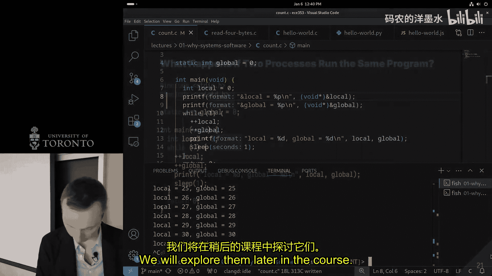

So。We found that the address of the local was different between the two processes。

The address of the global was the same between the processes。

 so we have something like virtual memory。If a process is basically the operating system keeping track of everything needed to run a program。

 what are other things that the operating system may have to keep track of in a process so think of other resources your program may use。

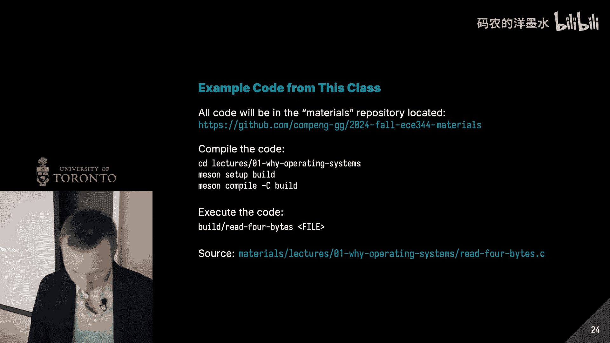

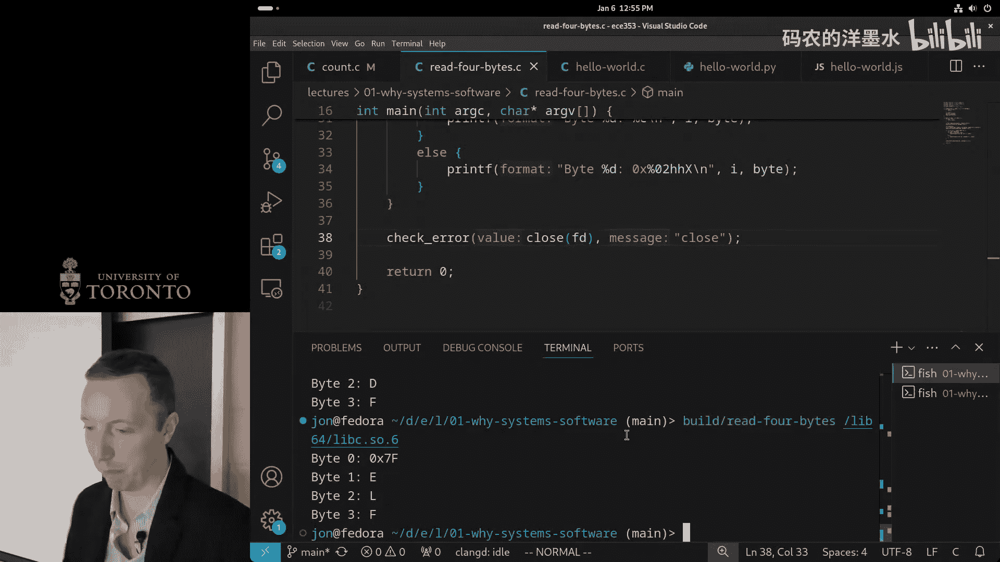

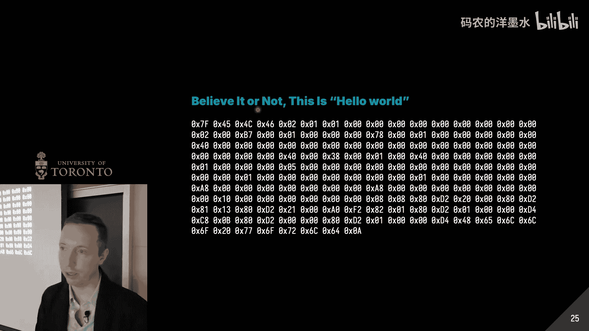

。Yeah。🎼。

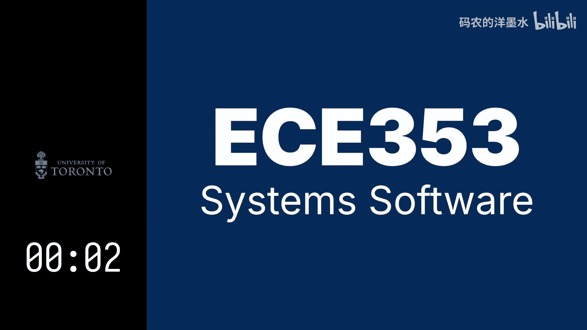

All right， our break is done， that was a quick 10 minutes。Alrighty， let's blow your ears out。

All right， let us continue。Let's actually run this program and verify that this does actually do hello world。

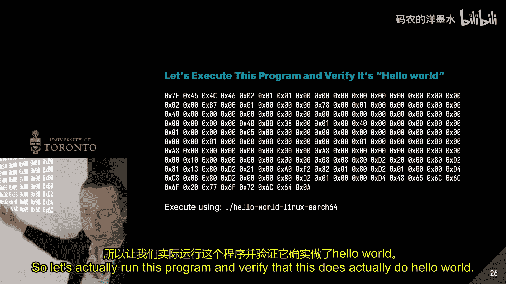

So。

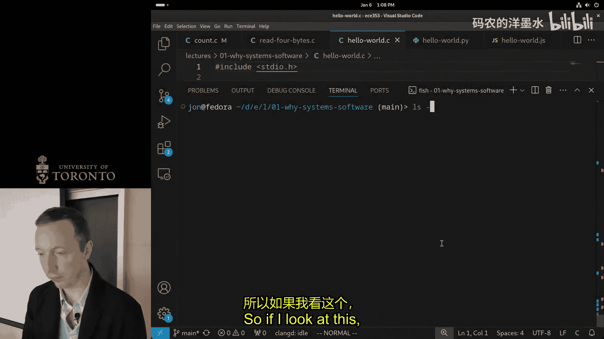

If I look at this， this random collection of bytes is only 168， I believe。

 so it saved as a file on my machine as hellello world，8 arch 64 because I。Macla pop， so it's arm。

 So if I go here and try to run it。

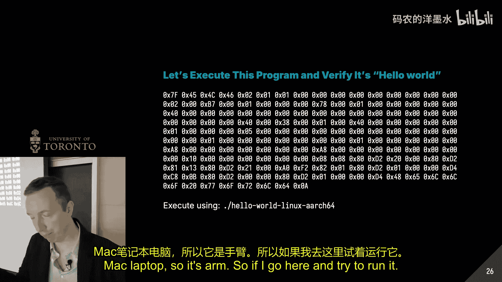

Looks like hellello world， right， that's the hello world everyone knows and。Probably not loves， but。

Kns of。 So I run it seems to run very well。 just print Hello world every single time。 really， really。

 really small so。

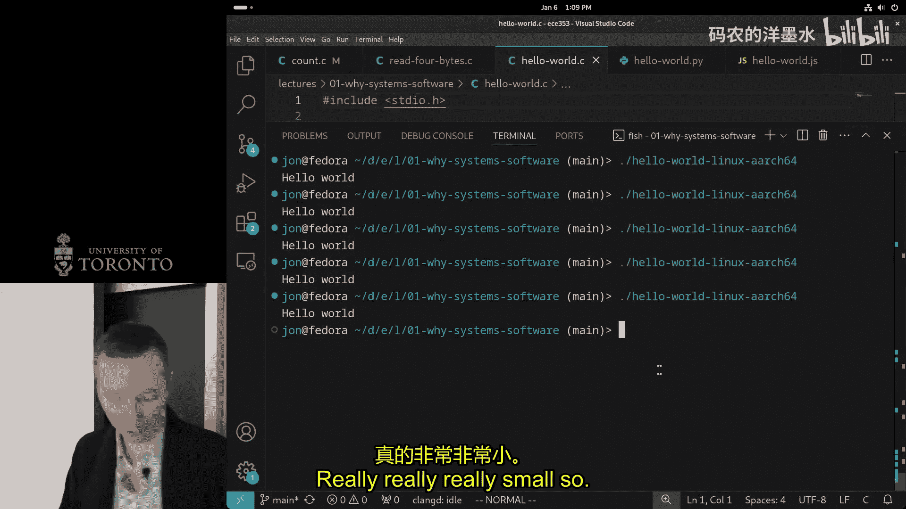

This part is mostly just for fun， I have to dive into the file format a bit。

 I will never ask you about file formats so you can sit back and relax for the last bit of this lecture I will tell you the few important parts you actually need to know so I will try and explain every single byte of this and I'll gloss over some of it but we already know the magical first four bytes that are。

Whatever 127 and then ELF。So。One aside， there's three major ISAs or instruction set architectures in use today。

It's basically machine code or numbers the CPU understands， there's X86。

 AKMD64 because they came out with the 64 bit。X86 CPU first， that's for desktops， non-apple laptops。

 for the most part unless you have andragon， and then servers， everything like that。

 then there's AR 64， AK Ar 64 which is basically what your phones are using。

 your tablets or Apple laptops are' using， and then there's risk5 which is an open source implementation kind of similar to Ar but you can actually make your own CPU。

With it， without paying arm millions of dollars。 so we'll touch on all of them in this course。

 not in any detail。 so don't worry， you don't have to write any assembly in this course。

 but we will read a very， very small， tiny bit of it。

So the next abstraction we kind of saw in that read for file things is called a file descriptor that FD so since our processes are independent we need a way to transfer bytes to and from our processes to other processes otherwise if your process just ran completely independently it would do some calculation that you would never ever see and it would just be you know heating up your laptop for no good reason so even hellello world needs to communicate with a different process so to communicate with the different process this is the important part the one turn to know again will revisit it later。

Is IPC stands for Interprocess communication， it's how to transfer data between two processes。

 so your hellello world program is actually transferring the string hellello world to your terminal which is then responsible for printing it to your monitor and the reason we use a terminal is because we don't have to be concerned with how you know our video card works or anything like that。

 we just give it text and the terminal figures it out for us。Then。

Thescript file descriptor is basically an abstraction for any type of resource we can read bytes to or sorry read bytes from or write bytes to。

 so the same abstraction is used for a file interacting with your terminal。I dont know。

 using internet connections， using your network card。

 everything like that will be using a file descriptor for actually communicating between different processes。

So。In this case for now， let's just consider file descriptor representing a file or your terminal。So。

Operating systems are a bit weird， I just can't call a random C function and hope it works。

Because well， the core part of the operating system is actually managing hardware。

Which your program is not allowed to do so to make requests to the operating system the only way to do this is to do something that kind of looks like a function call。

 but is a bit special and it's called a system call so。

It's a bit special we'll get into the detail of how this works， but we can represent system calls。

As if they were regular C functions and use them as such。

 but the way they work is a little bit different so here are two system calls you need for hellello world and this is universal no matter what so the first system call you need is something called right it takes three arguments。

 a first one is a file descriptor so that's just。Something that represents a file or your terminal。

 and then it takes a array of bytes。In this case， C， it doesn't care it just wants a pointer。

 So the way C indicates the type of a pointer it doesn't care about is just void star。 Again。

 that's just C。 it's a pointer。 I don't care what it points to。

 and then con means we will not modify any of the values that this points to。

 So this is saying it's not going to modify it， don't worry。

 And then third argument is count or how many bytes to read from this array of。Bs so。

It should write all of those bytes to whatever this file descriptor represents in this case let's just assume it's our terminal and then the next system call we need to make is something called exit group that takes a single argument in status and that is the only way to stop executing a process so that exits the current process and sets the exit status code。

If you've written C int Ma， that's the int of I Ma。

 so the number eventually goes to this system call and it should be an exit status code between on Linux 0 to 255。

 where zero indicates no issues and non-zero indicates there is some type of error with your program just by convention。

So， oh， yeahep。Any。So for now system calls， they just look like C functions。

 we'll define what they are in a bit and see how they work in a bit。

From our point of view right now they behave exactly the same as C function calls。

 I can just call them I give value back， nothing's different。But they are a little bit special。

All right， so if I was to write a hypothetical hellello world program。Without C。By convention。

 whenever you run a process， there are a few file descriptors that are just defined by convention and these you will become familiar with throughout this course。

 this is more magic numbers that you will remember。

There is a magical file descriptor 0 that represents standard input。

 so that's something I can read too， and then standard output is just the number one。

 it's file descriptor 1， I can write bytes to there， and then standard error is just the number two。

So your print F， that goes to standard out or in Java or in Python or whatever。

When gets the offering system， it just goes to file Descriptor 1， at least on Linux。

If I was to write a magical C function that just started executing and called it underscore start。

 and it doesn't take any arguments or return A arguments。

 if I was to write hellello world without a main and assume execution starts in this start function。

The minimal hello world program I could write is just write to file thescriptor 1。

 which is standard output and then write the string， hellello world with a new line。

 so this would be a standard C string so it's basically just array of chas and then a pointer to that so you can just use it as an array of chas and then I have to say how many characters to print or how many bytes to print from this array of chas So 12 would be H E LLO space WO RLD and then backslash n that's just one character that's a new line so in total that's 12 and then that's all I do and then I exit group so that's all my process does is just print hellello world and exit group with zero indicating that there's no error。

So。If I was to write the most basic hellello world program that interacted directly with my operating system。

 this would be it not the C hellello world， which probably looks more like。Let's drag this down。

So the normal sea hellello world just， you know， looks like that， right， it main。

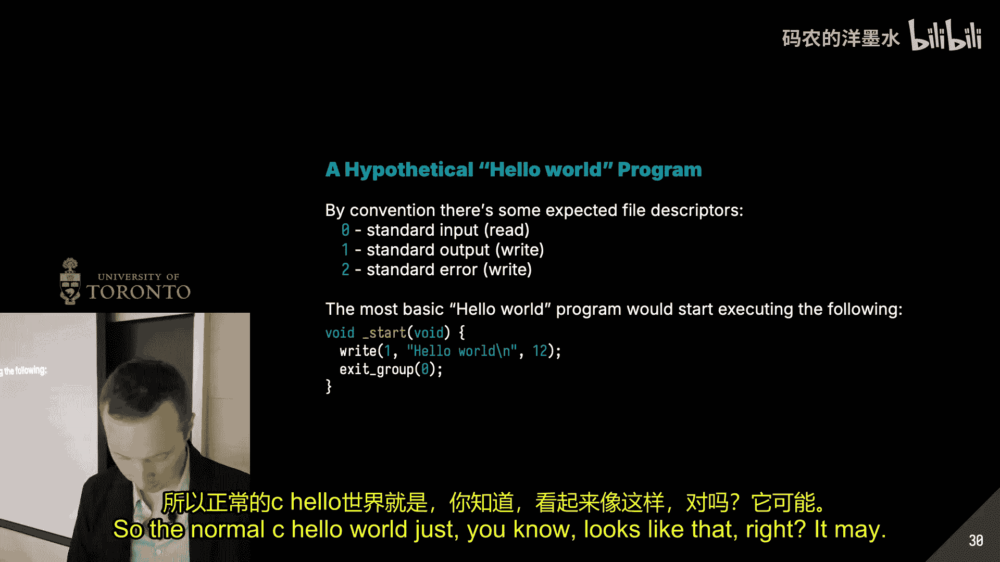

print F。Return zero， but if I was interacting directly with the operating system。

 it would look like write one hellello world new line number of bytes， exit group four。

 you can see kind of the nices of C， you would' have to tell C。

 you know how many bytes to write or anything like that， it figures it out for you。

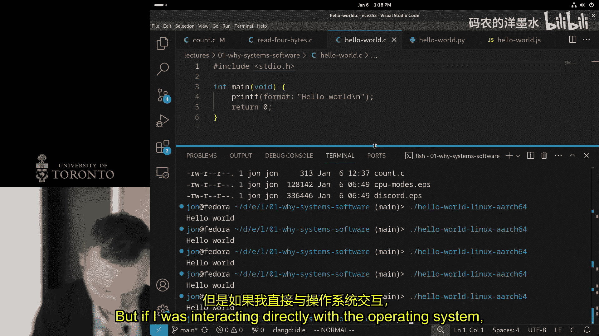

All right。So this goes to another aside that you don't really need to know。

 but it will be important for figuring out system calls。 so youve probably heard of an API before。

Probably haven't heard of an A before， or maybe you have。

But an API application programming interface。😡，Basically。

 just abstracts the details and ignores them and just describes the arguments and the return value of a function。

 So for instance， a function takes two integer arguments and returns an integer。

 That would be an example of an API。One's named X， the other names is Y， that's an API。

 an A or application binary interface specifies the exact details specifically how to pass arguments and where the return value is。

 so if you've written assembly probably remember oh which registers are call saved。

 which are call or saved， which yeah which ones you have to save which argument goes。

 where or the C calling convention where arguments are passed on the stack in right to left order。

All the details are in the AI and both the caller and the collie have to agree otherwise things will not work。

 Usually you don't have to pay attention to the AI， but。

Sometimes you actually need to pay attention to it because the details do matter。

So there is a different system called ABI， specifically for Linux on arm 64。

You have to go ahead and look this up， these operating systems。

Because they're part of the operating systems， they're not normal C functions。

 they don't have an address to call， so when you compile， I don't know a call to print F。

 that's just call to a random memory address well。You can't actually you know the operating system doesn't load itself into your own virtual memory address。

 there's no address to call， so these functions， what we do to call them is we generate and interrupt to the OS and then the OS thankfully handles the interrupt for us and then。

🤢，Actually performs whatever we request and then returns back to us kind of as if we called a function。

 so your program can generate a interrupt by using the special instruction。

Specifically an arm called SVC， so that's a call to the supervisor or call to the operating system and the A BI is that it passes arguments in registers so register X8 that contains the number of the system called to you so every single function Each different name gets assigned a different number so the right function could be I don't know number 64 exit group can be number 200 and something like that the number goes in that register and that is how the operating system knows what function to actually perform and then it actually allows you to have six arguments in register x0 all the way up to x5 and those are all the arguments you can pass to the operating system function So what are some obvious limitations of this。

Compared the C specifically。Yeah。Yeah， what if I want a seventh argument， well in this case， too bad。

All the registers too are all the same size on arm 64， there's 64 bit registers or 8 bytes， well。

 what if I wanted to use a value that's bigger than 8 bytes， like 16 bytes？

Well it doesn't fit a register， I either have to combine registers in a weird way that won't work here if they're all different arguments。

So I can't use anything bigger than a register and anything smaller than a register like if I want to use a one byte argument。

 well I'm basically wasting the other seven bytes of a register if I only use one byte。

 so it's not terribly flexible， but。It doesn't have to be that flexible。

 but it does have some limitations here， this is also why we don't use it and we use like C most of the time。

 so we don't have these weird limitations。🤢，All right， so this is the last aside。

I don't know really why this here， but just for interest sake。

 the CA AB or college convention for X86 system calls only use registers， C is mostly stack based。

 arguments are pushed on the stack in left to right order。

There's some registers that are call are saved， remaining registers that are colleagues saved。

Although that's not exactly true， some arguments may be passed in registers instead of the stack for performance reasons。

 because using memory much slower than the stack， you can see Wikipedia for details。

 there's lots of conventions， they just have to agree。

Some advantages this gives us over the system called A。

 we can have any number of arguments and if we use a stack they can all be different sizes。

 it's all hunky dory and all fine， disadvantages is that well， if we use a stack。

 it's going to be a bit slower。So。Going into the file format， so programs on Linux or PlayStation。

 I guess， use L file format。It stands for something exceedingly boring。

 it ElfF stands for Executable and linknkable format。They're not very creative。

 specifies both executables and libraries， so that's why you know any of my programs in the standard C library both start with the same thing。

 always starts with 7F， and then these hex characters which are ELF。In fact。

 if you look at the ASCI table， 7 F is actually defined， it's just not a printable character。

 it actually represents the delete character。And that's just a way to signify that， hey。

 you shouldn't interpret this as like a plain text file because the first character is something you can't print and again these first four bytes are just called magic that's the only way your computer actually knows what this file is。

 there's lots of different file formats that have many different number of bytes。

You can actually look at Wikipedia， the list of file signatures if you don't want to call it magic。

 magic's a bit more of a fun term， PDF files actually start all' start with the same five bytes so there's actually。

 you know if I read the next fifth byte， it would always be a dash and that's just what every single PDF file on the planet starts with。

Images have their own format， they all start with magic JPGs， I don't know。

 I forget their starting character， but some starting character then J GPG。

Everything has that sorry to dispel the magic from you。

 but you can go ahead and explore that if you're weird like me。All right， so。

What I argued before is that our bytes represent that L file for that Hello world program。

What this actually does is tell the operating system to load that entire executable into memory at some address I just picked Willie Nilly。

 I just picked 10，000 in Hex。Because I felt like it。

 and then there's part of that L file format that describes the header so that describes information about that L file。

 it's 64 bytes by definition if you look at the specification for it and then a program header which you need for executables is 56 bytes。

 so just information about this executable， takes up 120 bytes in total。

 and that's only to describe what's in the file not actually doing anything important like representing data or instructions。

If you dive into it， the next 36 bytes are instructions。

 and then there's actually 12 bytes for the string hellello world with that new line。

 so if I load the entire thing into memory starting at address 10，000 hes。The first 120 bytes。

Are loaded into memory as well。But that just describes the contents of the files。

 instructions would start at byte 120 because that's the first byte after all of the information about the file and 36 bytes later。

 it means the string data starts at，Heex 1009 c because 9 c is 156。

 so that's the last 12 by of that file if you wanted to。

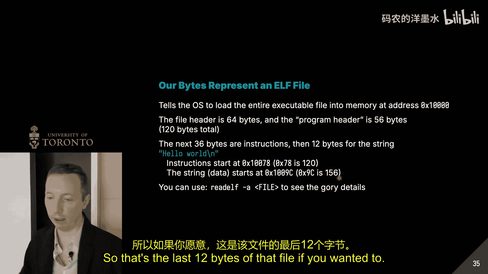

If you want to visit all of the gory details there's this program called read Elf and you can do read Elf A and read all of the gory details about it。

 so this will tell you what's in the header file so it says like hey， what's the data in this。

 this is where little Indian comes into play， what's the version。

 what operating system does this run in， is it what is it， oh it's an executable file。

 what's the ISA， what version is it， where do I start executing。

 which is that address where the start of the instructions are。

 a whole bunch of boring information that if you're a masochist you can look at the details。

 we will ignore them for now just know you can access them if you want？

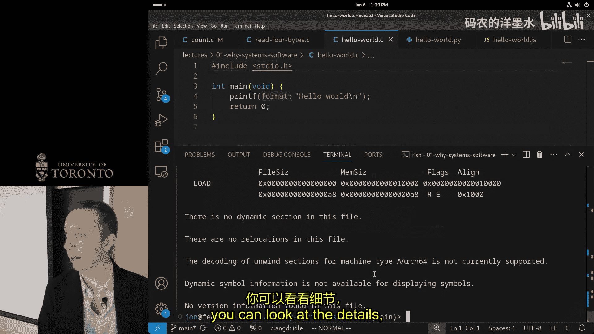

So visually。How those random bytes look is the first 64 bytes again visually。

 these all represent information about the executable。

 so all of the blue space that's wasted there and then these cyan bytes， the other 56 just say hey。

 please load into memory at this address I just said loaded into memory at starting at 10。

000 hecs that's basically all that does and then the next few bytes that are actually doing things that take up the least amount of well the second least amount of space are the actual instructions to actually。

Do the right and the exit will'll get into how we do that and then finally at the end is the actual data for the string itself。

So if I disassembled those 36 bytes on an inline disassembler or some local disassembler。Thankfully。

 you don't have to do this in your course。 but if you get into like reverse engineering and like exploits and all sorts of stuff。

 you probably will do stuff like that。 but basically if I disassemble these instructions。

 this is what I would get。 And what they do is while this uses a system called ABI。

 So what we can see here is it。What move just does is it does an immediate move of this value into this register。

 so it's setting register x8 equal to he40， which is decimal 64。

 which if we remember before is just the magical system call number。

 so I want to do if I'm doing hellello world I'm doing right first。

 so right is just system call number 64。Then x0 is the first argument， standard out is just one。

 The second argument is the address of this。The address of the string， so on arm。

I can't do a move of like very large value because all my instructions are only 32 bit so I have to break up setting x1 into two different instructions basically all this will do is just set x1 equal to the address of that the address of the string which is 10。

09C and then the last argument is how many bytes to read from that address and it's just C which is 12 and then I do this SVC instructions so this does the system call after this I should see hellello world on my terminal and。

After the operating systems done writing it to my terminal。

 it just returns here and keeps on executing kind of as if that was a function call。

Then I want to do exit group。 So that's a different system call number。

 So I load x 8 with the magic number94。 So that's the number for exit group。

 First argument should be 0， and then I do SVC and。There's a number here。

 but basically that number is never used， so we just set it to zero。

 and then this does exit group and then exits my program and that's as complicated as it gets for Hello World。

So the final 12 bytes are the hellello world string itself ASI coded。

 it's this followed by a new line， that's what a is。

 and a weird low levelvel ASCI tip is B5 indicates whether or not it's a upper or lowercase letter。

 the value is differ by 32， if you're a giant nerd like me and this is how they designed it because。

Computers weren't that powerful back in the day， so they designed ASI in a way that was easy to check if a letter is capital or not by just checking a single bit which is pretty much the fastest thing you can do so uppercase letters bit5 is0 lowercase letters bit5 is one so I don't know why I told you that again I'm weird so。

That accounts for every single bitete of the program and we can see what C does。

 so already we can spot a difference between strings in our example compared to C。

 because as they have taught you， strings in C are null terminated， right？

Is this string null terminated， whoops？Yeah this string is not null terminated right I had to tell the operating system how many bytes to actually read from the string instead of being implicitly terminated by a null byte。

 so lot the C program designers really， really regret that C string format because it's actually quite terrible and causes a whole lot of problems。

 it's a lot easier to keep track of the number， the size of it independently。If you program it right。

 which I guess is a stretch， but let's see what happens。

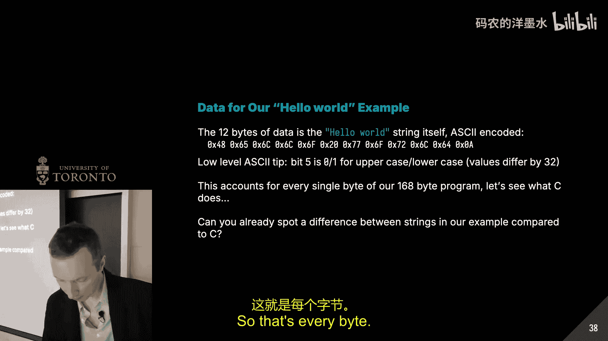

So that's every bite。So let's verify that I am not lying to you again， I will run this program。

Prince hellello world。And then if I look at it， the size of the file is right here。

 so it is only 168 bytes。So。You've been told C super efficient， right？Yeah。By specification。

To represent all the flexibility you need for file formats。Okay， so yeah， so this is 168 bytes。

This program， that looks like hello world to everyone， right？So。Let's compile it。So compiled it。

 we can actually do like the read4 bytes。Verify that it is indeed。Oops。

That C has produced a hellello world file， it's an elf file。All right， cool， looks like an L file。

Prince hellello world。Cs an efficient language， A1 y guess how big this program is。

 it just prints Hello world， so it should do the same thing as mine does， right？So。Anyone thinks。

The C。The C version is 200 bytes or less， so it's around the same as mine。

No one thinks seas as efficient as me。Okay， how many people think the executable sea produced is less than 1000 bytes？

One， two， three， four， five， six， seven， eight。All right， who thinks it's less than 10，000 bytes？

We're getting closer to a quarter。All right， what about？50，000 or less bys for hellello world。

Should be more hands in before。All right， listen。100，000 bytes。We're losing confidence and C。

 all right。So let's just see how big this is。So LS dash。199 k， that is000。

So it's almost a megabyte for hellello world。Hello world。Like 0。1 megabytes。My hello world。168 bytes。

Any difference？What the hell is going on， who said C was an efficient language？

Someone lied to you at some point， right？All right， so the fun part about this is。

We actually get to dispel what the hell is going on here。😡，So。

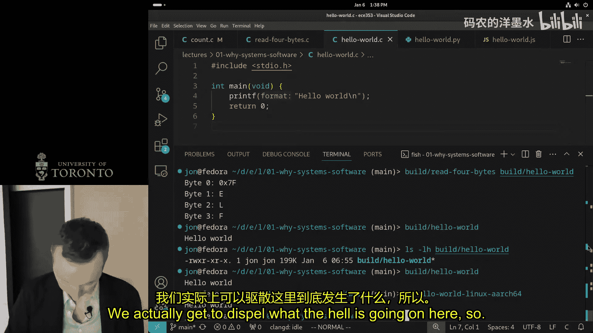

I've just been saying the operating system， the operating system。

 it's time to talk about actual specific names。So an operating system is actually a whole bunch of different things。

One thing that is in part of the operating system is something called the kernel。

 and it is the core part of your operating system。On your CPU。

 there is a special privilege mode called kernel mode。

 and that specifies what instructions your CPU is allowed to execute。

Clonnel mode allows you to access instructions that actually interact directly with the hardware。

 so if you try even if you knew what the instruction was and you try to use it in your executable。

 you would get an error of illegal instruction because your program is not allowed to actually modify hardware so some part of your operating system runs in a special CPU privilege mode called kernel mode。

 which is one of the first important things that you actually have to remember for this lecture。

And that allows you to actually execute instructions that actually interact directly with the hardware。

 So different architectures have different name for this mode。It's called S mode on risk5 or arm。

 it's just they call it supervisor mode instead of kernel mode means the same thing。

It's kind of a circular or cyclical definition is the kernel is the part of your operating system that runs in kernel mode。

Simple definition， so that's the software that's actually running in a more privileged CPU mode called kernel mode。

These instructions。Only run。Because that software， that core part of your operating system is trusted。

 It's written by， you know， if it's a。Mac， it's written by Apple， if you're using Windows。

 it's written by Microsoft， if you're using Linux， it's written by hundreds and thousands of very。

 very smart people and those instructions are and that software is the only thing that can actually interact directly with the hardware so only the kernel can manage virtual memory if your processes could mess with virtual memory they could read other processes memory and then you'd have no security on your system whatsoever and you know things could interact badly with each other。

 so this is a very， very important part of the operating system。

 only thing that can interact with hardware and only thing that actually maintain security。

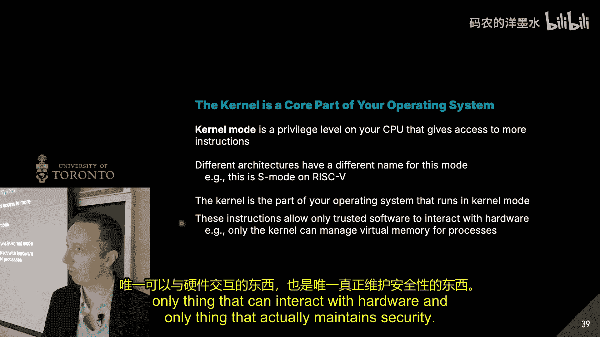

So。More privileged CPU modes can access more instructions。

 so the normal CPU mode is called user mode， that's what you've been using so far。

 that's where applications and libraries execute in。

 it's least privilege it cant actually access hardware。Then there's kernel mode or supervisor mode。

 that's where the kernel lives or part of the operating system that actually interacts directly with hardware。

Later in this course we'll explain hypervisor mode so that's where virtual machines exist when we finally get into being able to talk about that and then there's machine mode which is the most privileged that can access everything。

 that's where your bootloader and firmware is， or when you did a low levelvel hardware course。

 you were just writing things essentially in machine mode without any restrictions。

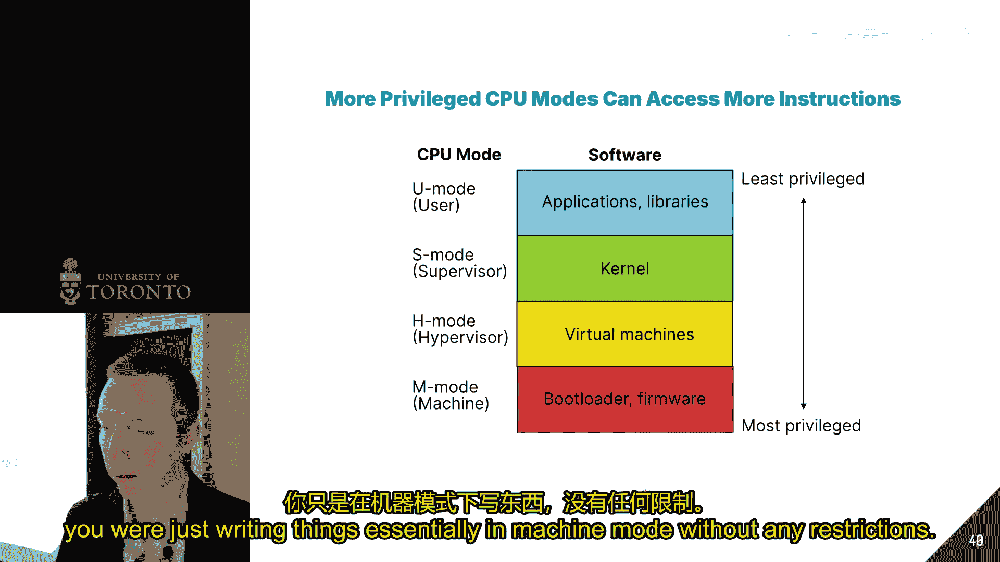

So， oh， yeah。

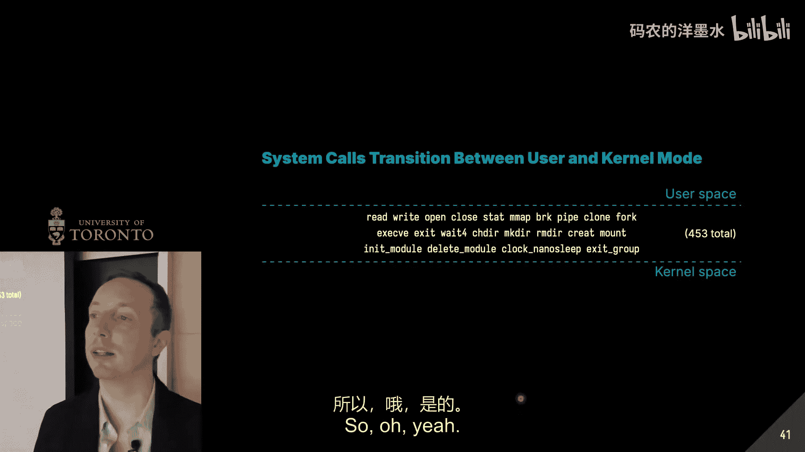

So this is just to indicate privileged levels， so each level below can access all the instructions in the level above。

So like least privilege would be like an ad instruction or something like that， right。

 so the kernel can actually use an ad instructions。

 but there'd be instructions here to actually access hardware that these couldn't run so it gets。

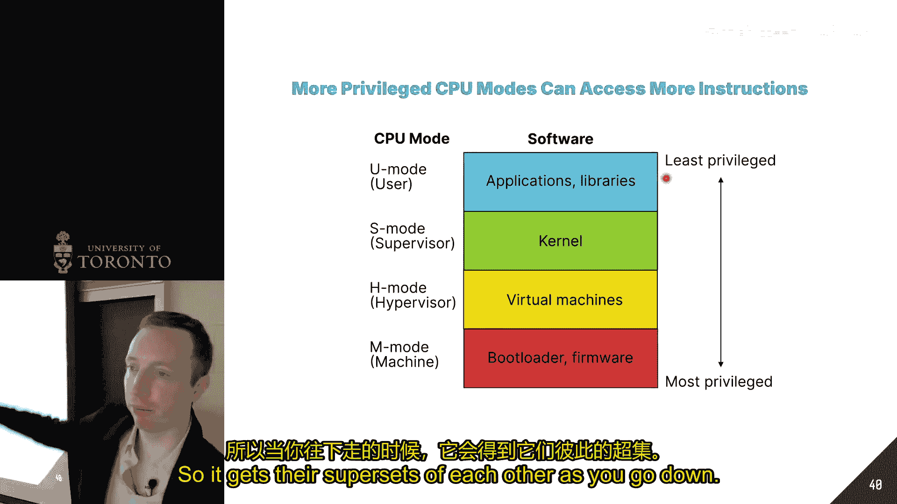

They're super sets of each other as you go down。All right，System calls。

 It's the only way to actually transition between user mode and kernel mode。

 So it's the only way you can actually interact with the operating system to actually。

Interact with hardware on your behalf。At the time of doing this slide。

 you can think of them as function。 system causes just normal functions， if you want。

The only thing your program can use is these 456 total different functions。

 some of them we've already encountered， like read and write， open close。

By the end of this course we'll understand all of these， other ones we've hit is exit。

 and then there's a few other ones again， by the end of this course we kind of this is where the course kind of lies will be living in user space。

 writing programs in user space that use system calls and then explaining through lectures what actually goes on in kernel space without actually writing any kernel code。

So。The nice thing about system calls is no matter what language I write a program in。

 every single program has to go through that system call interface， no matter what。

 because that's the only way to interact with hardware so on Linux there is a way to actually see what system calls every single process makes when you run it using this Stra command。

 which is a really fun command because we can Strace literally any single program no matter what language it's written in so。

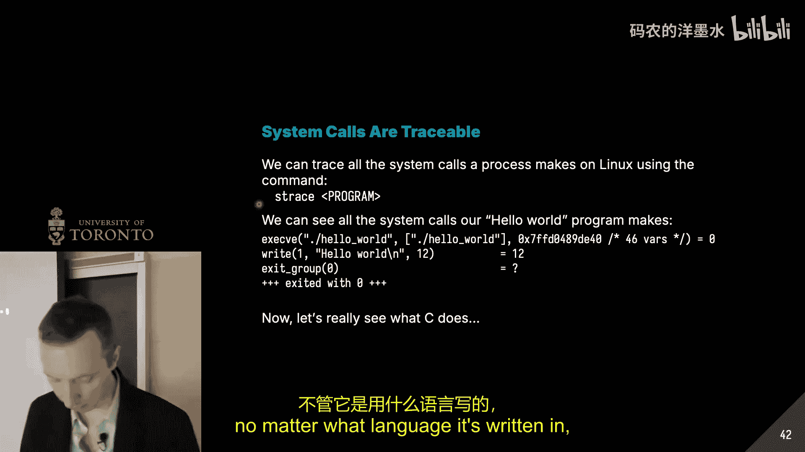

If I want。Whoops。Oh。Do。I can Strace my Hello World program。I'm going to do one。

Number devnll basically this just says I don't care what the output of the actual program is so I don't want to see hello world。

 I just want to see what system calls it makes， so if I run it。

The first system call- so there's one system call per line。

It shows you the function and then all the arguments and then equal and then what the return value is in this case I didn't make this system call so we can ignore this first line。

 this is basically how someone started running this program we'll get into that in a bit but this is what my actual program did it did right to file Descriptor1 hellello World 12 bytes and then write actually returns the number of bytes written so you can actually check that every byte was written。

Spoiler alert。Print F also returns the number of bytes written。

 so you can actually check if there is an error with print F。

 How many of you have ever checked if there is an error with returnturn F or sorry， print F。Yeah。

 none of you。So errors can happen with print F， but you've just ignored them。

 and then here we have exit group of zero， and then that is my hellello world program right This is all it should do well。

I can use S tracece and I can see what the He C is doing with its many， many， many， many， many， many。

 me， me， me， me， me， me bytes。So。Oops。D so I can do the same thing。

 I can Strace my hellello world program from C。So I can see it ends because anything that Prince Hello world has to end with the same thing because it uses a system call ends with right。

 file descriptor 1， hellello world 12 bytes， and then an exit group。

 but I can also see other things C did。 so if I scroll up。These are other system called C made。To do。

So。This。It didn't do this is me running the program but we can actually kind of take a guess at what some of the other system calls are so this is BK short for breaks。

 it's breaking something， don't know why it's doing that Mmap don't know what that is LD preload oh it got an error。

 no such file directory so that didn't help it there oh it's using a cache I don't know caches are good right it got a value there that's great I guess then oh hey that makes sense it opened the standard C library。

 that makes sense I wrote it in C has to load the standard C library that explain something。

And I can see that it read information。 So the file descriptor got back for the standard C library was three。

 here it's reading the standard C library and。By default， the output here。

 it kind of looks like an L file but not exactly， that's because by default。

 anything it can't print out in ASII is anoctal for some reason。

 I don't know why but 177 is ocal for that same7 F and hex again don't tell me why it's anoctal but it is basically it just means that the standard C library is an L file and that it reads some information from it cool spoiler it's looking for print F。

Basically looking for print F。Does a whole bunch of stuff， does a whole bunch of stuff。

 does a whole bunch of other stuff we can't explain yet。You know，h。

 does it did something inappropriate， inappropriate octyl， that's not good， random， I dont know。

 I'm not using any random stuff， but got random， then did this BK thing and then BK for an address。

What that's doing is that's actually managing the heap。

This is how the standard C library grows the heap， it is a system call。

 so BK with null that returns the address that starts the heap。

 and this is basically just the standard C library saying please grow the heap for me because I need some space for memory。

 so this is the heap yeah。So yes， the question is why doesn't use SBRK。

 that's because he took another course， SBRK is just a nice way to use BRK。

 but there's only one system call。So with this， we can actually see what different programming languages do。

 right？There's no reason why I can't write hellello World and Python， right？

They should do the same thing， let's see what Python does。I can Strace， Python。Hello world。

So we can see what Python does。You can scroll up and see so at the end。

 Python did exit group to exit this process， did some weird memory stuff。

 but eventually it did the same right to hellello world。

 so no matter what language it's written in it eventually did that。

You can see Python did some other stuff so here's。Python' is an interpreted language。

 so it had to read the Python file， so here's it doing that。

It seems to actually read the same file twice a bit weird。

But you can actually discover what Python is actually doing。 So you can scroll up。

 You can see that it does a lot of other things。So it does a lot of other things。

 so I've previously just seen how many lines they have。If I count the number of lines for C。

 it does like 38 system calls， if I look at the Python version and see how many system calls it does。

 it does 472。嗯。Well， fun thing I could do is JavaScripts a language。It's a pretty crappy language。

 but it's a language。Should do the same thing， right， so let's have some fun。

Let's Stra's Hello world written in JavaScript。So let's e tracece this。This is always fun， holy crap。

So。It ended with exit at group。Does anyone see a right to hellello world anywhere here？No。

 it's doing some weird things。So I'm going to start scrolling up。

 stop me once you see JavaScript Priing Hello world。So let's go up one screen。

A and see right in there。Seeing a whole bunch of other crap。Nope， we're all good， no rights。

 all right， so let's scroll up a bit more。There is a right up here。

But it's a right to file descriptor 14 with a bunch of random zeros and ones。

Don't know what the hell that is， All right， no， scroll up。Definitely not a right there。

Keep scrolling up。Wow， ja sucks。 Allright， scrolling up。 bunch of Mly， I think JavaScript got worse。

Holy crap。 All right， there's something with the heap reading。 No， not quite there。It wrote a star。

It read a star。Cool， all right， JavaScript， do you do， oh， there it is。

So it wrote hellello World and then started playing with stars for some reason。

 and then before it also started playing with stars。This is what JavaScript does。

 so now you can unravel the mystery of JavaScript， can unravel the mystery of why the hell they wrote it like this。

 but this is what it actually does and if we look through it。

 we can see what it did So how many systems calls does JavaScript make。952。

So it's objectively at least two times worse than Python。Fun。

 so you can e trace anything you want and see what it actually does。 But at the end of the day。

 if you write hellello world， it's going to do the same things。😊。

Has to do right to file descriptor 1，12 bytes hellello world， and then eventually exit。

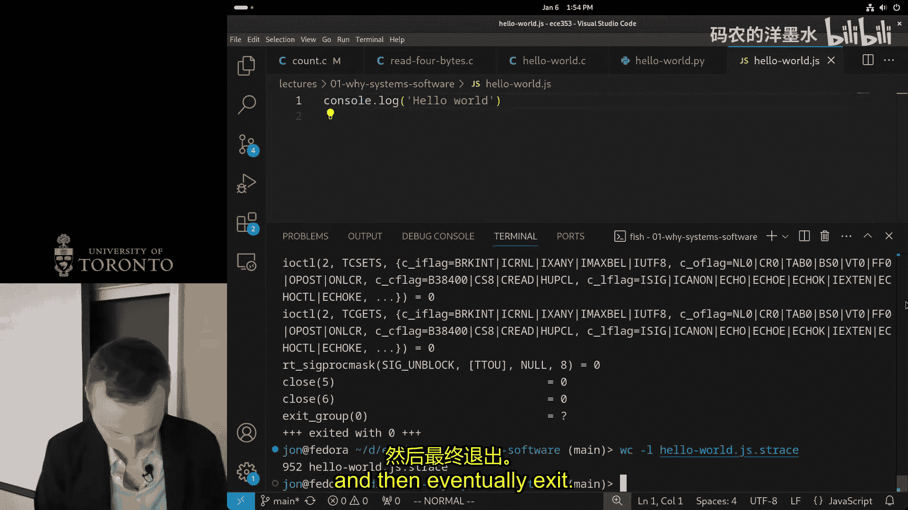

So。Back to content， you can think of the kernel as like a long running process。

 so writing kernel code is more like writing library code。The kernel。

 we won't be writing kernel code in this course because it's really。

 really hard to debug and get right， we'll just be explaining what it does and kind of simulating it。

 but the kernel lets you load code into it while it's running called modules。

Then that code executes on demand， so for instance， when new hardware is plugged in。

 when you plug AOS or something like that， or' accessing a certain file。

 it will know to run the function you just loaded。If you write a kernel module。

 there's some demos for that， you are running in kernel mode。

 you can actually access all those privilege instructions， any kernel data。

 you can do anything and you can really mess things up so you can read the memory of any single process。

 you can kill any process， you can do whatever you want， you are all powerful。So。

There are different ways to architecture your kernel。

 This is an important thing that might be like a short answer at some point。

 so there's different ways to architect the kernel。

There's the first one which is what Linux uses called a monolithic kernel and that basically just says anything that's even related to hardware。

 I'm going to run in kernel mode， so kernel the kernel that's running in that privileged CPU mode will deal with handling virtual memory will deal with like scheduling what process to run on a CPU will deal with IPC will deal with how you know you actually deal with data on your hard drive and any other device drivers like video cards or anything like that that will all run in kernel space。

 so that is an absolutely massive amount of code that is in there and as we all know。

 the more code you write， the more errors you might have。The more exploits there might be。

 and if you can exploit the kernel， you run in kernel mode。

 you now have full control over that machine。 So there is another view of thought。That is， well。

 let's move as much as we can out of kernel space and only run the minimum amount of services required for an operating system。

 so there's less code running and kernel mode， less code means less vectors for exploits， hopefully。

 and that means a more secure operating system。Things that have to be in kernel space are dealing with virtual memory because it needs to be more privileged than anything else to control virtual memory for processes。

Also， it needs to be the thing controlling which process to actually run。

 what program to actually run， otherwise if programs can schedule themselves and take over a CPU。

 then while you have no control anymore，To make sure processes are isolated。

 it has to have at least some basic form of IPC in kernel space and this architecture of a kernel that only has these three things is called a micro kernel and that idea is minimum amount of stuff in kernel mode。

 try and put file systems， device drivers and more advanced forms of IPC all in user mode。

 and then I have to do system calls。So there's other types of kernels that there's different tradeoffs for why you would put different code in different modes。

 so hybrid kernels are kind of in between monolithic kernels and micro kernels。

 so for instance in Windows， emulation services are in user mode。For Mac OS。

 device drivers are in user mode because Apple doesn't want you to be able to modify or touch the kernel in any aspect so they don't allow you to write kernel code。

 they lock it down， device drivers only run in user mode and there's also active fields of research in operating systems to kind of shrink a micro kernelnel down。

Just come up with other names called like make it even smaller we'll call it a nanoconnal or a pickle kernel and that's the idea of just shoving more stuff into user mode than traditional Michael kernels。

 but that is a line of active research there's different architectural lines you can draw with different trade offs。

So。In summary， the kernelel。Interfaces。That operates between the system like CPU mode boundaries。

 user mode and kernel mode， you do it through something called a system called the kernel is a part of the OS that interacts directly with the hardware again。

 cyclical definition it actually runs in kernel mode system calls are the interface between user mode and kernel mode。

 every single programs especially on Linux must use this interface so we can use something like Strace to actually see what every single process is doing and then you know we could have。

Oh， yeah。Sorry。No， go for it。with a micro。Our system related that we don't actually have。Yeah。

 so like for Micro kernelnel， I could put file systems and stuff in user mode and just say， hey Col。

 this is how you read you know a disk or something like that。

 you can read it on my behalf but you deal with the hardware。But I'll tell you what to do。

 but I don't actually get to run。Running kernel mode， I just get to kind of tell you how it works。

Yeah。And so what you don't need to know is file formats。And how to actually define an executable。

 but I showed you how to do it in 168 bytes。Should kind of know the difference between the API and API at a high level。

 how to explore system call， so Strace is fun， really fun to Strarace any single program。

 and then there's different kernel architectures that shift how much code runs in kernel mode。

 versus user mode and that will make more sense to you as the course goes on。

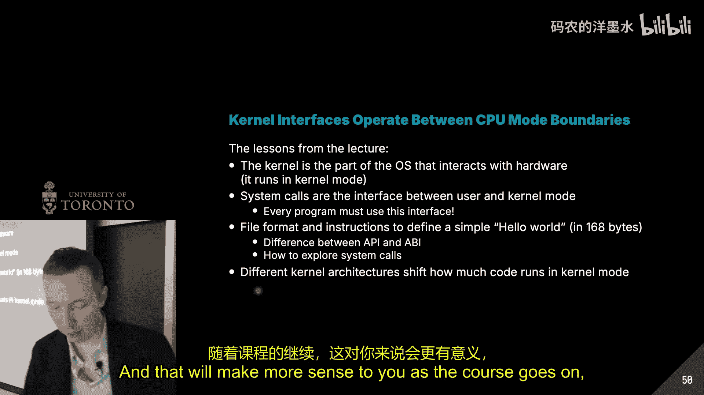

Just to show and probably end the lecture， whoops， that crashed。

So I could literally erayce everything， so Firefox is running， I can eRAce Firefox if I want。

If I askedtra is Firefox， well it's going to slow down because Firefox does a lot of system calls。

 but I can actually see what it's doing。It's running。

It's going to be slow because it's tracing stuff， but here it is， it's still loading。

 it's still doing stuff， you know web browsers do a lot of stuff。Sorry， we're having trouble。

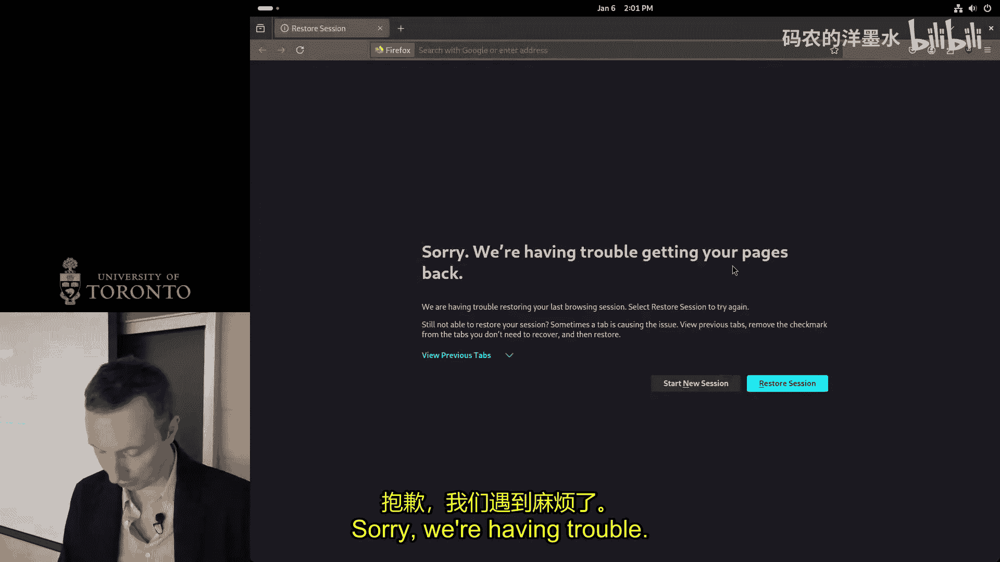

And it crash。 cool。 So I read way too much input and crashed， crashed that。

 But if I gave it more memory， it could probably survive。

 but you can literally esce anything you want。😊。