# 【全集 2025】多伦多大学 系统软件设计与编程 中英字幕 1080P p02 Lecture 2 - 程序库 -BV1YrkYBQEeL_p2-

Allrighty， welcome back to 353， bright and early at 9 a。 isn't this fun？All right。

 so let us start our next lecture about libraries。

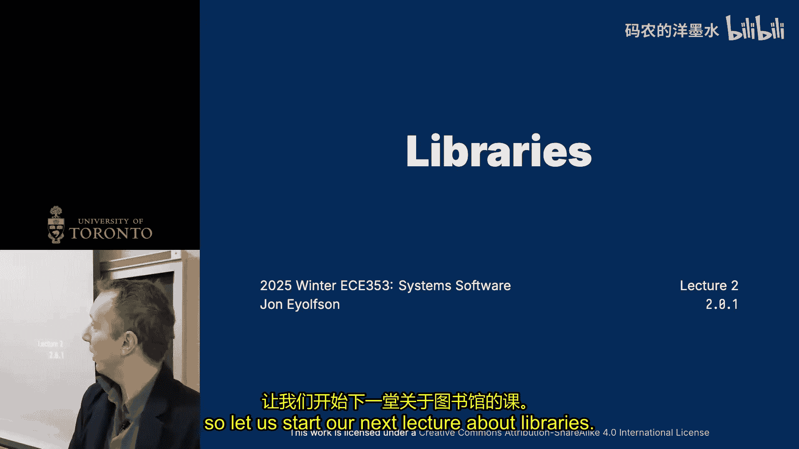

So we actually haven't actually defined what the heck is an operating system。

 so we said that the kernel is part of the operating system is the software that runs in kernel mode against kind of circular definition。

 but what else is part of the operating system。 So for instance， if you're an Apple fan。

 there's Mac OS， iOS， iPad OS， watchOS， GOS。Are they all different operating systems or？Are they 99。

9% the same well it out？They're all using the exact same kernel。

 they're all using you the same Darwin kernel， but they would all be technically considered different operating systems because。

Typically， what you care for， what you care about for an operating system is what kind of programs or applications it could run。

 and you can argue all the different。You know a。TV app is not the same as an iPhone app is not the same as a Mac app。

 so technically you could probably say they're all different operating systems。

 even though 90% of the code is the same。So applications might pass through many layers of libraries。

 so what we talked about yesterday was hey， the kernel lives in kernel space way down there。

 it does very important things like here you' interacting with the hardware， but your applications。🤢。

Typically do not actually use that system call interface。

 You probably rely on something like the C standard library to call it for you and use it for you。

 So if you have a very basic is a C standard library and you might consider the C standard library part of the operating system if you have something more complicated。

 there's other libraries， there's like a system demon library that has to。

That abstracts hardware for your application so you can tell， hey。

You know this computer has different network cards， things like that。

 so like things like network manager might use that demon to see hey， what's an neatthernet device。

 what's a w-fi device， things like that， Libra office well that probably use like a GuI toolkit you can actually have a user interface so that would probably use some GuI toolkit like JTK。

 something like that and then that in itself would use a library to actually display the pixels to your screen。

 something like whhalland on most modern Linux systems。

 and then something like Firefox might use all them so you can mix and match libraries so。

What is part of an operating system kind of depends on your application。So。What it is。

 like I just said， depends on your application， Android and Debian or whatever you're running your dev container on。

 they both use the Linux kernel， but the applications are different。

 your Android application is going to be different than like the hellello world we did before。

 but Android and Debian both use the Linux kernel， so if I only cared about Hello world。

 you could actually transfer that hellello world executable to your phone and if you're using an Android phone and it would execute in which case you might say that Debian and Android are the same operating system is if all you care about is console applications。

So。Again， thats kind of weird， the answer is it depends。🤢，As an aside。

 links distributions are usually considered to be Gnu/lash Linux because Linux is the kernel and Gnu is basically the standard C library and all the default applications you have LSCP。

 things like that。What the operating system actually consists of is the kernel and any libraries required for your application。

 so that is our definition of a operating system where the answer is it depends。

 The only thing that is ironclad here is a kernel is definitely part of your operating system。

 whether or not a library is kind of depends on your application。

So here is some review on compilation， so normal compilation C。

 hopefully this is review for everyone， you have your dot C file。

 you compile it either by hand or by using make or Mesan or CMake or something like that and every C file turns into an object file that has all of the machine code in it and all the functions and everything like that。

 and then in a separate step they're all linked together。

AK they're just kind of all mashed together to form a single executable and now we can also know that these dot0 files are also just e files with code for the function。

 so this is review to everyone， yes any questions about this。All right， hopefully review。So。

There are two types of libraries， static and dynamic， static libraries are included at link time。

 so say in some of those C files you want to use them in different applications well copying pasting is really bad if you want to make something reusable you can compile it create a library out of it and then many applications can use your library。

 so static libraries are included at link time or compile time so should know from before。🤢。

There's a difference between compile time and run time。

 so compile time whenever I use GCC creates the executable and then run time whenever I try and execute my program。

So。If let's say my ufo and my bar files were something I wanted to reuse。

 I could instead of linking them all in the executable。

 I can mash them all together doing something called link them together as an archive and then they're all mashed together in this Lib。

 a file and the idea behind this is that while instead of using this linking to the C files directly。

 your application can just link with this Lib dot a， but otherwise this all happens at compile time。

 you get the same executable it has the same things in it and it gets linked together at compile time。

So the only difference is that， hey， I have several things together， mashed together in Lib。

A here and other programs can actually use it so if I had like a main two。

 I could just link against Lib。t A instead of recompiling every single file again。

So the other option is to have dynamic libraries for reusable code that gets determined at runtime。

 so the C standard library is a dynamic library。It's indicated on Linux as a dot SO file。

 like other systems， it's basically the same thing。

 it's a collection of dot O files containing all of the function definitions。

But it's resolved at runtime and idea behind this is similar to any other library。

 multiple applications can use the same library， so pretty much everything you've ever written。

Ever uses a C standard library， so your application1 and application 2 can actually use the same standard C library and the operating system can do some tricks with this。

It can only load Libps C into memory once and share it between every single application。

 which is probably something you want to have a lower memory footprint You don't want to load。

A separate Lib C for every single application that uses the exact same library， right？

Even if LibBC was like 1 megabyte， if you had 100 programs using it and none of them shared。

 then you'd have 100 megabytes wasted for every single version of LibBC。

 so this is why it's a good idea to just do it dynamically。So how it works， same idea。

 we take all of our dot O files， but instead of doing an archive。

 we do them under shared linkage which adds some additional things to this do SO file that helps the operating system find like where a function like Pri F is and then now for our program。

 we don't have to compile time or link time， all we have to do is say hey what library we use。

 it will go ahead and kind of just double check it whenever we compile it。

 but it will create an executable that actually uses that library at runtime。

 so whenever you run your program， it then loads that function from the library。

 whatever it is run so now I can actually update this file and I get run a different version every time it runs yeah。

Kind of like a database， but it's just like， yeah， you can kind of think of it like a database that just。

Loads it whenever your program actually runs， so like when we did the Stra on our Hello World program。

 we could see that hey， it opened Lib C and it found print F and then it called that so if we changed it and then ran the program again it would find the new version of print F。

But if we did it statically， then printf would be included in our executable and it would always run the same thing and it wouldn't have to find anything。

 it would just be in the executable， it would just run printf。Drawback is there， if we update printf。

 we have to recompile our whole program again and everything like that。

Wwhichch we'll get into so there's a useful command line utility for checking what dynamic libraries and executable uses。

 you can do LDD and then the executable and that'll show you all the dynamic libraries and executable uses just in case you are curious。

Might be useful for you later， we won't really touch in this course， just a nice aside。

So why would we use static and dynamic libraries？The other option again。

 was to statically link our code。Again， static linking basically just copy paste all of the dot o files directly into your executable。

 so if you change something in your library in order to get the changes in your executable you have to recompile it because it basically just copy and paste it into the executable。

 some drawbacks compared to dynamic libraries， if you statically link you're not reusing any libraries。

 many common applications would have many duplicates， so。For instance。

 if the standard C library was a static library， then if you use print F。

 you have a copy of print F in your executable， that's a copy of it whenever you compiled your program。

 and every single program running on your machine would have its own independent copy of print F。

 which is whatever it was， whenever you compiled it。

 and that would be a lot of wasted space and again。

 if you have to update print F if there was a bug with it， hopefully there's not a bug in print F。

 but if there was， in order to get that new version of it。

 you need to completely recompile your executable。Well， if。

I use a dynamic library and I immediately get the changes。

 might there be an issue using a dynamic library？Has anyone ever written a buggy program before？6。

Yeah， well， what if it becomes deprecate or even worse。

 what about if the new version now has a bug in it？If the new version now has a bug in it。

You immediately when you update that library and then run your program again。

 wellni now uses this buggy function and then you know it blows up and it doesn't work anymore。

 but you didn't change your program at all， so now you get to go ahead and try and debug that with something that is absolutely not your fault。

 so really important that you know you write good software。So we'll see an example of that。

So the big drawback here is dynamic libraries。Can actually break executables。

 So we talked about a A BI change。Like what an A was before。

 there are certain things you write and see that suddenly changed the A that we will go over today。

 don't worry you don't have to know this for the course like what all the rules are。

 we'll just be exploring a little example that may or may not be slightly confusing but let's just say we have a dynamic library that has a struct in it with multiple fields and that courses to a certain AB like how that struct is laid out in memory。

 whether you know it or not there are certain rules for it。

 so the executable access is fields of the struct， if an executable uses the fields of a struct used by a dynamic library。

 well wherever you compile your program。It uses certain API。

If you change it and the library compiles with a different version of the struct。

And they don't agree anymore， really bad things were happen。

We'll have an example where the dynamic library just reorders the fields of astruct。

 so it just changes the order of them that would not change the API。

 so say I have a point with an x and a y and I define it as y then x and then later I'm like he。

 I didn't like that order， I'll change it to X then y well。

That's the same API point has an X and a Y， but the rules of C are that those have different layouts in memory。

If you never show the user astruct and you keep it contained in the library and the changes are only internal to the library。

 you will never have any disagreement between them， but if there is a disagreement。

 bad things will happen， so let's see what our example is。So。

Cs rules for their AI forstructs how they're laid out in memory。

 the fields are laid out in memory in the exact same order you declare them in。

 so C compilers all agree on this， they ensure the A ofstructs are consistent for specific architecture。

🤢，So if we had the followingstructs， if I had str point with an x and a Y。

And let's say this is my version one of the library， so in version one of the library。

 the X field is offset by four bytes， everyone knows what an offset is， hopefully。

So offset is just the number of bytes from the start of this file。 so thisstruct here。

Contains two ins， and int is 4 B。 So the total size of the struct is 8 B。 And well。

 if they're laid out in memory in the same order， they're declared in， then。

If I give you the starting address of the struct， at some arbitrary address。

 offset zero would be the first byte of the struct， and that's where y would be。

 so y would start at byte 0 be byte 0，1，2，3 because it's four bytes。

 and the X field would start at byte 4， so that's what we call offset4。So。For version one。

 just looking at the X field， it's offset by four bytes from the beginning of the struct and then in version 2 where we just flip the order of the fields it now is offset by zero bytes so it's at the beginning now so if we had a library that just dealt with points and we've made just this change we will cause a whole。

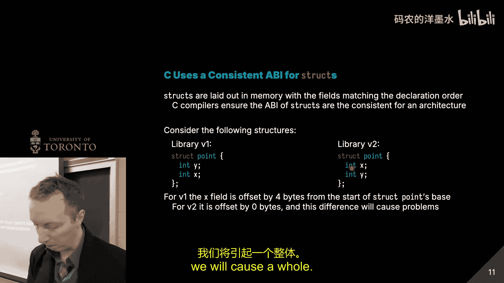

Slew of problems。So let's look at the code。So again， here。

 just to be clear how the struct is represented。After compilation。

The translation is going to differ for each version。 So forstruct， for point。V1 and for V2。

It's basically represented as an array of two ins if you want to think of it that way because of the same size and types in version 1 where I had y first and then x。

 that's the same as y is like at the array at index 0 if it's an int array and x is at array at index 1 and in version 2 x is at array at index 0 and y is that array of index 1。

 so this clear to everyone。All right， so this is going to cause problems and let me know if this hurts at all。

We're going to create a library called Lib point and it's going to have these following four functions。

 so it's going to have a point create that。Takes an x and a Y。

 and then it returns a pointer to a new struct， so internally this would just mall some space for that struct。

Initialize the fields based off the arguments and then return you back a pointer to it and then。

Well this is C， so they're not methods， but we'll have a basically a method to get the value of x。

 given a pointer to the struct， and then how to get the value of y given a pointer to the struct。

 and then we'll have a point destroy， which is basically just going to call free。

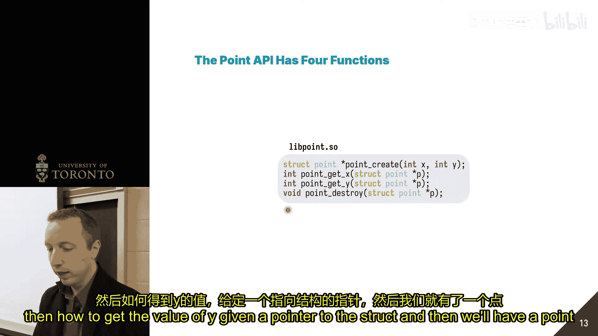

So here， so let's go into the example code and again， stop me at any point if things get strange。

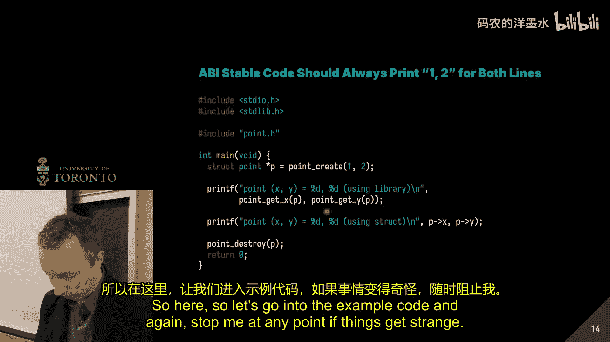

So here is the library， so in point createate all I do is oh also part of the library。

 typically you also have like a header file， so here's my header file that has thestruct in it。

 so this is version 1， so it has a Y and then an x。

 and then it has declarations for my four functions I'm going to define。So that's okay with everyone。

 that's my header file。And then in my point。c， this will be compiled to create my library called point in point createre。

 all I do is malloc， you know space for that struct。

 I get a pointer back and then I just set the fields and then return back that pointer I got from malloc。

Get X， get Y， they just access the field， and then destroy， just freeze it。

 So A we have any problems with this。Perfectly crmulent， right。Here is my example。

This would get compiled。Using this header file， which is version 1。

 which has y then x and two Lib point。Dot SO， which would be my shared library object。And then let's。

Create a program that uses this library， so I would include this point do H。

 which right now if I compile it with version 1 of the library， it would have y then x。

 which is the same order that the library was compiled with and then here。

I do a call to point create where x is1， y is 2， and then I do。

I just print the points X and the y using the library calls。

 So the numbers I get are from calling X and Y。 but then you might be like， okay， well。

 I as part of the library， I actually know。The fields of the struct because it's defined in the dot H file。

 so I can just get the points x and y coordinate just directly using thestruct right。

 I can just do P arrow X， Parrow Y， right？That's okay with everyone。All right。So if I run this。

Where I compile it with version 1。So。When I say compile version 1。

 that means of this header file oops。And all I'm doing is changing the order of the struct in this header file。

 So compile version 1 means I compile this。Lid point example with version 1 of this point。

8 file and link V1 means I also compiled the library with version 1 of this header file。

 so if I run this program， what should I see printed。How tricky am I？Yeah， one，2。

 and then one two again， right？see confidence， so1， two， one， two again。

 everything is all hunky dory， right？So。Weird thing might be because this is dynamic， right？

This line is coming from calling my library functions， right。

 which that's compiled separately than my executable。

If I go ahead and I do make a version2 of that library， so here I open version 2。

 the code is going to be exactly the same， I did not change any of the definitions of the code whatsoever all I did is in point。

 H。I just swapped around X and Y， right？So。To simulate a update to the library and not an update to my program。

 I can run this under Lipoint example so compile with version 1。

 so this point example program was compiled with version1 of my library which had this or sorry had。

This as the header file it was compiled with and then later。I came along。

 created version two of the library。That changed the header file to flip the fields of the struct。

 I would have compiled this new version of my library with version 2 of that struct。

 so now this is using the fields in the well。In memory these fields are in the other order。

 I compile this， this is now Libpoint version 2， so to simulate that update。

 I can run it using this point example compiled with version1 of the library and then linked with version 2 of the library so if I do something like that what's going to get printed and this simulates a update yeah。

Two，1， and then one， two。So using the library。It's going to get。Two，1， and then one。

 two as the next line， y。So close。 So one of them got reversed。

 So why did that one get reversed and not the other one。It's a good question。

 Anyone know why that one got reversed yeah。Yeah。Yeah， so we have to look at who created thestruct。

 right， So in this point example。So this point dot H。

 if I'm compiled it with version1 of the library， this point dot H that has。Y first and x first。

 right？If I use point create。That's calling my library1。

 So that uses the order of like what the library expected it to be in， right？

 So point create for the library。 It was in version 2。 It was X first， then Y first。 So with。

Version  two， using the library， since this is one of the functions as in the library。

 it went in memory。It went x first then y first。So if I use this point git X。

 well git X also uses a library， the library is going to agree with itself right。

 so it thinks that x came first so it will get X。And then using point git y， well。

 it knows that it was x and then y， so it will return the y。But if I just use the struct directly。

 this is my program that was compiled，ops it accesses the fields of the struct。Directly。

 and they get baked into my executable whenever I compile it。 so this P dot X。

 if I compile with version 1， that will think x comes second and then y comes first。

 so that's why if I do this well this is just going to access the second element。

 this is always going to access the first element so in this case it's going to be the reverse of what I think it should be right the library agrees with itself。

 but this does not agree with what I compiled the library with。Isn't that fun， yeah？Sorry。Yep。Yeah。

やだ来て。Like2 and one。Yeah， so this one using the library。Shows。1 then two， right。

 because it agrees with itself。So the library actually created the struct。

If we compile thestruct with version two of the library， it goes x and y， right？And then this gi x。

 it knows if it's compiled with version 2， it will access x at the first slot at index 0 right。

 so this would return1， this would return2。Using the struct。

If we compile this with version 1 of the library where y came first and then x came first。

 this is going to correspond to the second slot， right？And this se will correspond to the first slot。

 which is disagrees with the library。Everyone kind of see how that。 It's a really subtle thing， but。

Shouldn't break things， but they've actually broken code for。

Literally every single program on the planet， C++， the standard C++ library。Did a change like this？

Where they reordered fields， I think of a list， and then every single program that used a list was now wrong and didn't work。

 so they had to recompile literally every single program on the planet， that was fun。Yeah。

GoodQuestion。啊。Takeaway， I guess。Its the library。Well， takeaway is。

Takeaway is if you are the person writing the library。So if I am the person writing the library。

 let's go up here。If I'm the person writing the library and I define astruct。

I can now no longer change it if it's included as my header file and then you can compile it into your program right because if I didn't do this。

 if I just said you know struck point and then didn't give a definition at all，And then。

Completely hit it from you and then you can only access it using the library。

 then I can willy nilly update the library the library is always going to agree with itself right but if I define a struct and then you use it。

 I'm now no longer allowed to change the struct whatsoever。

 otherwise I will break every single plant program on the planet that uses your library。Yeah。

 in that case， if I want to do it properly where I want to be free to change the struct。

 I don't define it in the header file， I only define it in the C file because then。

Only the library is going to know about it， which is fine。 You can change it Willie nilly and then。

I can also simulate other weird things， so if I compile with version 2。Oops。呃。

If I compile with version 2。And link with version 2。Then they're both going to agree with each other。

 it's fine。But that would mean like， hey， I had to recompile my program which kind of defeats the purposes of a dynamic library。

 or I could also be like， hey， I updated my library。

 it's now version two but you're using an old system that only has version one of the library in which case it's going to disagree the other way doesn't matter it's going to flip them around you could imagine also if this was a game or something like that。

 you update a library and then your whole game flips diagonally。

 that would probably be kind of weird， so yeah， probably don't want to break things using that。🤢。

All right， that okay is with everyone。You don't have to really care about the details。

 the really important thing is that， hey， some things actually correspond to an A。

 you can't break an API。If you're using a static library or if you're using a dynamic library。

 if you're using a dynamic library， you have to be very， very careful about your updates。

 otherwise you will break every single program on the planet and it will be bad。

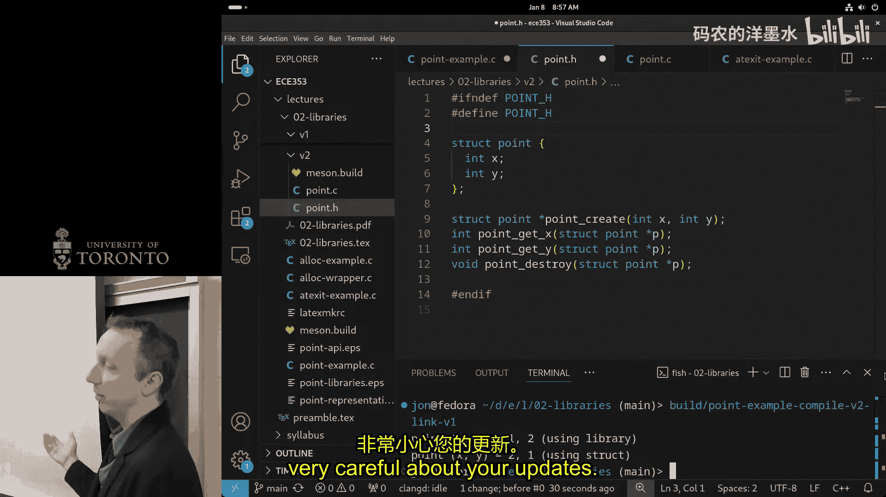

How I did that is a little bit of magic。 If you want to simulate library updates too。

 there's this environment variable called LD library path。 and that will actually。😊，Tell。

The C or yeah， the C runtime， whenever I start running this program。

 look in this directory for the library first so I could set LD library path to build V1 or V2 to simulate a library update so you can do this。

To simulate a library update yourself， so even if you ran the one with compile version1 and link with version  one。

That's just at compile time， if I want to simulate a library update。

 I can set LD Library path to search for version 2 first。

 and then it doesn't matter even if I use this program where I originally linked it with P2。Well。

 LD Library Pa is going to search for like search for the library in this V2 thing。Or V2 directory。

 if it finds it there first， it will immediately use that one。

It will disagree with itself and have the same problem we had before， which is not great。

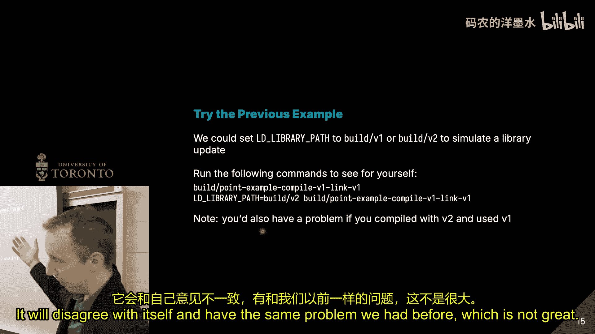

All right， so there's more， just in case you need to see that。

 we can go on to the next topic since I think I hopefully explained it a bit clearer。🤢。

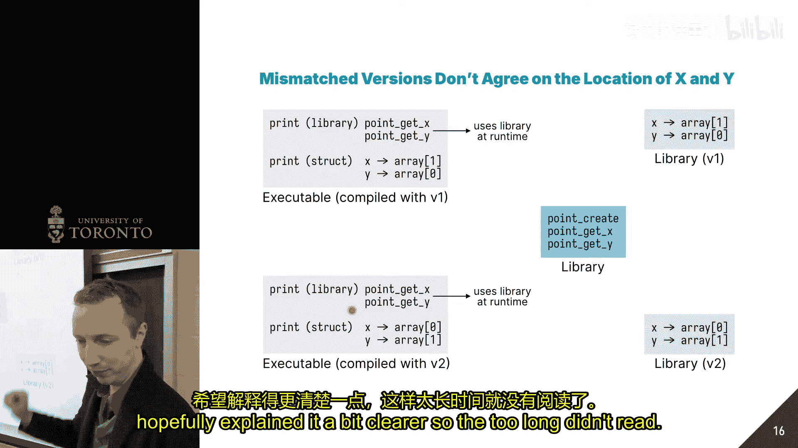

So the too long din re problem is like mismatched versions of the library causes problems， right。

 Our original thing had a struck point in both versions of the library。

 all I did was change the order of the fields。Has the same API struct has an X and O Y。

 but I suddenly changed the ABI even though I didn't even realize it。

 so the too long di'n read is if you expose a struct it becomes part of your API and now you are no longer allowed to change it so you can try any of the combinations。

If you wanted to change it， like I said before， proper stable A would be to hide that struct from point。

h and only use it in your point。c file when you compile your library。

So there's a scheme called semantic versioning that's supposed to help developers know whether or not a library update will break something or not。

 you can see it at ser。org。Basically， it's a set of rules to actually like version our software。

 So a version number should be like。All numbers， it should be number dot number dot number。

 where the numbers are major dot minor dot patch and the rules are we only increment this major version。

 if you make a version with an incompable a PI or a BI change so if you see this major version changes from one to two。

 that means for sure I need to recompile my program and if I want to not recompile my program as long as the major version is the same。

 it should work even if you upgrade that library。The other one is this minor version。

 so you should increment that minor version if you add functionality in some backwards incompat or backwards compatible manner。

 so like I add a new function in version， 1。1， then I know hey， my program needs at least version 1。

1。Because I need this feature should also work with 1。2， 1。3， 1。4， so on and so forth。

If I don't add any new functionality and I just make a bug fix or something like that the rule is I should just increment this patch version。

 so it goes up from 1。11 to 1。12 or something like that。

 so that's generally the rules for doing dynamic libraries because if you're using a dynamic library。

You need to make sure you write it following these rules。

 otherwise you're going to cause the user using your library。

 if you break things for them they're going to get really mad at you and then probably no longer use your library and probably send you a nasty email or yell at you or know troll you on something。

So。Other fun things we can do is well the C standard library is a dynamic library。

 believe it or not it allows you to debug easier so we can control it using the environment variables last example I showed you with LD library path you can also do something called LD preload and that forces a library to get loaded before anything else runs so for example let's consider this silly program and this is always fun don't save。

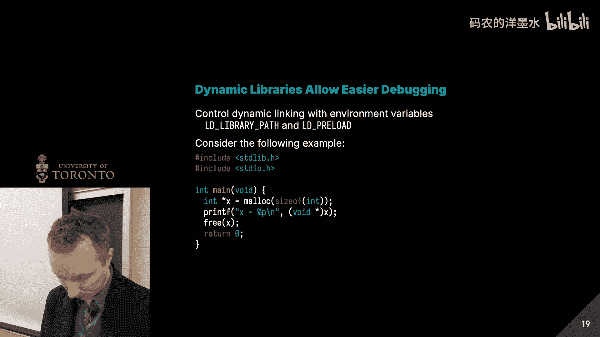

So let's consider this fun program。So。This program， Imp Maine， Imp Maloc， size of int。Everyone。

 what's the size of an int？so this should return a pointer to four bytes， right？All right。

 so I cast it because it's C to a pointer to an int。And then I print off。

The address I got back from Maloc， right？And then I free it。No memory leaks， no nothing， right？Okay。

 so fun thing I can do is let's say I wanted everyone's used vgrin before， right to kind of。😊。

Check if we have a memory leaks or anything like that so I could write my own kind of memory checker if I want I can instrument like I can define my own malloc and free and what I'm going to do is define my own malloc and free and I'll just have it print out whenever malloc and free happens so I can just kind of debug what's happening to make sure everything lines up so。

I created something called LD preload。Called it Libalc wrappper that wraps mallocc in free。

 so I can see what things are doing。So if I just ran this program normally。

 Id just get x equals some pointer value， right？If I run it with this。

 I can see all of the calls to malloc。 so call to Maloc4。So that's the size of an int right。

 I got back this address， so this is what Maloc returned。And then here I do x equals。

 so this is from my program， this matches a call a malloc right， and then I call free。

Of that same address。What the hell is this？Anyone guesses？Yeah。He petered。Nope。No。

 so this happened after。So this is all in order， so malloc4 happened first。Yeah。

sThat where the string is？Very warm， I would almost count it yeah。Terminal， no， that one was warmer。

 anyone else with the。More than。Using that idea， but more nitpicky， yeah。The print， the terminal。

Close。It's basically。That memory is being used by printnt F itself。

So that's where this is stored in memory， right， because it has to print F。

It needs to use some memory。So it needs to format my string， right。

 it needs to take this percent like this is a string with a percent P in it。

It needs to take this string and replace the value I give it。

 like replace the percent p with the value I give it right。

 so it needs some memory in order to do that and turns out that well print F needs some memory and this malllo call is from print F。

And。Do they ever free it？No， they don't ever free it。 Well。

 let's see what if I run vgrind on this Aloc example。Let's see what this says。It says。Two allocs。

 two freezes。1000。28 bytes allocated， well that agrees with what I had before I saw two malloc calls。

4 and 1024， so that was 1028。But I saw one free。They didn't ever free that。 This never got freed。

 right？But for Vgrind， it says。It was free。Have you guys been lied to this whole time by Valgrind？

Any guesses as to what the hell is going on here？Yeah。Automa advocate and then when。You return it。

When you return from print F， it automatically releases。Maybe that's from the。Yeah。😊。

Print F has a free function inside。 Nope， just uses malloc。 So if it was to free it。

 it'd have to call free。Yeah。Does it get freed after the program terminates ish， yeah？In the what？

Nope， they do not both get freed in that。One free call， only five or my four B one does。So。

Turnned out。There is。

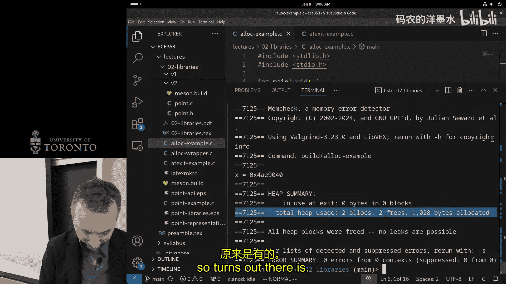

A rule here。So if you look at the documentation for Valelgriand， it actually cheats a little bit。

 it has this little blurb here that says the Ganew standardC library LibC。

so which is used by all programs may allocate memory for its own uses aK what we saw in print F usually it does not bother to free that memory when the program ends。

 there would be no point since the lens kernel reclaims all processes resource when the process exits anyways。

 so it would just slow things down so we've been telling you to free your memory all the time and the standard C library doesn't free their memory that seems unfair doesn't it。

So。The reason why they can get away with this is because。If I had a more complicated program。

That 1024 bytes that gets reused for every single print F call。

 so it only mallocs the first time you call print F and then internally it reuses that memory every single time you call print F over and over and over again and well it wouldn't actually know when to free it because the only safe time to free the memory that print F uses is after the last call to print F and if you're writing the C standard library there's no way to tell what the program's last call to print F is。

You simply just do not free it and when your process terminates。

 the kernels going reclaim all the memory associated with that process anyways。

There's no point to free it because well you don't know when that memory is going to be last used right。

 if they were wrong and they just freed it whenever they thought well the last time you called print F is and then you used it again。

 then that would be a use after free and that would be really bad so you can make this argument if you are writing a library。

 but unfortunately it does not excuse you from not calling free。

 so you are not writing libraries for the most part。You will a little bit in this course。

 but for the most part， you're not writing libraries， you're writing executables。

 Your executable should still call free。 You only get this out gettto jail call。

You only get to do this if you're writing a library。Yeah so Valalgrind actually like special cases。

 any allocations that come from LibBC and it counted as freed so because there's nothing you can do about it right。

 if it doesn't free its own memory it's not like you're going to free its memory for it so there's actually like hardcoded in vgrind it will just mark anything from LibBC is freed so it doesn't bother you yeah。

So。No， this only applies to Libpsy。Well， if you defined your own print F or own version of it and you used memory。

 you could make that excuse too， but。If you use vgrind on it。

 they're not going a special case set and it's going to look like memorys not freed and there's a memory leak。

 but you know that， oh， you know， I can use the same excuse as the standard C library。

 this is actually okay。But so you have to argue if you leak memory in vgrind。

 you have to argue that you are correct。Yeah。Yeah， if you made your own print up that malloced。

 it would say you leak memory。So how does it？How is it known？Without getting into too many details。

 it basically just instruments everything。 It knows that you loaded the Libses stamp version of print F。

 and it knows basically any malloc that comes from print F， it's just going or。

Any malloc that comes from Libps C， it's going to just assume it's freed yeah。No。

 you just ignore it if Falgriin says it's okay， it's okay。

So if you define your own function in a library and there's a good reason for you not to free it。

 then you can argue that that leak's OK because Valalgin will say there's a leak。

But you have to argue that it's okay。 And if you're using vgriin。

 there's a certain way to mark things as like， hey， don't report this as a leak， it's fine。

But there's certain ways you can do it in Valgr to be like nice。But yeah， basically you'd have to。

Argue about it and then tell Valgr that， hey， no， this is totally okay， I know what I'm doing。

 trust me。2。Other cool things you can do is you can detect memory leaks with something like address sanitizer so there's some sanitizer tools built into clang now GCC you have to recompile so we use mesin for this course to build everything because it makes it easy if you want to detect memory leaks using this instead of Valgrind you can recompile your program set it up with this option desanitize address and that will basically compile all of the malloc and free checks directly into your executable and it'll run a bit faster than Valgrind so you can try this if you want we won't see an example of it but that's something you can try。

Also， so you might notice that system calls are really rare in C generally you use things from the C standard library instead。

 so most system calls do have like a one to one correspondence with a C function。

 but they do other things so system calls don't set ano or anything like that so the C version set this global variable called Ano。

 they might also buffer reads and writes to reduce the number of system calls so print F might not actually trigger a right in some cases。

 it usually only triggers a right if there's a new line。

mightight try and simplify interfaces like a function that combines two system calls together or add some type of new feature。

So for instance， C has exit， if I do system call exit， that means programs done。

 process is done running， it exits immediately。No pass and go， no collecting $200， but C has its own。

Exit function， so the system call exit again immediately stops the C exit。

 they added a feature to register functions that get called before the system call exit actually happens。

 So if I have a program like this。

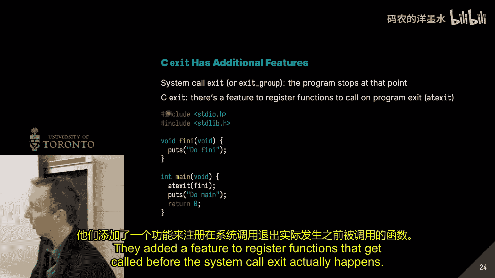

So I have this fan function that just。Print a string called Dufiny。 And then I have a main that。

Calls this at exit function， What at exit does is register a function to run whenever I actually call exit。

 then I do a put S。That basically just prints do main and then I return zero from main。

 so returning a number from main implicitly calls exit from the C standard library。

 so this return zero will call main and because it doesn't immediately do the system call main it does the C exit it will check for any registered functions and run them before my program actually exits in which case it should print Duiny even though I don't call it from here so if I run this。

That's a called Add example。I see that I see。Domain and then return， which calls exit。

 so it's the exact same thing as if I just did this， they mean the exact same thing。

And then compile oops。So they mean the exact same thing， so if I run that I get Duma dofiny。

 but if I did the system call1，Like if I did system call exit right after Du。Process would be done。

 I wouldn't see that duiny line because， well， this is the C version of exit that adds some additional features。

niitaeng。嗯。So let's quickly wrap it up in the one minute we have。

 so operating system provides foundation for libraries， we learned about dynamic libraries。

 comparing them to static libraries。

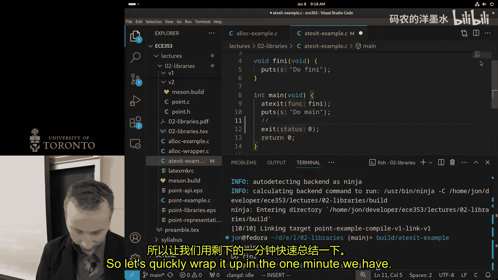

A little bit how to manipulate the dynamic loader you absolutely do not need to know that for this course that's for like if you want to exploit things or just play around with stuff and we saw example usages of like just changing the ABI that broke things without any API changes again just know the high levelve rules you don't have to know the details so just remember。

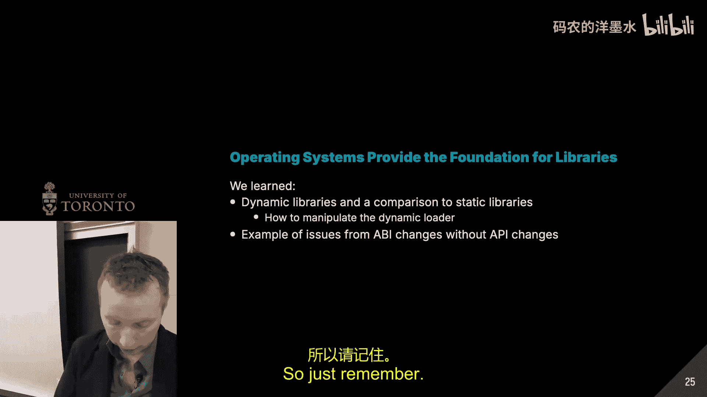