# 【全集 2025】多伦多大学 系统软件设计与编程 中英字幕 1080P p03 Lecture 3 - 进程 -BV1YrkYBQEeL_p3-

か知。Exact just like the random guy。Allrighty， welcome back to three5，3。

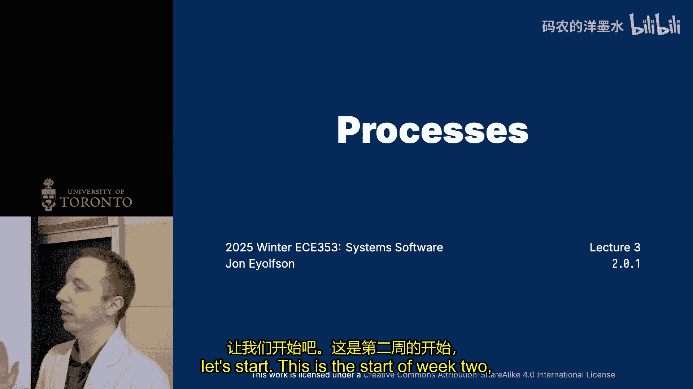

All right， so。First off， let's start。This is the start of week two。

 let's start off by a little bit of a review。So。We learned that there are processes which are kind of like a running instance of our program。

 which we can have multiple of。So let's draw a box that represents our process。

What are some things in a process that we need to keep track of a running program or allow a program to run？

Nothing a program can run with nothing， yeah。Stack， all right， we got to stack somewhere。

Anything else， yeah， a heap， all right， we got a heap。Yeah。We got registers， are they real registers？

Sorry。Yeahや。Well， we got virtual memory。 Yep， so virtual memory is a good one。😊。

So we got virtual memory。And technically， that's where the stack and the heap also live， right？

Then we also have some virtual registers。All， is that all we need to run a program。

 register stack heap？Well， I guess that's all we need for now， but our Hello World program， right。

 we outputted hellello world to something。 Anyone remember what that something was called。

The magical number we used， we gave it to name。Ih。Yeah， guessing no？So file descriptors。

So program probably interacts with something else。 So tactically， we got some。Technically。

 they're open file descriptors。We then go into it too much other than saying， you know。

 basically it's representing some resources。 so let's have a nice division here so。

Processes are managed by the kernel， so they would be in kernel space。And then。

If we have kernel space， what's the other thing called what do our applications run in？User space。

 right， so we got user space up here。And this is where our applications live。Ohoops。

How does an application？Try and make a request to kernel space， yeah。System calls， right。

 So crossing this boundary is done with a system。Call。All right。So。Other little things。

 so this is a bit beyond， but we can imagine that the kernel is also keeping track of like a whole bunch of files。

 so maybe we got file one。File2， maybe something representing our terminal。

So open file descriptors for a process， you can think of it for now is。In your process。

 there is just a big array of pointers to files。 So these are your open file descriptors and a file descriptor is basically an index into that array。

 So the default ones or by convention there should be a 0，1 and 2。

 So the way to think of those file descriptors are。They're kept track in your process。

 and they point to some resource in the kernel。 could be a real file。

 could be something like a terminal。 So， for instance， by default。

 something that again is a bit beyond is that the default file descriptors 1 or sorry，0，1 and 2。

 they all point to this terminal resource that we can read by from or write bytes 2。

Other thing to tie together， we also talked about libraries。

 where do libraries fit in on this picture。We don't need them screw。Yeah。都。Yeah。

 the answer was doesn' it depend what kind of architecture。

 so the architecture of the kernel decides what's in kernel space and what's in user space。

 typically that has to do with things that are kind of related to the hardware。

 libraries usually aren't super related to the hardware。Yeah。They。Bottom of the user space， yeah。

 so libraries are somewhere in user space。What libraries you would consider part of the offering system depends on what applications you're running。

 but they would be in user space， typically these system calls you don't do。

Just using that AI we saw before， you can do that， but how we're going to use system calls in this course。

Is the library we use the standard C library or other Poss wrappers will do the system calls for us or maybe add some other features like that at exit thing and all of that。

 so our applications will use libraries， they could directly do system calls。

 usually that doesn't happen。Libraries。Give you some added functionality。

 they may or may not do a system call， group up system calls， add new features， everything like that。

And what we're concerned about kind of in this course is this whole system call。

Boundary here between programs。 So we'll be creating applications that。

Pretty much use the system calls， but use the C wrappers。 So they're a bit easier。

 And we should be able to explain what the hell is going on in kernel space。

 You might imagine writing kernel space code is difficult because it has access to all the hardware and things can go very。

 very wrong。 So we'll stick to user space for actually writing stuff。

 So any questions about the whirlwind of week1 because it is going to get very strange today。

All right， everyone ready for it to be weird， so this is where the course starts getting hard。

 what you know about programming is about to be turned on its head a little bit and it's going to get confusing and it's going to stay confusing for about。

 I don't know， five weeks and then we'll figure it out。So bear with me， ask questions。

 we know just enough to start being dangerous after this class。

 and you'll probably crash my computer at some point。

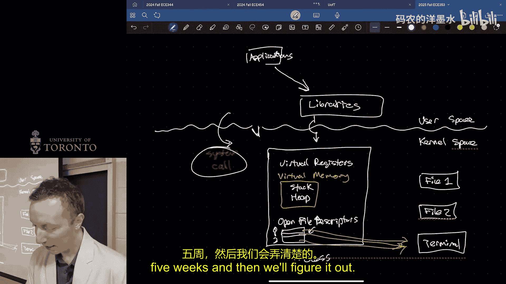

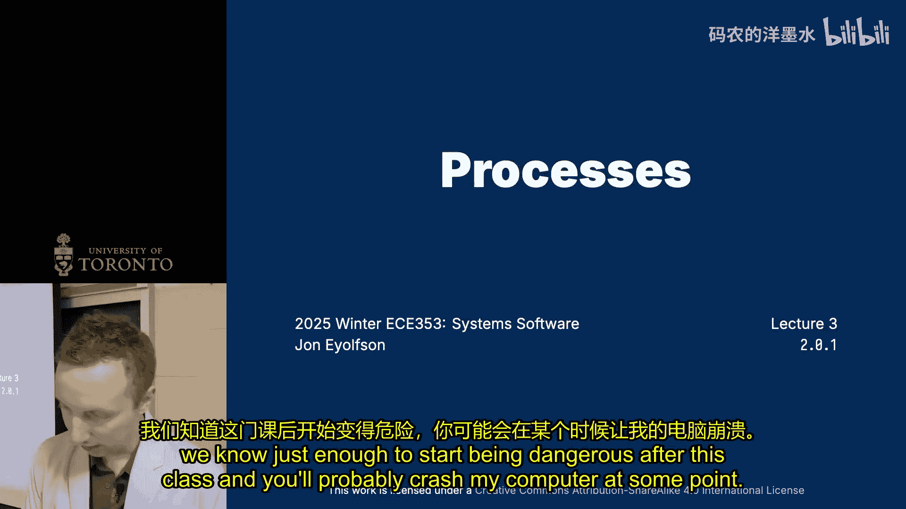

Going to start talking about processes again， here is the process representing a running instance of our program。

 I can have multiple processes all running the same program independently like we saw with that count example。

 So here's me just adding open file descriptors to that process。

 is basically just an array of pointers to some resources that you can read bytes from or write bytes to。

So technically all the information about a process is in something called a process control block。

 or of course we need a TLA for it， so it's also called a PCB。

 that contains all the information you want to know about a process specifically in Linux they call it the taskstruct and you can browse it on GitHub。

 great thing about the Linux kernel is it's open source so you can read all about it if you want to see what exactly makes up a process。

All we really care is that it contains some process state， saves the CPU registers。

 so like a copy of those virtual registers has scheduling information like when this process should actually physically run on a core。

 which we'll get into a bit later in the course， memory management information。

 so what its virtual memory is mapped to in physical memory again， topic later in the course。

 IO status information， so if it's reading or writing from a file or network connection or something like that。

 and lots of other type of boring accounting information。

The thing we really need to know so far is that each process gets a unique process ID。

 again we shorten it to just be PID or process ID and that's in order to keep track of a running instance of a program so it is unique as long as that program is running。

So。Processes have a lifetime right we run our program it ends so if we want to really break down the lifetime of a process。

 we could do it with a handy dandy state diagram， so at some point which we'll see today we can create a process out of thin air。

 it is creatively in this created state where the kernel has to go ahead。

 you know set aside some memory for it， set it up so that it's able to execute。

 give it space for stack。Maybeybe load the program into memory， things of that nature。

 and then once it's ready to execute， it will transition to this waiting state which could you could also rename it to Read if you want。

 it means it is able to run but the kernel has not deemed it important enough to actually execute on a CPU。

When it deems it important enough to actually run a CPU， it will transition from waiting to running。

 where it will actually physically run on a CPU core。

 so the kernel would have to load its previous version of registers and everything like that。

 let it get access to the CPU and actually physically run。So。If our program is short。

 it will transition from this running state to this terminated state and it will do that using that exit system call right so it will do that。

 that means our process is done， it's terminated， it's done running so we can clean it up if our program runs for a long time。

 well， especially I have like hundreds of processes on my machine。

Your kernel is going to be smart enough be like， okay， well， one of the other 99 processes。

 they get a turn at the CPU， so it will stop you from running。

 save the current state of your registers and everything like that and put you back in this waiting state where you could execute again on the same CPU core。

 maybe a different one again， topic a bit later in the course。

But it might deem me important enough that， hey， now it's your turn again， you should run again。

And then you could run。Then maybe you make a system call which is slow or needs to do some IO or something like that。

 So if you make a system call， your process will go from this running state to something called blocked blocked means it's just waiting for the kernel to essentially finish a system call。

 So it will go to this block state。 maybe it's waiting from input from a file。

 maybe it's waiting for input from a terminal， maybe it's waiting for input from a network。

 something like that。 So blocked means it's not able to execute。 It's not terminated。

 it's waiting for something to happen。 So after something happens。 you know。

 I get that data from a slow disk or something like that。

 it will transition back from blocked to waiting or ready where it's able to execute again and then we could run it again。

 So any questions about that fund state diagram。Yeah。Play correspond。Yeah。

 so this is just for a single process， so one process can be blocked。

And we'll see how to figure this out to see processes that are blocked on Linux and all sorts of fun stuff。

Alright， so you can read process state information using this proc file system on Linux。

 so there's a standard proc directory specifically on Linux that represents the kernel state。

 so they aren't real files， they just look like it。 So every directory that's a number。

 represents a process ID。In that proc file system。 and within that。Diy。

 there's a file called Sta that contains the state and that's used for lab1。

s use everyone's used task manager or activity monitor on Mac right that shows you everything running well lab1 you're going to create a slightly scuff version of that that works on Linux so you're going to write your own kind of process viewer so。

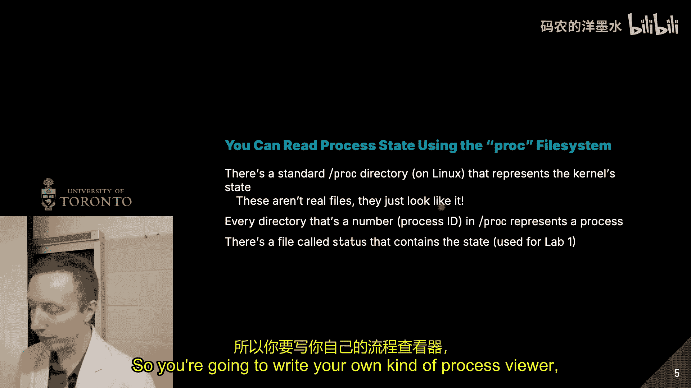

If we take a look。Just to explore lit， if I go， if I do LS in this pro directory。

 I'll see a whole bunch of things that represent the state of the kernel， something zone info。

 VM alloc info， uptime version interrupts， file systems， like a whole bunch of different file names。

🤢，Fun one might be like， hey， there's one called CPU info that if you read it。

 willll tell you what CPU you're currently running on。

 And then all these directories that our numbers represent a process running。 So if it's all numbers。

 that is the process Id of that process。 So for instance， if I wanted to， I could look， whoops。

Ignore weird names there for now， if I looked at there's a process called process ID1。

 if I looked in here there's all sorts of information that I could see about process ID1。

Most important one， only one will use for lab 1。 once it's posted tomorrow is this status。

 So if I look， oops， that's a file。 So if I cat the status file。

 I can see a whole bunch of information about the。Process， including it's name。

 it's called something called system D， something called there's a UMass， there's a state。

 so it's currently sleeping， isn't that cute， and it has a whole bunch of information about it。

 process ID。We'll see what this number means in a bit。

 but it's got a whole bunch of information about it。

 including a whole bunch of stuff about the memory and all that。

 But it's a way to actually view what the kernel is telling us。

 there's a few other fun things in the proc file system like this prox CPU info。

 If you want to look at it， it will tell you how many cores you have on your machine and what they are So on mine。

 it's an arm because it's。Running on my MacBook， so it doesn't have too much information。

 the CPU implementer， they didn't want to say Apple 61， fun all right。

That is our whirlwind tour of that proc file system。A little review of what you'll be doing for lab1。

 writing a process manager。

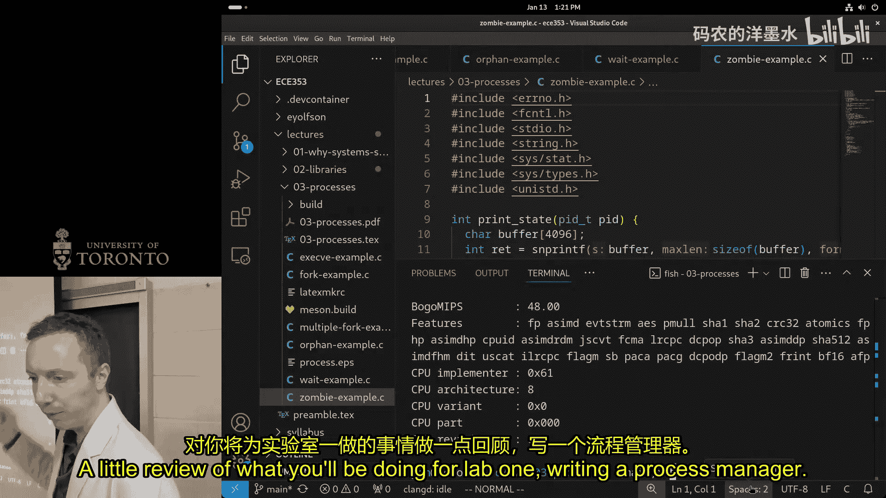

So how to actually create processes？I could create them from scratch， load a program into memory。

 create that process control block， that's what Windows does all in one shot。Uix。

 for historical reasons， decomposes process creation into more flexible abstracts。

 although there's arguments that。I also would make that they're becoming increasingly bad with threads。

 but we're going to roll with it for now， we'll see why it's bad once we get to threads。

For programs with threads， typically this decomposition of process creation is going to be a bad thing。

 so for programs。There's a way to do it on Linux like what Windows does。

 using something called Posic Sp， which will just create a process out of nowhere。But。

What old historical UniX does， instead of creating a new process from scratch。

 it could just clone the current running one， so what this does is pause the current running process。

Copy its process control block to a new one， this reuses all information about the process including variables。

 so the new process is an exact clone of whoever created it they are， aside from their process IDs。

 otherwise identical。And the way UniX distinguishes between these two processes is with something called a parent child relationship。

Meaphorors are going to get quite literal here and it's going to get quite messy but our first one is parent child。

 so like if you have a child it's kind of like a clone of you。

 so the one who created it is the parent and the newly created process is called the childil。So。

After that point， there are two separate processes that operate independentlyly and they can both execute different parts of the program together。

 maybe in parallel， maybe concurrently which they might mean the same thing to you right now。

 but as we go on， we will distinguish what they mean。So。This new process。

 sometimes it can either just continue running。As a clone。

 or it can load the new program if I wanted to indeed run a new program。So。

In order to create a new process。It's not called give birth to or something like that。

 even though it's parent childil， they called it fork， so fork creates a new process。

 which is a copy of the current running one， so its API is fork。

Takes no arguments and returns an integer， and the way it works is it returns the process ID of the newly created child process。

The only time when that is not true is if there is a failure， so if it fails。

 it will return negative1。If it returns zero， it will return zero in the child process。

 so the only way to distinguish between which process is the original and which is the clone is the return value of fork。

 so in the child process。Fork will return zero and in the parent process。

 fork will return a positive number greater than zero， which will be the process ID of the child。真的。

So in the program that's running， in that process。If that makes it， we'll have an example。

 So we'll write a program for it。 So it's going to get a bit weird because now there's two processes running。

 They can access the same variables， but they're completely independent and completely separate。

 And you might think this is a complete waste。 Like what if you know， Chrome running。

running with two gigabyte of memory， cloned itself when I have to copy two gigabys of memory。

 so operating system do something called copy on right to maximize sharing to make forking really。

 really， really fast so you don't actually have to copy two gigabytes of memory。But again。

 we won't go into that until we start talking about how to manage virtual memory。So。

As an aside before we get into our example is on Pos systems you can find documentation using the man command short for manual。

 we always have to make it shorter Today we'll be using the following API's fork Ex V E and wait we're going to do that today so don't worry about it so you can use man function to look up the documentation So sometimes if you just do man and then the function name you'll get something weird so you might have to specify a number the number two is for system calls and the number three is for library calls so for instance。

 if I do man fork。

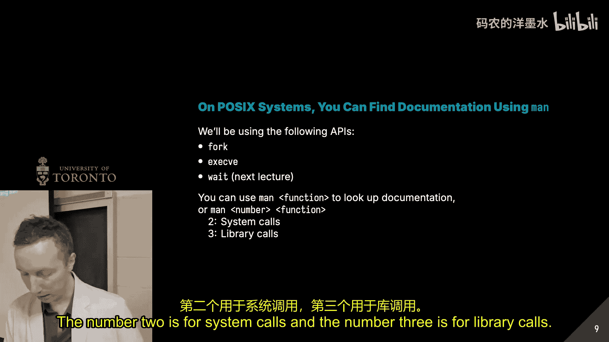

Well， I get the correct one， so it tells me all about the C standard library fork， which is good。

 creates a new process by duplicating the calling process。 Thank you。

 But if I get give it something like Exec V E， whoops， Exec V E。Oh that gives me the right one。

Maybe it gives me the wrong one if I use read。Oh， okay， so this gives me the read for my shell。

Not the read， the system call read， so if I wanted to look up the documentation for the system call read or the library wrapper I could do Man3 read。

 not in section 3， so I have to do section 2， which is a system call and then I can actually look at the documentation for the system call read so if you don't get the right thing using the man page you can do this or you can look it up on the internet。

Alright， so let's look at our first fork example and again。

 ask questions because things will get slightly strange。All right， so here is our program。

 let me clear this and make sure we can read it。So。Starting off， rules are exactly the same。

As we all know and love， so execution starts at Maine。In this case。

 we now know that technically a process is running this program。

 it will get assigned some random process I D， so。If I want to mark。Where。You know。

 I'm currently running in my program I can mark it by saying what where this process is。

 so each process will get a number， I'll just for argument sake。

 say that this process running main is process 100， so I'll just shorthanded in writing at P100。So。

Here， the first thing it does is call fork， which is where things immediately start getting weird and again。

 ask questions because we're going to try and run this。After I call fork。

I have now created a new process， which is an exact clone of the calling process。

So I'm going to create a process， let's say for argument's sake， it's called process 101。

 so it's a new process and the only difference is the return value of fork。

 so in process 100 fork returns，The process ID of the newly created process。

 so it's going to return 101 and in。Process 101。 So that is the clone。 fork is going to return 0。

Yeah， let's say returns。So。Knowing that now。So， these， so。I cover the error case here。

So we can ignore that for now， so let's just argue about these two L statements， so one says if。

You know， our program still runs as normal C programs do if it takes the if branch。

 it'll just take the if branch， do those prints and then。Fall through。The if branch。

 and I don't show it at the bottom here， but just returns from Maine and just terminates。

I have an if and an else branch。 so now if I run this program， what will I see any guesses？All right。

 first off， easy。Easyer question， how many lines are going to get printed？Six， three。3。

We got a whole bunch of threes。All right。Good because this is where our brains will start hurting。

So we run this program。We got six lines。Why do we get six lines， well。

 because now since we cloned ourselves， we now have two processes。They're both running independently。

And one process， in this case， process 100。So fork returns 101 for it。

 so after the fork they operate independently， so process 100。

 it's going to create a variable called returnturn ID。Assign the value 101 to it。

 So is 101 greater than 0。Yes， so。Process 100 will go into this if branch and then print off these three lines and then exit and now that process is done。

 but we're not done yet because there is another process to run so。Process 101， which is our clone。

Fork returned 0， so it would also。Be a copy at the time of the fork。

 which just means it's running main。And then it would return from fork， return0。

 so it' would create a variable called return PID assigned 0 to it， and then is0 equal to0。 Well。

 yes。Now this process 101 will run this and then it will print these three lines， child return PID。

 then the value of its variable， and you can see all the lines aside from it saying parent or child print the exact same copies the variables。

This returns the value of return PID， which is set from fork。

This system call called Git PID that gets the process ID of the current running process and Git PID again。

 I don't know why we need to make everything so short that stands for Git Parent Pro ID yeah。

So when the child process calls work， why wouldn't that create another？The child does not call fork。

 only the parent calls fork。And then it's like。Then the child gets created。

As the exact copy of the parrot， and then it returns。It looks like it just returns from the fork。

So only the original process that started running Maine created that child。

 so it only creates one process So the actually starts running it the problem。Yeah。

 so the child process basically started running at fork， and it started running。

Its initial state was an exact copy of the parent， so it starts running。

 you can think of it as the child starts running at fork and the only way to distinguish it from the parent is what it returns from fork。

いや。Yeah， that's a good question， will it always run parent first then child well ain't nothing to it。

 but to do it， we can just run it a few times。Whoops。Let's see how unlucky we get。 There we go。

 So the answer to that is no， So turned out。That I can't argue about。

Which process runs because which process runs is determined by my operating system right it gets to decide what to run。

 it just so happens that most of the time parent print three lines first and then child print three lines。

 but because they' are two independent processes，You don't know which one runs at any point。

 so within a process。Your mind does not break so within the main process or the parent process。

 it will still print these three lines in order， so it will always print parent return。

 then parent PID， then parent parent PID， but there's no ordering between two different processes your kernel gets to decide what to run so it could print parent child。

 parent childil， parent childil。There's no order between the processes whatsoever。

 which is our first。Brain breaking thing because。You might actually want some type of order here。

 but we'll get into that much later in the course， yeah。Yep。

Completely lucky that it was always parent and then child。Alway。No。

 so Fork always creates a new one new process， so I had a process that was running Maine。

 in this case I argued that was called process 100。

 and then Fork created one new process and it was 101。So。I had something running， it called Fork。

 it created a new program。Yeah， so when I ran my program， right something。

Start created a new process and started running this program， right？

That I don't know quite what it is， we can explore and see what it is。

 but something started running that and created a process to run that program。

 and then immediately I created a new process from that running。そう。Yeah。

 Fork just created one new process。So。Let's run this here。 So the numbers are also consistent here。

 So parent return P I D。This is the return value from the fork so in this case it was 5515 so if I look at the process ID of the child it should kind of jive right。

 that should be the process ID of the child and I can see that indeed in the child fork returned zero and the child's process ID from this GitP call is 5515 so that makes sense。

 it is clearly the child of the original parent process and then I can also check that all my numbers Jive the child's parent process ID is 5514 which is the same thing as the parent process ID right so all the numbers kind of makes sense。

So yeah。位即佢。So return PID， why is it greater than zero in return？Yeah， so why does it go into？So。

Your brain hasn't broken。 A program did not go both into the else and the if branch。

So that didn't happen。 You're not allowed to do that。 What happened is。

Because of the fork we have two instances of this program running right so we have a process 100 and a 101 so within the process it still obeys all the C rules。

 So process 100 went into this if branch and process 101 went into this elseif branch so within a process all the rules still apply。

 but yeah you're right at first glance it looks like if you just run it and look at the output it looks like if you didn't know what a process was it looks like it just did the impossible right but trust me first thing is that the impossible does not happen。

 I have two process。Yeah。Like， can I call fork again？Yeah， that's where things get interesting。

 So the question is can I just fork again like this？😊，So。

And he guesses as to what happens if I just call fork again like that？Yeah。Yeah。Yeah， sure， yeah。

I think of。He had another child。trial。Yeah， so if I do this。

 things are going to start getting weird so。Let's see if we can argue about what it does because it gets more complicated。

 so we'll rewind and say。Something created a new process that is running Maine。

 we'll call it process 100。So process 100 calls fork。 so because of it calling the first fork。

 it would create a process 101 then。The return of fork， fork returns。101 and in here。

 forops fork returns zero。And then the next thing they do is return。PID will be equal to 101。

And then if it executes return， PID will be equal to zero right So now I have two processes running。

 I don't know technically what will run next。's up to my operating system。If。Process 100 runs next。

It would call this fork and then it would create something like process 102。

 which is an exact copy of itself right so it would also have a variable called returnturn PID and it would be equal to 101。

The only way to distinguish between them is the return value of fork。

 which I conveniently just throw away。 So they are now indistinguishable clones of each other。So。

In process 102， it has a variable called return PID， which existed before the fork。

 So it exists after the fork。 So it would have a variable called return PID that is equal to 101。

 So both process 100 and 102 we'll go into this if branch， print a whole bunch of things。

 and then eventually。So let's just assume that they ran so they went into here。

 printed a whole bunch of stuff and then let's say process 101 executed， it called fork。

 it would create something maybe called process 103。

 so a new number that's not used and it would be an exact clone of whoever called fork which in this case would be process 101 so it would have a variable called returned PiID would not return and it would be equal to0 and then I don't use the return value of the fork or anything like that。

 so they indistinguishable clones from each other。So they would both go into the El branch。

 So when I run this， I should see。6 lines that start with parent and six lines that start with child。

 So let's go ahead and run this。Boom。Lots of confusing stuff。Fun， right。Isn't that fun。

 aren't our lives complicated now？Wル。P发。I is that。Oh， so the question is when 101 created a process。

 why didn't it create a child with like zero from fork？1，100。1100 meta yeah。When let's rewind。

 So we want to rewind back to。It kind of looked like here and we just had process 100， right？Yeah。

 like if we have a second。100。102 why doesn't？first。Yes是。So when process 100 calls fork again。

 it creates 102。So fourk here will return 102。So this fork。That process 100 does the second one。

This fork returns 102， the newly created process， but I don't use the return value， right。

 I just throw it away。And then process 102， which is a newly created one。

It appears as if it starts executing， returning from fork and it gets returned 0。 But again。

 I just throw it away。So I immediately threw it away。 So if I captured it in a variable， then yeah。

 it would be0， but I just threw it away， which makes it。If I throw it away。

 I basically can't distinguish between them unless I like。

 get the process I D and figure it out using that， yeah。

How does fork know the difference between the child and the parent？

Fork is a system call and one process made the system call， so that is the parent。

 the one the colonel created is the child。Yeah， when 100 makes a call。

 that's the process that made the call， so it's the parent。And then one01 also makes them。Yeah。

 so if I were to draw like a family tree， in this case， I have a bit of a weird family tree。

 so processs 100 was the original one， right？So technically process 100 created two children， right。

 it created process 101 and then what a good ASCI diagram。 It also created process。102， right？

And then technically process 101， that called fork， the second fork created process called 103。

 so this would be like my family tree so。For the family tree。

 the parent it's always like the parent at the top and then arrow to the child。

 so process 100 created two processes， one was 101， the other was 102。

 so it had two children and then process 101 created process called 103。

 you could think of it as like process 103 is like the grandchild a process 100 if we wanted to be super literal。

Like I don't understand how so I know what I'm delete。The same return turned。

So before this fork here。There is a variable called return PID and it was equal to something。

 so because a4 creates an exact clone。That new process is going to have that exact variable equal to that exact value。

So that's why so I didn't reset it， I didn't reassign it， it just got cloned。

 that's why in process  102。For the second fork。There by the time I called this fork。

 there's a variable called return PID。 It was equal to。To the value 101， so if I call fork。

 I create a new process， that's the exact clone at the time of the fork。

 so has the same variable equal to the same value。Yeah。Wturnern PiID is only different。ple taken。

Yeah， so。In this case。I only assign the value return PID after the fork。

 and then I don't update it again， so it stays the same。All right。

 that's where it gets slightly complicated。 Let's rewind a bit。 So any questions about just。

The normal one or anything we' are curious about， so all the numbers kind of driveive， oh look。

 all the child printed way before the parent that time， that was fun hu yeah you head。Yeah the first。

Yeah。Doesn't4。Yeah， so process 101 is the child。Of 100。Then how did it get 100？

Oh well thats we can explore so the question is how did that process get process ID 100。

 so in terms of real numbers from running it， this is the parent process ID， right？In this case。

 it is 5090 or 9，15。 so you're asking basically。What created this process， right？Well。I have。

That process is parent ID， and it's that number， right？So that means my parent is that。

 so that must have created me， right？我在的 culture都。No， so this。

Is the process that created me that's running this main function initially？And somehow that。

Got sign to return。Somehow that value got assigned to return PID。5，1，1，5。5，1。Like otherwise。

 it wouldn't have。There's no 519，5。5，9， one，5。5，9，1，5， so。Yeah， this is。5，9，1，5 is the process I of。

My program running Maine and something had to create me， right？

So that thing that created me is this process ID。So so so。So this fork， right。

 I created a new process， I created this process。I created process。1516。

So this process was created from me from the fork。I only created one process if I have this program。

Something must have created a process to run this main function initially， right？So。

If I wanted to explore what created my process to run this program？How would I do that？AK。

 what the hell， how would we explore what the hell this is， because this had to create me， right。

4015 that created me。Any guesses as to what the hell 4，0，5，1 is。Yeah。The process for the shell。

 that is a good guess， how would I verify my guess？Well。

 there's that whole proc file system I could look at right。

 so I could do less proc if I wanted to do it kind of scuff version， I could do just do the number。😊。

The number is the process ID， so I can figure out what 4051 is and I can look at the status file and will tell me that the name is fishish。

 so fish created me。What's fish。It's a shell， so it's a shell for you， it might be bash。

 it might be ZSH， whatever， so it's a shell but。This kind of makes sense because， well。

What I'm typing into run my program is the shell， so the shell created a copy of itself。

Must have created a copy of itself because that's the only way to create a new process and instead of running a copy of itself。

 it started running my main instead。H kind of cool， right。 Well。

 how the hell did it start running a different program？

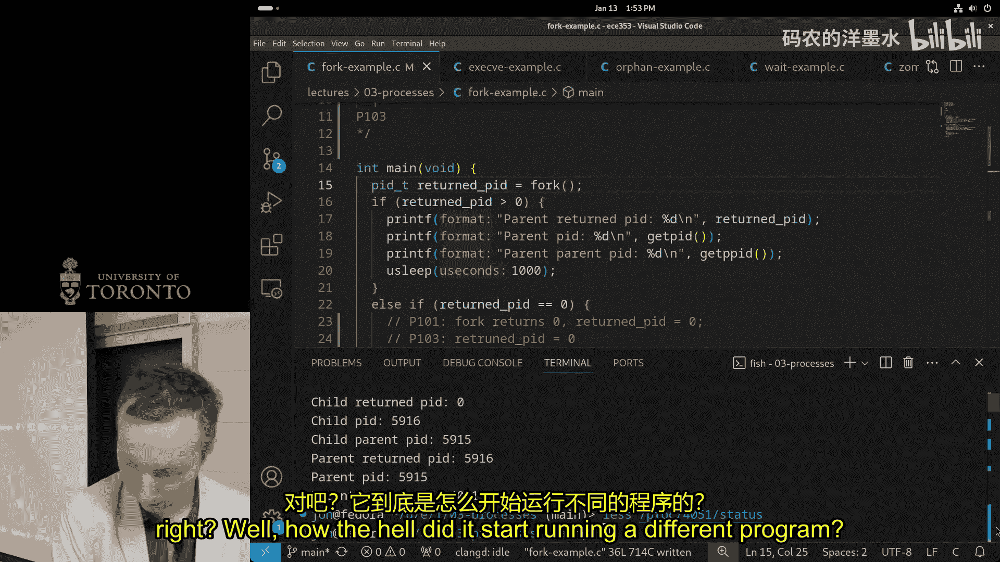

So what Shell must have done is use something like this Exec VE system call。

 so what that does is it replaces the process with another program。

Resets the process control block and starts executing that program instead。

It has a following API where it needs a path name。 So that's the full name of the program to load。

ArgV， which is an array of strings， which is an array of characters terminated by an null pointer that represents the arguments to pass through the process。

NP is the same as AGP， but that represents the environment of a process we won't get into really in that course。

 but it's basically just global variables， and then it also returns an error on a failure does not return if's successful so let's get into that example。

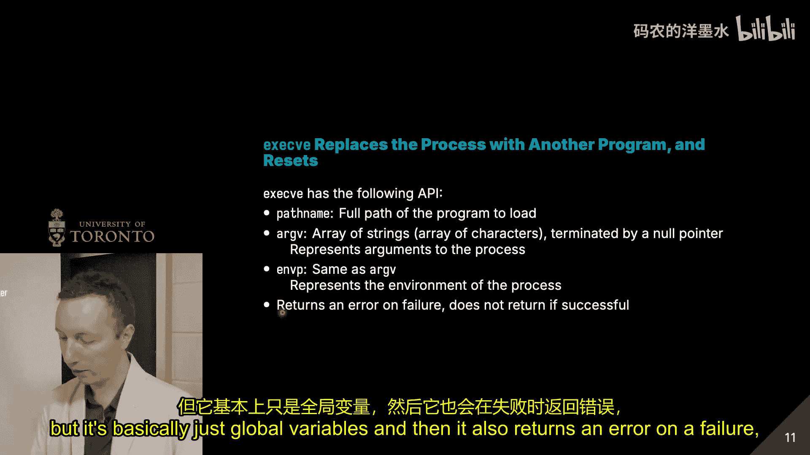

So if I don't combine it with forkker， anything like that。

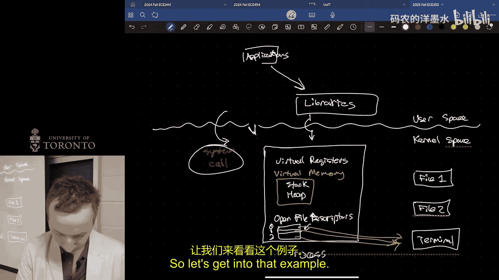

If I run this program， it starts executing Maine。Thankfully， I don't have a fork in this。

 so nothing weird happens so it's going to。Execute how I expect it to。 It's going to print F。

 I'm going to become another process。 Then it's going to fill up this R V array， so。

That's all like the command line arguments。 You should give it by convention。

 argumentment 0 should be the name of the program that you actually typed so let's。

kindind of simulate actually running LS， so the first argument LS。

 and then you give it a null pointer to signify that is the end of the argument list then there's NP we'll just set it equal to null to indicate that there's nothing。

Then。I do exec V E， so I give it the path to the executable to run。 In this case， I want to run LS。

 It's an executable。 It's just an L file。 then I give it the argument。Then the environment P。

And then。If I look at the API， it returns negative 1 if there's an error。If it is successful。

This process starts running that program instead。 So that process Id just gets reused this。

Like this program stops running and the process runs a different program。

 so it will maintain the same process ID， but in this case it will turn into LS and start executing LS's main。

 so if LS is found， I should only see I'm going to become another process。

 then I should see the output of LS so。I shouldn't see any error。 And if Exec VE worked。

 this slide will never print because I'm running a different program instead。 So if I run this now。

I should see I'm going to become another process， and then I see the output of L S。 So this。

 if it was created as process 100。Then L S would be running as process 100 after that exact V E system call。

 and then。Runs that process as soon as LS exits， that process is dead， and we're all good。

So questions about this fun thing。Yeah。The reason we put out a lot。Yeah。

 so the name here is just purely by convention， so if I wanted to。

I could actually do this if I wanted to null， that's fine。嗯。So compile it。Run it。Nothing bad happens。

Turns out you could have just made a lot of money by exploiting pseudo。

 Everyone's used pseudo before， right。So pseudodo lets you run as root。

Does a whole bunch of texts and everything like that。That having an argument there。

 That's the name of the program is just by convention。

 usually to help you print a help message or something like that， but doesn't have to be there。

 The developers of pseudo， just assume that it's always set there's always at least one argument that's the name of the program。

 So if someone did something like that where they passed it null and then pseudo used it without checking so they dereferenced the null pointer which Seg faults or corrupt memory and if you were clever enough。

 you could corrupt memory in such a way that you could take over pseudo get a root shell and then boom you own a system because they didn't check that the first argument could actually be null and not exist。

 So fun security fact。 but it's just by convention that the first thing should be an argument。

Or the name of the program， whatops I called it loss。All right， any other questions about this？I。

And then in the child。第二。Yeah， so if I was to so this just replaces the current process so if I was fish right and I just did exactec VE。

 then whatever you're typing in it is now poof gone， it started running a different program right。

 So if I wanted to basically write my own shell， I could do what I did before I could just fork。

And then。I could have if PID。Is equal to0。It's harder to type on this than I thought。

If PID is equal to0。Then I could do all this， right？So that would mean in the child。

 it does all this， and then the child transforms into some program running LS。 So in this case。

 if I run this， let's indent it so it doesn't look as ugly。So in this case。

 I will actually see if exactec fee work this line will never print because my child started executing LS right。

 So let's just make sure I'm not crazy and that that works。 so compile it， run it。

 and then I see in this case， the print F lines are a bit out of order because while it's consistent within a process。

 So the parent。Printed， I'm going to become another process and then。Create a child。

 The child is set up to run LS， but didn't quite get there yet。

 The parent continued running and said Vxc work， this line will never print and then terminated itself and then the new child process。

 that's the run one that ran LS。 So this is basically how your shell works。 right It forks itself。

 sounds bad。 And then it exactecs your program， whatever you typed in the terminal。

 So that's how your program。Well， that's how we actually run your program yep。Why does your？

So why does it run simultaneously so by default， I have no choice。

 I have no control over what runs first in my shell it like waits for that command to finish right so we'll see how to do that after the break。

So that's something we can do。All right， any other fun questions？And three wine。The fork things up。

All right， any other questions for this？Or weird things。So another question I usually get is like。

 why the hell's LS repeated twice， doesn't that sound silly？So。

Turns out this convention is actually used for quite a thing。 Everyone's done like know。

 dash dash help for something， right？So like LS dash dash help。All right。

 print something gives you help message and like tells you。Let's scroll up。

Like tells you a whole bunch of things about its usage like LS and a whole bunch of files Well it turns out that the name of the program doesn't have to correspond with what you actually typed in your terminal right I could have made an alias or done something weird so turns out that is by convention to kind of help with error messages so if I wanted to simulate running help as like exact VE I could do like name it whatever the hell I want and then do dash dash help and that should do the exact same thing。

So if I compile。And run this。Get the help message like before。But as I can see， by convention。

 it actually uses that to try and give you more descriptive names。

It pulls the name from the first argument， not the name of the executable because it doesn't know anything about it。

That's just by convention， you can call it whatever the hell you want。In fact。

 some programs actually use that to behave differently depending on what you invoke it as。

 So like some core utilities that implement。CP and RM and all those move commands and everything like that。

 it's the same executable that behaves differently depending on what name you call it as。

 but the same actual executable， so you can do something like that。

 usually by conventions just to help with the help。Program name。I don't know。

 but knowing that you can do fun， stupid things like that。All right， any other questions about that。

 we'll see how to develop a shell after our break。Oh， the index equal to。

 So this index equal to stuff are just are my code completion thing。 I didn't actually write them in。

 It's just to tell me what the value is at index 1，2 things。 It's just a code completion helper。

All right。

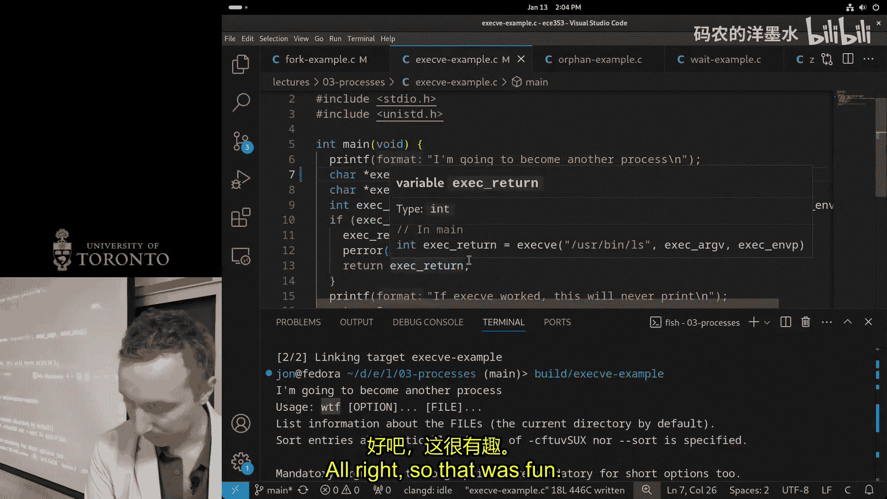

That was fun。 Now， programs don't seem to， you know。Do what we think them too。For a break。

 we'll leave on this note that the operating system create processes。

Operating system where the kernel has to maintain process control blocks， including some state。

 create some new processes。 now we know what system called does that fork。

 and we have to load a program， reinitialize a process with the context that's exactec VE。

 so we're going to see some more fun things， more fun terminology after our break so let's take our break now。

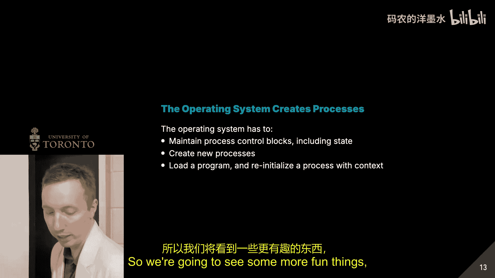

Wops。🎼Yeah。🎼Yeah。

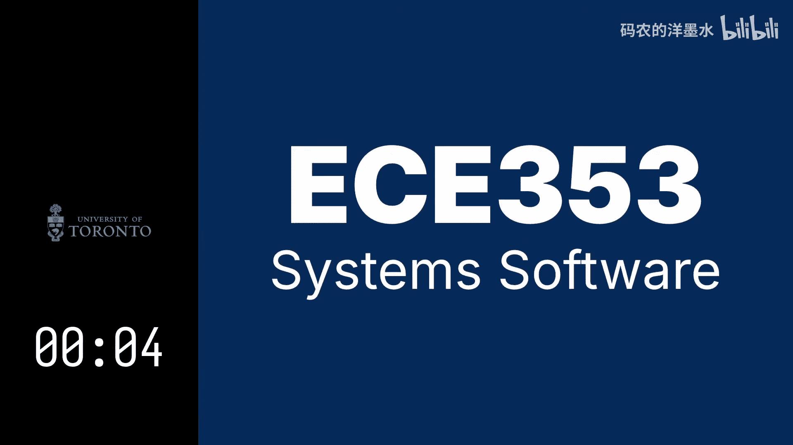

Allrighty， so。Mike， Mike on， all right， let's continue our journey into processes。So。We have parents。

 we have children， things are going to get even weirder at the end of this lecture。

 we're going to have zombies， orphans， which in later lectures we get to kill， so we'll have fun。

So your Google searchers are about to get a whole lot weirder， try not to get on a list。

We saw that process state diagram before， created to ready to blocked。🤢。

So Linux has a steamed diagram， but the terminology is slightly different。

 so if you were observant you can read the processes state by looking at that status file again。

 there is a field called state， where again I can replace PID by the process ID or if I wanted to have a shortcut。

I can replace that PID with self and that gets the process ID of the current running process and the Linux states are as follows。

 so there's a runnable or running state that's the same as when I showed before running and waiting or ready Linux does not make a。

Does not consider。Ready and running to be different。

 It groups them all in this running or runnable state。

 Then it takes this block state and divides it into two types of blocks。 So again。

 blocked is like you're doing a system call。 The kernel is trying to do something for you。

 So there are two types of reasons that you are doing a system call and the first one is called interruptible sleep。

 that is one kind of block。 That means you could get woken up and resume execution。 if you wanted to。

 you're not actually waiting on anything important。 you kind of opted in to go sleep。

 So someone could wake you up and then you could actually do something。Uninterruptible sleep is。

Like me， if you don't have coffee， I'm asleep。I'm busy doing something in this case。

 sleeping and even if you tried to wake me up， I'm not going to do anything useful。

 I'm going to ignore you。 So technically on Linux uninterruptible sleep is you're blocked waiting for something and you can't get woken up to resume to do anything useful usually it's because you're waiting on output from a file and it's assuming you actually need that output to continue so。

Since the output is not available， it will be in this uninterruptible sleep state where。

Even if it wanted to try and wake you up， you couldn't do anything useful anyways。

 so you will just stay blocked forever， there's no option to wake you up。

So the other state is a state called stopped， which we'll see in the next lecture。

 and then there's also this zombie state。So we're going to see what this zombie state means because it is a real state name in Linux and it seems kind of weird that something would call you a zombie。

This stop state is because the kernel lets you explicitly stop a process if you want to to prevent it from running。

 and then another process can explicitly continue it。

 but we'll see how to do that in the next lecture。So。Also kind of the infrastructure。

 why we have this parent child relationship and everything is because on Uniix， so Linux or Mac OS。

 the kernel。When you boot up your machine， it is technically only responsible for one job for user space。

 it launches a single user process， and then that process is responsible for creating every single other process on your machine either directly or indirectly。

 so it has a special name， it's typically called a knit。

The kernel when boots up will look for it in the folder Spin andni and again it's responsible for creating every single other process on your machine。

 it must always be active if it exits the kernel thinks you're shutting down because it's supposed to be if you want to think of it as like the grandpar of every single other process and it should outlive everyone so for Linux andni will probably be something called system D but there's some other option so when looked at the name of process ID1 earlier。

 if name was system D that is the name of an in system there are more or less religious wars over what init system is the best there's a whole bunch of different options you could even write your own if you really want to so also as an aside some operating systems like windows create like an idle fake process that basically the scheduler can run just to keep track of。

How much time your CPUs are idle for and not doing anything useful。So。We。

Kind of argued that there's parent child relationships between every single process。

 So if I wanted to see that process tree that we kind of drew before on a virtual machine。

Or your do or your container。 you can actually view it。 It probably looks something like this。

 So there is a command for it。 If I want to see the processed tree hoops。

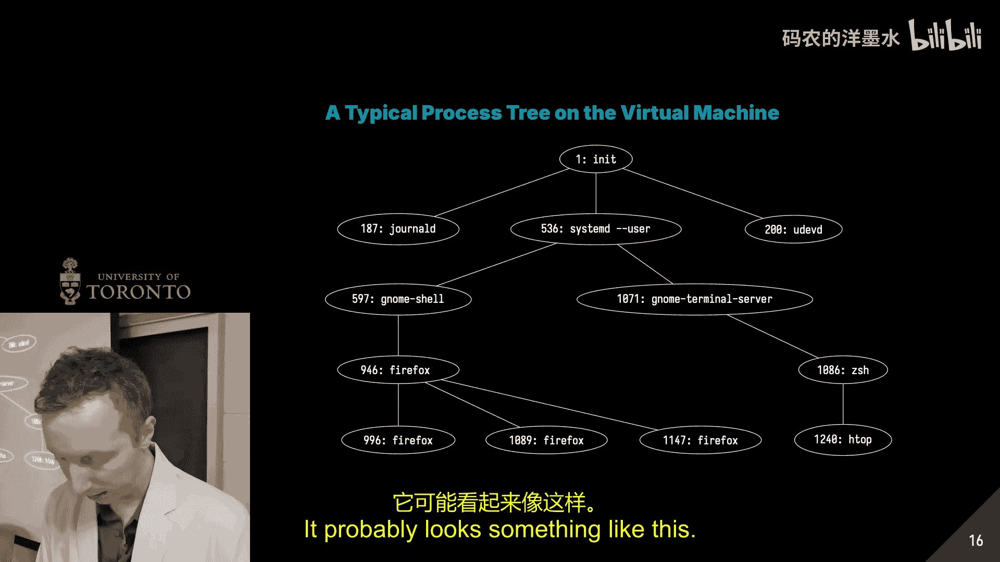

Let's expand this window。I can use something called Htop and that will essentially be like a command line process viewer that will show you some more information。

 So above here it shows me all the CPUs I have， what percent usage they all have。

 So right now my system's pretty much idle shows me how much memory I have。

 and then it shows me a whole bunch of processes running on my machine so。By the end of this course。

 we'll be able to read all the columns。 But for now， all we can read is the process I D。

 So the first one is process I 1。 So that is a knit。

 And then it tells you the command used to run it。 So it's something called system D。

 And then it has a line from it。 So it will tell you all of its direct children。

 So they create some child children。 It is going to be the。

Grandchild or grand parentent of every other process。

Either it's direct children or you know every other process will be related to it somehow。

 so it created directly journal D system or user DBD。

 and then it created a whole bunch of other subprosses， created a whole bunch of other things。

 I can look through it， there's this low memory monitor， that's probably a good process to have。

If I go through it， there's some dumpy things。Some other things。

 but you can see that every other process is related to this， let's see if we can find something so。

Here。Noome shellll， that is the desktop environment I'm writing in so it's running as a process and when I launch VS code through my desktop environment well it had fork itself wow that sounds bad so it forked itself it exact VS code which is called code so I can see that the shell created VS code so this is VS code and then VS code went crazy creating subprosses so it created some processes to use as a sandbox created a whole bunch of processes one of the processes it's created is the shell I'm currently typing into and then hey look at that I can see Htop so this is the command I'm currently running to view itself so this is the process I of this。

And then I can also see what's the fun。 So there's command。得 da da。It's a really long command。

All right， maybe it doesn't show the state。Anyways。

 you can see all of the parent child relationships between。All of your processes on your machine。

 Yeah， there's nothing else terribly interesting here yet。

 so you can explore that and have fun with that， whoops。😊，I exited the wrong process， right。

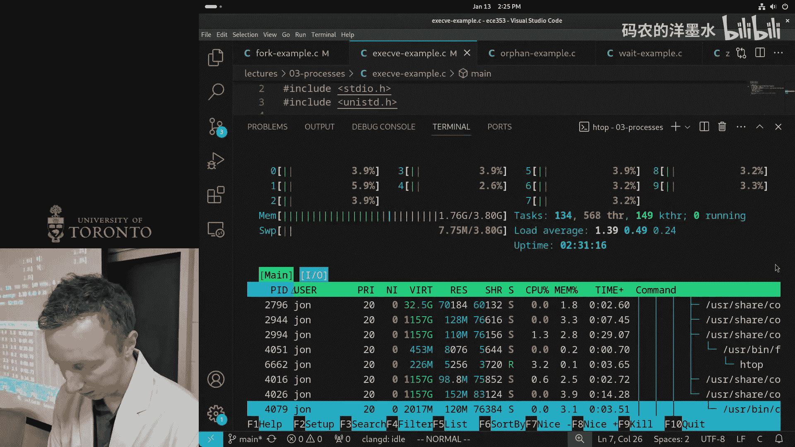

So go back。 Let's make sure this works Nope。て。All right， recovered covered。All right， so。

Processes they just get assigned a process ID or PI whenever they're created。

 and it does not change as long as they're running， remember， process ID is just a number。

And it is unique for every active process on most Linux systems， there's a maximum PID of like 32。

000 zeros reserved for being invalid。Because well， that's how Fork knows that you are the clone。

 you're the child process， so eventually。The kernel will recycle process IDs after the process dies for that new processes。

 it happened that my processes， I got process IDs in the same order。

 but that's because I rebooted my machine recently so I haven't gone and recycled any process IDs。

 so they might not necessarily be sequential。And also remember each process has its own address base。

 so independent view of memory， so each process behaves how you know C programs work is just now。

 instead of having one process you get to argue about multiple maybe going on at the same time and you don't know which one executes when and also had the question。

During the break， another way to think about fork， another good way to think about fork or how I like to think about fork is one process calls fork and two processes return from fork that is another way you can think about fork。

So。You might be wondering， hey， if I can terminate a process what happens to this parent child relationship。

 so previously。I， you didn't notice， but there was a little sleep there。

 so I made sure that the parrot exited last by cheating a bit and using this sleep， so。

Linux or UniX is very， very serious about maintaining this parent childil relationship between processes。

 and if one can exit so one can disappear， one can cease to exist。

 so what happens if a process exits first and no longer exists， what happens to that？So。

The reason we have this is， like， in real life。The parent is responsible for its child。

 so the operating system， whenever you terminate a process the system sets the exit status。

 when that process terminates and records it in that process control block。

 so whenever you terminate a process， the operating system can't clean up all the resources because well something has to acknowledge it and actually read that exit status。

 so the minimum acknowledgement，The parent has to do for the child is to read its exit status or to read whatever。

it gave to exit or return from Maine， so there's actually two situations if one of the processes exits。

 so either the child exits first if the child exits first then that child process becomes something called a zombie process because well the operating system can't run that program anymore。

 it's terminated so it's technically dead but it's still live in a way because it can't remove its process control block because someone has not acknowledged it yet。

 so it's both kind of alive and kind of dead， kind of like a zombie which is why they named it a zombie they gave it they give things dumb names so again quite literal speaking of literal names。

 if the parent exits first so you create a child and then you terminate first your child now no longer has a parent。

Gruuesome， and while they use the literal name of that child process you created is now technically a orphan process because its parent now doesn't exist anymore。

 so there are rules with Linux or Uniix what to do in these situations。So。If all goes well。

To first acknowledge the child， you need to call wait on the child process。

So weight has the following API。Ts。Only one argument， a pointer to an int。

 and that's the address to store the weight status of the process。

 so it will actually assign a value to it， and it will return the process ID of the child process if it's successful。

So right now it will return negative1 if it fails。If。There's two versions of weight。

 There's a blocking one that will wait for that child to terminate and a non-blocking one that will just poke it and be like hey are you dead yet。

 yes or no， have you terminated yet， yes or no， and it will return immediately so we'll see how to do that later for now it will never return zero。

 it will block until that process ID has actually terminated or give you a failure。

 so that weight status contains a whole bunch of information including that exit code which is what it returns from mainine so you can use man weight to figure out all of the macros to query the weight status we'll have an example that will show what it does so。

Before we create weird zombies and stuff like that， let's do the simple example。

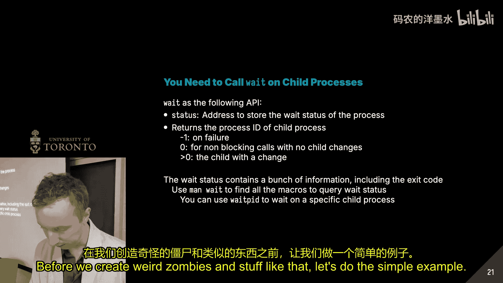

So。Here is our program that's going to use weight。 and I'm going to artificially put in some sleeps just to make things more consistent。

Not guaranteed to always be consistent， but I'm more likely to。

 which is good enough for the purposes of the lecture。

You should not be using sleep to guarantee that things run in a certain order。

 we'll see how to ensure order later in the course。If I run this program， again， I like arguing that。

Just process 100 starts executing the main function。

 the shell would create it or something else I don't really care right now。

 just process 100 will execute main and then the first thing this process does is called fork lucky for us so this will create a new process 101 that is the exact copy of process 100 so it will have the same program loaded and it will resume from returning from fork so。

In process 100。What does Fork return？101 right in process 101， what does fork return？0。

Which process executes next？I have no idea， so if you have no idea。

 but one process we'll execute next， we'll just assume a single CPU for now。So in this case。

 we'll just assume these two processes， if Pro 100 executes next， well it will go ahead。

 create a variable called PID and then assign the return value of fork to it。

 so PID will be equal to 101。So process 101。PID won't be able to negative1 because there's no error so it will fall into this else branch。

And then it will print calling weight。So it will print calling weight， create an int called W status。

 and then do that system called weight where it gives the address of that int to weight。

 weight is going to be a blocking system call， so process 100。

Will not resume execution until process 101 is done。

 has terminated or returned from Maine or called exit， they all do the same thing。

 so process 100 if it executes all the way， it will make it to this weight and it will be stuck here blocked waiting for process 101 to perish because it is its child。

So now the only process that could execute is process 101。It's process ID。Sorry， let's back up a bit。

So fork returns0， so it would also create a variable call PID。

 which it assigns the return value of fork， so it would be equal to0。So process 1，01。

 PID will be equal to 0。 So it will go into this if statement and then sleep for two seconds。

 which will just literally put this process to sleep for。Up to two seconds。

And then sleep is also a blocking system call， hopefully it actually just puts it to sleep for two seconds。

Once sleep returns， so it would return。Continue execution because this is within one process。

 it is consistent， so it took this if branch so it will not take this else branch。

 so it will fall all the way to return 0， which is this exact same thing as exit  zero right So this process 101 is going to terminate and then after process 101 terminates。

Process 100 will wake up so it will unblock from weight because now my process is done。

And then it will return from this weight。It will return the process IDd of the child that has terminated。

 so it should return 101 in this case and then。It fills this it assigns this integer with a whole bunch of information。

 including the exit code， so you technically need to use a whole bunch of macros from the man page to figure out why it terminated and get some information about it。

 so there's several reasons a process can terminate。For now。

 we'll just assume it has to have exited to have terminated。

 if it hasn't had so you can use a macro to check if exited and give it that W status that was assigned from the weight system call。

 so if exited will return one， if indeed it terminated by exiting。🤢，If it returns false。

 I just exit this process 100 with the air code E childil because I have no idea what's going on。

 it's an unhandled case， but for now I'll assume that it has to have exited。IfWhen it exits。

 I do print F weight return for an exit process PID is that value I got from weight PID and then its status should be whatever it returned from main and in this case if I want to get the exit status or whatever value it returned from main。

 I use that W exit status macro， give it the integer and it will extract out whatever value that program returned from main in which case it should be zero so if I go ahead and run this weight example。

Then I see calling wait that's from my main process it waits two seconds for my child process to terminate so this answers your question over there like how would I write my shell。

 how would I prevent it from continuing so what my shell does is when I start my program it would fork exec it and then wait for it to actually finish before I'm allowed to type more on my shell so now we can actually create a scuffed version of a shell if you really wanted to so。

The parent calls weight。It blocks for， in this case。

 two seconds because it's waiting for the child to terminate。Then once the child terminates。

 weight returns， it's unblocked， then I see weight return for an exit process in this case。

 whenever I ran it， I got 8122 and then a status equal to  zero， so questions about that。Neat， so。

Just to verify that， you know。I'm actually reading some values。After sleeping in the child。

 I could return， I don't know， the value 42 or something like that。

Which will since I'm returning from Maine。 This is the same thing as exit 42。 So just to verify。

 I'm acknowledging my child and I'm actually getting that value in the parent process。

 I can recompile run it again。 I see calling wait wait for two seconds。

 And now I see that the status I got from the child was 42。 So it's whatever it exited with。

 So that's my acknowledgegment from the child。Fun， right。

 so any questions about that before things get weird， yeah。Sa on the slide， we can use WPIE。Yeah。So。

 yeah， the question is， what's this say， So there's also a version of weight。 So this weight。

So this weight will wait for the first child to terminate of any of your child children in this case。

 I only have one。There is another system called weight PID， where you can wait on a specific child。

So weight PID， its first argument is the process ID of the child I want to wait for。

 and then this int location， that's that pointer to W status。

 and then there's a few other options we can do， so if I wanted to wait specifically on my child。

The question is， how do I know its process ID， right？In。This case， in the parent。

 which is process 100。What's its value of PID there from the fork？Yeah。

 it's the process I D of the child。 So if I want to specifically wait on my child in this case。

 instead of just wait， I could do something like weight P I D。In this case。

 I could give it the process idea of my child， which is what was returned from fork conveniently enough。

And then I can give it W status， and then the optional argument I can just give as null so I could do something like that。

That will actually just do the exact same thing where because I only have one child just waits for my one child to exit。

 but I'm specifically telling it to wait for that child。

So might be useful if I have to wait for multiple children or something like that I want to wait for a specific one。

 but don't have to。All right。Any other questions with that fun stuff before things get strange？

All right， let's start us down the rabbit hole。

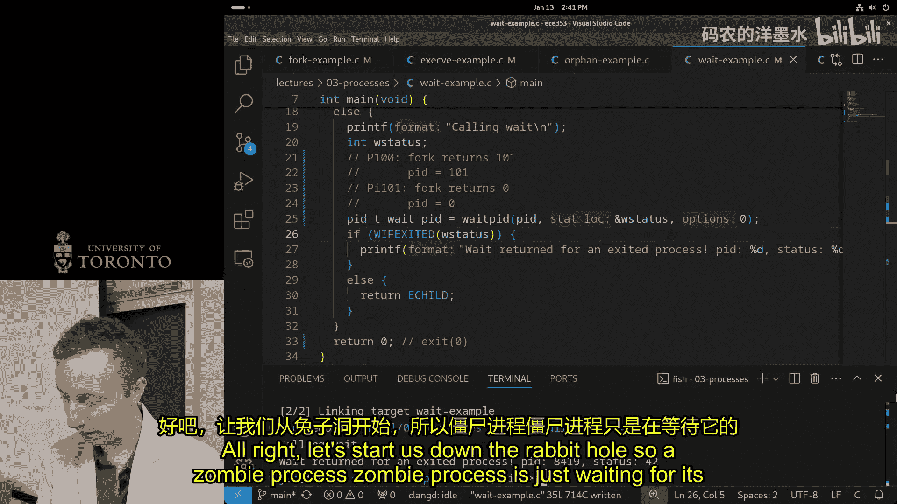

So a zombie process。Z process is just waiting for its parent to read its exit status。

A zombie process means that process has terminated。So it has exited。

 but it hasn't been acknowledged yet， so no other process has called wait for it。

Why this is important， Well， you might think that that process might have an error in it and。

You know that parent might have an error in it where it creates a child and then ignores it and it's neglectful and that child may have an error and if it has an error and you don't read it how do you tell it has an error。

 something bad probably has happened and you should probably handle it so you should probably be a good and responsible parent so the operating system has a way to kind of nudge your process to try and be a responsible parent because as a responsible parent。

 you should always acknowledge your child so the operating system has a mechanism where it can interrupt your process and say hey。

 your child has terminated you should probably acknowledge it， please。

We'll see what that exact mechanism is in the next lecture but it is also basically a suggestion。

 so you are free to ignore it and that is also the default behavior so the default behavior is if your child process terminates offering system will poke you and you will immediately ignore it so it's technically a basic form of inter processcess communication called a signal。

It's basically like a user level interrupt， again， we'll see it in the next lecture。But。

The reason this is important that because if you are a neglectful parent。

 the operating system has to keep that process around as a zombie process until it's acknowledged。

 So again， it's terminated， it can't run anymore， but the operating system can't get rid of it because it needs to be acknowledged by something。

 If the parent just completely ignores it。It's a zombie process and it needs to wait to get reparented。

 which we'll see in a bit， but let's make sure that a zombie process actually exists。

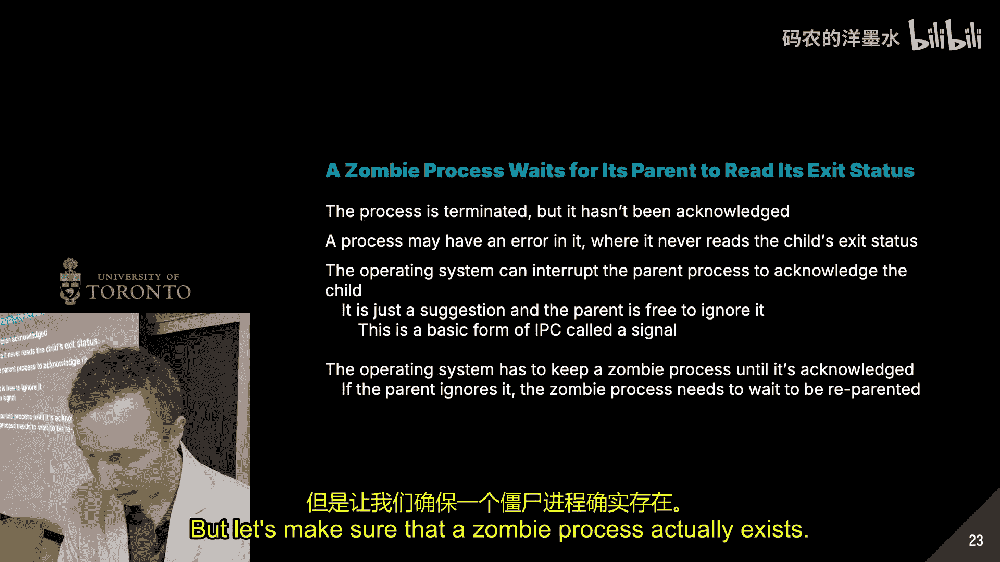

So here is our example。So。In this example。All right， we can ignore that function。

So I just have a function I wrote to get to read the proc file system and read the state of a process。

 we'll ignore that for now。Again。We'll just assume， process 100。

Got created and that is the process running Maine。Immediately， it calls fork。

 so we create a new process called 101 again， doesn't have to be sequential， but to argue about it。

 typically it's the easier thing to do。 So in process 100 fork returns 101 and then process 100 fork。

Returns zero。I don't know which one is going to return from fork first。

 I don't know which one is going to continue running。

 I don't know if they'll get switched or they'll be interleaved or whatever。

 so I'll just assume process 100 goes first， so fork returns 101 so it creates the variable called PID and it is assigned to 101。

So it's going to fall into this L statement。The parent is going to sleep for one second。

And then it is going to read the child's process state。

 so what the state of that process is after a second。It's going to check if it return an error。

 it will not return an error website， I don't want to get rid of that code。

So it hopefully will not return an error。And then it will sleep for another two seconds。

 so when it wakes up from this sleep， it will have slept for a total of three seconds on the wall clock and then it's going to read the process state again and then。

Just terminate。Any questions about the parent， so it's going to read the childs state after a second and then another two seconds after that or at three seconds approximately。

All right， so we're all good with the parent， so what is the child going to do？So fork returns zero。

 so it's going to create a variable called PID， it's going to assign it equal to0。

So it's going to fall into here。The child is going to sleep for two seconds。Then wake back up。

And then。Fall through and then just return from main so it's going to exit。

Approximately the child is going to only exist for two seconds right。

 so the child is going to exist for two seconds and the parent is going to check the state of the child after one second。

And then after a total of three seconds to see what its state is。At three seconds。

 the child should be dead， right？So if I run this。I can see that indeed。The trials's process state。

After one second is sleeping because only a second has passed。

 it's in that middle of its two second sleep。And then when the parent wakes up again after three seconds。

 reads the state again， and the state is indeed a zombie， so it means it has terminated。

 but I have not called weight on it yet right so the process ID of that child in this case in my example。

 it is 101 the operating system is still keeping track of process 101 and then has stored its exit status at return from Maine in this case is 0 so it can't completely remove that process I 101 because no one has acknowledged it yet。

 so it will still be available and it will be in this zombie state until some poor soul someone acknowledges it hopefully the parent So any question about a zombie process。

Alright， so we got to get into the other side， so。

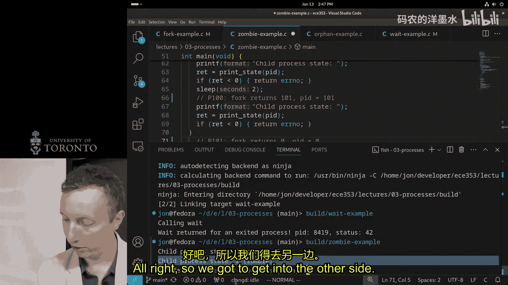

An orphan process needs a new parent， so the child process lost its parent process。

So the travel process still needs some process to acknowledge its exit。

And what the default rule is is。The Linux kernel or UniX kernels in particular。

Really want to maintain this parent child relationship。 So if your parent has terminated。

 no longer exists， then the kernel will get you a new parent so it will repar you or you can think of like。

 you know， you get adopted by something else。 The process is literally called adoption， so。

The offering system will repair you by default， it repairs you to in that is process ID1。

 and then the in process is now responsible to acknowledge the child So in actually has two jobs It's responsible for creating all the processes on your machine either directly or indirectly and then also kind being like the orphanage that cleans up all of the children that come to it so。

And then if it's written correctly， it should also acknowledge any children that it adopts。

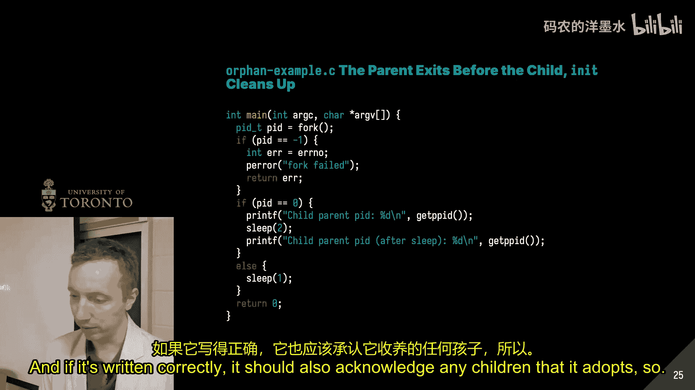

Let's see how that works。So we have an orphan example here。So in this program， again。

 we start off with fork， so I'm going to argue that we have process 100。Wow， I can't type。

Process 100， starts executing main， first thing it does is call fork。

 so that would create process 101， so I'll shortcut this a little bit in process 101。

 it'll create a variable called PID， it will be equal to 101 and process 101。

 itll create a variable called PID equal to 0。So。In this case。

Let's assume the chip parrot executes first。 So the parrot。

Is going to sleep for one second in total and then exit。

 so the parents's only going to exist for one second。

Then what the child is going to do is go into this if， and then it's going to print off。

It's parent process ID， which should be whoever just called fork， right？

Because my parent should last at least last for at least a second。

 this should happen pretty much immediately， so I should get the process ID of whoever just created me。

 but then I sleep for two seconds， so my parent dies after one second Id wait two seconds and then I print who is my parent now so I would have been adopted by some other process so let's see that that exists。

 so let's run our Or's example。 I get process I of。8703。

Then I see I got control back to my terminal that's because my shell is waiting on the process I originally ran in that argument it was process 100。

 so after a second when process 100 terminated my shell gave me control again because what I was running is dead but the child was still running in the background。

 it was still connected my terminal， so after two seconds it yelled out to me from beyond my grave and printed off its parent。

 its new parent which is 1000 or 1683， which is not process ID1， so I did not lie to you。

 we can figure out what oops， we can figure out what this process is so process。

This status is system D， which is the same name as process ID1 and knit。So。

So happens there's a process manager specifically for your user and you can actually opt in to become the orphanage where orphan processes will get adopted by you instead of a knit。

 so that is one thing system D does， so it's like kind of manage processes for your user。🤢。

It has a gruesome name。I called process one like the orphanage。

That's a good name for it because it gets all the orphans， but its official name is the Reaper。

 like the grim Reaper， because it kills everything that comes to it。By default。

 process ID1 is the Reaper because it kills all the children it gets。Yeah， again。

 your Google searches get weird and you can opt in， so any process can opt in to being a subreaper。

 which means any grandchildren that get orphaned from you go to you instead of a knit so you get to kill them instead of a knit so you can become a reaper。

Again， I did not make up these terms， do not blame me。But if you need to。Perfectly valid Google term。

 how to become a reaper to kill all my children， perfectly valid Google search might get you put on a list somewhere。

 but。If you just say just add on operating system at the end of it， and it will be fine。All right。

 any questions about our fun subreaper or anything like that or our orphanage or？Any weird things？第二。

How do you said to be an orphanage， you'll figure it out in lab2。So La  two。

 you will one optional component of lab two is to become a subbriefer and kill children。

 so I will not。Again， if this was a different course in not offering systems， I would be in jail so。

Thankfully， we're safe in offering systems。 All right。

 Any other questions about zombies or orphans or anything like that。😊，Yeah二。Sorry。

How do you acknowledge your child， you call weight on it？

So that weight system calls how do you Ac your child。As part of what gets set from weight。

 you get it exit status and a whole bunch of different things。

 so that's acknowledging it is the weight。Writing a good program， if you fork， you should。

 unless you have a good reason to， you should acknowledge your children。

 so you should always wait on them and clean them up to make sure that they're not killed by anyone else。

 so you should kill your own children， don't let someone else kill your children。Again， weird， yeah。

We is zombie。Yeah， so that's a good question。 So in the other example， so in this zombie example。

 right？I never acknowledged my child， so I read its status， it was a zombie， I never acknowledged it。

 and then I died， right？So。Technically。That child process is now a zombie right when I checked it。

 right？And then I died。 So when I died， it also became an orphan。

So that process is now simultaneously a zombie orphan。 So it' both a zombie and an orphan。

 And then because of that， it's an orphan， It gets repared for argument's sake toignit。

And then a knit adopts it， and then a knit would wait on it and clean it up if a knit is written correctly。

 so it would briefly be when this parent exits， it would briefly be an orphan zombie that it would get adopted by a knit。

 and then a knit would wait on it So now it's cleaned up and that's no longer a zombie is how things should work yeah。

We read the exits。No， so returning from weight。Well， in this example。

 we don't return from weight so we don't acknowledge it as a zombie。我 뭐。Iknowled。

So wait what does weight do to acknowledge the child process。

 so weight blocks until it's terminated and then it will extract some information out of its process control block like the exit status and why it exited into this W status variable in which case we've extracted all the information we've acknowledged it So after weight returns。

 let's say we waiteded on process 101 after。This weight returns in 100 process I 101 now no longer exists。

 It's completely cleaned up that process， that process I is now。Free。

 and now the operating system can naturally reuse things。

 So if I don't acknowledge it and I just create a whole bunch of processes and never acknowledge them。

At minimum their process ID still exists， and I just create zombie after zombie after zombie after zombie。

 and eventually I might want run out of process IDs。Right， all right， so any fun things。

 knowing all the bad things we learned this lecture。

 anything you want me to do to definitely end the lecture。So。One thing I could do。 example。

 let's go back to Fork example。All right， so I'm lazy， I'll just return one。Fun things I could do。W。

What's that do？Yeah。Yeah， it is still fun it even has a name， so its name is a fork bomb。

 but what's it do？So， yeah， so let's say argument's sake， process 100 starts running this。

Right process 100 starts running this okay well while true， all it goes into the loop。

 we create process 101 and now both of these would go in the loop again right so next time through the loop two processes called fork so how many new processes get created in the second iteration of the loop。

2， allright。 what about the next iteration of the loop。4 then 8， then 16， then 32， then 64。

 then blah， blah， blah。 So let's have fun。 So print。😊，Print F。喂。Forked up。

So let's decide a bit of flavor to it。So。If I compile。And run this program。

Something bad should happen， right？So。Also， again。If you log on the school's machines。

 probably don't run this。Don't do what I do。 But let's try run it。 So if I run it。

I see eventually my operating system protected me a little bit。

 theres a bunch of numbers that flashed by， and then I got negative one。

 So negative one means fork failed。 So one of two things happen。

 either my operating system was smart。 and it was like， this guy's an idiot。

 I'm going to not let him make any other processes and stop him。 or I have ran out of process Ids。

 And I can now no longer make processes。 So if I press this plus button， Oh。

 and things are getting warm。 So if I press this plus button， this should launch a new shell right。

 So if I press this plus button。If I press this， oh， oh。If I have any input。

The window is not responding。

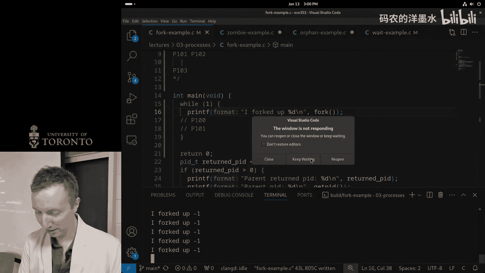

Close。2。And then we can check if anything bad has happened。Turns out my system kind of recovered。

Is there anything bad。 No， that's not bad。So different things happen in different years。

 all sorts of different things。And then。Yeah， I think that all that pretty much crashed everything we out of time anyways。

 So you can try and run that on your。