# 【全集 2025】多伦多大学 系统软件设计与编程 中英字幕 1080P p04 Lecture 4 - 基础进程间通信 -BV1YrkYBQEeL_p4-

Allrighty welcome back to 353 and good morning wow it's early all right so next topic IPC or Interprocess communication now we know that processes are independent we need some way for them to actually communicate with each other through IPC and through the kernel otherwise well。

If a program does not communicate with anything， it is worthless。

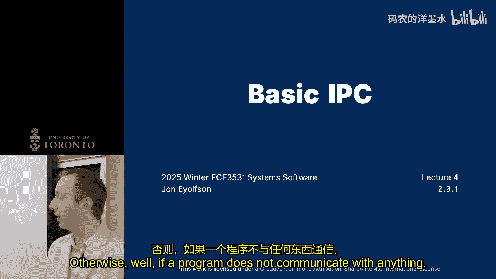

So again， as a reminder， IPC or inner process communication is transferring bytes between two or more processes。

 so reading and writing files technically is a form of IPC。

The processes do not need to be alive at the same time， so one process can write to a file。

It can end， another one can come along。Read that file。

 technically that's inter processcesed communication。

The read and write system calls just allow any sequence of bytes。

 so they they don't really care as long as you write bytes， they are happy。

So we will just dive into our first code example so a simple process could just。

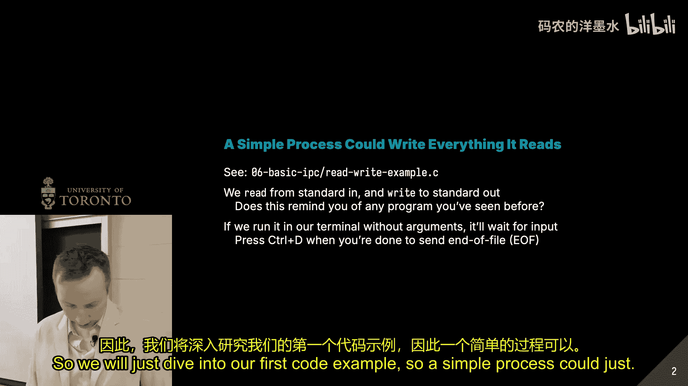

Read writeite everything it reads from the standard file descriptors。

 so here is my little program that is deceptively simple， but we'll see that it's actually useful。

 so we have a main。I declare a。Character Ray。Of 4096 characters。

 we'll see why I use this number once we get to virtual memory。

It's a special number other than being a power of two。 So that's 2 to the power of 12。

 but we'll figure out later why that is useful， but that's just。

Some space set aside that when I do a read system call。

 all the bytes are going to be written into that array。So。Next I declare a variable called bys red。

 that's S size T， so that's sine size type， that's what D。the read system call returns。

The read system call or sorry， the read C wrapper of the system call does what all the rappers do。

 not the cool kind of rappers， it will return negative one if there's an error。

 otherwise it returns the number of bytes read from this file descriptor， so file descriptor0。

 that's just defined by convention to be standard input。🤢。

Which most of the time when we run our applications connected to our terminal。

 and then I have to give it an address。To write to。

 so I give it that buffer and say the number bys that can write is up to the size of the buffer。

And I'll just put it， and then I said it equal to bytes red。

And that assignment will return the number of bytes red and I keep doing this loop while I read greater than zero bytes。

 so there's still some input I'm reading from the file or whatever or the terminal or whatever it represents。

 so I'll keep on doing the body of this loop as long as there's some data。

Then the next thing I do is I write， so I write to file descriptor 1， which is standard output。

 and I give it that buffer as well， so I give it that buffer that it was just filled from reading and I am writing it back out to standard out and I only write。

Whoops。I only write the number of bytes I have actually read in。

 and then the rest of the code is error checking， so I check。If bytes written is equal to negative1。

 in which case there's an error， so I'll just print out some error information。And then technically。

 I should check that the number of bytes written is equal to the number of bytes red。

 kind of like checking if print F was successful， but we don't do that。But here I'm going to do that。

 I will write an assert statement。I don't actually check it。

 What I like to do is program defensively， so any kind of assertions I make or anything I believe to be true。

 I will write an assert statement， so if I'm wrong instead of something weird happening。

 it will just fail at that point and tell me why it has failed。

 so I'll assert that number of byte thread is equal to the number of bytes written。

And then aside from that， if I break out of this while loop， read either returns zero or negative1。

If it returns negative 1， that means there's an error。

 otherwise it should return zero and0 signifies end of file。

 there's no actual end of file character if anyone has told you that before。

 it's a lie or it's only true for whatever library they're using， kind of like with C strings。

 strings don't have to end with the null byte that something C made up and they kind of regretted it。

 same with the end of file character that something someone else made up to signify end of。

File instead of just having the number of bytes of the file。

Anyone have any problems with this program just reads from file descriptor 0。

 standard in writes to file descriptor  one standard Out。Looks kind of useless， right？So。

Let's run this。So if I run it。It just hangs here right， nothing happens。

 so if I want it to do something。What should I do？Probably type in my terminal， right。

 So what if I wrote hello and then hit。Enter。Well oops。

 I hit hellello I well if I do hellello I and hit En， soon as I hit En。

 well that's me sending information from technicalally my shell to that process。

 then that process read that information so hello I and a new line character and then it immediately wrote it back out to standard out so it kind of like echoed it back to me。

 not really the echo command。Does this command look familiar to anyone， how it behaves？

Any command you might have used before that does this exact same thing。No guesses yet。String copy。

Like the command I write in my shell， not the C command。No one's used a program like this before。

Has anyone ever used the program CA？This is cat。So this is exactly what cat does if you don't give it any argument。

 so it's actually more useful than you think。If you accidentally type cat， how do you get out of it？

Sorry。Control C control C is one answer， do you know what control C does？Close the terminal。

 not quite。Anyone know what control C does？第二。Kills the process。Technically not any other guesses。🤢。

No one knows what happens when I hit control C。Sends a signal to that process， yes。

What sends a signal to it？Yeah， so the shell would send a signal to the process。

 Anyone know the proper way to exit cat without sending a signal to it。Probably not。How。Uix。

 anything signifies end of file is if read returns zero， which means no more input is available。

If I want to exit cat or tell my terminal that I am done typing to it， I can actually hit control D。

 if I hit control D， that means I'm done writing to it and in this process when it's running。

 Reed will return zero and then signify that I'm done so it will break out this wall loop and then finally exit my process so this is exactly what cat does if I do cat hello same thing it echoes it back to me hi。

Control D， and then it's done。So。By the end of today， we will also see what happens。

 other ways to exit and see what control C actually does if some of you didn't get it before。🤢。

But any questions about this program？Seems perfectly crmulent， right？Perfectly good program， it's CA。

 we use CA all the time， it's fairly useful， most of you probably use cat to like cat a file， right？

So we can modify it and because we are using the standard file descriptors。

 it's actually a very simple modification。So。Without changing the rest of my program。

I will add some more information to Maine so I can get command line arguments from it。

I will expect the user to type  two， so the name of the program。

 which gets set by this shell and then a path to a file which I'm going to output。

 So if I don't get exactly two arguments， I'll return from mainine with this。E in Val。

 so that's supposed to mean invalid input and then I will check。If Arg C is exactly equal to2。

 so someone has specified。The file name argument， what I'm going to do is。Well。

 what I'm allowed to do is I can just replace file descriptor0 with something else。

Standard the process by convention has file descriptor01 and2 open so what I can do is I can close file descriptor 0 so I say whatever the original standard in was or whatever it was pointing to I don't care anymore I'm not going to use it so I close it so now file descriptor0 is free for my program and the way Linux and all Uni is assign file descriptors is it will always use the lowest number available so when I do this open system call of this file and I'll just give it a read only flag the file descriptor I get back is going to be zero so now0 which is by convention means standard input is now essentially pointing to that file instead of whatever it originally was which was the terminal I of course check for errors and then the rest of my program is exactly the same as before I don't actually have to change it whatsoever because I'm just using the standard。

File descriptors or I'm just reading from file descriptor zero all the time。

If I run this now I can even be meta about it， I can essentially this is like catting its own file。

 its own source file， so if I do that I see the contents of that file without changing anything right。

 just to show you that I indeed wrote CA so any questions about that fun thing。Kind of useful。

 everyone's used this before， this is exactly what cat does。

 this is basically the implementation of cat。Except that the real cat lets you specify multiple files and just reads them in a row。

But other than that does the exact same thing。So questions about that。This nice。

 bright and early time in the morning。Okay， well。Turns out if I know how to use my shell。

 because everything uses the standard file descriptors， I didn't even have to write this。

This open at all oops。I didn't have to write this open to have my program deal with files as long as I use the standard file descriptors and I know how to use my shell。

 I can do some more interesting things so your shell will let you redirect the standard file descriptors。

 so instead of what I did before running my open example with the name of a file。

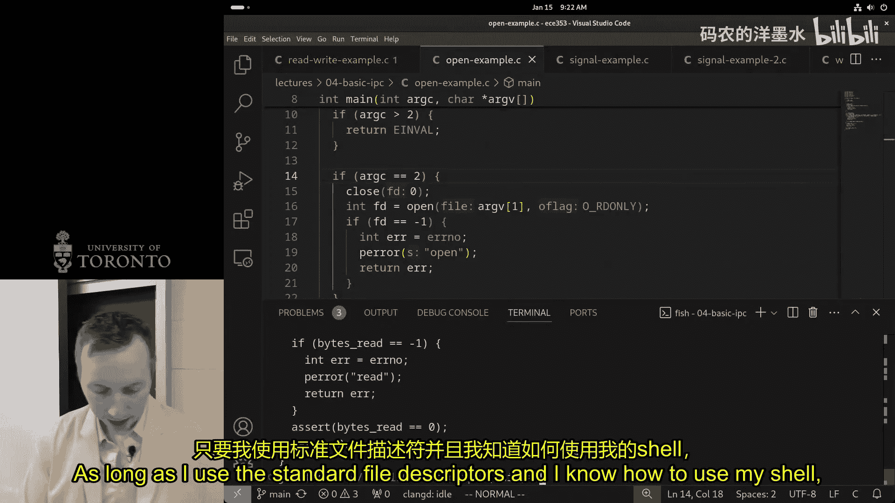

I could instead just run open example and then use this arrow thing。 So this arrow thing。

 what it will do is before that process starts running your shell will in fact， replace。

Standard file descriptor0 with this file to point to this file instead of the terminal。

I didn't even have to do that， I didn't even have to do an open system call in my program if I didn't want to。

 so just to show that I didn't have to do that， I can run my readWrite example。

 and then I can give it that C file again so this was my readrite example that didn't have any open system call or anything in it。

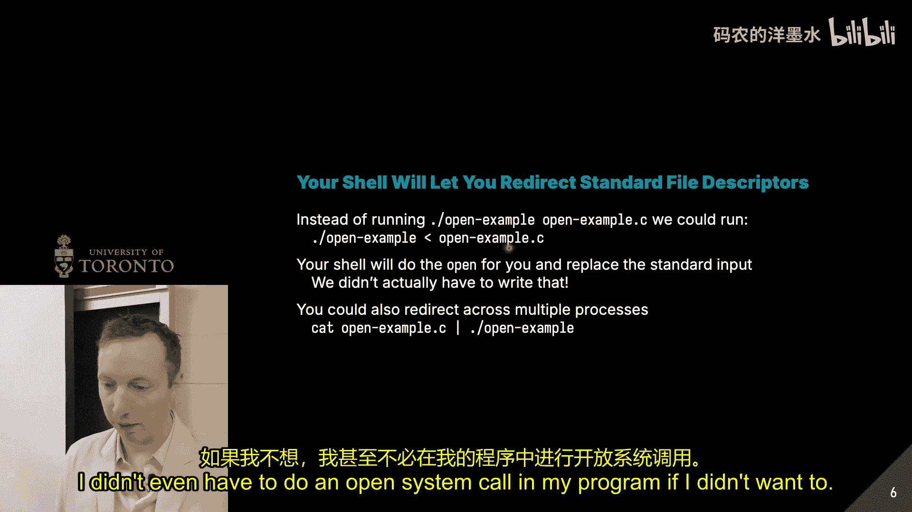

But using the shell redirection， I can give it。Make。The standard input file descriptor 02 openexle。

 c， so now I can run it and get the exact same thing。

singAs long as your program uses the standard file descriptors。

 it can handle files without you actually having to explicitly write file handling in your program。

Cool， so any questions about that？Neat，huh？All right。So。Another thing we could do。

Is we can actually redirect across multiple processes so I can use this bar character to kind of connect the standard output of one process to the standard input of another process to make them essentially talk to each other so I'll just cheat and use cat so what this will do is。

Take whatever this process write to standard output and instead of standard output by default going to your terminal。

 it's instead going to go to the process on the right of the bar so anything from standard out on the left is going to go to standard in on the right so it's going to read it and in this case the output is going to be the exact same thing because。

This process is writing to its standard output， the contents of that file from reading it and writing it out and then cat from its standard input is going to read the standard out of this process which will be the contents of the file again and then write out the contents of the file so in a more roundabout way I can see the contents of the file again and since cat behaves like this。

 I could add a whole bunch of cats if I wanted to， I could be a crazy cat。

 lady I guess or man and do it as many times as I want I'm just doing it more inefficiently by just。

Throwing more processes at it。So。Any questions about that fun thing？When what like？

So the left the left。Arrow kind of how I like to think about it is。

It's going to change standard input to point to that instead。

 so the contents of this file are going to go into this process as standard input。So by default。

 standard input would be like your terminal right， so I type on my terminal。

Then just goes to that process like when I type hello and spit back out at me， if I do the arrow。

 it's like okay， I do not want the terminal to be standard input。

 I want the file to be input instead so the arrow， since it points at the process is like。

Kind of you're feeding that file into that process and there's also。

The other arrow which is if I don't want to see the result in my terminal。

 I can use the right arrow and instead of going to my terminal in standard out standard out will go to that file instead。

 so I can actually use this as a kind of scuffed way to make a copy of a file so if I called itco。 C。

And ran it， I don't see anything my terminal or it's not asking me to type anything because when I run this process standard input is replaced by pointing to openex。

 C and standard output is replaced by pointing to copy。

 C so all the output is actually going to this file instead so now if I look at copy。

c I can see it's actually a copy that file so it turns out you don't even need the copy command。

 you can just use cat creatively if you really want to so yeah。Or when you。さにた。Yeah。Yeah。

 so if I just run it without any arguments， then since I'm using a shell。

 the default thing is that standard input and standard output go the terminal。

 So when I type something，And hit hello like and hit En。Then whenever I type that。

 it goes to standard into that process and whatever it outputs。

 so this is me inputting something and this is it outputting something。

 So if they're both by default， go the terminal。All right， any other questions about that？

Kind of cool， we can actually copy， we don't need a CP command。

 we can just use cat in creative ways if we really want to。So that was it。 That was pipes。 All right。

 so now we can talk about what happens when we hit control C。So。Like someone pointed out。

 if I want to exit this process， people have told you just hit control C， if I hit control C。

 some wonderful things happen， it gets a bit unhappy， there's in my shell at least。

 there's this red thing that says sig int， what the hell is that。

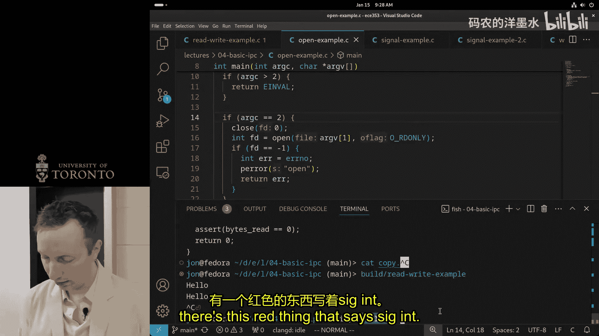

How that works is technically when you hit control C。

 you send an interrupt everyone loves interrupts right。

 so you send an interrupt to that process and the kernel technically starts running it in your process and that interrupt has an associated number with it so the kernel sends a number to your program indicating the type of the signal。

 if you can look up the numbers we'll go over a few today and。

Your program by default has a few default signal handlers。

The default ones will either ignore the signal and do nothing or terminate your process by calling exit。

So control C send SG int， which is supposed to represent and interrupt from a keyboard and the default signal handler for Sig int is the one that terminates。

 and the default handler that terminates will exit with the exit code 128 plus the signal number。

 so turns out that in this terminal， it translates that number back to Sig int。

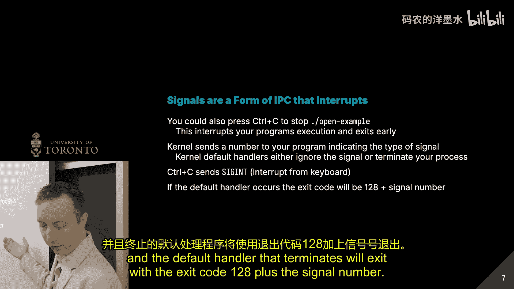

But if I didn't have this displayed， I would see that my process exited。

 if I waited it on it or something like that， I would see it exited with the exit status of 130。

So knowing that this is a convention， it's whoops。

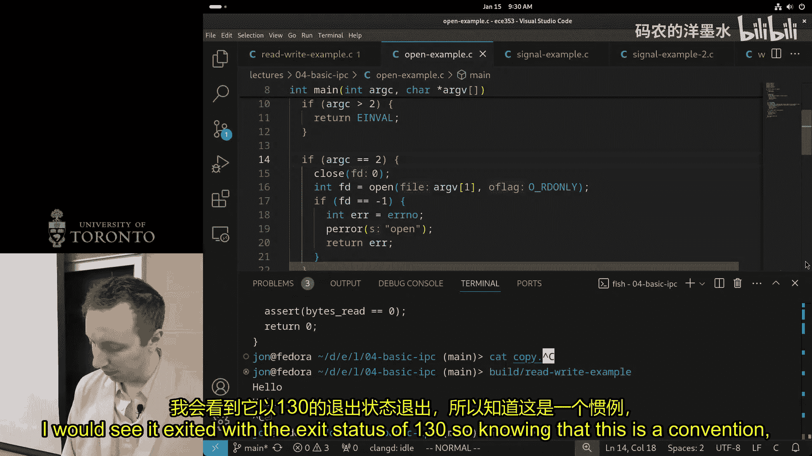

Knowing that this is the convention that it's 128 plus the signal number。 if it exits  130。

 that means signint is number two。 You don't have to remember the number two。So。

You can actually set your own signal handlers with a system called SIG action。

 which sounds kind of fun， funner than it actually is。

All you do is declare a function that doesn't return a value and has an int argument and that int will be set to the number for the signal handler。

 so the numbers more or less are nonstandard， but from Linux x8664 bit。

Which is what most of you will probably interact with， these are some of the default numbers。

 so too is SAit interrupt from keyboard。Nine is SG kill， which is terminate immediately。

 and then 11 is something we've probably all seen before。Sig。

SG V or memory access violation or SG fault or I screwed up memory or ID referenced the null pointer or whatever。

 and then there is Sign 15， which is sG term which is supposed to be like terminate nicely。

 so what the hell is the difference。So。Let's go into the signal handler example。

I am going to write a program。That is a jerk and will have foiled you before this lecture。

 so I'm going to make a program。That just ignores view typing control C。

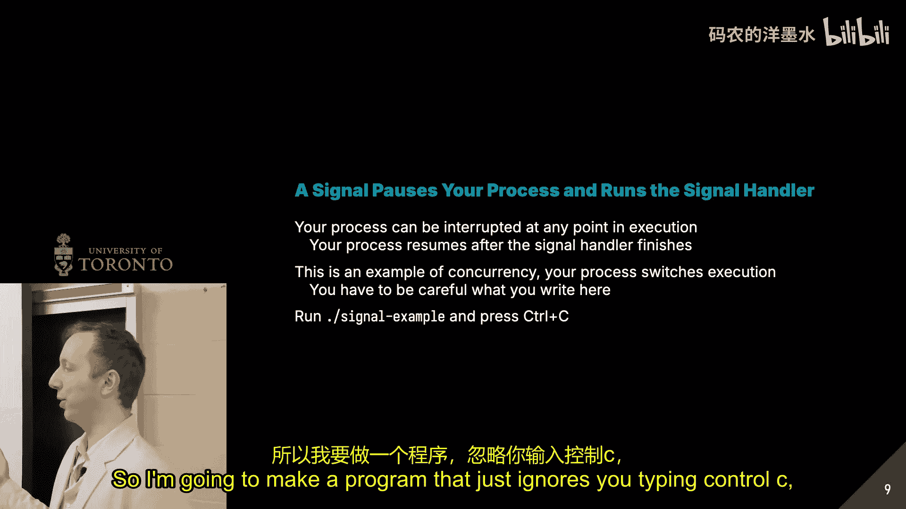

So。And this is a fun program to give to someone that hasn't taken this course。

 So I'm going to write a my handle signal function。 So like I said。

 it returns nothing and takes an integer argument with signal number。

 And I'm going to be a jerk where I'm just going to print out ignoring signal and then print out the signal number。

😊，So。You'll probably only copy and paste this， so don't worry about it too much。

 but I'm going to register my signal handler so it takes this struck Sig action。🤢。

has a whole bunch of mask we're not going to worry about in this course。

 the only thing we really care about is that one of the fields to constructstruct is a signal。

 the SIG action handler， so this is just the function that it's going to call whenever your process receives a signal that you register and then you register an individual signal number through this SIG action signal call so you register the signal number to intercept or actually run your action handler with。

 give it that new action which will register that function and then of course we error a check。

All right， aside from that。The program is going to be that cat example where， again。

 we just read and write bytes from well we read from standard in， write to standard out。

 So I'm just going to register Sig int and Sig term。So。Now if I run this program。

 what I called it signal example。So。A might， guess what happens when I control C now？Yeah。Yeah。

 it just ignores it and taunts you， right？So I hit control C， oh no。

 good thing I programd defensively now， so I get ignoring signal2。

 but I also get a error from my read system call。So。I gotSo the signal handler happened。

It ignored my signal， it printed it off and then it returned wherever my program was at when it received the signal。

 which was in the middle of this read system call and it made it by default， return an error。

 that error was interrupted system call so good thing I programmed defensively otherwise my program would have just kind of ended and probably some weird things would have happened so turns out。

This actually isn't a real error， all I would have to do is be like， oh okay， well。

 if I got interrupted， I just restart and call read again so I can write version 2 of my program。🤢。

That handles that。 So how I would handle that is I'll check if I got an error。

 So byte red is equal to negative 1。 and then I'll check if that error and no is equal to E。

And you have to look this up， but interrupted system call corresponds to this error， E in R。

 and then I'll just continue， which means I'll just restart the read system call again otherwise。

If I didn't get that， it's a real error。 I want to break out of that and then print that error。

 So now if I run it and I hit control C。Just says ignoring and keeps on running， right？So we could。

Hit control D since we learned how to do that now， but if you gave this to， let's say。

 one of your other classmates before this class started and they hit control C and it just taunted you。

How do I exit it now？Anyone know how to exit this or you're all screwed？

So I can just give you this and then you're stuck in it forever。There should be like。

A requirement to pass this course， you have to exit out of this program。So I don't need control Z。

 control Z， but you want me to kill it with the PID， right？Oh， that's the way， okay。

 so there is again。We're going to increase our vocabulary with kill。

 so now we can kill some children。 So I don't know why they named this。

But the system called to send a signal to a process is called kill。

 I assume because historically the only thing you could do to the process。

 so one of the process numbers was said kill， I assume originally they didn't have numbers and it was just sending kill to that process which is why it's called kill instead of something nice like send signal。

 but who knows so。Yeah， one of the suggestions was if I know the PID of this， I can try and kill it。

 which is like please terminate。To find the PID of that process， I can use Pi of。

 so Pi of it's called signal example dash2。So that gives me the process ID of that process which is currently running and taunting me。

 so you said I should just kill it right， so I could do kill oops。And then give it that number。

 so kill5，9。5，000， whatever， so kill。So I sent it， it should be dead， right？So let's go back and see。

Ignoring signal 15。So if I just kill， so everyone's used task manager and like tried to end task。

 right？What do you do if NT doesn't work？Restart the laptop， okay， that technically works。

 but without restarting the laptop。What you do in Windows La or any Windows or Mac users。

 what would you do？Or what does it complain at you to do？No one's had to choose violence before。

 everyone's programs have worked properly。Really？Yeah。Yeah， if you're。

If you go in Windows task manager， some process isn't responding。

 then you go to end task and then it doesn't end。We tried control Cd doesn't work。Yeah。Yeah。Yeah。

Force quit right， force quit or end task or kill violently。

 so the Unix equivalent of that is that kill signal。

This kill by default will send a terminate single to that process which is 15， which is like。

 please terminate nicely， I would like you and that gives you the opportunity like clean up any resources or like finish doing whatever you're doing。

But if a process is not behaving correctly， there is a violence option。 So the signal。

 which is called kill， is。The kernel will terminate your process。 You have no say over。

 you cannot handle that and it is signal 9。 so if I do kill dash 9， so kill by default。

 send signal 15， I can do dash and then number to send any signal number I want to that process so if I do kill dash 9 and then give it that process ID now it is finally dead。

So now it says terminated by single Sig kill， force quit， and task， this is like the force quit。

If you're using Windows or Mac and you press the fourth Qui button。

 essentially it's going to do the same thing， send a kill signal to it。

 and that is something you cannot handle the kernel immediately terminates your process。

 it's not allowed to do anything else， it doesn't get to clean up or do anything fun。Ooh。

 that was fun。 We violently killed it。 Allright， so now we know how to exit any process。

 So any questions about that。😊，Yeah。Are not able to open。If you're not able to open a new terminal。呃。

Then that's bad。I don't know， you fork bombed yourself， you ran out of processed IDs。

 you probably should have set your kernel to protect against that。

So if you can't open a new terminal， then let's like in Windows if you can't open task Manager。

Then you can't open taskask manager。Oh。You're screwed， you got reboot at that point， right。

 you're kind of over。All right， other questions about that， so we now know the violence option， 9。

So questions about that， fun things。So anyone will remember what a cool process is， that's really。

 really important。That's like the orphanage and cool processes。Yeah。The unit process is one， right？

Anything cool I could do？What about if I kill process one violently？All right。

 let's skip that as thinking out loud。 Don't worry about it。All right。

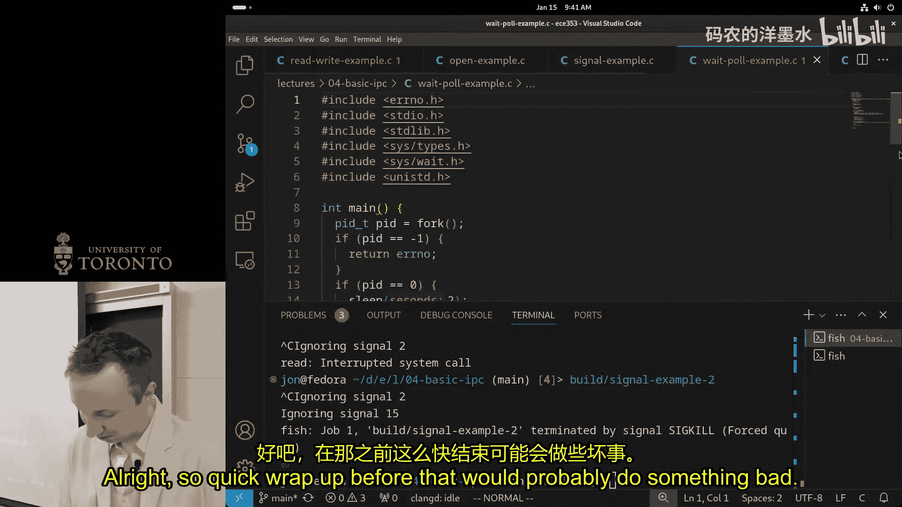

So quick wrap up before that would probably do something bad。

So let's rewind a bit and go back to weight so most operations or system calls are nonblocking that you do or that you hope to do so nonblocking returns immediately and then you check if something occurs so we saw weight before that was a blocking system call maybe you don't want to wait for one your children to terminate maybe you just want to check if they have terminated or not so I can use weight PID with W no hang。

 basically that will turn it into the non-blocking version and to see。

Whether or not a process has died， like with， I don't know。

 figuring out has something happened in hardware， I can either do pulling or interrupt。

 So let's go back here。

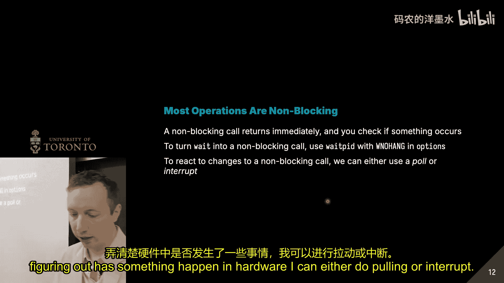

Let's write a program I can just fork immediately and then in the child process I'll sleep for two seconds and then it will just terminate so I can just write this here to make it easier so sleeps for two seconds and then terminates and then in the parent if I wanted to use the non-blocking version of weight well this one's going to be a bit silly because all I'm doing is waiting for my child but if I wanted to do it。

 I could do it in a big while loop right so。Just because I'm curious I can count how many times I call the nonblocking weight。

 So I'll just if weight PID returns zero， that means my child process has not terminated yet。

 but there's no error or anything like that， So I'll just go through this loop while weight PID is equal to zero otherwise it should return an error or give me the PID of the child that has now terminated。

 so I'll print off calling weight and then attempt whatever， and then call weight PID。

Give it what I got back from Fork， which is the PID of my child and then。Fill out weight status。

 give it that no hang option and then。After I break out this loop so I get finally a PID which is either negative 1。

 an error or greater than zero， check if it's an error， print an error message。

 otherwise I assume that I just got the process ID of the child， I'll print off weight returned。

 print off that PID and then that exit status of it。So this kind of looks familiar。

 but let's see the non blocking or the pulling version。So weight pull example。So if I do this。

Turns out two seconds is a lot of time， and I do a lot of unnecessary work， so I pull it， you know。

About quarter million times， at least， so that seems less than efficient。

If I wanted to reduce the number of weight PiD system calls I make here。

How do I more efficiently pull this thing？Any。Any input。

 how I would more efficiently pull this thing？Or remember the options in our hardware course，Yeah。

 I could just wait a little bit， right， So what about if I just do， I don't know， I wait。

Thats just say I'll just sleep for a second。So I'll sleep for a second。Whoops。A， crap。All right。

 so I have to choose violence。Well， good thing I took this course， so now I can kill it。So， compile。

And then pull so now if I do this， see a temp1， attempt temp2， oh attempt3。

 so it took me three seconds， so more efficient here。

 but there's always a trade off if I have to pull right， so worst case。I have a bad response time。

 so worst case， I might pull and then right after it says no。

 it hasn't terminated yet and then immediately after that it terminates， but I sleep for a second。

 so worst case， I might only get notified， it terminates up to a second later。

 which is pretty bad or if I want it to go lower， I have to reduce my sleep amount。

 which means I'll pull it again more times uselessly so。There's always that option for pulling。

 but if I don't want to pull， instead， maybe I want to clean up my child immediately when it exits。

The thing the other option to polling is just interrupting so remember when I told you before in the last lecture the operating system will poke your process that hey your child has terminated。

 please clean it up and by default you ignore it Well it turns out that pokeke is a signal so。

When your child process dies， you get set a signal with the signal number SG child。

 The default signal handler just ignores it。 but if you wanted to actually。

Immediately clean it up without having a blocking system call on it。

 you can register a signal handler for SIG Child and in SIG Child。Just to be sure。

 you can just call the W NoHang and here。Remember how weight by default returns whenever the first child terminates。

 well， if I give weight PID the PID argument of negative1。

 it will have that same behavior so it will return for the first child has terminated because in the signal handler in this case。

 I don't actually know the PID of my child without making a global variable or something like that。

 so I'll just set it equal to negative1 so。I will just do a non blocking weight P ID in my signal handler。

 So whenever my child dies， I should immediately get set in a signal by the kernel。

 Then immediately I clean it up。 So I do not create any zombies or anything like that。 And I am a。

Not neglectful parent， so I'm a good parent in this case so I clean it up immediately when it's done and in this case since I'm not doing anything else I'll just terminate that process。

Just to show you， it runs， so let's just do the weight。Oh yeah。

 sorry and just to show you that the main could be doing or the original parent process could be doing something useful。

 well here the child sleeps for two seconds like before， and in the main process。

 I just put to sleep for an absurd amount of time and that will block you know the thing executing Ma to show you that the interrupt actually happens concurrently with whatever's running it in Maine。

 so I was put Ma to sleep for a stupid amount of time。Wall it sleeping。It gets sent a signal。

 And then after my child dies after two seconds， then I clean it up。Print off that， hey。

 we exit for a process and then I just terminate my process because I'm not really doing anything more useful。

 but you could imagine that instead of that sleep 9999。

 your program is actually doing something useful。So any questions about that。

 so that's our other option， you'll probably want this in lab too whenever it happens next week。

Multiple children， How to be。Make sure we are only alive。や前と。Yeah， so if I have multiple children。

 what I can do is I could call this weight multiple times。So if I call weight PID multiple times。

 eventually if I wait on all my children and they're all dead。

 it will eventually return an error of negative one and one of the error codes is no more children。

So I can just constantly call wait until I know I have no more children， or it returns zero。

 which means none of them has terminated so's。Yeah， I call it。

In a loop and two conditions to terminate that loop。

 either I have no more children anymore or nothing is terminated。All right。

 other questions before we can do some more fun things。Okay， well， as the last example too。呃。Yeah。

 some more fun things， whoops。So。One thing you might want to do， which。

It kind of gets into threaded stuff is like hey， maybe I have this file descriptor open in my process and whenever someone tries to terminate my process。

 I want to go ahead and be nice and clean it up maybe I'm buffering something I want to write everything out before I terminate so you might want to write this handle signal。

 that is like， okay well before I exit， I'm going to close that file and then exit so here I check if that file descriptor is valid。

This will be set for main， so if it's negative 1， no open file。

 I just exit otherwise I try to close that file descriptor。

 make sure that there's no error and say I closed file and in this case I'll just simulate something else happen for 10 seconds and then exit to exit the process now in this case I'm going to register signal while that's my register signal function。

And。In this function， I'll just write out my P ID just to make it a bit easier。

 So I don't have to do that PID thing。 And then I'll open the file。Say that I opened it。

 register SG int and SG term， which is。You know， controll C and just that normal kill。

And then just simulate I'm doing some work， sleep for 9099 seconds。If I run this。

I get its process ID 6654， and has it actually hasn't opened a file yet。

 sorry I should give it a file。So。Oh， that's a nice number， all right， 67。

000 is that process ID and it has opened a file， it got file toscriptor3 for that zero or for this file。

So。We can imagine this program's running， it's using that file， it's writing to it。

 maybe it's reading from it， whatever it's reading from that file。

 so let's set it up on the other terminal to kill。So maybe。I say I'm done with this program。

 I hit control C， and then it's trying to close that file， so it's close that file。

 but maybe I get impatient and then I try to kill it。So。If I look at it。Well。

 what could happen is something very， very annoying so that when I was in the middle of handling a signal。

Another signal came in which would make it a recursive call， which is fun。

In this case I actually got an error from close sayingB file descriptor because it turns out I have already closed that file descriptor。

 so what happened in this case which is why signal handlers are kind of a pain in the butt because they can happen recursively so when I first hit control C and set signal to it。

My process immediately started running this function， it printed off closing file and exiting。

 so signal2， and it didn't get。Like the file descriptor was equal to3， so it didn't print this off。

 then we closed file descriptor 3。 it didn't have an error， it printed closed file。

 and then it was asleep for 10 seconds just to simulate。

Just to give me time to do it so that I can hit a recursive one。

While it was in that middle of sleeping for 10 seconds， I sent signal 15 to it。

 which would essentially simulate。Calling handle signal again in the middle of this。

 so I would a new call would happen in the middle of it where it would say closing file and exiting signal 15。

 well file descriptor， that global variable still equal to 3 so this doesn't happen and now close a file descriptor 3 gives me an error because I've already closed it so。

🤢，This is。

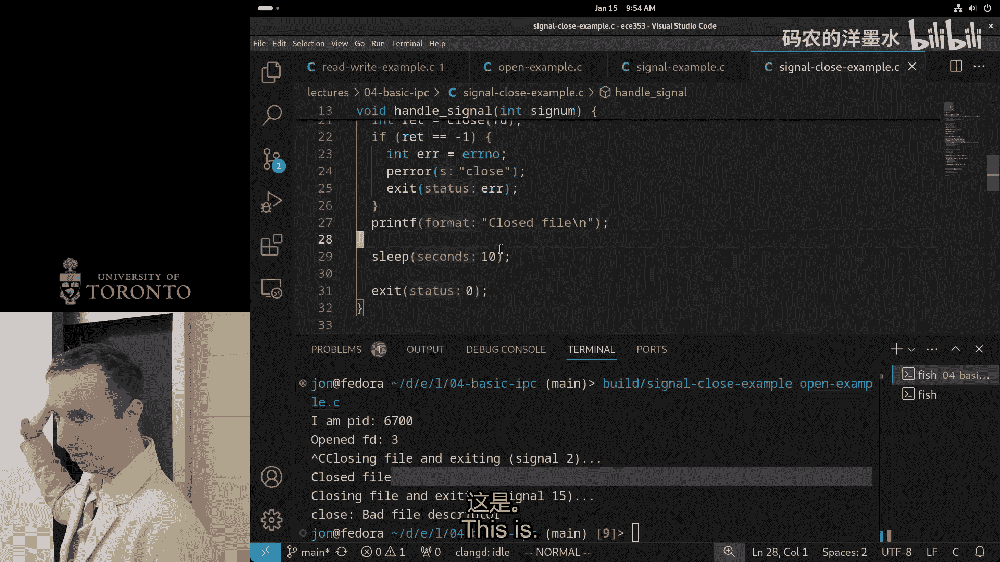

Bad and you have to be very careful so all your interrupt handler code must be something called reentrant。

 so while in the middle of executing it， it should be able to call itself again and nothing bad should be able to happen so it should be able to pause execution in the middle of it。

 execute another call to itself and then resume execution from wherever it went off。

 which is actually kind of a hard topic。Do not worry about it for now。

Get revisited once we start talking about threads。This property is actually really。

 really hard to program for， and it's one of the reasons people don't really like signals at all。

With that caution or tail out of the way， let's try something fun， so。😊。

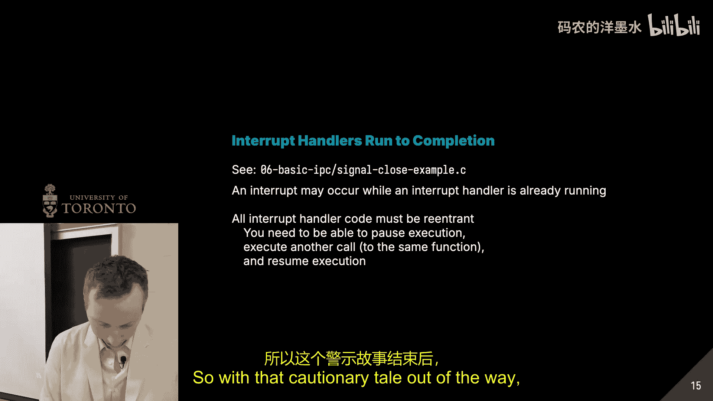

Any questions before we wreck my computer？All right， well， let's see here so。Like we said before。

 process one， fairly important right， if I try and kill one。

 nothing will happen because it'll probably just ignore me， In fact。

 it says operation not permitted oh probably because I'm not the root user right so I can just pseudo kill one。

I am now the root user。Enter my password。Okay。Nothing happened。

 probably because they made it ignore that right because that doesn't really make sense they probably shouldn't kill it。

Well， if I wanted to actually kill it again， what do I do？Kill Dash9， right。

 like I really want you to die。And nothing happens， so turns out。

Colonels smarter than us and they actually ignore that， they don't let you kill process ID1。

 but remember last lecture there was some fairly important process。

So when I ran that orphan example last lecture， remember my child got adopted by some special process which is like system D for my user。

 so it turns out the kernel doesn't protect that， so that is the process that's like acting as the orphanage for my user。

Basically spawning every process for my user。 So this process ID。17，001， pretty important， right？

So what would happen if I just did hoops？Killed Dash9。Whatever that number 1，7，0，1。

So any guess is what happens if I kill this violently？No guesses。

 seems like a fairly important process that spawns every other process for my user， right？

Including what I'm currently typing into because VS code is running as a process。

 a shells running as a process。

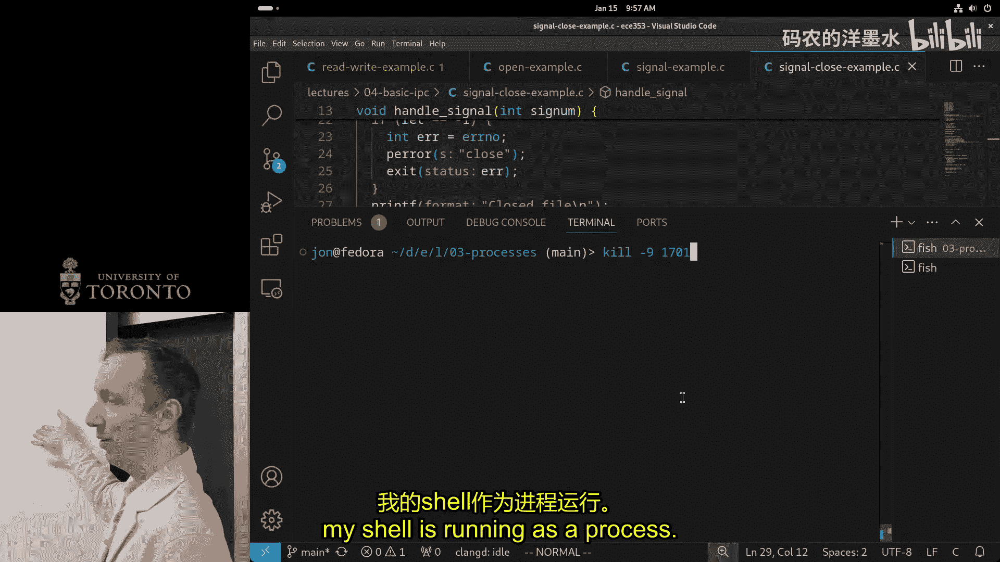

So let's just see what happened。

All right。