# 【全集 2025】多伦多大学 系统软件设计与编程 中英字幕 1080P p05 Lecture 5 - 进程实践 -BV1YrkYBQEeL_p5-

Alrighty， welcome back to 353 slight technical issues， but we're back on track。

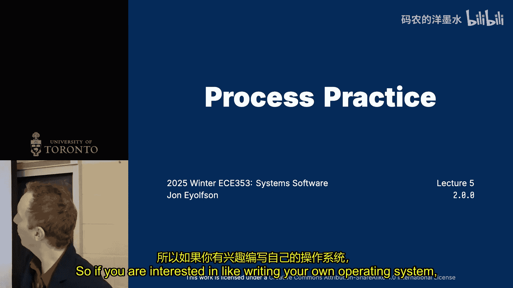

Let's start off。If you are interested in like writing your own operating system。

 not exactly where this course is aimed at， but you can actually start reading this now。

 so from the graduate MIT operating system course， there is this XV6 kernel risk written specifically for riskk5。

You can run it in QMU if you want， that would mean you're running it in a VM in your VM。

 but it's a reimplementation of Uniix for risk5 in C， and you can actually start reading it now。

 So here is there a knit process。 So remember a knit is supposed to be responsible for spawning either directly or indirectly every single program and also acting as the orphanage。

 So we can actually kind of read this now。 So here。

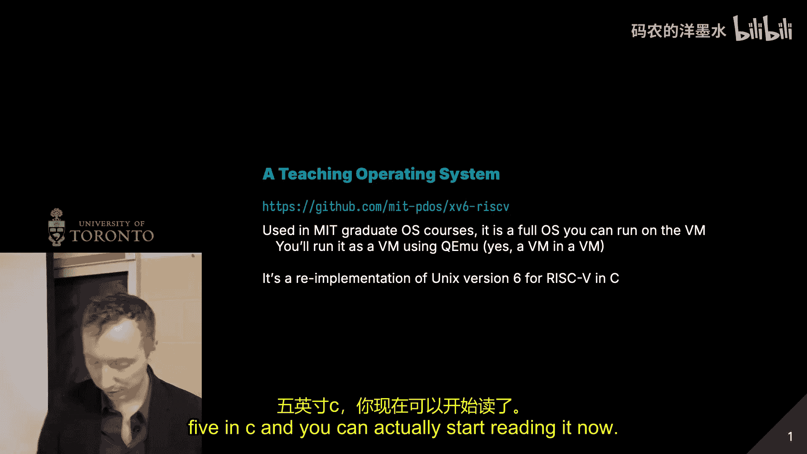

Their in process is disrespons for launching SH， which is the shell， so first it starts up。

 it does open console and well the console is basically their terminal。If it's successful。

 it will return file descriptor0， so that would be standard in， and then they do a dope。

 which we'll get into today， but that basically just returns a new file descriptor that points at the same thing as file descriptor0。

 so file descriptor 1 and 2 also point to the terminal。Then it has this handy dandy4。

Semicolon semicolon， which is just a fancy way of saying wall true。

 so wall true it says a knit starting SH， then it forks， everyone knows what fork is now。

 checks if PID is less than zero， meaning there's an error in which case it exits。

A knit which exits the entire operating system， otherwise if PID is equal to zero， then it execs。

 so it starts running as the child， the SH program or the shell， and if it's successful。

 then that new process starts running the shell instead， if it is unsuccessful。

 exactec returns an error， they don't check because it has to return an error to reach this print line。

 and they just again just say exactec SH failed and then exit。After that。

 it's another infinite loop in the other infinite loop that says this called a weight happens if the shell or if another process exits。

 So it's just an infinite loop that weight。 So this is it acting as the orphanage。

 So it just calls weight over and over and over again and it has a little check here that if the process I。

 it gets back is the shell that it launched， all it does。It breaks。

 which causes it to just relaunch another shell， otherwise it checks for an error and otherwise it was a parentless process so it adopted an orphan。

 it cleaned it up so it will do nothing and that is the entirety of the in process for a very。

 very simple operating system so we can see that it indeed has two jobs and this does the two jobs right it launches the shell which the user types in to launch other programs and it also is the orphanage because it just calls weight over and over and over again so any questions about that we can now read operating system code。

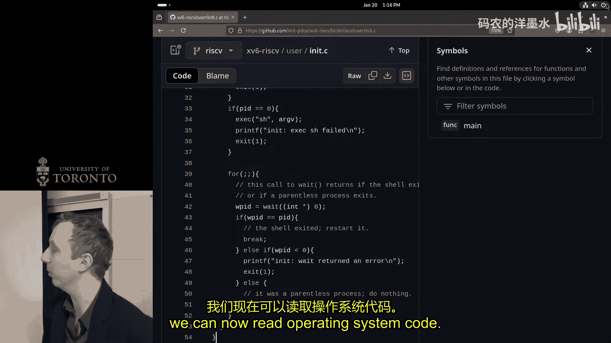

Neat。All right， so。We'll get into three， most of today is going to be a lot of programming classes or programming practice because well。

 have managing children and forking and killing them is hard work。

 so we will get some more practice with that today。

But before there's something called unit programming for old batch processing OA operating systems。

So probably much， much， much， much older than you， But back in the olden days with Dos and whatever the hell came before that。

 you could only run one process at a single time， which is a bit limiting。

 so that was called unit programming。 So if you have two processor。

 they're not run in parallel and they're not run concurrently no matter what we can only run one process at a time。

 which kind of sucks。 Every offering system since I don't know， the 80s has been multipleprogramming。

 So we have multiple processes all going on。 Two processes can run in parallel or concurrently。

 Again， we don't know exactly what these words being yet， but we will get into them。About week five。

 so only thing we need to know is that modern operating systems now try to run everything in parallel and concurrently so it could be juggling thousands of different processes。

 you can open your activity monitor or open your task manager or whatever and see how many processes your operating system is actually juggling between is going to be at minimum probably hundreds。

So another talk about that juggling different processes。

 there's something in an operating system called a scheduler and that decides when to switch between running different processes。

 so to create a process， the operating system has to at least load it into memory。

 right and when it's waiting or in that ready state。

 the scheduler which we will argue about in a bit decides when to transition it from ready to running。

But first， we're going to focus on the mechanics of actually switching which process to run。

So where it fits in， there's this core scheduling loop that runs in kernel mode because it has the main control。

It has to have control over all the processes and it changes which process runs。

 so it basically has four steps that all go in an infinite loop。So， oops。

So our four steps are it will pause a currently running process that is running on a CPU so it will stop it from running。

 it will save its state so you can restore it later。

 AK the value of its registers so they're consistent between when it gets switched out and in。

The scheduler will figure the next process to run and then we will load that processes' state。

 so we'll restore that processes state and then la run directly on the CPU so it would restore at minimum all the registers from whatever that program was last paused and let it get control over the CPU again so it can run。

So。There's two different ways operating systems can actually maintain control we can let processes kind of manage themselves and figure out when they should run or have the operating system pause and have the operating system or the kernel maintain control so there's something called cooperative multitasking that means the process has to explicitly use a system call to tell the operating system that hey。

 if there's something else to run， you can run it， I will yield。

 I will give up the CPU so that I will be nice and something else can run if you don't do that then you just run until you're done and you kind of hog the CPU which may not or may be good depending again on the scenario most general purpose operating system have something called true multitasking where the operating system specifically the kernel retains control and will pause the processes without them having to opt into it so。

To do this for true multitasking， the operating system can like give a process of set time slice and be like。

 hey， you can execute for 100 milliseconds and then you're done and we have to go to the back of the line or it can maintain control by just waking up periodically using interrupts and then use that to do the scheduling information。

 kick out a process if it thinks that， hey， it should be kicked out。So that swapping of processes。

 specifically the terminology for that is something called context switching。

 so at minimum we have to save all the current registers because while that's what our program actually needs to run。

 so we have to save all the values using the same CPUs we're trying to save。Might sound a bit tricky。

 it's actually not that tricky， you can just save the value of all the registers on the stack and then knowing how many values you save。

 you can recalculate the old stack value if you really want。

 you can see that in the teaching operating system kernel for now we don't care just know that context switching will save the state of all the registers somewhere so there could be some hardware support for saving state because well if you have 200 registers。

Putting 200 values on a stack probably is not the greatest。

 so some CPUs have special instructions for saving the whole state somewhere。

But maybe I don't want to save everything。 So context switching is something called pure overhead like。

The goal of operating systems is to run our processes， right。

 We don't care about how long the operating system takes to actually。

You know do a bunch of busy work， we only care as users that our programs run as fast as possible and no other time is wasted so overhead is just time wasted。

 not running your program not doing anything useful so if context switching or like just swapping out of process。

 took 50% of my overall time， then your operating system is going to run pretty much twice as slow as any other operating system on the planet。

To run your program。 and you will probably never ever use it。

 So we want it to be as fast as possible。 It should be somewhere between most operating systems。

 It's like under 1% of the total time is spent context switching。 so it's more or less negligible so。

You can do some smart things to make sure you only save what you need so you can have like a combination of hardware and software to save as little as possible What example would be like there are certain registers for floating point operations and if you're smart enough if the kernels smart to figure out that hey your process doesn't use any floating point operations then it doesn't have to save any of the floating point registers to restore them if you're not going to use them anyways so the goal is to just be as lazy as possible only save the minimum amount that we actually need so that things still work。

All right， now we get into the new API time， so there's this new API called a pipe。

We saw how the shell uses it， so remember the bar between two processes。🤢，Technically。

 it's called a pipe and we can actually use it in our programs。

 It has an associated system call with us。 So the pipe system call。It takes， as an argument， a。

Aray of two ins。If it's successful， it will return zero on success， negative1 on failure。

 like all of the rappers for system calls do， and if it's negative one it will set ano。

 and what pipe does is it will form a one way communication channel using two file descriptors。

This array of two ins， it will assign two integers， so one at index 0，1 at index 1。

 and the file descriptor set at index1 is going to be the read end of the pipe。

 So I am allowed to do read system calls using that file descriptor to get information out of the pipe。

 you can think of the pipe as just like a kernel managed buffer or just， I know。

 a dumping grounds for information in the kernel that you can send bytes to and read bytes from。So。

The file descriptor at index1 is the right end of the pipe。

 so I can use the right system called to send bytes into the pipe and use the right read system called to get bytes out of the pipe。

 and I can actually use that if I'm clever enough to do communication between processes。So again。

 think of it as a kernel managed buffer， it's just some memory in the kernel that is actually accepting some information。

 when you write to it and when you read from it， it will read that information so we'll see how this is used and how we kind of implement that bar operator。

So here's an aside someone mentioned the fork bomb before so as an aside you can use the ampersand in your shell if you use ampersand at the end of your command。

 your shell starts that process and immediately return so if I do sleep one and ampersand I'll immediately tell that hey I can actually write in my terminal again that's because essentially it will do a fork and then it will not wait for it it will just fork it and then just let it fly and then it will just complete in the background it doesn't explicitly wait for it in order for you to actually regain control of your terminal so you'll see some output of the PD to let you know when it's finished so it will clean it up but that bar character and that bar character again creates a pipe between two processes so someone said fork bomb before so in bash you could do the sneaky command to actually perform a fork bomb and it looks a bit stupid but how you read。

It's intentionally supposed to be kind of obtuse so what this actually does is everyone knows kind of how to defined find a function in C right you give it like a name in the brackets in bash。

 you don't see what the return type is because it's bash so turns out you can actually define a function called colon so this is what the first line does it defines a function called colon that takes no arguments and inside you know it's like C。

 the curly brackets are the body of the function。So the body of this function calls colon。

 which is itself and then does a pipe to another colon， which again is itself。

 so this will call itself and the ampersand just forks it off and then。

Just continues executing again。 So this semicolon。And so that defines a function called colon that will call colon piped with itself and launch it off in the background。

 and then this colon sets off the fork bottom so that calls the function we just define。

So that will do the same thing as doing wall true fork just in a sneaky way so if anyone you know is running MacOS or Linux you can say hey look at this cool command that will give you a bunch of Bitcoin or something like that or Ethereum or whatever is cool and tell them to run that and then they fork bomb themselves so do not run this command on the school machines or anything like that you can just annoy your friend but you should help them fix it after you have fork bombed them so that's just an aside。

Yeah， of a sneaky way to fork bo。 So let's see an example。So。

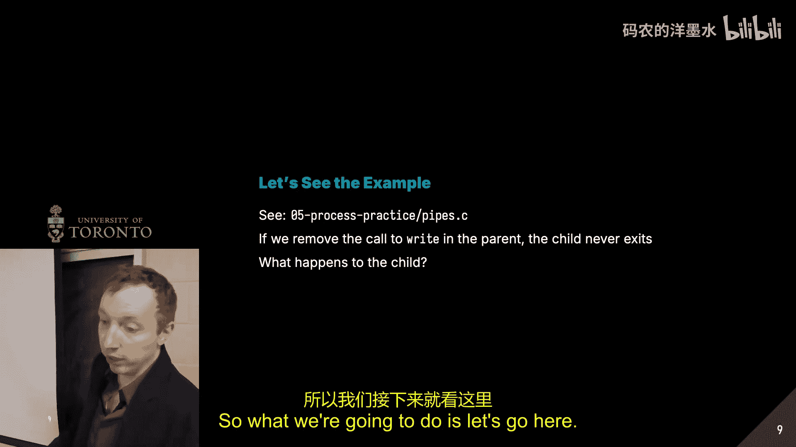

What we're going to do is let's go here。So close that。

So we are just going to write a little program to show how to use a pipe。

 so we're going to communicate across two processes using a pipe in this case。

 so what we are going to do is well first let's see all the stuff we have written。

I have this little check helper that takes us an argument。

 a return value and then a message and again this is just so I don't have to do any explicit error checking over and over again。

 all the C rapers return negative1 if it's a failure so if it doesn't return negative1 it means it's okay other than that there's an error。

 I'm going save error or no， print out the error and then exit the process。So。

First thing I'm going to do is I am going to， well。

 first declare an integer array of two file descriptors， Ill creatively call them FDs so this isn't。

InAray of two ins。 And then I'm going to call pipe。 So pipe。

 I will give it the file descriptors and then message if it fails。By convention。

 whenever I launch my program。Folile descriptor 0， let's say FD0， that standard in。

which I can read from， then I have FD1， which is standard out that I can write to， then I have FD2。

 which is standard error， which I can also write to。So if I call pipepe， if it's successful。

 I get two new file descriptors， right， I'll likely get file descriptor3。And file toscriptor 4。

And this three will get assigned to FDs0， and this will be the read end of the pipe。

AndDs4 file descriptor 4 will get assigned to FDs 1， which is the right end of the pipe。

And one way to remember which index is which is they kind of line up with the standard file descriptors so standard in is0 and that's one you can read to。

 same with index 0 for what's returned from pipe so I can only read from that file descriptor and then standard out which is one。

 I can write to it and same with this index， I can write to index1。Okay， so。

This by itself is kind of useless。 I just set up a pipe。 I want to communicate between two processes。

 So if I want to communicate with between two processes。Well， I should probably make another process。

 right？So I could do int PID equals fork。So。After the fork。What happens， So let's again。

 assume we have process 100 running。 So process 100 calls fork。 in this case， What happens。A。Yeah。

Yeah， so we'll create two processes right， so it will probably create process 101 and it's going to look like two return from fork。

And in the case of Pro 100， Fork returns。101 and in process 101， Fork returns what？Yeah。Zero， right。

 it is the child。So。It's a bit different than before。I have a pipe before the fork。

 So because I have a pipe before the fork。The two children are going to look exactly the same at the time of the fork。

 So both process 101 and 102 will also have file descriptor 3 and 4 open。

 and they'll both have the array and they'll be set to that and basically if file descriptor points to a file。

 So they'll be both be pointing to the same thing。 So in process 100。

 it has file descriptor 3 that points to the right end of the pipe and same with file same with process 101。

 It has file descriptor 3 that points to the same read end of the pipe。

 So if I want to communicate between two processes。What I could do is something like， I don't know。

 let's say if I am the parent。I can do something like。Maybe I want to just write some。

Bs to the child， so I'll declare something called string。Let's say I just saw，Ho， my child。Something。

It's not weird。And then I could do right。So if I want to send information for my child to communicate between the processes。

 I can write to the right end of the pipe so I can write in this case to FDs1。

And what I will write to it is the string， and I'll use string length of the string。

Just so I only write the contents of the string。 So that should write the contents of the string to my child。

 right。Anyway， everyone okay with that so far and we'll kind of break it down。

So why am I not right into FD3？Like if I just right？Wait， Fds3 like that。嗯。Did you生。

So the file descriptors。They're always sequential in your process。

 So the pipe system call is going to create two new file descriptors in your process。

 and because by convention we have file descriptor 1 or 0，1 and 2 open。

 the next available numbers sequentially are three and4， right。So that means pipe。

 if it's successful， it gives me two new file descriptors， which will be number3 and 4。

 like the actual value of the file descriptor， and then it will assign it to this array of FDs。

 so it will assign。The value 3 to FDs at index0。So it just writes it to that array。

 But if I look at like if I actually。Did something like if I print F。呃。FDs2 or FDs zero。

And let's just exit just to make sure it's easy。Oops， Mason compile， so if I do something like that。

This is called what the hell is are called pipes。So if I do something， that the value is three。

But I should just use whatever value I got returned from me。

Because I'm not guaranteed it would be three， I just know it's going to be three just based off how things are usually set up。

Okay。So I go back here。 I should use Eds 1。 All right， everyone， okay with that so far。So。

That is what the parent is going to do。In the child， I'm going to。Which is a different process。

 I want to read the bites that my parent has given to me so I can just declare my own little buffer here of magical size。

And then I can just do a， well， S size G。Btes red equals I can do my read system call。

So I can read from FDs zero， so that's the read end of the pipe。

 and I can read it into the buffer with size of buffer。Buffer。And then again。

 I should probably check for errors so I can check the by red。

And then my error message could be read， and then similarly for the right。

 maybe I want to go ahead and check for errors here， so size T。But。Wop bites underscore written。

And then check bys written。Right right， so there's error checking disc to make sure。

So now if I do this and I run it， what should I see？Well， let's try it trick question。Nothing。

Because I just read that information。 I didn't do anything with it， right， I just， I didn't print it。

 I didn't do anything with it。 So both my parent and my child just kind of exit。

So if I want to go ahead and read what the child or print， what the child just read。

 while I didn't screw with my other file descriptors， so I could print F， let's see。

What I read from the child。And the format descriptor I could use is I could do something like this。

 has anyone seen that before？As a format specifier。Looks how weird right。

 So it's a string format specifier with a width， so it'll only print a certain number of characters given by the first argument。

IfBecause I'm not guaranteed what I read was a C string， so I could only actually。

Use bites red from it。Do bites red from the buffer。

 and it will only print off that number of characters， so we still have a warning。嗯，对对对。Oh。

 because it wants it to be an int。 Okay， well， I'll make it an int just to make you happy because I know it's within limits。

So if I do that。I run it now， I can actually see I'm。Actually communicating between two processes。

 so I read hello my child， so that came from my parent， so my parent wrote to it。

 and because I was using a pipe and I shared it between two processes，By only forking after the pipe。

 so both processes had all the same file descriptors open。🤢。

I could effectively use that to do IPC or inter processces communication， so the parent wrote。

 hellello， my child。To the pipe。 and then the child read it， yeah。So。So question one is。

 is there any synchronization with Re that will ensure things happened？

So read is a blocking system call。 So yeah， we don't know which order these are going to go in。

 so if the child hits read first。It's going to sit there and block at read until the parent writes to it。

 And there's actual information。 So that is okay。 doesn't matter what order they're going to run in。

 I'm always going to read。 hellello， my child。But good question， was that everyone's question yeah？

What happens if the parent and child both right？The parents of the child can both。Yeah。

 so a pipe is a one way communication channel。So if both the parent and the child write to it。

Then who should read from it， Who's communicating with who。

So we'll see a more complicated example after the break where we need to use two pipes。

 but for now we're just going one way。Yeah。エスペで子な。Yeah。

 is there a case where you know what happens if the parent is just kind of a jerk， right。

 what about the parents just kind of a jerk and。Let's see the parent just like， hey， child。

 they're not on speaking terms， right？🤢，So we just don't write anything。

 this is comment out everything。So they're not on speaking terms。Well。What might happen。

 So create a pipe。 Okay， fork， they're both the exact same。

 They both have all the file descriptors open， and then the parent。Just exits immediately。

 and the child hits read。So our question might be well。Does it read nothing， Does it get stuck here。

 What happens with it？ So we should be able to investigate this just by running。 So oops。饿。Typing。

 standing up， looking at a screen with leg as hard。 All right， So if I run it。

 it looks like nothing happens， right。But how can I check if I created an orphan or not。

 Because that could be a possibility， right， if my child got stuck in this read。

 I could have created an orphan because it should have printed something here， right。

 So it kind of looks like。It's still maybe chilling around， it's still running。

 How would I check if I created an orphan？Sorry。Yeah， P S， or if I know the name。

 I can try that pit of。 So pit of it was called pipes。 So if I do pit of pipes。 Oh， look at that。

 I have a。Child process， chilling there， orphaned， turns out。

That what happened is the child calls read， but the parent kind of ignored it， right。

 So the parent kind of ignored it， this read blocks。 it's waiting for information。And。

There's a subtle thing， remember， read returnturn zero when it's end of file。

 right or no other input is possible。In this case， this will be fun in Lab2。

 so this will be one of your first debugging things in lab 2。Is in this case。

 read will not return 0 because it's still possible for information to go into the pipe。H。

 you might be wondering about that so。Let's try and draw a little diagram here。

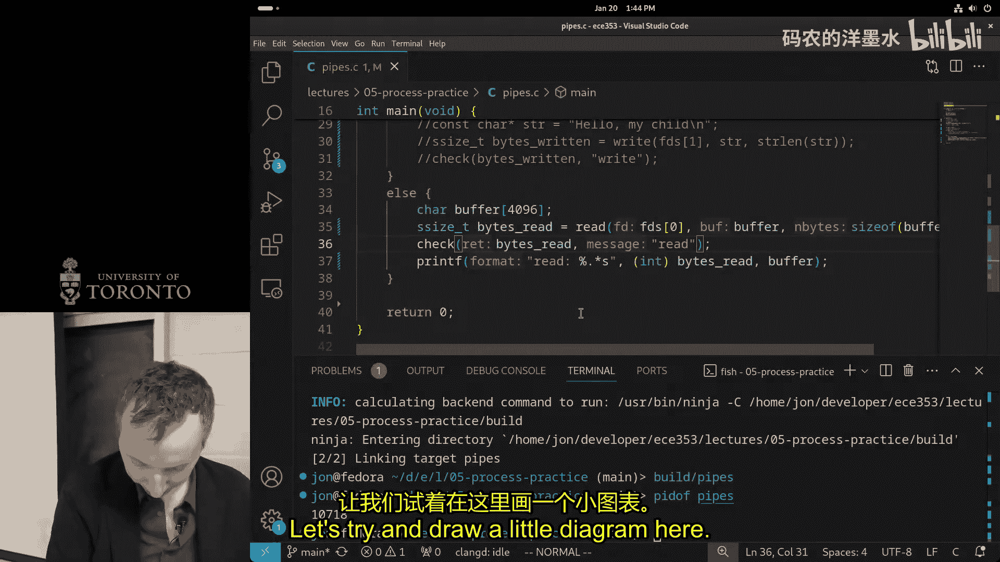

So。What we have， if you can excuse my horrible， horrible。Penmanship。Is， let's say we have process。

100。So if we have processed 100， I'm only going to care about its file descriptors used for the pipe。

One way to illustrate the pipe is this handy dandy pipe。Look at that。

 Doesn't that look like a great pipe。 So the way I represent a pipe is that F Ds1。

Is the right end of the pipe。 So if I write any information， it goes into the pipe。 So if I write。

 in this case， I'm writing the string hello and a whole bunch of other stuff， right？

 So that information。In the case where it actually worked and the parent wrote something to it。

 the parent wrote from there。 and then the child， whenever it read。

 it got that information out of the pipe using F Ds。Zero， right， so when it called read。

It took that information， got it out of the pipe， and then。That process read it。And。

How this worked and how I was able to do it across two processes is because， well， I created the。

I created the pipe before I forked。 so both processes actually were complete clones of each other after the pipe was created。

Process 100， it's filed toscriptor 3 in this case， oops。Or it's FDs1。Pointed here。

And same with process 101。It had a variable called FDs1。And it pointed to the exact same thing。

And then they both also had a variable called FDs。Zero， so FDs。0。2 the read end of the pipe。

And how it worked is， well， my parent process， in this case， parent or process 100。

It wrote data into that pipe， right， so it used this file descriptor to。

Kind of add data into that pipe and then process 101。

 use this file descriptor to get data out of that pipe。So everyone okay with this。So。Turns out。

What happened and what will be the first confusing thing is。The orphan we created。

 it was blocked at that readed system call， so Reed will block until someone writes to that pipe。

Or it's not possible to get any more data into that pipe。So。In this case， if Pros 100 dies。

 then all of its resources get freed along with its file descriptors。So now it looks like this。Now。

 what the operating system asks is like， hey， for this pipe。

 is it possible that a process can write to it？And it knows that by if a process has an open file descriptor to the right end of the pipe。

 it assumes it's possible for that process to actually write。To that pipe。

 So is it possible that process 101 writes to that pipe。Yeah。

 I mean currently it's blocked reading on it， so you might argue that hey well。

 it can't really write to its own pipe because it's waiting on it。

 but then you have to remember that signals are a thing。

 so you could send it a special signal such that the signal handler actually did the right end of the pipe or like wrote information to the right end of the pipe So the kernel has to be conservative and assume that hey data could go into that pipe so I can't actually assume that it is closed。

 I can't send that end of file。Notification， because it's possible that some other process or a process writes data to that pipe。

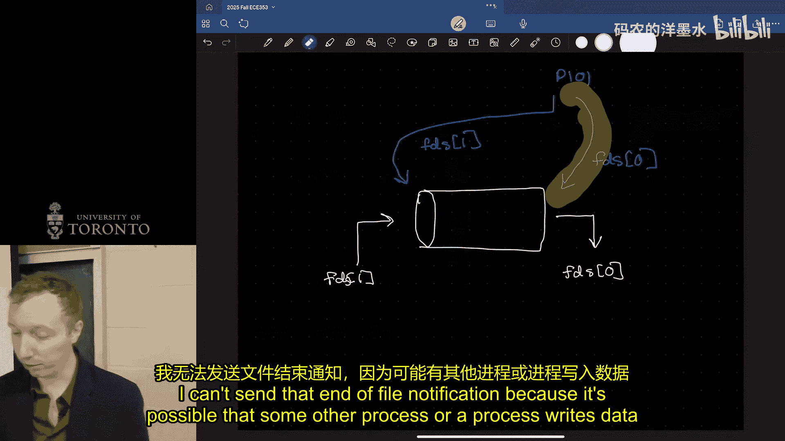

So。If I go back here， all right， so there's my work process。Again， only in this course。

 how do I murder my orphan？Yeah。 I can kill D9 or I could just kill it。It doesn't matter。

 so it should nicely close， let's just kill violently my orphan just to make whoops。

 wrong process ID。So I can kill it， it's dead。It's gone， we've cleaned it up， no more orphan。

 no problem so。First word of advice is going to be to close file descriptors。In your process。

 as soon as you don't need them， so in the trial process。

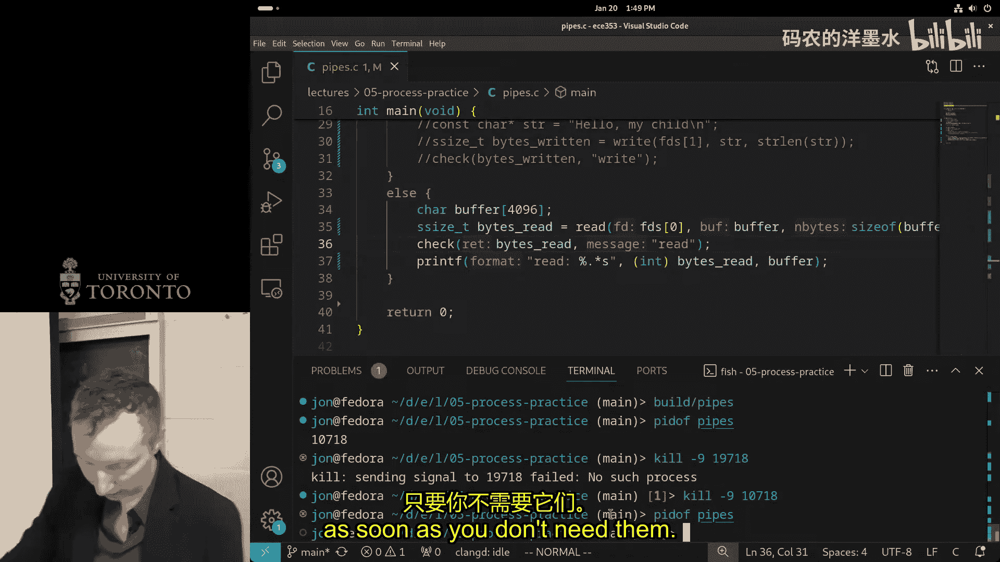

Does the trial process ever use the right end of the pipe？

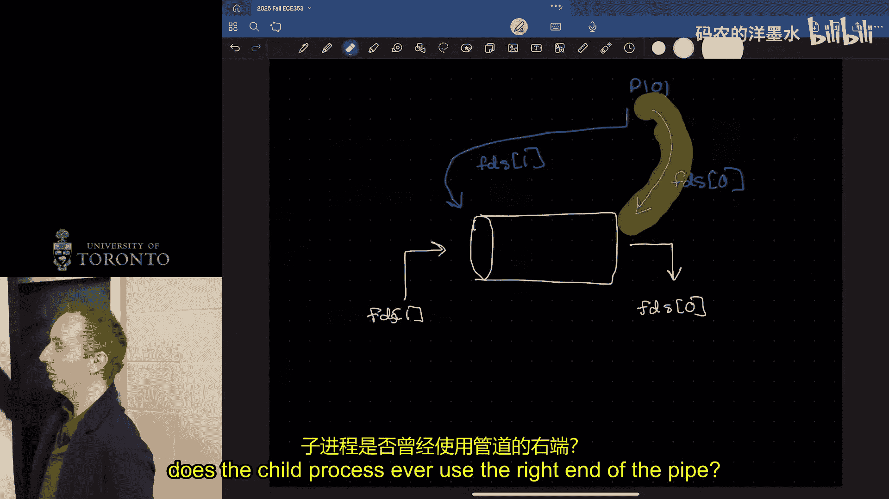

The answer to that is no， so even if my parent ignores me。If I'm following my own advice， whoops。

 if I'm my own advice after the fork， I should close a file descriptor if I don't use it。

 so the child does not use the right end of the pipe， so which file descriptor should it close check。

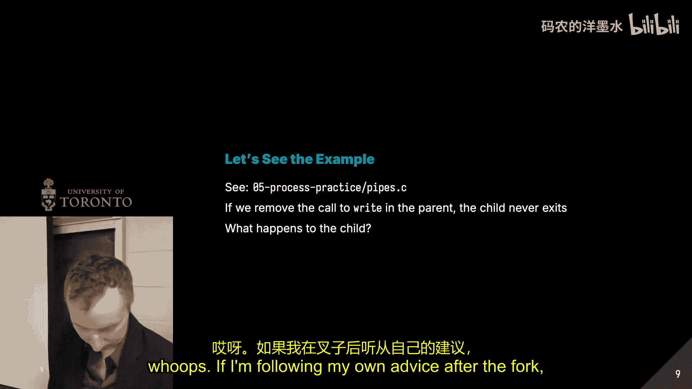

Help。FDs1 right， let's close FDs1， so that's the right end of the pipe， so it should close FDs1。

 and then we'll check for errors and all of that stuff。So。This is going to be one important thing。

So let's compile again oops。So if we compile again。

 we should see that whenever the parent dies in this case and doesn't write anything to the child。

Whenever the parent dies， its file descriptors all get free and because we close the right end of the pipe in the child。

When the parent dies， no single process on my machine can access the right end of that pipe。

 so read should return0 indicating end of character。

 and in this case I'll just get read with zero characters written。

 So if everything works properly and I run this， I should see again， read with nothing。And if I look。

 I didn't create an orphan， I didn't do anything like that， I'm all good。So questions about that。

And again， this will also work if I uncomment this out。If I uncomment this out and run this。

 s whoops， run it again。Then the child actually reads data because。If the parent is still alive。

 it has the right end of the pipe open， so Reed wouldn't return zero if the parents still alive because the parent has the right end of the pipe open。

 so it's going to block there until either the parent closes the right end of the pipe or it writes information into it。

So in this case it will block and it will always read hellello， my child， yeah。

Maybe something kind write to it。Sorry， if only something can write to it。第。

So if I have no readers anymore， like no process has the read yeah。

 so if no process has the read end of the pipe open。

 then anything you write to it goes nowhere and you actually get an error if you write to it， saying。

 I believe the error is like E pipe or something， that's like hey。

 you're writing data that essentially goes nowhere。Is a question。

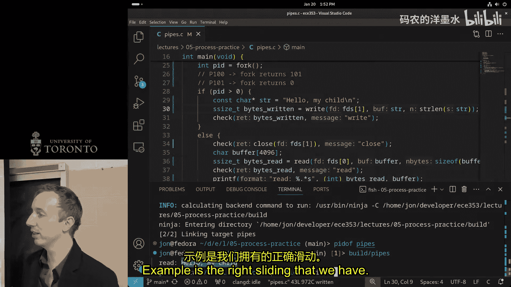

So the。So。嗯。So yeah， I write that rights go in。Here。And the right end is FDs1。And I don't know。

 it just I think it illustrates very like this and the read data comes out of it。We just wondering。

If。

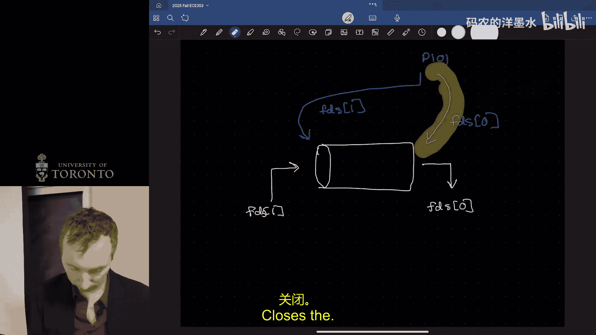

差的。Yeah， so I have a few things。 So if you didn't catch that。

I didn't really follow my own advice here， and it might be。Confusing what happened。

 So does the parent use the read end of the pipe。No， right。 So if you follow my advice。

 it should actually closely read end of the pipe。 So I can do y old copy paste。

And then change this from a 1 to a0， and then I can have my parent close the read end of the pipe。

 and the question might be， well， doesn't that cause any issues？

The parent closes the readta of the pipe does that cause any issues in the child。

 and the answer to that is let's compile and run it。It just， no， still works， still fine。

 And the reason for that is。Well， the parent。They're independent after the fork， right？

 So if the parent closes the read end of the pipe， it doesn't affect the child。

So the child still has to read end the pipe open。The parent never used the read end of the pipe。

 it just so happened that it wasn't terribly important。 so if I ignored it。

 it didn't cause any issues， but if I forgot to close the right end of the pipe。

 that was more important， that actually did cause me issues， yeah。Yeah， yeah。 So after the fork。

 the two processes are independent if I did something like。Let's say I accidentally move it here。

So what will that do？Yeah。お麻ハ。Yeah， so if I do it before the pipe right， I create a pipe。

 I have a read end and a right end and then right now this is before the fork。

 I assume only one process is running main， so that one process。

 let's say it process 100 closes the read end of the pipe。And then I fork， so I create a new process。

 well there are exact clones at the time of the fork。

 that new process doesn't have the read end of the pipe open because well I didn't have it open before the call to fork。

 I closed it， so this might be another error that happens to you， in which case if I run this。

 I'm probably going to get some weird errors where read says bad file descriptor。One option is， well。

 the child tries to read from the read end of the pipe。

 but I already closed the file descriptor here above before I forked。

I tried to read from an invalid file descriptor， good thing I checked for errors though。ho yeah。

Pointers to the read writing。Yeah。Yeah， so if you rate it。Weirdly。

 the parent and child could both write to the right end of the pipe。But you probably don't want that。

 right？Because。Great， what about if I did？Let's see。 What if I did something silly。

 So what if you were like， hey， I want to use a pipe， but I don't need to use it for processes。

 What if I did something。Really strange， Well， both if I just got rid of the fork， I was like， eh。

Whatever。Libo if I did something like this， would this work？No。It won't work。Well。

 let's build it and try it。Why does that work？Yeah， right to the right end。Yeah， well。

 it's all within the same process。 This is just a stupid way to communicate with yourself， right。

 So it opens a pipe。 It doesn't fork。 It writes， hello my child to the colon。

 The kernel has its own buffer， and then it reads。It reads information it just wrote。

 So if you end up doing something like this， so。Remember when we Strad node。

 and it was reading and writing at star， it was essentially doing stupid crap like this。

But if we were smart， right， if we were smart。We just do that。 And the strings， hellello。

 we don't have to communicate with ourselves。 It's right there。 That's the string。

That's completely useless。なしょう。Oh， that's a good question。Which is a bit more complicated。

So this is what we had before， right？So the question is。Well， if the parent also tried to read。

What would it read？I'll flip it a little bit and just say。

 assume we have two children that try and read it instead of just the parent also tries to read it。

So I could do that if I just did a fork here， right？If I did a fork here。

 then I create a new process that's a clone of this child。

The original child is going to be the only thing that reaches it。

 so they're going to be exact clones of each other。

 they're both going to have the read end of the pipe open and one question might be like， hey。

 if things are two processes are trying to call read to the same read end of the pipe。

 do they read the same data or is it sequential or what？So I know this。

 the answer is that it's sequential， but in case you don't trust me， in this case。

 I'll have two processes calling read， trying to read the information that the original parent wrote。

And in this case， if I print their file descriptors I don't know which one is going to read it。

 all I know is that one of the two processes is going to read the whole message and the other process is going to read nothing。

 it's going to read zero， so it's going to be sequential。

 so the kernel guarantees that whatever bytes you write to the pipe will only come out once。

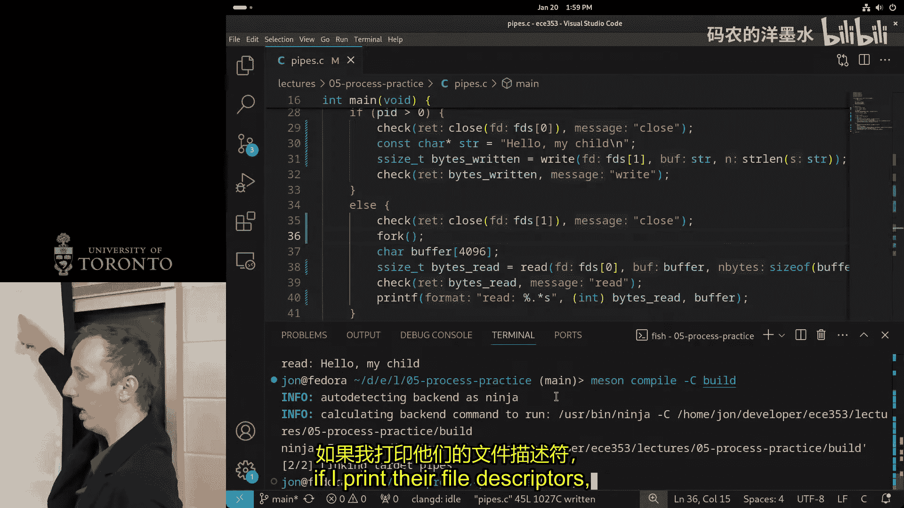

So if I run this， I can see one of them ran hello my child and the other one was empty。All right。

 any questions？All right， so let's take our 10 minute break and then we will have a more fun example。

Wops。Brick。

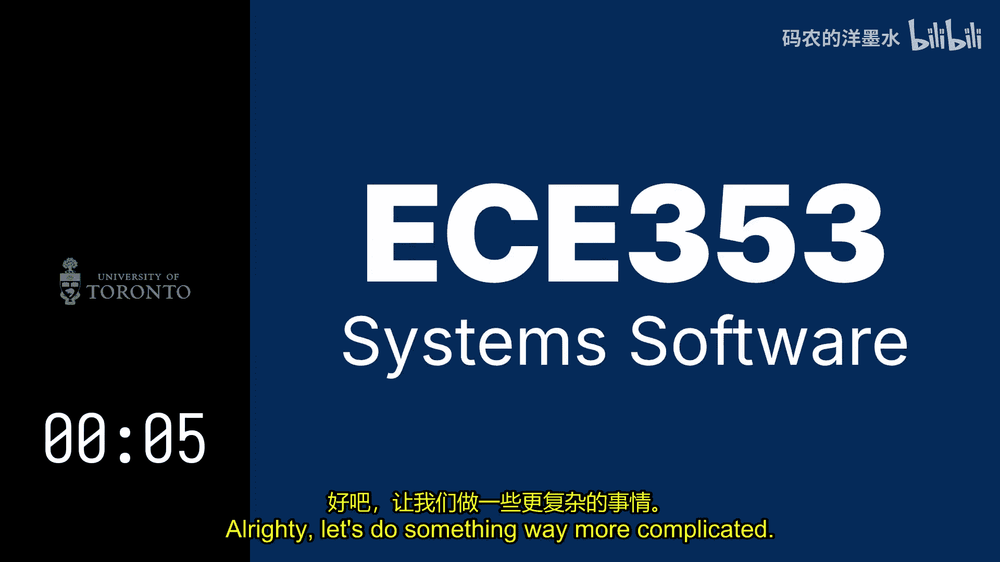

ありが。

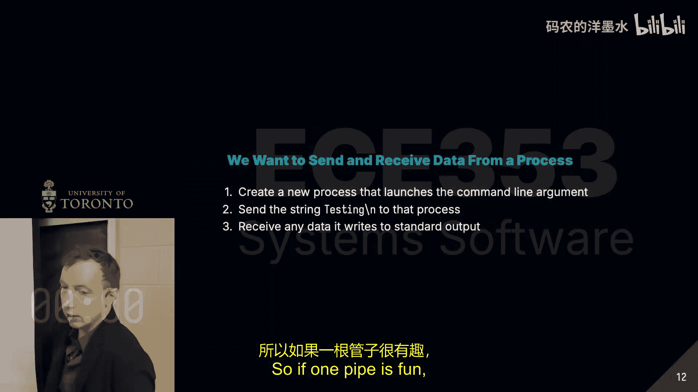

Alrighty， let's do something way more complicated。 So if one pipe is。Fun two pipes is more fun。

 so we're going to do something much more complicated where we send and receive data from a process。

Our goals， we're going to create a new process that launches the command line argument that we type。

Then we are going to send the string testing with a new line to that process and then receive any data it writes to standard input。

So some other APIs we need and spoiler alert， this is more or less lab2， so pay attention。

We're going to we saw Ex VE before to run a different program。

 It was kind of a pain in the butt because we had to know exactly like the path of the executable where it was on our file system。

 So there's a more convenient wrapper for that Ex VE system called called Exec LP and that will save us from writing out the whole path so it just needs the name of the file and then it also doesn't make us do an array of strings we can just。

pass a whole bunch of C strings to the function directly。

 it just has to end with a null when we're done。 does the same thing。

 It's just a more convenient wrapper for us again like the exact V it does not return on success returns negative one on failure and sets Erno and again it just lets us skip string arrays and it searches for executable using a path environment variable which is basically like a global variable for all executables so you don't have to know where how it works basically a global variable that tells you all of the folders on your system where there's executables and it will try and find it in one of those folders or directories。

Allright， so our final APIs that we saw at the very beginning we'll explain them now are Dope 1 and Dope 2。

 so both of these return a new file descriptor on success， negative one on failure and it sets ano。

 so it copies the file descriptor such that old file descriptor and new file descriptor points to the same thing for do it returns the lowest file descriptor。

 so for Dope。The file descriptor argument， again， think of file descriptors as pointers to something that you can read and write bytes to。

 so old file descriptor is just an index to some pointer that points to some resource。

 so it will return you a new file descriptor or a new index that also points to that same resource for Dope。

For Dupe 2， you give it two arguments， old FD and new FD and。

It will not modify what old FD points to， and it will make this number that you can specify。

Point to whatever old FD points to。And if this second argument。

 new FD is already open pointing to some valid resource。

 it will automatically close it for us as well， so we can essentially just make FD refer to a certain file descriptor if we want to。

 which will be useful because we want to communicate between different processes。

So rest of it is just a coding example。

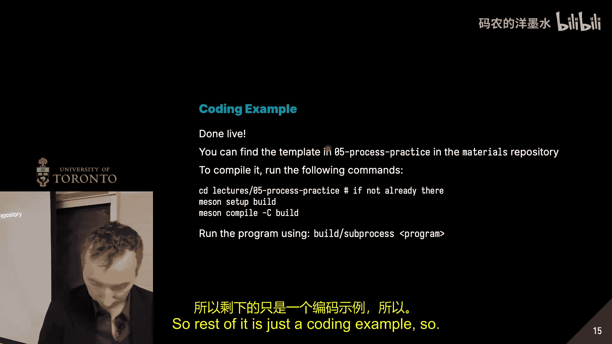

Here is we're going to need pipes。And again， we want to communicate。Across processes。Essentially。

 what we want to do is create some process 100。That has some information。

And we want it to essentially create。Process 101。This process。Shouldd。Actually， you know。

 start running a different program so it should run， you know， it should ex something。

 Let's assume we want to run。I don't know， the process you name。

 so you name just outputs to standard error or to standard out the name of the process。

 So maybe we just want to exact you name。And as part of that， we also want。

Whenever this process writes out information to standard out， we want to capture it。

 and we also want to write information to this process， in this case， the string testing。

With a new line。So。If we want to communicate across processes。

What do I need to use or what did we just learn to use？Yeah。A pipe， right， So let's start tackling。

 Let's say we want to start tackling。This pipe。We want that whatever this process writes to its standard out。

 We want to capture it， right， That was our goal。 We want to capture what it writes to standard out。

 So we need a pipe for that。So this look okay for a plan for now？And we'll slowly go over it。

 let's do the exactec first。So。Everyone okay before I switch the code。

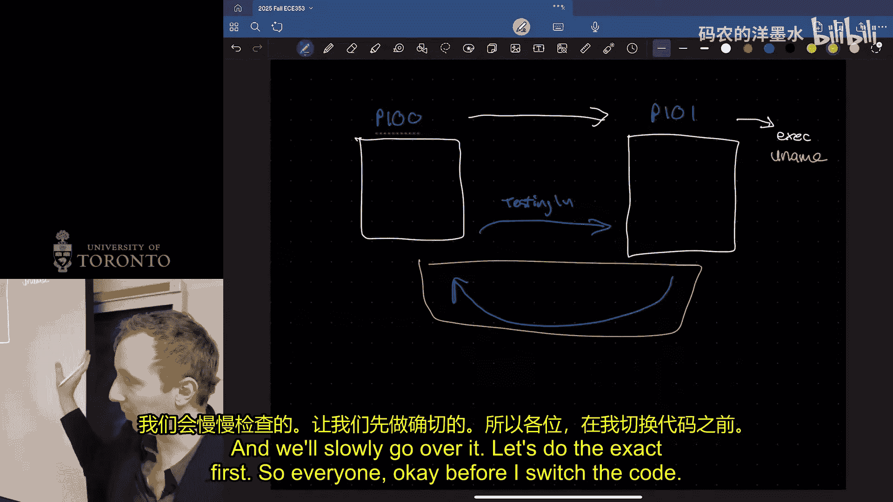

All right。Again， I'm going to split it off a little bit just to make it a bit more readable。

 so I'm going to create a few little helper functions so I'll have check error and maybe I just call it check。

 whatever。So I'll have my check function that again does the same error checking for system calls and then I will have a function called parent that's only executed by the parent because of course I'm going to fork and then also I'm going to have a function called Chil that only executes in the child in this case I already put that exact VE there and it's going to run some program that I give as a C string and we can see I had a placeholder for pipe so a pipe is a one-way communication channel so I set aside space for two pipes。

So in Maine， I checked， I have exactly two arguments。 If I don't， I return an error other than that。

 I just。Iitialize my array of just to all zeros just as a precaution。

 so I declare two arrays in pipe FD and out pipe FD， initialize them to zero。

 and then I fork and then I just called parent。Which with pipe FD out pipe FD and in the parent I give it the PID of the child。

 so for itll give me the PID of my child so I pass that to this parent function and then El in the child it gets that two pipes and then the second command line argument I give it so even with this。

If I run my program now and say I run it， I called the subprocess， so say I run it with you name。So。

By default， if I just run youname by itself， it just tells me the operating system I'm running。

 So it prints Linux。 if I run my program right now。Wops。Oh oh。All right。All right。

 I probably have to re uploadload the recording cool。呃，得得得。With that crash。 No。

 we're still recording。 good。 All right， so。If I run this program right now and say I run。Build。

 it's called subprocess。Do sub process you name， What do I see？Yeah。Linux， right？

So if I run this right now， I see Linux。Everyone okay with that， everyone could explain that。So。

My child runs， I create a new process。It exact LPs you name， so a new process is doing that。

Because I forked at the beginning， right， all my standard file descriptors are point to the same thing。

 so my child has all the same standard file descriptors all point to the terminal。

 I don't change them or do anything with them， so when it prints Linux。

 that process it does right to file descriptor1 and since I didn't play with it。

It goes to the terminal just like the original process。

 but this is actually coming from the child now and not me running it， so everyone okay with that。

All right， so if I wanted to capture its output， what shall I do。

 so I want to get the string Linux not to my terminal， but within my parent process。Yeah。めルかい。

Make a pipe。 All right， so let's make a pipe。

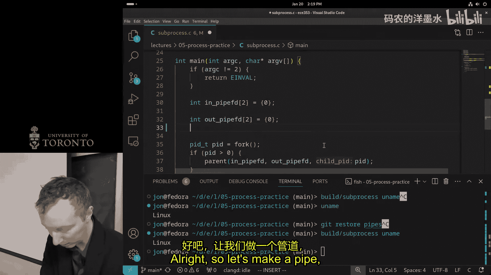

Let's call it out pipe 50。 So in here again， I'm trying to do this green one， So this green one。

 I'll call this one out。Pippe。FT， so we'll do this one first。

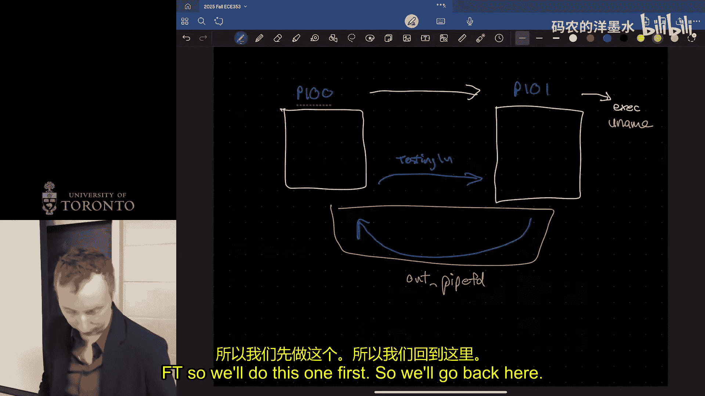

So we'll go back here。So we'll do pipe out pipe FD and then make sure that our pipe doesn't return an error。

All right。Now what， so I created a pipe。It's before the fork。

 so both my parent and my child have access to that pipe， so what do I do now？

I need to write to the pipe， well， I want this to write to the pipe， right？Capture STD out， so。

Could we maybe make use of one of these？

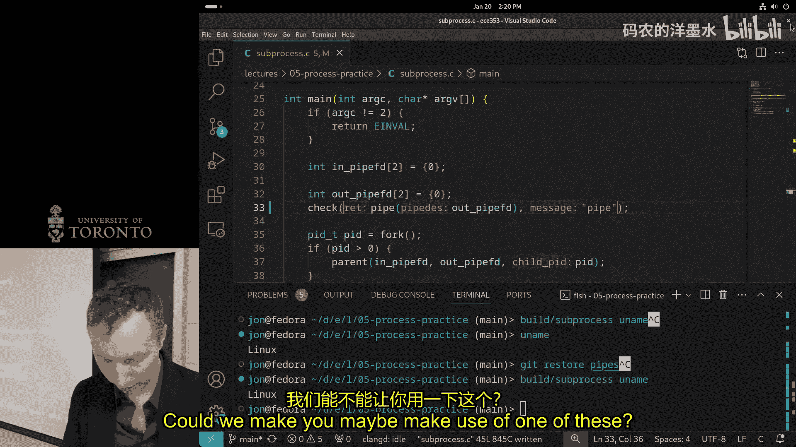

Oh yeah。 So we can't change what that U name is going to do， right。

 it's going to write to file descriptor 1。But we can change what file descriptor 1 points to。

 So if we want to capture what it's writing to file descriptor 1。

What should we do in relation to our pipes？Dpe 2， what？

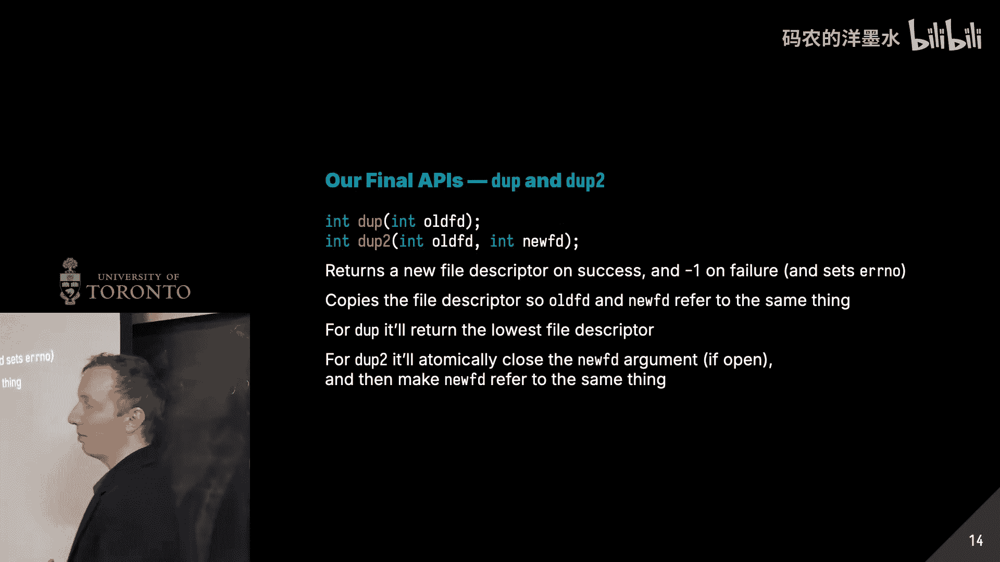

Yeah， so in the child， right， the child is what I want to capture output from。

 so conveniently it gets out pipe FD， so what I want to do。As I'll check， I want to dope2， right。

 so you said dope2。And I want to do out pipe FD。What index？One right so again。

 remember the right end kind the index corresponds with whatever standard out is。

 which is F1 if you want to remember it that way， it's not quite equivalent but a good way to remember it。

I want to dupe the right end of the pipe， and what do I want to point to the right end of the pipe？

Yeah。STD out， which is just the magic number one， right？Just the magic number one。

 or if you didn't want to， it's like standard out file。

 though if you just don't want a hard code of value， but spoiler alert。

 it's just the value1 so again。Like with doing exit success and stuff like that， you know。

 if you can。You'll kind of remember the standard numbers， but I could do something like that。

 So let's make sure there's no errors or anything like that。All right， so。Is that done。

 Is that sufficient？Yeah。Oh yeah， I could probably close the other end of the pipe。

 which other end of the pipe。The read end。I could check close the read end of the pipe。

 which is out pipe FD。Zero， right？Oops， close。So。Is that all I have to close yet？That理。Oh， yeah。

 Well， I should probably read it in my parent， right， I want， Yeah， I want to read it in my parent。

 Otherwise that information is going nowhere。 So yeah， maybe I do that part。

 So if I want to read it in the parent。I'll save you some time。

 I'll just do the standard thing we've always been doing a magical buffer of some magical size。

 which we'll get into later。And then I want to essentially just read the read end of the pipe， right。

 so ST size bytes， red equals read。The read into of the pipe is out pipe FD0。

 read it into the buffer， size of buffer， because it's C， of course we got to do that。Then。

 I'll check。The B thread is okay。And then I could print F。Same thing， whatever I read。

 so same format string as before。And let's do- sorry。I have to cast it to an int。

But it's red and then buffer。All right。Is this good now？

So do we think the parent should read Linux from the process it creates？Someone's laughing at us。

 that's not good。All right， well， let's try it。So if we run that。Hey， we read it， right。

 the parent read it， so we're communicating across processes。Have I skipped any steps？Yeah。Yeah。Yeah。

 I do want to read the string to it， we'll get to that later for this， yeah。Yeah。

 after the program fish is right， it should probably close the pipes。Right。So where。

Where should I put some close calls？After the print F。So after the print F， you want me to close。

The read end。And on the child close the right end。So that。So you want me to close after？Yeah。

It doesn't return from Mexico。Yeah， so if Exec LP runs successfully， it never returns。

 so it starts running another program， so this line。Unless there's an error。

Running a different program， this line will never get executed。So。Is there a problem if I do that？

Yes。ここれがあって。After du。But。So while we can see so if we put it before Dope。

 I mean thankfully we programmed defensively right so if anything bad happens we should get an error。

 so if we do this Doop 2 says bad file descriptor so that makes sense because I just closed it and tried to dope it so probably a bad idea。

So if I do this， will this cause it to break？Well， let's see。If I run it， still works。

And the reason why this works and why this should actually be， I would argue preferred。

 is because it is generally exceptionally rude to exact another program and have other file descriptors open beside the standard file descriptors so when you exec it。

🤢，The only things that should be open here are file descriptors。Z，1， and2。

 and it's considered very rude if any others are open。

 although someone should teach that to the VS code developers because they leave weird things open。

If we were to argue what happens from the starting of this program？Again。Maine starts executing。

 let's say it was process 100。It would have file descriptor 0， which points to standard n。

 whatever that happens to be。Ohoops， too many。Standard out， standard error。

Because we assume something reasonable launched us， then whenever we call this pipe。

 we're going to get two new file descriptors， likely file descriptor 3 and file descriptor 4 again。

 you should just use the values in the actual array just in case you're wrong。

 but for most sensible things these are the values you should get so this would be pipe FD0 or the read end。

And this is。Out pipe FD。One， the right end。So now。We have all these， let's indent them a little bit。

 be a bit nicer。So after we fork， we're going to have two processes that look exactly the same。

 so we're going to have process 101 and 100。They're going to have all the same file descriptors all pointing to the same things because they are exact clones of each other。

In the child， only the child is going to execute the child thing。So in here。If we close pipe FD0。

That essentially gets rid of this， right？ So this is the read end of the pipe。 If we close that。

 it is now gone。 Vi descriptor 3 is not valid。 Everyone， okay with that。Allright。

 so that's what happens after the first close， then after the Dukepe2。

 what Duke 2 is going to do is make whatever this file descriptor 。2。

 which is right now file descriptor4 which points to the right end of the pipe and it makes this file descriptor1 point to the same thing if it's successful。

 so what that will essentially do in this case since one is already open。

 it will just replace the original standard out with the right end of the pipe。

And then in order to properly clean stuff up， we should do that final close。

So right before the Duke 2， our file descriptors in the child process look like this。

 and then when we close pipeFD1 that gets rid of this。So now file descriptor 4 doesn't exist。

 And now file descriptor 1 still exists。 but now it points to the right end of the pipe。

 And that's what we did through that dupe 2 thing。So now we only have those three file descriptors open and we're now nice。

 So anyone have any problems with that。 That looks good to me。All right， what about the parent part？

So the parent part。Again， my word of advice is to close file descriptors as soon as you do not need them。

So in the parent。If we go here。Immediately。What should I close， what do I not use in the parent？Yeah。

Yeah， I do not use the right end of the pipe in the parent right。

 so I should immediately close that which I can just you know do ye old copy paste。

 make sure I copy and paste the right one。So first thing I do， I play copy and paste it too much。

 So first thing I do is close the right end。So if I close。The right end of the pipe。

 I got rid of that， right？So now in my parent。Can I close the re end of the pipe？

So can you just do you know？Just immediately。Do this。No， yeah， no， why because you haven't。Yeah。

 because I'm just going to read from them， I'm still using it。

 so advice is to close them as soon as you are done with them， as soon as you are done with them。

 I'm not done with it yet。 I need to read so here。As soon as I'm done with it。

 I'm done with it after the read call， so we'll just have it go。

 let's say oh we already have it there， so we already have it there where we close so we cleaned it up so at this point。

Our process 100， we properly cleaned up everything we opened and it still just looks like that。

So any issues with that？Yeah。Yeah， I could have moved it up slightly。

 so I could move it right after the read like that。

Up to you doesn't really matter too much in this case。But if you want to follow my advice to the T。

 yeah， just move it up there。All right， other thing I might have is maybe I put a check around here just in case。

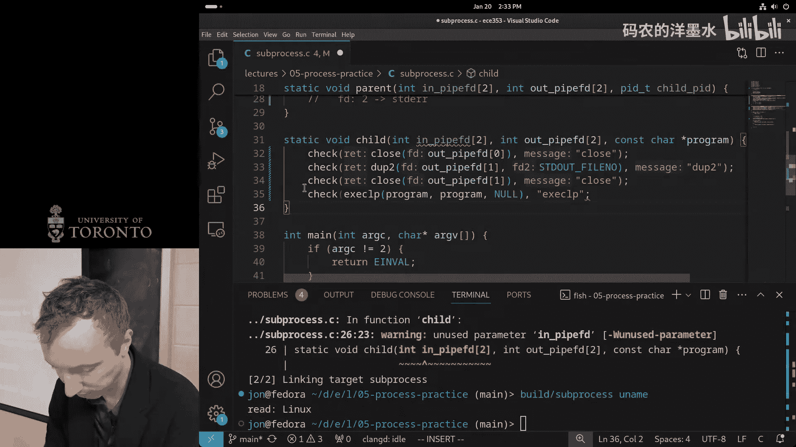

All right，That's good for reading information to that process， right？All right。

 what about if I want to write information to that process？

Do I need a new piper can I just reuse this one and also just write to it？Yeah。Yeah， it's one way。

 right？Let's， know， tablet。 So let's assume。This L pipe FD， I was like， screw this。

 I'm going to just use this pipe to communicate between two processes。So in actuality。

 I'm going to use it like this， right， so it's going to use it， I'm going to use it to process 100。

 is' going to write bytes to this process and process 101 is going to try and write bytes to that process。

Reason why this is a bad idea and something that you should be able to explain is。Okay。

 so let's assume I had it set up nicely that I had a different pipe that wrote the string testing。

To this process。 And let's say instead of you name， let's say instead this process。Was running cat。

What what happens， What information is the parent going to read back from the child。

 if that processes cat and I send the string testing to it。哦哦。Yeah。Does it hang？

So we're trying to send this to cat， the string testing with a new line。嗯。

No one knows what cat will output in this case。So we send the string testing to it to it standard in。

And we get its value from standard out。 So if we send the string testing to it。Remember Ka。

 it just reads from standard in and writes the standard out。What should we get out of it？Yeah。

Testing， right， just the string testing back。 That's what Allcat does。

So if we write the string testing to it， cut。Would。We send the string testing to it。

 so we write it to the pipe， it would read it from the type pipe。

 and then it would write it to the outpi， and then we would read it from that outpi so we send information to it and get information from it。

If instead， we decided to just say screw it。Or maybe we can just say screw it later。All right。

 do you want to just say screw it now and only use one pipe and see bad things？Sure， all right。

 so let's say screw it， let's just continue writing， assuming we only use one pipe。

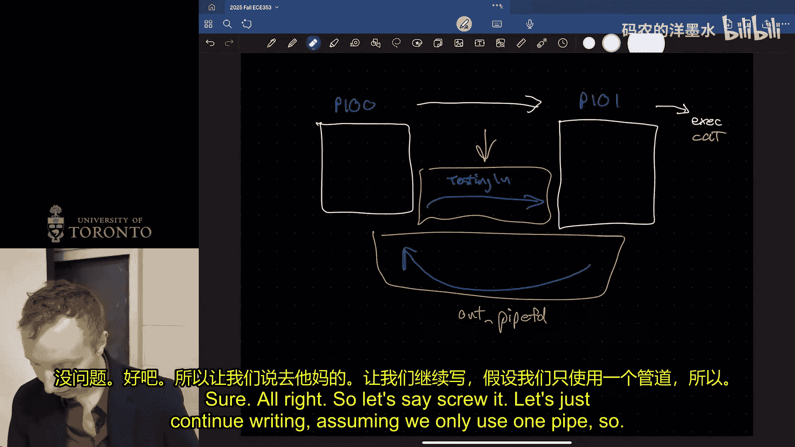

So。In this case， if I'm only using one pipe and I want to send the string testing to it。Well。

 in the parent。Before I close the right end of the pipe， let's just declare a string。

Called what we say we say testing。And then we will。Do or S size T bytes written？

So we'll right to the right end of the pipe。The string， string and string length string。

Check that we don't have any errors。And then that's it。 right。 So we're just going to write。

To that pipe。 and then read from that pipe。In the parent， right。

 so I'm hoping to get that information from the child。So in that case， I deleted too much。

So in that case。Before Exec VE happens， if we want to plan what goes on in process 101。

Fall descriptor 0 should be actually pointing to the read end of pipe or outpi FD。

And file descriptor1 should be still writing to the right end of pipe F。 So we already set up this。

 If we want to set up the other one， what do I do to make sure that。

Folul descriptor0 is the right end of type FD。Yeah。Dpe2， right， so same thing。

Before I close the read of the pipe， I want to dope two。This to the STD in file no or just zero。

And we'll give the error message。Okay， so we do that。Now we have it set up that in the child process。

 it's standard in is the read end of the pipe。 It's standard out is the right end of the pipe。

 which I， of course， misspelled both times。Lucky me。And then in the parent。

I write to the right end of the pipe and then read from the read end of the pipe， right？All right。

Everyone thinks this is hunky Dory， all good。One way communication channels are for chs。

So if I do that and you name， should this work？Well， let's run it and then we'll argue about it。

What happened there， the hell do I want to see Linux， what the hell？Yeah。

 it's just reading its own right， right？What happened is， while this case。

 I didn't read everything from the buffer。But in this case， the parent executed first。

It rode into the pipe and then immediately read from the pipe。

 so it got the information it read from the pipe。So。I can't really tell which way is which， right。

 and if I want to read everything。Maybe let's organize this so that it looks like this again。

So maybe I do another read call and in this case I can just reassign。So if I do it again。

 I have two read calls。Then I'll see testing in Linux because one came from the parent。

one came from the child， right， I couldn't tell， but I don't know which one came from which I'm reading my own input。

 So if I was meant to send the string testing to that process。

 I never actually sent it to that process， right。Because。Well， I read it， it didn't read it。

 I read it。Even worse。 so if I do something like， I don't know， run cat。

 what's going to happen if I run cat？So I'll give you a hint， my laptop is probably getting warm。

Or maybe it's not， let's see how efficient we are。Oh yeah， that's not good。

So all my cores are creeping up， let's see， can I filter？嗯。So it's running。

 it's doing something silly。And it's just running forever。

Anyone guess what the hell is going on here？So。Yeah。Waiting for STD in to close。

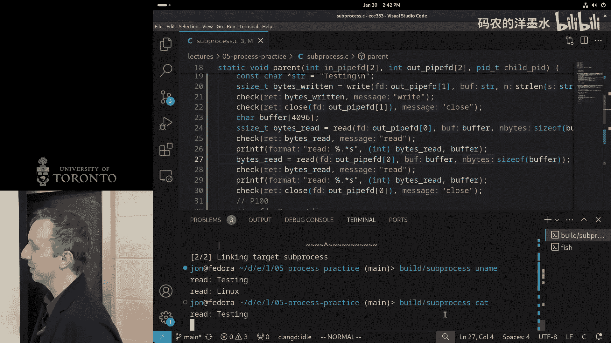

Kind of yet。The cat is writing in every。Yeah， CA is reading and writing to itself over and over and over again in essentially an infinite loop this time。

A control C to kill it， but basically what's happening is if I use this as a one way or a two way communication channel。

 right？

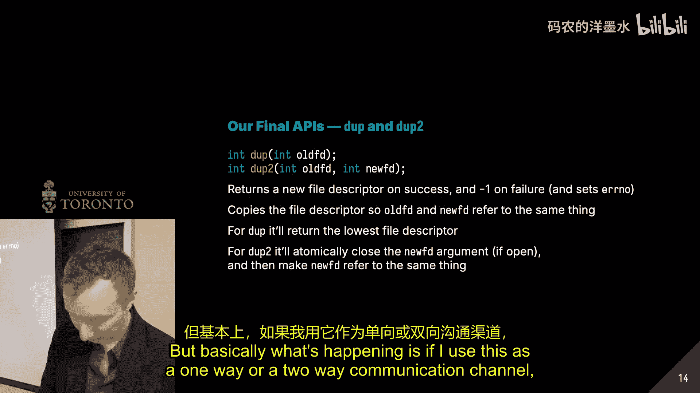

I don't know which end is which。 So this process is writing writing the string testing to this pipe。

And then trying to read twice from this pipe and then cat cat。

 all it's doing is constantly reading from the pipe and then writing that whatever it read back to the pipe so in this case I wrote the string testing to it and then I read it immediately in the parent process。

 so if I was to draw what this did， so this wrote the string testing to the pipe then read it back to itself。

🤢，And then the way it was set up that process 101 well that。

We set it up so that it standard in reads from the pipe and standard out actually。It's standard。

Out right to the pipe。 So what it's going to do， Oh， in this case， since we got lucky。

It would just try and read from the pipe。 and right now it's empty。

 so it's just going to sit there and kind of block forever。

 right So it's going to sit there and block forever because I read that information。

 My laptop didn't actually get warm for that reason。If instead I did something like， I don't know。

 let's say I'd never read from the pipe。

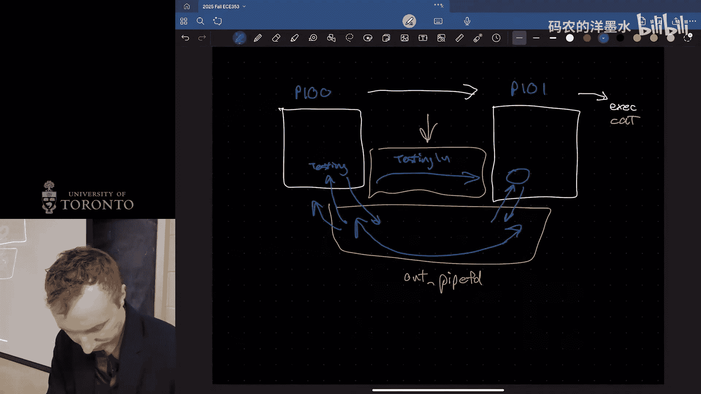

So if instead I never read from the pipe and only wrote to it。

 then I get into the condition where my laptop gets a bit warm。So if I do this。Then run it。哦。

Did I write the string？Oh， because I nicely closed on my file descriptors and things， so I was okay。

So I was nice， I kind of saved myself a bit here。Yeah。

 you can get an infant loop where cat just keeps reading and writing to itself over and over and over and over and over again。

 so to correctly do this I need two pipes， so I need this in pipe。Yeah。Sorry。😔，Yeah。

 so I rerooututeed standard in and standard out。So what we saw earlier when the program was。Yeah。

 it read nothing， and kept its own file descriptor open。

 so it's just hung there forever like before the break。

Because I didn't actually do anything to like start it off reading and writing to itself。All right。

 so to do this properly， I need to close this so I'm just getting information out of the pipe。

And I need another pipe that I can write into， so we need to create another pipe。

So we'll call this one。In pipe FD。Creative naming。So in pipe FT。

East thing to do is think about what needs to happen in the child。

So the child right now I don't clean up anything within pipeFD， but before this executes。

 I want it to look like this。So I want file descriptor 1 to be the right end of the pipe。

 which is something I've already done。And then I want fall descriptor 0 to be the read end of the pipe。

Which is the read end of N pipe F D because I'm going to use that to go the other way。

 So I can just do yield copy pasta。And do efficient programming and just replace out， whoops。

 just replace out within。So。Was that super efficient？I mean， it was super efficient。

Was that super wrong？Why do I need to change to make this right now？Yeah， the indices。

I don't use the right end of this pipe in the child。

 So I should close the right end of the pipe immediately。 And here I want the read end to be。

Replaced with file descriptor zero， so this should be the read end of the pipe。

 then after that I close it。So this is the correct way to do that。

 such that when process 101 executes。It only has these file descriptors open， right。

 and they point to the right things。 So everyone okay with that。Yeah。

So if we try to read to the right end read or write to the read end， we'll get an error。Well。

 let's get an error from the system call。Saying no permissions or something like that。All right。

 so in this case， da。So， let's。Flip it around so here。In the parent。I want to read from the。Oop。

 sorry。I want to read from the Lpi and then write to the inpi right the in pipe is what Im sending sorry sending to that process。

 so this should be in pipepeFD。And then I should close the in pipe。 All right。

 anything else I need to do。Probably clean up my file descriptors， right？In fact。

 I think I deleted a call to close， did I？Yeah， I deleted a call to。I deleted a called a close。

The parent immediately does not use the read end of in pipe， right？

So the parent does not use the read end of in pipe and also does not use the right end of out pipe。

 so I should fix my indices。So immediately， if I'm doing good practices。

 I should immediately close those two， right？And then here I rate the string testing to inpape。

Wwhichch in this case will go to standard in to my child and only to standard in my child and it will read it。

 then I close it because I'm done with it， I should definitely close it while I'm done with it。

 otherwise we might have problems and then here I read from the output so this should be exactly what that child actually send over its standard output。

So I read it。whoops。I don't need two read calls， there we go。

And then I need to close my file descriptor。Close too much， so I need to close out pipe FD0。

All right， that look good to everyone， we should be able to communicate with our process we have now created。

So。if I compile and run this now。And I do cat， it should work， right？So。Yay。Isn't that cool？Bish。

It's as cool as it gets in this course， sorry。First question， if we want to， okay。

 first question for you。If I。Forget to close the right end of the pipe here。

Will my program hang forever， yes or no？Oh， I see head shaking， no why？这さ。

Just because it's not closed doesn't mean。It's not written to。Yeah。So if I don't close it here。

So my child wants to read from it， right， if it's cat， it wants to read from it。That will close。ch。

The child won't close itself if it's possible that more data comes into the pipe， though， right？Yeah。

So cat stays open。Yeah， cat stay open while it reads more stuff， let's make sure， okay。

 I'm going to clean up all my orphans and stuff。 so a bit of。Cat。

 how many orphans do I create just one？Let's kill orphans again only in this class。All right。

I removed that and you said that cat will just sit there forever。

Turns out this is why debugging La two is going to be hard。 So I do this。 I read the screen testing。

Parent goes， did I create a forever orphan？Pit of cat， no。Oh no， why？Well， because in this case。

 the parent。Just read， it read the testing string。 And then that's all it did It didn' Wait for more output or anything like that。

 It terminated， which。Also， close the right end of the pipe。So it closed when it terminated。

 And then in that case， my childs gonna terminate because all the right ends are done then。

 So even if I forgot this one， this will work， although it's really bad practice。 Alright。

 so if we're a good parent， what should we do。To make sure we're a good parent and a responsible parent。

 yeah。Yeah， wait， I need to wait on my child right， so if I'm a responsible parent。Thankfully。

 I know the PID of my child。It's called。So it's just called in this case， it's called child PID。

 So I can call weight on it。 So I'll just wait， give it。 whoops， W status equals。Who cares？Check。

Wait。W status wait。And then after wait， I'll just write a few asserts just to make sure that good things are happening。

 so I'll do W if exited。I'll just try and make sure that this。Assert that it's definitely exited。

 and then assert that the。Exit status is equal to zero。

 just some asserts because I don't want to bother with it。

And this is why it didn't go in an infinite loop before， excuse me。So yeah。

 I could also wait PID for it， whatever doesn't matter so now if I run this。Properly closing stuff。

 It's okay。 It just print testing。 but now。When I forget to close the right end of the pipe。Now。

 when I forget to close the right end of the pipe， now bad things happen。Now it freezes。Why。Well。

 because I still have the right end of the pipe open， right。

 and the parent does not terminate until the child terminates。

 The child is waiting until remember what cat does。

 It just constantly reads and reads and reads until read returns0 indicating end of input。

 So in this case， if I don't close it。Then I still have the right end of the pipe open and if I'm nice and I wait for my child to terminate。

 well the I'm not going to close my right end of the pipe and it's going to stay open and my child will never terminate because。

 well， greed is not going to return to zero in my child。So。Depending on how your。

 if I'm a good parent， right， I could ignore that before and get lucky and my program works。

 But then as soon as I become a responsible parent。Bad things happen。All right。

 any questions about that， that's fun。Yeah。Does the parent remain？So when a process terminates。

 it automatically closes all of its file descriptors。And that's why it worked before。

 because didn' I wasn't actually waiting on anything。Coolhuh。Yes， yeah。Yeah。

 the whole purpose of Dupe 2 is so I can modify explicitly what file descriptor zero points to because that's time I'm trying to rearrange it in my child process because whenever the child process runs right since it uses a standard file descriptors。

 it will always just read from standard in and write to standard out， but I can change。

Where it actually goes by changing what those file descriptors actually point to。W。To back to。

Sa to something。So if I want to set file descriptor 2 back to standard error。If I close it。

 I've lost it。So I can't， unless I know what it was originally， I can't restore it。So if I close it。

 I close it。And also。Another nice benefit of programming defensively here。

 too because of the asserts， if I just type a bunch of gibberish。That's definitely not command。

I get a whole bunch of nice error messages here too that I can kind of dissect what the hell was going on so。

LP failed。Right， in my。Child。And then it wrote to standard error。

 So good thing I didn't change standard error， right If I changed standard error。

 I wouldn't been able to see that output。 If this output went to standard out。

 I wouldn't have been able to see it and debugging would have been a nightmare。

 So this is why we have a separate file descriptor for standard error that you probably shouldn't touch so you can actually debug your program and have a hope and hell of doing that。

 So this went to standard error from the child。 And then this is from the parent。

 So the parent got an assertion， it waited on the child and the child。

 well it terminated with error code that was not zero。

 whatever standard whatever the error it got is from error no and then。Well。

 Michelchelle told me that， hey， the process I just ran also terminated by signal Sabort。

 that was from the assert happening from mine。So。Any questions about that。

 so fun debugging thing too。If you have royally screwed up your file descriptors and let's say here I create my pipes。

And then。Let's close file descriptor 2。So if I close file descriptor 2， and I do this crap again。

 what's going to happen？Probably I'm not going to see a damn thing， right？

So if I've screwed up file descriptor2， and I do this， I don't see anything because。

My process is still writing to file descriptor 2。RightBut I never checked errors from。

Trying to write to file descriptor 2 or anything。 file descriptor 2 is invalid。

 So it tries to write to file descriptor 2。 If I S traced it， I would see that got an error。

 I don't check the errors or anything like that。Yeah。Let's say you change how this。Yeah to。

In play panic。Yeah， and then there's no way to like change it back to。No。Yeah， if I make standard。

Out or error point to like replace what it's pointing to by something else。

 they now point to the same thing and the original things lost unless something else was pointing to it and you saved it and stuff like that。

All right， so another thing you'll probably run into in the lab is。Hey， let's say before all this。

 let's just make a very small program。So。If I do this， trick question， if I do this and run it。

 what do I see？Hello， not a trick question。So if I do this and I run it。诶。Oh。

 they needed another argument。Okay， that was a trick question I tricked myself。All right。

 so now I print hello， right？Now， if you want to really screw with someone that's just learning， see。

 just start your program off and just say， hey， if you put this at the top。

 it will make your program run faster。So if I do this and try and run my program now， what do I see？

Absolutely nothing right， did instill right to it， absolutely。

But nothing happens This line still executed， but I don't see I think clause I closed file toscriptor 1 and of course we've never。

 ever， ever checked for errors from print F before have we so if we checked for an error from print F。

 we would have saw that it got an error but we just ignored it right so if you really want to screw with people learning C you should tell them how to fix it after。

 but just tell them put close one at the beginning of your program and you will enjoy speedups which is technically true because it'll just get error which is a lot faster than writing data。

 so just remember I'm pulling for you， we're all on this together。

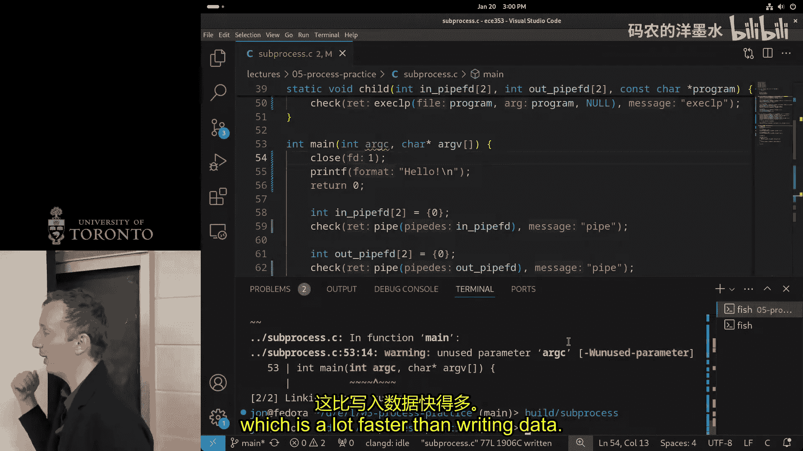