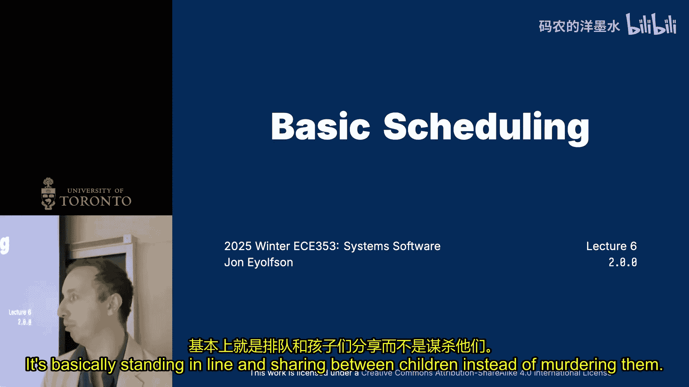
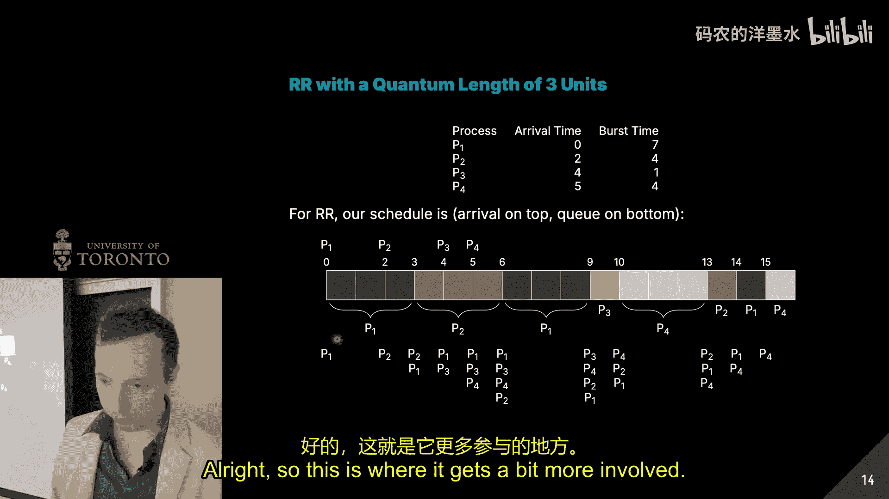
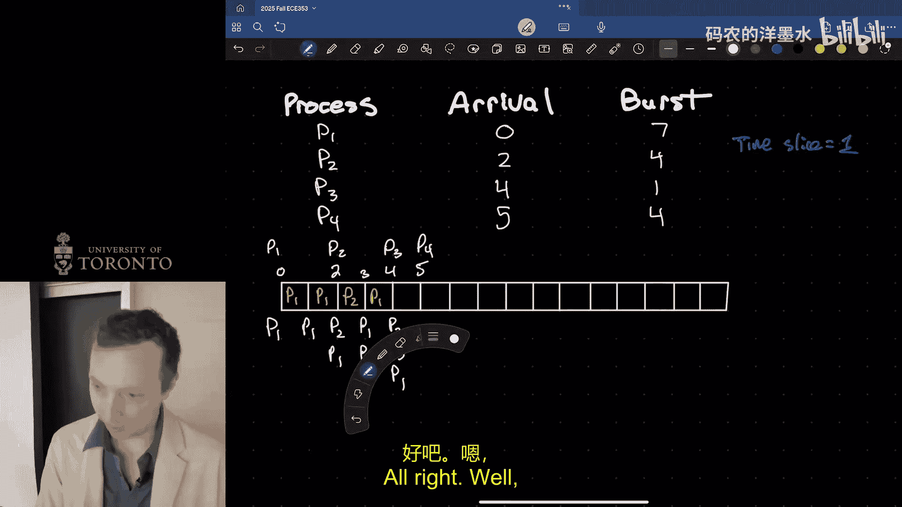
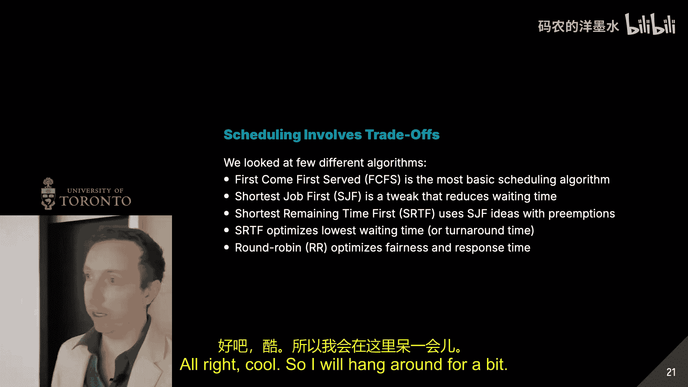

# 【全集 2025】多伦多大学 系统软件设计与编程 中英字幕 1080P p06 Lecture 6 - 基础调度 -BV1YrkYBQEeL_p6-

🎼。🎼Okay。Alrighty， welcome back to 3，5，3。 It turns out Arctic temperatures。

 plus early morning equals and no attendance。So it kind of feels like a snow day。So。Today。

 light reprieve from you know， talking about multiple processes， juggling multiple processes。

 dealing with children， murdering them when we get angry， all that fun stuff。

As a word of caution into here。For the labs， especially for La 2， push your code to the server。

 make sure it runs on the server。Because all of your docker containers。

 they don't behave the same as links。 All of your memory on your docker containers is well。

 not accidentally， but happens to be 0 initialized， which is not true。

 If you don't initialize variables， you get。Undefined values。

 which could be random values on your machine， you'll always see 0。

 If your code happens to work and depends on 0。Then you try and run it on the server。

 It's not going to work。So make sure you initialize stuff。

 Someone has already crashed the server by malocing using a size that was uninitialized。

 which turned out to be a gigantic size and then crashed the server。

 So now the server doesn't crash anymore。 it will just say you're out of memory。 But yeah。

 definitely make sure it runs on the server and you initialize your variables otherwise you have undefined behavior and your code is technically wrong。

 even if it works on your machine。 Alright， so basically scheduling today。 a lot easier than before。

 it's basically standing in line。😊，And sharing between children instead of murdering them。

So before we get into that operating system's main job is to allocate resources and we have to talk about two distinct types of resources。

 so there's preempttable resources and a non- preemptable resource and what that means is just a preempttable resource can be taken away and used for someone else at any given time。

You can share it。 So like a CPU， many processes can all share the same CPU。 They take turns。

 one at a time。So。In this case， we share it through scheduling。 I mean， if you are a sibling。

 you probably share resources with your other siblings who knows non preempable resources cannot be taken away at any time without some acknowledgecledment like disk space。

 So if your disk is full。 that's too bad。 I can't take anything away without you deleting some files。

You have to explicitly acknowledge or consent to having something deleted。

 so the resource is shared through allocations and deallocs if it's not preempttable。

 so you have to request it and then once you request it and it's given to you in order for someone else to use it。

 you have to give it back through deallocations。And as a note here。

 in some really high performance computing situations。

 you might be able to allocate a CPU exclusively for your process and only give it back once you're done with it。

But you only see that in like high performance computing。

 or if you go to maybe a Fintech company or something like that。

So today we are talking about the scheduler and just assuming a single core for now。

And the scheduler is only going to run when a process changes state so we can have preempttable and non-preempttable processes。

 First， let's consider the easy case where process are not preempttable。

 So that means once you pick a process to run。 it just runs until it terminates。 So in this case。

 the only decision the scheduler has to make is well， when something's done or when the CPU is free。

 gets to pick what process gets to run， and that's the only decision it gets to make till it's done then it picks the next process。

 So preemptive allows the operating system to run the scheduler at will。 So it maintains control。

 if you do you name dash fee， your kernel should tell you it's preempttable。 so that's。

How you can kind of read some output from you name。So for scheduling。

 there are four major metrics we care about and evaluate our scheduling algorithms which with and some of them are at odds with the other。

 So some metrics we have is we want to minimize waiting time and response time。

 so we don't want a process waiting around for too long or take too long to start。

 So these seem sort of similar terms， response time is when you start a process to when it first starts running on CPU。

 So the idea behind that is if it's something interactive with the user that it actually responds to you when you move the mouse and waiting time is how long from when you start it to when it finishes。

And through all of this， we want to also maximize CPU utilization。 So if we have you know。

8 cores on our machine， we want to use all eight cores if there's enough processing that needs to be done。

So we don't want the CPU idle if there is work to be done。

Right now we don't really know how to maximize CPU utilization while we could spawn multiple processes which could grow on multiple cores。

 we'll get into ways to exploit this a bit later in the course。

We also want to maximizeize throughput， so complete as many processes as possible and then fairness。

 which is kind of at odds with everything else to try to give each process the same percentage of the CPU and ensure everyone kind of gets its fair share。

So the first scheduling algorithm is something that is not。 I mean。

 it's technically scheduling algorithm， but something you're all familiar with。

 If you've ever been to， I don't know， any fast food restaurant in the world or basically。

Anywhere with a cash register， if although those are getting less and less common。

 But it's first come first serve。 So the most basic form of scheduling。

 the first process that arrived， get the CPU。They're stored in a queue in first in。

 first out order or PIO order。 And it's based off when they arrive。 So no one gets to butt ahead。

 There's no Disney Fastpass There's nothing like that。

So we'll use a Gantt chart to illustrate the schedule again we are just assuming a single core so for all of these questions and you will probably have one of these on test1 it should be relatively free。

 so through this I'll give you a table describing each process in a row so first column is the process name they have very clever names like P1 through P4 their arrival time is。

The absolute time that they start in， that they could first execute。

And the burst time is just another way to say that's the amount of time it needs to run on a CPU before it is done and terminate。

 So in this case， all of my processes arrive at time 0。 So they're all essentially tied。

 So I would have to tell you the arrival order in that case。

 So if I tell you the arrival order to break the tie is actually P1， P2， P3 P4。

 If we do first come first serve how first come first serve what my schedule would look like is below。

 So。I just take out the time units。 I just， I don't care what the time unit is。

 I just represent one box as one time unit， and I assume that one time unit is the lowest I can go just to make the math and everything simple。

So in this case， at time zero。Process 1，2，3， and 4 could execute， but。

I pick what came first in this case， I pick P1 to schedule and run on my one CPU core first so I look at the burst time。

 it takes seven seconds， so all of these seven boxes are P1 running。 So everyone okay with that。

Alright， so at time 7， it is now complete。 It has done。 It's done running。 It has terminated。

 So now my scheduler runs again and just picks the next process in line， which would be P2。

 and it runs4， four time units。Then at time 11。PP2 is done。 So the next in line is P3。

 it runs for one time unit。 it's done。The next N last process in line is P4。

 so it runs for four time units It's done at time 16。 so everyone understand this chart。

You will be probably given it on Tela， you don't have to draw it。All right。

 so one of the metrics we would like to know is the average waiting time。

 so the average waiting time is the total time the process waits around from when it first arrives until it finishes。

In the case of P1， it didn't wait around for any time。 It started at time 0。

 and it started running at time 0。 So it immediately started running。

 It didn't have to wait for anything。 So it rated around for zero time units。P 2。

 it arrived at time 0。It didn't run for the first seven time unit， so it waited around for 7。

 P3 waited around for 11， P4 waited around for 12。 so everyone understand that。

 So the average waiting time in that case is just 12 plus 11 plus 7 plus 0 divided by4。Which is 7。5。

 so our average rating time would be 7。5。On a test， I don't care if you keep it fractional。

 as long as you say the right number， I don't care， you won't have to do the final calculation。

 but I do allow calculators on the exam， even though the hardest math you have to do is addition and light。

Light division and addition， but again people feel better when they have their security calculator。

 so go for it。But you really don't need one for any of the tests。So。If we do first come。

 first serve again， same processes， same arrival time。 But this time， there's a break in the tie。

 So let's just say assume that。To break the tie at time 0， P3 comes first then P2， then P4 then P1。

 if I do first come first served， then P3 comes first。

 it only runs for one time unit then P2 runs for itss 4。

 then next in line is P4 runs for itss4 then next and final in line is P1 which runs for7 So the average weight time now is now P3 weighted for0 P2 weighted for1 P4 weighted for5 and P1 weighted for9 So to take the average add those all together divide by4。

The average waiting time in this case is like 3。75 now。 So it's two times as good。

 Sam scheduling algorithm just came down to the arrival。

 So that gives us some evidence that we could actually pick things。

Smarter and get a better average waiting time。So our first algorithm is going to be unsurprisingly something called shortest job first。

 so it's a slight tweak to first come first serve where we just always schedule the job that has the shortest first time first and again we're still assuming no preemption so soon as you pick a process it runs until it's done。

So。In this case。I will now tweak it such that。The other processes P3， P2， P4。

 I'll have different arrival times and I'll use these arrival times for the rest of the lecture。

 so how I like to do it on the Gantt chart is as soon as I see that I'll just put the arrival times at the top here so P1 arrives at time 0 P2 arrives at time 2 P3 arrives at time 4 P4 arrives at time5。

Just to help you see what's going on。So at time zero。P1 is available。 at this case。

 if youre the scheduling algorithm， you only have P1 to pick from。

 So there's nothing else to pick from in this scenario。

 So you would pick P1 since you have no other choice， and it would run 4，7 time units。

 So it would run until it's done while it's running at time 2， P2 becomes available。 Then at time 4。

 P3 becomes available then P 4。Yeah， then at time 5P4 becomes available。

This would be a first come first serve。Q， except that if you have a lower burst time。

 So if you take less time， you get priority in the Q。 So you move ahead of the Q。

 So initially at time 2， P2 would be in the Q as the only process in the Q。 then at time 4。

 P3 would come in。 Oh， it's burst time or execution time is only one。So that's the shortest job。

 so it would go to the front of the queue and then P4， well that's tied with P3。

 so it would just go after P2。So。In that case， at time 7。P1 is done。

 So the scheduling algorithm will pick the next process to run。 in this case， shortest job first。

 it would pick P 3。 It runs for one time unit， then。At time 8， I have two things left in the Q。

 P2 came first。 They have the same burst time。 So in that event。

 we pick whoever arrives first in the event of a tie。We would pick P2 to run。

 it runs for four time units and then at time 12， we pick P4， which runs for four time units。

So our average waiting time is now four。 All right， Any questions about that one？Alright。

 let's do another tweak then。 So this lecture also might be on the shorter side， which is good， so。

This is not practical， because。Although it is provably shown， it minimizes average waiting time。

In practice， I do not know the first time of each process， so if you just run a process。

I don't know how long your program' is going to take to run。

 your operating system doesn't know how long your process is going to take to run。

Maybe you could use the past to predict the future， throw some AI in it。Although if it's wrong。

 then it's wrong and doesn't matter。 And usually， you know。

 you can't predict an infinite loop or anything like that and the。Might starve long jobs。

 And what that means is they never execute。 So if you have。

 let's say we have that long P1 that takes seven time units。

If you're constantly launching processes that only take one time unit， if you launch enough of them。

 it is possible。That P1 process never executes because it will never get scheduled before anything shorter。

 so if we're doing scheduling algorithms， we do not want to starve processes that is generally a very bad trait to have。

 so we want to fix that。So we'll just fix one thing first and we will add preemptionions to our scheduling algorithm。

 so we will tweak shortest job first to shortest remaining time first。

 So it's going to be the same idea。 but we're just going to add preemptions into the mix。 So again。

 we'll assume that our minimum execution time is one time unit。

 So I don't have to do any 05s or a hard math or anything like that。

 And similar to first or shortest job first， this optimizes average waiting time in the case that we have preemptions。

So。What does that look like， So in this case， we have all the same processes arriving at all the same times with all the same burst times。

 So again， I put the arrival time at the top。 And now with preemptions， that means。

That we can kick a process out if there is a shortest job with some remaining time left。So。At time0。

 P1 is the only thing to execute， so we would actually run it for two time units until P2 comes in。

Now， when P2 comes in， if it has a shorter remaining time left than P1， we would kick out P1。

In this case， P1 executes for seven time units， in total is how long it wants to execute for。

Right now at time two， it has executed for two time units。 So how many time units does it have left。

How awake are we？55， right？ So five left So is。And then P2。

It takes in total 4 has not run for any of them yet。

 so it has a shorter remaining time than P1 right5 versus 4。

 so in that case the shortest job is P2 so we kick out P1。

 throw it to the back of the Q and P2 gets to run so P2 gets to run for two time units。At time4。

 P3 comes in and we might kick out P1 or we might kick out P2， or we might not。

 depending on the shortest remaining time left。So。In this case， after P2 runs for two time units。

 it has two time units remaining， and then P3 comes in and it runs for one time unit in total show that is the shortest remaining time now。

 So we would immediately run P3。 So we immediately run P3 for its one time unit。

Then it's done and then at5 P4 comes in。 Well， the remaining times our P2 has two time units left。

 P4 has four time units left and P1 has five time units left。

 So we would schedule them in that order。 So P2 get runs for its remaining two time units。

 then at time 7 P4 executes for its four time units。

 and then at time 11 finally P1 finishes its last five time units。 So any questions about that yeah。

Yeah。Yeah， yeah， so this still has that starvation issue。Different。Yeah。

 so we could it would also count starvation if even if it starts first。

 if it never is able to finish， so that could yeah， still have starvation issues。We know that。Yeah。

 we still， yeah， we still don't know。 It's just taking what before and just adding preemptions。

 but still has all the same issues。The only tweak we' made is now we can kick things out to get us ready for real scheduling algorithms。

And then here， the average waiting time， I mean， it gets a bit trickier to calculate。

 there's some shortcuts we can take， though。 So in this case the waiting time for P1 is these nine time units in the middle because it arrives at time  zero starts executing。

 but then gets kicked out and it's waiting around for 9。Similar for P2。

 well it starts executing immediately， but it gets kicked out for one time unit to run P3。

 so it waits around41 time unit， then P3 waits around 40。

 it's immediately scheduled and then runs and then P4。

 it only waits around for two time units so our average waiting time is now three。

So easy way to count that if there's a lot of back and forth， too。And。

Easier way if you don't want to try and count all the squares or anything is just take the time that the process ends。

 So in P1's case， it's 16。Minus the time that it starts and that's like the total time it was around right。

 so it was around for 16 time units and then if you subtract its execution time。

 then you get the waiting time because they have to add up right so。If I take 16，-7， that's 9。

 so it was waiting around for nine time units， I don't have to bother counting。

 and it also works if it you know gets scheduled in and out or something weird happened。

 So that's a much faster way to do that if。You had to do something quick， I don't know。

 on a test or something like that。Allright， so this is the first real scheduling algorithm。 will'll。

 well first come first service a real。😊，Scheduling algorithm。 it kind of sucks。 so。

 So this is the first one。That's。Used and kind of useful。 So so far， we haven't handled fairness。

 It's kind of a trade off with other metrics。So the offering divides execution to time placess。

 fancy computer scientists that like cool words use the word quanta and individual time slice is called a quantum。

 I'm a P though， I call it a time slice， but if you want to sound cool， quantum and quantum。

 go for it。So。Might be familiar with this is you had a sibling and you had to share， I don't know。

 a computer。 And you know， you take turns of half an hour， same idea with round Robin。

 You're basically taking turns， turns。 And there is some type of time place。

 So how this works is it maintains a PO Q of all the processes similar to first come first serve。

 But the only。The only tweak to it is it preemps if it's still running at the end of its quantum or the end of its time slice。

 it re adds it to the back of the queue。 So gets its shot at it。

 runs for a little bit and gets thrown to the back。

 So some practical considerations determining quantum length is well。If it's shorter。

 then I'm switching between processes a lot。 If it takes a while to context switch。

 I'm wasting a whole bunch of time context switching or if my。Quantum length is infant。

 then suddenly it becomes first come first serve， so we will see that as well。All right。

 so this is where it gets a bit more involved。

So。Let's go to oops， wrong example。 So in this case， we could say our time slice。Or quantum length。

Oops， if I could spell。Is equal to three。So in this case。

The most you can run for without being put to the back of line is three time units。 So again。

 to do the scheduling， I will write each process' arrival time on the top of my boxes。

 So P1 arrives at time 0 at time 2。Then time4， time five is also important， so at time 2， P2 arrives。

Time 4， P3 arrives。Time 5， P4 arrives。So。What I also like to do in this case is right under the time。

 I will put the first Com first Ser Q。So at time0， P1。Is added to the Q。

 and it's the only process in the Q， So at time0， it would run4。

 three at most three time slices before the scheduler runs again and determines another process to run。

So， in this case。P1 would run for its3， would run for its full time slice because its total burst time is 7。

 right， So it's not done yet。 So it's。Stillill wants to run。 But， you know。

 it has to give someone else a fair shot if there is anyone else in line。 Turn out at time 2。

While P1 is running。 So if a process is running， it's not in the Q， it's running。 So at time 2。

 when P2 arrives， it would join that Q。 There's nothing in the Q。

 So it would be at the beginning of the Q。Then at time three here。When P1 is done。

 it would get thrown onto the back of the Q。 So at time 3， my Q would look like P2， then P1。

 Everyone okay with that。All right。At the end of time slice， the scheduling algorithm would just say。

 okay， well， what's the next process to run， It's whatever is at the front of the queue。

 So P3 gets a time slice of 3 to run。 itss total is4， so it will use all of its time。

 So P2 gets to run4，3 time units。Well that is going on at time four。Well， time four。

P1's the only thing in the Q because P2 left it and it is currently running。

 then at time 4 P3 comes in， it arrives， so when it arrives， it goes to the back of the Q。

 so it goes to the back of the Q behind P1， and then at time 5 when P4 arrives。

 it goes to the back of the Q behind P1 and P3。So everyone okay with that。All right。

 so the next time we have to make a decision。Is here at time six。So。At time 6， what gets to run。1。

 right， P1 gets to run。 So it's at the front of the Q。 So P1 gets to run。

So it will run for all of its three time units because it has four left。

 so it's going to use all of its time， so P1 runs for three time units。And in this case。

 P1 is still not done。 So it would be added to the back of the Q。 So our Q would look like。oh。

 whoops， I didn't re add P1 whoops。Sorry， rewind a little bit。So at time 6， I picked P1 to run。

 and my Q at that time would look like P3 is next in line， then P4。

 and then P2 would get reacted to the back of the Q oops。Like that。

 So the next thing we would run after P1 is done is P3， right？ So our Q would look like P3， P4。P2。

 and then P1 is added to the back， So I would now run P3 right How long would I run P34。

 Only one time unit， that's all it needs to run for。 So I run P34。 It's one time unit。It is now done。

 My cue now looks like。P4， P2， P1。Now， P4 hasn't run at all yet。

 So it's going to use its full time slice here。 So it's going to go P4， P4， P4。

Then still have some running time。 It'll be added to the back of the Q。 So my Q will look like P2。

 P1， P4， And they all have one time unit left。 So they'll just。P2 will run for its one time here。

 It's done。 Then we'll go to the next thing in the queue。 That will be P1。Which is an orange。

Then we will go finally to P4， which is in blue。So questions about that。 is our fun scheduling。So。

Other metrics that we didn't have that are important is， well， first。Is going to be our average。

Waiting。Time。So， our average waiting time。Well， we're going to count the average waiting。

 the waiting time for each process and then average them。 So for P1， what is the waiting time， Well。

 I could， you know， just count。 So it would be like P1's waiting here， here， here。 So that's 3。4，5，6。

 seven，8。 so I could count the boxes again and get myself eight。Or I could take the shortcut。

 So it ends at what time。This is 16， this is 15。So P1 ends at time 15。And then start。

 it arrived at time0。If we do the math， it was。In total， available for 15 time units。And then。

That time is equal to waiting time plus burst time。 So if you want to figure out the waiting time。

 just to subtract the burst time。 So-7 is 8。 so I didn't have to count the boxes like a P。

 I could have just done that。All right， what about P2？

Anyone want to tell me the average waiting time for P2 in the fast way。Yeah。Oh。So let's see。 So P2。

It finished at time 14。And arrived at time  three， so 14 minus-3 is 11。And then。Sorry。Oh， sorry。

Point out the wrong thing。 I think we made the same mistake。I got got。 Allright。 yeah。

 So it arrived at time two， So it was chilling around for in total 12 time units and its first time was 4。

 So 12 minus-4。 Hey， it's 8 again， right。Then P3， P3 is a lot。

Easier because it arrived here at time 4， and it finished at whatever the hell that is what。

That's 10， I think。Or just。Or， I mean， it finished running anyways。

 So the waiting time is we could just do 9-4 if we wanted or 10-4。 So that's finish， arrive。

Which is equal to 6。 And then。What was around for one？

So total is five or we could just take start time in this case since it went to completion to arrival time。

 same number， we get five in either case。So P3 was5 and then P4， P4 was around4。

It says shorten it seven time units。So if we do all that， divide by。For。We get seven。

Everyone okay with that？Cool， alright， so the next one is something we haven't done before。

But it's not that hard， so it's average waiting time。

So average waiting time is defined as the time from when you first arrive until when you first start executing。

 yeah。Oh， sorry， response time， yes。I didn't have enough coffee this morning。Yes。Yeah。

 writing average waiting time twice as silly。 So sorry， average response time。

 So that's the time from when it arrives to when first starts executing。 So for P1。

Its response time is 0。 It arrived at time 0 and started executing immediately， so。

Its waiting time was 0 for P 2。 P2 arrived at time 2， started executing at time 3。

 So its response time was1。P。3， in this case， its response time is the same as its waiting time because well it only executed for one time needed anyways。

 so it was waiting around for five and then finally P4， so P4。It arrived at time 5。

 and then it didn't start executing until time 10。 So in that case。

 it also waiteded or its response time was 5 time units。 And then we take that all divide 4。

 We get something like。2 point。7，5， something like that。The last metric。

We take care of that might be important is the number of context switches。A context switch again。

 is just changing what process runs because。We assume here it's instantaneous， but in the real world。

 it is not。 So counting that number is also something we might need to do。 So in here。

 any time you transition between two processes， that counts as a context switch。

 So I just draw a thick line between two different processes。 So in this case。

 one thick line at time 3 between P1 and P2， at time 6 between P2 and P1， then between this， this。

This， this， and this。And then the final one is just， again， the number。Of context。Switchches。

And the number of context switches is just the number of red lines。 So in this case， we got 1，2，3，4。

5，6，7。All right。Everyone okay with that。 All right， we want to have more fun。All right。

 let's have more fun。So。I might now say。And this will probably be the longest one。

 The time slice is one。So same idea you want me to go through this or you want to。

Get to the only interesting part， and then just skip it。Alright， so let's start it off。

 And when I bore you， let me know。 And then we can start wrapping up。 So again， at the top。

 I write the arrival times of everything， P1。At time 2， we got P2 at time 4， we got P3。 at time 5。

 we got P4。So in this case， our time slice is one。 So this is going to be a pain in the butt， so。

At time  zero， it's only P1， so we would execute P1。Then technically， it's done its time place。

 So it gets thrown to the back of the queue， but there's nothing in the queue。

 So it would be the only thing in the queue again， So it would just continue running。Then at time 2。

 this is our first and pretty much only interesting case。

 So there's a tie between P2 arriving and P1 getting re queueed so。In this scenario。

No matter which one you pick， it won't affect the average waiting time because one of the processes is going to。

Wait anyways if I have a choice between two。But if I was to choose what number could be affected by my choice。

Yeah。Yeah， the average response time， so which choice would lead to a better average response time？2。

 the newest one， right？ So in this event， if you're requeing something at the same time。

 something arrives and that's your tie between getting added to the queue。

 Always prefer the newest one because that will help your average response time and do nothing to your average waiting time。

 So that is how you can remember that through logic， so。😊，At time 2， there's a tie between them。

 but P2 is a newer1。 So P2 would go ahead of P1 in line。

So we would picked P2 to run then at time 3 here。Well。

 P2 still gets reed to the Q after its time slice， so it would look like P1， P2。

 and then P1 would get readed。Now at time four。P2 would be the only thing in the Q。

 So the new process doesn't but ahead of something that's already in the Q。

 So my tie is between or requeing P1 and the newly arriving P3 process。 So I would give it to P3。

 So P3 would go ahead of P1， but again not ahead of P2 because P2 already existed in that Q。

Everyone got that， no Disney Fast passss， no budding in line。We're all polite， so these are polite。

So。Shall I go forward with this？All right， I got assigned to cut it。

 anyone really want me to do this。 So the answer is also on the slide。 it gets very， very。

Slightly tedious。Alright， Well， it's tedious。 So here's the slide for it。

 It's just a lot of math that just skips back and forth。

 And if you don't do the trick with figuring out the average waiting time。

 counting the boxes of pain in the butt， because I'm switching between them so often。

So。The whole point of this is just to compare it to my other answer。 So before。

 if we calculate our number of context switches， our average waiting time and our average response time。

 see a few interesting things。 Of course， the number of context switches go way up because my time place is a lot shorter。

 So I'm switching between processes faster and faster and faster。 And this。

The general thing I can take away from it is it will always lead to a better response time since I'm able to switch so fast since the time slices are so small。

 but the big tradeoff here is that the number of context switches will go up a lot。 So again。

 for most scheduling algorithms， we want to make sure like our context switches is like 1% of our total running time or lessen that。

Otherwise， becomes kind of a pain and you don't want to pay that price。

 And then the average waiting time in this case， it was also slightly better。

But it doesn't have to be it kind of depends on the processes。

 so we could do it again if we wanted more fun with the quantum length of 10 units。

 but in this case 10 units is greater than the running time of any one process so it just looks exactly like first come first serve。

 which kind of defeats the purpose of being fair。So。Here's the metrics for that。

 Les context switches。 Turn out this one actually gives a slightly better waiting time。

 but in general， doesn't have to。 but our average response time， of course， went up a lot。

 So in this case， again， it's the same as first come first serve without preemptionions。So。

The round robin performance kind of depends on the quantum length and also job length。

 one of which you control， one of which you do not control， so it has low response。

 good interactivity。Fair allocation of the CPU， it doesn't have that starvation problem。

But it also has like a low average waiting time when job length varies， but the performance， again。

 depends on the quantum length。 So if you mess up。And it depends on your job length。

 which you don't know if it's too high， it's first come first a serve， which is bad。

 and if it's too low， there's two main context switches which leads to too much overhead。

 which is just wasted time not actually running your processes。

 it's spending most of its time just switching between them， instead of running them。

 which is what your ultimate goal is。It also is shown to have poor average waiting time when the jobs have similar lengths。

So。That's a fun way to say scheduling involves a whole bunch of trade offs。 We looked at a few。

 thankfully， after forking and all that stuff， few fairly simple different algorithms。

 So first come first serve most basic。😊，Validd scheduling algorithm that doesn't need to look into the future or anything。

Then we were like， okay， if we wanted to optimize average waiting time with no preemptions。

 we could do shortest job first， and then if we had preemptions。

 we could tweak our algorithm to be shortest remaining time first， but both of those。

 even though they will optimize the lowest waiting time have。

 which is sometimes also called turnaround time。It also has problems， one being starvation。

 two being that it's impossible to actually know how long a process is going to run for。

So the first actual useful scheduling algorithm we saw was round Robbin。

 which tries to optimize fairness。End response time。

C isn't this much nicer than the other lecture before and a lot less confusing。

 So I intentionally put it here to give your mind a bit of a rest。

 So I will stick around for any questions or if you want to ask me anything about the last lecture。

 Oh， yeah。Like a few size of ago direction。哦。We only favor than you want， is there an issue？通にまで。

So if you dont favor old the new one and favor the old one。

 then your average response time is only going to go up and your waiting time is going to be the same。

 so there's no point in favoring the old one。All right， cool， so I will hang around for a bit。

