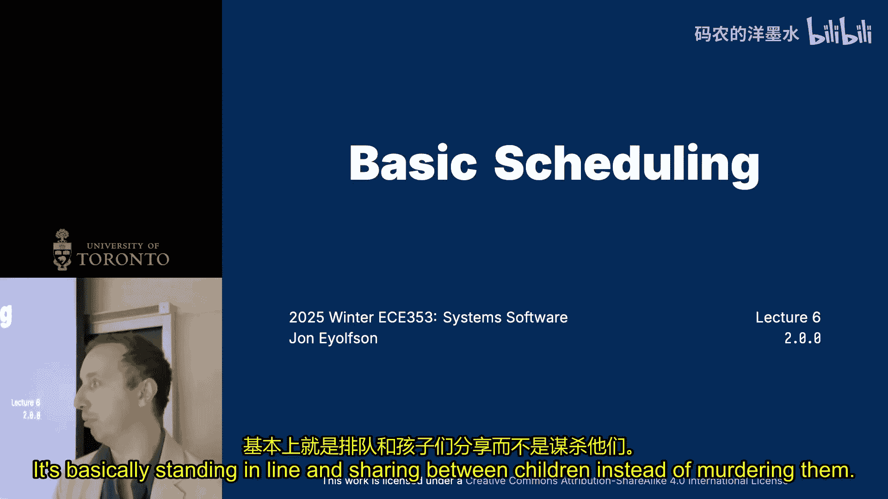
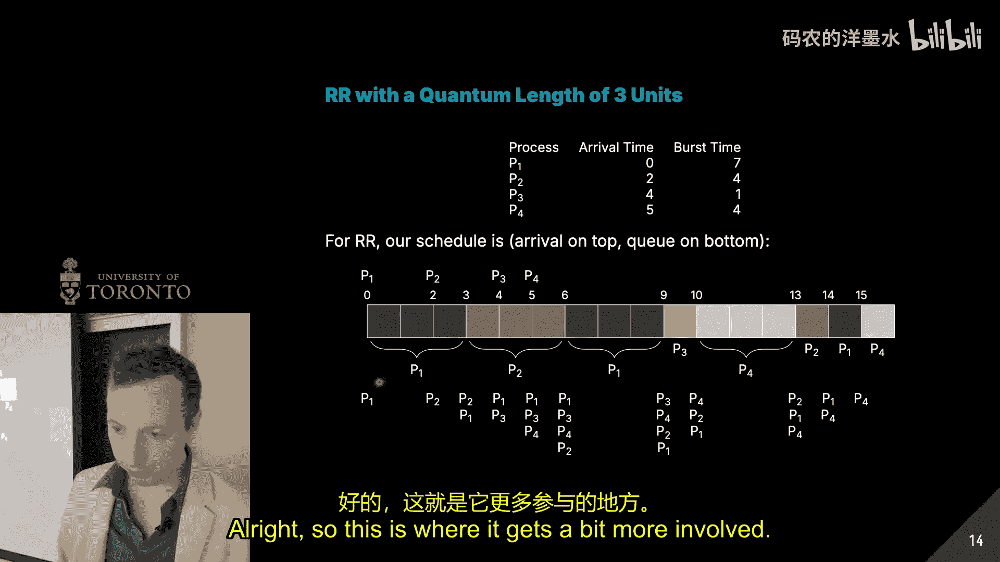
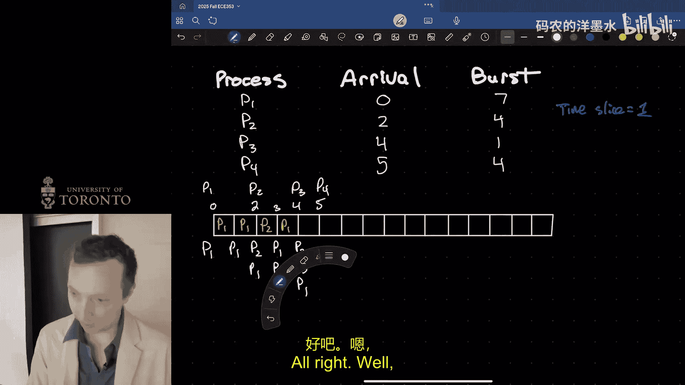
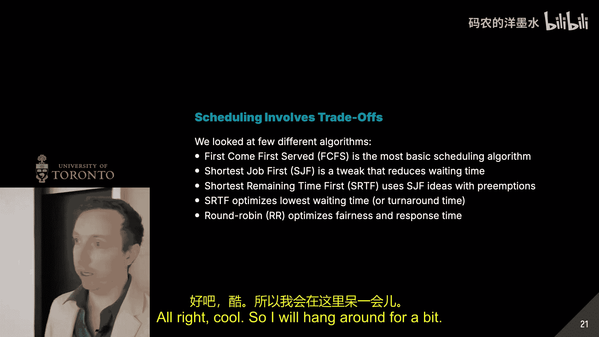

# 操作系统调度：第6讲：基础调度算法

## 概述
在本节课中，我们将学习操作系统中的基础调度算法。调度是操作系统分配CPU时间给多个进程的核心机制。我们将从最简单的算法开始，逐步探讨更复杂的策略，并分析它们各自的优缺点。



---

## 资源类型
操作系统的核心任务之一是分配资源。资源主要分为两种类型：

*   **可抢占资源**：这类资源可以在任何时候被操作系统收回并分配给其他进程。最典型的例子是CPU。多个进程可以共享一个CPU，通过调度轮流使用它。
*   **不可抢占资源**：这类资源一旦分配给某个进程，就不能随意收回，除非进程主动释放。例如磁盘空间。如果磁盘已满，操作系统不能随意删除其他进程的文件来腾出空间，必须等待文件被显式删除。

在大多数通用系统中，CPU被视为可抢占资源。调度器就是负责管理CPU时间分配的组件。本节课我们假设系统是单核的。

---

## 调度指标
在设计和评估调度算法时，我们主要关心四个核心指标，它们之间有时会相互冲突：

1.  **最小化等待时间**：指进程从就绪到最终完成所花费的总时间。
2.  **最小化响应时间**：指进程从就绪到**第一次**获得CPU开始运行所花费的时间。这对于交互式应用（如移动鼠标）的流畅性至关重要。
3.  **最大化CPU利用率**：我们希望CPU尽可能保持忙碌，避免空闲。
4.  **最大化吞吐量**：指在单位时间内完成尽可能多的进程。
5.  **保证公平性**：确保每个进程都能获得公平份额的CPU时间。这个目标常与其他指标（如最小化等待时间）相冲突。

---

## 先来先服务调度
上一节我们介绍了调度的基本概念和指标，本节中我们来看看最简单的调度算法：先来先服务。

先来先服务是最基础的调度算法，类似于生活中的排队。进程按照到达就绪队列的顺序依次执行。该算法是非抢占式的，意味着一旦一个进程开始运行，它就会一直运行直到完成或主动放弃CPU。

以下是评估调度算法时常用的进程信息表示：

| 进程名 | 到达时间 | 执行时间 |
| :--- | :--- | :--- |
| P1 | 0 | 7 |
| P2 | 0 | 4 |
| P3 | 0 | 1 |
| P4 | 0 | 4 |

假设到达顺序为 P1, P2, P3, P4。我们可以用甘特图表示调度顺序：

```
时间:  0    1    2    3    4    5    6    7    8    9   10   11   12   13   14   15   16
      [P1  P1   P1   P1   P1   P1   P1][P2  P2   P2   P2][P3][P4  P4   P4   P4]
```

以下是各进程的等待时间计算：
*   P1：到达即运行，等待时间 = 0
*   P2：需要等P1运行7个单位，等待时间 = 7
*   P3：需要等P1和P2运行完，等待时间 = 7 + 4 = 11
*   P4：需要等P1、P2、P3运行完，等待时间 = 7 + 4 + 1 = 12

平均等待时间 = (0 + 7 + 11 + 12) / 4 = 7.5

**问题**：如果到达顺序变为 P3, P2, P4, P1，平均等待时间会降至3.75。这说明仅仅依赖到达顺序的调度效率可能很低，促使我们寻找更优的算法。

---

## 最短作业优先调度
上一节我们看到先来先服务算法的效率受进程到达顺序影响很大。本节我们引入一个能优化平均等待时间的算法：最短作业优先。

最短作业优先算法总是优先调度**预计执行时间最短**的进程。它同样是非抢占式的。

我们调整进程的到达时间，使其更符合实际情况：

| 进程名 | 到达时间 | 执行时间 |
| :--- | :--- | :--- |
| P1 | 0 | 7 |
| P2 | 2 | 4 |
| P3 | 4 | 1 |
| P4 | 5 | 4 |

调度过程如下：
1.  时间0：只有P1就绪，运行P1。
2.  时间2：P2到达。此时队列中有P2（执行时间4）。
3.  时间4：P3到达（执行时间1）。由于1<4，P3被插到队列最前面。
4.  时间5：P4到达（执行时间4）。队列顺序为 P3(1), P2(4), P4(4)。
5.  时间7：P1结束。调度器选择队列头部的P3运行。
6.  时间8：P3结束。选择P2运行（与P4执行时间相同，按到达顺序优先）。
7.  时间12：P2结束。选择P4运行。

平均等待时间 = ( (7-0-7) + (8-2-4) + (8-4-1) + (12-5-4) ) / 4 = (0+2+3+3)/4 = 2.0

**优点**：理论上可证明，该算法能获得最小的平均等待时间。
**缺点**：
1.  **饥饿**：长作业可能因为不断有短作业到达而永远得不到执行。
2.  **不可预测**：操作系统通常无法预知一个进程需要运行多久。



---

## 最短剩余时间优先调度
为了解决最短作业优先的饥饿问题并进一步提高响应性，我们引入抢占机制，得到最短剩余时间优先算法。

该算法是抢占式的最短作业优先。调度器总是选择**剩余执行时间最短**的进程来运行。当一个新进程到达时，如果它的剩余时间比当前正在运行的进程剩余时间更短，当前进程就会被抢占。

使用与上一节相同的进程数据：

| 进程名 | 到达时间 | 执行时间 |
| :--- | :--- | :--- |
| P1 | 0 | 7 |
| P2 | 2 | 4 |
| P3 | 4 | 1 |
| P4 | 5 | 4 |

调度过程分析：
1.  时间0-2：运行P1（剩余7 -> 5）。
2.  时间2：P2到达（剩余4）。4 < 5，抢占P1，运行P2。
3.  时间4：P2已运行2个单位（剩余2）。P3到达（剩余1）。1 < 2，抢占P2，运行P3。
4.  时间5：P3结束。P4到达（剩余4）。当前剩余时间：P2(2), P4(4), P1(5)。运行P2。
5.  时间7：P2结束。剩余时间：P4(4), P1(5)。运行P4。
6.  时间11：P4结束。运行P1。
7.  时间16：P1结束。

计算平均等待时间（使用完成时间-到达时间-执行时间的公式）：
*   P1: 16 - 0 - 7 = 9
*   P2: 7 - 2 - 4 = 1
*   P3: 5 - 4 - 1 = 0
*   P4: 11 - 5 - 4 = 2
平均等待时间 = (9+1+0+2)/4 = 3.0

**优点**：进一步优化了平均等待时间和响应时间。
**缺点**：仍然存在饥饿问题，且同样需要预知进程的运行时间，不切实际。

---

## 时间片轮转调度
前面介绍的算法都侧重于优化等待时间，但牺牲了公平性。本节我们学习第一个实用且注重公平的调度算法：时间片轮转。

时间片轮转算法维护一个先来先服务的就绪队列。每个进程被分配一个固定的CPU时间片（称为量子）。进程运行完一个时间片后，如果还未结束，它会被放回队列的末尾，等待下一轮调度。

以下是该算法的关键参数和影响：
*   **时间片长度**：
    *   **过短**：上下文切换频繁，系统开销大，大量时间浪费在进程切换上。
    *   **过长**：退化为先来先服务，响应性变差，失去公平性的意义。

让我们通过一个例子来理解。假设时间片长度 = 3。

| 进程名 | 到达时间 | 执行时间 |
| :--- | :--- | :--- |
| P1 | 0 | 7 |
| P2 | 2 | 4 |
| P3 | 4 | 1 |
| P4 | 5 | 4 |

调度过程甘特图如下：
```
时间:  0    1    2    3    4    5    6    7    8    9   10   11   12   13   14   15
      [P1  P1   P1][P2  P2   P2][P1  P1   P1][P1][P3][P4  P4   P4][P2][P4]
队列演变:
t=0: [P1] -> 运行P1
t=2: P2到达，队列[P2]
t=3: P1用完时间片，重新入队，队列[P2, P1] -> 运行P2
t=4: P3到达，加入队尾，队列[P2, P1, P3]
t=5: P4到达，加入队尾，队列[P2, P1, P3, P4]
t=6: P2用完时间片，重新入队，队列[P1, P3, P4, P2] -> 运行P1
... (后续过程略)
```

计算关键指标：
*   **平均等待时间**：
    *   P1: 15 - 0 - 7 = 8
    *   P2: 14 - 2 - 4 = 8
    *   P3: 9 - 4 - 1 = 4
    *   P4: 15 - 5 - 4 = 6
    *   平均 = (8+8+4+6)/4 = 6.5
*   **平均响应时间**（从就绪到首次运行）：
    *   P1: 0
    *   P2: 3 - 2 = 1
    *   P3: 9 - 4 = 5
    *   P4: 10 - 5 = 5
    *   平均 = (0+1+5+5)/4 = 2.75
*   **上下文切换次数**：在甘特图中每次进程变更计为一次，本例中为7次。



**时间片长度的影响**：
*   若时间片=1：上下文切换次数激增（本例中为16次），平均响应时间会更好（~2.0），但系统开销巨大。
*   若时间片=10（大于任何进程执行时间）：退化为先来先服务，上下文切换少（3次），但平均响应时间变差（~3.25）。

**优点**：公平性好，响应时间佳，无饥饿问题。
**缺点**：平均等待时间可能较差（尤其当所有作业长度相当时），性能严重依赖于时间片长度的选择。

---

## 总结
本节课我们一起学习了操作系统中的几种基础调度算法。

1.  **先来先服务**：最简单，但效率低下，平均等待时间差。
2.  **最短作业优先**及其抢占变体**最短剩余时间优先**：能提供最优的平均等待时间，但会导致长作业饥饿，且需要预知运行时间，不切实际。
3.  **时间片轮转**：第一个实用的算法，通过在公平性、响应时间和系统开销之间进行权衡，通过调整时间片长度来适应不同场景。



调度本质上是在多种竞争性指标（等待时间、响应时间、公平性、吞吐量、开销）之间进行权衡的艺术，没有一种算法能在所有场景下都是最优的。