# 【全集 2025】多伦多大学 系统软件设计与编程 中英字幕 1080P p07 Lecture 7 - 虚拟内存 -BV1YrkYBQEeL_p7-

Allrighty， welcome back to 353 so next topic is virtual memoryory which is historically the second hardest topic in this course so because your Enci students and you like being tortured I will torture you for two hours so get ready for this because this will be a ride so。

Virtual memory， we now know it exists， right。 So two processes can use the exact same memory address。

 but they're independent， so they must map to different physical memory on our machine。

 So how do we create that illusion， so。

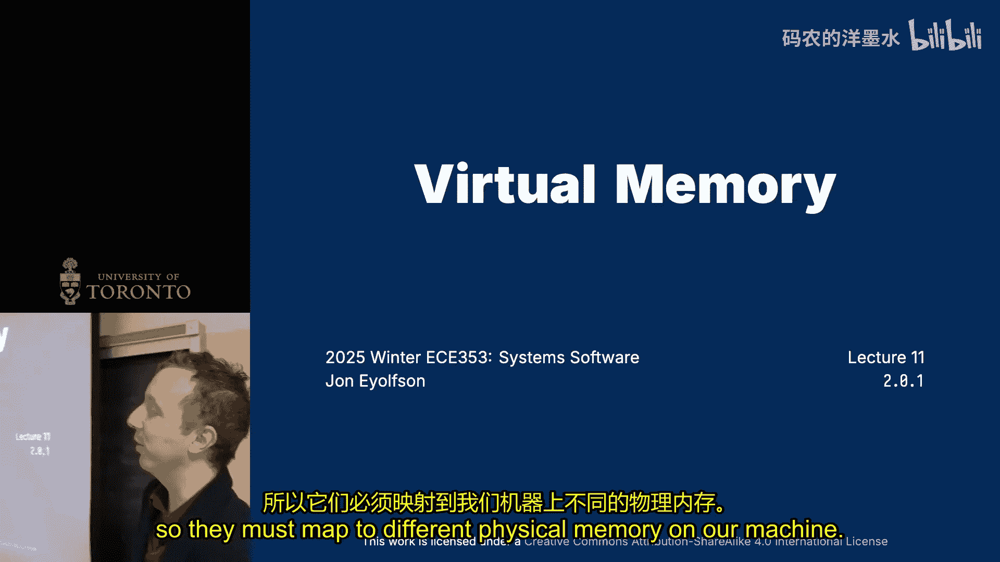

I will pose that to you first， so let's see some ideas。 General this is fun。

 so I'll give you a minute to think about how we should actually implement virtual mapping。

 so remember each process should be independent， so each process there should be some way to map a process is virtual address which we know is not a real physical address to a real physical address in physical memory。

 and we need to do this in a flexible and efficient way。 so。

I will give you a minute to think about that and you tell me how you would implement this。

So and again， basically， you want this for each process。

 you want to map a process's virtual address to a physical address efficiently。么回事？我。手なてど。All right。

 your minute is up， hit me with your best ideas。Oh。

 we're about not to have a functioning computer yet I last 4096 is。

You get divided memory into chunks of 496 bytes。あバと。Treat it as a file descriptor。

 so break the memory into big chunks， treat it as a file descriptor， map it somehow， all right。

 any other ideas？You can restrict how this can be an address。So for。So how would that work。

 so reserve some of the virtual address。

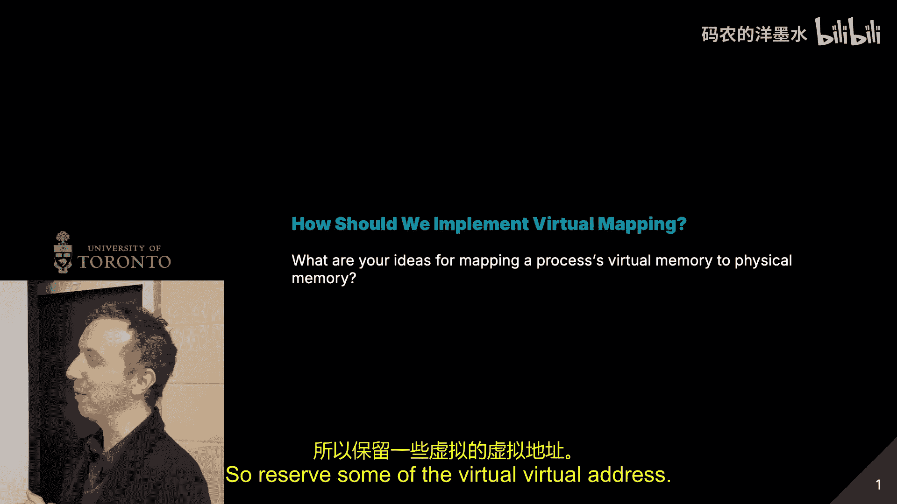

So here let's see。So let's say I have a big， so let's say I have a 64 bit address， right。

 lots of bytes。 How do you want me to divide that up。So reserve 16 bytes or bits。Okay。

 and what you want me to do with this？連だ。So this is supposed to be an index for what index。4。

The entire memories least。The entire memory space。 So what。48パ。So divide my memory into sizes of。

48 bit blocks。Two to48， by one。Through the 48 B blocks。

 those might be quite huge and be more than the memory I have on my machine。 So if I have what。

2 the 30 or 30 B。 That's 1 GB， right。So I don't know how much RA do we have， probably not that much。

 right， 36， probably about the most， that's what 64 gigs of RA。All right， other ideas， yeah。あ証明。

It knows how much stack it。K how we start process volatility。ゆち分。

So if they're all set the same thing， you know， if I process 100 process。101。

 maybe they use the same virtual address， right？But。You have the colonel says， hey。

 you have an offset of like， I don't know。Z， you have an offset of 1000。Something like that。Oh。

 that's it。Decent idea。 So I just store an offset。 That's' in physical memory。

 But everything needs to be the same size， right， Well of this process uses。Or were sorry。

 What about this process is Chrome and uses。I don't know， grows and keeps growing and uses you know。

 four gigabys of memory。 Then oh I'm going to have to move this too。

 right and moving it while it's running。 that's not going to work。Yeah。二百の回。我打。Yeah。

 but then if it's dynamically then what， I have to keep track of the offset for each dynamic allocation。

Do you like this。Just give them a real address for each malloc call。

 just give them a new free address。That's physical。All right。Other ideas。

 usually when I say mapping a virtual to physical address， usually that's some type of solution。

 what do。First thing that jumps to mind， I mapping something。Yeah。A hash table， right？All right。

That's what someone always says。 It's like a normal thing， mapping， hash table， boom。

 hash tables that are fast。All right， now I have to go on a tangent， why do we use hash tables？

What are hash tables really？Sorry。Dictionaries。The dictionary hash table mean the same thing。

 but at the end of the day， what data structure is it？Yeah， not a cash。Yeah， it' an array。

 It's an array， right， So a hash table is basically an array。

 The reason we use a hash table is because we。We can't figure out what the hell index to use。

 It's just too big， right， so if we want。To， I don't know， store a value for each string value。

 how many possible string values are there for， I don't know， like a string of 30 characters。

 quite a lot right if I wanted to have a slot for each one of those， I would run out of memory。

So a hash table is just a way to use an array efficiently。So I have two main values。

 I want to shrink it down so I can actually use an array。 That's what a hash table is for。

 So in this case， I don't have too many values。 I want to be able to map。

Possibly every single virtual address to a physical address。There's no skipping anything。

 I might have to map everything， right？So it would just be an array， right。

 I could just have an array lookup for each process， something like that。

 Everyone kind of agree with that， that could happen。So simplest thing。

 just have a lookup for each process。But then the question is， okay， well。You know。

Each address is a byte right so I could have this whole big lookup table。

 which is basically just virtual address。Which would basically be the index into this table。

And then I could just map it to whatever physical address right。

 and that could be my key there so here。They would both have to be， I don't know。

 my index would have to be 64。Bits same with my physical address。

 so I could have a different one for each process， So I process 100， maybe I just have， you know。

Virtual address， 1000 goes to physical address， I don't know， let's say E0，0，0。Maybe I have。

Now a different table for process 101， where it's virtual address。1000 goes to， I don't know， F0，0，0。

So that could work， right？It's a perfectly crulent way of doing it， it's just slightly wasteful。

Right， because I need one entry for each byte。 And if this was a big array， well。

 I don't have to store my index， right， I would be storing this， which is 8 Bs。

So every single index would have an eight byte value。

 so if I'm literally just keeping track of what virtual address maps to what physical address。

 that means for every byte， I have to spend eight bytes keeping track of it。

Which means suddenly you can only use a ninth of the RAM on your machine， which is quite bad。

One way to make this more efficient and have better usage is the idea way back at the beginning beginning is to split our memory up into bigger blocks。

 and then we only keep track of mapping between big blocks， so。The size of the block。We give a name。

 we call it something like a page， so we basically take all of our physical memory。

 so this would be physical。We divide it up into fixed size blocks， everything that same size。

And then we just keep track of mapping the blocks for a process。 So virtual address。1。

000 for this process。Which virtual block it would map to is probably like this one。

 and then we keep track of again。🤢，Keep track of what physical block， okay， sorry。

I'll do physical on the right。And I'm cramped with rating。

 and then each process would have a virtual。View of memory， right。

 So I could make it so that this block with address 1000 on it maps to this physical block。

On memory and then。For process。101 that uses the same virtual address I could take。

It's a virtual block that's the same block addresses and map it to this in physical memory right and then I have flexibility。

 if everything's the same size， I could move it around， do all sorts of things。

 so that's basically the whole idea we're going to go over today。

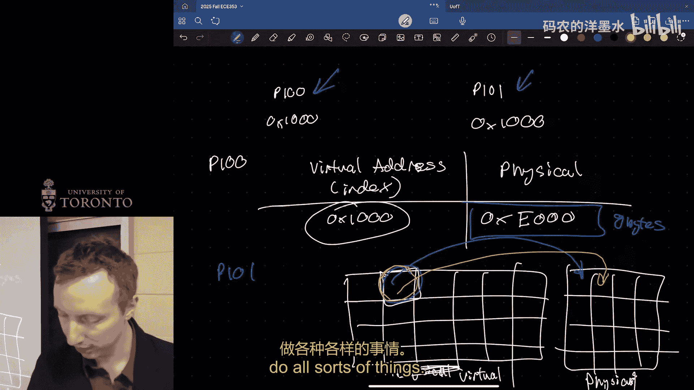

So。

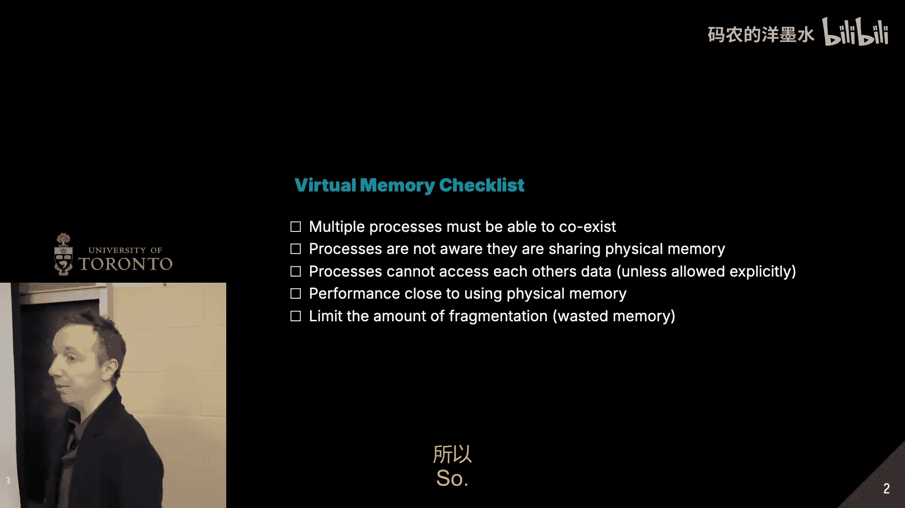

Oh， yeah。So， yeah， so。Yeah， so each virtual block here。

There's different trade offs for different sizes。 The one we've all standardized is that 4096。

So it's 4，096 bytes per block， we'll get over why we chose that number in a bit。Oh。

 so how does that match with what I drew here， So this was like bitete to bite mapping， right。

 where this translation was only valid for a single byte。

Right so instead I could just say instead of this translation being valid for a single byte is actually valid for 4096 bytes all in a row。

 so that would mean the addresses。I guess this will go over what the hex is。

Those addresses map to this essentially in physical space。

So I just make it a bigger mapping instead of one single byte。

 so if anything falls within that range。I pretty much do that offset thing， right。

 this is basically my offset to it。So。If it's slightly confusing， don't worry。

 usually I don't chicken scratch at this early， we'll go into why we do all these things。

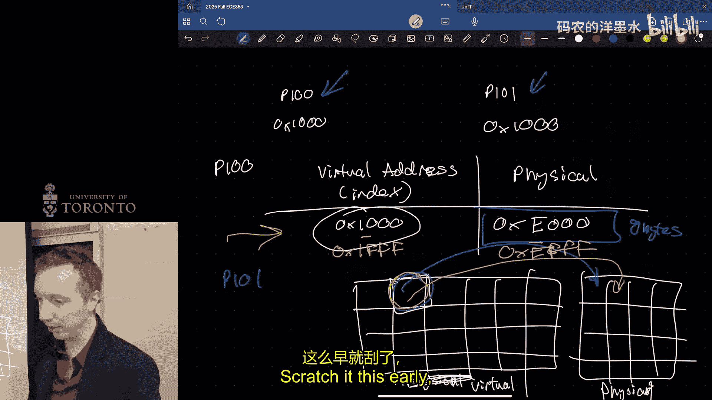

So some checklist things we have to make sure our virtual memory system is nice and efficient。

 so multiple processes must be able to coexist and they should not be aware they are sharing physical memory because we'll all have some type of limit on however much memories in your machine。

So， shouldn't matter。If I'm running your process on a machine that has。I don't know。

256 megabytes of memory verse 1 that has a terabyte of memory。

 like some machines that are on campus here， right shouldn't matter。

And you should not be aware that other processes are sharing physical memory with you。

 you shouldn't care how many other processes are running at the same time。

 you shouldn't be able to access any other processes data unless you're actually allowed to explicitly。

 by default， you shouldn't be able to read another process's memory。

And you want performance close to using physical memory。 that will be a problem for a while yet。

 and we need to limit the amount of fragmentation， which is just another fancy word for saying some wasted memory。

So since we were using big blocks， well our program might not use the entire block at a time。

 so that's why we chose something that' we kind of want a Goldilocks number of something that's not too big and not too small。

If we chose it as a byte that's way too small， we're wasting a lot of space just keeping track of translations。

 but if it was like， I don't know。A gigabyte or something like that。 Well。

 then each process gets a gigabyte， no matter what， even if you only use a kilobyte of memory。

 so that is。Showing that we don't just want wasted memory， what kind of Goldilocks number？So again。

 remember that memory is always byte addressable， the smallest unit you can address in memory is one byte。

 eight bits at a single time， and we can only read and write one byte at a time at minimum。

Addresses and pointers， they're not terribly complicated if you really break it down。

 think of memory as just a big bite array and the address is just the index into that big bite array and we call that memory so it's just like an index into array。

 nothing is more complicated than just arrays at the end of the day I don't know they tried to scare you with pointers for some reason but。

Basically just an array。So。First idea we had is where everyone's had a segmentation fault， right？

So the first idea is basically that idea of a segment or segments is that idea。

 so it's like coursearse grain memory management， so we divide the virtual address space into different segments for different purposes。

 so we have some for code for instructions， data for global variables， a stack and a heap。

K of looks like an elf file where large sections have like represent some memory with permissions like one I allowed to execute。

 what can I read from， what can I write to， and each segment has a variable size and can be dynamically adjusted。

It's some old legacy thing that's no longer used。But this is how virtual memory existed back in the day。

 So any memory access violation， it's called a seg fault because， well。

 that's what they used in the 70s。Now we know with libraries after you name something and tell it to your user。

 you can't change the name， so even though we don't use segments anymore。

 you still get segmentation faults even though they don't exist because they existed in the 70s。

The reason we don't use them anymore is they can be very large and costly to relocate。

 so if we have a segment just for he and we keep allocating， allocating， allocating。

 it's basically we keep track of an offset for the heap。

If that might run into memory from another process then we have to move all of that memory somewhere else in physical space。

 so that is the big drawback for that， but how did it get used So each segment kind of has that idea contains a base and these are that base is where it is in physical memory a limit。

 So how big the segment is and permission， So what am I allowed to do with this memory so。

You get a physical address。By using this， so this is what your virtual address looks like。

 it's not a whole address， it's divided into two parts。

 a segment selector so saying which segment you want to use and an offset so how many bytes into that segment do you want to read and then the MMU or memory management unit is special hardware on your CPU that does all of these virtual memory to physical memory translations so what it does is check that your offset is within that size limit so the limit is just the size and if it is so if it's a valid access。

 it will calculate how that translates to physical memory by taking the base physical address plus the offset you requested it will also do permission checks see so if you're not allowed to write to it and you're trying to write to it it will deny you。

So if it fails that you get a segmentation fault， so again。

 that's where that came from is basically any illegal memory of access。

 what's called a segmentation fault because it failed this check。So for example。

 your virtual address would look kind of weird， it would be like segment1 offset FF which is 255 and then as part of the thing the kernel manages the kernel would manage segments for each process so for this process the kernel would say hey。

 segment1 for this process starts at physical address， 2000 in Hex。

 it has a limit of1 FF and therefore to translate this weird physical address or sorry to translate this weird virtual address to a physical address wed be like okay the offset is within the limit so it's a valid access so we just take this offset and then add it to the base physical address so that would translate to physical address to zero FF in Hex。

This hardware still exists if you have an X86 CPU because again， once they introduce something。

 they can't get rid of it， but what Linux does is to effectively get rid of the system even if a process tries to use segments。

For every process， it sets up base to address 0 and the limit to the maximum amount of memory you have。

 So basically it turns anything into aO op where it doesn't do any translation whatsoever。

 So even if you try and use segments， which is allowed， won't do anything。

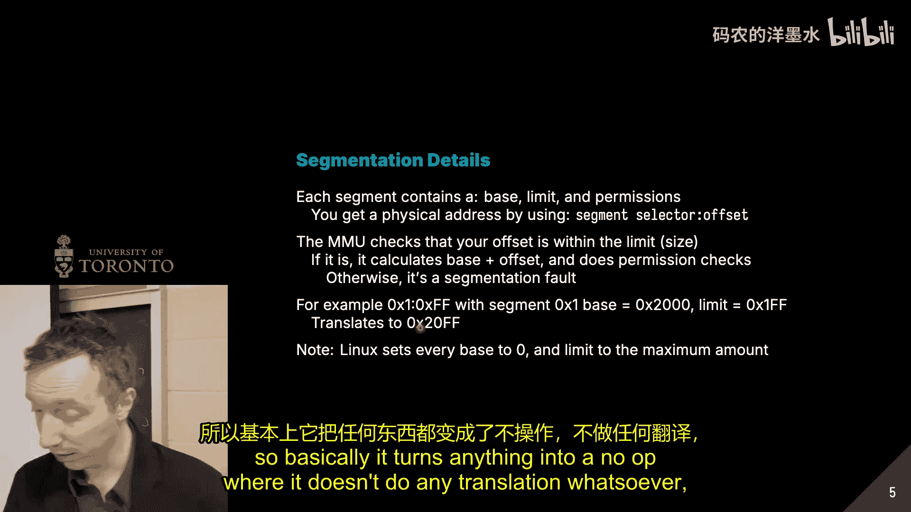

All right。So our first real insight into what's being used now is to divide memory into fixed sized chunks。

EachEach process has different virtual blocks， it thinks it's all of memory。

 and we just have to keep track of mapping a virtual block for process to a actual physical block of memory on our machine and we as a kernel get to keep track of that。

 So first question again， how big is this block going to be。

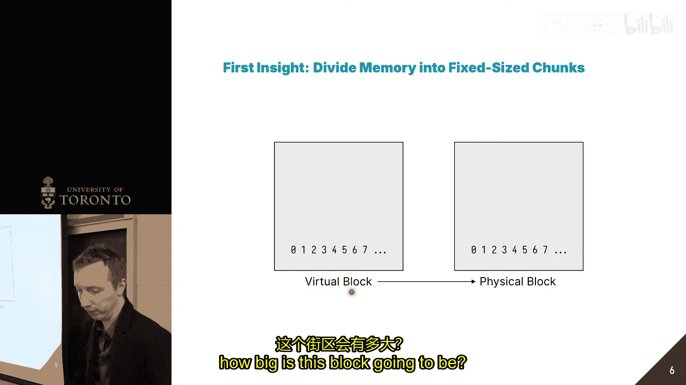

And before that， just to get into details。 So again， I said M MU。

 without saying what it is here it is on slide。 So it's the memory management unit。

 It is the piece of hardware responsible for， actually。

Doing the translation of a virtual address to a physical address。

 and it will also do all the permission checks and everything like that。 By the end of the lecture。

 we'll see how a simulated one works。 So the ttan we use is to divide memory up into fixed size blocks。

 We call them pages， typicallyyp they are 4096 bys large。

 You might see a whole bunch of different terminology。

So a page in virtual memory is also just called a page。

 we don't call it a virtual page or anything like that， just say page。

 and then a page in physical memory might be called a frame or you might divide them and say virtual page physical page。

 usually it's kind of obvious what you're talking about， after a while。

 but just note that someone just says page， they probably just mean a fixed size block of 4096。So。

On all of our CPUs now， we have a 64 B CPU。CPUs might have different levels of virtual addresses you can use。

 but the implementation ideas are always going to be the same。

And we'll see what the trade offs are in a bit。 But we'll assume a 39 B virtual address base used by Rik 5 and other architectures。

 So this is limit for how much memory a single process can use。

 So if it can only use 39 Bs of virtual address space， that means it could only address that many。

2 to the 39 bytes because every index is a byte， memory is byte addressable。

 so that means each process could actually address 512 gigabytes of memory and this is called SV39 whole bunch of different ways and trade offs we could do。

So how this is implemented is just by something called a page table。

 which is basically the idea we had before， it is an array。

 so the index of the array is the virtual page number。And the value is the physical page number。

 so where that actually is in physical memory and each process would have its own page table。

 so how would that look？

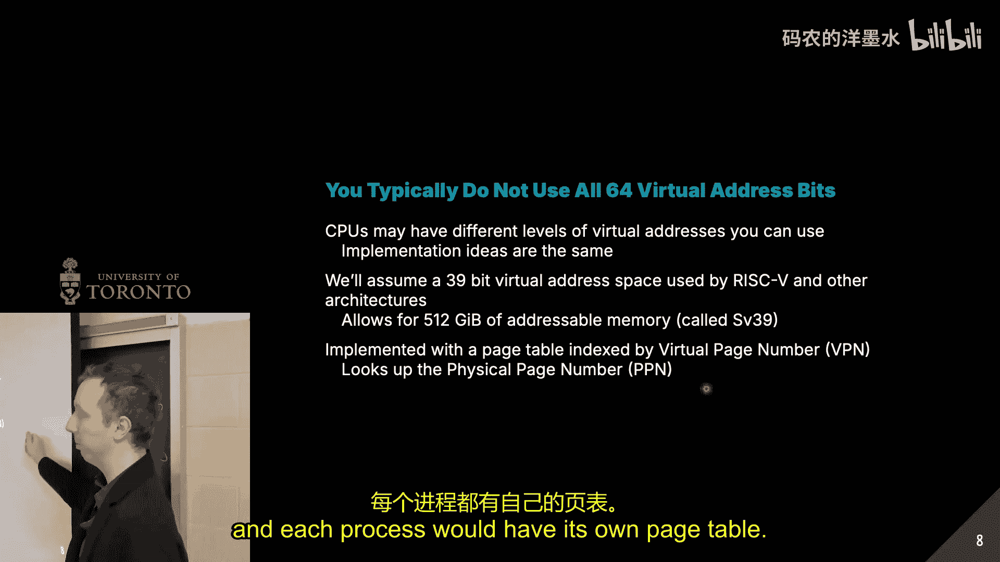

So to do the mapping。Above here I have my virtual address if I have a 39 bit virtual address I'm divided into two parts。

 so one I will call the index so which virtual page number am I going to use for this virtual address and then what is the offset so to get the number of bits for the offset the offset is just which byte of the page do I want to access and it doesn't matter if it's a virtual page or physical page is just an offset like that idea we had before so。

If my page size is 4，096。Then that is2 to the 12。Right。

 which means if I want to have as many options to address every single byte on that page。

 I need 12 bits right because to the 12， that's 4096 bys。

 So that is what my offset is it's related to the size of the page So I don't have to translate that when I'm translating a physical or virtual address to a physical address。

 So everyone okay with that。 we don't have to translate that part。

 It's just like where on the block I'm at， I don't care if it's physical or virtual。All right。

 so then we have our page table here。It needs one entry for every single possible virtual page right so the other bits here so in total this is 39。

 then we're using 12 just to say where we are on a page which means we have 39 minus 1227 bits left。

 so that is how many indices we need if this was a giant array right so。🤢。

That means we would need since this is bits， there's two to the 27 different entries here。

 so we would need two to the 27 different entries here。

 and each of them would just say what each of them would store the physical page number right So what physical page does this virtual page correspond to for that process。

 So each entry would be something we call a PPPN or physical page number。

 otherwise virtual page number or VPN。 So this is。Basically which physical page does that virtual page correspond to and that is what we would look up in our page table so we would get the index from the virtual address。

 look it up in the page table， there'd be one of these for each individual process and then that would give us a physical address so everyone okay with that。

Yeah。Why is it 44 good question we'll get into that in a bit。Whoops。So yeah。

 the question is why is the physical page number 44？And the answer to that is， well。

 that's how much physical memory。Like our limit for physical memory that we can actually use on our machine。

 So in this case， the total physical address size is 44 plus 12 or 56 Bs。 so I could address up to。

2 to the 56， which is an awful lot of memory。 It's not all 64。Bits。

 but it's a lot of memory and it's good enough for now， turns out。This number。Basically free。

 each entry has to be a power of two anyways。4 by isn't quite big enough to fit anything useful。嗯。

 we'll get into that in a little bit。 But basically， that's how much physical。

Memory our machine could actually use while each process is limited by the amount of virtuals addresses。

这这个还是。Like to the。Is like。No， so the virtual addresses are mapped to physical addresses。かなだけ。Yeah。

 that would be Ram。 The physical addresses is theyre all Ram， yeah。Yeah。

 we're not getting into storage or anything like that yet。それにも。Any multiplexing going on。

 what do you mean by that？So the way we have it set up is like， let's say。Here。

 let me erase some stuff。So let's see if I can illustrate it better。 So let's say we have。

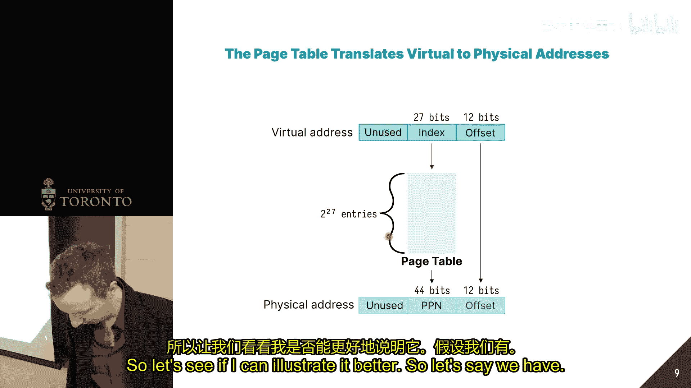

You know， process 100。Process 101。

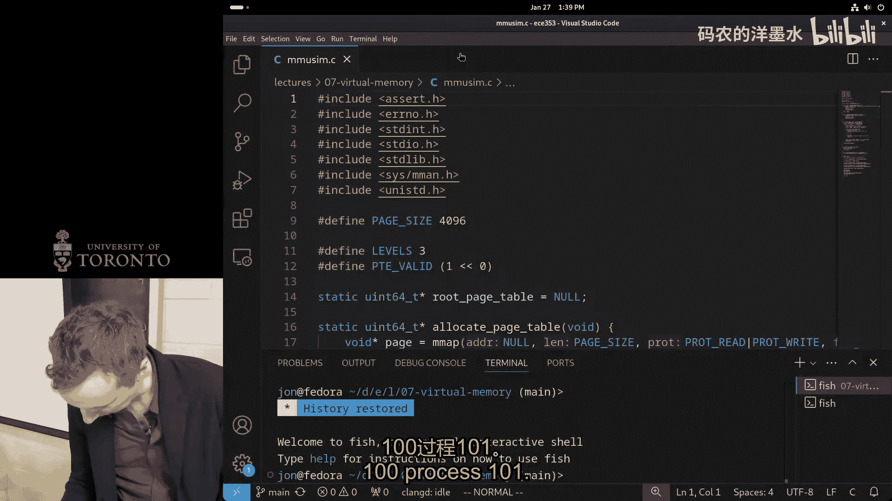

And。Am I writing on something， Yes， oops， all right， So we have processed 100。And process 1，01。

 So we divide it up。Wow， that is the worst grid I've ever。I could could have done that before。

All right， so we have two processes， these are kind of their virtual。

And then they would each have their own kind of。Page table here。Which has all the translations。

Then we only have one set of physical memory， right， Come on。So you take physical memory。

 divide it up into pages two。So the way we have it。

 we can have that the same virtual page for two processes maps to different physical pages。

 so this oops。So let's say this entry here。Virtual page that corresponds to a range of addresses。

Using this page table。Maybe it corresponds to this physical page。

 and then similarly for the other process， maybe this virtual page。Given its page table。

Maps through a different physical address or physical page。 And your question is，5 multiple。

 can I make it so that， hey， maybe。Maybe some virtual page here maps to this virtual page like that。

by the police。Yes， so here the kernel would be the thing。Managing the page tables。 So ideally。

 if no process can see。Any other processes， memory， I have to ensure that。

Like there's no crossing the boundaries right that there's no line from the orange one to the pink one right because if this was the case and this physical page is accessible in both processes。

 then I could read some other processes' memory right so if you're the kernel and you're ensuring security and things are isolated。

 you absolutely do not want that to happen。 So if that happens， you have a bug in the kernel。

 you can read some password from another process or something like that， which is bad。

 might be cases where we do want that though which。If we want。

We might want this to communicate quickly between processes。But。If we want things separated。

 that's a bad thing。Yeah。Is there another question with that or other？Mappings。Okay。Yeah。The pace。

boarding us。Where我。Yeah， so that's a good question。Question is。

 where's this page table actually stored？ Well， yeah， right now。

 it would have to be stored in physical Ram， right， It would have to be somewhere， But for now。

 we'll just assume that it's kind of floating at the end or something like that。

 We will just assume some magic for now。 And we'll worry about that later。 But yeah。

 it would have to be stored in physical memory， yeah。😊。

you also mentioned that every process has its own。Yeah， each one is。垂子だ方。Yeah。

 you're jumping the ahead already， but yeah， that's going to be our first problem that they're huge。

Yeah。You certain that the physical addresses。Yeah。So why do we have。

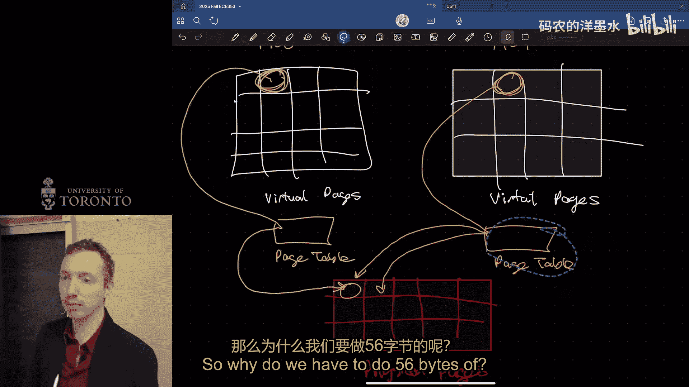

失ぱ？So why do we have up to？Two to the 56 here。We're future proofing。

 We could have that much eventually。 So we'll get into the trade offs basically that allowing for more physical addresses is free。

Because right now。Each process could only do 512 gigabytes， but right now。

 computers with a terabyte of Ram is not that uncommon。

So we want to be able to support things like that， and we'll get into the trade offs affecting these numbers but。

Before I move on， everyone okay with this。Alright， cool。 Then we'll get into engineering in a bit。

 so。I lied a bit so this page table like each entry。

 it has to have at least the physical page number， so what does this virtual page number translate to but that page table entry so each of the entries here actually has a whole bunch of other information so it also stores the flags in the lower bits so。

It stores at least the PPN。 So that is going to be some knowledge you're going to have to commit to memory。

 So a page table entry has to store at least the physical page number or the PPN in this case。

 it's just 44 bits。 And then that's also where it stores some permission flag。 So at minimum。

 we will always need a valid bit。 whether or not this translation is valid for this process。

 And then there's a few more bits we could have。 So there might be a readable bit。

 So is this process allowed to read this memory， Is it allowed to write this memory。

 I it allowed to execute these addresses。User like。Is should it only be accessible in user mode。

 is it global， is it mapped in different processes， is it accessed， is it dirty， that's a fun one。

 we'll figure out what that is， then there's reserve for supervisor use。

 supervisor is just another fancy name for the kernel so there's two bits reserve that the kernel can use for whatever it wants。

🤢，Then there is 44 bits for the physical page number and then right now for this layout there's 10 bits reserved for future use。

 so you'll see that this page table entry is 64 Bs or 8 bytes has to be at least。Well。

 it's a computer， so it's going to be a power of two number bytes。So if this was only four bytes。

or 32 bits， then while we have 10 bits here for flags。

 that would mean we would only have 22 bits left over for a physical page number。

 which means the most amount of memory we could use is what 22 plus 12， 12 bits for the offset。

 which is 34 which would mean the most physical memory we can have in our machine is 16 gigs。

 which isn't good enough。We have to increase our page table entry size to 8 bys and with that we just have a lot of room for the physical page number it's essentially free。

 it can be really large， so that's the reason why it's 44 bits。

The answer is it was essentially free because we had to go up to8 bytes and while they just reserve 10 bits just for future use。

 they could go all the way to 64 bits if they want or use it for other stuff， they're like。

 no one has a machine with that much memory yet， we'll worry about that in like 30 years。

So that is what a page table entry looks like。

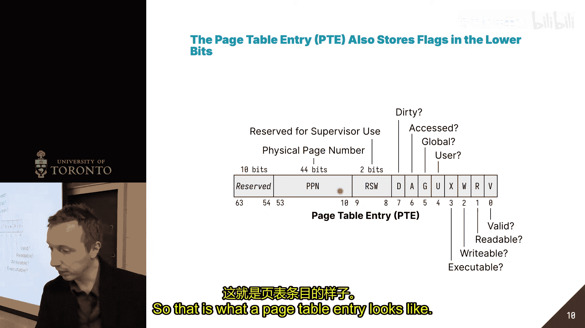

So the kernel is the thing again， handling translating the virtual addresses or managing these page tables。

 so if we consider this page table again， it would just be an array。

 so the virtual page number is the index， so this would not actually be stored in that so。

I would have virtual page number 1，2，3，4 or sorry，0，1，2， and3， and then for this process。

 virtual page 0 maps to physical page1， virtual page1， maps to physical page4。So on and so forth。

 So if I were to do the translations。

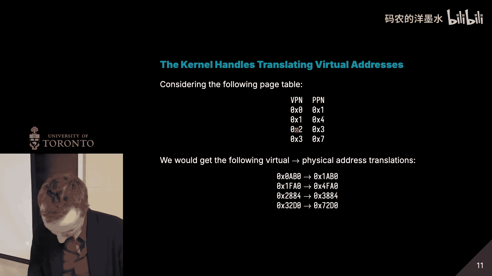

So if I were to do the translation， so again， here is my page table at the top。

So this is my page table。It would basically be VPN to PPN。And zero， one， two， three。

If you all write my PPN in he， just for fun。So remember how we translate， We take our whole。

Virtual address。And then divide it up into an offset。An index。

And based off the scheme we had before with our page size， if our page size is 4096。

So it's 2 to the 12 B。 I always like writing powers of 2。

 You should get very used to writing in powers of 2 for this course。 So that is 2 to the 12。

 That means my offset is 12 B。And then my index is whatever， the remaining third 27。2。

Questions so far。All right， everyone remember theirre fun hecks。Translation and everything like that。

Sure hope though。 So a single hex digit or hex it， whatever you want to call it。

 how many bits does a hex digit represent？Four， right？

How many hex digits do I need to represent this offset？10 whoops。So three， right， so luckily for us。

Hopefully， we don't have to write binary。 We can just keep it in Hex。 Trust me， it will be easier。

 So the offset is thankfully， whoops， exactly。Three hecks。Digits。Hex it， whatever you want。

So this will be fun， so if we wanted to translate。The virtual address for this process。

 let's say it was whoops。So let's say we had virtual address。A。We sorry，0， A， B0。

So if I'm translating that， I don't have to translate the offset， right， I can leave that alone。

 That's how many bytes into the page do I want。Thankfully， if I write it out in Hex。

That's three hex digits。 That means I don't have to translate this， right。

 I don't have to translate the last three hex。Digit exit， whatever you want to call them。

 So when I'm translating this。Virtual。2。Some physical。It's basically who knows。

 and then it will always end in A B0， right？So。Remember。

 the other part of that is the other part of the virtual address， this is the offset。

This is the index。Or VPN。Pretty much mean that they're equivalent。

 So if I want to translate this virtual page number to a physical page number。

 I just have to consult my table， right， This is index 0。 So Hex 0 is index 0。 So that means in。

If I want to translate this virtual address to a physical address。

 I just have to look up that index in my table and replace that virtual page number with the physical page number I look up right。

So my physical address would be 1 AB0。Everyone okay with that？All right， so quick pop quiz。

 if I have the virtual address。1 F A0， A11， tell me what physical address that translates to。Yeah。So。

We got4 FA0。Everyone agree with that？So again， why is that， well， again。

 we don't have to translate the offset， so the FA0， if you can read my crappy writing。

Stays the same and then the other part of that is we want to replace the virtual address or virtual page number with the physical page number。

 so this is our index， we look it up in the table， corresponds to VPN1 because hex1 is one and that means we replace it with the physical page number four so we just replace that。

One with four， all right。Now let's some other addresses web about。2884。 What does that map to？Yeah。

Right right。3。8，8， four， right， last three ones， don't have to translate。This I look it up。

 it's here， I replace it with three。All right， everyone get that。Yeah。So the last three is like。

What bite on the page am I trying to access and it doesn't matter if it's virtual or physical。

 I don't have to translate that part， right？Because we just divided memory up into pages。生产。Justます。

It's been the physical address。Because we want to have。Yeah， we have multiple processes。

 so there would be a page table for。Each different process。

 so this would be like this is a page table4 process。10100。 and again。

 I could have a page table for like process 101。That would be the same idea， right。

 but if I were to keep them separate。That's a good question。So it would have to have mappings。

 if I were to keep them separate， I just have to make sure that。

I don't use any of these physical pages， right， So if I did something like， I don't know。

Let's say I put this at。Page F， this one at E。This one at， don't know，2， this one at。0。

 then that's fine。 There's no overlapping between them， right。

 They would map to different physical addresses， even though they use the same virtual address。

 But if I did something like this。Let's say I changed this mapping。

 I was the colonel I screwed up and I did this。That means I can actually access the same。

Physical page as another process so I can read another process's memory， which is probably not good。

 right？Yeah， so each process has its own virtual addresses as long as my kernel is written correctly and。

It has to ensure that they don't actually。They can't actually access the same physical memory， right。

 because the only memory they're allowed to access is through their virtual addresses。

 and the kernel manages that。 So another thing too， I'm assuming everything is valid。So。

It could also make this like this is like an invalid mapping， right， invalid。

So there could be an invalid page table entry there， so if this process was tried to access。

 I don't know， address。Like zero， like a whole bunch of zeros， right， this is like the null byte。

 so if it tried to access that。It would。Not translate this。 This is the offset。

 Use this virtual page number to look it up and then be like， oh， well， that doesn't map to anything。

 It's invalid。 And then you would get a Seg fault。 If you tried to do that。 So spoiler alert。

 this is why null Seg faults in every single process。

 The first entry is always mapped to an invalid page。 So if you try and dereence null。

 null is just a fancy way of saying address 0。The first entry is always invalid otherwise。

Some kernels， some operating systems could map that virtual address 0 to something。

 And then if you default or then if you de referenceence null， hey。

 you suddenly read some random memory， which would be probably worse than crashing， right。

So one way to do things。 All right， any questions about that。Yeah。本 that's悪。range table or。Oh。

 by invalid， I mean like in the page table entry。 so the page table entry technically would have a。

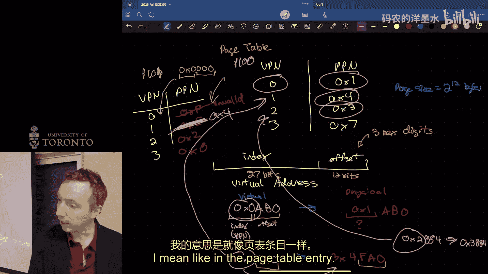

The PPN and then a whole bunch of other bits to keep track of。What we can do with that translation。

And then one that is a valid bit。 So if it's zero， that means that。

This virtual address isn't mapped to anything for this process。 So it's invalid memory。

 So if you just， you know， start running your process and then guess an address and dereence it。

 likely that virtual address isn't mapped to anything， and you'll se fault。Which。

It's confusing because it doesn't actually use segments or anything like that。

 It's just a legal memory access， but we can't name it anything different。

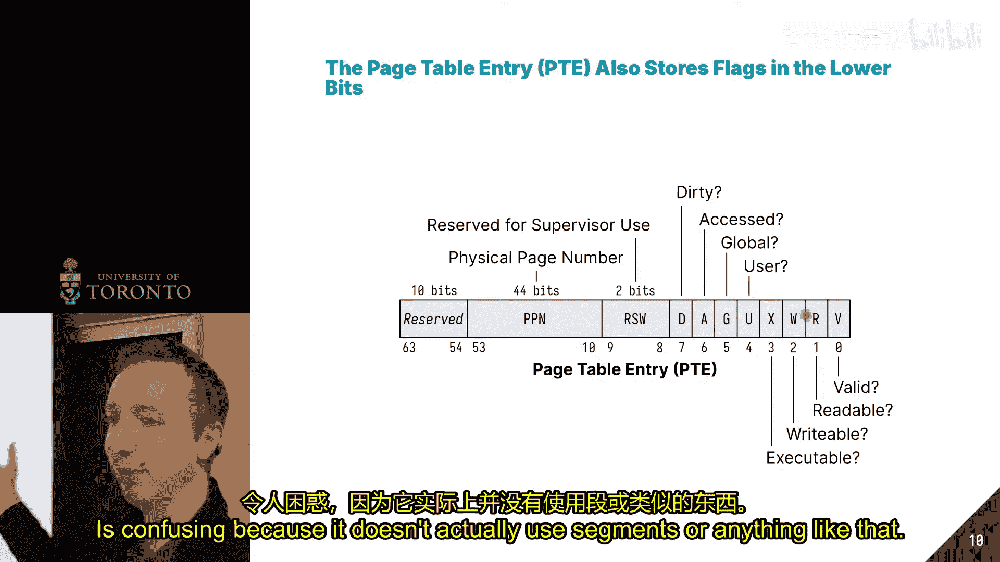

All right， any other questions？Yeah， so technically， if I was to break it out。More each VPN。

 each row would be a page table entry， but the important part for translation is a PPN， right。

 the rest of it。For now。The only thing that's important is that it's valid。

 but we're just practicing some translations for now。All right， any other questions with that？

All right，Other problem could have something like this， which makes it even more fun。

So let's just go through this problem。

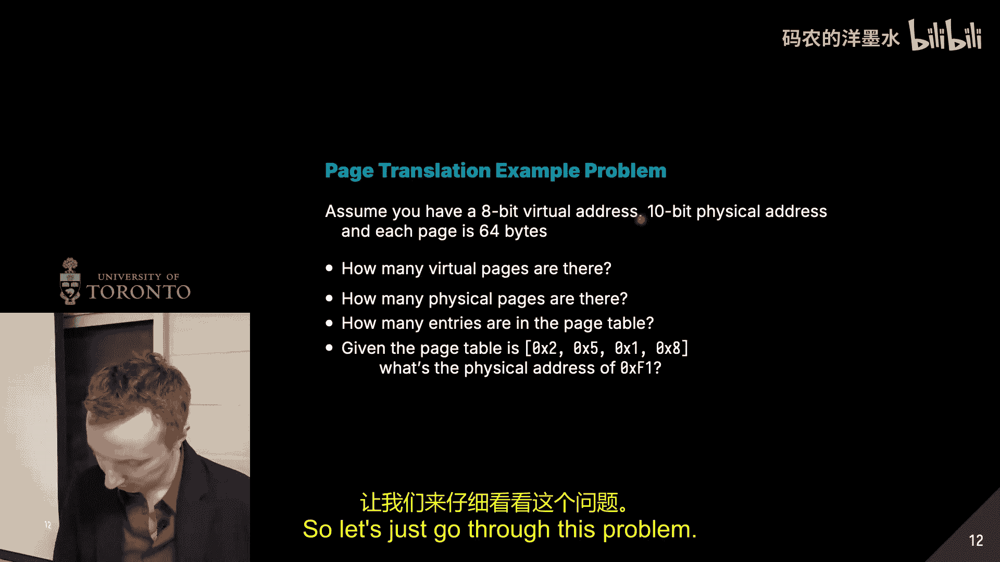

You'll get some questions like this where it's like， hey， I can come。 whoops。

 that's not the right thing。 I can come up with some made up system。 and then we can actually。

 you know， try and do the translations for it。 So we can have a system and you'll be told a whole bunch of information with it。

 and you'll have to figure things out。 So maybe I have a weird system that has an 8 bit。

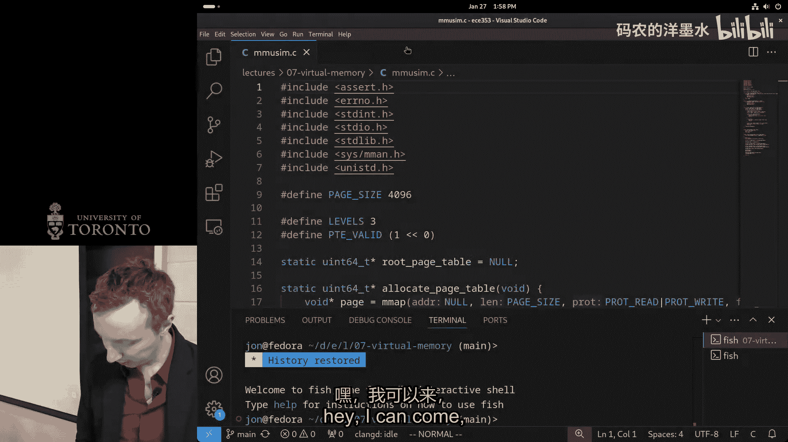

Virtual。Oops。E bit virtual address。Then it has a 10 bit physical address。And then a 64。But。Page size。

So。If I have that system。I should be able to figure out a few。 Well。

 I should be able to figure out a few things。 First thing I should be able to figure out is how。Many。

So how many virtual pages are there per process at most？So。Or to do this， I'm going to have to。 well。

 here is where I'm going to have to practice writing powers of two。Again。

 you can have a calculator or do whatever。Shortcuts I like to have is I just remember that2 to the 10 is 1024 and 2 to the 5 is 32。

 And then from that I just multiply a divide by two a few times to figure it out。

 So if I have a 64 byte page size。 What is that in powers of two。Two to the6 right So2 to 5 is 32。

 I just have to multiply by two once a K one more exponent， and then it is a power of two。

 so this is。Two to the six。Fights right mean the same thing。So。If I were to divide up my。

My virtual address。Right I divide it up into an offset and then index。Well。

 I know that the total size of this was given by the question， it's eight bits。

How many bits do I need for the offset， can I figure it out？Yeah。Yeah， so again。

 memory is byte addressable。 so if I have two to the six bys per page and I need to address every single one。

 I need six bits to do that right to the power6， I need to address every single byte。

 so my offset in this case would be six bits。Right。And that's based off my page size。

 And then the question tells me the entire virtual address is8 bits。

 So how many bits must I have for the index。Oh， yeah。Two， right？So total thing is eight。

It's made up of index plus an offset。 I know the offset is6。

 so that only means I have two bits left over for the index。 right。

 This is pretty much as complicated as the math gets in this course。 So again。

If you have trouble subtracting， you are allowed to bring a calculator on the tests。

 but shouldn't probably need it。If I have two bits for an index。

HowAnd that's the same thing as like the virtual page number。

 how many virtual pages could I use per process？Yep。right so if I have two bits here。

 that means I have a total of two to the two different choices。Two， the two is four。So in this case。

 each process could use。f。Questions about that。Okay。What about the next one。How。Many。Physical pages。

Yeah。16， everyone agree with 16。So，16。Well， why 16， same idea， right？

 So if I was to take the physical address and divide it up。Again， right now。

 whoops probably shouldn't erase everything。Right now it looks the same。

 it will also consist of an offset。Plus， an index。 But this is， you know， the PPN。 This is the VPN。

So， again， offset。Based off the page size， it is the same。 It is still 6 B。

Then the total physical address given by the question is 10 Bs， that means we have four left over。So。

I have。At most possible， two to the four different PPNs，2 the four is 16。

 So it's just2 to 5 divided by 2，32 divided by 2，16。All right。Fun question。How。Many。Entries。

In the page。So how many entries are there in the page table？Yeah。4， everyone agree with four。

Kind of a trick question， right， because well。How many entries are there in a page table。

 Well there's one entry for each virtual page， so these numbers are always the same， right？

These two questions mean the exact same thing because I need one entry for each virtual page so。

This is literally the same question。They're asking the exact same thing。All right。

Question4 might be like， okay， well， here's a page table given。

And I can short form it in like Python syntax and write it as kind of like an array。

So I could write it like this， so if I wrote it like this。And shorthand it。 So each entry。

 all ignore valid bits and everything for now。 So each entry is。Each entry。Is。Just a PPN。

And then since I wrote it like this， of course。Everything is a zero index array。

 so this would be index 0，1，2，3， but typically I don't have to write the index if I write an array right so I could just write it like this so。

I could ask you to。Translate。Virtual address all just shorthand it as VA。Translate virtual address。

F1， so how would I translate virtual address F1， and this is going to be less fun than it was before。

So anyone want to tell me my first step。Yeah。R out in binary， right。

 because before I don't have to change the offset。So before I I didn't have to change the offset。

 my offset was or 12 bits， which was three hex digits。 The address was already in Hex。

 I didn't have to do Nada， right now。I leave the offset alone。

 but it is6 bits that is not nicely divisible into a hex it， right， So it's either 4，8 or 12。

I have to write it in binary crap。So shorthand for binary。

 if you can't remember all the binary translations， what I do again， because I don't know。

 I have weird memory tricks for this， I just remember the value is for a。A is 10， right。

 It's the value 10。 and in binary， funnily enough， it's just 10，10。 So it's just oops。Not a hex。

 so a is equal to 10， 10， a is 10， in binary it' 2 10s， 10，10， a is 10， I don't know。

Whatever I just remember that one。 And from that， I figure out all the rest of them。 So V。

 you just add one to it， right， So it is 1，0，1，1， C again， is 1，1，0，0， blah， blah blah bh， bla， blah。

 blah， but just remember a 1010。 figure out the rest from that， so。And also， F is just all ones。

Probably have that one handy。So if I want to write out F1 in hex or sorry in binary。

 what is that in binary？So F and binary is one。One， one， one， right？And a one in hex， or sorry。

A one in hex in binary。Is 0，0，01。It'sJust one。 right。 So to translate this address。

I don't have to touch the bottom six bits， right， the least significant six bits。

 Those are the offset so。want color。 So I do not have to touch。This， right？So this I leave alone。

All right。In that case。What is this， what is the11 at the beginning？Yeah。Index 3， right。

 it's the index。Or VPN， whatever you want to call it。1，1， and。Binary is just the value 3。

 So that would mean it corresponds to this entry right in the page table。 So I just。

Literally copy paste that， so the offset for my physical address。Again， I don't touch it。

And then now I replace。This。PPN。With the old VPN。 So what is 8 in binary。Yeah，1，0，0，0。

 right so again。This is the ones column。 This is the two's column。 This is the fours column。

 This is the eighth column。 If you have to remember it like that。

 So 8 is just going to be one in the eighths column。 So that would be just copy and paste that。

 So I replace。This index by 0，1，0，0，0。And that's it。 So this is my resulting physical address。

 Everyone agree with me with this。 All right， write it back out in Hex。So right back out in Hex。

 I can just start grouping in fours from the bottom， right， what's this in Hex？1。

What's the next for in Hs？3。And then， of course， there's leading zeros for everything。

 You can write them in if you want， it makes you feel better or do whatever。 What is that in hex。Two。

 so the final physical address。For this is。2，3，1。Everyone okay with that？Fun。

 hopefully we don't have to do binary again， so。

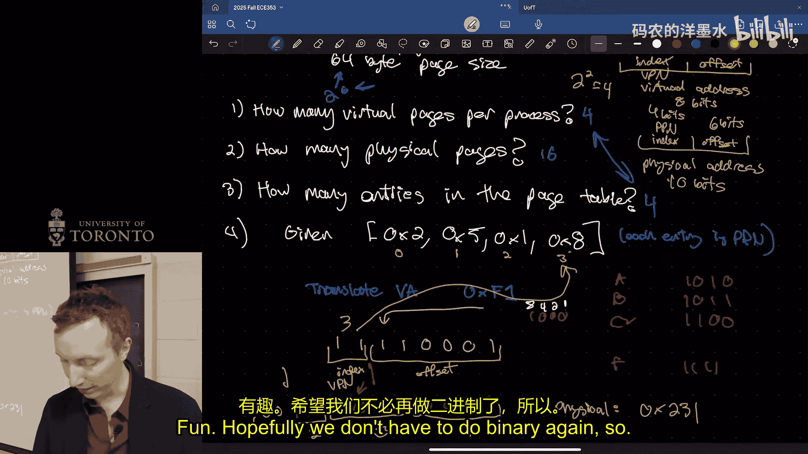

Hopefully I'm nicer to you on the test， which I probably will be and keep it in hex， but yeah。

 so this again， remember each process gets its own page table and now we know also when we fork a process。

 right？Has to copy the page table from the parent， so what it actually does to make it more efficient is turns off the right permission。

For all the memory different your process can access。

 So it turns out both your page tables are exactly the same and they point to the same physical memory。

 It turns off the right bit。 so that if any process tries to modify that memory only then it tries to be lazy and only copy it then we'll get into more details about that in a while you'll get to implement that and that will be fun。

 What are major problem， the first thing we need to tackle is even with this。

 there are two to the 27 entries in the page table。 and each one is 8 by。

 that was our page table entry size。 So if we figure out how big this array is It's just number of entries times the size of an entry。

 That means the page table would be one gig So each process has a one gig page table that means well。

 if I have 16 gigs of memory on my machine I can only have。16 processes。

I can only store their page tables and that's it there's no other memory for the actual processes to do anything useful so at sucks we have hundreds of processes running on our machine so we're going to have to do something about this and in this case yeah note what we're doing right now is we're translating a 39 bit virtual address to a 58 or 56 bit physical address again we have 10 bits in the PT we could expand。

The physical address is the most amount of physical address。

Physical memory that our machine or our kernel could manage。

 and this is how much memory each individual process could actually manage and the size of the page table is basically determined by the size of this virtual address。

 so remember。We needed one entry for each individual one。

 this number was based off of the size of the virtual address。

 so if we supported an even larger virtual address。

 we would need more entries which would cause it to be even bigger than a gigabyte。

 which would even be worse。So。This is also yeah， a lot of work。

In that subprocess lecture we did a forkfold by exec so do we even really need to copy like maybe a gigabyte of page tables so it turns out we don't there's a system call that is dangerous to use called VFork and what that will do is that new child process it will actually use the same page table as the parent so they actually share all memory by default which is really really bad so this is only for。

Only valid if you're doing a fork followed by an exec which creates a new page table to run that new program and it's technically undefined behavior to modify anything in the child。

 so this is only used in performance sensitive programs。

 but we can kind of argue about what it's actually doing now。So for this。

 we use pages for memory translation to divide memory into blocks only after to translate once per block。

Use page tables which is basically an array of page table entries， each entry has a PPN and flags。

 but our new problem that we're going to tackle after the break is these page tables are huge one gigab process we need to do better than that。

 so we'll do better than that in 10 minutes。

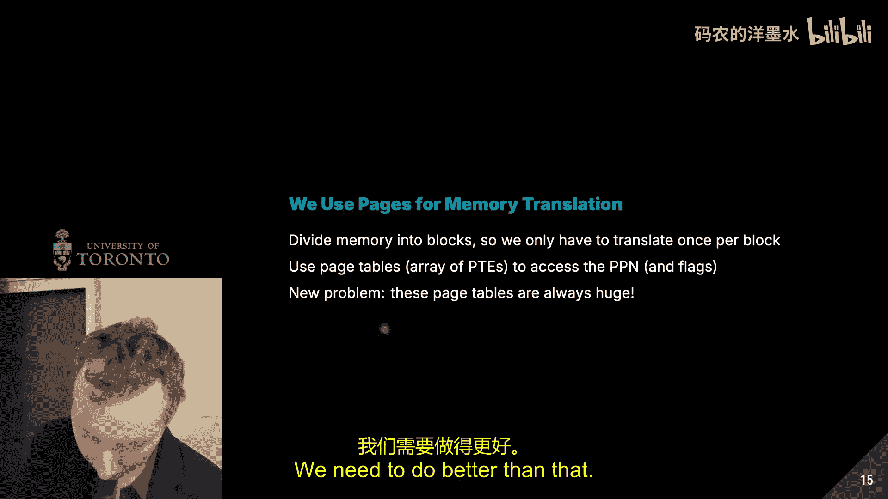

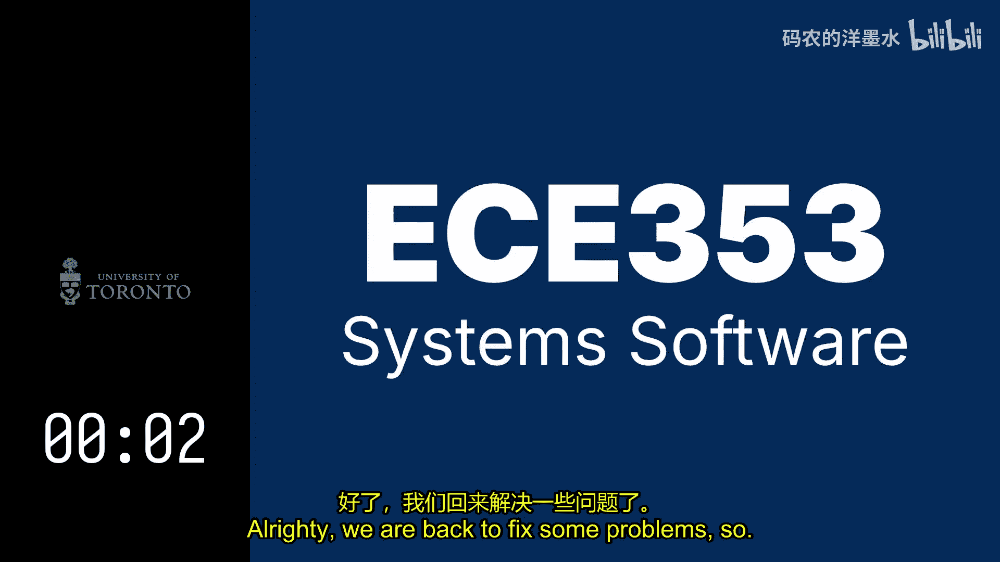

Alrighty， we are back to fix some problems。Most programs do not use all of virtual address space。

 basically anything minus Chrome does not use 512 gigabytes of memory。

Programs you've probably written。Assuming you're programmed in of a memory leak。

 how much memory do you typically use when you run your programs？Any guesses？Anyone， well。

 you probably use like kilobytes， maybe megaytes of memory at best， right？

 you don't need gigabytes and gigabytes worth of mappings。 So I don't know。

 you could have different options。 You could be like， okay， well。

 some processes have a smaller virtual address size or maybe we do something more clever so。

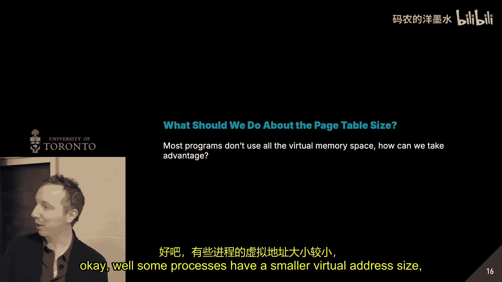

Right now， this is what we have， we still well， right now the idea behind this。

Is you asked before like， okay， where do I actually store the page tables？Well。

 I have to store the page tables in physical memory。

One easy thing to do to make it take up less space is just to make it smaller。

 so I can just make our page table fit on a page so。

That means sometimes I use pages to store data for a process。 Sometimes if I'm the kernel。

 I use physical pages to actually store page table。 So in this example。

 it's exactly like we had before。But now our page table is smaller。

 so if we want to actually fit our page table exactly on a page that means this total size of this page table should be two to the 12 bytes because that is the size of our page and if we know that each page table entry is8 bytes that means we can only fit two to the nine entries right So8 bytes is two to the power of three and to the power of three times two the power of nine is' just two to the power of 12 so lines up everything lines up means if I want this page table to fit exactly on a page it can only hold two to the nine page table entries。

 So everyone okay with that。First step。 So I'm just saying， let's just make our page table smaller。

 So obviously， we can support way less virtual addresses。 So we only have 9 bits for our index now。

12 Bs for the offset， so。Our virtual address now is essentially 21 bits， which is what two megabytes。

 which isn't that great。But。It's much smaller now。 Our page table exactly fits on a page。

 So questions about this， Everything else is exactly the same。And。

Another piece of detail is for your process。Each process。

 there'll be a special register that is actually used by your CPU set by the kernel。

 called the Root page table， it's called SATP， it's basically the root page table。

 it's the page table I'm going to use or the MMU is going to use to translate virtual addresses for this process。

It's basically the starting physical address or the PPN of this page table。

 so it will point somewhere there and that's the page table that will be used to translate addresses。

For this process。 And our physical address is going to stay exactly the same。

 So any questions about this， exactly what we had before。But now our page table fits on our page。

 we made it smaller。Okay。All right， so now things are going to get weird。Deep breath。

This is what it actually looks like。嗯。🤧So let's explain this。So。

We're going to keep with that idea that each page table fits exactly on a single page。

 so each page table can hold two to the nine entries， so to index each individual entry。

 I need nine bits。So。Now， instead of having one gigantic page table that has。Two to the 27 entries。

I'm going to have three levels of page tables which will give me the same power but give me some nice flexibility。

 so now when we had that 27 bit virtual virtual page number。

That was also used as an index into our giant page table。

 But now we're going to take that 2727 B virtual page number and break it out into three individual levels where each level。

Each level page table fits exactly on a page。 so in this case that 27 bits would be divided into3。

 so 27 divided by9 because that's how many different entries we could hold on a page table gives us three levels So now we would have three levels of page table。

 So the root page table register would point at。An L2 page table。

 we give them each different level numbers based off their level， lowest being zero。

 highest in this case being two because I have three levels。So。

How this would work is each process would have a root page table。

 which would be a single L2 page table。That would have two to the nine entries。Before this。

Physical page number that we found in this table。 That's what we just used for the physical address before right now we are going to go through a bunch of different hoops now that physical page number instead of telling us what this virtual page number maps to tells us what page table to use for L1。

 so tells us what page table to use for the next level L1， so we would have two to the nine。

Possible different L1 page tables。 And then each of these could point to two to the nine different ones。

 So in total， I could have two to the 18 different possibilities。Of things that。

The L1 page tables could point to。 So I use this for an index to figure out which page table entry to use here。

And then that tells me which L 0 page table to use。 And here again。

 I have two to the nine different entries。Thankfully and mercifully。

 this is called the lowest level page table， so this page table， the L0 page table。

Like we had before contains a physical page number of the virtual page number that we want for our translation。

 and then again， mercifully we don't have to translate the offset， the offset stays the same。

So we're just jumping through a bunch of hoops this time instead。

 but we still have all the same power right so we have one of these it can point to two to nine different things。

 that means we could have two the nine different L1 page tables at each point to two the nine different things。

 which means we could have two to the 18 different L0 page tables at all point to two the nine different things which means we can still point to two the 27 things in total。

 we're just doing it in a more roundabout way。Allright， why the hell am I doing things like this。

Are we all just gluttons for punishment， so why would I do this？🤢，So before。

 if I want to translate a single virtual page number to physical page number。

 I needed a one gigabyte page table right to even translate a single address。How。

 many pages do I need to translate to single address now if I use this scheme。Three， right？

I could have one L2 page table。That fits on a page， so it's 4 kilobyte。

Then it could point to one page table， the other entries could all be invalid。

 so I'd need another page for an L1 page table， then it could point to an L2 page or L0 page table with all the other entries being invalid。

That is my third page， so that means that brings me up to what 12 kilobys now。

 and then I can actually translate an address just using three page tables。

 right three pages worth of memory， so to translate a single address instead of one gigabyte that I needed before I only need 12 kilobytes in this case。

So if my process doesn't use， doesn't need mappings for everything。

 I can actually save a lot of memory using things like this。

Only problem is that this is very much more confusing， isn't it？I find it fun， but I'm insane。

 so whatever。Does this kind of make sense now， This is why page tables are hard and fun and lots of things。

 yeah。So this SATP register， that is just the page table to use to translate virtual addresses for each process。

Back when I had just one page table that just tells me which page table to use for this process。

Same idea before。But now each process， instead of having just one massive page table is only guaranteed to have one L2 page table。

 and then I use that to start off all my translations。So it's just。

Which page table to you use to translate virtual addresses for this process？

Because I always need a starting point， I need to know which page table to start with。Yeah。

Each process。Please。Yeah。And doよ。So it needs at least an L2， but yeah。

 in order to translate at least a single address， it needs one of each。アウトィ？Yeah， yeah。

 so to translate a single address we need 1 L2，1 L1，1 L0， unless we do something crazy。

 we could do something crazy and make it recursive to break our brains even more so we could have the L2 point to itself。

 so it's used the same thing for each level but we won't worry about that for now。

But that is a technique we can do yeah。So they all have PPNs in it。

But the idea is in the L2 page table， it has the PPN for the L where to find the L1 page table。

 and then the L1 page table， its PPN tells you where to find the L0 page table。

 and then the L0 page table always has the PPN that we actually care about for this whole virtual address。

Yeah。没他吃。来修理。Yeah， so any tradeoffs so that is a good question so now let's think before to translate a single virtual address。

 if I think about it in terms of memory accesses so let's just assume this was a single large page table right in order to translate a virtual address to a physical address well。

This index is part of the address， that's not a memory access。

But I have to access the PP page table entry here， that's one memory access and then access the actual physical address I want right so using if I wasn't using virtual addresses。

 it's one memory access。If I'm using one big page table。

 it's two memory accesses because of the overhead for the lookup， right？So now with this。

 I made that way worse， how many memory accesses do I have now？

So in order to use a single virtual address in a process， now it has to read an entry in L2。

Then read an entry in L1， then read an entry in L0， then do the physical memory access。

 So now I've made things four times slower， so。Well。

 I'm doing four memory accesses instead of just one， if I didn't have virtual memory so。

I have a trade off here。 I made that way slower， but my trade off is now I don't need a huge gigantic page table。

 So I'm trading off time for space。 So in this case，1 GB is just too massive。 I just can't。

 I have to do some trade off。 And also。The reason we store these page tables on a page is because it makes managing memory a lot easier too。

🤢，So。If we go back， let's see。

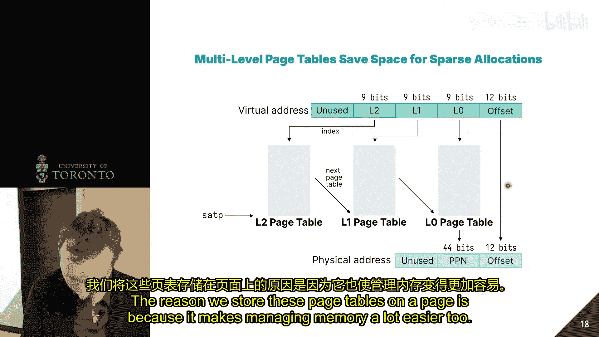

So if I go back and then let's。Thought experiment before， right。We had。

 say this is all physical memory and different blocks。Well， before we said， you know。

 this might get used for one process， this might get used for the same process， different mapping。

 this might get used for a different process， this might get used for a different process。

 and then we were like， oh， well， we need to store you know the page table for this process。

And then the page table for this process。And it has to go somewhere in physical memory right。

 So it's like where the hell does it go。 But now since we're using that scheme where every single page table now fits within a page now it's just。

The kernel will use some pages it'll be like hey， I'm going to use this one for an L2 page table。

 I'll use this one for an L1 page table， I'll use this one for an L0 page table and then these blue ones are things the kernel manage so this could be for you know for。

Process 100， so these could all be for process 100， right？The colonel gets to decide。

Physical memories just divide into pages， the kernel will use some of them for page tables。

 stored page tables there， and some of the pages will be used。For memory for the actual process。

So it makes things easier， the kernel only has to care about pages， makes things really easy。Yeah。

 yeah。Yeah， so my L2 page table， right， it can point up to。Two the nine different things， right？

And that means I could have oops。I could have up to two to the nine different L1s， right？So。

There's no reason why a process couldn't have multiple L1s， right。

 I can have at most two the nine of them。And that's fine。 I， if I want to translate， like。

 say a process actually used 512 GB， then I would need to use。

 I still have to keep track of all the mappings， right， So I would still， yeah， they'd be all full。

 and I'd be pointing to a whole bunch of different things。 General， they shouldn't overlap though。

 So like。This page table shouldn't have like two different entries that actually point to the same physical page。

That， so that probably shouldn't happen。 That's probably bad。So。

For the kernel to make sure everything's independent。

Each process should have its own L2 page table and in fact it's whole independent set of page tables right。

 just to not interfere with any other process， otherwise if you do that， so say， you know。

 I create a different set an L2 for the green process here。

But I make one of its entries point to this L2 process。Or this L1 page table。

 then eventually I can access another program's memory， right。

 same same situation we had before we want to avoid that。And generally， sharing page tables is very。

 very， very messy。Even worse than sharing memory。 so always keep them independent。All right。Okay。

 with that， y。re all the L1。Yeah， so the question is all the L1 page tables。

 are they created when we create a process or are they created on the fly？Some of them。

 the answer is， it depends。 Some of them will get created ahead of time because well。

Part of creating a process the curl' is going to have to load that program into memory， right。

 So it's going to load that program somewhere into memory and it will be using virtual memory。

 so it will have to set up the page tables so that all those virtual dresses are valid for that process when it starts running。

 right。So it will have to have some L1 page tables。

 some L zeros to make sure that those are valid mappings。And then eventually it will run。

 maybe it asks for more heap space or something like that。 And then it can dynamically， you know。

 allocate more pages to that process， which would mean modifying its page tables to say， hey。

 here's some more memory that you can point to， right。So depends， that's what。

We saw that BK system called that is a way to expand the he and it would just give your process more pages。

Yeah。

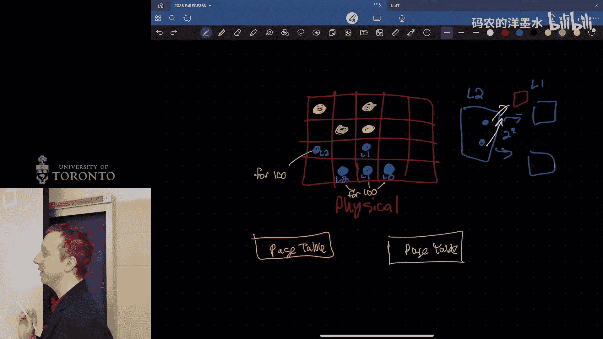

Yep。I would still still need the starting physical address right。

 because for all the questions when I said， hey， translate the virtual address to physical。

 I told you what page table to use right， this register tells me which page table to use。

So why didn't you include it in like a few examples？

I didn't include in the examples before the break because I just gave it to you。

 it was that page table I showed you。That would be what it's pointing to。And when you have multiple。

け塚を。Yeah， so all the page tables eventually。All memories like all data stored in physical memory。

 right？And the page tables they' managed by the kernel， the easiest way to think about is well。

 they have to be somewhere in physical memory， right？But the kernel's just managing them。

 so the kernel gets to the side。This physical page is used from my own page table for。

Page tables I'm managing through processes， or it's going to be used for memory for the process。Yeah。

ミ三0。Like how。くち。to be stable。How does the kernel know where the L2 page table is？So。

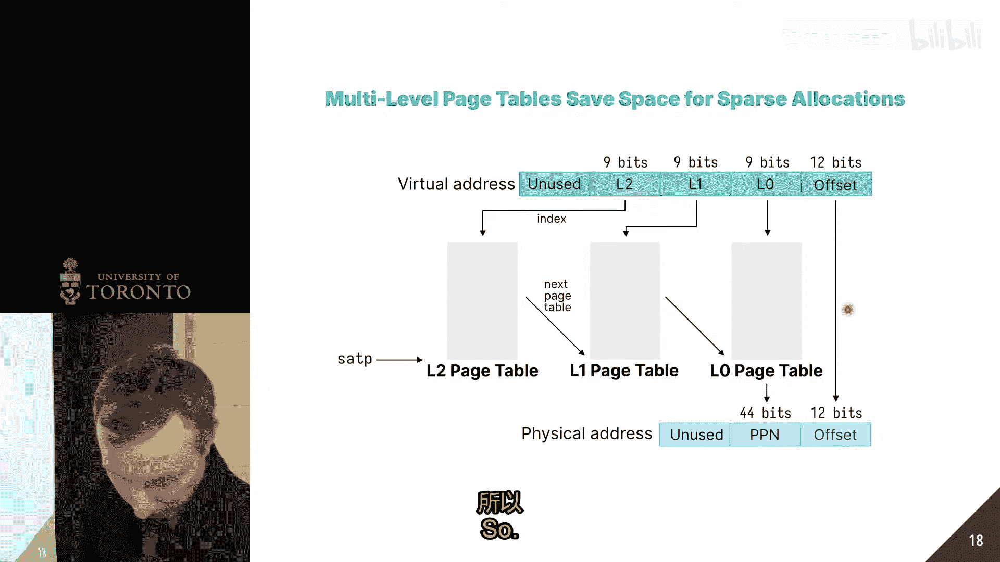

The kernel whoops， so the kernel， when it boots up。

 essentially it would divide memory into these pages and it would know which ones are free。

 so if it needs a new L0 page table， it could just grab whatever page right。

 just grab that one be like I'm going to use that one for an L2。My question was， get the SAT。Yeah。

 that's a register。In the L2P table I think。For the young one。No。

 the SATP just essentially points to the L2 page table in this case。

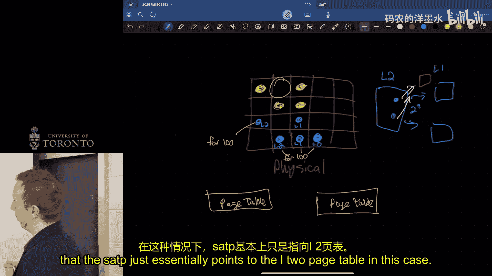

So that register， so the kernel would be like， hey。

 I'm going to use this for an L2 page table and that register would point here essentially。

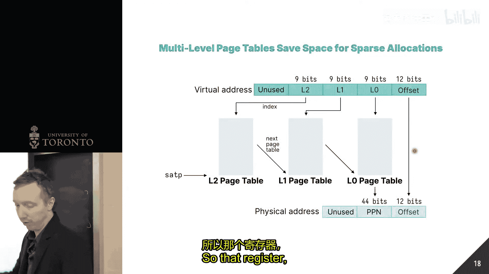

And'd be like， okay， that's the L2 page sta I use to translate stuff for that process。

If you find an entry， that will tell us okay， go here。Yeah。Yeah， yeah。

 and then this L1 right or this L2 would have。A whole bunch of different entries。

 each entry tells me where to go find potentially a different L1。Then L1。

 I use an index to find where my L0 is。 and then my L 0 hopefully tells me where to go to get。

The actual final translation。Yeah， yeah。 So each process has its own L2 page table。

 I need to know where to start if I want to translate a virtual address to a physical one。咁如果你。Yeah。

 yeah。Yeah。Yeah， each process has its own just 1 L2 page table， that's where to start。

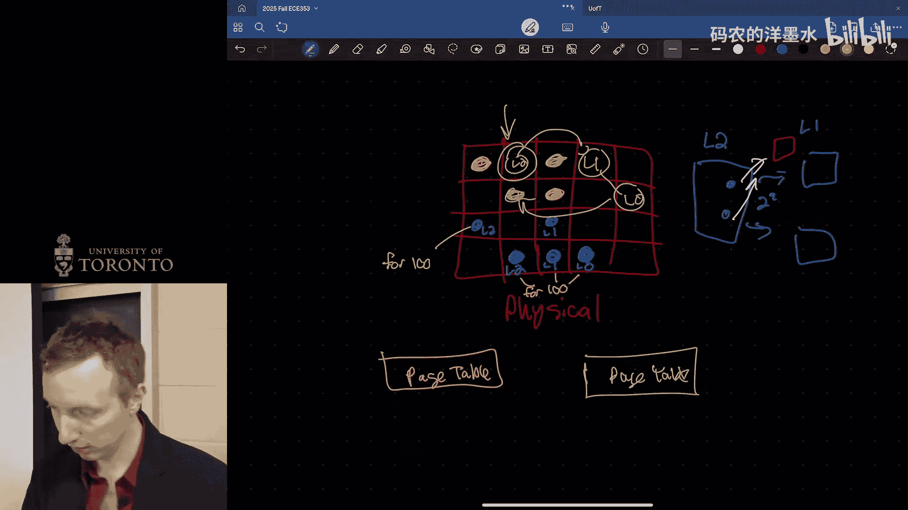

All right。So。Oh， yeahep。To make the L1 now。Yeah， the question is。

 does this relate to the L1 L2 NoL0 CPU cache？Answers。No。To make it more fun。

 they are completely unrelated。So we have here the level1 cache， well， this is levels of page tables。

 levels of cash is not related to this right now， but caches will come in a bit。

 but confusingly we call it something different。So unrelated to caches， but that's a good question。

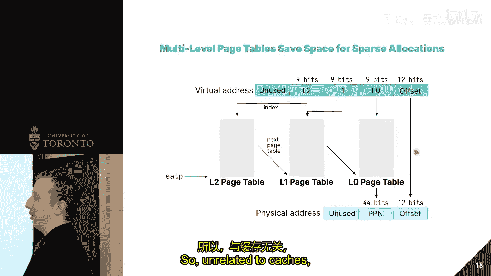

All right， so kind of what I alluded to page allocation or the kernel。

How the kernel does memory allocation is very， very easy。Given physical pages。

 the well specifically kernel， which is part of the operating system。

 just maintains a free link list of pages。When you boot up your computer。

 it can just store a pointer to the next free page just on the page itself because it's otherwise unused。

 so unused pages just contain a next pointer to the next node in the free list that would get initialized as boot and then to allocate a page。

From the kernel's point of view it's easy to allocate the page just remove it from the free list。

 the next thing is the next thing that it's free to deallocate a page I just add it back to the free list so I just have a free list of pages。

 that's it memory allocation according to the kernel is very。

 very easy because it only deals with pages at a time for processes so really， really， really easy。

So。This was our big insight before to use a page for each smaller page that simplifies everything。

 so again， just the math here。Just to double check， we can fit two the nine different entries。

 which is 512。Because they were eight bytes each， which is two to the three。And if it was an array。

 we just multiply the numbers because of the exponent law， we can just add nine to three。

 we can just add the exponents， so two of the 12 is 4096。

 all the numbers kind of line up and again the page table entry for L0 or LN points to the page table for L n minus1 so it always points to the level below it and then the rule is no matter how many levels we have。

 you follow them until you arrive at L0 and that contains the physical page number for that whole virtual page number and our whole tradeoff here again is space for time。

So just to be clear， smaller page tables just like a array。😡，I think we kind of got it。

 but a lot of people get confused about this。And see。

 if I say we have an array of ints and we have 512 of them， what's the size of this array？Oh oh。

In bitetes， yeah。2048 right in is four bytes。Here， in an array， that's how many elements there are。

512 elements。 if they're all ints， each is4 bys。 So the size of that is the size of the I array is 2048 bys。

 right。And then here， if I ask you what's the offset of index 2， anyone tell me what the offset is。

 hopefully this isn't the first time you've heard the word offset yeah。Eight， right。

 everyone got eight。So。Here offset， if you haven't heard that word before。

 just in case offset is just how many bytes from the beginning array does is that element or where does the。

Int at index 2 start at。 So in this case。The first at index 0， that's offset 0， right。

 The first int would start at offset 0 because it's the first thing in the array。

 and it would be 4 B。 So it would be byte 0，1，2， and 3。Index wise。 And then the next int would be 4。

5，6， and 7。 And then the start of index 2 would be at byte 8。

 So it would be byte 8 to byte whatever 11。 So we would say the offset of index 2 is 8。

 That's where that。Actual element actually starts， so it's the exact same thing with page tables。

It's just an array of page table entries。Here。Same idea。 we have 512 page table entries。

 In this case， the page table entry is4 or sorry，8 bytes instead of four bys so。

All of these numbers should jive under this， under this。

Kind of idea we're going with so the size of the page table should be the same size as the page size so in this case if our page table entry is 8 bytes and we have 512 of them。

 then it's 4096 and that's the same of our page size these two numbers should always be equal with multilevel page tables。

And the size of the page table should be the number of entries。

 so this 512 is the number of entries times the number the size of the page table entry。

 so all these numbers should always be consistent in your head so likely on a test， oh no。

 whatever that is was like two weeks， whatever that is。

You'll probably be not given one of these and have to figure out the other ones。

 but luckily it's just multiplication， so you can probably figure out if I don't tell you one。

So let's do some more fun translation。So。Hope we probably won't be able to get through this today。

So let's see how far we get。Yeah， let's see how far we get， All right。

 so assume our process just uses one additional level of page tables。

 so we have two levels of page tables。So if we're trying to translate the virtual address。3 F， F， F。

 F， F， F 0，0，8。 If I wrote that out in binary， it would be like this。

 Or if I group it out so that the bottom 12 bits are not。

If I group it out to the bottom 12 bits which represents our offset this would be it in binary and then each level is9 bits so these are the L0 bits so they're all ones these are the L1 bits。

 the next nine bits that are again all ones so in this case if there's only two extra levels of page tables we have a 30 bit virtual dress that's what that is and again the page size is 4096 so if I had just one big page table right I would need to be able to translate to to the 18 entries。

And each entry is two to the three or8 bytes， so I would need a two megabyte page table for that。

 but because。I'm using this scheme of multilevel page tables。

 I only need1 L 1 page table and 1 L0 page table to translate a single address。

 So for this case to translate a single address， I only need 8 kiloby instead of by single large page table。

 which is two megabyte and then。In the worst case。If everything is full。

 I actually consume a bit more memory， so I consume。

Two megabytes across all of my L0 page tables because I still need to maintain。

All of the entries for each individual virtual page number and then I also have kind of an overhead of my L1 page table because I need that。

 so it actually worst case actually consumes more memory than a single level。Just one big page table。

 which is kind of bad。So。If I want to translate that address， we're not。

 we're definitely not gonna have time to do that in three minutes。 So I will。

 I will let you out of this crazy ride and we can do it in the next lecture。

 So just remember pulling for you。 We're on in this together。 And this is the second hardest topic。

 So if it doesn't make sense， bringring questions to the next lecture。

 We will get through this together， I am pulling for you。

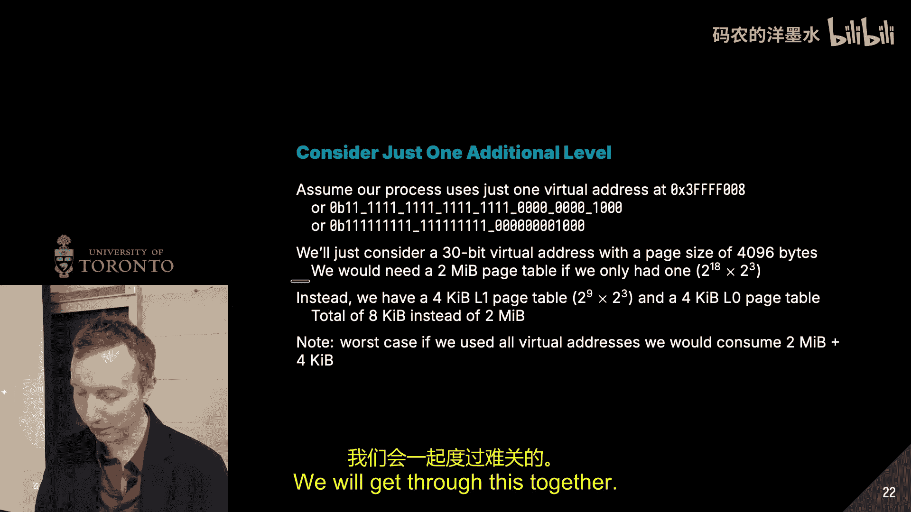