# 系统软件设计与编程：7：虚拟内存 🧠💾

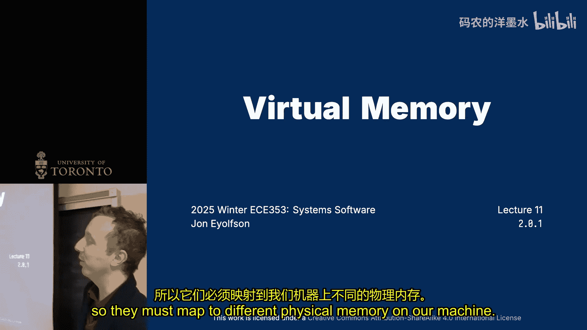


在本节课中，我们将要学习虚拟内存的核心概念。虚拟内存是现代操作系统的基石，它允许多个进程安全、高效地共享物理内存，同时为每个进程提供独立、连续的地址空间假象。我们将从基本概念开始，逐步深入到其实现机制。

## 概述

虚拟内存的核心问题是：如何为每个进程创建独立的地址空间，使得它们可以使用相同的虚拟地址，但这些地址最终映射到物理内存中不同的位置？本节我们将探讨解决这个问题的思路，并介绍页式内存管理的基本原理。

## 虚拟内存的挑战与思路

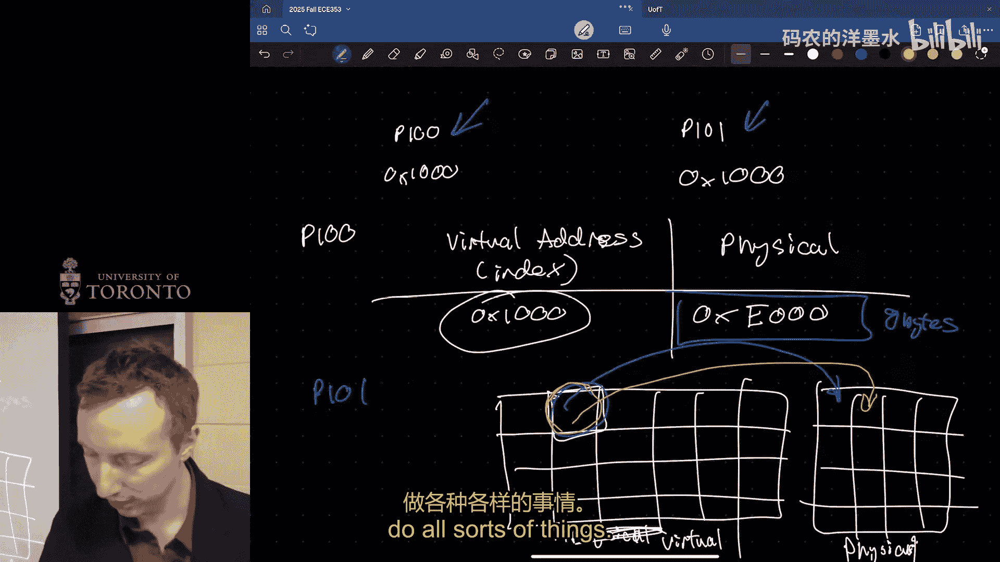

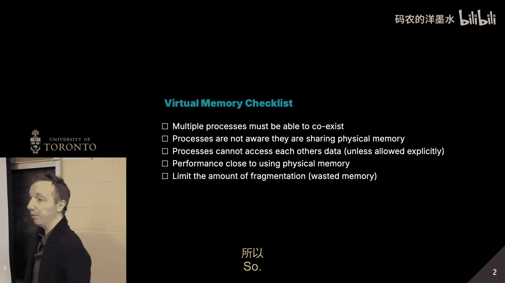

上一节我们介绍了进程间内存隔离的需求。本节中我们来看看如何实现虚拟地址到物理地址的映射。

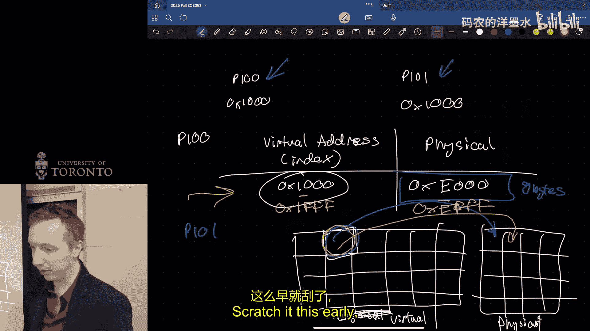

两个进程可以使用完全相同的内存地址，但它们是独立的，因此这些地址必须映射到我们机器上不同的物理内存。我们如何创造这种假象？

以下是实现虚拟映射的一些初步想法：

*   **分块管理**：将内存划分为大块（例如4096字节），并跟踪这些块之间的映射。
*   **地址预留**：在虚拟地址中预留一部分位作为索引，指向物理内存中的大块。
*   **偏移量**：为每个进程存储一个固定的偏移量，将其虚拟地址加上偏移量得到物理地址。但这种方法在进程内存大小变化时难以处理。
*   **哈希表**：使用哈希表进行映射。但本质上，哈希表是为了高效使用数组而设计的。在虚拟内存映射中，我们可能需要映射每一个地址，因此直接使用数组（即页表）是更直接的思路。

最简单的想法是为每个进程维护一个巨大的查找表（数组），虚拟地址作为索引，表项存储对应的物理地址。然而，这种方法极其浪费空间：为了映射每一个字节，我们需要花费8个字节来记录映射关系，导致只能使用九分之一的物理内存。

## 页式内存管理：核心思想 💡

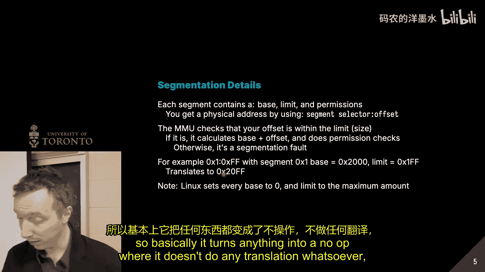

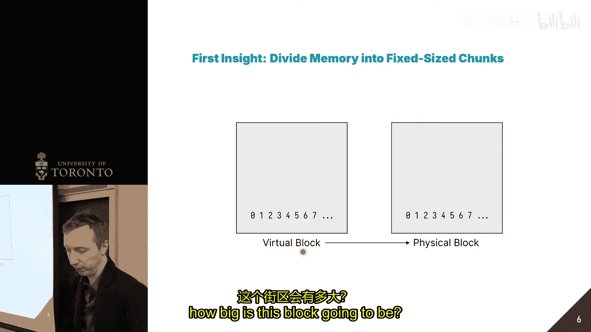

为了使映射更高效并提高内存利用率，一个关键思路是将内存划分为更大的固定大小的块，然后只跟踪这些块之间的映射。

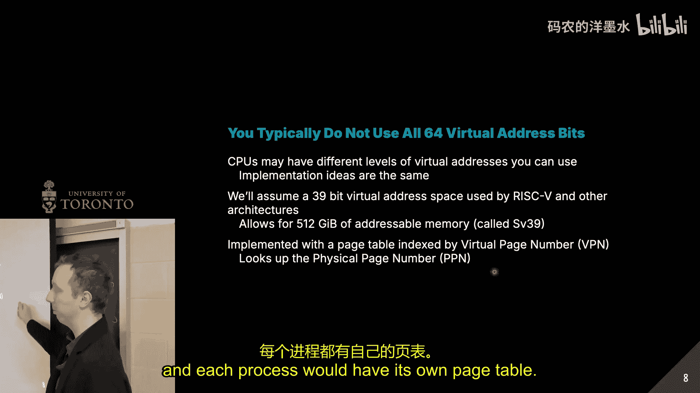

我们给这种固定大小的块起一个名字，叫做**页**。我们将所有物理内存划分为固定大小的页。然后，我们只为每个进程跟踪其虚拟页到物理页的映射。

**核心公式**：
*   物理地址 = 物理页号 (PPN) × 页大小 + 页内偏移 (Offset)
*   虚拟地址 = 虚拟页号 (VPN) × 页大小 + 页内偏移 (Offset)

通过这种方式，如果一个进程的虚拟地址1000映射到某个物理页，另一个进程使用相同的虚拟地址1000可以映射到另一个不同的物理页。这样我们获得了灵活性，如果所有页大小相同，我们可以移动它们，做各种操作。

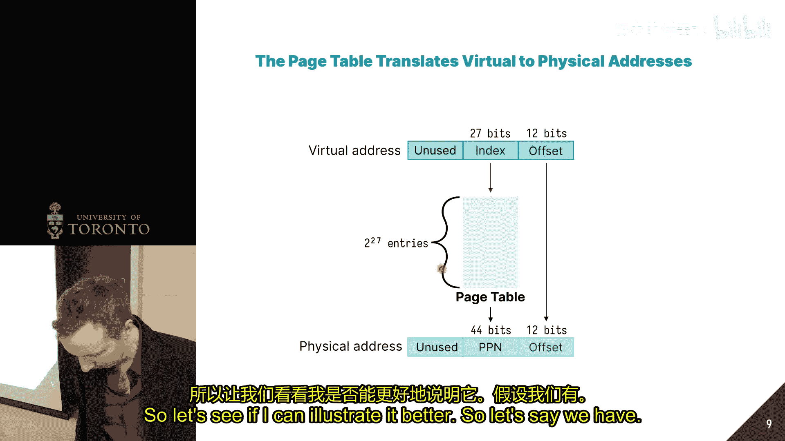

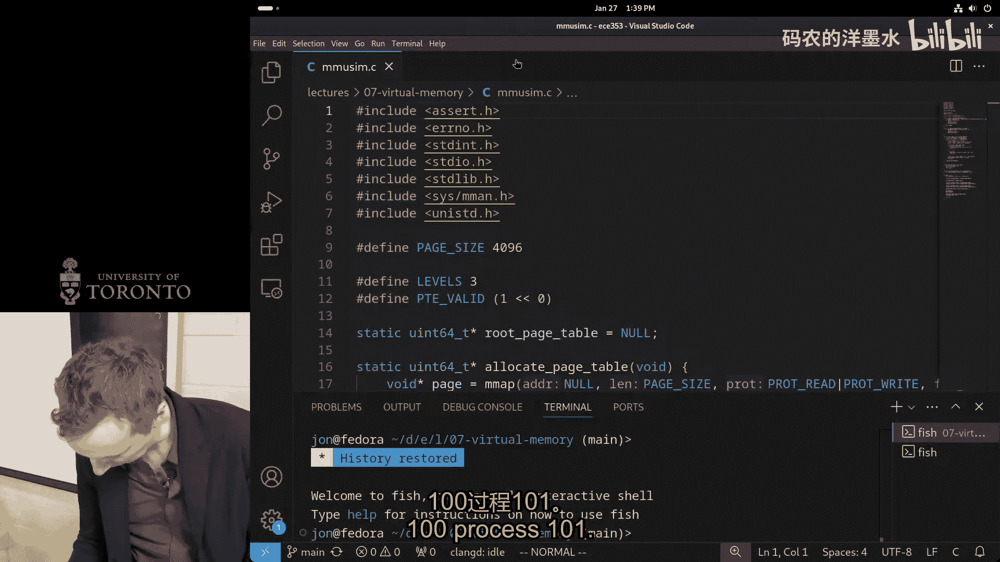

## 页式内存管理的优势 ✅

我们的虚拟内存系统需要满足以下要求，而页式管理很好地支持了这些特性：

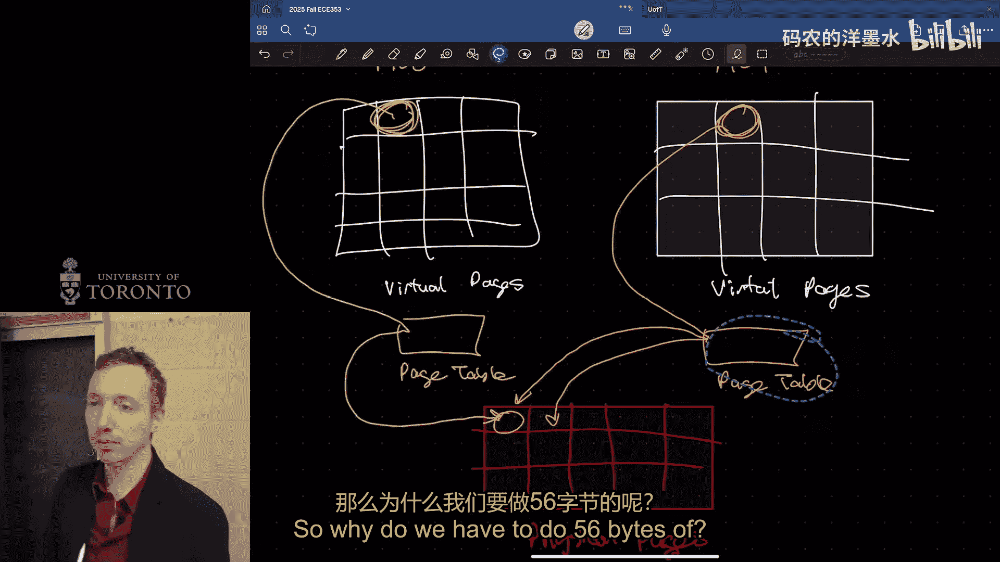

*   **进程共存**：多个进程必须能够共存，且不应意识到它们在共享物理内存。
*   **内存透明**：进程不应关心机器有多少物理内存或其他进程的存在。
*   **安全隔离**：默认情况下，进程不能访问其他进程的数据。
*   **性能接近物理内存**：虚拟内存访问性能应接近直接使用物理内存。
*   **减少碎片**：需要限制内存浪费（碎片）。由于我们使用大块，程序可能不会一次使用整个块，因此我们需要选择一个“恰到好处”的页大小（不能太大也不能太小）。

## 地址与指针的本质

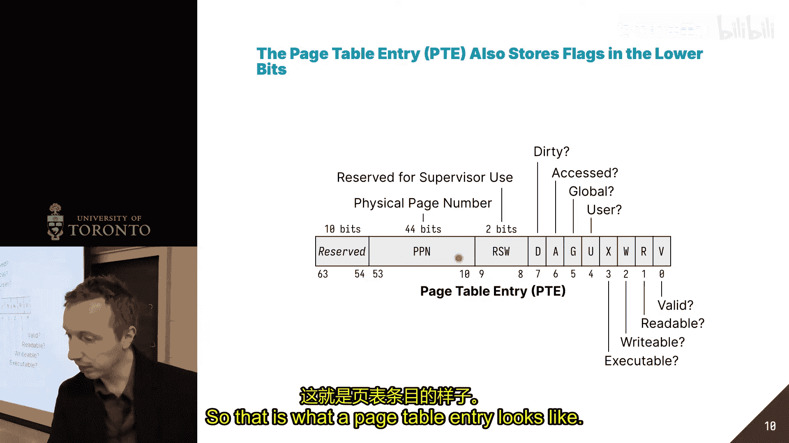

内存总是按字节寻址的，你可以寻址的最小内存单位是一个字节（八位）。地址和指针本质上并不复杂：你可以将内存视为一个巨大的字节数组，而地址只是这个数组的索引。

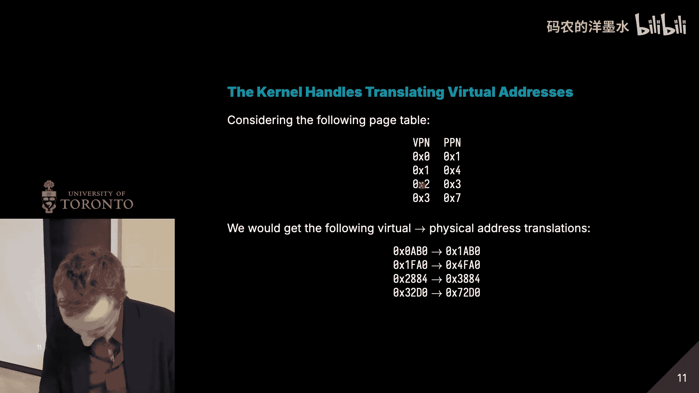

## 段式管理：历史背景 🕰️

在深入页式管理前，了解其前身——段式管理——是有帮助的。段式管理是一种粗粒度的内存管理方式。

它将虚拟地址空间划分为具有不同用途的段（例如代码段、数据段、栈段、堆段）。每个段具有可变大小，可以动态调整，并带有权限（可读、可写、可执行）。

**段式地址转换**：
虚拟地址被分为两部分：段选择符和段内偏移。内存管理单元 (MMU) 通过检查偏移是否在段大小限制内，并将段基址加上偏移来计算物理地址。如果访问违规（如越界或权限不足），就会触发**段错误**。这就是“段错误”名称的由来，尽管现代系统已不再使用段式管理。

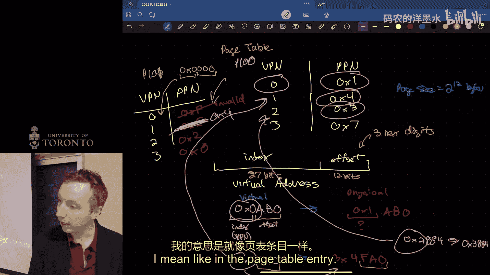

段式管理的主要缺点是段可能非常大，重新定位（移动）的成本很高。

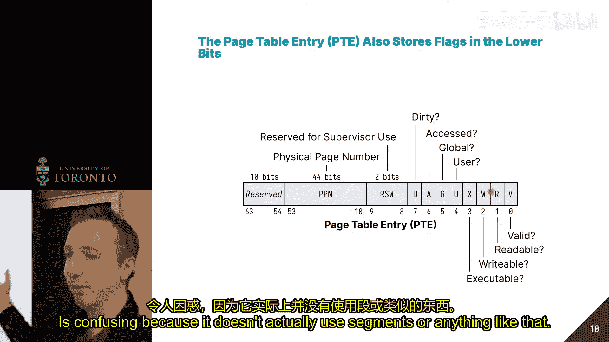

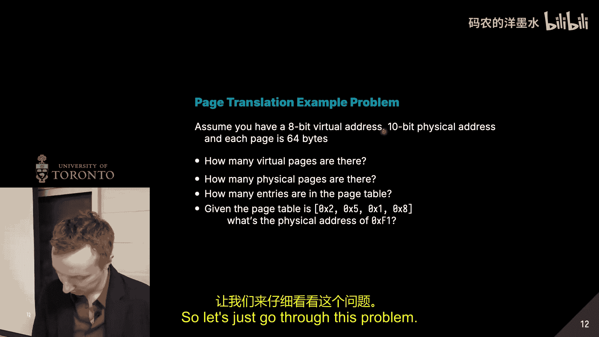

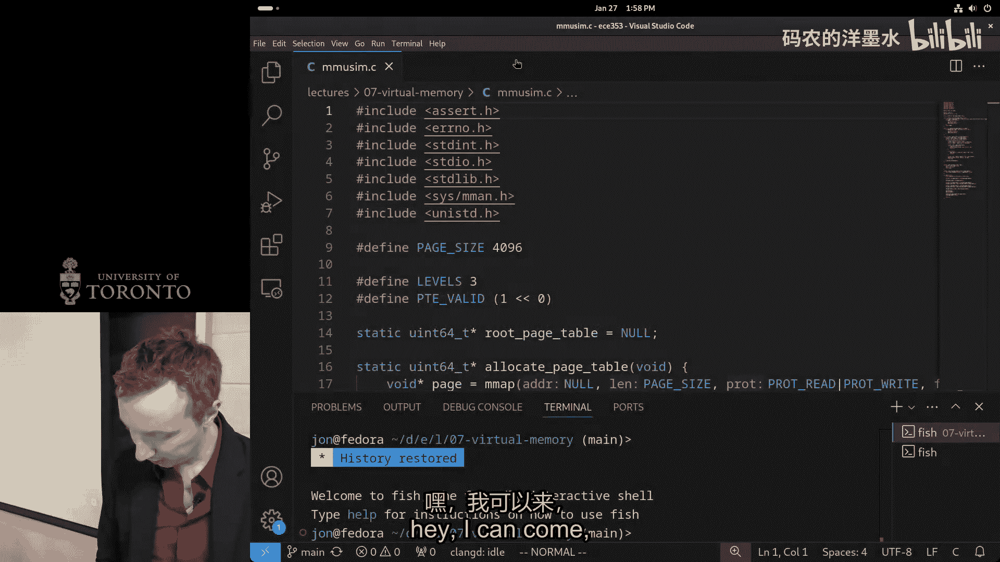

## 现代方案：页表 📄

我们真正的解决方案是使用**页表**。页表本质上是一个数组。

**核心代码/结构描述**：
```c
// 页表项 (Page Table Entry, PTE) 的简化表示
typedef struct {
    uint64_t ppn : 44;  // 物理页号
    uint64_t flags : 10; // 标志位（有效位、读写执行权限等）
    // ... 其他保留位
} pte_t;

// 页表本身就是一个 PTE 数组
pte_t page_table[NUM_ENTRIES];
```

*   **索引**：数组的索引是**虚拟页号**。
*   **值**：数组的值是**物理页号**。
*   **独立性**：每个进程都有自己的页表。

### 地址转换过程

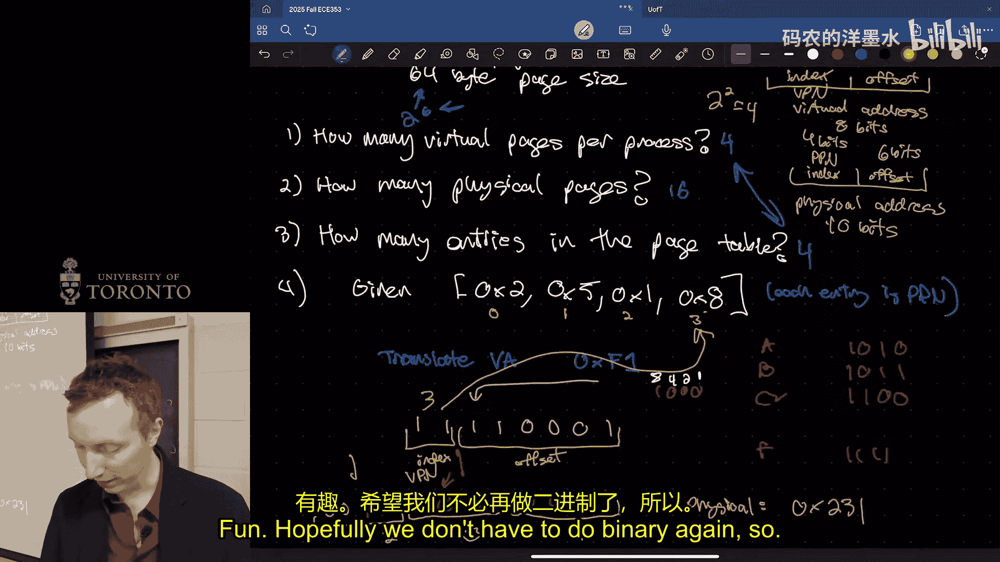

假设我们使用39位虚拟地址和4096字节（2^12）的页大小。

1.  **划分地址**：将虚拟地址划分为两部分：
    *   **页内偏移**：低12位（因为2^12 = 4096）。这部分在转换中保持不变。
    *   **虚拟页号**：高27位（39 - 12 = 27）。这用作页表的索引。
2.  **查表**：以 VPN 为索引，在进程的页表中查找对应的 PTE。
3.  **组合地址**：从 PTE 中取出物理页号，与原始的页内偏移组合，得到最终的物理地址。

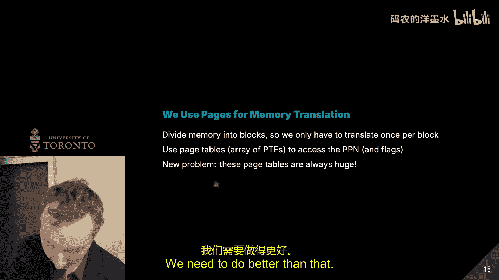

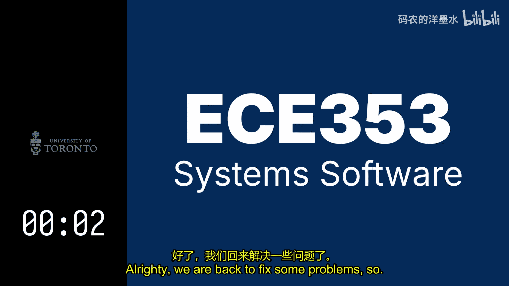

**转换示例**：
假设虚拟地址为 `0x1FA0`，页表显示 VPN 1 映射到 PPN 4。
*   偏移 `0xFA0` 保持不变。
*   VPN `0x1` 被替换为 PPN `0x4`。
*   最终物理地址为 `0x4FA0`。


### 页表项详解

一个页表项不仅包含物理页号，还包含重要的标志位：

*   **有效位**：该翻译是否对此进程有效。访问无效地址会触发段错误。
*   **权限位**：可读、可写、可执行权限。
*   **其他位**：如访问位、脏位（用于后续优化），以及供内核使用的保留位。

页表项的大小设计（例如64位/8字节）考虑了未来扩展性，以便支持更大的物理内存地址空间。

## 单级页表的问题：空间开销过大 ⚠️

我们遇到了第一个大问题：页表本身太大了。

在我们的例子中（39位虚拟地址，4KB页），每个进程需要 2^27 个页表项。每个项8字节，那么每个页表大小就是 1GB。如果一台机器有16GB内存，仅存储16个进程的页表就用完了所有内存，这显然不可行。

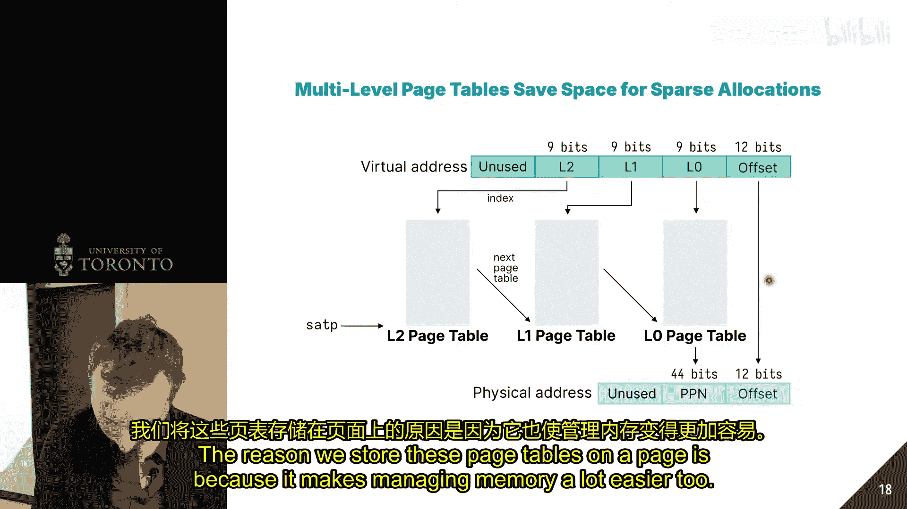

## 多级页表：用时间换空间 🔄

为了解决单级页表空间开销过大的问题，我们引入了**多级页表**。核心思想是：大多数程序不会使用整个虚拟地址空间，因此我们可以只为实际使用的地址区域创建页表。

我们让每一级页表的大小恰好等于一个物理页（4KB）。由于每个页表项是8字节，一个页可以容纳 512（2^9）个项。因此，每一级页表需要用9位来索引。

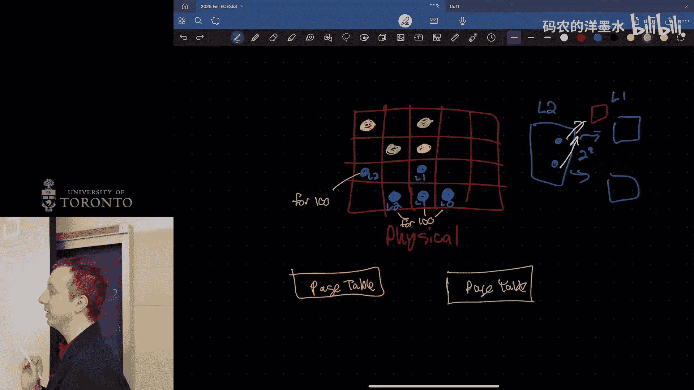

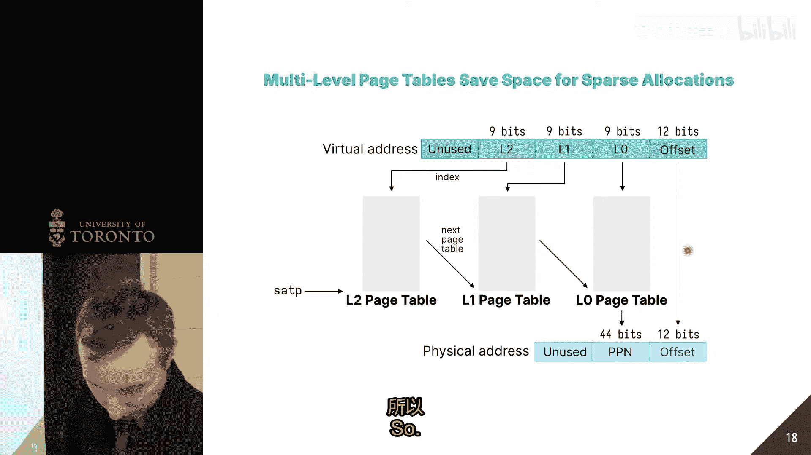

对于39位虚拟地址，我们将27位的虚拟页号（VPN）平均分成3组，每组9位，分别用于索引三级页表：L2（根页表）、L1、L0。

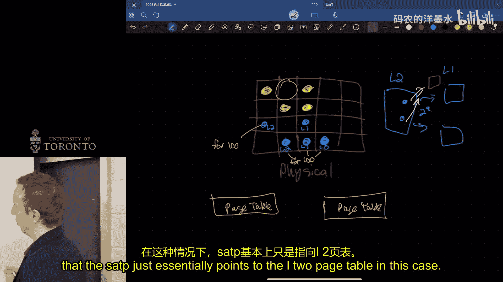

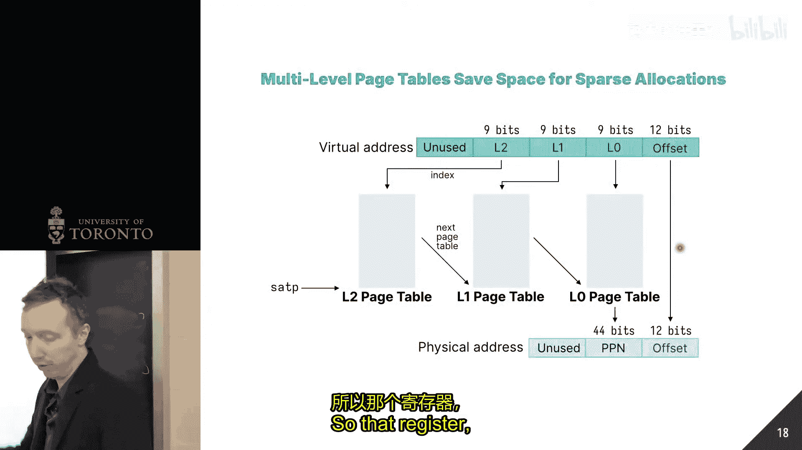

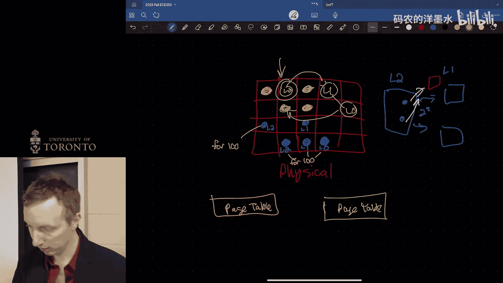

**转换过程**：
1.  CPU的 `SATP` 寄存器指向当前进程的 L2 根页表的物理地址。
2.  用 VPN 的最高9位作为索引，在 L2 页表中查找。找到的 PTE 包含一个 L1 页表的物理页号。
3.  用 VPN 的中间9位作为索引，在 L1 页表中查找。找到的 PTE 包含一个 L0 页表的物理页号。
4.  用 VPN 的最低9位作为索引，在 L0 页表中查找。找到的 PTE 才包含最终的目标物理页号。
5.  将此物理页号与原始的12位页内偏移组合，得到物理地址。

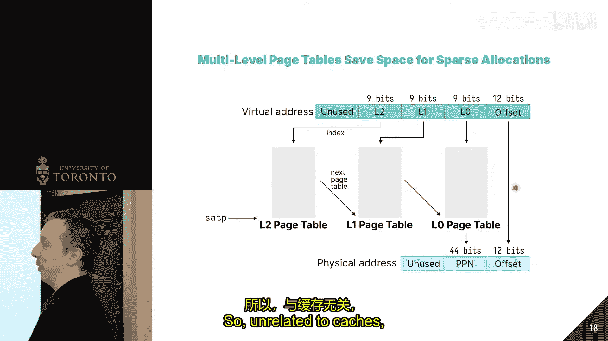

**优势与权衡**：
*   **空间节省**：现在，为了映射一个地址，我们只需要3个页（L2, L1, L0各一个），即12KB，而不是之前的1GB。只有当一个进程使用了大量分散的地址空间时，多级页表的总开销才会超过单级页表。
*   **时间开销**：每次内存访问现在需要先进行3次页表查找（3次内存访问），最后才是目标数据访问，总共4次内存访问。这比直接物理访问（1次）或单级页表（2次）要慢。我们是在用**时间换取空间**。
*   **管理简化**：内核只需以页为单位管理内存，无论是用于存储进程数据还是存储页表本身，机制统一。

## 内核的内存管理

内核如何管理物理内存？非常简单：它将物理内存视为一个个页的集合，并维护一个**空闲页链表**。分配一个页就是从链表中取出第一项；释放一个页就是将其加回链表。这种仅以页为单位的分配方式极大地简化了内核的内存管理。

## 总结

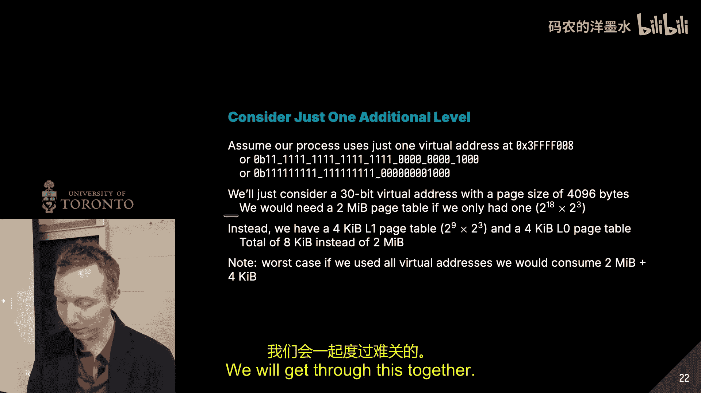

本节课中我们一起学习了虚拟内存的核心机制。我们从虚拟地址映射的挑战出发，探讨了页式管理的基本思想，即通过页表将虚拟页号映射到物理页号。我们分析了单级页表空间开销过大的问题，并引入了多级页表这一“以时间换空间”的经典解决方案。多级页表通过树状结构，只为进程实际使用的地址区域分配页表，显著减少了内存开销，尽管增加了地址转换的时间。理解页表的结构和转换过程是掌握现代操作系统内存管理的关键。