# 【全集 2025】多伦多大学 系统软件设计与编程 中英字幕 1080P p08 Lecture 8 - 页表 -BV1YrkYBQEeL_p8-

🎼Yeah。Alrighty， back to 35，3 in page tables， we had fun last class， right， yeah？Yeahep。

It should be released， right？Yeah， all right。So page tables。

 we had a fun two hours of torture last class， so we had this。

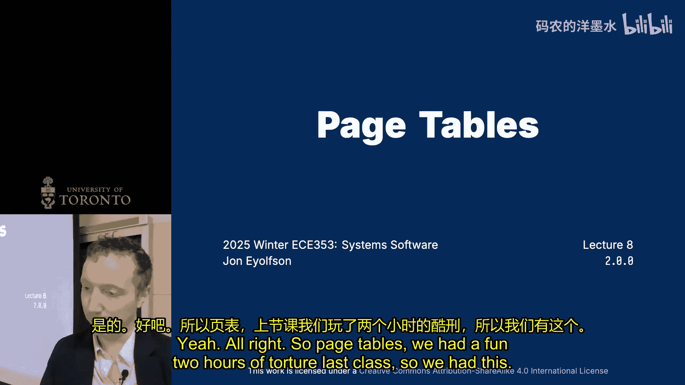

Any questions？So。Quick review， right， Each process has its own set of page tables because each process has its own virtual addresses that map to physical addresses。

Page tables managed by the kernel。And what we had before， we broke up， you know。

 had a virtual address， used a whole bunch of bits for pages。Some for offset。

 everything's the size of a page that's the number of bits we need for the offset is to the whatever power of bits equals the size of the page because we can only memory or access memory in bytes at a time and then before we used this entire thing as an index we called it VPN and we looked at a giant page table to find the physical page number for the process and we were like wow that's too huge that would be a gigabyte。

Then we decided to hey， let's fit each， let's break it into smaller page tables such that they all fit exactly on a page and then we figured out how many page table entries we could throw on a single page and that is the number of bits here so we need to address every single entry we can fit on a page table in this case。

We have two the 12 bytes up。P page and our page table entry size is8 bys so we can fit to the nine entries on a single page so that is where we got our nine bits from and then we broke the VPN into multiple levels based off however my bits we want to cover so in this case it's a 39 bit address so we broke into three levels so to translate an address now it is now a whole process so。

The kernel will set the root page table， in this case， if we have three levels。

 it's the L2 page table unrelated to the caches named L1 and L2。

And the entries there will contain a page table entry that will point to where the L1 page table is。

 and then we'll use the index from the virtual address。

 figure out what entry we have to access that tells us the VPN or sorry the PPPN of L0 and then we look at the index from the virtual address。

 find out whatever the entry is and that's the PPN for the final physical address and we don't have to translate the offset so any quick questions about that Yeah。

 the L table each entry points to another L1。to L1 points to another L0。Yes。Yeah。

 so each entry in L2 points to either nothing or an L1 page table。

 and then each entry in L1 points in L0 or nothing。Right。

So the whole idea behind this is in order to translate a single address well we could only have one valid entry in our1 or L2 page table and then that would point to1 L1 then only one valid entry here that points to 1 L0 that has well in this case we only need one of them it could have up to 512 entries that could translate up to 512 virtual page numbers so at minimum we only need three page tables now and the whole idea。

Behind doing this too is you think of this as a tree。

 so there's only one L2 page table and then it can point it up to2 the nine。

 and then each L1 points up to two the nine， just like a big spanning tree。

 but the whole thing here is we can cut it off early because of an entry in L2 is invalid。

 then we cut off that part of the tree。

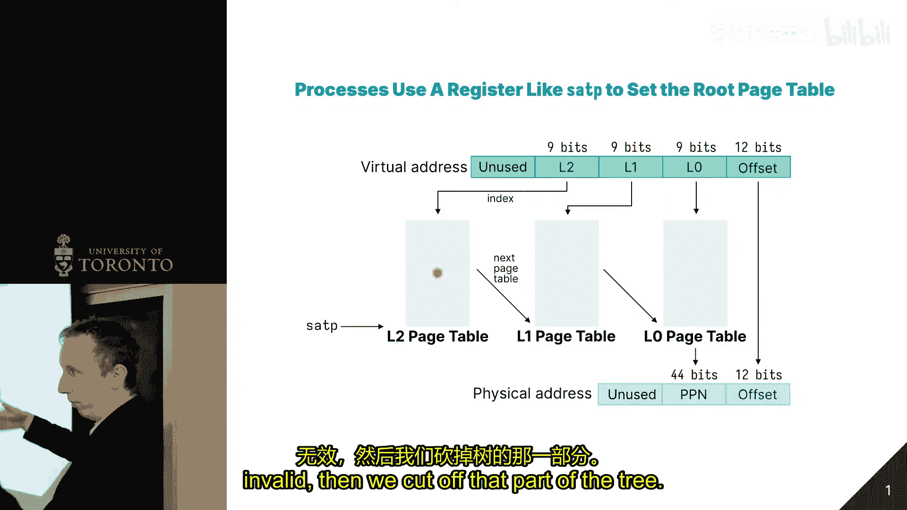

Allright， so we have to talk about alignment。 I got this question， too。

 So alignment means memory eventually lines up with byte 0。 So if pages are。Page aligned or。

4096 byte aligned。 It means pages always start when the lower 12 bit are 0。 And in computing。

 we like alignment。 That's why we don't have to store the offset of the pages or anything like that。

 So if instead we didn't have page alignment， then it would be really weird because。

If a page starts at like the Hex address 7 c00， if we go a page further。

 then it means its last byte would be at address 8 BFF， which would be really weird。

 So in this case since everything is page aligned all the pages start at offset  zero so memory address 0。

 that means if it is on PPPN 7， it means it starts at the address 70，0，0。

 that's where the first byte is always when the last in this case。

3 hex digits are all0 and ends at 7 FFFFF。 so。Alignment basically just asks if it is divisible by that number。

 so for instance。If I asked you， is the address EC8 by aligned， what is your answer？No， right？

Why is that not aligned to8 bytes well？If it was aligned to 8 B。

 it means it should be divisible by 8。 It means if we take that address， it should be， you know，0，8。

16，24，32， whatever。And in this， since it powers of  two， all I have to do is check essentially。

If it ends in a0 or an8 because all the other hex digits。

Just represent some power of two that is divisible by8 by itself， so。

An address is going to be 8 byta line if it ends in a 0 or an 8。 And that's an easy way to check。

 So this ends in a C is not 8 by aligned。 But if we asked if it would be 4 byta line。

 that would be true。 So 4 byta line， it ends in a 0，4，8， C。And that's it。

So questions about alignment， so that's why we don't have to store the offset of a page or anything like that if we get the PPN of6 again。

 we know where it starts at offset0 and goes all the way to the end and we're using that whole page to store a page table of our entries and if everything is you know if all my entries are 8 bytes。

 that means the first one would be at 7000， the next one would be 7，0，0，8 then 7，0，10。

 so on so forth。All right， questions about alignment， and that's why we don't have to store that。

Cool， all right。So here's the question we had before I will try and blaze through it。

 So this is translating a two levelvel page table that just has one additional level instead of three。

 like we usually have。 So if our process just uses this virtual address，3 FFFF 8800，8 again。

 we have to break it up into the L1 index， the L0 index and the offset So the last 12 bits here are the offset didn't really have to translate them in this case。

 the next9 bits would be all1s the L1 index， which is the upper9 bits。

 would also be L1 and we have that because we are considering again a 30 bit virtual address normal page size and if we just had one large page table it would be to the 18。

Times2 to the power of three B large， so it would be  two megabytes big。

In this scenario to translate a single address， all we need is 1 L1 page table， 1 L0 page table。

 and that's it， so we have a lot of memory savings even for a single level。

So if we were to translate that address， then while to even do the translation。

 I would have to tell you where the L1 page table is。It would be somewhere in memory。

 let's say I't know， let's say the root page table register is pointing at PPN 7 like we had in the example before。

 and then if you look it up at index 512 which is all ones。

 then if it has a PPN of 8 and hopefully a valid bit saying it's valid， that means the L0。

Page table would be located at the address 8，0，0，0。

 That's where the start of that page table is because it's all page aligned and everything like that。

So then we would use the index， the L。0 index from the address。 It would have the P PN of C A F E。

 for example， That means we're done。 That's the entry in our L 0 page table。

 So that's the P PN for the overall VPN。 So our final translated address。

Physical address would be CA FE008， so questions about that。Cool， all right。

 now we will go on to more fun things。 So here。

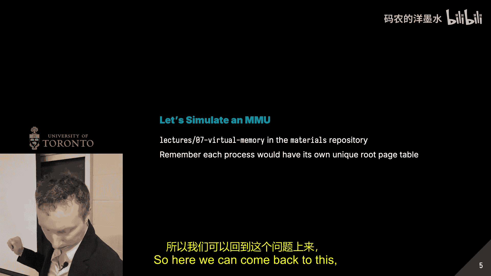

We can come back to this， but just to see quickly。This is basically what the kernel would be responsible for。

 So if I wanted to simulate using an MMU， this code is given to you in your examples repository， but。

Here。In order to translate a single address， if I have three levels of page tables。

 I need at least an L2 page table， an L1 and an L0。

 so I have this function called allocate page table that just gives me back a page so I just get back a page and Im it's see I'm using it through a pointer。

And I also have a global variable that's called the root page table just to simulate like that would be set as a register and the MMU would use this L2 page table for the translation the virtual address translations。

 so I just set it here。Then I create an L1 page table， so that gives me a new page。

And then I set entry0 in my L2 page table。2。2 that page table that I just allocated。

 so it just creates a page table entry from that address so itll just shift some bits over so that it creates a PPN from that and makes it valid。

Then。I create an L0 page table， so there's allocate page table again， then in L1， I do at index 5。

I point index 5 to point to this L0 page table and then in this L0 page table at index 188。

 I put the PPN CAFE so then I have this MMU function which would actually be happening on your CPUU and this will use that route page table and then translate this virtual address to a physical address for you。

 so it would use all the page tables， get the indexes from this address and translate it for you so。

If we were going to translate this ourselves and figure out what index are used。

We wouldn't have to translate this， the last three hex digits are the offset。

 so we wouldn't have to translate that， and then oh for ABC， well。

 then we'd have to write that out in binary and start grouping all that stuff。

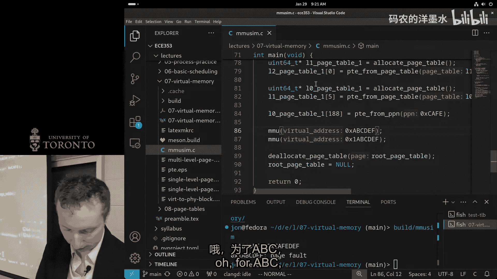

If we were to translate ABC， So let's just。So a， if we remember from before， is 1，0，10。

Given that stupid little shortcut， B is what whoops。B is 10，11， and then C is 110，0。

And then I just have， I'll just write the offset in hex here。So。

If I was to figure out what indices are going to get used right for that normal SV 39。Translation。

 I have to group in groups of nine， so these nine bits would be used for the L0 index， right？

Then these nine bits would be used for the L1 index。Then the top。Nine bits are used for the L。

Two index。So。Can anyone tell me what 0，1，0，1，1，1，1，0，0 is in decimal？No one's that quick， All right。

 I'll give you a hint。 It is 188。All right， easy one。 What is the L1 index in decimal？5， right。

 That one should be easier。What is the L2 index in decimal？Z， right。

 So sometimes people get tripped up。 there is always leading zeroes。Right。

 my address is going to be at least 39 B。 So if I don't write anything， it's all leading zeros。

 So we got a whole bunch of zeros here and then a whole bunch of zeros here。So if I have， again。

 what we started off with virtual address。We start off with virtual address， AB，C， D。EF。All right。

 so everyone get how I broke out ABC， D， E，F into these parts。Oh， D EF， whoops， I skipped ahead。

Sorry， this is TEF。What see。All right， questions about that。So。

Those are the indexes I'm going to use if I set it up so that I have a valid entry here and a valid entry here and a valid entry here like I did。

 so if we go back， those are indeed the indices I used0，5 and 8， so if my L0 page table。

 it has a PPN of CFAE， what is going to be the final final physical address for this virtual address。

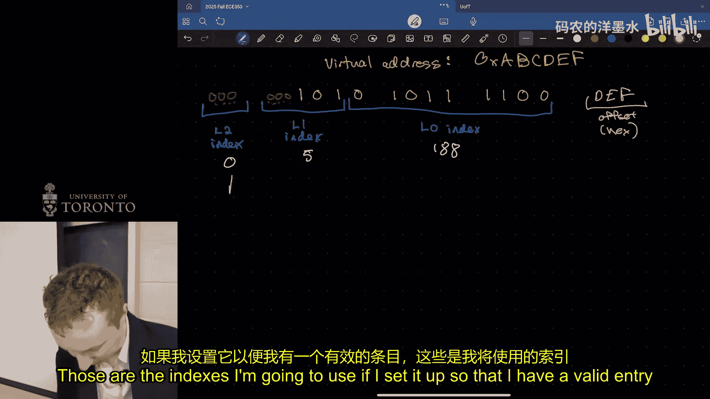

Oops。Yeah。Yeah， see， so we're going to replace essentially， we broke out all of this。Into indices。

 if we follow the indices until we get to our L0， which has the final PPPN for the translation。

 we'll just replace the VPN by that and keep the offset， so our final address is going to be。

 oh I have it at the bottom here， still crap。So our final address is going to be CA FE and then D EF。

 and then if I tried to do this one， try and access this。

I'm going to get a page fault right because there's no entries if I follow that at somewhere along the chain。

 it is going to in fact， page fault and just go ahead and die， right？So。Questions about that。Yeah。嗯。

 c a。0 zero。Why is it not， sorry？Zhi。Yeah， so each page is 4096 by。 But remember， at the end。

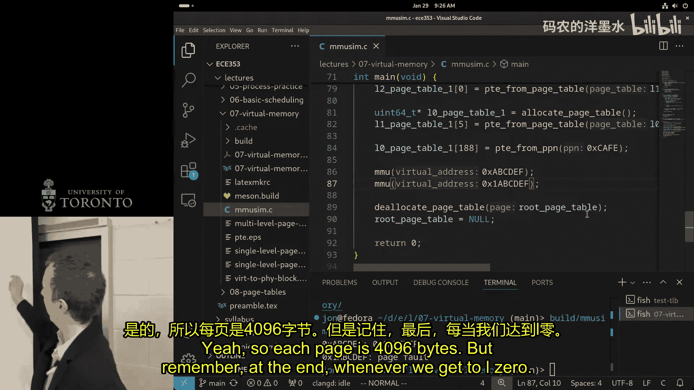

Whenever we get to L0。Here are we。Whenver we get to L0。

 we just use the PPN we find there to replace it and get the physical address by PPN plus the offset we got before。

Yeah， the offset stays the same。No matter if it's virtual page or physical page。

 the offset is just like how many bytes into a page am I trying to access， it will never change。And。

Here， these page tables would start at address 0， 00 because they span a whole page， right？

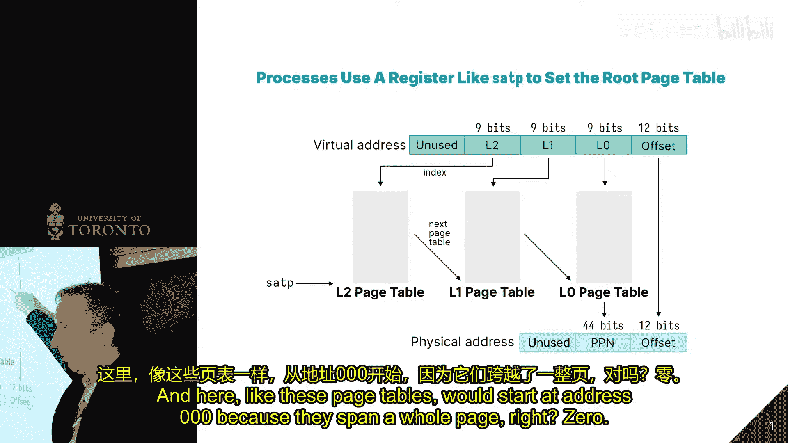

闇さん。Mhhum。Slide four。So the offset would be 0，0，8 in this one because my first address I'm trying to translate ends in 0。

0，8。So again， the offset doesn't change。It would just be where the page table starts because the page table span a whole page。

 right？オケージョン。Yeah， yeah。 So the page tables span a whole page。 So they always start at 0，0，0。

 span a whole page。But once I get to the final translation。Like。The page I get back， right？

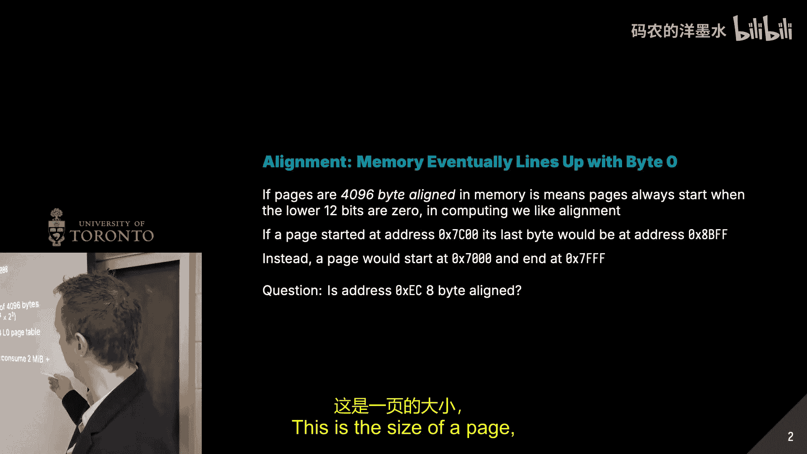

This is the size of a page， but I'm accessing some byte on a page。

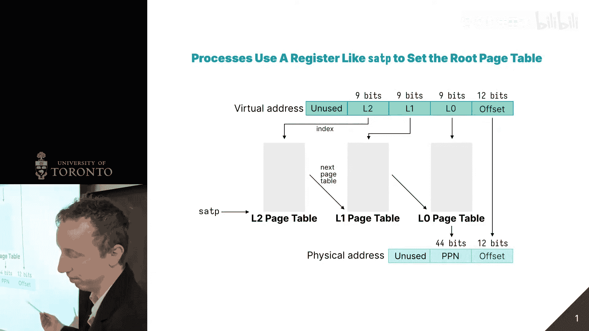

Okay， any further questions about that， That's fun。

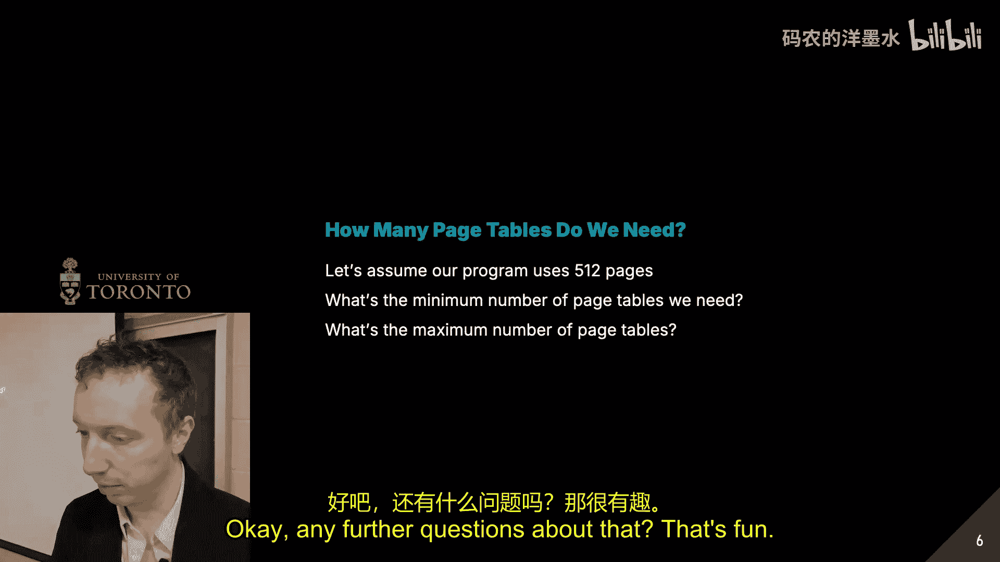

Al right， any wizards。 So how would I make this entry valid。Yeah。The L2 page up。

Make the L1 entry at what？You added one。So that would increase the L1 index。Get the。So。7，6。

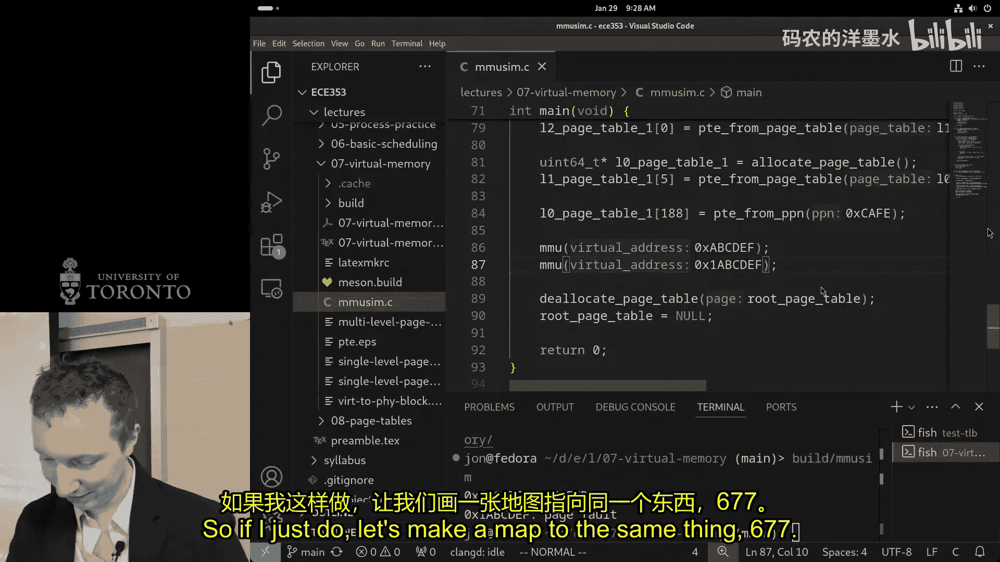

So if I just do。Let's make it after the same thing， six， seven， seven。确认。Yeah。13。Yeah。1，1，0， yeah。

It's D， so it should be。What's that， that's like the eighth column。

 So it should be 5 plus 8 was 5 plus 8。13， so that。So if I do that， right？Ohoops。饿。Then yay。

 see it works and now I've made magic because now both of these virtual addresses because they point to the same L0 page table。

 probably not something you want to do because now I can access the same physical memory through two virtual addresses in my process which。

Turns out is something you can actually do in your process if you really want to。

 Sometimes it's actually useful。 Sometimes it's really confusing。

 but that is actually something you can do if you really want。 So questions about that fun thing。

 And you can see you can play around with this， make up all sorts of addresses and all that fun stuff。

 And spoiler alert。😊，It kind of looks like lab3 ish。Alright， so that was fun。 Allright。

 so I'm going to dispel some myths for us now。 Oh， actually， first。 So another question。

 how many page tables do we need， so。😊，We assume our program uses 512 pages。

There's two questions we could answer。 What's the minimum number of page tables we need and then what is the maximum number of page tables we need for this process。

Any guesses？

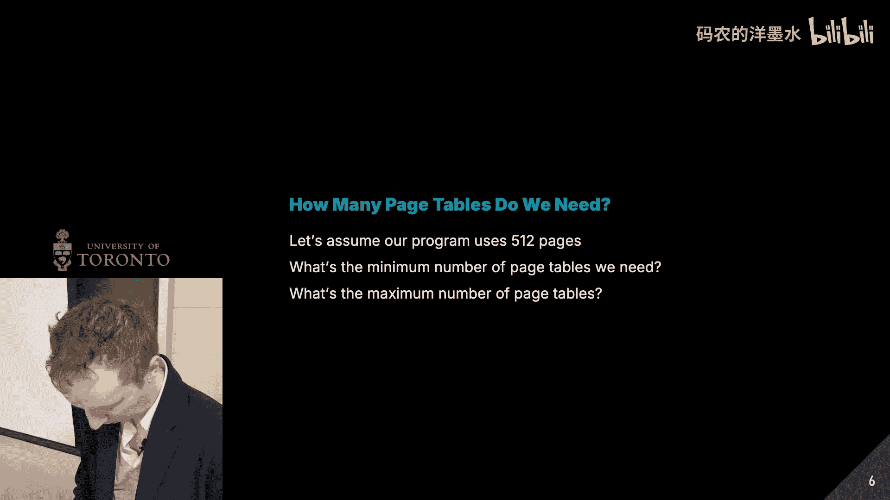

Whoops。All right。Any guesses， so your program is using 512 pages of memory。

How many page tables at minimum does the kernel need？いいぱバれた。Yeah。5，515。So why 515？

Because we use that happened。We need three more to keep track of。So just page tables。

 so three more to keep track of page tables， so then your answer three， right？Three。

 everyone good with three。So why3。Minimum would be I have one L1 page table， right。

 I have one L1 page table。It points to1 L。One page table。

 which just has one entry that points to 1 L0 page table and this page table is full so it can fit。

 remember we can fit 512 entries using the SV 39 so we could have up to we could point to essentially 512 pages through this whoops。

So that would mean my L0 is completely full right every single entry is used there if I want to use 513 pages of memory in my process。

 then while I can't stuff something else in L0， I would need to have a new L0 here with a single entry and in my I don't need another L1 page table I can just have another entry that points to an L0 and that points to one page here。

 so if it was 513 pages I would need at least four page tables。Clear。Okay， well， what about。

The worst case。2。Maximum。So what about if I was a big old dumb du？Yeah。1025。How'd you get 1，025？

you took the address as a separate。Yeah， so I have my L1 page table and you're saying it's full。

 so it's full， so it's pointing to 512 things。And then each of those is an L1 page table， right？

So these are my all one page tables， and then each of those just have a single entry。

So each one of these has a single entry。These are my L zeros。

 and then each one of those has a single entry。So that points to at total 512。

Pages across all of them， so I'll have 512 L 0 page tables， 512 L1 page table plus my 1 L0 or L2。

 sorry that would give me 1025 in total if I was a big dumb do， right。Everyone get that ish。Yeah。

Cant you just have like。白分。11。You can't have just one big page table。

 So this is assuming multi level page tables。Yeah， this is。Yeah， SV 39。 if you try and do that。 So。

 I mean， you could try and be clever with recursive page tables or something like that。

 but that will only work essentially like it doesn't care if this page table points to itself。

 it'll just follow the steps three times right？ So the entry here could point to itself。

 and that could use itself as an L1 and then itself as an L 0。

 but it's just gonna map to itself always， which is probably not what you want。

 So we'll just assume that just for the sake of simplicity that。They're all independent。

 You don't sharing page tables is generally a bad idea。All right， all good with that。

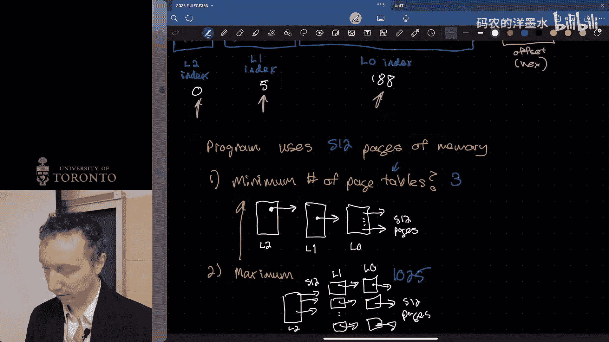

All right， so next thing might be like， hey， these are typical questions， how many pages do I need？

Back in the day， before you were born， we had 32 B CPUs with 32 B virtual addresses and 32 B physical addresses。

 So we still believe it or not。30 years ago， we still use the same page size of 4096 bytes。

But because we had to support less physical memory back in the day。

 our page table entry size were was smaller。 So it was only 4 B， so。

If I want each page table to fit in a single page， my calculation， well the steps are still the same。

 but my final output is going to be slightly different than was before because now my page table entry size is half of what it is now so I could find the number of page table entries I could have that would be two to the 10 now。

 so it makes sense I can fit double the number of entries on a page if it is half as if the entry is half as big。

And then again， like we've always been using log2 to the number of PPN or PTEs per page is the number of bits for the index table because while I need to figure out which entry I'm trying to address So if we were to figure out the number of levels we need。

 it is just the number of levels equals the number of virtual bits。

 minus the offset bits or another way to express this is just the number of bits we need for the VPN again same。

Same thing， just different way to express it and then divided by the number of index bits。

 and then we have to take the ceiling。For 32 bit CPUs back in the day。

The number of virtual bits was 32 offset bits still 12。 So that is in total20。

 And then the number of index bits is 10。 So this is a ceiling because we have to round up if it doesn't nicely divide。

 But luckily， back in the day， it nicely divided。It's funny how that works。

 So we add to have two levels。 So what is a consequence of this compared to 64 B CPUs now。Yes。Yeah。

 this is faster， right， so less levels， it's less memory access that I have to do。

And a 32 B virtual address that supports up to 4 gigs of Ram， which。When。64 bit CPUs first came out。

 People didn't have that much Ram， and they were like， wow。

 why the hell would I upgrade to a 64 bit CPU that would make my programs all slower？

So there was some reluctance to do it initially because， yes， indeed， it made things slower because。

Well， 64 bit CPUs need a bigger page table entry size to support the bigger physical memory it could address。

 so I actually need more levels to actually address the same or like to support the same level of virtual addresses so。

Here is where we dispel some myths。Has anyone ever been bothered？Everyone's told you， okay。

 we've all been bothered。 Ha anyone ever told you that， hey， access memory sequentially。

 it's a lot faster。Everyone's been told that， right。

 Does it bother anyone that you're using something called Ram random access memory， and it's not。

Random access some sequential access is faster。No one's ever been bothered by that， just me。

So let's dispel it。 So， yeah， using page tables for every memory access is slow。 turns out Ram。

 if you're accessing physical Ram。Random access is true。

 It doesn't matter what address is' trying to address。 it will all be more or less the same speed so。

The whole slowness is due to。The biggest factor is page tables。

One of our goals was to make this fast right now it's really slow。

 so we need to follow pointers across multiple levels of page tables and likely you have to access the same page multiple times like close to wherever the first access time was and then a process might actually only need a few VPN to PPPN mappings at a time So one solution is another computer science classic there's pretty much two solutions add another layer of abstraction or add a cache so this is adding a cache。

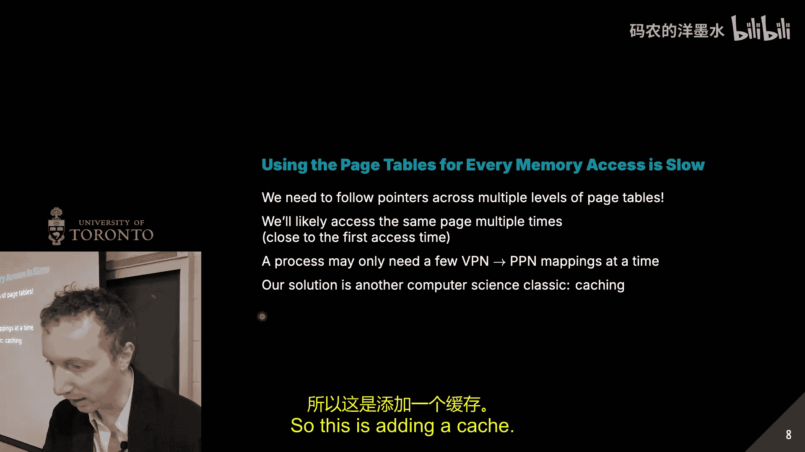

So。kind of related to the L1 L2 cache that actually cachees data for you CPU。

 This is a cache for page table entry。 So this is a cache for doing the final VPN to PPN or I guess more generally VPN to final PE mapping。

 So what's going to happen is we have our virtual address。

 which is 39 bits never after trans the offset。 So the VPN bits are what we're using for translating。

 breaking them up into indexes to go through the multilevel page table。

 But we just add a cache So we had a cache。 It's called the TLB translation lookco buffer。

 good term to know。 And we'll just see if this VPN is already in our cache。

 So that means we already have the final PTE in the L0 page table。

 So the final one after falling through all the steps。

 So we can just use it directly we get our PPN there if there is a。It'll be hit。

 which means it's in the cache。If there is a TLB miss。

 then we have to translate it using page tables。 so we have to go step by step by step by step。

 which is really， really slow。 So we want to avoid that and hit the fast path。

 So when we do finally translate the address， we would add the entry to the T LB。

Don't have to know the entry or the details of the T L B。 It's basically just a cache。

 So this is what makes things quick。

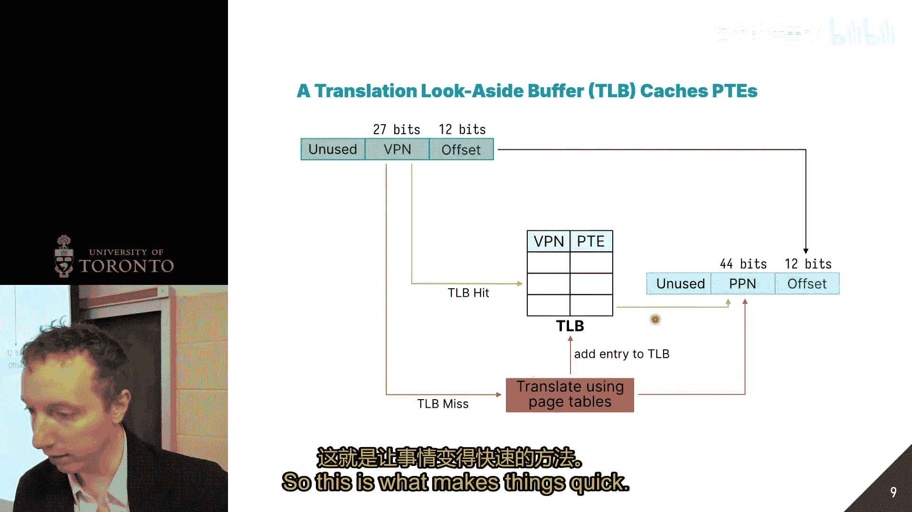

So。knowing that we can actually calculate the effective access time for using virtual memory。

 so if we assume again， just assume a single page table for this calculation。

 this is like the best case scenario where there's only one additional memory access for going through the page tables。

 So the TLB hit time， So searching the TLB isn't free， It's a lot faster than memory。

 but it's not free。Is。If it's already in our cache。

 well we had to search to make sure it was in our cache and then access the original memory physical memory access we wanted to do。

 so if there's a hit slight penalty for searching plus the original memory access we wanted。

 if there is a miss， while we had to search the TLB to try and find it。It wasn't there。

 so in this case， if I had to look it up and we had a single large page table。

 I would have to look up the page table entry， then do the additional memory access。

 so this multiplier here will change depending on the number of levels of page tables we have if we have three levels that would be4。

 one for L2， one for L1， one for L0， and then the original memory access。

And then if we compute the effective access time where alpha is just the ratio of hits to misses。

 we have the hit ratio times the hit time plus the miss ratio times the miss time。

 So if we assume that we hit 80% of the time and our TLB search takes down at 10 nanoseconds and memory accesses take 100 nanoseconds。

 our effective access time is you know 0。8 times。110。

 so the original memory access plus the search and then。20% of time will have the slow path。

 which is the search， plus the two memory accesses。

 So that would give us whoops an effective access time of 130。130 nanoseconds， which。

Isn't two times slower。 So it's like a 30% overhead in this case， which is much， much， much better。

 So caches save us。 It's the only thing that saves us from using multi levelve page tables。

And turns out this is like the dominant thing that， oh， yeah。No， the TLB would be for the entire CPU。

 so the CPU just has one TLB。But it would yeah。 so we can get into those details。 too。

 Was that the next slide。 So yeah， here we go。 So context switches requiring handling the TLB， right。

 So if I switch processes， I'd be switching which address space I'm in， right。

 So if my TLB is caching VPN to PPN， that would be caing it for this process。

 if I change to a different process， they're now all invalid。 So one option is to flush the cache。

 So I just get rid of all of the entries in my TLB。

 they are no longer valid anymore more because I'm switching to a different process。 or。

There's some systems where the TLB will actually support attaching a process ID to the entries。

 so they're only valid for a certain process， most implementations they just flush the TLB in Rik5。

 it has a special instruction called SF virtual memory accesses and that flushes the TLB on X86 if you essentially load the base page table or change the route page table register。

 it automatically flushes the TLB for you， you don't have to remember to do that。

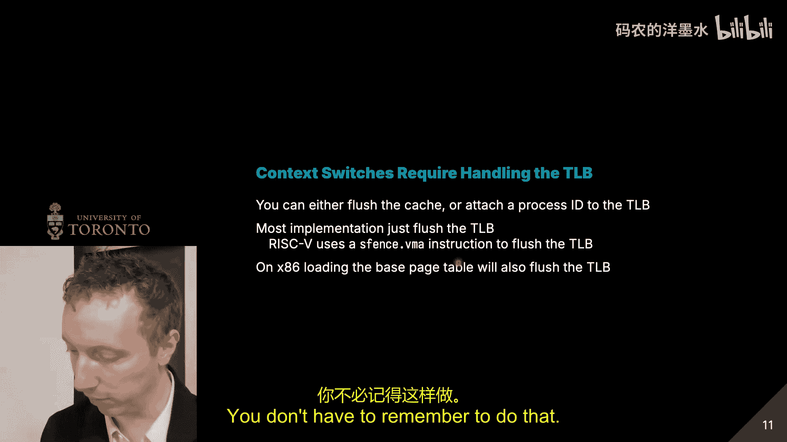

So we can actually explore why this is the primary reason why things are slow， so I'll bring this up。

So this little program called test TL B was written by the same dude that started the Linux kernel。

 So you know it's good and it works like this so。It just takes two arguments， the size and a stride。

 and what that will do is just allocate a bunch of memory of this size and stride is however remaining bytes it will access that in。

 So if the stride is 4， it will access byte 0， then 4 then8， then 12， blah， blah bh， blah， blah。

So if I do test TLB with 4096， so that's the size of a page and the stride of four。

That means it will go ahead and you know， get。A page access by 0，4，8， 12，16。

 so on and so forth until it's done， in which case it will have 1024 accesses in total。

 and then it just averages out the memory accesses to tell you how long it took。How long each took。

 So here， if I do this my。Effective access time is 1。4 nanoseconds to access memory。

 So if we were to think about T L B hits and misses， how many hits do I have。

 How many misses do I have for this。Yeah。Yeah， one miss， right？ So assuming it gives me back a page。

 whenever I try to access memory on that page first。

 it'll have to follow all the page tables to get the translation。 So that will be a miss， but。

That mapping is valid for that entire page， right， which is this size。

 So the rest of the accesses assuming everything's aligned will all be hits。 So one miss。

 and then 1023 hits all in a row。All right， what about if I did， what's the other one I like doing？

What go if I did this。So some gigantic number， that's 512 megabytes of memory。

 and I access every 4096。So how many misses does that grant be， and you can say that as a percentage。

Yeah。Yeah， basically everything's going to be a miss， right？

Because I'm accessing if my stride is 4096， that means every memory access is a new page。

So if every memory access is a new page， that means my T LB basically doesn't matter。

 and we can see it is hell a slow。So it's what like over 30 times slower。

Accessing every page instead， so。This is the primary reason why they tell you to access things sequentially。

Partially to do with caches and prefetching and all that stuff， you will learn that till later。

 And mostly due to the TLB thing， because if you access it sequentially。

 it's more likely to be on the same page in which case it'll already be cache and everything will be good。

 So we could go some like in between number。So if we do this with 128， we'll have kind of。

An in between number here where we'll have a few more， not everything will be a miss。

 but not everything will be a hit。 So if we do that and we can see that， hey， it's now you know。

 five nanoseconds as opposed to this horrible one， which is every page and really， really， really。

 really， really， really bad。Alright， any questions about that fun。

 So that's why you don't want to use memory。Randomly， not because the actual hardware can't do it。

 it's because your processes use virtual memory and things will be on different pages。

 which will be very， very， very slow。

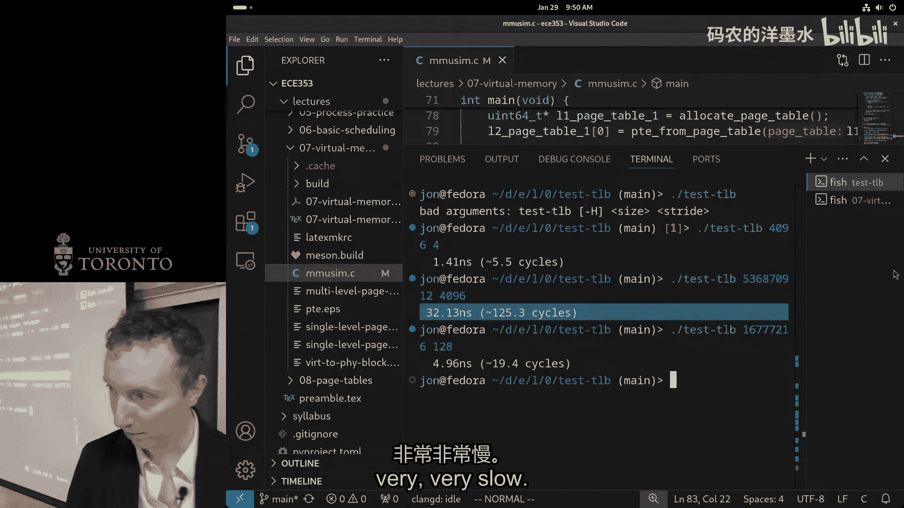

Alright， cool， dispelling computer mysteries。So。We saw that SBRK system call at the very beginning。

 This call grows or shrinks your heap。 The stack has like a set limit。 So for growing。

 what it does is grabs pages from the free list to fulfill that request。

 So the kernel just sets the page table entry as being valid other permissions and just grabs a new page to map it to that。

 And then in memory allocators。Typically， this is like difficult to use。

 You'll rarely like shrink the heap。 So it'll stay claimed by the process until。

 and the kernel cannot free pages because。I mean， if you're using Maoc or something like that。

It doesn't know what memory you'll free。 likely， you won't free memory in such a way that。

All your memory is freed on a single page and can just give that page back to the kernel。

 so some memory allocators just ignore this growing or shrink of the heap and use Mmap directly to bring in large blocks of memory。

 so that's why sometimes if you etrace your program you won't see your heap grow or anything like that you'll just see an Mm called because some memory allocators just use that instead。

 so your memory is not really on the heap in some cases。

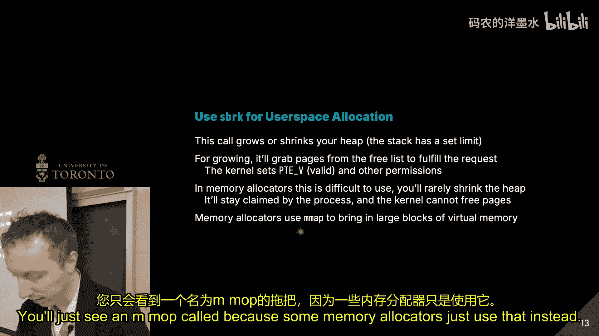

So。This is how your we don't need to know all the details of this。

 but this is basically what your process's address space looks like。

 So as part of loading your program， so each of these boxes are will just assume their pages so there will be a few pages used for instructions so that our pages the kernel will mark that are able to execute that will have the machine code for your program then their data will be here。

 which is your global variables likely and then your stack will be somewhere it will be a set size and most cases our stack grows down so in this case address zero is here address high is up here so in most cases our stack grows down。

The reason why we can detect a stack overflow is because the kernel puts something here at the end of a stack called a guard page。

 so that's a known invalid page and that way if it sees a page fault on the guard page。

 the kernel knows it's likely you overflowed your stack as opposed to just accessed random memory。

If some of you have screwed up your stacks so badly that you actually seg fault。

 what happened is you essentially leapfrog over this guard page。

 so you overflowed your stack more than the size of a page and you fell off somewhere here so you didn't get a stack overflow even though you definitely overflowed your stack because you jumped over a guard page。

And then up here there'd be some maybe some pages used for your heap。

 and then there'd be some pages here that the kernel would may use to save information about your process。

 So in some kernels if you read the source code，They'll be like a page called a trap frame。

 so that is where the kernel saves the copy of your registers here so you're not allowed to read it but the kernel has。

 so that's like your safe state when you switch context switch your process。

 your registers get saved there and they get restored from there and then there's this thing called a trampoline so。

There's some like roundabout things。 If you do a system call。

 you're technically still using your virtual address space。

 so the kernel has to insert some of its code into your process。

 So that is what basically a trampoline is So that's where the interrupt handler is you're not allowed to access it or anything like that but it is mapped into your virtual address space。

 So when you do a system call。 it actually leaps here and that's controlled by the kernel and then the kernel can switch to its own address space and things like that。

 but that's some implementation detail you might see if you have to implement a kernel。

 we won't go into that in any detail in this course aside from just now So you're free to ignore it if it is not interesting。

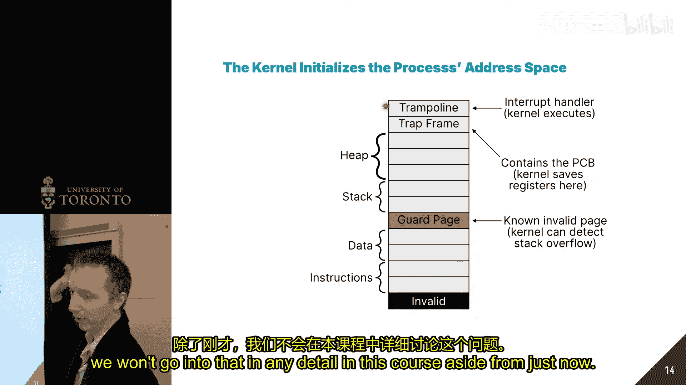

So。Other things it can do， the kernel can provide like a fixed virtual address。

 so this allows the process to access kernel data without actually using a system call。

 so this is the only exception that a process can actually get do a function call to the kernel without actually doing a system call So for instance。

 this clock at time does not do a system call if you do that you won't see a system call instead what actually happens is。

That timer， it's a read only timer。Put at a known virtual address that's managed by the colonel and that。

Function in C just reads that virtual memory address。

 We don't have to go over doing an entire system call just to read a clock because， well。

 most of the time for the clock， you're like hoping it's not valid on nanosecond scale。

 And system calls take way longer than a nanosecond。 So that would kind of defeat the purpose。

 So this is one other trick we can do to get around doing a system call if we want things to be really。

 really quick。Other fun things， page faults also allow the kernel to handle virtual memory。

 so that's the type of exception for a virtual memory access， again。

 generated if it can't find a translation or permission check fails and the operating system can handle it。

 so because of this。The kernel can like lazily allocate pages。

 implement things like copy on write or swap to disk。 So that means。Even if your process says， hey。

 I would like a gigabyte of memory， the kernel can just be like okay。

 it can make the page table entries like kind of mark the page table entries as being valid for that process but not actually allocate a page until that process actually tries to use that page in which case pagefall will be generated。

 then it could actually grab that memory， map it for that process and then let it carry on as if nothing happened。

 so just because you request memory doesn't mean the kernel has to actually give it to you so being lazy is typically being fast。

So overall this page tables translate virtual to physical addresses， MMUs。

 the hardware that uses the page tables， and it may be a single large page table。

 which is really wasteful。Typically， the kernel to make things easier。

 just allocates in pages at a time， just from something like a free list。

 And we use multi levelvel page tables to make everything the size of a page。

 Also save space for sparse memory allocations。 Only drawback is that it's much， much slower。

 But we use a TL B to speed up those memory accesses。 So any last。😊，Questions。

 that was a whirlwind of virtual memory， which is fun。So now we know why things。

Should be accessed sequentially， and it's not because RA is not random。第二。

TheTLB and trying to have like。私少教れれてる。So the TLB hit time has a me associated with that because that's the original memory access we were trying to do yeah。

All right， any the last minute questions？

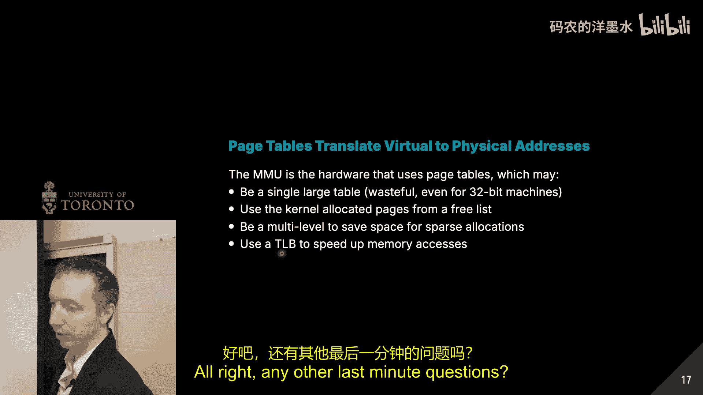

Oh well， we only got two minutes left anyway so just remember。

