# 【全集 2025】多伦多大学 系统软件设计与编程 中英字幕 1080P p09 Lecture 9 - 高级调度与虚拟内存实验 -BV1YrkYBQEeL_p9-

Alrighty， welcome back to 353。Today is a little bit of a hodgepodge。

 We are doing doing a little bit of a rewind back towards scheduling。 If we still remember that。

 that was the nice and easy part。 and then I will prepare you for your virtual memory lab。

Because that is your next lab and you're probably still having fun debugging this lab， right？

Everyone having fun with file descriptors， everyone encounter all the errors that I showed you in class and did not do them yourself。

Yeah， probably not。hu All right， so let's get into the first hour or 50 minutes of fun so。

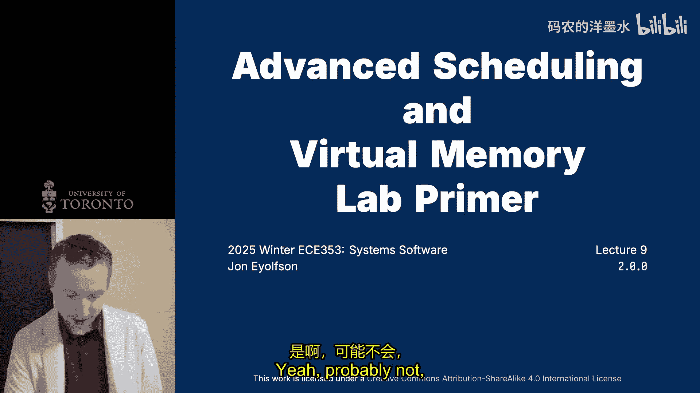

When we were talking about scheduling， we ended up。At round Robbin， right we need to。

Figure out which process to run at a given time。 And we said there are a whole bunch of trade offs and other things we could do。

This is a lecture about some of the other things we could do so in my scheduling system I could add something like priorities。

 so probably you're familiar with the Disney FastPass I might favor some processes more than others and maybe I want to just explicitly say hey。

 you are my favorite process I will give you higher priority over the other ones so initially we can assign each process a priority and our scheduler could just do the thing where it runs higher priority processes first。

Round robin processes of equal priority， this can be of course preemptive or non preemptive and just a reminder preemptive means I can just kick out a process。

 maintain control， non preemptive means they just execute until they finish。So。

To actually implement priorities， we can just assign a priority as an integer。

 so we could either pick a lower number means a higher priority or a higher number means a higher priority。

So Linux， they picked a lower number is a higher priority and it might become evident by the end。

 but in Linux， negative 20 is the highest priority， lowest number。

 and 19 is the lowest priority or highest number again。In kind of the default scheme。

We might lead to starvation if there's a lot of higher priority processes if we did what we talked about before and always run higher priority over lower priority。

 then while there might be a case where we have starvation which basically means that a process might not be able to run so a lower priority process might not be able to execute one solution you could just tack onto this is be like。

 hey， if a low priority process hasn't executed for a very long time。

 temporarily make it a high priority then it runs， then after it runs a bit it's now it's not starved。

 you say you've done your duty and you can reset it back to its original low priority。

So we have a new issue also if we introduce priorities called priority inversion so we can accidentally change the priority of a low priority process to a high one based off dependencies so if we have inter processed communication as we have learned before one process might be doing like a read while another one's doing a right and that read would be blocking so it would be blocking until that process that does the right。

 actually does it， then it can actually unblock and keep on continuing so。

If we have messed up and that low priority process， which is doing the right。Is。

Doing the right for a high priority process that is depending on it so it's waiting for the right to happen so it can read it。

 Well， then suddenly that high priority process is now a low priority process because it's waiting on the low priority process and it。

Actually you uses that priority in order to unblock itself so if I was to actually solve this issue。

 one solution you could have is priority inheritance so if you as the kernel detect that one process is depending on another for output it's blocked on it for some reason then in order to break this I could actually just inherit the highest priority of the weighting process so if I'm waiting on something and it has a lower priority than me temporarily I will increase its priority to my priority and of course this could happen recursively so might be able to I might have to chain together multiple inheritencies if I need it and then as soon as that dependency gets unblocked I can revert it back to its original dependency but in order to break it I have to do something like priority inheritance。

So another way to divide processes might be。Well， some processes might want good interactivity because you're interacting with them as a user。

 some might be in the background just doing some computation。

 so you don't really care about interacting with it， you just want to finish as quickly as possible。

 so you might divide your processes into something called foreground processes and background processes。

Basically， foreground can receive user input， background， just run in the background。Technically。

 a UniX background process is when the process group ID differs in its terminal group ID。

 you do not need to know that specific definition， it comes from back when you actually had real terminals connecting to a process and your process basically connected to a keyboard and a monitor。

 so you could tell whether or not it could actually get input。

 whether or not it was detected or connected to something。

Doesn't exist now because we have goUies and we don't actually know whether or not you might actually type or interact with a process。

 so this was a good idea back in the day。Where hey。

 foreground process are interactable that they need good response time。

 so maybe I do something like round Robbin with them， maybe background processes。

 they don't need good response time just throughput， so I can just you first come first serve them。

 who really cares as long as they finish at some point。

 maybe I just first come first serve and if it takes too long， maybe I switch。

 do or round robin with a bigger quantum period。Who knows a whole bunch of different trade officers there。

 no one good answer for scheduling？I might also use multiple cues for other purposes。

 so maybe I just do what we said， I could create different cues for foreground and background processes。

 forground round Robbin background first come first serve。But again。

 now I have to schedule between background and foreground processes。

 so maybe I round robin between foreground and background， maybe I use a priority for each Q。

 maybe I say foreground is a higher priority than the background。Who knows again with scheduling。

 there is no one true answer because it's always just a trade off， people just tack things on。

So like I said， no right answer， only trade offs， and we haven't even talked about multi processor scheduling yet。

Even my watch has two cores on it， so talking about one core is not the greatest。

 so we'll assume that our machine has something called symmetric multi processing。

Basically a fancy way of saying that all of our CPUs are connected to the same memory。

It's probably the case in most of the computer systems you have。In higher end ones。

 different CPUs can be connected to different memory and then you have to communicate across them。

 we will ignore all of that。We'll just assume all CPUs are connected to the same physical memory and CPUs have their own private cache。

 at least at the lowest levels like L1， L2 and things of that nature。

 hopefully they told you about caches in architecture。Yes， okay。All right。

One approach is to use the same scheduling for all of the CPUs or CPU cores。

 so still I only have one scheduler。But now I just extended a little bit。

 so it just keeps adding processes while there's available CPUs。

 so the advantages to this is I have good CPU utilization if there's something to schedule an idle CPU。

 it gets to run on a CPU。It's fair to all processes as long as my scheduling algorithm is fair。

 but the disadvantages is that it's not scalable so everything blocks on that global scheduler so there's only one thing making a decision and it makes one decision after another after another after another so if you have I don't know 100 cores or something crazy like that then you have to make 100 decisions and the 0th core can't progress until you've made decisions one through 99 and then it also has poor cashity。

What that basically means is processes might jump between CPU cores。

 in which case their caches wouldn't be invalidated。

Hopefully when it context switches out and back in。

 some of its caches are still valid but if you change it to a different physical core that it runs on。

 then none of its caches are going to be valid so we're going to have some poor cache locality。

 everyone know what I kind of mean by that。So caches will not be valid。

 so this is the approach back in Linux 2。4， which is way， way， way older than me。

 and this is because having more than one core was a gigantic luxury that no one really had。So。

What we can do is create per CPU scheduler， so have a different schedule algorithm run on each different CPU course。

 so we only have one global decision to make so when there's a new process。

And only when there's a new process， I assign it to run on a CPU。

So maybe I just assign to run on the CPU with the lowest number of processes and then it just stays on that CPU until it's finally finished。

 so the advantages of this is， well it's easy to implement。

 I just instead of just having one scheduler I just have one scheduler per CPU core。

 the only global decision I have to make is when it starts， which isn't that bad。It's scalable。

 so each one core is not waiting on another core to make a decision。

 so there's no blocking on any resources， it has good cash locality because the processes stay on the CPU core。

 so when their context switched in and out， some of its caches might still be valid。🤢。

But the disadvantages are there could eventually be a gigantic load im balance。

 so some CPUUs might over time end up having less processes or less intensive ones so you can think easyas thoughtt experiment is if I only have two cores and let's say I have four new processes come in。

Two run for a very long time and another two last for like a millisecond well if I make the decision to schedule both of the long runs on the same core and both of the short ones on the other core。

 well eventually that one core is going to be done with the two really short ones and be idle and then the other CPU core will be just be bouncing between the two longrun processes。

 while the other one is idle， so probably not a good thing to do。So。Easy thing to do， easy solution。

 easy band-ai for that is I can have kind of a little bit of a compromise。

 so I can keep that global scheduler and also allow it to rebalance CPU cues so if a CPU is idle so it's out of process is to run。

Then I can do something called work stealing where I just take a process from another CPU core in order to more distribute the load so you might want more control over what process can switch some processes maybe you don't want to switch CPU cores。

 maybe they're very sensitive to caches and their performance would go way down if it's switched so there is a knob you are allowed to use on your operating system called processor affinity and that is basically the preference of a process to be scheduled on the same core so if it is high a Fi that means it is more likely to stay on the same core rather than to get switched so you can even do this on Windows if you go to Windows and go your task manager and right click on some process there's a set of Fy button you can say low medium high high means it will be scheduled on the same core so if you have a program you really really care about you could set it to high and you won't have a you'll have less weird hiccups with it。

Something you might care about， so this is basically a simplified version of the constant time 01 Schchedr that is used in Linux 2。

6。为事。And the court was started。Yeah， by same core， the core was started on or last quar was running on。

 so it just sticks to that same core， you could call it CPU stickiness if you want。

 then CPU affinity。It's a more literal term， I mean we've been killing children and stuff。

 so I don't know why we're not doing literal terms now， but whatever。

I don't I just teach the stuff all right， speaking at cool terms。

 so another strategy is called gang scheduling， so sometimes I might have multiple processes that need to be scheduled altogether。

 maybe they all depend on each other， theyd all need to be running at a certain time。

So the scheduler on each CPU cannot be completely independent if everything needs to be scheduled together。

 so I could do something called gang scheduling or co-scheduling that might be an option on some operating systems and that allows me to basically just context switch a set of processes simultaneously so they all act as one unit generally you won't see this unless you get into like really high performance computing thing because this requires a giant global context switch across all CPUs so all CPUs switch to running the same set of processes all at once。

All right， there's another thing called real time scheduling。

 so real time means there are some time constraints， either deadline or a rate。

So for instance audio on computers that is something that has a deadline right you have to maintain a certain frequency because of the sample rate。

 yada yada， yada， I forget signals and systems but I remember it is important so if you do not meet that deadline for audios。

 you will hear scratching， you will hear weird distortions and all that stuff so。

Some things have to run within a certain time limit。 So there are some types of systems。

 One is called a hard realtime system that is required to guarantee a task completes within a certain amount of time。

 Like， I don't know。 if you were guiding a missile or something like that。

 You probably want to make a decision within a few milliseconds or something like that。 Otherwise。

 you might go off course and hit something you don't want to or autopilot or something like that。

 So people that program these things or like a train switching system。

 You don't want the train to be derailed。You actually want to guarantee counting like CPU cycles that something reacts within。

 a few milliseconds and that， and you actually have to work to guarantee it actually handles that。

 which means you have to have full control over the system。

 it has to be simple enough to reason about。If。You can't reason about it。

 you can just ignore it and just throw， I guess throw money at the problem and that's a soft realtime system where your critical processes just have a higher priority and and in practice the deadlines met in practice。

 but I can't really guarantee anything because the system is just too complicated。

 So Linux is an example of a soft realtime system because there are so many things you can't control。

 you can't control how many processor running you can't control。What their priorities are。

 you can't control the hardware you're running on， you just have to give it high priority and just assuming it's meant in practice。

 otherwise people will yell at you and things like audio。Again， CPUs are really， really really fast。

 so the deadline will might get met in practice， so Linux is an example of soft real time。

 it cant actually do hard real time， hard real time is a whole other course。

 you're basically writing the other type of software where you're basically writing your own operating system and arguing about the worst case scenario of however long it takes your function to run。

So。Linux actually implements first come first serve and round Robbin scheduling so if you are crazy enough to search the Linux source code。

 if you search for S_ FIFO or S underscore round Robin， those are first come first serve。

 they just call it FIO or roundund Robin， they just call it RR and what they do is they might use a multilevel Q for scheduling processes of the same priority and let the OS dynamically adjust the priority if something hasn't。

Executed for a long time。In Linux， there are two types of processes。

 there's soft real time processes that always schedule the highest priority process first。

We can explore now and actually read each top a bit more。

 and then there's normal processes which adjust the priority more or less based off aging。So。

In Linux， real time processes or the soft real time processes are always prioritized。

They use a simple scheduling algorithm so you can more argue about them。

 so they'll either be scheduled as first come first serve or round Robin。And annoyingly on Linux。

 well， this was before Linux existed， but there is100 static priority levels for these soft real time processes。

And they go from  zero to 99 and annoyingly， zero is the lowest and 99 is the highest。

 so highest number means higher priority。Unlike before， where the lower number meant higher priority。

 which is fun。Normal scheduling policies apply to other processes。

 so the default priority is zero and like I said before。

 the priority ranges from negative 20 to 19 where negative 20 is the highest priority and 19 is the lowest and processes can change their own priorities using system calls。

 you can set scheduler to change your scheduling or this system called nice and niceness is related to this default scheduling priority。

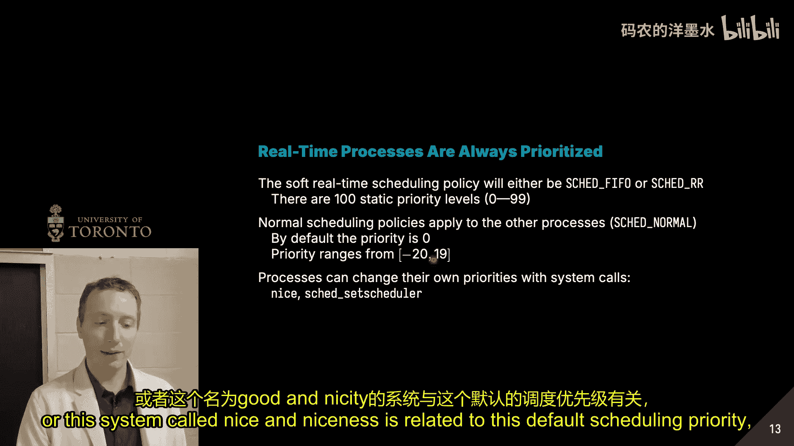

So。We'll see what the numbers， so Linux tries to like unify both the soft real time priority and normal。

Processes， so bear with me for a moment because this is。Kind of annoying， it's like， hey。

There are two competing standards， let's create a third and that will make things much better。

The normal process is， let's stay in this little corner here。

 so the normal processes that use the normal scheduler that we will talk about later。🤢。

They're called normal processes and their priorities are called niceness。

 so they range from negative 20 to 19。Always for this。

 low priority is towards the right and high priority is towards the left。

 so these are our normal processes ranging from negative 0 to 19。So。

When I had soft realtime processes， the priority was 0 to 99 where 0 meant lower priority and 99 meant higher priority。

 so in order to standardize these things， Linux has their own priority so they map both the normal processes and the soft realtime processes kind of on the same number line where。

A higher number means lower priority and a lower number means higher priority， so in this case。

With the Linux priority the normal processes are mapped from 0 to 39 so you just take the niceness and add 20 to it basically。

 and then the soft realtime priority just gets inverted so zero gets mapped to negative 1 and 99 gets mapped to negative 100 so another way you can look at this is if it has a Linux priority of negative it is a soft realtime process and if it is zero or above it's a normal process that has niceness yep。

wasn't different。So soft Real time will always get scheduled before normal processes and they'll use some simple scheduling algorithm like Round Robbin or first come first serve。

 but they're always run before normal processes。All right。We can explore or any questions on that。

 It's just a weird thing。 you don't have to remember the stupid numbers or anything like that。

 I just have them up here so we can actually read them so。

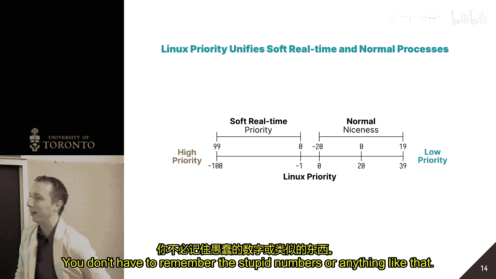

Let's see， so now we can run each top again and see some more numbers。

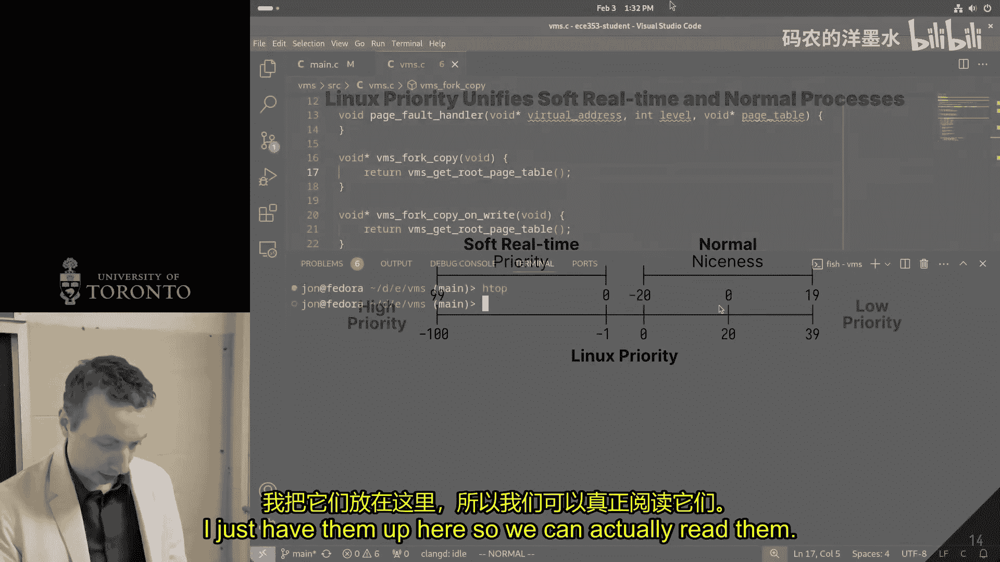

We know what PID means right， we know the user that runs at so now we can read the next two columns。

 so the PIR， that is the priority， the Linux priority。

 so that will be some number negative 100 to 39 and then this NI stands for niceness so it will be some number negative 20 to 19。

And。If this priority is negative， it means it's a soft real time process。

And this niceness basically doesn't apply so we can explore my system and see what's important。

So the default priority is a niceness of0， which corresponds to a Linux priority of 20。

So these are all normal processes。This has a niceness of negative4。

 but its priority is links priority is 16， so it's still another process。

 but it's just a little bit more important than the other ones， it's called A D， auditing something。

 I don't know， seems important。Go down here， let's see this process has a Linux priority of negative2。

 so it's a soft real-time process which means this niceness priority is just going to be zero because it's not a normal process so we can just ignore it so this is a soft realtime one and it's called lowmem monitor so that's probably important thing to do it checks if I'm running low on memory and we'll probably try and kill some children for me。

So go up there， this one seems less important。 its priority is 21， niceness of one， so RT kit demon。

Doesn't appear to be important。This definitely doesn't seem important， priority of 39 niceness of 20。

 so it's the lowest priority possible， it's also control has to do with pressing your sound buttons。

 apparently that's not important。So other ones， pipe wire and wire plumber， those are cool。

 so that has to do with audio， so audio is important， so that's why priority it's a higher priority。

Has to deal with audio if you know what the name does。 Oh。

 there's good old VS code using 32 GB of Ram。LoveVS code has lots of children。

Let's see any other fun processes go down。Oh， there's pipewi pulse， again， has to do with audio。

So priority of zero， so they're still normal。🤢，The only other fun one are things like this。

 So there's migration。Where to go， migration dash 0， so its priority it says Rt。

Our key is shorthand for just negative 100。 So it's the absolute highest priority There is this migration thing。

Basically， that's a Linux。Internal Linux thread， we don't really know what thread is。

 Well that's basically responsible for doing context switches。

 So it's very important that context switches happen。 So that's why it's real time priority。

 And there's one for each CPU core and then。There's a watchdog。

 watchdog's negative 51 seems to be fairly important。If you don't know what a watchdog is。

 it basically detects if your computer has hardlocked and we'll try and reboot it for you。

 So it's somewhat important。 but there you go， you can have fun to explain anything else you want me to explore here or you can actually just read more columns now。

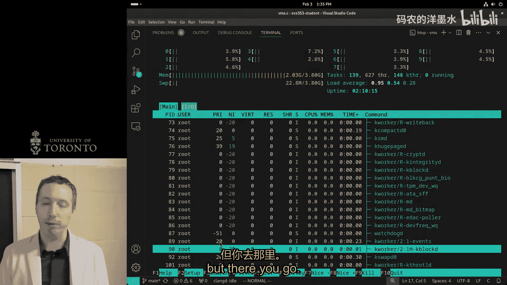

All right， fun。So don't have to know these numbers or anything like that just so you could read those columns just in case you are ever curious。

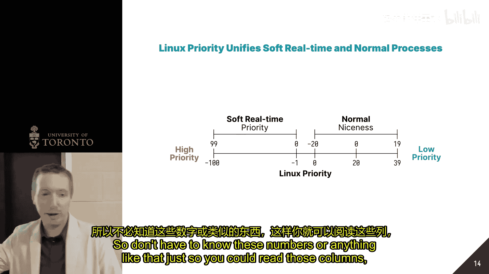

So how did the scheduler evolve so where we are right now we have that global Q we started at 2。

4 at 2。6， we got that 01 per CPU scheduler and now in the present since quite a long time ago the La kernel uses something called the completely fair scheduler。

 so it's fair and allows for good interactivity。So。

Why we move to that is because while that '01 scheduler especially has problems with modern processors。

So back in the day， foreground background processes， good division。

Easy to do with the terminal less so with goUoei processes because well。You might be like， oh， well。

 if I have the window focused， maybe it's important， but that is also just。I guess。

Just because you have a window focus doesn't mean you don't care about it。

 Maybe you have a video playing beside you。 You don't want to start skipping frames and the audio to go out of sync or anything like that。

 So you might。Not want to guess which processes are important。

You could try and have the kernel detect interactive processes with some heuristics。

Like maybe if it goes to sleep a lot， it's more interactive， but thats ad hoc could be unfair。

 you're just kind of guessing。So how would we introduce fairness for different priority processes。

 maybe I don't want to always run higher priority processes over lower priority processes。

 maybe I just want to give higher priority processes a bigger time slice。

 that's a perfectly valid thing to do。Maybe that would mean the higher priority。

 the larger the time slice， but there's also situations where that could be unfair。

 if I guess incorrectly as well。So。If I was to think about the ideal far scheduling。

 so assuming I don't have to worry about context switches。And I have infinitely small time slices。

 the fairest thing to do is again， just talking about one single CPU is if I have。

N processes I give each of them an n of the CPU， so if I have one core and one process it gets the entire CPU core。

 if I have three processes and one CPU core they all just get a third of that time so the CPU usage is just divided equally among every process。

You're sharing with your siblings fair， you all get the fair shot at whatever you fight about。

So some example of an ideal far scheduler is like， hey。

 if we consider the following processes all arriving at the same time。

 P1 through P4 all arriving at time  zero and their burst time or the time they want to execute for is eight time units。

4， 16， and four。To simplify things， I can say that。Each vertical slice here。

That represents executing for four time units on a CPU core。

 and each box represents the time unit spent executing for that process。This。

First column here represents me running my CPU for the first four time units。

If I'm being completely fair， I have four time units and I have four processes。

 so I should give them each a fourth of the time， that's why I wrote the columns in four time units just so the numbers are nice。

For four time units being completely fair， I let each execute for one time unit right。

 so they all execute for one time unit， that is the fairest thing I could do。

Then for the next four time units from four to eight again。

 fairest thing I could do just divide up my time between each of the processes so they all run for another one time unit and what is in the box here is a total amount of time they have run for then again they're all running for the next。

4。Then they divide up the next four and then at time 16。

 each process has run for four time units if I'm completely fair， so everyone okay with that。

So now at time 16 P2 and P4 are done because they only want to execute for four time units。

 so now I only have two processes left， my vertical time place here are still four time units。

 so if I'm being completely fair I give each CPU a half of the time because there's two processes so four time units divided by the two processes I give each two time units worth of execution time so now in total they both executed for six time units。

 then at time 24 they both executed for eight time units。

Then process1 is done so there's nothing else to execute。

 so I don't have to be well the fair thing to do is just let it execute in totality so it would get all four time units jumping to 12 execute in total then 16 execute in total and then at time 32 everything is done y。

这是什么？P完的。Yeah， so this is one CPU。Executing them， switching really， really fast in such a way that。

 you know， I'm just assuming infinite time slices。 That's why I didn't do it like。

Each individual time unit because we're trying to be completely fair here。So it would be essentially。

Jumping back and forth between these four processes infinitely fast。

 just to give them all a fair share， of course we can't really do that。

 but this is the fairest thing I could do， right？So。Based off that fair thing。

 that's what we base the completely fair scheduler off of， we can't。

 of course do this because we can't context switch infinitely fast。

So we can just use this as a model to strive for， so it's technically the fairest policy。

 we each get the fair share based off how many processes there are。

Every single process gets an equal share of the CPU time。

 and it boosts interactivity has ideal response time because I assume context switches are infinite。

But of course， that would perform way too many context switches in practice。

They're not infinitely fast and I also have to constantly scan all processes。

 which is ON because and I don't want to do that because that is slow。So。

The idea behind the completely fair scheduler， which is what the latest kernel actually uses。

Is for each runnable process， it gets assigned a virtual runtime。

That virtual runtime is basically just record keeping of how long it has executed for in totality。

So at each scheduling point。Where some process runs for some time T。

How we would normally record how long it runs for is we would just add the time it runs to its total runtime。

 right， We would just keep adding and adding and adding itss total runtime。 So this does that。

 but it fudges it a little bit。 So instead of just adding。T。

 how long it just executed for to its virtual runtime。

 it fudges it a bit by multiplying it by some weight and the weight is based off the priority of the process。

 and this is where it actually makes sense that a lower priority process or sorry。

 a higher priority process is a lower number。Because。If it's a higher priority process。

 it means it's a lower number， which means the weight will be smaller， which means。For instance。

 let's say it executed for two seconds， and it's such a high priority process that it's weight。

Was calculated to be like 05 means it runs for two seconds。

 but it only gets one second counted against it when it actually。

Tabulates its virtual runtime and keeps track of it while if something had a default weight where the weight was just one。

 it runs for two seconds， it gets two seconds counted against it。

So another cool way of saying this is that virtual runtime， the property of it。

It's monotonically increasing。😡，Basically， a fancy math word that says the values only increase。

 So the values never decrease。 that virtual runtime only keeps on getting bigger and bigger and bigger and bigger。

 will you'll never just add zero to it or add a negative number to it。So。

The schedule algorithm is the decision it makes is conceptually kind of simple。

 it just selects a process based on its lowest virtual runtime， so whatever process has not。

Had its fair share of the CPU。 We just picked the lowest virtual runtime。

 and that is the process we are going to run and then。This where it gets a bit fudgy。

 We compute its dynamic time slice based off that ideal far scheduler， so。

If the next highest runtime was， I don't know， let's say we only ran for one second and the next highest runtime was like four seconds。

 we might to be like， okay， well our time slice should be at least three seconds in order to catch up to that other process。

 maybe a bit more again， a bunch of heuristics for this the idea is to get a time slice that gets us closer to the other processes yep。

Like having。8月份呀。So this weight here， basically the lower the weight， right when we multiply it by t。

 the less。How long we actually run gets counted against us？So let's say， I don't know the weight was。

OhWe took the。Niceness plus 21 or something and then use that as our weight well if our niceness was zero it'd be like 20 times however long we last we ran for to say we only ran for a second then we'd get 21 virtual runtime units count against us right but if we were a。

Li priority process， maybe our priority is like 30。So multiple and then add 21 to it。 We get 51。

 so the weight would be 51。 so we run for one second， but we get 51 time units counted against us。

 so it's less likely we're going run right we ran for one second。

 we got 51 count against us instead of the lower one ran for one second got 21 count against us and it will the higher priority was likely oh sorry。

To run again because it has a lower virtual runtime。And yeah， it gets kind of fuuzzgy。Where we do。

 we just allow that process to run when it time slice ends， we just repeat that process again。

So basically how it works and how it's implemented with red black trees。They taught you this。

 and you never used it。 So this is where it's actually used。 One instance where it's actually used。

I see worried faces I will not make you write a red black tree， but this is where it's actually used。

Just in case you don't remember algorithms red black trees are like a self-baluncing binary search tree with nice properties in this case the key of this binary search tree a red black tree is that virtual runtime this gives us some nice properties because we have log n insert deletion。

 update and finding minimum which is all we need for doing our scheduling decisions。

That virtual runtime is kept track of like a nanosecond granularity and the nice thing about this is that's the entire algorithm。

 it doesn't need to guess the interactivity of the process。

It tends to favor IO bound processes by default。 What that means， it's a process that's。

Spends most of its time waiting for input。So you ideally want it to run as soon as it has input。

This scheduling algorithm is likely to run that in favor of any other processes so what that means is an IO bound process will probably execute for a very short amount of time until it hits a read and then it gets blocked and whatever it gets switched out。

 we would increase its virtual runtime but it didn't actually execute for that long。

 so it wouldn't have much virtual runtime count against it。

 then wed run a whole bunch of other processes。🤢，They would。Accumulate more of their virtual runtime。

 and then。If that I bound process。Has data finally and gets unblocked。

 It's very likely it's going to have the lowest virtual runtime than all the other processes that were otherwise running。

 so it's going to immediately get scheduled。 It's going to have good response time it's good。

Do kind of exactly what we want。Another fancy way of saying that small CPU burst。

 a case small CPU runtime translates to low virtual runtime。

 in which case it means you will get scheduled sooner。

And you also get a larger time slice in order to catch up to that ideal。

 so if a whole bunch of other processes were running for a whole，Butload of time。

 you get a whole giant time slice in order to catch up to them。 You do a whole。

 you can do a whole lot of processing if you were waiting for that input to do something otherwise important。

 So any questions about that again， I will not make you write a red black tree。

 So don't don't worry I saw so many worried faces when I said red black tree。

And it seemed like some of you just assumed that they just never existed in practice。

So here's one instance of that。So with that scheduling gets even more complicated。

 we got more solutions， more issues， introduced priority and we introduced the problem of priority inversion because of dependencies between processes。

 then we were like okay well some processes we interact with， we probably need good response time。

 others I probably don't care about maybe I want to schedule them both differently， again。

 that makes things more complicated， introduce more tradeoffs， you might get things wrong。

Then if we have multi processors of multiple cores， we might want a separate cu for each core。

We might also have the problem of real time where we need things to be slightly predictable。

And for a very complicated system like Linux， the best we can do is make the scheduling algorithms as simple as possible。

 always schedule them above a normal process， so there's a situation where it could lead to starvation。

 but on Linux there shouldn't be that many realtime tasks， otherwise bad things will happen。

If you want， you can make your game or whatever run at real time if you want。

 if there's only one's probably fine， you'll get some good performance doing that。

Although it probably won't matter that much， and then we briefly talked about at the end what the length kernel actually uses。

 the completely fair scheduler that basically tries to model that ideal fairness by keeping track of how long each process runs for。

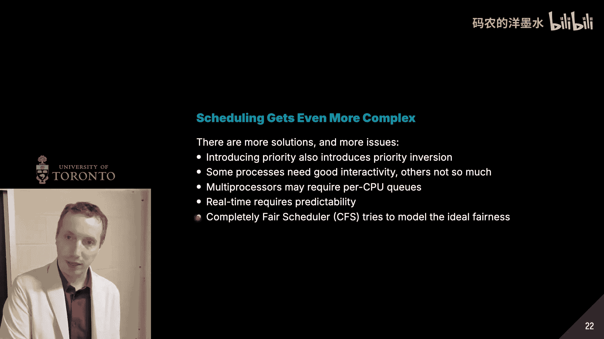

🎼。🎼。

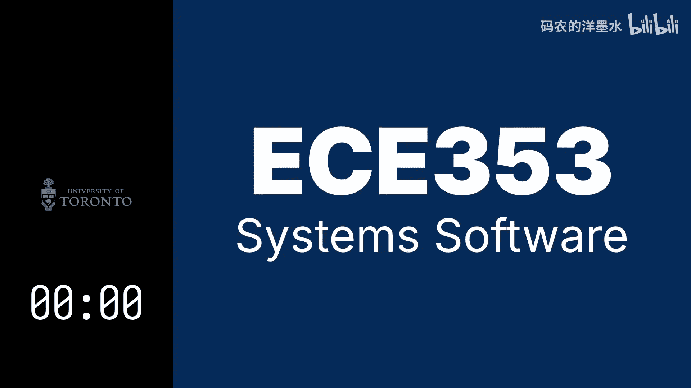

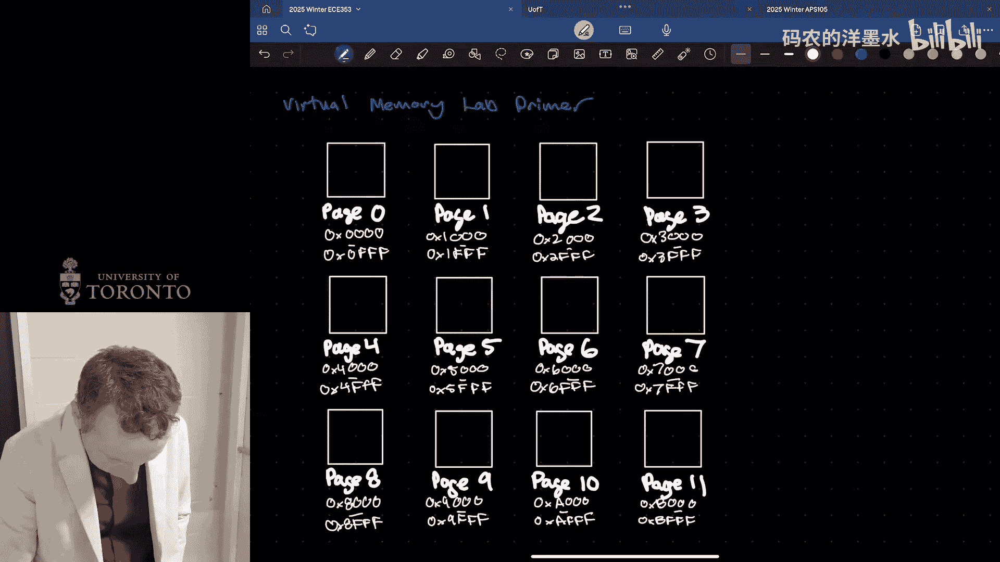

There we go。 My mic was not on All right， so again you are writing a library。

 so in order to test your code there's no executable to run。

 so I have given you this main dot C which will create an executable to run。

 but there's just a whole bunch of test cases。So what this will do again。

 this will just set things up so this will set up memory for a process kind of like we did before when we simulated it。

 so there's an initialization which will initialize pages you don't have to worry about it。

 there's this new page function which you can also use to get back in new page I'll go over all of the helper functions I give you。

But in this case I get back a page， I'm going to use one page for an L2 page， one for an L0。

 one for P0， so that's like a data page I just call it page zero because I'm creative。And then here。

I'm assuming in this process I want virtual address ABC 12，3 to be valid。

Kin of like what we had before so if I divided this up into all of the indices right the L1 index would be0。

 the L or sorry the L2 index would be0， the L1 index would be 5， the L0 index would be 188。

 I think for this ABC。🤢，And then my offset is 1，2，3， so I don't have to translate that。

 so if I want this to translate correctly。In my L2 page table。

 I have this helper function called Page table PTE entry， so it will return a PTE entry。

PT entries are8 bytes， so this is that SV 39 risk5 thing that we discussed in class。

I always return it as a pointer so it's a pointer to a U int 64。

 so it's an8 byte unsed integer and it's a pointer to it。

 so I have this helper function so given a page table which should start a page。

End the virtual address and then you tell it what level you want it will go ahead figure out from the virtual address what the index it should use be。

 so it'll do all the bit shifting and stuff for you so you don't have to worry about that so that will give me that PTE at that index and it will be a pointer to it and then。

Again， I showed you like the layout of the page table entry that it stores the P PPN and a whole bunch of bits and stuff。

 Well， I have all these helper functions， so you don't have to worry about bit shifting or anything like that。

 So there's this VMS P TE。 So it takes as an entry， a pointer。

to the entry so in this case it's L2 entry and what this will do is set the PPN to whatever this argument is。

 so I have another helper function that translates a page so a whole address that represents a page to a PPN so in this case I want it to point to my L1 page table which again starts at a page so it just gets PPN from that。

Basically， I'll just in this case lop off the lower three hex characters because everything's page aligned。

 so my page should always start at。Z，0， zero in he。And then in this case I need to set the valid bit。

 so in my PT I have to say that it' valid， so it's actually a valid entry and you should set it otherwise if it's not set。

By default， everything's zero initialized， so it's like everything's invalid。

 so if you try and use it， you'll get a page fault and things won't work。So again。

 here's my L1 entry so same thing I created a page for my L1 page table using that virtual address in level1。

 it'll figure it out where that entry is for me， I make it point to L0 and then I make it valid and then in my L0 which finally points to the actual data page。

 so here again I get the entry。Using level zero in this case。

I set its PPN to just point to that P0 page， so I'm going to use that for data。

So if that program had like in X or something or actually had， it was actually using data。

 it would be stored on that page P0 and then here permissions are going to actually matter now so I have to say that it is valid and。

If I want to read and write to it， so use it as a normal variable where I'm allowed to like read it and reassign to it。

 I have to set the read bit and the write bit so I can do that using PTE so VMS underscore PTE it'll be a whole whack of functions I'll called that they all operate on a page table entry so it saves you from doing a bit manipulation or anything like that because people hate doing that so I already wrote it for you so this would make it valid。

 make it readable and make it writeriable。Then the last thing I do is I assume I'm running a process so I can set the root page table and that would be that SATP register。

It's the L2 page table I would actually use to translate。Virtual addresses for this process。

This would simulate it using that virtual address as an integer and writing the value 1 to it。

 So if I write the value 1 to it， I。Have a little bit debugging information where I just say what the virtual address is。

And then I have these。Functions that are only used for testing。

 so VMS read will use that virtual address and try and read an integer starting at that address。

 So if I read it， well， hopefully it is a one because I just wrote a one to it so I should be able to read a one back from it。

And then here。I simulate what happens for a fork， so this VMS fork copy is what you are writing。

 so you should return to me a new L1 or L2 page table。

 which is completely independent from the one currently being used。So it should have an L。2。

 and L1 and L0， and that L。I'll just draw it out， so here let's go here。

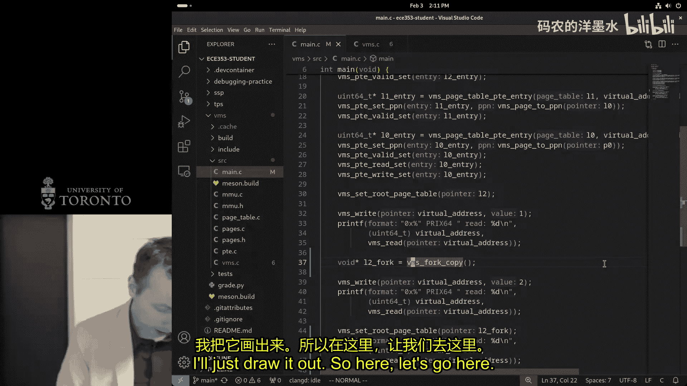

So。In that case， let's assume that this is all the pages we're going to use in this scenario。

Let's say I just use them in order。My L2 variable was equal to this page。

 so it started off at just 000。And then on it I had again。

 I'll write in this because the index isn't actually stored， it's a big array。

 and inside of this I will use this as an L2 page table， it has a whole bunch of page table entries。

 512 in fact， and one of these at index0， the PPN。Is going to be， in this case。

 let's say this is my L1 page table， my PPN would just be one。

 right because it's referring to this page and it starts at PPN1。All right， any questions so far？

All right， so in this case， the valid bit， I'll also write that here。

 that valid bit is also one for that entry。 so it means I would use。

My virtual address is using indexex 0 means， oh， it's valid and to go to L1。

 I have to follow it to page1。So page1 here。It would have an entry at this case at index5 where the PPN is。

02 and the valid bit is 1。And。That would mean I'm using page two as my L0 page table。

And then it would have something at index 188。Again date don't all have to be sequential if I wanted to I could put it at page seven。

 doesn't matter as long as it's consistent， and its valve bit is one and in fact there's a whole bunch of other bits here so let's actually erase that。

So it should have a write bit， a read bit， and then a valid bit， and they are all one in this case。

And then that means this page would be used for， in this case that would be P0。

 it'd be used for my data and it would store X somewhere on it。🤢，So questions about that。

So we got essentially something like。That。So everyone good with this， if this was my root page table。

If I access that address， it would eventually lead me to page seven and blah， blah bh。

'd use the information there。So your job， if I am forking， so that sounds bad。

 if I'm forking and I'm creating a new process that needs to be completely independent from the original parrot process。

But look exactly the same。What do I need to do so I need to create an L2， right？So。

Let's say I do it on page four。What should be on this new L2 I have created that's supposed to represent the child's address space？

Anyone？Yeah。Yeah， well， it needs to point to an L1 page， which should be independent than the parent。

 right， Because what about if I just did， okay， well， I'll make。

My new L2 page exact clone as the parents L2 page。 If I did that， I would have an entry at0。

 the PPN would be。one。And V would be6。So if I did that。Would that be correct？No， why， because， well。

 if the parent used that same memory address， right？It has its own L2 page table。

 so that would be its root page table but。If it uses this entry。

 it means it would follow it to this page， which is the parents L1， so it would use that。

For that same virtual address， it would follow it to the same data page。

 which means it would be the same physical page， which means if the parrot。

Or the child modifies that value。 It would be seen in both of them， right， which isn't great。So。

In this case。What do I need to do？Rut row。Anyone。Yeah。Yeah。

 I need to just grab a page and use it for this child's L1， right？

Let's say I would probably call a new page， let's say I get back this page。

So if I get back page5 as L1， what should my？PPN look like on page four。🤢，Yeah， yeah。Yeah。

 I should just point to that so the PPM would just be5 and be valid。

Which would mean they would point to that new one， right？So I'm one step of the way there。No。

 on this L1 page， well， I probably need to grab。A new page to use for my L0 for my child。

 let's say I get page six。So I would have to make sure that on page5。

 which is my L1 page table in the child。It has the same structure as this one。For every valid index。

 this one should have a valid index so that the same virtual addresses are valid。 In this case。

 it only has one valid entry， so this should have a valid entry at index 5。Its PPN should point to。

Some L0 page table that has the same structure as the parent L0， so we're going to use 6。

And its valid bit is going to be one， so that means we're pointing here instead。

Then eventually we're going to need。To do something like， I don't know， let's say we have page1。

 something like that。 this would be where we store our data。 So our L 0 page table。

 it would need that same structure， so it would have a valid entry at 188。

The PPN in this case goes to page 11， which is just B。🤢。

And read write valid so all the flags should be exactly the same because if their exact clones of each other。

 they should behave the exact same right， if I set right to0。

 that means well if that program tried to update the variable x it is not allowed to。

If they're clones， they should behave exactly the same， so all your bits should be exactly the same。

 so that means I can read， write， and it's valid。So that means it would point。To this。So say here。

The value of x is 1， so what should this page 11 look like if it's an exact clone of the parent at the time of the fork？

Yeah。Yeah， I is one。So should or x is one， which means that these two should be an exact copy of each other。

 right， Bte for byte， the content of the pages should be exactly the same。

 So now there's two copies of it。 So now。Assuming this program still ran and modified its X。

 which would be virtual address， whatever ABC 1，2，3。 it would modify this value in memory。

 So it would only update its own X。 Then if we contact switched to。

The child process and switch the root page table to this， then it would modify its X， right？

Initially is the same as this one， but after the fact。It's on different physical pages。

 changing that won't affect the other one。Any questions about that？All right。

 you can just go do it now。All right， I'll walk through a few more things that will help you。

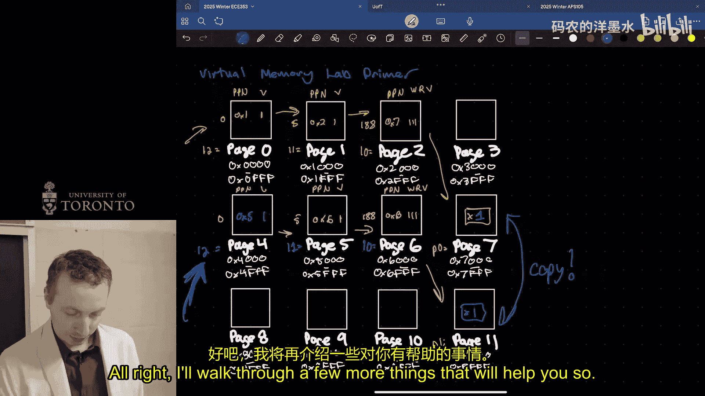

So。

Going back here。So。Let's walk through a few more things， so that mean。That will。

Help you to kind of debug your program so right now。I set it up so that it's valid。

 if I do set page table， this is like the parent process running， it updates the value。

 let's just call it x just to give it a name to1 and then reads the value so it should be equal to1。

 so that's my first read here。Then。It does VMS for copy。

 which should return to me a new L2 page table which should be the child's。

 so it should return whoops。

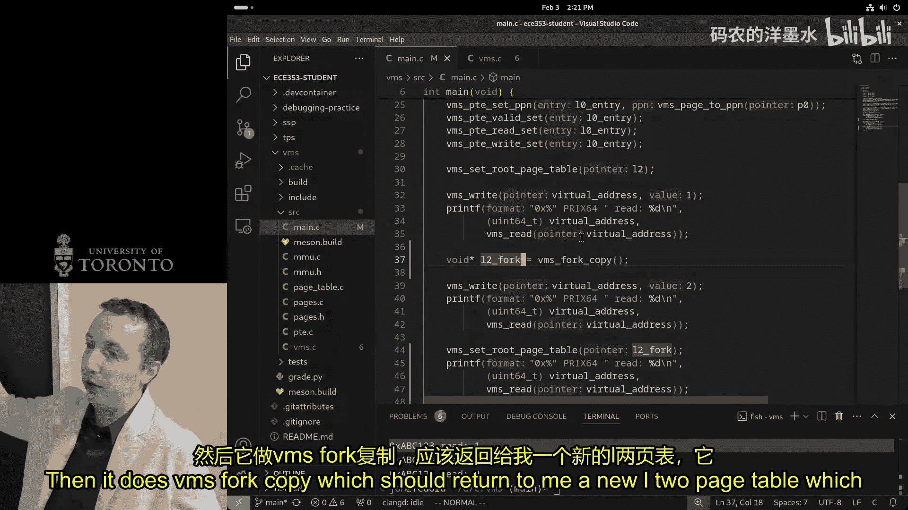

Should return essentially page four in this case， right？So if I go back here。

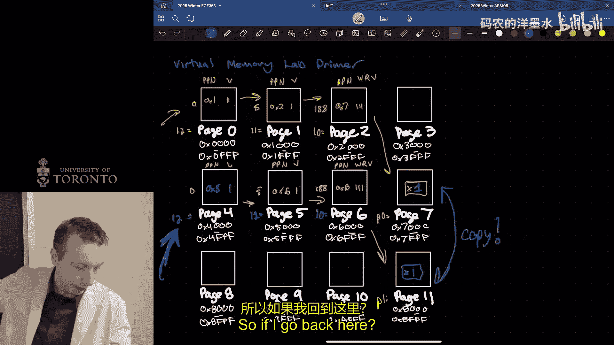

If I do VMS right here and update the value of2， well。

 this VMS right it uses the current root page table。

 so the current root page table is still the parents。

 so this should only update the parents value of x to be equal to 2。

And because the fork happens here， there are only copies at the time of the fork so at the time of the fork。

 the value was1， so if I write here， then I should see in this process which would be the parent that I just read A2 and then here I simulate a context switch only for virtual memory so this is like context switching to the child's process and now when I read it。

If I did this properly， what should I read？Same as the first， right， I should just read of one。

But in my code right now that is not implemented， I read82 well that's because what I gave you is I gave you the dummy implementation。

 which just returns the parent root page table。That is absolutely not what you should do。

 This is just some code so that it does something。 it does the wrong thing。

 basically doesn't do anything。 It says， hey。Well， it's actually the same implementation of VFork。

 if you really need to know that where it doesn't do anything。

 it doesn't create a new set of page tables， both of them access the same memory and that's it。

So what I want to do is。To keep track of it， maybe I do something like。

I actually need that value because that's the only way to know what the parent' L2 page table is。

 so I also put there as kind of I don't know a hint or something。

What we want is we want to start that。 That's what we should copy， right， So we need to copy all。

 oops， we need to copy all the structure of it。

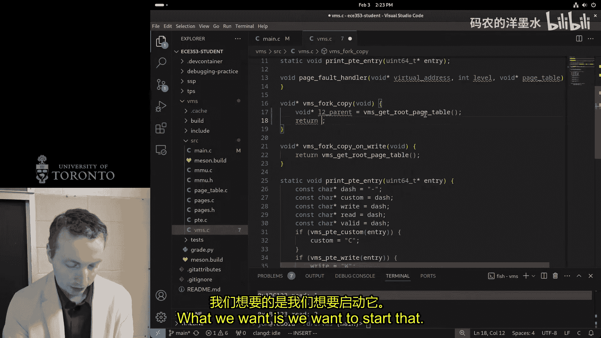

Follow it。Of。Follow it until it gets to L0， see what pages it points to make copies of those pages so we have to know what our starting point is。

 so in this case we would start at page zero and that's how we know what to copy。

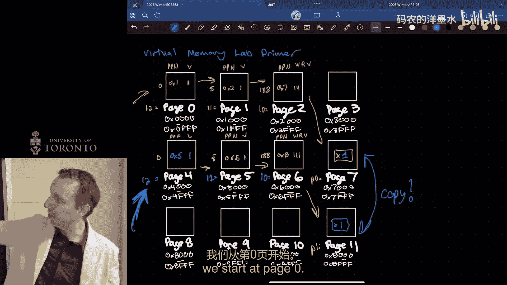

So。In here。First thing you're going want to do is you want to make that new L2 page table， right。

 So how I do it， how you might want to start it is， well， we need。

And we can differentiate them by just calling it child。 So here's the L2 of the child。

 I could just do VMS new page， so that just gives me a new page， and then I can return。How2 child。

So I can just return L2 child。If I do that， I mean， I would expect nothing to actually work， right？

So if I do that， I might get a bit further。Where if I now run my test program。

It will now page fault because。Essentially， what I did， VMS S new page， it's all full of zero。

 So that means every single entry in L2 is invalid。 So if I give that back to you and。

The MMU tries to figure out， oh， what physical address does this translate to？

It'll find the entry in L2， it will be invalid and it will page fault。 so in this page fault。

I have wrote it for you where it gives you a whole bunch of fun information。

 so it says fatal page fault。It will tell you the virtual address it used。

 so in this case it was ABC 123， it will tell you what page table it used。

Probably not that useful information unless you keep track of multiple levels。

 but this is the page table I use that was created by this L2 child， so that's this page。

It told me it failed at translating at level2， so it found it invalid entry at level 2。

 which was the first thing so if it makes it like it could fail at any level right and it still generates a page fault so it tells you what level it fails at and then it also tells you information about the PTE it was accessing that caused it to fail so in this case since everything was initialized to zero it says the PPN was zero and its flags were all it will show in this case four flags。

Shows a mystery one， and then。This would be a W if it's readable， a capital R if it's readable。

 and then a V if it's valid， so this one has no permissions。

 and the other flag is for the custom bit， which we'll get into for how we actually do copy on right。

So any questions so far？Okay so you might have to also read a little bit of code so there's this VMS。

 H which has all of the functions that will help you， so the MMU functions。

 these are only used for testing you should not use them except for that one get root page table to get the parent L2 page table to know where to start from so aside from using this function。

 these are basically only testing functions so you should ignore them。Then there's page functions。

 and I documented the hell out of this so you can read all this too。

 I won't read it during the lecture， but I'll just do the quick version。

 So the in don't have to worry about this new page。That's how you get a new page。

 you never have to free them， so don't worry about that and then get youth pages is to make sure that you are actually being efficient in your implementation。

 not just wasting pages。And then there is。A we。That given an index， so。

It only allocates a set number of pages， which in this case， wheres Z。嗯得得得。

So it only allocates a set number of pages， so in this case the maximum number of pages it has is 256。

 so if you want to take a page and turn it into an index which may be useful， oops。

 which may be useful for the second half of the lab，This is。Well this gi index is how you do that。

 so you give a pointer to a page and it gives you back an index and it will be some number between 0 and 155。

 so this pointer must be some value return from get new page or sorry new page。And then similarly。

 the Git pointer will give it an index， it will give you the address where that page starts you shouldn't need that one。

 you should only need this one for the second part。Then for page table functions， again。

 this is how to actually get。One， you don't have to worry about that much。

 it's just how to get the page table index from a virtual address and an index that will do all the bit level manipulation。

 you can look at that if you want shouldn't have to use that one。

This one is to get the page table entry from an index， so given a page table and just its index。

 so we know how many entries there are per page table， in fact， it comes from where is。

So you can use this to find if you want to numb PTE entries so that tells you how many entries there are in a page table。

 so you can do that if you want to iterate over all of them or do whatever。

 so that index is going to be something from 0 to 511 and then there's these functions that we've already seen a bit。

Get the page table entry， given a page table and a virtual address and what level does giving a pointer to the page table entry。

 And then these are the ones to convert from a。PPN to a page。

 basically it'll just shift it by three hex characters and then the other way around page to a PPN。

And then these are all the page table entry functions。So。Looks like there's a lot of them。

 but they don't do that much。 So for each bit， there are three functions。The clear function。

Will set that bit to a0 so if it no matter what the current value is。

 it will set it to a0 set will set that bit to a 1 so no matter what that current value is。

 it sets it to a1 and then just without a set or a clear that just returns what the current value of that bit is0 or1 so that will tell me whether or not the valid bit is set for that page table entry and then there's the read permission。

 the right permission， the custom permission and then。Given。

And then how to access a PPN from the page table entry。

 So this will give us a PPN just as a 8 bit value or 8 byte value。 We won't use all of it。

 And then this is the function we saw before。 That sets of VPN。And then this VMS。

 these are the functions you were writing。 so that's it。

 So you shouldn't have to do any bit level manipulation or anything like that。 Just look it up。

 It will probably do what you want。All right， so let's start the lab then。So。

Let's say I'm doing fork coffee。

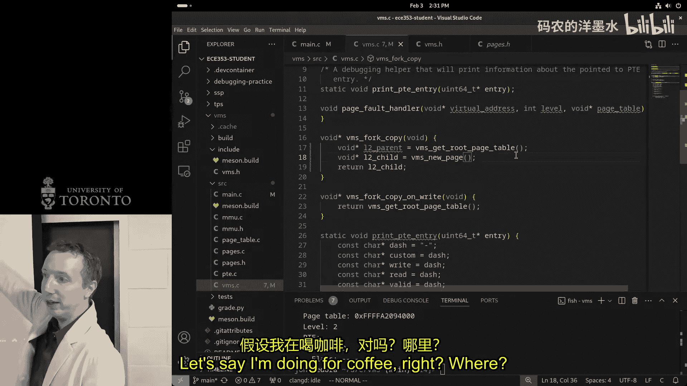

Right， where？I want to essentially。Essentially for every single entry in this parents。

 so let's give it a name now。So this is L2 parrot。So basically。

 for every single valid entry in the parent L2 page table。

 I need to create my own valid entry at that index， right， that points to an independent。

L1 page table， so I have to probably first figure out which things are valid。

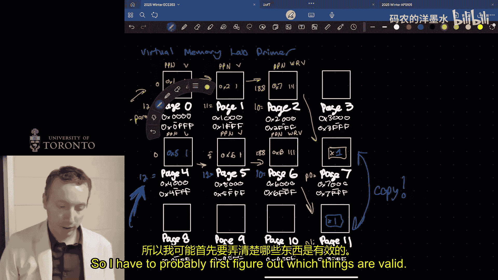

Also， as a debugging function， I gave you this print P TE entry that just takes a。

Page table entry and print it out nicely for you。If I wanted to， I don't note。

 iterate over all of the parent page table entries， well。

 I could do that so I could just write a for them for I equals 0 I is less than non PTE entries。

 I plus plus。Then。If I wanted to get every single entry in this page table。

 I could do something like this。So for each entry， I can go ahead， just look it up here。

So I can scroll up here and be like， oh okay well I have a page table。

 I have an L2 page table in this case， I want to get every single entry， so looking at this。

 I can look at this oh page table this starts off with a page table and then gives me the PT entry from the index so I know what page table I'm on and I know what the index is。

 I should probably use that function。So in here I could use VMS page table from indexex。

And go through the parents and go through every single entry， right？So。Now what will this do？

Actually， give me every single entry in the parent page table， right？So if I want to， I don't know。

 debug it， I could do something like。Print PTE entry and then just give the entry。Oops。

So if I do that and run my program now。I can now see a whole bunch of information。

 probably too much information。Let's print off what our current index is too。

So this will tell me what the page table entry is at every single index right。

 so all of them are completely invalid if I look up。Oops until I get to page zero， which currently。

In this picture， the PPN。Points to essentially page one in this scenario。

 and we can see that its valid bit is set。Right？So questions about that， yep， or no。

 that was just a yawn。All right， so。Here， I probably don't need every single entry， right。

 I only need valid entries。 I only need to do something for valid entries。

 So easy thing to do is I could just check that like， hey， if V M S。PTE， so they all start with that。

 I could check it's valid。So here。This will return one if it's valid，0， if it's valid。

 so I can just nod it。 So if it's not valid， continue。So I can continue and now when I run that， hey。

 guess what？I now only print off。The one entry I have to do anything about right。

 so for this entry I need to make a new L1 page table。Make my index point to that new L1 page table。

 and that has to have the same structure。To do this lab， you can do a whole bunch of four loops。

 or we could use our old friend recursion and you can do it in like 20 lines or less。

K of looks like a recursive problem， right？Oh yeah， I hear oh， that pissed everyone off。

So red black trees and recursion， they're not just for。Fan。They will make your program shorter。

 but you can write multiple four loops if you want。

 but everyone can kind of see the structure how this is going， right？And then for copying the pages。

The contents of the pages， I would suggest you just use Mem copy， so just use you know。

Just use meM copy and you're just copying the contents of a pages so you should content。

Copy the contents of one page to another page， so you should be copying everything for Paul。4。

050 or 96 bytes on a page。All right， any questions about that before we get to the hard part？

All right， theres worried faces， fun。The hard part。So。You might see this page fault handler thing。So。

How your kernel really works is this would all be done in kernel mode because you're。

Essentially the pages you get back。We're assuming they're physical pages。

 that's what we're kind of trying to simulate here， they're not really but。

For the purposes of this these are all physical pages so we're managing physical memory。

 so this page fault handler and this code would of course all be in the kernel realistically so this page fault handler is something the kernel can do to handle a page fault happening so this is before your process would actually see it so when I run it and says fatal page fault fatal page fault means the process running would actually see it and see it as a SeG fault。

But you have the opportunity to run the page fault handler in the kernel and actually fix things up if you need them to。

 and then the MMU will retry the memory access and only if it fails again will it actually be a fatal page fault so you get one chance in order to in order to fix things up。

 so the next part we are going to be doing is copy on right。So with copy on right。

 what we are doing is we are not going to copy the content of a page like before until we actually have to。

 so this copy。

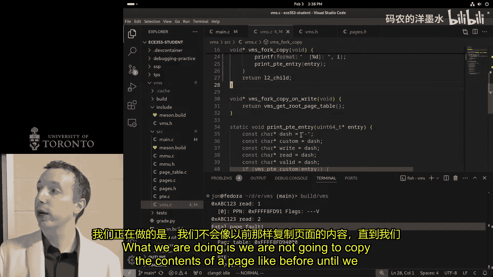

You might imagine that this process uses a lot of pages， so let's just， for instance。

 say it uses also another page at something else for data， page 3。Everything's valid。

And it uses it for data， so let's say it has a variable called Y on it。So。

When I create my new child process， well， it also needs to have that data page， which is a copy。

Actually， I should probably do that in。Blue。So。It would need its own copy。Probably in this case。

 going to page A that should look exactly like it。So if I just did my normal copy。

 it would look like this， right normal。My normal parent process was using。One， two， three， four。

 five pages， my new one has five pages， these ones are all copies of each other。So on and so forth。

 so that might be wasteful。This parent process used like you know thousands and thousands。

 hundreds of thousands of pages， and for each page it uses we'd have to make a copy right。

 which would of course be very slow especially if。We don't actually access that memory ever again。

 So what we are going to do in the copy on right version is。

We're going to share data pages and data pages only as long as is physically possible while maintaining the illusion that all of our processes are otherwise independent。

 so what's that going to look like？So in that case。The pages we are using of a copy。

 they are not going to exist anymore。So it is going to look something。So let's go back here。

 so this is using two data pages。Has an X and a Y。Okay， so everyone， okay。

 the first process the parent went at the top using two data pages。Now。

 what we want to do to do this efficiently and not copy as late as possible is what we're going to do is。

In the child process， we are actually going to share pages。

 so we are going to do something like this。So。If I start off initially doing that。

 where I'm pointing at the same physical pages。Are the processes going to look like they are otherwise independent？

No， right， because if I change。The same virtual address on one is going to change the same physical memory on either process。

 so one change is going to appear in the other one。But。

Is it going to make any difference if both those processes only read from that page？No， right。

 they could actually share the page as long as they are reading from it。

 So that's the whole idea between copy on right is。

We are going to try and share that page as long as we can。

 so both processes are only reading from the page。We will just let them carry on their merry way and read it The only time we want to actually make a copy of the page is only when a process tries to modify it。

So let's say we're running as a child， so this blue process here。And it was trying to modify。

The address on it was trying to modify its copy of X。

So what we are going to do is we need to devise a system where we know that， hey。

 this page is being shared between both processes， we are trying to modify it。

 so we need to make a new copy now our hand has been forced。We need to make sure we're independent。

 we were sharing the page， I can't just modify it because it will change the value for another process。

 so you have forced my hand and now I must copy it。If I didn't do anything special。

To translate the address， I would wind up on this page modify X。

That would be bad so one trick I can do to handle things because what I want to happen is as soon as I try to write to it。

 then I make a copy as late as possible and copy that page make it X and then fix it up so that this points to that new page now and then oops。

So I make a copy， points that new page， and then I can do that modification， change x to B2。

 and then it's fine everything is independent。Everyone see what we're kind of aiming for here。

So in order to do this trick， I will give you some hints。So。

You are going to need to use that page fault handler because you are going to intentionally generate a page fault。

To let you know when you need to absolutely copy a page。

 so how you are going to do that is if you are sharing a page between two processes。

You want to intentionally turn this right bit off。😡。

So you intentionally want to turn that right bit to zero， in fact。

 you want to do it for both processes。And why do you want to do that is because you as the kernel。

 want to get a page fault sent to you so that you can actually fix it up。

Do something to make a copy and then make this entry point to the copy。So。

First thing you're going to do is turn the right bit off so that a page fault gets generated and you can actually do that。

 So that okay first with everyone。Okay， so the first problem you're going to encounter is well。

How do you know that these processes， right when I copied it。

 it could be the case where this page was right only to begin with， right？

If it was right only to begin with， then I don't actually need to make a copy of it。

 So first question you might have to answer is。Okay， if I turn the right bit off。

 how do I know if I was supposed to be allowed to write to that page or not。

 right probably a good thing to know。Any guesses how I would do that？Yeah。

The custom bit right now it comes in and now it makes sense。

 so I highly recommend you use that custom bit to keep track of whether or not that page was originally writeriable so now。

Because like if I tried to write to it and it was originally write or read only。

 it should generate a fatal page fault。But。If I'm trying to use this copy on right thing well I want to generate that page fault and actually handle it so that's where our custom bit is going to come in so I should probably use a custom bit to keep track of whether or not this page is being shared and it was originally writeriable so now if I do that I get a page fault I should check the custom bit if the custom bit is one then I'm like oh crap。

This means I need to actually create a copy of my new page。So create a new page， make it a copy。

 then fix it up so that might entry points to that copy now and then。

I can return from my page fault handler， it will restart itself due to the translation again and that should find the new copy。

And be done and be all good。 So any questions about that， yeah。あく coffee。Also， right through。Yeah。

 so that is a good question。 so in this scenario， let's play it forward a bit， so let's say。

What we need to do， we need to create a copy of that page， fix it up so that I now point to this。

 and then other things I could fix up is， well now。

Since I am the only thing pointing to this page in the child。

 well I can turn that custom bit off because I now just made a copy of that page and turn the right bit on because while I want to be able to write to this page now so I have to turn the right bit on。

 otherwise I would get a fatal page fault， so now I'm the only thing pointing to it。

So the question is if I go back to the parent and then access it， so I now context switchitch。

 let's take this。So I now contact switch back to the parent。And then try and access X。In this case。

 in this， the custom bit would be 1， right would be zero。I go through it， I try and modify X。

 I end up on this page。So the question would be， do I have to make a copy of this page or not， What。

 what do people think， What would be the efficient thing to do。To copy or not to copy。

 that is my question。Yeah。I guess the especially they will can now copy but the easy。Not copy， right。

 why would that be the efficient thing？我。So what about if there's multiple geology out。

 we could have three processes all points to the same page， right？

If some other process was point to it， then I'd have to make a copy。

 right because someone else is pointing to it its shared。In this case。

In this scenario which you should be able to detect。

I am the only thing pointing to this one right so if I am the only thing pointing to this。

 I should not make a copy of it because I'll be making a copy and then I'll change it to。

Now I'm the only thing pointing to this and then I'll be the only thing pointing to the copy。

 and then I'll point to the new copy and then this is just lost forever。It doesnn't seem very good。

 so yeah you're going to need to detect the situation， so if I'm the only one pointing to it。

 then I should probably be like oh okay， I can just fix it up。

 I'm allowed to turn the right bit back on。And just not worry about it and set the custom to be off because I'm the only one pointing to it。

 that's the efficient thing to do。So you should be able to detect this。

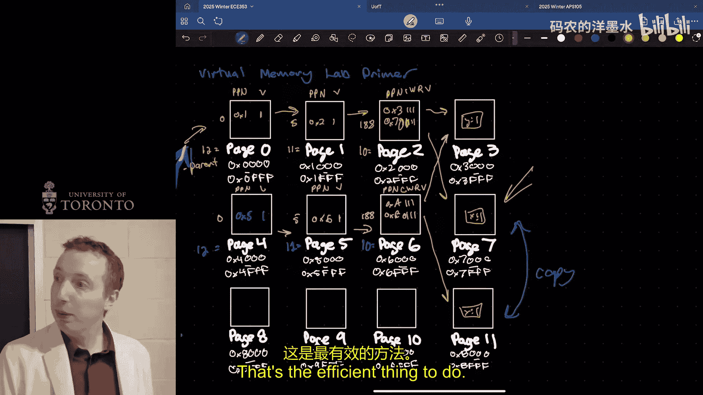

This is where。You can， don't know， some people come with all kind of clever solutions。

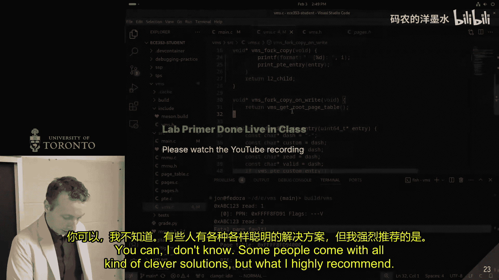

But what I highly recommend。Will this make it too easy and whatever。

 So what I highly recommend is you should keep track of how many processes are pointing to a page so。

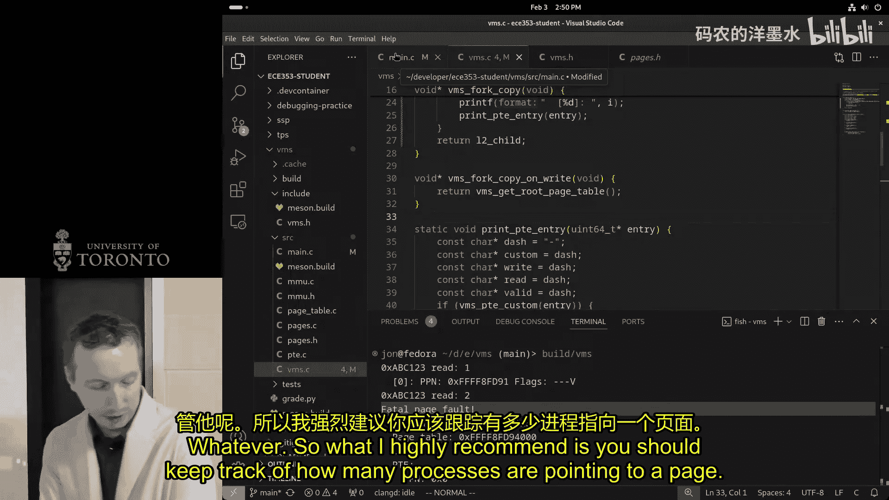

There are whoops。There are a set number of pages it is defined for you as where is it？

So there's a set number of pages。

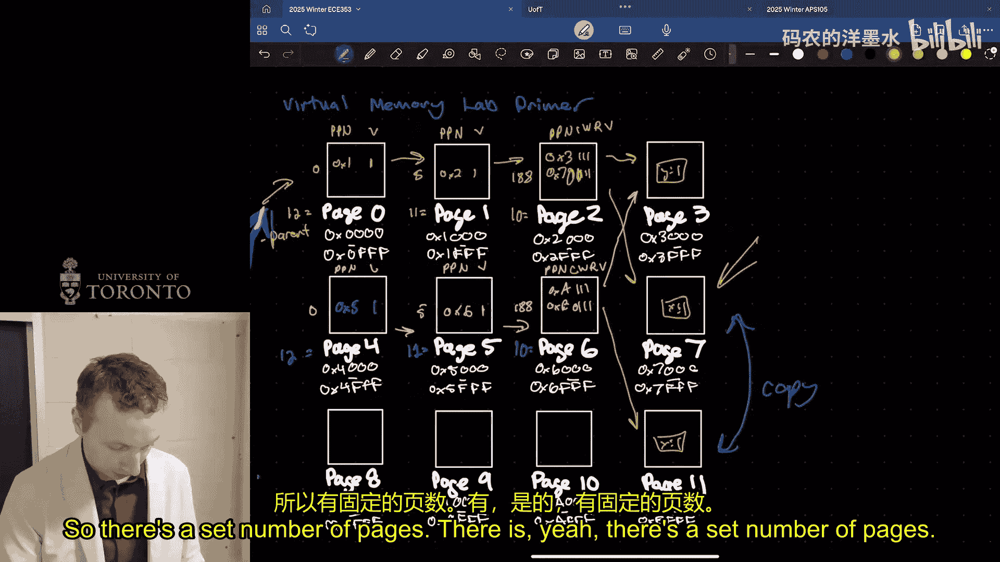

There is。Yeah， there's a set number of pages。One or 256。

 there's a whole bunch of functions that will give in a page， give you an index。Given an index。

 give you a page so you can go back and forth between them， you'll always have a page。

I would highly recommend you just have a big array that keeps track of how many processes are currently sharing this page。

So you can just have a big global， well not a big global but。

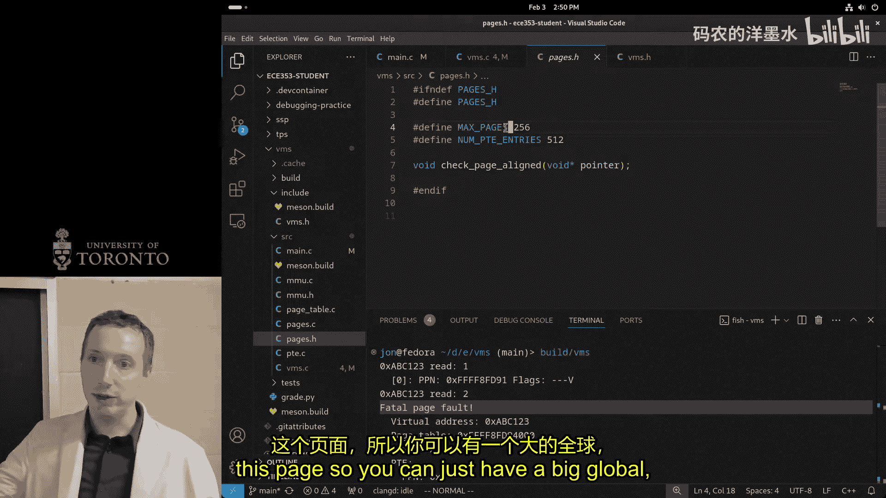

You know， a reasonable global so like。Some static global heat whoops。

Some static global at the top of your thing that keeps track of how many processes are actually sharing that page that way you should be able to detect that if only one process is sharing the page。

 if I'm the only one pointing to it， then I don't need to make a copy of it。

 I'm the only one pointing to it so I don't have to worry about it。Just make a big array indexed。

 there's a set number of pages unlike La2， where you should beat cough cough。

 not having a set number of processes I can make。But I guess I don't test for it， but in this。

Maybe I should and too much work， maybe I should yeah。

 but in this there's actually a set number of pages unlike Lab2。

So you can actually take your lab two skills and apply it to this one。亮。

We always make a coffee while it's not efficient， it will save us。It doesn't save you lots of code。

 it's just one check， it saves you a global variable as opposed to losing a page so if I just blindly create a copy of a page I'd create a copy of this。

 point it to the new page and now this one's lost so now I'm leaking pages at a time so if your kernel leak your process can leak pages。

Or memory that's fine because it's just a crappy process I can kill if your kernel leaks pages。

 you are screwed。So we're simulating being the kernel， leaking pages especially bad。

So even if you were to argue， it makes my code shorter， you're going to leak a page。

You're going to become。Windows Vista。But no。Was that like ship people's childhood offering system out don？

No， you guys are too young， God damn it。Yeah， any other questions this lab。

 that's basically all you have to do。So。Never try and share L， like even for copy right。

 never try and share L。2， L1， L。L anything page tables do not share page tables。

 we're not trying to be hyper efficient， that's just a recipe for disaster。

 you're only sharing data pages so。For both cases。All of the page tables should be independent for。

Each。Different process。Only share the data pages， what else think。

I think that should be everything any other questions？Or anything else I should go over。

It's a fun virtual memory lab， I would suggest at least getting started of it before next week's fun term test because you may or may not have a virtual memory problem。

Yeah。A general question about labs， is it possible to not pass something on our local machine but pass it on the？

I's actually something wrong with our local。Yeah， so oh， okay。I guess this happens a lot。

 I think I stated from。 So just to be really explicit about。 Yeah， the question is。

 is it possible that I run my code locally， It works， I push to the server。 It doesn't work。

 Is your server broken or is my code broken， your code is broken。 So I will tell you why。

 because if you are using Windows or Mac， All of your memory happens to be0 initialized。

 even though it's technically。😊，Undefined behavior so for you it will be zero initialized which it probably should be。

 your program will work correctly， but when it runs on the server memory is actually randomly initialized。

 so random things will happen and your code will fail on the server because you didn't initialize your things properly you got lucky because your machine initialized into zero minded not your code was broken。

And it just happened to work。 So I've already seen that。 Someone crashed the server because。

They mallloed with an uninitialized size。On their system it would have malled zerobytes。

 which is not a memory leak， on my system， it malled like several thousand gigabytes。

So it crashed my virtual machine， and then I had to set a memory limit so that it just。

 there's a new message now that if you try it， it says out of memory now and it's still behind the scenes。

 nothing crashes。 Yeah the other way doesn't pass the。Oh。

 other way around it doesn't pass on your machine， but it passes on the server。Yeah。

 your code likely is。Broken in a way where for this lab generally you have a for loop that iterates over every single file descriptor。

 which is not very good and gets an error on things。

In which case the server might be faster than your machine and be fast enough that it doesn't matter。

That could happen generally the other way around is way more common， but could be possible。But yeah。

 you can assume somethings wrong。 Yeah， yeah， something's definitely wrong。

I can try and look at debug it if you want。For your grade， it's the one on the server。

 so you can kind of ignore it if you really want to。 All right， Any other last minute questions。Oops。

All right， well good luck。 You probably want to come back to this as soon as know La  two is done because you're probably still working on it。

 So I'll stick around for another few minutes， but remember pulling for you。 we're on the stick。😊。

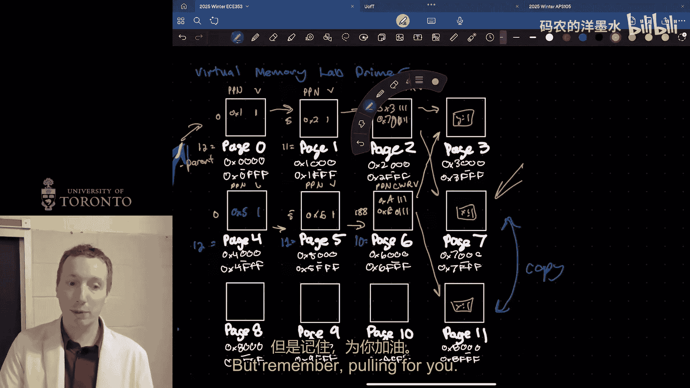