# 系统软件设计与编程：第9讲：高级调度与虚拟内存实验 🚀

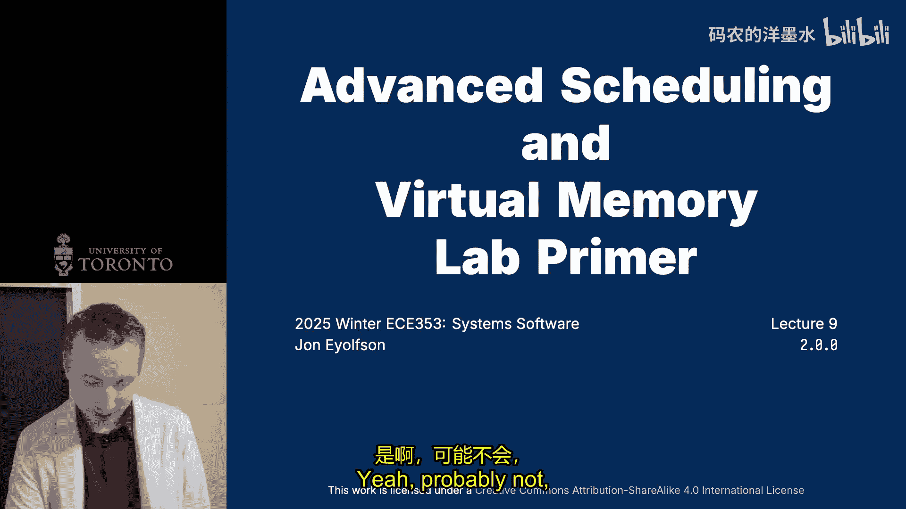

## 概述
在本节课中，我们将要学习操作系统中的高级调度策略，并深入探讨虚拟内存实验的实现细节。课程分为两部分：第一部分回顾并扩展了调度算法的知识，介绍了优先级调度、多处理器调度和实时调度等高级概念；第二部分则详细讲解了虚拟内存实验（Lab 3）的实现，特别是进程分叉（fork）时的内存复制以及写时复制（Copy-on-Write）技术。

---

## 高级调度策略 🔄

上一节我们介绍了基本的轮转调度（Round Robin）。本节中我们来看看更复杂的调度策略。

### 优先级调度
我们可以为进程分配优先级，让调度器优先运行高优先级的进程。优先级通常用一个整数表示。

*   **Linux中的优先级**：在Linux中，数值越小表示优先级越高。例如，-20是最高优先级，19是最低优先级。
*   **公式**：`priority = integer_value`
*   **潜在问题**：如果一直有高优先级进程，低优先级进程可能会“饿死”（Starvation）。一个解决方案是“老化”（Aging）：如果一个低优先级进程长时间未运行，临时提升其优先级，运行后再恢复。

### 优先级反转
当进程间存在依赖关系时，可能会出现优先级反转问题。例如，一个高优先级进程等待一个低优先级进程释放资源（如写入数据），高优先级进程实际上被低优先级进程阻塞。

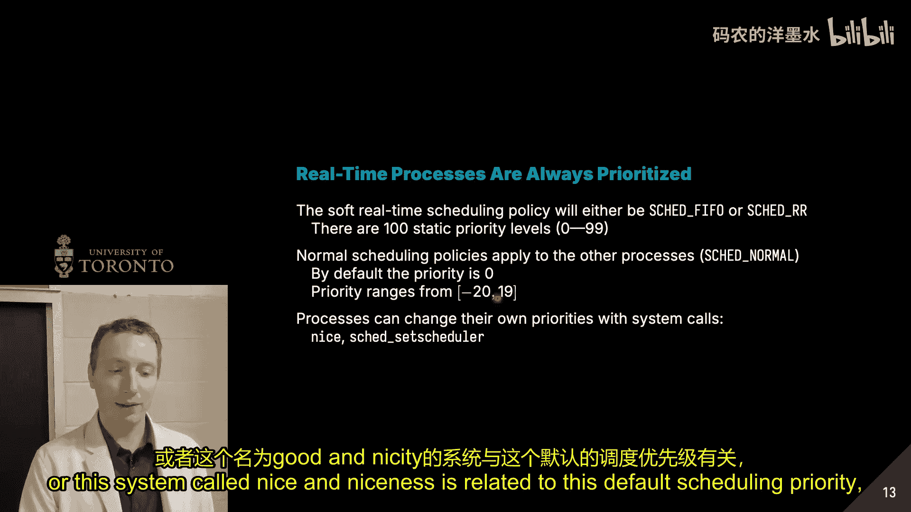

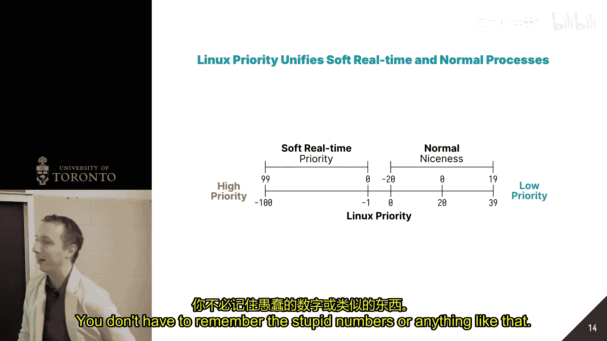

*   **解决方案**：优先级继承（Priority Inheritance）。当内核检测到高优先级进程被低优先级进程阻塞时，临时将低优先级进程的优先级提升到与高优先级进程相同，以打破僵局。

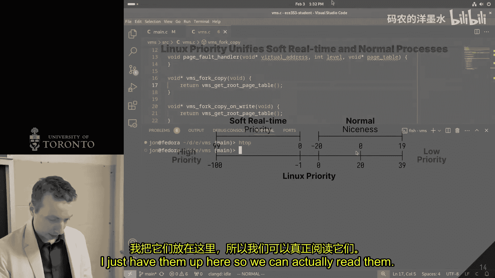

### 前台与后台进程
根据交互性，进程可分为前台进程和后台进程。

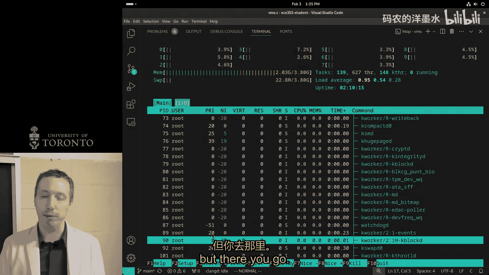

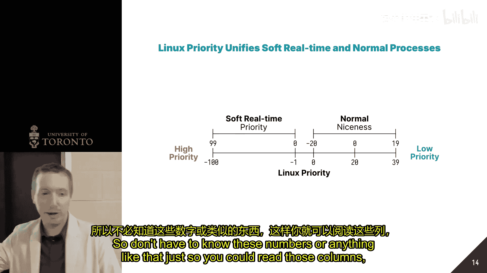

*   **前台进程**：需要与用户交互，要求良好的响应时间。可采用轮转调度。
*   **后台进程**：在后台运行，注重吞吐量。可采用先来先服务（FCFS）或使用更大时间片的轮转调度。

以下是调度策略的权衡：
*   可以使用不同的队列管理前台和后台进程。
*   需要在队列间进行调度，例如使用优先级或轮转。
*   调度没有唯一正确答案，只有权衡取舍。

### 多处理器调度
现代计算机通常有多个CPU核心。我们假设系统是对称多处理（SMP）架构，即所有CPU连接到同一内存。

*   **全局单一调度器**：所有CPU共用一个调度队列。
    *   **优点**：CPU利用率高，对所有进程公平。
    *   **缺点**：可扩展性差（所有CPU阻塞在全局调度器上），缓存局部性差（进程可能在CPU间跳跃，导致缓存失效）。
*   **每CPU调度器**：每个CPU核心有自己的调度器。
    *   **优点**：易于实现，可扩展性好，缓存局部性好（进程倾向于留在同一核心）。
    *   **缺点**：可能导致负载不均衡。解决方案是“工作窃取”（Work Stealing）：当某个CPU空闲时，从其他CPU的队列中“偷取”进程来运行。
*   **处理器亲和性**：进程对在特定CPU核心上运行的偏好。可以设置为高、中、低，以减少因切换核心导致的性能波动。
*   **组调度**：有时需要一组进程同时被调度（例如，相互依赖的进程）。组调度（或协同调度）允许同时上下文切换一组进程，通常用于高性能计算。

### 实时调度
某些任务有严格的时间约束（截止时间或频率），例如音频处理。

*   **硬实时系统**：必须保证任务在特定时间内完成（如导弹制导、列车控制系统）。需要对系统有完全控制权。
*   **软实时系统**：关键进程有更高优先级，在实践中通常能满足截止时间，但无法严格保证。Linux就是一个软实时系统。

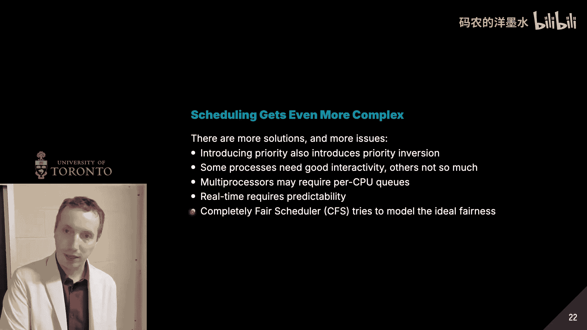

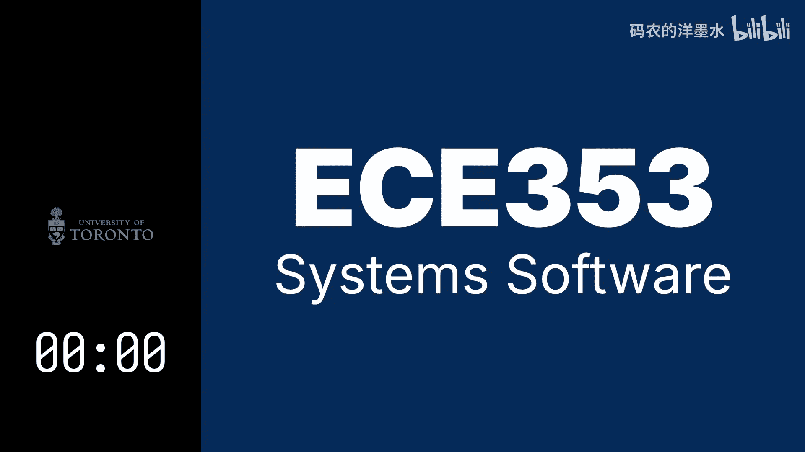


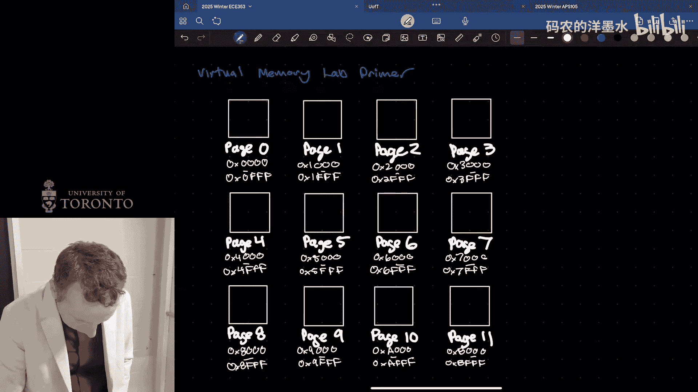

### Linux调度策略
Linux实现了多种调度策略。

*   **实时进程**：使用简单的调度算法（`SCHED_FIFO` 或 `SCHED_RR`），优先级为0-99（数值越大优先级越高）。它们总是优先于普通进程被调度。
*   **普通进程**：使用默认调度器，优先级（称为“友好值”，niceness）范围为-20到19（数值越小优先级越高）。系统会动态调整优先级以防止饿死。
*   **Linux统一优先级**：为了统一，Linux内部使用一个优先级数值，其中负数表示实时进程，0及以上表示普通进程。实时进程的优先级被映射为负数。

我们可以使用 `top` 命令查看进程的优先级（`PRI`）和友好值（`NI`）。

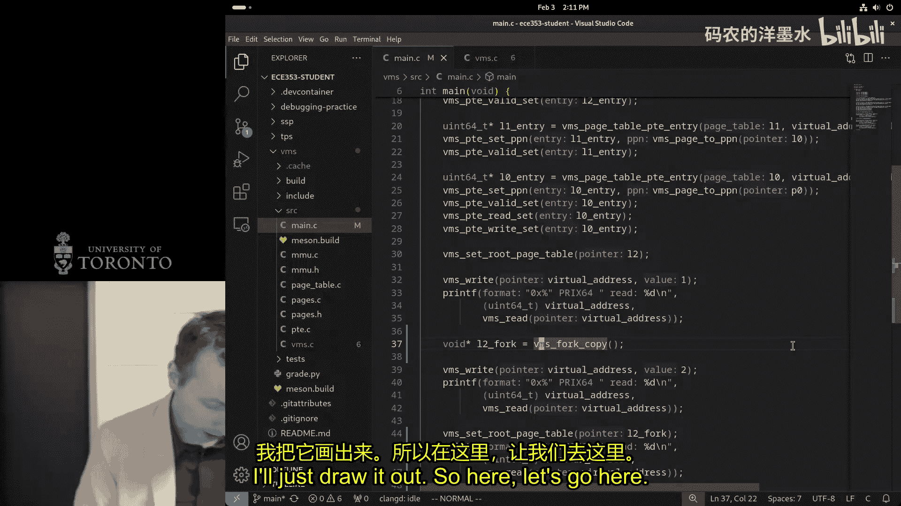

### 完全公平调度器（CFS）
现代Linux内核使用完全公平调度器（Completely Fair Scheduler, CFS）。

*   **理想公平模型**：如果有N个进程，每个进程应获得1/N的CPU时间。
*   **虚拟运行时间**：CFS为每个可运行进程维护一个虚拟运行时间（virtual runtime）。当一个进程运行了时间T后，其虚拟运行时间增加 `T * weight`。权重基于进程的优先级（优先级越高，权重越小，虚拟运行时间增长越慢）。
*   **调度决策**：CFS总是选择虚拟运行时间最小的进程来运行，并为其计算一个动态时间片，使其能“追赶”其他进程。
*   **实现**：使用红黑树（Red-Black Tree）来高效管理进程的虚拟运行时间，实现O(log n)的插入、删除和查找最小值操作。
*   **优势**：自然地偏向I/O密集型进程（这类进程运行时间短，虚拟运行时间增长慢，更容易被再次调度），从而获得良好的交互性。

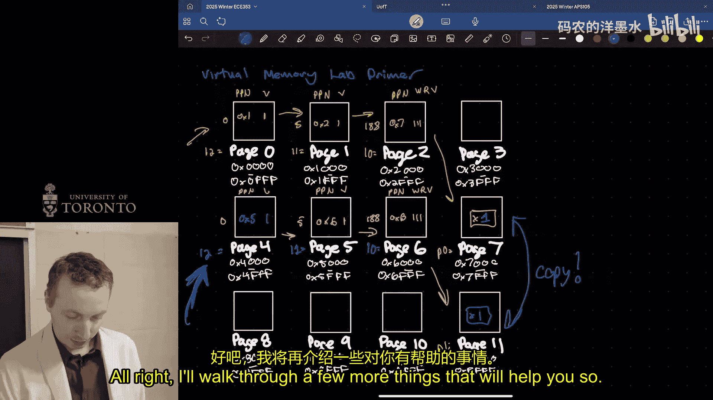


---

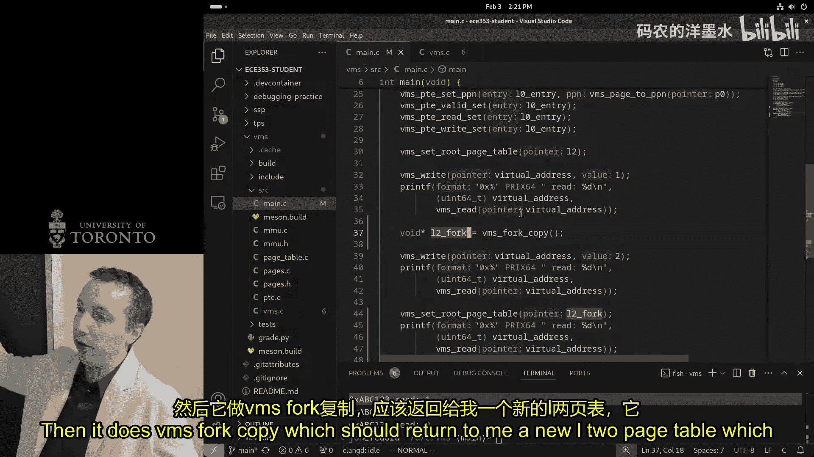

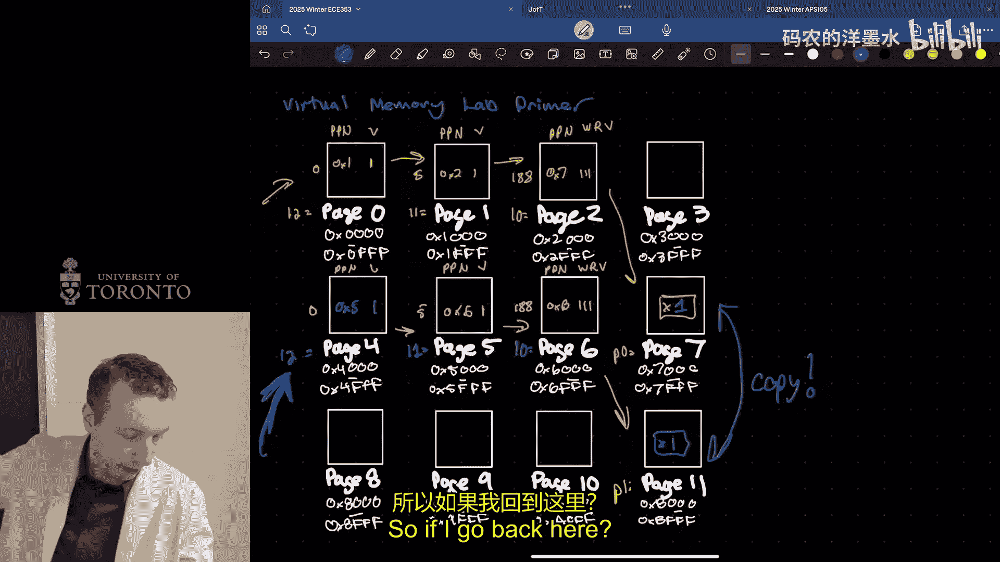

## 虚拟内存实验 🧠

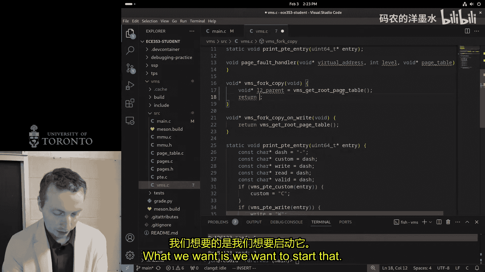

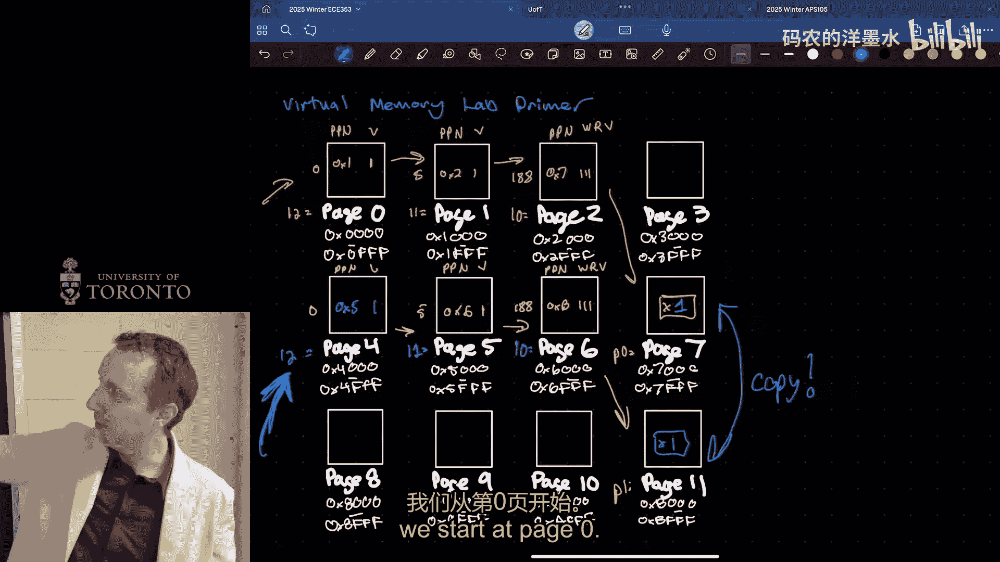

上一节我们介绍了高级调度策略。本节中我们来看看虚拟内存实验的具体实现。

### 实验概述
在本实验中，你将实现一个虚拟内存系统库。主要任务包括：
1.  **进程分叉时的内存复制**：实现 `vms_fork_copy` 函数，为子进程创建独立但内容相同的地址空间。
2.  **写时复制**：实现 `vms_page_fault_handler` 函数，支持写时复制（Copy-on-Write）优化。

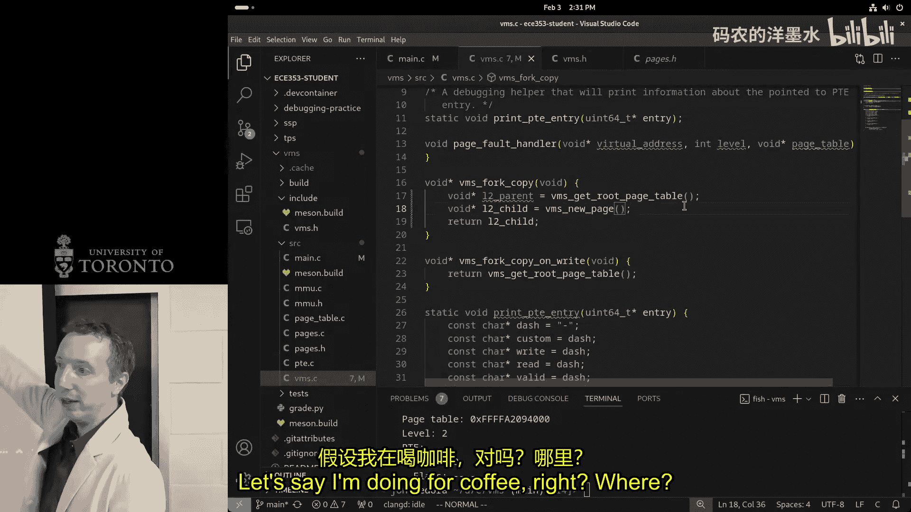

提供的代码框架包括初始化内存、创建页表、翻译地址等辅助函数。

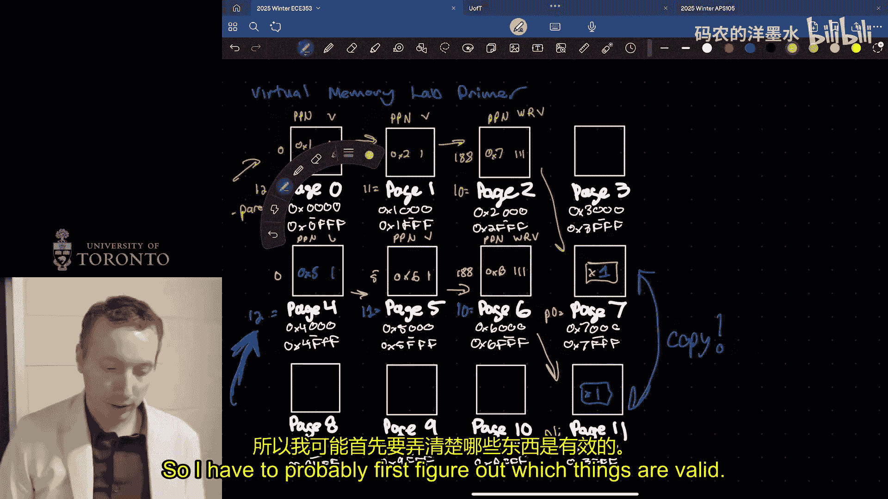

### 分叉时内存复制
当父进程调用 `fork()` 时，需要为子进程创建一份独立的地址空间副本。

*   **页表结构**：假设使用三级页表（L2, L1, L0）。L2是根页表。
*   **复制过程**：
    1.  为子进程创建新的L2页表。
    2.  遍历父进程L2页表中的每个有效条目。
    3.  对于每个有效条目，为子进程创建新的L1页表，并设置子进程L2条目指向它。
    4.  递归地复制L1和L0页表结构。
    5.  对于最终指向数据页的L0条目，需要**复制数据页的内容**（使用 `memcpy`），使父子进程拥有独立的物理数据页。
*   **代码提示**：可以使用递归函数来遍历和复制多级页表结构。

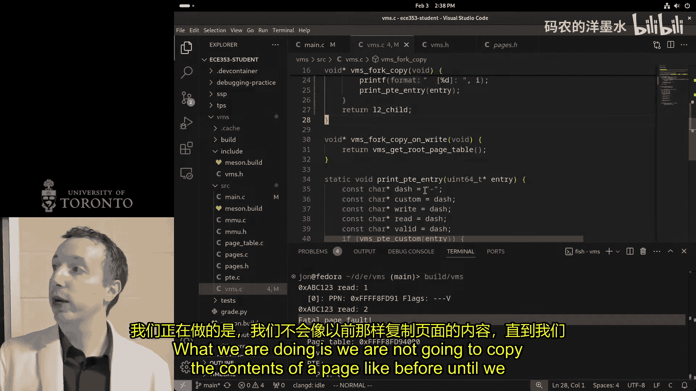

```c
// 示例：遍历父页表条目
for (int i = 0; i < NUM_PTE_ENTRIES; i++) {
    uint64_t *parent_pte = vms_page_table_from_index(parent_pt, i);
    if (!vms_pte_valid(parent_pte)) {
        continue; // 跳过无效条目
    }
    // 处理有效条目：创建子页表并复制
}
```

### 写时复制（Copy-on-Write）
为了提升效率，我们不会在分叉时立即复制所有数据页，而是采用写时复制。

*   **核心思想**：父子进程最初共享只读的数据页。只有当某个进程试图写入共享页时，内核才为该进程创建该页的独立副本。
*   **实现机制**：
    1.  在分叉复制时，对于共享的数据页，**清除页表条目中的写权限位（W=0）**，并**设置自定义位（C=1）** 作为“共享且原可写”的标记。
    2.  当进程尝试写入该页时，由于无写权限，会触发页错误（page fault）。
    3.  在页错误处理程序（`vms_page_fault_handler`）中：
        *   检查自定义位（C）。如果C=1，说明这是一个写时复制页。
        *   检查该物理页的**引用计数**（有多少个页表条目指向它）。你需要维护一个全局数组来跟踪每个物理页的引用计数。
        *   如果引用计数为1（只有当前进程引用），则只需**恢复写权限位（W=1）并清除自定义位（C=0）**，然后返回。
        *   如果引用计数大于1（多个进程共享），则需要：
            *   分配一个新物理页。
            *   将原共享页的内容复制到新页。
            *   修改当前进程的页表条目，使其指向新页，并设置正确的权限（W=1, C=0）。
            *   减少原共享页的引用计数。
    4.  页错误处理返回后，硬件会重试导致错误的写入指令，此时将成功写入新副本。
*   **关键点**：
    *   只对数据页实施写时复制，页表页必须始终独立。
    *   引用计数是判断是否需要真正复制的关键。

```c
// 页错误处理程序逻辑示例
if (fault_type == WRITE_FAULT) {
    if (vms_pte_custom(fault_pte)) {
        // 这是一个写时复制页
        page_index = get_page_index_from_pte(fault_pte);
        if (ref_count[page_index] == 1) {
            // 唯一引用者，直接恢复权限
            vms_pte_set_write(fault_pte);
            vms_pte_clear_custom(fault_pte);
        } else {
            // 需要复制
            new_page = allocate_new_page();
            copy_page_content(old_page, new_page);
            update_pte_to_new_page(fault_pte, new_page);
            ref_count[page_index]--;
            set_ref_count_for_new_page(new_page_index, 1);
        }
        return; // 处理成功，重试指令
    }
}
// 其他情况（如真正的访问违规）导致致命错误
```

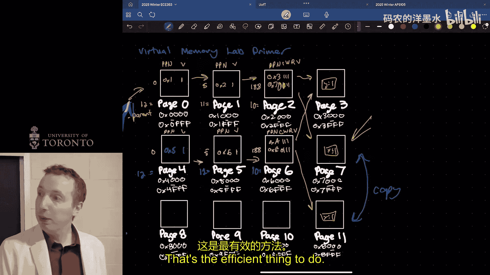


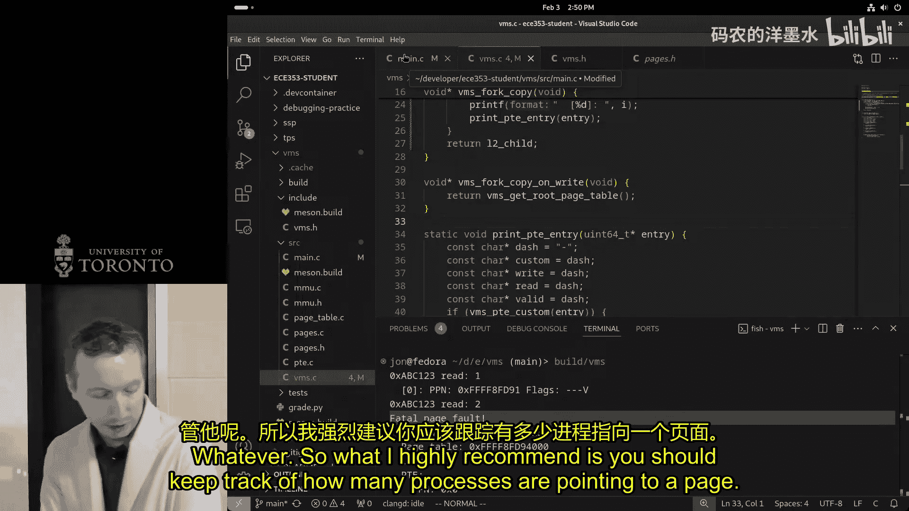

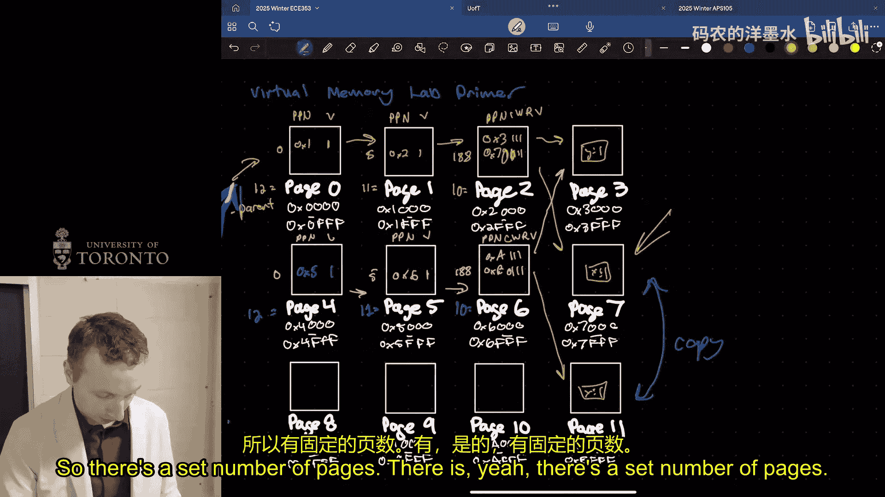

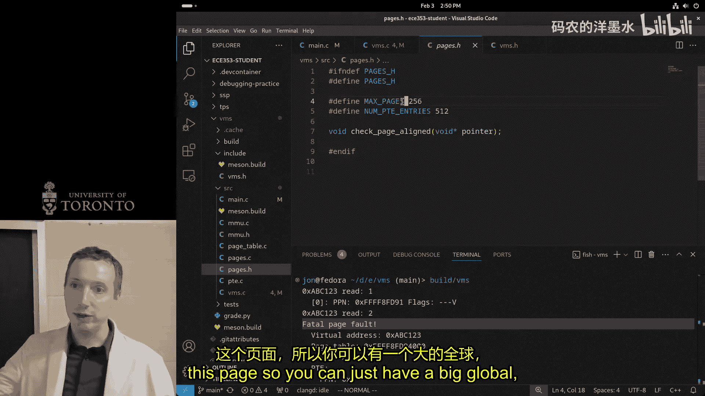

### 测试与调试
*   使用提供的 `main.c` 进行测试，它包含了多种测试用例。
*   如果实现有误，可能会遇到“致命页错误”（fatal page fault），调试信息会显示失败的虚拟地址、失败级别和页表条目内容。
*   **重要**：在本地开发时，未初始化的内存可能默认为0，使程序偶然正常工作。但在服务器上内存是随机初始化的，可能暴露问题。务必确保代码逻辑正确，不依赖未定义行为。

---

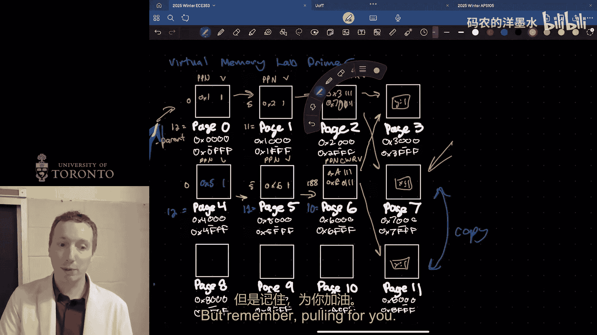

## 总结 🎯
本节课中我们一起学习了操作系统中高级调度策略的权衡与实现，包括优先级调度、多处理器调度、实时调度以及Linux完全公平调度器的工作原理。随后，我们深入探讨了虚拟内存实验，详细讲解了如何实现进程分叉时的内存完全复制以及更高效的写时复制技术。理解这些概念对于构建高效、可靠的操作系统至关重要。