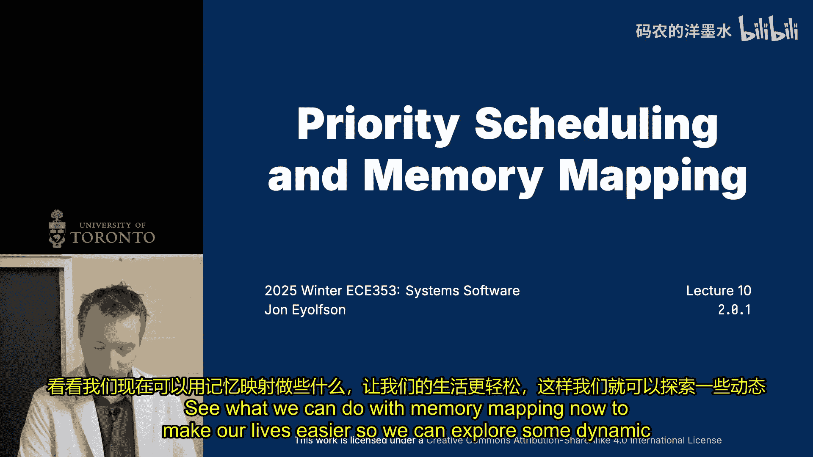
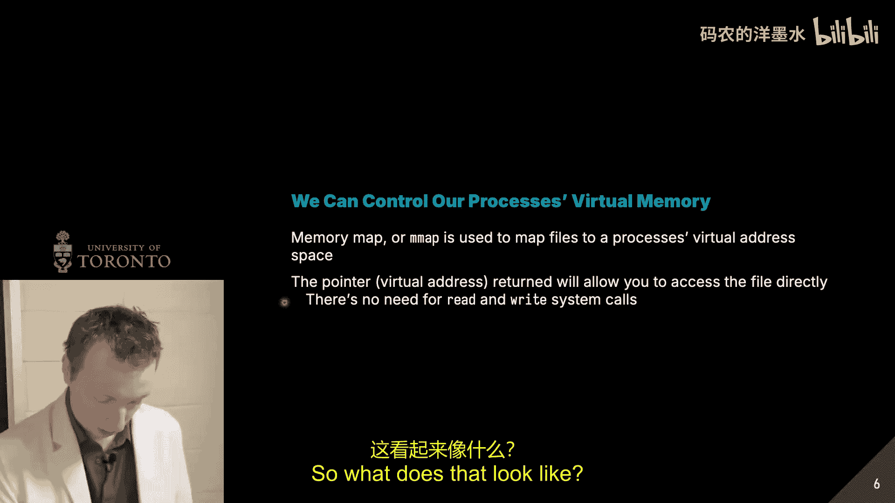
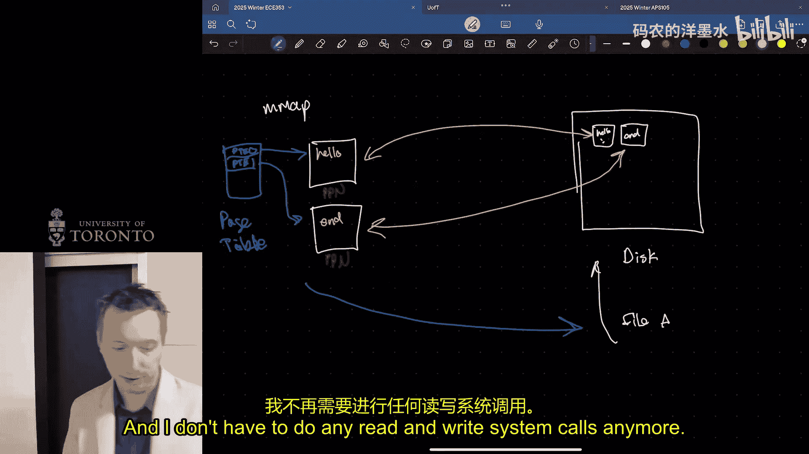
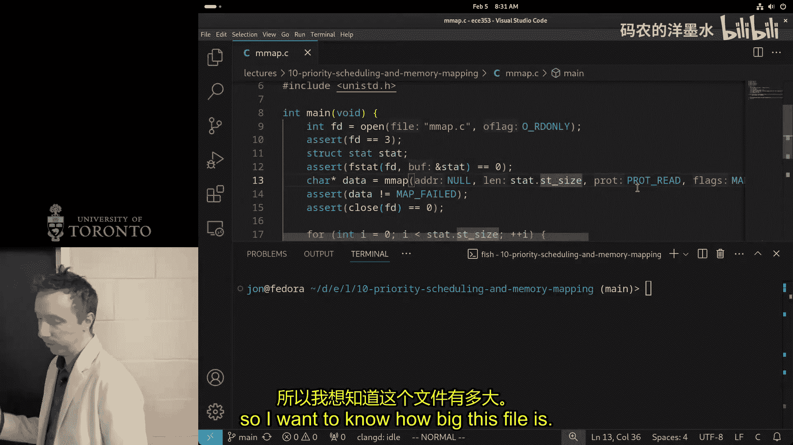
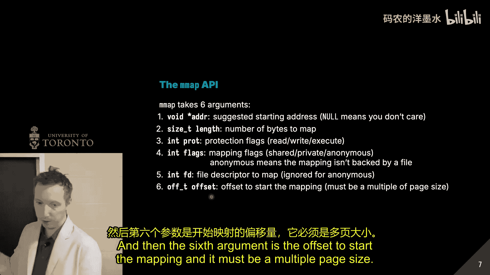
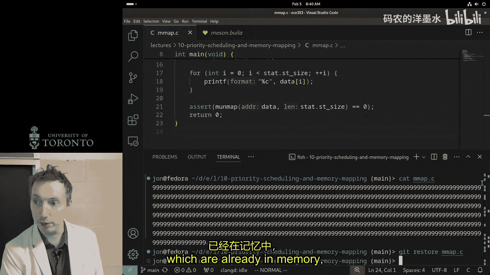
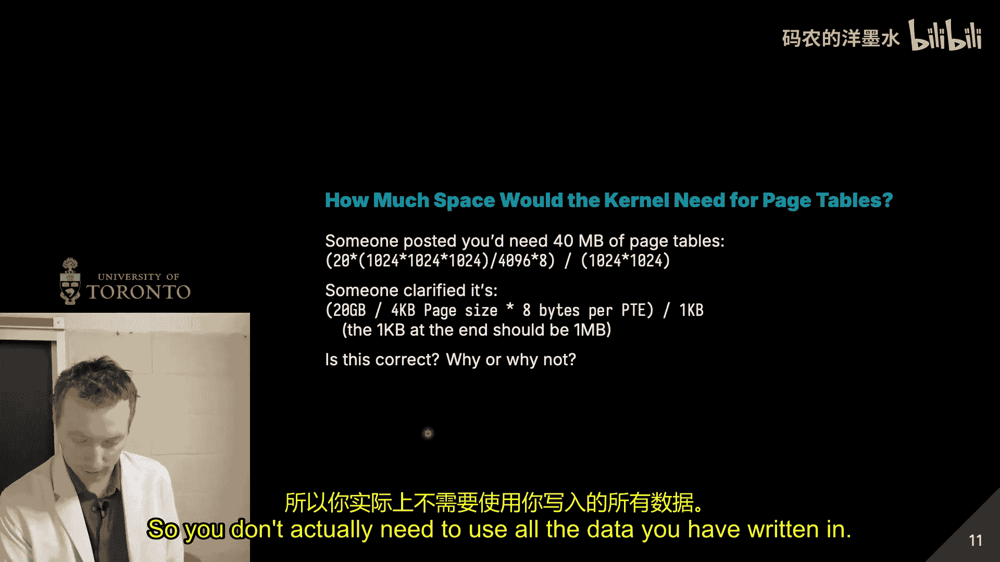
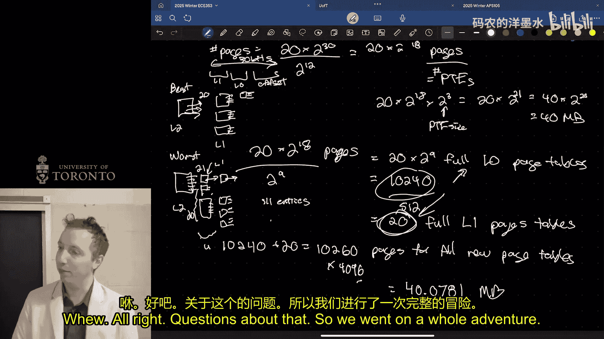

# 【全集 2025】多伦多大学 系统软件设计与编程 中英字幕 1080P p10 Lecture 10 - 优先级调度与内存映射 -BV1YrkYBQEeL_p10-

All right， welcome back to3，5，3 and good morning。 The morning has a lot of casualties today， I guess。

It's like a snow day， except it's not actually snowing。All right， so 9 AM lectures。

 not the most popular。 So let's get into it today will be more of a， I don't know。Kind of review ish。

 kind of wrap up， see different types of scheduling。

 see what we can do with memory mapping now to make our lives easier。

So we can explore some dynamic priority scheduling， otherwise called feedback scheduling， I believe。

 in the textbook。And for this。We let the algorithm manage priorities。

 we use set time slices and measure CPU usage kind of like the idea of the completely fair schedule and having a virtual runtime except a lot more simplified and in this case。

 well we dynamically adjust the priority of process so we increase the priority of processes that don't use their time slice and decrease the priority of processes that use their full time slice or that run for a long period of time。

 so that is our goal for this。So for this scheduling。

 it's easiest to pick the lowest number means the highest priority because it will simplify our formulas and how we readjust things。

 so each process gets assigned an initial priority when it starts。

 we'll call it P of N and then the scheduling algorithm just picks the lowest priority number to schedule。

 if it yields， if it blocks， if it gives up its execution then we pick the next lowest number we will break ties with a rival order。

 and if a lower priority number becomes ready， we would immediately switch to it so this is pre-emptive。

Then we also record how much time our process executes for this priority interval。We'll say CN。

 it's like our time slice that we recompute all the priorities for， time error still occur。

 so the kernel maintains control and then at the end of the interval we update the priority with this formula so we just take its current priority。

Divide it by 2， so it decreases， and then we add C of n。

 which is how long it has run for in this time slice。

 and then we just reset the value of Cn back to zero， keep our count going again。So。

If we assume all the processes have an initial priority zero， and then they are all ready to execute。

 arrive in order X， Y， A B， and we'll take another little twist of this。

 we'll call A and B CPUU bound processes， that means if they get selected to execute。

 they will execute for as long as you'll give them CPUU4。And then X and Y are I O bound processes。

 That means they are waiting for a read system color or something like that。 They get blocked。

 So in this case， how we're going model it is they execute for one。

Time unit and then they get blocked for five so they actually can't execute for five。

 they're waiting on a read system called a return or something like that。

 so we should schedule something else to run。So timer interrupts occur every one second。

 time place is 10 or the priority interval is 10， same things will recompute the priorities every 10 time units。

In this case， we should be able to answer what is the scheduling where each box is a timer interrupted its one time interval。

Initially， they all have the same priority， so to break。The tie。

We would go by arrival order so we should pick x to execute first， right？None， I't know， none。

Can't really argue about that one So X we would execute for one time unit。

 but it is one of these IO bound processes， so it will execute for one time unit and block for five so it's done executing with its one time unit and then it's blocked for one。

2，3，4，5， so it won't come back until six。So we have to pick something else to execute。

 What are we going to pick to execute next， if we can't pick X。Why， right， it's an nextant order。

 So we would pick out why it's one of these blocking processes again。

 So it executes for one time unit and then it's blocked for5。

 So now we only can pick between A and B。 so we would pick A。

So we would pick a for the rest of the time。The reason for this is even though x and y are ready like here and here。

Well， they don't have a higher priority than process X。 So we won't or than process A， sorry。

 So we won't just kick out process A because they're the same priority。 So you would just。

Favor just keeping executing whatever you're executing。

 So a will execute for eight time units until time 10。

 And then we get to recalculate all the priorities。So like I said here， at time six。

 x is ready and at time  seven y is ready， but we don't switch them because they do not have a higher priority or lower number than what is currently executing。

So at time 10， we recompute the priorities。 So it we take their。Current priority。

 which is 0 for all of them。 Their initial priority divide by 2， which is always going to be 0。

 And then we add basically how long they ran for in the last time。10 time units。 So X ran for one。

 Y ran for one。 A ran for 8， and B ran for 0。 So the new priorities would be 1，1，8 and 0。

 So now at time 10。When you pick something to schedule， hey。

 B has a higher priority or lower number than everything else。

 So we would just pick B for the rest of the time， then recompute at 20。Do it again， blah， blah。

 blah， blah， blah， so questions about that。Fun alright。

 So we can change it a little bit where A And B have a priority of 6 and the others have a priority of 0。

 So x and y， again， the rest of this is exactly the same。 So the scheduling this time is。😊。

X and y have a higher priority than A and B， and so we would pick either x or y to run and to break the tie。

 we'd go by a rival order so we'd pick x to execute first， runs for one time unit gets blocked。

 then like before， pick Y。Runs for one time unit gets blocked and now we have no choice but between A and B。

 they're both of equal priority6 in this case， so we would just break the time based off rival order so we would pick a and the only difference now is that at time 6 when x is now ready it has a higher priority or lower number than a。

 so it's going to kick it out， so it will kick it out run for its one time unit block for5 so at time 7 y is ready again。

 it has now a higher priority than a， so y would immediately run。Then， at time 8。

Then we only have the choice between A and B， so we go back to A again for the same reason we did before。

So a executes for two time units and then we recompute the priorities of everything。 so in this case。

 the only difference here is that the initial priority of a and B were6 so it would be6 divided by2 the initial priority of x and y was0 and then we just add how long they ran for so x ran for2 y ran for2 A ran for6 and B ran for zero so now if these are the newest priorities well x and y still have higher priority than process B which is the next but process B has higher priority than process A。

 som right now I only have a choice between A and B because X and y are blocked so I'm going to pick B in this case right？

So pick B in this case， it'll run for more。Two time units。 And then at this time， X is unblocked。

 So x still has a higher priority or lower number than B。 so it will kick it out。And then at 13。

 for the same reason， why we'll become ready and then kick out B and then。At time 14。

 we only have the option between A and B again。 So we will go with B。 and then at time 18。

 X is ready again。 So for the same reason， we'll kick out X。 And then at time 19， Y is ready。

 So we will go to Y。 So questions about that。 just。Another flavor of kind of round robin。

So recalculating priority happens every 10。So every 10， no matter what's happening。Yeah。Yeah。

 so wed recompute it again at 20 and if we were to carry on and go on。Yeah。

 so the priority interval is every whenever we recalculate it。

 it's pretty much the time slice is kind of irrelevant because whenever if we don't recalculate the priority。

And if it's time place， we're going to make the same decision anyway， so it doesn't really matter。

So you're only free。it's not like。Yeah， we're just assuming they all arrive at zero in this case。

Yeah， we just assume they all arrive at zero and we have to break the tie with a rival order。

The time slice will pretty much will never be significant。

 It's just like an implementation detail so the only thing that matters for this one is the priority interval whenever we recalculate the priorities because only then will you make a different decision。

So sometimes they have them both， but the time slice is fairly irrelevant。

 recalculating the priorities is the important one。All right， any questions about that fun thing？

So we're going， oh yeah。Piano。PN over2。Oh， is there a reason for that formula？No。

 no good reason for it other than it kind of does what we want。

 So it decreases a priority of things that or decreases the number or gives things higher priority if they haven't run。

 So dividing by two is a nice way to do that。 And if you have run， right。

 you get a constant added on you。 So it's just a good one easy way to demonstrate it。

 you could make up any heuristic you want as long as if you haven't run， you get a lower number。

 if you have ran， you get a higher number。Alrighty， so we got that。 whoops。 Allright。

 so let's become a wizard。 So L O Ms are a thing， so。There is。I mean。

 Laamas metata's large language model， you can download the model and this C++ implementation called Lama。

 CPP is very efficient， so efficient that people were like absolutely dumbfounded on how they could actually accomplish this。

 so let's see if this works。🤢。

Yeah， so though this says， hey， this model now only needs。Less than 6 gigs of Ram。

 So this model is like 20 GB about。 And then someone made like that has taken this course。

 made like a two line change where it only needs 6 gigs of Ram to run now。

 And then everyone was like。Oh my God。 how did you do this， You are such a wizard。 Please teach me。

 So I will teach you what they did。 They basically just did a one line change in order to reduce the memory consumption by like 75%。

So。We can use MMap so we can control our processes virtual memory with a memory map or M system call。

 and this lets you map a process's virtual address space if you want。

And we now know how virtual addresses work， we translate virtual pages to physical pages。

 turns out we can do different things。The initial values of the physical pages can be something else。

What this does is the pointer returns， which is a virtual address。

 allows you to access a file directly if you want to。

 so you can map your virtual address space to a file， so what does that look like。

Let's go here。We'll learn about this a bit later， but somewhere on your computer。

 you have a disk that is where all of your files are stored， right？

Let's assume because for the most part， this is true that they are stored in。

Blocks that are the size of a page， so let's say we have a file。We'll have some other metadata here。

 something like that， so let's say file A。Its contents span two blocks。 So it's like， you know。

 hello。I don't know。 This is a very large file， something with text at the end。

 So it spans like two blocks or something like that。 So this is the content of the file。

So one thing Mmap allows us to do is we can Mm， and this will allow us to。

Ask for some virtual pages and ask what they are initially mapped to if we want。 So we can ask for。

 you know， just two virtual pages in our program if we want and just use them。For memory。

 if we don't care what their initial values are， but one of the things you can do with Mmap is say。

 well， I actually care what the initial values of the pages are and you can make it so that it actually maps to the same content as the file so I can access the file through memory so I can essentially link this page with this block of the file。

This page with this block of the file。And we now know that with copy on right2 M is lazy so the kernel can just set up all of the PTEs and not actually get memory for you until you first use it。

 then it would generate a page fault then it can lazily grab a page and allocate memory for it and then fix it up and then let you use your memory。

 so in this case the kernel could do the same thing where you know it just has some page table。With。

Two PTEs referring to the two blocks it gives you back。So what can do is when you first access。

Whatever is on that page， what your kernel can do is be like oh， there's a page fault。

 I have to grab a page in physical memory， so I have to grab a PPN and I could also make its initial content equal like copy its initial contents from that file blog so I can put in hello there so if I only read the first page of the file it's already in memory I don't have to do anything like that I don't have to do a read or write system calls I'm free and clear and then eventually when I go to access the next page of the file。

 whatever that happens to be then the kernel can go ahead， grab a physical page， make its content。

Copy the initial contents from the block of the file， and then I can access it like that。

 and I don't have to do any read and write system calls anymore。 So this is useful not even for LLMs。

 but just for using a file so。

If we want to read the entire contents of like let's be meta so if we want to read the entire contents of like a source file called M。

c and we don't know how big it is， we would allocate a buffer， a size of a page。

 call read over and over and over again until it finally returns zero and then we're done right。

 but that's kind of annoying we'd have multiple read system calls。

So one thing we could do as an alternative， which is something is not really testable for this course。

 but you will probably hopefully end up using is I can do。just open that file like normal。

 so I get a file descriptor back in this case we know it would probably be file descriptor 3。

Then I can allocate this create a local variable of thestruct stat， so the strt。

 there is an Ftt system call， that'll basically just give you information about a file through its file descriptor so we probably need to know how big this file is so here I just do an Ftt system call。

 give it the address of stat， and then it fills in a whole bunch of data of the structs One of the useful things is its size so I want to know how big this file is。

So。The MAP API is a bit large， it takes six arguments。

 the first argument is the suggested starting address so I could pick if I cared about what virtual address I got back。

 I could say， hey， please give me this virtual address back because I don't know。

 I like it or you can use that to do all sorts of fancy things。

 but null just means you don't care in this case I don't care what virtual address I get back is。

The next argument is the number of bytes to map， so it's a size underscore T。

 then the third argument is protection flag， so what should I be able to do with this page。

 read write， execute probably looks familiar to the bits on a page table entry so when I allowed to do with this memory through this virtual page。

Then there's flags for the mapping itself so some ones are like shared private and anonymous。

 so shared means like if I fork it will be mapped to the exact same thing in the child process so that's one way to share memory private means that won't be the case and it also changes a bit when it refers to a file which we'll see and there's anonymous and anonymous means the mapping isn't backed by a file by default it's backed by a file。

 if I just want some memory back to play with， I just want to allocate a gigabyte then I don't have to set a file descriptor or anything like that。

 which is the fifth argument so that's the file descriptor to map if it's anonymous it's ignored if it's shared or private then that is the initial content that it will load into memory and then the sixth argument is the offset to start the mapping and it must be a multiple page size for this will always to start it at zero。

So。How that would look is we don't care what the address is， the length is the size of the file。

 and we'll just assume we're just reading the file。

 so we read only then the flags will just say it's private， give it the FD。

 so the FD we got back from the open system call and the offset is zero。So。How it works is if it。

Returns and error， returns the special value M map or map failed。

 which is probably just which is negative one。 And then we can close our file descriptor after that because we don't need it anymore。

 We have set up the mapping through the file descriptor。 We don't need it。

 And then if we want to read the whole contents of the file。

 we could just use it as a big array of characters now， because now。It's essentially in memory。

 the kernel will do it lazily， but it's essentially in memory now。

 So for every single byte of the file， I can just print the character。 and then at the end。

Just like with Maoc， you have a free with Mmap， you have an M unmap。

 So this is how I would unmap my data。 It takes the pointer we get back and the size to unmap and it should be0 if it's successful。

 So if we run this。We easily see that we have like our cat where we just cat the result of the file。

 so this is the contents of the file that I'm currently editing。

 but isn't this so much better than just doing read and write system calls over and over and over again so I just emm it。

 boom I'm done I don't have to do anything if I don't even use that file it won't even load it from the disk it will be nice and lazy。

🤢，So。Cool， alright。 what about if I wanted to modify that file。 Well。

 we can see different ways to get seg faults now， even though we know Seg faults aren't a thing。

 So I have it as read only。 So let's say I tried to change the contents to all， I don't know。

 It's 9 AM。 Let's say I wanted to change the contents file to all 9。😊，If I do that and run it。

 a guess is what will happen。It dies。Probably right， so I run it。

 it says turn aid by Sig fault address boundary error， which is kind of a bad message。

 What that actually means is hey。We're trying to write to it and this right flag is off。

So it's read only， so it should say like read only page or something like that。

 but for some reason it gives us a very unhelpful message。

Which is that if we wanted to try and change the contents of the file， we could try to do like， hey。

 let's add this right flag on so that I can actually change it。So if I do that。And run it。

I might nuke my file， right， fill it full of nines。 So let's run it and see。 So I run it。

I see the contents of file again because I'm printing it before I'm changing anything。

 but I'm looking at the the file right now。 It doesn't seem to have changed。

 Maybe my editor just has it buffered or something so I can look at it。 No。

 contents of file is still the same。 So the reason for that is reading or。

Updating it is kind of a pain。 And probably going have to change more than one thing。

 So private means this mapping is only valid for this process。

 and it's not going to actually change the contents of the file if you write to it。

 So everything just stays in virtual memory。 But if I do shared， if I can type shared， who。

So if I do shared。Who cares a about validating？So if I do shared it。

 well it should actually reflect in the file， it probably won't， but let's see。

 So I run my program again。 No， no， I get another address。Boundary error。

And this one's even more of a pain in the butt， so。The reason this is because。

You need to be able if you want to change the contents of the file。

 you must be able to update the virtual memory， so that was with that Pro， oh wait。

 did I delete the Pro read。Oh whoops， that's probably why it got deleted。

So I have to add Pro right in， I'll probably still get an error。Yeah。

 so I get an error but I get another error where now it says good thing I wrote assertts right so now it says assertion this M or data does not equal map failed failed so M returned an error and then it aborted and all that fun stuff so I could print off in this case let's say P error。

And map， let's see what we got。See how helpful this is。Just as permission denied。Isn't that helpful？

What that means is， well。Your protection flags need to measure or match if it's backed by file what the flags are on the file。

 So for this file， it has read only。 So I'm not allowed to write to it。 So if I want to do both。

 I have to change this to be what is a read， right。

 So I have to have the file descriptor open for reading and writing。

 So now if I finally do this and run it。It doesn't really complain at me， it runs。

 and I'm changing the whole contents of everything to nines。My editor。Didn't change。

 but it's probably buffered because if I cat the file， I can see that is now full of nines。

 So that's one way you can update it。 You don't have to do read and write system calls if you want。

 if they're backed by files。 And map is totally the easier way to do this。 I guess。

 and you can tell B S studio there we go。So now I open it， and I change the file。

 it's all full of nines， I'm not getting it back unless you know I use gett properly and just you get restore yay。

 how。OopSo good thing I used Git， even though I did something stupid。So that was our MF example。

 So any questions about that， probably a good way， most of your， I mean。

If you look at the source code your compilers for whatever reason。

 they're just going to em your source code and that's how they give you easy messages and stuff they refer back to the contents of the file。

 which are already in memory， which is nice and efficient。

So。That is to say M map is lazy just to say it again。

 sets up the page tables doesn't actually read from that file。 Basically。

 it just creates an invalid page table entry during the M map call that says that the kernel uses the remaining bits for bookkeeping information。

 So what should I do to actually。Get initialized memory for this page table entry if the user tries to access it so I can go ahead and fix it up。

 So the first access that generates a page fault and like what we did with copy on right where we handled the page fault by copying a page。

This time the kernel would handle the page fault by actually getting a page and then copying that data from disk and reading it in there and this also ensures that only used parts of the file get read so I can just em a giant file and I only pay for what I use so back to the question。

How do。How can I actually just use a 20 gigabyte model and only use 6。8 gigs of real memory。

 so turns out。Everyone was really confused because they were like， hey。

 to load the model into memory， that is 20 gigabytes， I have to read a 20 gigabyte file。

 but turns out when you do model inference so when you use the model it's sparse so you don't use all of it so you don't actually need to use all of the data you have written in。

So。What they could do instead， which is。What they did， oops。Tt， yeah， which is what they did instead。

 is they just end mappped that whole file。 And then that was it。

 So they changed all the read and write calls， They just got rid of them and they just end mappped it。

 Yeah， So in the exampleary you write a file。 Are we writing directly to this。Are you writing。Yeah。

 so the question is why I'm writing to the file， am I writing directly to disk or when is that happening。

 and the answer to that is for the most part the kernel will be lazy and not write it till disk until it absolutely has to。

We are writing to the rooftra pages。Yeah。Yeah， so you're just writing it to memory first and that it might not be synchronized to disk。

 and we'll get into that a bit more once we talk about disk towards the end of the course too。But。

Basically， rating the disk is slow so itll get avoided at all cost。

So in this case we should be able to figure out a few things if I just em a 20 gigabyte file。

 well that's going to just set up a whole bunch of page table entries it's not going to actually do anything。

 so one question we should be able to。Answer is like， hey， well， one。How much。

So how much space or how many page table entries or well， what's the total？

Total amount of space we need to just set up just the page table entries for a 20 gigabyte file。

 so we could probably do this math math， 20 gigabytes。That's two to the power of 30。

 So I'll just keep it in powers of  two for now。 So the total number of pages I need。For this。

woWould be like 20 times2 to the 30 divided by my page size right。

 my page size unless someone tells you different is probably 4096 or 2 to the 12。

 so that means I need a total of what 20 times to the 18。呃。Pages。So。

How many page table entries would I need？か入に。Just page table entries just for that。In total。

TT question， right， It's the same。 I need one entry for each page。It's the same number。In this case。

Yeah， that's also equal to the number of PTEs。I need。So the total space I need is like 20 times。

Ohoops， that should be two， not 20 eggsikes。So。20 times 2 to the 18。

 so that's the number of page table entries we need and if I need the total space just for page table entries。

 that would be times the size of a PTE。Which is 8 by on our system。

 So that would mean I need essentially 20 times2 to the 21， or if I change all the bases。

Two the 20 and then just take a two out and multiply it， that's the same as 40 times2 to the 20。

 which is the same as 40 megabytes。So I need 40 megabytes just to set up the page table entries for this 20 gigabyte file right。

 and those would be spanned across。All of our L zeros， right。

 We're not arguing about how many L zeros we need yet or anything like that。

 but everyone get that number。All right，Someone said， plain stop that。You know。

 just the space to set up the page tables for this is 40 megabytes， is that true？

Or would we need some more information to or would we need more pages to？

Actually be able to use this information。Yeah。Yeah， this is just the L。

 all the entries across all L zeros。 So if we want to be panantic about it and figure out how much space we actually need in the best case scenario set up page tables。

Well， what do we need to do？We have two to the 20。Or sorry，20 times to the 18。Pages。

RightAnd we can figure out how many L0 page tables we need that are completely full so we can fit two of the nine entries in a single L0 page table。

 right， So that means。In the best case scenario， we have 20 times。Two to the nine。Fll。L0 page tables。

Which is another way just to say， was it 10，000？I think that's the number。 So's the number。Yeah。

 so that's the number， so I need this many full L0 page tables。Everyone see how I got that？All right。

 so best case scenario， how many L0 page or sorry L1 page tables do I need in the best case？Yeah。

バイバイ。So take this number and divide it by 512 again。So that means I have 20 full，'s。

Oh one page tables。Right， which would mean 20 pages。Worth of memory。

 do I need a new L two page table？Sorry。Do I need one， but I assume my process is already running。

 right？ So my process is running。 It already has an L2 page table， so it doesn't get a new one。

 So this is it so。In total， that 40 megabytes was like this number times the size of a page right that gave me my 40 megabytes。

 but that is not the true answer if we want to be turbo nerds in the best case scenario。🤢。

We actually need another 20 pages for the L1 page tables， so in total we actually need 1000。

 or sorry。10，240 plus 20。Which is 10000。260。Pages。For。All。Newu。Page。Tables。Which。I mean。

 if we do the math on that。To get that size。 so it's that number。Times。Times the size of a page。

 right？ So if we take that number times the size of a page and then figure out the megabytes。

What we actually get is 40。0。7，81 megaby。So wasn't that worth it to do all that extra thinking just to get another 0。

7 be technically correct？So now you can go back to that form because in the discussion they're like。

 yeah， it takes another 40， you could say， no， it's at best case， 40。07。

And you can waste a lot of your time just to be。Closer but。First approximation。

 just use the number of page table entries we need because it's probably good enough。

But that's also the best case， and it also turns out that well most of the time you'll have the best case because you get back just one big contiguous block of virtual memory and the way all the indexes are set up is they'll all be in a row。

 worst case is just going to be。So this is our best。So our best case is we have。Our L 2 page table。

 And it kind of makes sense because the rest of the address space is like if we divided it up between our L 1。

 L 0 and our offset。The total number of space here is like 30 bits。Which to the 30， if we did that。

 if we were addressing bytes at a time， that's  one gigabyte， so if this is a 20 gigabyte file。

 makes sense that we would have 20 full L1 page tables because well。

 that's everything like basically at best each entry in the L2 page table can map one gigabte of memory kind of make sense if we use everything there。

 if that could map one gigabyte of。Memory so。In the best case scenario。

 we have 20 that go to a whole bunch of full。L1 page tables that are full that have 512 each。

 and each of those L1s have 512。So worst case we have。Is if we straddle some boundary。

Where all of our L0 entries must be contiguous。 worst case is while we still have an L2。

 but we might use 21。And we might use 21 in such a way that。In this first L。呃。Actually， might be 22。

 in this first L。One page table。It could only have a single entry pointing to an L1 with a single entry。

And then all the rest of them would have to be contiguous。For。All of the rest of them。

 these would all be full。Like our 20 before。And then they would all point to full blocks。

And it would just be the case where in the last L0 here， this one。Has 511。Enries instead of 512。

 so we're just straddling that boundary， but worst case it just adds what an extra two pages。

 so it adds an extra page from L1 and an extra page from L0。

But it doesn't make much of a difference Yeah。A chain of four。Oh。There。

That'll eliminate my train of4， sorry。Like that。So yeah， this row is all L1s。

 I got I got too excited with drawing a whole bunch of lines。 but yeah， there's only three levels。

 and we only only ever have one L2。All right。 questions about that。 So we went on a whole adventure。

Just to get that stupid number again。I don't know。 I'm weird。 I read posts， and then I'm like。

 that's not technically correct。 And then I figure it out。 And then。I don't know。

 that's probably how I ended up here and why I'm now in university forever。So。

Any other questions before we wrap up our fun morning lectures， everyone loves morning lectures。

All right。