# 【全集 2025】多伦多大学 系统软件设计与编程 中英字幕 1080P p11 Lecture 11 - 线程 -BV1YrkYBQEeL_p11-

Alrighty， welcome back to 353。This will be our last hardest topic， so that'll be fun， so think。

Everything this is not on test one。 so again test one goes up to lecture one or sorry of course it goes up to lecture one。

 goes all the way from one to8 Gez， I am off my game today so。

Lectures 9 and 10 were kind of review ish。 We kind of applied some topics。

 so I won't test you on Mmap or anything like that， but some of the things may or may not help you。

 So it's already written。Also， just in case you didn't see the announcement。

 it is in the exam center and it is at nine everyone's favorite time， so。Starts at 9。

10 exactly and then goes to 955。 so you have a hope of crossing the street and making it to your next class or whatever you shall do。

 but yes， Im sorry you have to get up at some ungodly hour maybe if you commute in I know I will be waking up at 4 a。

 so yay， all right， so threads。

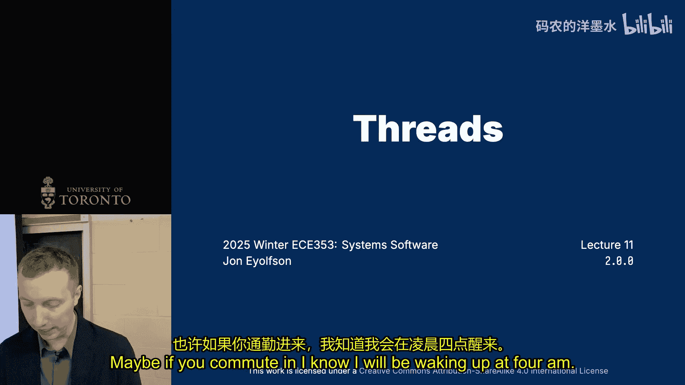

So first， we get a fun， silly real life example because we have to talk about concurrency and perism。

So for most people， for most normal people that aren't computer scientists。

 those two words are synonyms or whatever the English word that is， I't know。

 I failed grade 10 English， well not really， but I got really close。

 but computer scientists are weird people and concurrency and parallelism do not mean the same thing。

So。The difference between the two is concurrency means I am switching between two or more things。

 It means I can get interrupted and make progress on。Well。

 I can only make progress on one thing at a time， but I can switch between the things I'm making progress on。

 So the goal there is to make progress on multiple things。

 While parallelism two things need to be happening at the exact same time instant。

 So it means they are independent They mean they are happening at the same time and that goal is to run as fast as possible。

 So again， I have multiple cores to in my watch。Every system nowadays will you want to exploit some parallelism。

But back in the day， you know， concurrency is also important， too。

 especially if you are doing stuff like web server stuff， loves concurrency。

 So let's have a silly real life situation to explain the difference between concurrency and parallelism because one does not imply the other。

 You can have something that is or well， concurrency and perism is typically between two things between two things。

 They could be able to be done concurrently or parallelism or any combination of that。 so。

You have to bear with me for a second here because we're going to have a silly real life situation where we assume we are not animals and have manners。

 So you're sitting at a table for dinner and you can eat， drink。

 talk gesture with your hands and there's this weird caveat that you're so hungry that if you start eating。

 you won't stop until you finish。 So between two test。

We can try and find ones that cannot be done concurrently and cannot be done in parallel。 So。

 for example。If I am considering the tasks eating， well， let's actually go with a different one。

 If I consider the task drinking and talking。Can I do those concurrently。So can I talk， stop talking。

 pick up my drink， drink？Yeah， I should be able to do those concurrently， right， If Im not an animal。

 can I do those in parallel。That means I'm talking and drinking at the exact same time。

Some of you may be able to do this， but again， you have to bear with me here we were trying to be civilized。

 so we would say we could not do those two tasks in parallel。All right， so what about？I don't know。

Eating and drinking。Can I do those two tasks in parallel again， not savages。

 So I can't do those in parallel again， assuming I only have one mouth， right。

 Can I do eating and drinking concurrently。Well， in this case， no， because I have this。

Kind of silly condition where if I start eating， I can't switch。

 So concurrencies is being able to switch。 But here， well。

 I can't switch between eating and drinking because if I start eating， I'm not going to stop。

 so I can't stop halfway through eating。 Again， this situation is kind of rare in computing and rare in real life examples。

 So again， slightly contrived， But that's just to show that they do not imply each other。

 What about eating and gesturing。 Can I do those in parallel。Yeah。

 I have another free hand so I can eat and gesture。

 but I can't do those concurrently because I can't stop eating too just solely gesture。 So again。

 I have the weird situation where again， one doesn't imply the other。

 And then for the rest of them gesturing and talking well between these two。

 I could do them in parallel or concurrently， it doesn't matter。If I could stop。

 I could switch between them。 I could do both at the same time and same between gesturing and drinking。

 So I could do those again， both concurrently and both parallel。 So through the silly example。

 everyone get the difference between concurrency and parallelism。

And the reason why it is kind of hard to tell which is which。 So here's all the real life examples。

So the reason why it's kind of hard to tell with computers。

 which is which is because if you do concurrency really， really， really， really quickly。

 then it will kind of look like parallelism。 So， you know， again， silly example， if I have a。

Blue drink and a red drink in front of me。 And I tell you to close your eyes for 60 seconds。

 and then you open your eyes and they're gone。You don't know what I did。

 I could have done them concurrently or in parallel， right， So if your time scale is much， much。

 much larger than me actually switching between things。

They kind of look the same from your perspective。 So that's often what happens with computers。

 especially if we had a single core back in the day， lookss like we can do multiple things。

 but really computers just switch really， really quickly。And again。

 with that silly real life example， you don't know if I just down them both at the same time。

 if I'd like double fistted them or if I was switching or what I was doing， right？Alright。

 everyone on the same page with that。Alright， let's start talking about threads。

 So we all like processes。 It was everyone's favorite thing。 So we do threads。

 which is like processes， but with shared memory， which is even worse。

 So they're the same principle as processes。 They enable some parallelism to happen。😊。

Except by default， they share memory。 So when you create a new process。

 it's completely independent from the original， right， a whole new virtual address space。

 one doesn't affect the other。In the case of threads， they are not completely independent。

 threadreads have the same address space。 The only thing independent in a thread is its current registers。

 its program counter， which is also a register， and its stack so。

In your intro course or why your intro courses or the other kind of architecture course。

 they harped on to you about like stacked versus heap and things like that， right？

So now it is going to matter because if I use the stack。Well， if I use the stack with threads。

 it's independent。 Well if I use something like the heap。

 it is not independent because it's all sharing virtual memory space。

 So they have the same address space。 So if I change something in one thread that isn't on the stack。

 it will appear on the other thread。If I want to have nons stack memory specific to a thread。

 I can do something called thread local storage or TLS。 again。

 TLS also means some other things for security。It's an overloaded term。

 but we won't go into specifically how we do that， just know that it is an option and some things are actually stored in TLS that we have been using。

Like that ano thing。The rule between process or the the relationship between processes and threads are one process can have multiple threads。

 So by default， a process just executes code in its address space。Technically。

 the easiest way to think about it is that initially a process just has a single thread that starts executing Ma。

But because I can have multiple threads now， I'll show you how I create them in a little bit。

 We can have multiple executions in the same address space。 So multiple。Kind of。

Virtual processors going on， which may be actual different physical processors again。

 depending on my machine， whatever my kernel decides to do with scheduling them because the kernel will schedule them exactly like weve argued about before with all of our scheduling algorithms。

 So the idea behind them is that they're lighter weight。

 they only need a stack and a set of virtual registers。

 So they're less expensive to create than a process。

 They share code data basically everything thing in the same address space file descriptors in everything like that。

's not that much that is independent for them。Which is great。

If you know you had a lot of communication between processes， well。

 if you had to use something like pipes or something， they have to go through system calls。

 it's slow， if you're sharing a lot of data， then well it's easier if they're in the same virtual or if they're in the same address space because everythings shared by default。

 so there's pretty much no communication overhead， I won't have to do system calls or anything like that。

So。Assuming I have one CPU again， threads can express concurrency at minimum。

 but usually we want them to express parallelism as well。

 so one process can appear like it's executing multiple locations at once。 however。

 this could be just an illusion， the OS context switches within a process and it could be going really really fast。

Even if you have a single CPU core or you're using。No node or something like that。

 some jascript framework。 it's all single threadreaded and it heavily relies on concurrency。 So。

 for example， web servers typically look like this。

 there's a main part like in your main thread or in your main function， it'll be something like this。

 So like while true， I get a request So that'll be from something that looks like a file descriptor。

 I'll show you it in a later lecture just in case you're interested。

 but I accept a request essentially I get like a new file descriptor that represents that request。

 and then I might just create a thread to process that request。It would be using your network card。

 which is I O， which is typically slow。 So it can juggle many。

 many connections all at once and make them appear like they're all happening at the same time。

 even though it's just juggling between them really。

 really fast because your CPU is a lot faster than network connections。 But that those。

Two lines are basically a web server。 So if you go into Google dot com or anything like that。

 that's basically what it looks like。So。In summary， they're lighter weight than the process。

 so a process has an independent code， data and heap with a thread they share。Code， data and heap。

Processes have independent execution， or again， you can think of a process as just initially just having a single thread in it。

 while a thread must live within an executing process and well be able to relate them between processes。

Pretty much one to one except for that parent child relationship so processes has its own stack and registers。

 thread has its own stack and registers for a process it's more expensive to create and context switch them because while as you're learning from lab3 hopefully you'd have to create a new virtual address space you have to create a whole new set of page tables you'd have to create a whole new set of file descriptor tables。

 everything like that so obviously it's going to be more expensive to create well threads all you have to do is create a stack and a set of virtual registers and context switching is cheaper。

And faster， because if I'm context switching between threads within a process。

 I don't have to do that thing where I flush the TLB or anything like that because it's all the same virtual address space。

 everything is still all valid。 Well if I'm context switching between different processes。

 I'd have to flush the TLB as we went over before， which is much slower。For processes。

They're completely removed from the OS when they're exited and weighted on and for a thread。

 whenever they're weighted on or cleaned up， just as stacked is removed from that process。

 whenever they exit and get cleaned up and then the only caveat here that's slightly stranger is's that when a process dies。

 all the threads die within it as well， because threads only exist within a process。

So throughout this course， we'll be using Poss threads。

 Pretty much everything is built on these for Windows。 Of course， there's a win 32 thread。

 but we're going to use Unix threads。Theres you can actually use this on Windows 2。

 a lot of people do because I don't know they just like it better。

 So how you use it is you just do hashtag include P thread dot H in your source file。

 there's short for P thread， short for Prosss threads。

 and then you just use this dash P threadread for compile and linking the library。

For all the code I give you， I've already done this for you as part of the build system。

 so you don't have to worry about it。 So all the P thread functions have documentation in the man man pages。

 and we'll be going over them as well。So。Fork creating a process we used fork。

 well for creating threads。All of our functions are going to begin with P thread underscore and they're going to be named slightly better。

 so instead of fork， there is P thread create to create a thread。

 so it has four arguments which is a bit more fun， so it needs as the first argument a handle to a thread at a pointer location which basically means you create a P thread underscore T。

which is basically an int， kind of like a process ID。

 but just for a thread and then you give it the address of it so it can go ahead and set that value as part of creating。

 then it takes a pointer to this attribute function。We won't be using it。

 We'll just be using it allll to get the defaults and we'll see more details on things you could do。

 but won't be relevant for this course， but you might find it useful。

 Then the next is a start routine。 that's the function to start execution。

 So looking at the type of this。 void star， star， start routine， void star。

Anyone want to tell me in plain English what the hell that type means。

Everyone remember their pointer and C。Horribleness， yeah。many point。Yeah。

 so what this is is a pointer to a function。And that function takes a single argument。

 which is a pointer， so void stars just sees the way of saying it's a pointer to what I don't care。

 so it's a pointer to something as its argument and it returns a pointer。

So if I want to actually give it like set this to a value， that's what I do to this int arg。

 So this a is the value that gets passed to that start routine function。

 So whenever the thread is created， it's set up that it runs that function and the initial value of the argument is given by that fourth argument here and here Pthread create will return0 if it's successful otherwise it directly returns an error no instead of setting that global a variable。

 and if it returns an error， the content of dereencing。That thread are undefined。

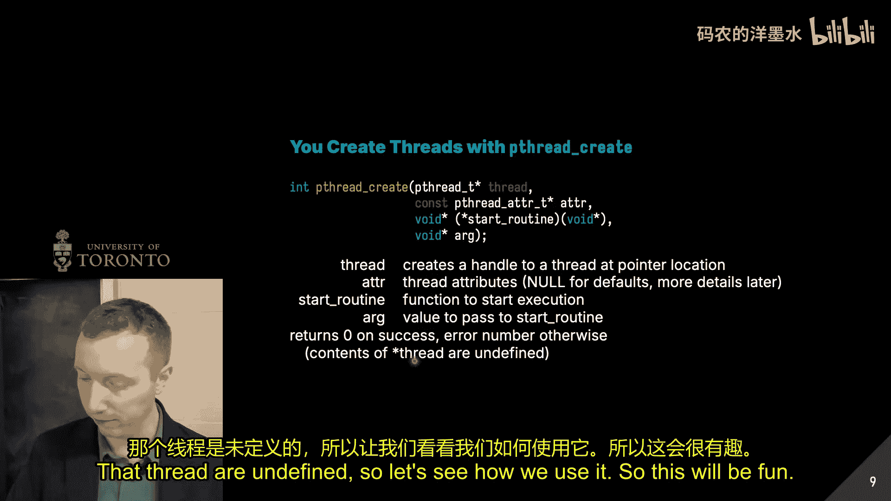

So let's see how we use it。So this will be fun。All right， so。This is how we can use it。 So again。

 our execution would start in Maine。 I create a P thread thread， Then I can do P thread create。

 I give it the address of thread so we can go ahead and set it。Set the attributes to null。

 So I want all the defaults。 Start routine is the address of run and run is this function here。

That I just put this weird attribute so that the compiler wouldn't complain at me because this argument I do not use at all in this function。

 So that's what this does。 It's just to use to shut my compiler up。

So I have the right function signature， I take a void pointer and I return a void pointer。

 so in this run function I print off in run and then I return null because I don't really care and then in here the initial value I give to Arg is null because again I don't use it。

And then I print off in main。All right。So。If I run this program。What should I see？Any guesses？Yeah。

InYeah， so one thing I could do is print off in run and in main。

 So if we thought of this P3 create as a process。The only difference is the kind of。

Works in the virtual address space， but it basically just creates a。Another process。

That runs this run function， although memory is shared。 and when it is picked to execute。

 it will just run this in run line and print this。 And then the。Parent process， again。

 if this was processing and that was fork instead of create。

 the parent would just print in main and then whenever I run this。

 I should see in run and then in main。In that order。哎。Has anyone used threads before？Okay。

 so some people have and。Some people's experiences， Yeah， just use threads。

 It'll make things a lot faster。 And that is horrible advice because they you do not know the first thing about threads。

 So our first thing about threads is。It would be a good guess to assume this print in run and then in Maine。

 right？So let's go ahead。Give it the old setup。Oops。Give it the old setup， give it the old compile。

And then this is called。P thread example。Oh， I'm trying to Cd， of course I shouldn't C。

 I should just run it。So if I run this， I get in main in run。Okay， cool。I run it。I get in Maine。Oh哦。

I run it， I get in Maine， I run it， I get in Maine， I run it。I run it。 I run it。 I run it。 I run it。

 I run it。Hey， I got the other 1。 I got in main and then run。 So this is very not consistent。

 Anyone guess why。This is happening， why did I only see in Maine？Yeah。

It main finishes running in an exit。Yeah， so。Basically， after I have P threadread create。

 I have two threads in this process。One would continue on and print in main。

 the other would continue would start if it's picked to run， we'll immediately print in run。Again。

 this is up to the scheduler just like for processes。 I don't know which one will run。

 So in a lot of the cases when I ran it， the main thread。

 that's what you call the thread that originally runs main。 Just prints off in main。

 and then we return0。 So remember， return 0 from main oops is the exact same thing as like exit  zero。

 So it means this process is now donezo。 and all threads live within the process。

 which means the thread that was set up to execute in run。Gets murdered。 So it gets murdered。

 It's no more。 So that is why I always see in Maine， no matter what happens。😡，All right。

 questions about that before we fix stuff， yeah。Yep， so did， did we see and run first， and then me。

Yeah， so it's technically possible that we see in run and then in Maine and then it exits。

Probably it's slightly unlikely but it is possible。

But most of the time we'll see in Maine than nothing or in Maine than in run again。No idea。So。

If this was a process， what am I missing in my process if I was to be a good parent。Yeah。Yeah。

 I could wait for， right， I could make sure I can clean up my child and get read its return value and everything like that。

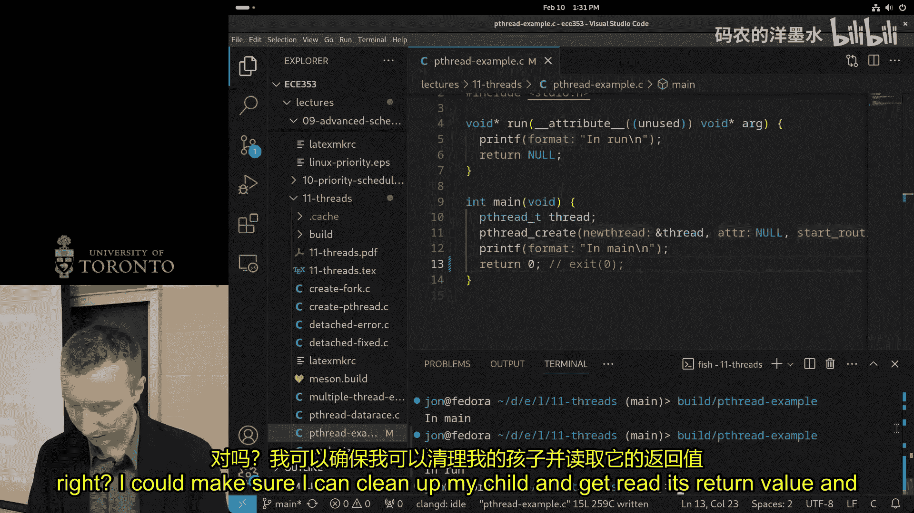

So。What it could do。Is there's a weight equivalent for threads so you can acknowledge your thread。

And how you do that is annoyingly， It's not called weight。 It is called join。

 So the function for that， again， is called everything is prefixed with P thread underscore。

 So this one's called P thread underscore join。It takes that P thread T。

 which is basically the thread ID set by create。 and then we get this。 So void star star。

 Everyone loves that。So the return value is void star star because， well。

 there's like some equivalent between processes and threads。 So when a process exit。Exits。

 what we really care about is that it sets its return or its exit status with is which is an integer。

 right， And because of that， whenever we use weight， we give it a pointer to an int。

 so it can go ahead and set its value。 So the only difference here is processes by default。

 you can think of them as returning an int threads by default， just return a pointer。

 So if I want to get the value of the pointer。 I have to give it the address of some pointer variable。

 So it can go ahead and set the actual address there。 So that's why it's void star star。

 So this would be set to the return value of the run function。

 So whatever that run function actually returned。That would be its kind of equivalent of an exit status。

So。Storore the exit status， or basically the return value of the thread set by P thread exit。

So we haven't gone into that oops。So we haven't gotten into P thread exit yet。

There's an equivalent exit for P threads called P thread exit， which instead of giving it an int。

 we just give it a pointer value and that goes ahead and just sets that value for us。

If it's canceled， so there's a way to kill threads。 So like we can kill processes。

 We can kill threads。 It's called canceling them。 So if they're canceled。

 it gives you this return value of P thread cancel。 And if you just want to ignore it。

 you can set that pointer equal to null and。Unlike。Wait where if you wait on something。

 while it's cleaned up， Everything's done。 The kernel knows about it。

And would give you an error if you waited on it again。

 for P threads because they all exist in the same address space。

You can call this multiple times with the same number， but it is technically undefined behavior。

 So you should only call this one time per thread。 And you have to ensure that。

 So that is one difference just because they're in the same address space。

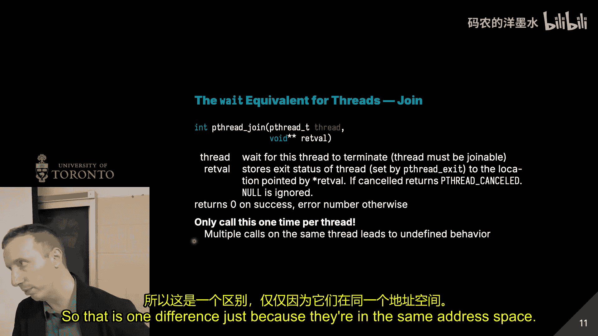

So if I want to change my code so that I always see both lines。 Well。

 if I want them to happen in any order， then in the main thread， I should wait for my。

There's no equivalent of a child thread， but wait for the other thread to end， so。

Here I would do P thread join。 I would join on thread， and I don't care about its return value。

 so I could do something like that。 So if I join it， now I will always see in run and in main。

 But in this case， if I join it after I create it， I still have no idea what order they're going to be in。

 likely， I'm going to get the exact same order every time。But it just happens by chance。

 So this time when I run it， I will always see in run and in Maine because I'm waiting for it。

And I just happen to be getting lucky， such that I see in Maine every single time I do this。

 Will I get lucky。I should probably give up around now， huh？Whoops， all right。Okay。

 we didn't see a miracle， so it can happen the other way。 it's just highly， highly， highly。

 highly unlikely。All right， any questions about that。

 And this also nicely cleans up that other thread right， so now I'm。Nice， yes。Yeah。

 so that's a good observation。In the run function， just like the main function。

 if it makes it to the end， this is essentially the exact same thing as P thread exit and then。

That value just gets returned there。 So it's the same idea。

 P thread exit just takes a pointer value instead of an int。

 and it's implicitly called if it makes it to the end of this。

 just like if a process makes it to the end of main， it's implicitly called at the end。

 So exactly the same thing。 if I want。Exit early， I could do something like P thread exit。

If I give it a value I don't care about， I could do something like that。

 and if I compile and run this， I'll just never see and run because it will immediately exit。

 even if I join it well。And then I'll join it。 I'll clean it up， and everything will be great。

 So if I go ahead run this， I just see in main because the other thread just exit before it printed anything。

All right， any other questions or anything before we go over more stuff？So threads are fun。

 That's do。

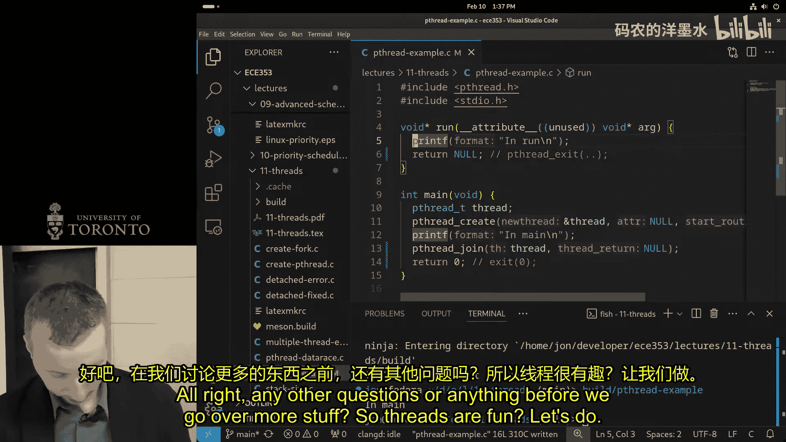

So yeah， preempted me。 so ending a thread early again。

 you can do it using P thread under score exit again。

 think of exit just the only difference being instead of returning an int。

 you're returning a pointer so。That's why it's a void star return value again。

 it's a C's way of saying it's a pointer to what I don't care you should know。

Because of course it is at C， so that start routine returning again is the equivalent of calling P thread exit。

 so basically the exact same equivalent as returning from mainine just calling exit。

 returning from that start routine is the same as calling P thread exit。

 so it will be implicitly called at the end。All right。

 so what we saw is the default where they are called joinable threads。For joinable threads。

 we have to wait for someone to call Pthread join to release all their resources。So unlike processes。

I can just say， hey， screw that。 I just want them to just。Combut whenever they exit。

 I don't care about the return value。 They can just go ahead and clean themselves up。

 So one thing we can do is create something that does not have an equivalent in processes called detaach threads。

 And with a detached thread， they release all their resources when they terminate。So。

The catch here is that if they release all their resources when they terminate。

 then they cannot read their return value because they're already gone。 their poof。

 They don't exist anymore。 So you only prefer this。

 if you do not care about their return value and you just don't want to bother waiting for them。

 you want them just to， again， really sell their resources， you don't want。

To have them being zombie threads or anything like that。So in this case。

 the thread that just marks the thread that's detached。 And again， it returns0 on success。

 error number otherwise， so。There's also this caveat is if you call P thread detaach on a thread that's already detached。

 boom， more undefined behavior。 So that is a fun thing to look out for。

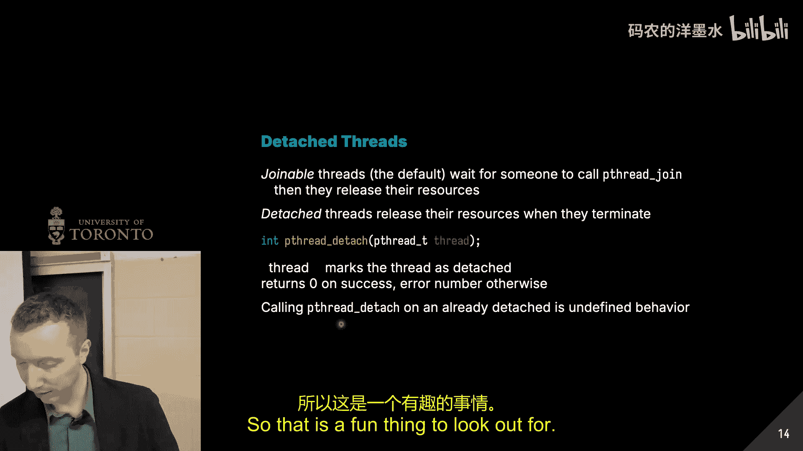

Ohoops。So。Did， to do。So if I wanted to， I could change it to use。Detach instead。

 So after P thread create， I can do P thread detach。So in this case。

 I didn't really care about its return value， right？So。If I detach。

 now that thread's a detached thread and it should clean up its resources whenever it's done printing in Ma。

 So now I have a bit of a dilemma。 So now I can't join it right， So if it's a detached thread。

 I can't join it。 So I have to do something like this。So。If I have this and I run it。

Will I see both lines again？Or will I see only one line sometimes？

Anyone thinks we'll get two lines every single time using the detach one。No， okay。

Most people probably think we might see one line and might see two。

 it kind of depends it's exactly what we had before right where we don't know what's going to execute first。

And while the main thread could execute first， print in main， exit， exits the process。

 the other thread is now dead。 so if I do this， compile it， run it。

 I'll get exactly what we get before I see in main that time in main in main in main。

 most of the time I probably see in mainine。I might get lucky。WhereI see two things。

Apparently I only got lucky before。No reason why I can't see two things again。 It is highly unlikely。

 So your question might be like， hey， I don't care about its return value。

 but I still want to wait for it to be done。 So in that case。

 if you only want to exit your process when all threads are done。

Basically what I want to do is avoid this， so the main thread will eventually return from main and call exit。

 which will terminate my process。What you are totally allowed to do with P threads is I can just P thread exit from that main thread。

 so if instead of returning zero from main， which would call exit， I can call P thread exit here。

So if I call P thread exit。The way P thread exit works is it will just terminate that thread。

 So it will just terminate the thread that was running that was initially created。

 that was running the main function。 And if it exits。

 then what the rule is is your process will still stay alive as long as there is one thread still remaining。

 So in this case， if the main thread prints in main and calls P thread exit， well。

 in the case that the other one hasn't run， it would kill the main thread， it would terminate。

 And then while the process wouldn't end， it would only end when there is when P thread exit gets called。

 and there's no other threads to execute。 So the other thread。

Would eventually get picked by the kernel to run， print in main and then do its P thread exit。

At the time it does。 It's P thread exit。 It is last thread。

 So the P thread library is going ahead and go ahead and。Terminate that process and call exit on it。

 So if I run this now， I should always get in main and in run。 no matter what， again。

 the order is unspecified。I'm trying my luck。 It's not working， but again， the order is unspecified。

 I could see in run and then in Maine。Just so happens that likely， again， because of the way。

 what we can kind of argue about now is because of the way the scheduler works。

So if I create another thread。Well， the main thread's already running。

 It probably has some more time left。 It probably has some more time slice left。

 So it'll just continue running and。Printing main doesn't take that many cycles。

 So itll probably just in the rest of its time slice。

 just print in main before the other one even gets picked to run。

 So that's why it's likely it does that but again。Someone could come along and make their own scheduler that just prefers the new process immediately。

And in that case， we would see the reverse order again， depending on the scheduler。

So any questions about that？Yeah。Yeah， so the P thread exit there。

 P thread exit always terminates the calling thread。 So in this case。

The easiest way to think about it is initially， your process is set up with a single thread。

 and that single thread is special called the main thread。 and it's executing the main function。

 So if you don't call P thread exit， you'll just do the normal C thing called exit。

 But if you call P thread exit， then it'll terminate that main thread， yeah。It。Yeah so。

The equivalence between threads and processes basically stops at parent childhood relationships。

 So with threads， there's no parent childhood relationship because they all exist within a process。

And that's it。 So when you create threads， you won't have to wait on your child or anything like that because they're all in the same address space。

 Any thread can wait on any other thread。 It doesn't matter。

 But there is kind of the concept of zombie threads。 So if I have a joinable thread。

 and it terminates。 and I don't join it。 It's kind of it's like a zombie thread。

 So it still has some resources around。Your kernel can't clean them all up just yet。

It has to wait for something to join to it， so it at least needs to keep its thread ID around。

But there's no equivalent of like orphan threads because there's no parent childil relationship， so。

I is a zombie thread， the concept of a zombie thread， non an orphan thread。

So if P thread exit gets called here， then that main thread is just done。

 the main thread terminates and it will never make it tier。So， just end。Yep。Yep。Is there。どせ備加速。Yeah。

 so the question is。W I created kind of new process， why don't I just create it in a thread？So。

For that， if I created in a thread， if my shell just created in a thread。

 then it would share the address with the shell and it could probably mess it up。

 which is probably not good。A lot of the times， if you don't want things to communicate。

 you definitely want them as a process because then they're independent and if it crashes it won't crash the other thing。

 so like here， if either thread crash my program by doing a dereference or something like that。

 it would crash that whole process and bring the other thread that had nothing to do with it down with it。

So like。Things like your web browser， your tabs will actually be implemented as separate processes and not threads because if a tab crashes。

 you don't want to bring down the entire browser， for example。

 So that's another reason always kind of a trade off for web browsers。

 They started off being threads and then they move tabs to be in different processes instead。Back in。

 always kind of a trade off。But yeah， that was a good question， anything else。

 is that questioner here？

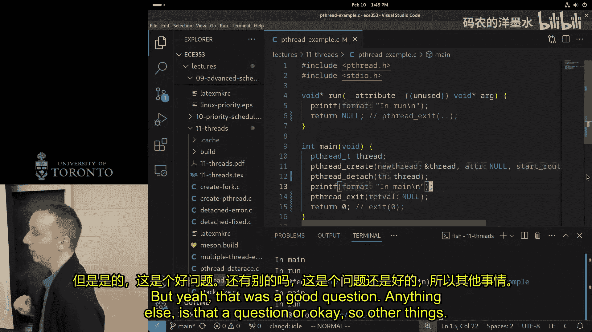

Other things。Just so we can see how to use attributes。 Again。

 we don't really care about them that much， but we can see how to get and set attributes。

 So there's this。Attribute called stack size so how to use attributes is I have to create this P thread attribute type again I can give a lame name like attributes and then you have to initialize it so you have to give this attribute a NP function。

 the address of it so it can go ahead and initialize that value。

Just like scanf or any other thing in C。If I want， I can do this git stack size of that attributes so I can see what the default stack size is。

 So I give it the address of the attributes and then the address of the stack size。

 which is a size G， which will go ahead and tell me what the default stack size is just to show you that there is indeed a set limit。

 So here I can print the stack size。 And then after I'm done using that attributes。Basically。

 a knit would probably do something like malloc。 maybe a lot of mallocs。

 So I have to do the equivalent of free for this attribute， which is this called destroy。

 So if I run this。 So here's the example， what's it called stack size。

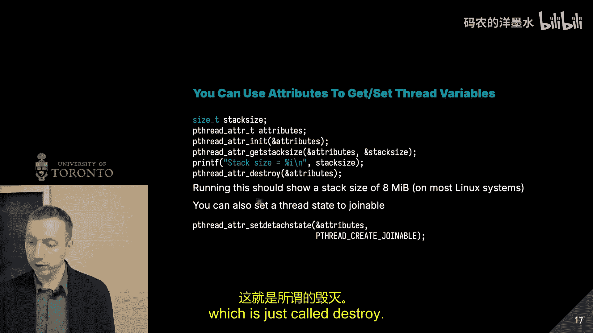

So if I just run stack size， it should tell me what the default stack size is on my system。

I don't think it probably changed from the last time so if I run that I see this number which is basically just8 megabytes。

 I think so on most Linux systems that's the default stack size， it's 8 megabytes。

 if you go over that then you see a stack overflow and all of that fun stuff and。

If you want to play the。The Java game of like hey， my program has a stack overflow error， well。

 if you want to get around that and you think your program doesn't have an infinite loop。

 you can just increase your stack size and then hopefully that works so you can do the Java solution。

So that's something you can do， or you can also go ahead and do things like if I didn't want to call P thread deach。

 I could set the detaachched state as part of the attributes and send it as either detached or joinable thread whenever I create it again。

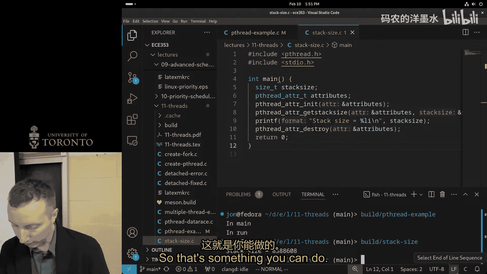

For this course， we'll just always use the default attributes。

 and the only attribute we'll use is detached， and we can go ahead and use that P thread detach function。

So。

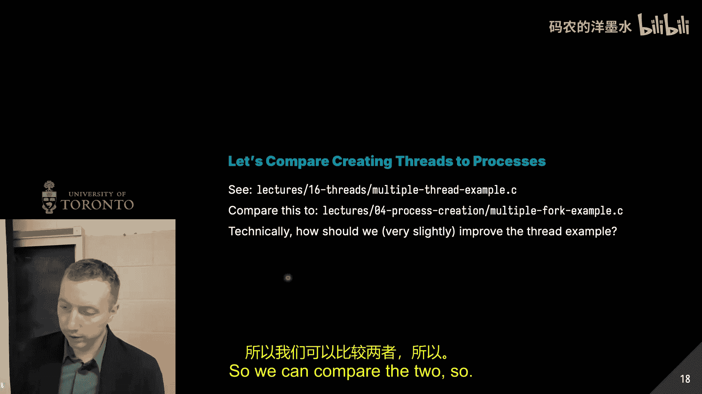

We can compare the two， so。Let's see if I have multiple threads。I thiss a good example。

 So five multiple threads。Actually， let's go for multiple processes first。Oh， I don't have that。

Let's just assume we're creating multiple threads， we'll see how this works because I'm using a whole bunch of pointers。

 so go ahead and ask questions。So if in mainine， I'm going to go ahead and have a four loop from I to4。

 so it should go1，2，3，4 and through each of them each time through I create a new thread here and I pass it the int I and then afterwards my main thread after it creates all the new threads it checks for errors。

 let's just assume they don't happen， it calls P thread exit so it doesn't implicitly exit so that all of the four threads I create。

 hopefully also finish。In P thread create。What I have to do here is if I want to pass a value to a thread。

 well， I have to do it through a pointer and I have to make sure that memory survives long enough。

In order to pass it a value， it gets kind of messy， so I have to declare a pointer to an int。

 malloc some space for it。 so that goes to the heap again when I create all my threads here。

 they'll all have access to that so。They'll all share it。

 but I'm only going to give one thread that pointer so here。I dereference that pointer。

 I set the value through it， and then I create a thread， and then in my thread。

 I give it the default attributes。I tell to execute this run function and the initial value of argument is what I got back from Maloc。

So if I want to make sure everything works correctly well。I wrote my program。Again。

 because of the three rules it just takes a pointer to void that's I don't care In this case。

 I know that Arg is a pointer to an int so I can typecast it from a void star to an int star because again I know what it's pointing at then I can dereference it to get its value and this int ID here it's a local variable so it's on this thread stack。

 so it is independent for this thread so I read that value into IDd and then I can go ahead and free that pointer so now I don't need this heap space anymore。

 I got that value it is now in my local variable and now I can use it。So for each thread。It goes。

 it loops 10 times and it says thread， it's ID， so this should happen four times。

 so it should be thread1，2， three and4， so it should print off its ID and then I and then just for fun。

 I have a U sleep just。To add a little bit of a delay just for fun。So in this case。

Four threads execute this， I should see thread1， and then thread1，0，11，2， blah， blah， blah。

 the way to nine， thread2，0 to9， thread3，0 to9， thread 4，0 to nine， right？So。If I execute this。

 what's this called multiple thread example？We'll see that indeed is what happens。🤢，So here。

If I go back up to the beginning， I added that value that sleep just so I pretty much always see the same number from all threat for threads。

 but I don't know what order they're going to be in so here for printing off I equal to zero for all threads again I will be independent for each of them。

 I get thread1，2，4，3， then the next time through， I get1，2，3。

4 so the order is not the same then I get1，3，2，4， then next time I get 1，4，3，2。

 so I can see that the order is completely different over and over and over again。

So any questions about this before I break it， yeah？Movely you sleep， would you instill it again？

Yeah， so one question is if I just remove the you sleep。

 will I get the nice000 everything and the answer to that is probably not。

Likely whatever thread gets scheduled first will just dump out everything。

 so I'll probably see like thread whatever0 through 9 and then thread whatever0 through 9。

 but we can go ahead and test it again。 This is all up to the scheduler。 So yeah。

 so it's what I guessed。 So I see thread 3，0 through 9， then I see thread 4，0 through 9。

 then I see thread1，0 through 9， then 2，0 through 9 again up to the scheduler I just added the you sleep as just a bit of flavor。

All right， cool， any questions about this example？Yeah。Why doesn't it like have？Both call claim。

It seems like。example， like when you removed it you sleep？I。

The right column what do you mean by the right column was nice？Right one。Yeah。

 so basically each thread just dumps it out because this loop one's really， really fast。

 like print F is pretty fast。 so it just。Whoever gets picked first just goes through all of them。

 print them all out。 Or if I used sleep， it's slow enough that each thread is going to get its turn。

 so you sleep will essentially like block a thread so it won't execute so another thread gets a turn。

 and that way， if I add that all in there， it's likely again， not guaranteed that I'll see。

Everyone prints zero， then everyone prints one， then everyone prints two。

Just has to do with the scheduler again， not guaranteed there's no reason why even with the sleep。

The kernelel could ignore it， it could do whatever I could see it in any order。All right。

 any questions about that before？I asked my own question。Try and ask you what the hell is going on。

Okay， so。One question I like is like， hey。诶。Anyone think this whole malloc thing is just kind of a waste of time？

So I could be like， ah， screw this malloc。Points like all the types can line up。

 So here in P3 create。I don't need to malloc anything instead of value。 I have int。

 and I can just take a pointer to ID so I can just give it a pointer。

 so I'll just give it the address of ID。And then in here。Well。

 I don't need this free or anything like that。So I don't need this free or anything like that。

 I can just go ahead and read that value of art。So。

Any guesses what will happen if I do something like that？And this is what makes threads oh， so fun。

So。Here， I will give you a hint。 Let's compile and run it。Although it may not help。Holpe。

 I have a bug。Anyone with saying， guess what the hell is going on here。And as another hint。

This thing that's printing thread2。That's probably not thread2， that's probably actually thread1。

Yeah。

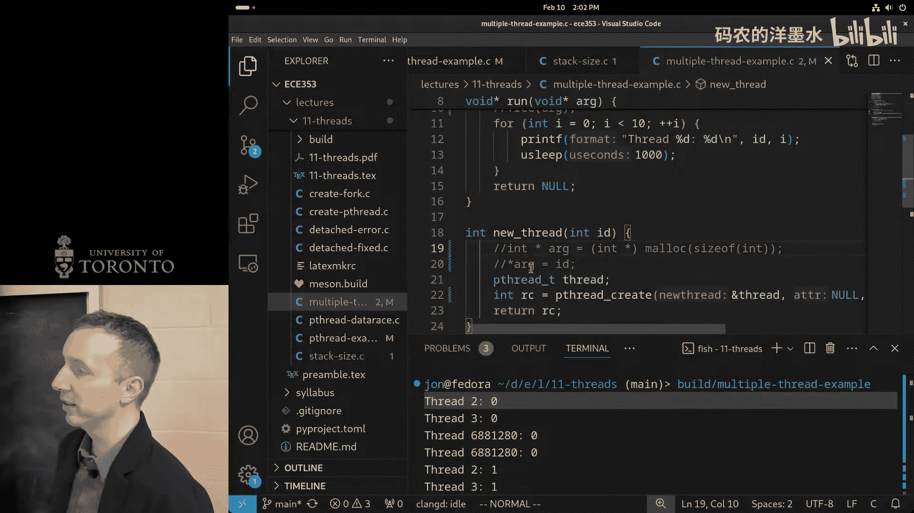

Yeah， so。If you didn't hear that， here is the kind of lay explanationation。

 so now this is where it matters。What's on the stack， what's on the heap？

If I write out my main thread here， so Maine。Keep track of kind of its variables。Well。

 it creates a variable called I D。First time through。It's equal to one。

So that makes sense if I do address of it， I essentially create a pointer to this， right？

Everyone got that from first year。So in this case， well， I know my。

Run function from a different thread。 So run。Let's say run from thread one。Well。

 it has its own stack and its own variables and everything like that。So when it runs。

 it's going to get。The argument and that argument is an address， which is basically a pointer。

 so it's pointing to the main thread stack， right？It's probably bad if you cross this boundary。

So it's pointing to that and again we don't know what's going to run next。

 so this is how it's set up to run， if it was to run。

 it would just be pointing to that location where the current value is one if we pick this thread to run。

 then the first thing it does。

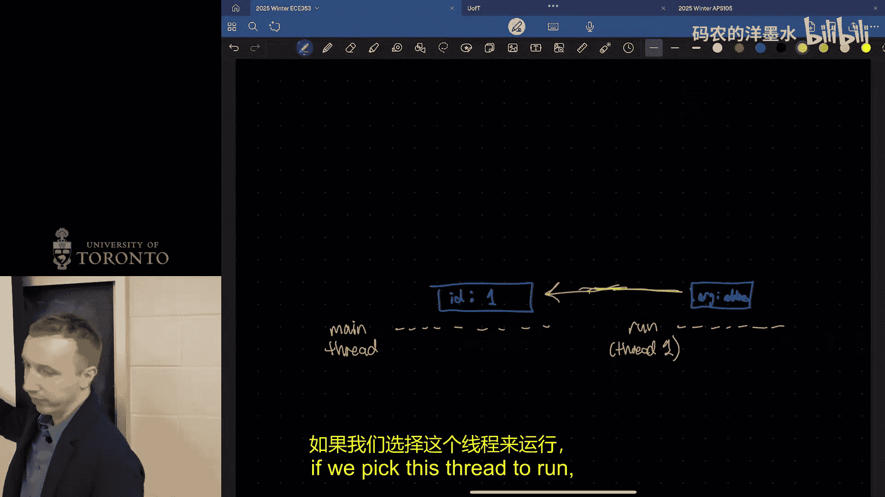

Is。Casts that pointer to an instar and D reference it。 So if it immediately run。

 it would get the ID equal to one， which would be correct， but it doesn't have to run。

 So what could happen is the main thread continues。

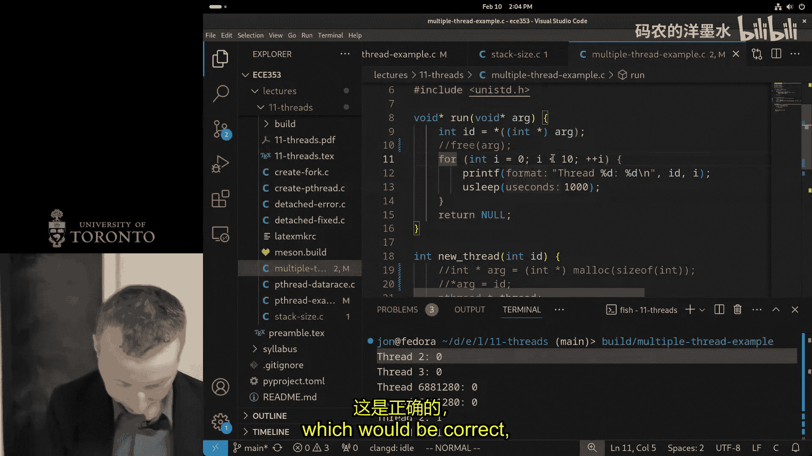

So it would go ahead and this is done through that new thread function。So next time through。

 it would essentially just delete that。And then we would call that function again。

 it would create a new ID。Likely at the same memory location， but now have that value too。And now。

I would be creating run of thread。2。It would have an a。

And it would have an address and it would be pointing。On this computer to the exact same location。So。

Right now， if thread one was to get picked for running， well。It would just follow this address。

 dereence that value， so it would get the I too if it was the next thing to run， right。So。

This is fun， and。This would go on for every single thread。 And the reason we got this。

 the reason we got this horrible value is because， well， eventually， the main thread exits and。

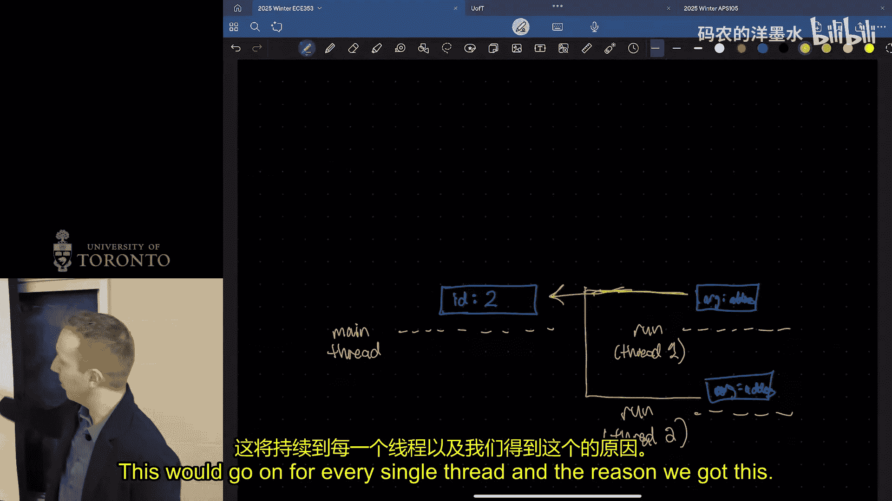

Ends and its stack gets obliterated， and it just takes on random values。So that's where we got that。

 So that those threads executed and read the value at that location after the main thread already died。

 So I got those random big numbers。So。Really important。 What's on the stack and what's on the heap。

 right？ So if I do it on the heap， well。

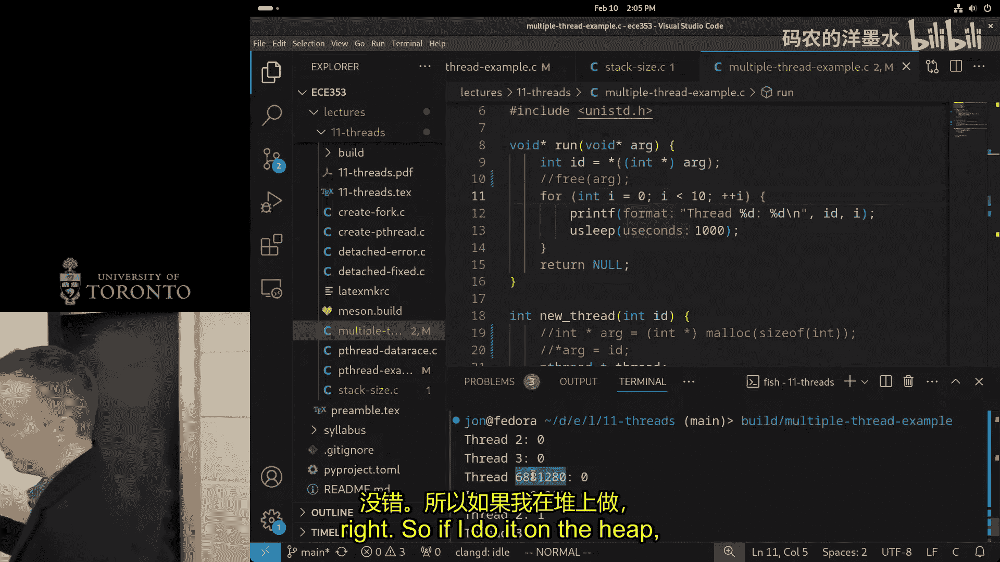

Groups。So when I did it correctly。I created this value all on the heap， which is independent， right。

 so I created some value on the heap。In this function。I created， I don't know， whatever I called it。

I had Arg。Which was an address。And it pointed to something I malllocked。

 so it pointed to something here。And then I set the value here equal to 2。

And whenever I called that run function。I didn't give it a value to my stack。Let me delete this。

I instead gave it。The address to this which doesn't get changed by anything else right so always stay consistent。

 no matter what doesn't matter when this actually gets to execute because I only give that malloced pointer to exactly one thread so I'm guaranteed that no one else is going to messed with that value it's going to be consistent every single time doesn't matter if the main thread exits by then or not because it lives on the heap so it lives until you actually call free on it。

 which again is why that thread had to call free on it originally because it essentially is the thing that owns that value now。

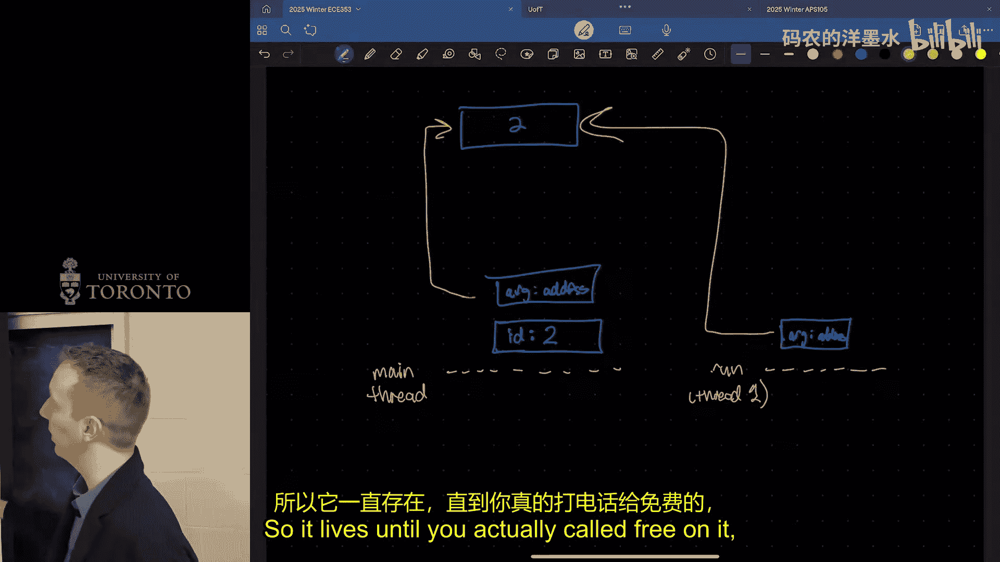

Some languages make that easier than others。Again， C doesn't really care。

 So any questions about that。 Again， when I run this。Fun thread mistakes is， oh， cool。

 Now I got two different random values， and。😊，Two threads got assign the ID3。

So have fun debugging thathu。So this is why threads is the hardest thing。

Conceptly is not too much different than processes， but because everything shared by default。

 and it matter what's shared and what's not， you can quickly get into errors。

 especially when you don't know what's going to execute next。

 And you have to argue about every single execution makes it really challenging。

 So any questions about that。Yeah。Yeah， each thread does have its independence deck。ありワ？

When I D2 over I D 1。 So that I D variable only existed in the main thread stack。

 and then each thread had an address to the main thread stack， which is not great。So whenever that。

 so the main thread would be controlling that， but if you're accessing someone else's stack。

You're allowed to do that， you're in the same address space。

 but probably you're always wrong if you do that。W that like。The second I to the stack。

So it didn't overwrite it， So in here。This。In this example。

 it got an address to the main thread stack， and then here it didn't overwrite it。

 it just read that value and assigned it to some value on this thread stack。

So just essentially whenever this thread gets executed to run。

 it reads wherever that memory location was on the main thread stack， whatever it happened to be。

In yourd， you like。Yeah， so when I crossed out ID equals to one， ID equal to two， that's like two。

 the main thread calling new thread once with ID1， and then it would create a variable called ID。

Ass the argument there。And then。It would be assigned the value 1， then it would return。

 so it would get destroyed and then we called new thread again with ID equal to2。

 and that would create a new ID values is 2 happens to be at the same memory location as well。

 then it exits ID disappears， called new thread with ID 3， same thing happens。So on and so forth。

 which is fun。Yeah。ち of bit that 그。Can we just pass it directly？No argument。😔，Yeah， so。

What you can do。Which is not recommended， but you can do that is， yeah， this is just passed by value。

 So instead instead of an address。 I can just shove an in in there and then type cast it back So it will be passed by value。

 like any other C value。 So if I just do。This， instead of pointer， I just force an int。Again。

 my compiler is going to initially complain at me。Probably。That like hey。Jerk。This needs a void。

 and then of course I could be like， yeah， of course。An in void star。 And it kind of complains at me。

 too， but。they'll still compile just says warning， who cares， warnings are fine， right。

 so I can do this。The problem is。It's not super portable because an int needs to fit in a pointer。

On this case， on this machine， it does an inch 4 and。A pointer is eight， so it would fit。

But you'll also get into issues where this will work if it's little Indian and will not work if it's big Indian。

Also needs to fit。 Also， you're not guaranteed the size of a pointer。

 You could be using a microprocessor or something that's like a 16。16 bit address。

 in which case you're screwed， so should just use pointers if you want to be。Make sure it works。

Otherwise you're going to get into weird architecture difference where yes。

 sure it might work for a while on air machine， but you pour it to a different one and then you get a whole bunch of bug reports of people saying your program's broken。

What the hell。Yeah。Ex。So the strange values when we didn't malloc。Came from。

Like basically each thread had a pointer to some value and main stack， right？For this。

When we didn't have malloc and when we got the real weird values， it's because。

Before the threads executed。 and like this basically just reads the value at that address。

 which is on the main thread stack。 The main thread was already dead。

So if the main thread was already dead。The value it just has is just undefined。

 So that's why we got random numbers， because。In that scenario。

 the other thread started executing after the main thread was dead。

So I it didn't have any local variables because it didn't exist anymore。

 So we just read garbage values。 Does that make sense。Yeah， it's。

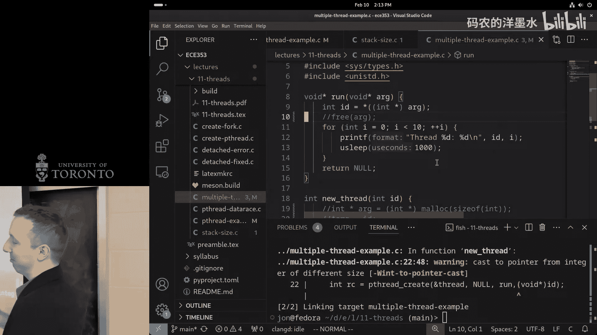

Again， kind of messy， you want to avoid those cases at all costs because it means your program has a bug with it。

All right， any other last minute questions before we take our fun break？

The doorbells ringing cool right。Threads enable concurrency， we export threads。

 related them to something we already know processes。Basically， lighter weight。

 share memory by default， and each process can have multiple threads。 Again。

 how I like to think of them is initially processes just have a single thread at the start。

 just called the main thread。 And we can add more to them。 So let us take our 10 minute break。

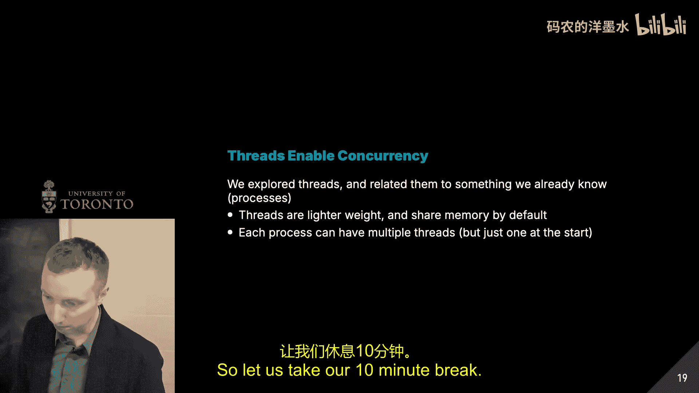

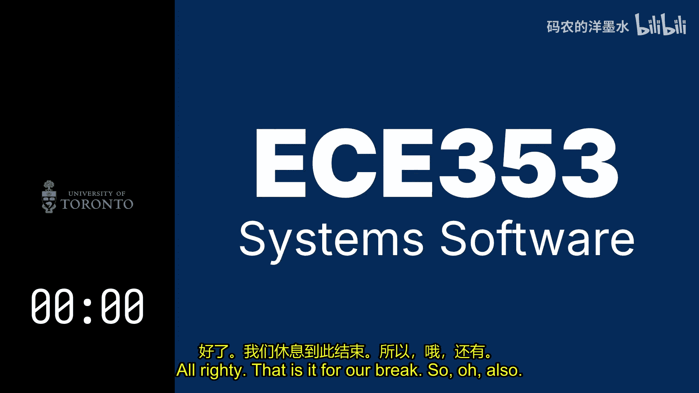

Oh righty， that is it for our break。So。Oh， also for the midterm， study tip for the midterm。

You have not completed lab3， correct？It's too after the midterm。 Your exam is， wow， Wednesday。

 That's fun， so。😊，The questions where you have to like go through and translate things and all that。

 Lab 3 is supposed to help you with that。 You have not done lab 3。

 So those questions I probably wouldn't worry about too much of like actually translating it because you're not done lab 3 yet。

 So you should know conceptually about multilevel page tables and how they work。

 I will definitely ask you a question about that。 But I will probably not ask you a mechanical question about that because you' have not completed lab 3 yet。

 So that is a little hint for your test 1。But again。Good to know how to do it。

 Your time was not wasted。 I can still ask you about multi levelvel page tables。

 But going into like super nitty gritty details， I don't really need to do。Again。

 that'll probably be covered on test 2 because， well， your one is short。

 you only have 50 or 45 minutes。 Alright， so let' that out of the way。

 let's talk about more threading stuff。 So this is also kind of to get you prepared for lab。4。

 so in lab4， you will be creating your own threading library。 So that will be fun。 It's actually fun。

😊，I also simplified it， so I'll have a lecture to help you get started on it as well。

 So we'll do that next Monday， the one not on reading week， the one after that， so。

You'll be implementing it。 It will be fun。 I cut it down。

 It used to be like an 80 hour lab or something like that。 It is cut down to be much， much， much。

 much， much， much more reasonable。 And again， I will help you get started on it。

 So before we do that， we have to talk about multithreading models and how we would implement threads。

 So there's two main ways to implement them， we can do either something called user threads or kernel threads。

 which implies kind of where you would implement them either in user mode or kernel mode。 So。😊。

User threads are completely in user space， so the kernel doesn't treat your threads in your process any differently From the point of view of the kernel。

 Your process is running in a single actual thread。

 And then you are just bouncing that thread between。Different。Well， internal user threads。

 so in that case you're just doing concurrency。So kernel threads on the contrary are。

Implemented in kernel space。 So the kernel manages everything for you。

 and it can also treat threads specially because guess what the kernel knows about them。

 So it could schedule them to run in parallel or do different things based off whether or not they block or not。

 which we will get into。So。Thread support requires some type of thread table。

 so similar to a process table we saw previously， again。

 could be in user space or kernel space depending on the implementation。For user threads。

 there also needs to be a runtime system to determine scheduling。

 so you're going to have to do some scheduling for your lab4。

 but youre not going you're going to do first come first serve。 it's not going to be that bad。

 So don't worry about that。 And in both models each process can contain multiple threads so that still exists。

So。The nice thing about using user threads is to create them。 I avoid system calls。Or， well。

 or I could just let a single thread block everything。 So that is basically our tradeoff。

 So for pure user level threads， again with no kernel support。

They're going to be very fast to create and destroy because I don't have to do a system call。

 I don't have to let the kernel do any context switches or anything like that。

 I would be the one switching between threads but the major drawback is because the kernel doesn't know you have multiple threads running if one thread blocks so if one thread calls read or something like that that's waiting for some slow resource to come in then that entire process gets blocked the kernel can't distinguish that hey。

 maybe another thread could actually run while this thread is waiting for some result to come in so for kernel level threads they're going to be a bit slower to create that creation will involve system calls but the nice thing about that that is if one thread blocks so if it's doing a read system call。

And there's another thread that could be executed while then the kernel can just simply schedule the other thread to run。

 so even if you have a single CPU core， it is also beneficial to have kernel threads instead of user threads。

And there， of course， is some trade offs between them， and we will get into them。

 But those are the major trade offs there。So。All of the threading libraries you use technically do run in user mode。

 and that thread library maps threads to kernel threads。For different implementations。

 you can have many to one， where many to one。 Where is my cursor。

Where many to one means threads are completely implemented in user space。

 so that means every single user thread is mapped to a single kernel thread。

 So the kernel only sees one processor or one stream of execution。

 The other one which is basically the idea of kernel threads is one to one So one user thread maps directly to one kernel thread and the kernel basically handles everything including scheduling and all of that。

 So in lab4 you'll be doing pure user space， which is many to one they'll all be in user space while the P threadread library is an example of one to one。

 So one Pth is basically one kernel thread and then there's also the crazy scheme of many to many where many user threads may map to many kernel threads and it depends usually you have try and do the best of both worlds here where you have lots and lots。

Lots of user threads map to one kernel thread， but you also have multiple kernel threads。

You could make it so that you only have as many kernel threads as things that could actually run in parallel on your machine and then just kind of map a whole bunch of user threads。

 thousands or tens of thousands of them onto one。Of those， I don't know。

 let's say eight kernel threads。So。Again， like I said。

 many do one is that peer user space implementation it's fast and portable。

 doesn't depend on the system。 It's just a library。 you've been writing libraries so far in the labs。

 drawbacks again are that if one thread blocks all of the threads block and of course we cannot execute threads in parallel。

 we can only do concurrency which。Is fine if you're doing a whole bunch of slow operations。

For example， like node and all the async libraries basically just use user threads。

 and they just use some kernel functionality that。If they're doing some slow operation。

 they can actually switch to a different user thread wall。

 The kernel actually does that operation in the background so we can trade off between them like that。

 So in this case， the kernel just schedules the process to run。

 It's up to the library to decide which actual user thread gets to run。😊，1 to one， again。

 just uses the kernel space thread implementation。 basically P thread。

The P thread library is basically just a thin wrapper around the system calls to make it easier to use。

This way I can actually have the full parallelism of my machine。

 the kernel can schedule multiple threads to happen simultaneously AK in parallel。

 of course it could do it concurrently as well， but it does need that slower system call interface and you lose some control because of course you don't have control over the scheduling the kernel gets to decide that so typically this is the implementation you actually use in we assume this for Linux P threads。

Maybe the many is a hybrid approach。 again， the idea is there's more user level threads than the expensive kernel level threads。

Again， idea might be to cap the number of kernel threads to the number I could actually run in parallel That way。

 I get the most out。 I try and get the best of both worlds。

 I get the most out of multiple CPU cores and reduce the number of system calls。 But however。

This is always bad。 It leads to a very complicated thread library that has very bad performance issues。

 and this trend seems to come and go currently in the Java world， it is coming back。

And they have namedd it Java virtual threads， but they use this approach， but it's typically very。

 very， very hard to debug， especially if you are having performance issues。

 So depending on your mapping luck， you may block a whole bunch of other threads， so。Let's say。

Let's consider， I don't know I have。4 CPU cores。 And I have 100 user threads。

 So I map 25 user threads to one。Colonnal thread for this Java virtual thread thing。 Well。

 let's say only four of those threads do something that blocks。 Well。

 I could get lucky and have one of each of those 25 threads。In that kind of。

Group of user threads mapping to the same kernel thread。 they could all be in different groups。

And that way， actually， that's the worst case。 So that way， if they're all in different groups。

And they all block。 then guess what All of those kernel threads are now blocked。

 and now your application will not make any progress。

 even though you might have 96 other threads that could make progress and that will just depend on your luck or you could get lucky and those four threads that actually block are all scheduled or are all mapped the same kernel thread in which case the three other kernel threads could go ahead and make progress while that one thread is blocked But again。

 you will。Typically not have control over this and sometimes you run your program。 it's slow。

 sometimes you run your program， it's fast and you're not going to debug it。 Also。

 it's very hard for that threading library to get it right。 And again。

 like with most things in computing。Ideas come and go， come and go， come and go。

 and the general idea is that this is a very poor idea。 but again， just as a word of warning。

 it's coming back in Java virtual thread， so probably avoid those。So。

Threads also complicate the kernel。We have threads， we also have fork。

 so how should fork work with a process with multiple threads？So。

Different ideas we could have if I have eight threads in my process and I fork it。 Well。

 if it's an exact clone， then that new process should also have8 threads。

 They could all be in different states。 So maybe they're just cloned in that new process in whatever state they are that would get out of hand very quickly。

One， it would be hard to argue about what state there are2。Is well， this would get out of hand。

 Remember our good old friend， the fork bomb。 Imagine we could do a fork bomb。

 but we also create threads at the same time， too， so we can make our fork bomb even more effective if well we fork and we also fork with multiple threads。

 So the rule Linux uses for when we fork。In a process with multiple threads is Linux will only create a new process。

That is a copy of the thread that called fork。So it will just create a new process with a single thread in it and。

The thread that is running is going to be a copy of the thread that's called fork。And。

In that new process， if it hits P thread exit， that means， well， now it hits P thread exit。

 this is the only thread in that process now， so it's going to terminate that process by default。

 it will just set that exit status to zero and that process will terminate。

If you want to control what happens to the other threads at a fork。

 there's this P thread at fork call， I will not cover it in this course。

 but that is how you can control what other threads do whenever one thread calls fork。

To try and make memory consistent。But basically， if you try and use that。

 you are probably making things。Very complicated for yourself and we will not be covering it in this course。

 but it is an option。All right， signals， signals are also fun。Right now。

 if our process gets sent a signal， we can handle it。 Well。

 if I have a process with eight threads and I send a signal to it。

 what happens should every single thread receive a single。Well。

 the rule for Linux is it won't just send a signal to every single thread。

 It will just pick one at random to handle this signal。

 So this makes your life even more complicated because any thread could get interrupted at any time it's。

Not guaranteed to be the main thread because well， when you get sent a signal。

 it's not guaranteed that your main thread even still exists。 So the Linux thing is just。

 it's guaranteed that it will send it to exactly one thread， which thread I don't know。

So that makes handling signals with threads even more fun。So also， instead of many too many。

 instead of using like that hybrid approach， you can use something called a thread pool。

 So the goal of this is to kind of do that many to many thread mapping to avoid creation costs。

 So a thread pool will create a certain number of threads and a queue of tasks basically as many threads as there are CPUs in the system。

 And then I just keep those threads active and keep on reusing them and keep giving them little tasks to do。

 So as a request come come in， I can wake up one of my threads， give them some work to do。

 and then whatever they're done， I can put them back to sleep。 And then that way I just have one。

Set of creation costs。 And then I reuse them all the time。 So in I dont know。

 you can find an implementation for threadpools in Python or C or whatever。

 So if you get into for performance programming and you really want to avoid that startup cost。

 you can use something called a thread pool again， aside from mentioning it。

 we will not really cover it in this course， but it is a good thing to know。So。For again， for lab4。

 you'll be implementing many to one。 so you'll be creating your own thread。

 So this is going to be your state diagram for the lifetime of your threads。

 just like lifetime for a process， same idea。And in that lab。Everything will be prefixed by what。

 because I seem to like three letter acronyms。 So what stands for wacky user threads。

I'm easy to entertain， putting what in front of everything， I don' know， made me chuck a little bit。

 so whatever I did it， you're not the boss of me so。

In order to create a thread while to transition from this create to waiting state or ready state。

 there's a function called what create basically looks like P thread create is to simplify it a bit。

 So I don't have you pass arguments or anything like that。 So the function to run takes no arguments。

 returns， no arguments。Then， we have this。Wting state。 or actually might return an int。

 Then we have this ready or waiting state， and you'll be picking what goes in running state just based off first come first serve and like for。

Processes， we can have true multitasking or cooperative multitasking for your lab。

 You'll be doing cooperative threads， so they will run until they actually terminate by calling what exit or they relinquish the CPU by calling what yield。

 what yield will basically just put them at the back of the queue and let another thread go ahead and run。

 And then you are also going to implement what join。

 So you're going to be able to join on another thread that will transition it to a blocking state because it's waiting for another thread to terminate。

 And then when the other thread terminates， then it would get added back to the queue and go in this ready state so。

We'll come back to this when we talk about lab 4， but again。

 and all these transitions also exist for the P thread library。

 just the only difference with the P thread library is that it's true multitasking so。

Transitioning from ready to running is determined by the kernel scheduler and not yours。So again。

 your scheduler can just be round Robin， that's what you'll be doing for La4。

 you'll just create a queue， a list， I'll show you how to do that instead of implementing your own。

It'll be easy because you'll run the thread at the front when it yields， you throw it to the back。

 it'll be a w link list， I will show you how to use it again， don't have to implement your own。

You'll also have to do the context switch， which will save the registers。

 I will show you a function that will do most the heavy lifting for you。

 and we will be doing context switching in an example lecture again。And then Monday。

 well in two weeks from now。 So these are cooperative threads， so they have to be nice。

You could extend this to preemptive threads where you just essentially force them to yield。

 but we will not be doing that。So。Our next complication is going to get into what makes。Programming。

 threads， fun。So let's get into it here。

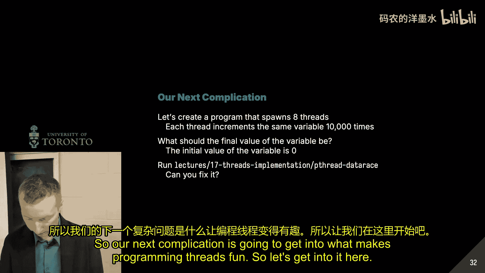

So oops so let's see this little program， So at the top here。I have defined numb threads 8。

 then static encounter。 So this is a global variable called counter I initialize to0。

Then in the main function， what I do here。I have a array of。Well， an array I call thread。

 maybe I should have called it threads of type P thread underscore type and I have it's of size nu thread。

 so it's of size 8。Then here I have a little micro optimization。

 I don't know why I share I between my loops。 So I have an I here。

 Then I go from I equals to 0 to numb threads。 So this should run eight times， right and then。

What it does is called P thread create。 It will initialize the value in the array。

 I give it the default attributes， tell it to run the run function。 Give it no arguments。

So I set off， I create eight threads。 I don't know what order they're going to execute in。

 And then my main thread is going to join on all eight threads。

 So my main thread is only going to continue here after all of those eight threads are done。

So it joins on all of them。 So it waits till they all terminate， cleans them all up。

 And then it prints the value of the counter。 So let's see what all eight threads are doing。

 So all eight threads。Okay， that just looks ugly， I'm just going to move it because it bothers me so all eight threads。

Go。Iterate 10000 times， and they all just do plus， plus counter。Alright， so if I run this program。

 anyone want I guess what the final value that I'm going to print off for counter is going to be。

So I have eight threads and they all increment counter once， 10，000 times。

Anyone need their calculator？Yeah。80，000 right， everyone agree？

It threads incrementing the same value。10，000 times  eight times 10，000， 80，000。So。

This is also a good way to calculate your marks to right， I can just add it up。

 I'll add it up one at a time。 So let's see what we get here。 some P thread。Oh好。

The course average went down。🤢，So if I run it again， oh。No bugs。My program works perfectly。

Run it again。72 slightly better。ooh， that's real bad，59。And again， 59， that's not good。

70000 on the dot。71，000， 70，000， 70，068。Oh， that is almost right， good enough。80，000 twice a row。

 no bugs。So。Anyone have any idea what the hell is going on here？Yeah， here。

Pays off to pay attention in your。Architecture course， so plus plus counter looks deceptively simple。

So up here， let's just。

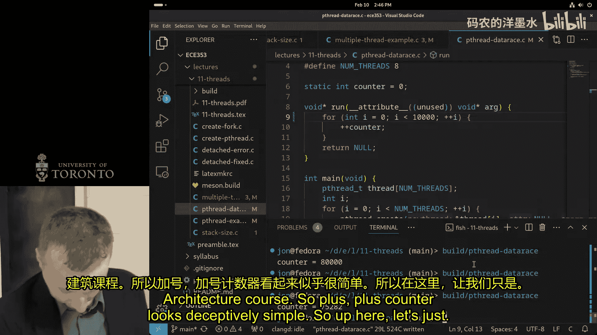

Argue about so I have a global variable called counter， right？Well， it's。In virtual memory。

 I'm using threads。 Everyone can access it， right。I have this variable called counter。Initially。

 it's equal to 0。 We now know that counter。Exists somewhere in memory， right？So。This is counter。

 If I was to write a pointer to counter。They would be pointing to that。

That virtual address is something the compiler picks for me， whatever。So。

Everyone good with that so far。Just a global variable， so I will argue about， let's say。

 let's just break down what happens in thread1。So。If I have plus plus counter。

That is a deceptively simple instruction。 So what plus。

 plus counter actually does if you break it down architecturally is it will essentially just。

Use a random register， let's say RA for argument's sake。 and well。

 what plus plus counters do is first it will read the value of that counter from whatever it is in memory。

 so it will essentially just。Dreference P counter。Which is like a load。Some load instruction， right。

 then it will increment。It's register。And then it will essentially do a rate。

 so it will rate the value of that register。2。Overwrite whatever， just do a memory right here。

mightight call it a right， might call it a stored depending on。

 I don't know how architectural you are， so plus plus counter actually does those three steps。

So thread2。Well， thread2， it could be doing that as well。 It's also doing plus plus counter。

What the hell are all these buttons？I just want to copy， go。Paste。So。so。

Thread2 is also doing the same thing。If this happens， well。If thread1 executes completely。

 it's going to load the current value of counter， which is0， right。

 and it's going to increment it in its register， which is1。

 then it's going to write the value out and update the counter from a0 to a 1 like this。

Then thread2 is going to come along， load， so it would load the current value of counter。

 which is one incremented in it's register， make it a two， then store the value2。

So that's what would happen in the happy case or the good case。 but now because we have threads well。

East way to argue about threads is just argue about them concurrently。So。

All of those instructions will happen in order for the thread。

 but I have no idea what the order is going to be between threads so。As a teaser for。

 the next lecture is coming up。What could happen？Is my order goes like this。

Thread one executes this load。Then thread2， it switches to thread2 again。

 just arguing about concurrency。 So on the same CPU core。 So we contact switch over to thread2。

 it loads the counter value， and then it increments it， it's register。

 then we switch to thread1 in increments its register， and then thread1 stores。

 and then thread two stores， So don't worry about regular this for now again will be arguing about this add nauseum in the next lectures。

 But in this case， what happens is if thread one executes first。

 it loads the current value of counter， which is0。So it would load0 and that value of 0 gets assigned to its register。

We switched to thread 2， so it would load the value of counter， which is now still 0。 So it loads 0。

 Then it registers。I' sorry， then increments its value in its register。

 so the value of RA changes to 1。Then we switch back to thread1， and again， remember。

Each thread has its own set of independent registers， so its value in its register is still 0。

 So when it increments it increments from 0 to1。 and then at this point it would store the value in its register to that memory location。

 so it would store a1。 So that counter would get0 would get replaced by one。

 then we would switch back over to thread2 here， and then it would also write the value 1 over。1。

 so it would just overwrite that same value。 So we get some of a disagreement。 So essentially。

If this happens。

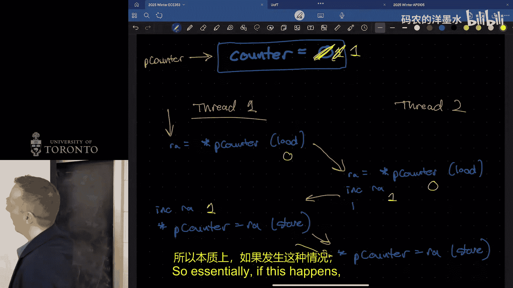

We lost an increment， right， so that's why when we run our program。We always get different numbers。

 The number we got is basically how unlucky we were， How many times we got interrupted doing that。

 or we got context switch between them。 And we actually got unlucky in missed account。

 So that's why it is not consistent。 Sometimes we get omega lucky and。It's fine。

 we don't miss anything。That's because the operation is really fast， but。Salavy， all right。

 any questions about that？All right。Without knowing something complicated。

Is there a way I can change this program such that it will always print 80，000？Yeah。

 join immediately after C。So join immediately after Cate， everyone agree with that？

Well I always get 80，000。Well， we can try it。80，000， 80，000， 80，000， 80，000， 80，000。So now。It works。

But if we were using threads for increasing performance and wanting things to run in parallel。

We have fallen into one of our first traps when you first learn threads。

 is that just adding them will speed up things。Well， in this case， we actually slow down things。

 So if we create a thread and then join it， it means only one thing's running at a time， right。

 So the main thread is creating a thread。Then joining it immediately so the only thing that can run is that thread。

 so basically I'm just making a serial program， so one thread increments 10。

000 times it's the only thread existing。It would increase counter until it gets to 10，000。

 then another thread would get created。Run increment to 20000。

 Then we do one after the other after the other after the other。 It'll be consistent。

 but it's basically just。Using a single thread with more steps。

Any other idea for how I could do this in a way that's safer。I'll always get 80，000。

 and I can do it in such a way that even if I do the join right after it still always works。Yeah。

Inc separate。E separate counters。Yeah， so I could add up eight separate counters and add them up all at the end。

 So one way I could do that is， well， I could create an array and then make sure that each thread access a single element in that array。

 have an increment it and then have the main thread， do it all at the end。

 or I could leverage the fact that it returns a pointer to something。 and I can go ahead and。In here。

 instead of counter。Again， kind of a contrived example because， I mean。

 if I'm just incrementing something， that's really fast。But。If I wanted to do this in a safe way。

 I could do something like， hey， I could create a local counter。So I could create a local counter。

 initialize it to zero， instead of incrementing the global variable counter。

I could do something like this and just increment local counter and then at the end。

I could go ahead and return that value to Maine。In this case。

 I have to give it the address of pointers。 so I'm going to have to do that malloc thing again。

 where okay， now I have to you know。的。It。Its called it a because whatever we're running low on time。

 I could do something like。Malock。I'll save myself writing size of int。We need standard whoops。

 what I do？All right， so we could use the standard library so we get malloc then。

We could write the value of local counter to it。And then just return A。So that's how we could return。

Our value back to main and in main。 Well we could have the main thread go ahead and just add the result of every threads。

Final output to。TheTo the actual counter， so we could set up。Intstar， I don't know。

 whatever they returned， initialize it to null。And then here we actually use the thread's return value so we can give it the address of RET。

We're going to get a compiler warning because of course we are at C。

 it will probably demand a void star star so we can see our types kind of lineup。

 it got void star star or we gave it int Star star but expected void star star again。

That's just the rules of C's type system so I can shut it up， I can type past it to void Star star。

That's fine。Then and here I can go ahead。Get dereference it。

 So that will get me the local counter return from the thread so I can add it to counter。

And then I can go ahead and free whatever I got， make sure I clean up memory。

 make sure Valgr's all happy at me。 So this is another way I could do it where if I compile and run that。

I'll go ahead， I get 80，000 every single time now， but I did it in a more roundabout way。

But this is still safe， right， I let every thread。 I made sure every thread only incremented its local variable。

 So it's independent。 I know there's no trouble with it。

Then I give it all back to the main thread and the main thread is the only thing that adds to that counter variable。

Nothing wrong with that。 In fact， if you invented this， I don't know。20 issues years ago is。

Some idea at Google called basically map Red。 So you do some operation independently in each thread。

 And then once each thread is done what it's supposed to do， hopefully in parallel， you kind of。

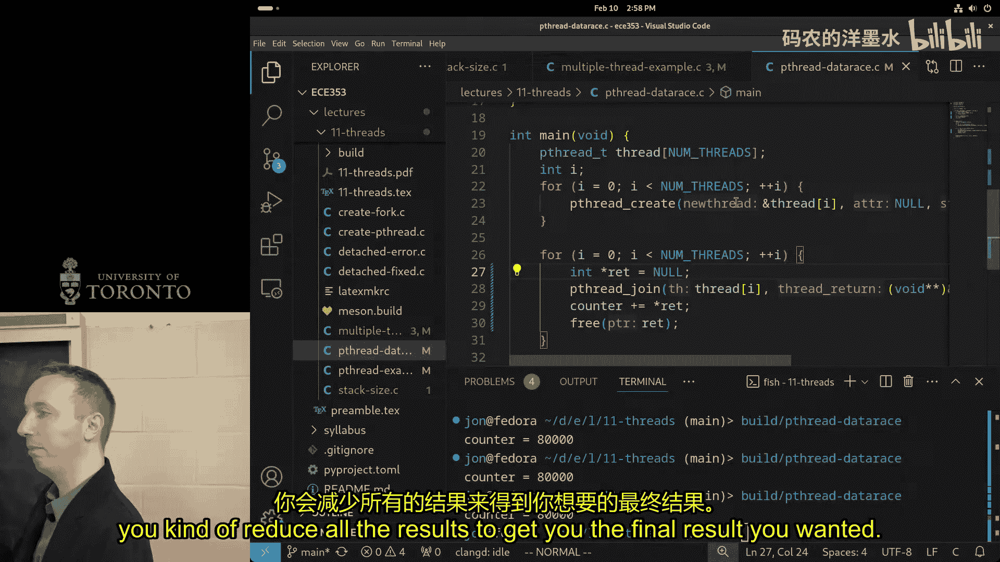

Reduce all the results to get you the final result you wanted。 So this is a good thing to do。

We'll see other ways to fix this because maybe some problems don't actually go to this。

I'll show you other ways to fix that。 That will be our content after reading week。

 so that will be fun。 so we can wrap it up in the last minute。

 We have so both processes and kernel threads enabled parallellyization Each process can have multiple kernel threads。

 most implement implementations use one to one。 So one user thread is one kernel thread。

 That's what P threads are。 The operating system has to manage what happens during a fork or signals for Linux。

 When you fork new process gets created only one thread copy of whoever called fork signal gets sent to a random thread。

 But now we have synchronization issues。 and that's what we have to look forward to fixing。

 Once we come back from our break。 So just remember pulling for you。 We're on this together。

 and good luck on the midterm and。😊。

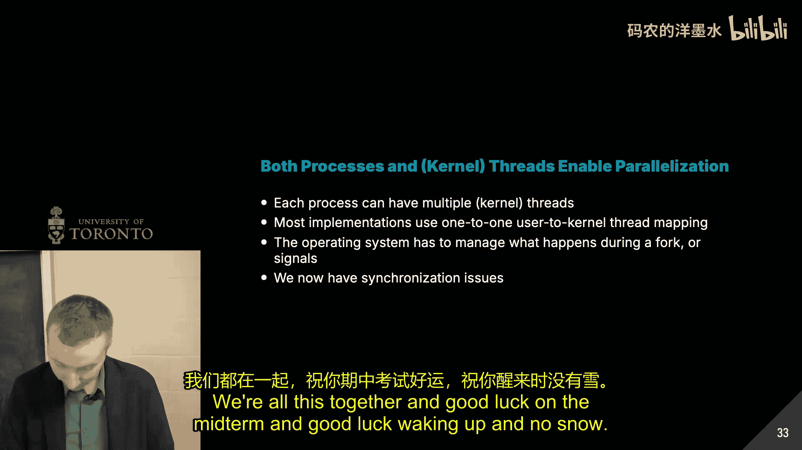

Good luck waking up in no snow。