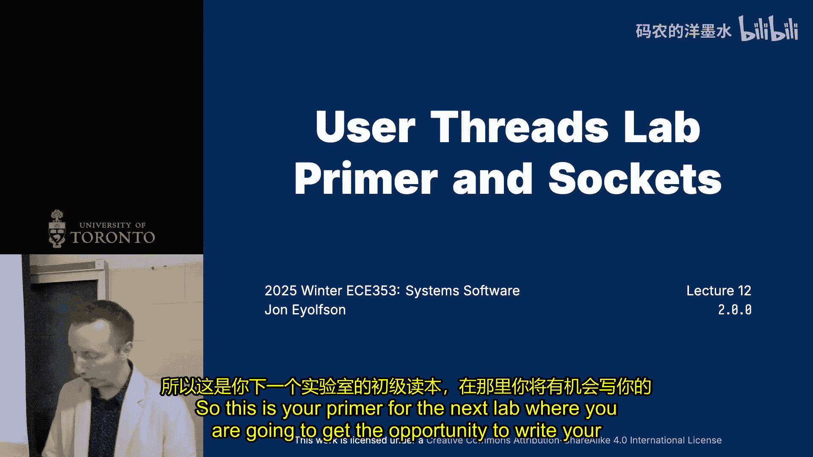
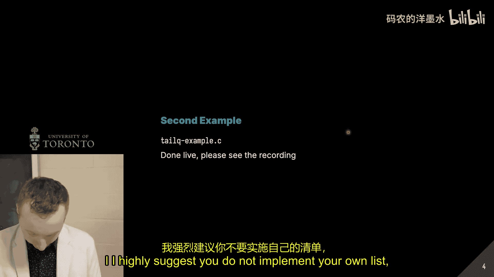
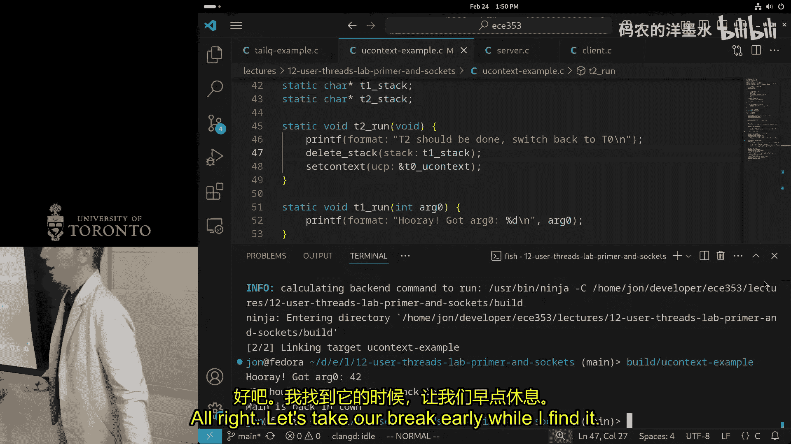
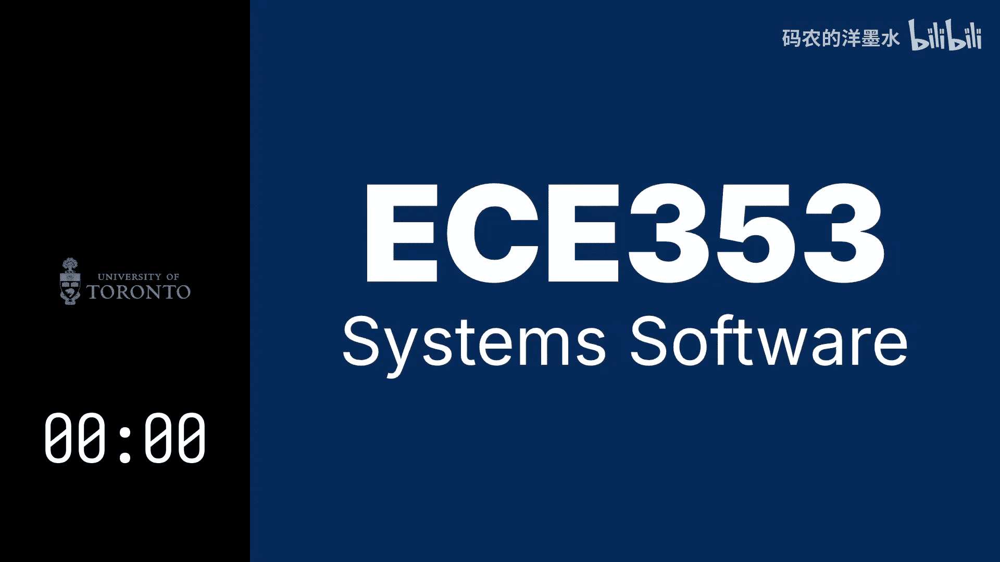
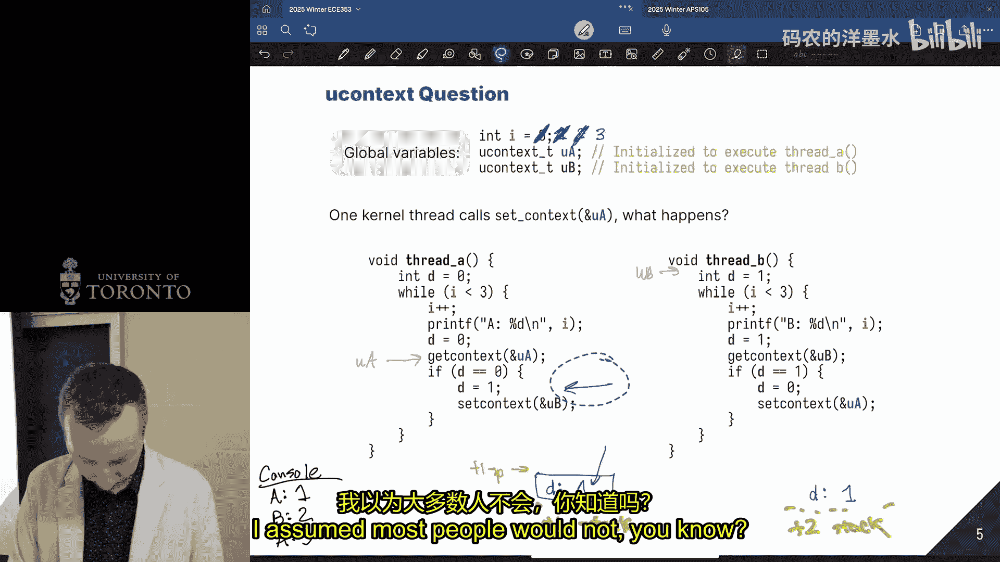
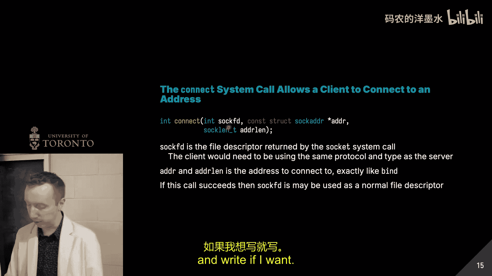
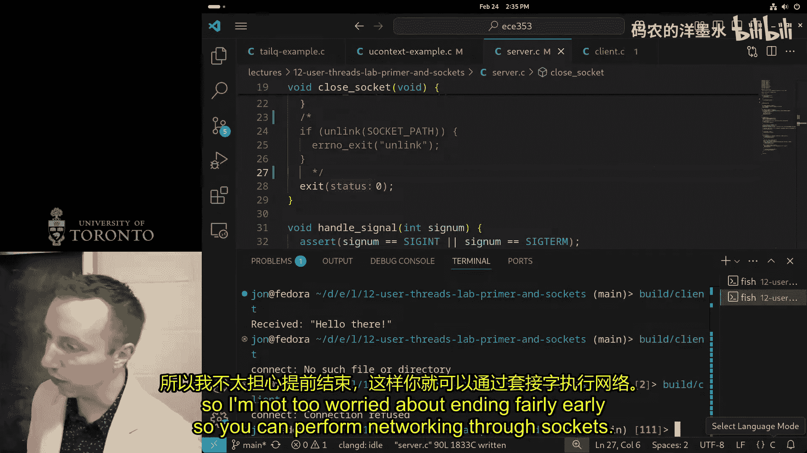
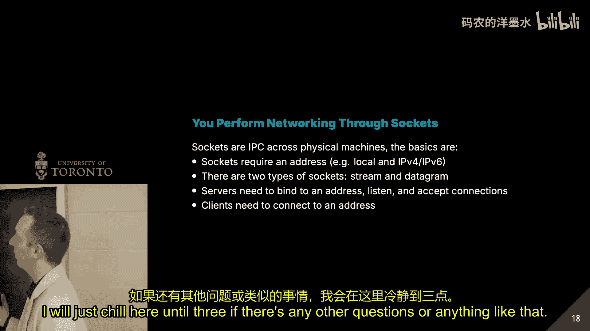

# 【全集 2025】多伦多大学 系统软件设计与编程 中英字幕 1080P p12 Lecture 12 - 用户线程实验入门 -BV1YrkYBQEeL_p12-

Alrighty， welcome back from Reading Week， where the hell Everyone Go。All right， yeah。

 I guess I released the test one back， so everyone dropped it。So everyone here did well。

You should be able to see the average on crowddmark。So I think the average is like 71。

 but half a good handful of people like Blatley failed。

 that it's bringing down the average quite a bit。I usually check to see who did really well。

 and I've not seen their faces before。 So I assume that's why。All the faces I recognize did good。

All right， so。Welcome back， where did we end up， we ended off before you're eating week talking about threads so you are。

Going to be in for a treat。 So tonight， your lab， whatever is due。

 also could be the reason why no one's here。So this is your primer for the next lab where you are going to get the opportunity to rate your own threading library。

Just as a review where we were leaving off before Read week。

 we were talking about processes with threads so to draw everything kind of visually all together。

 we have this abstraction called a process which abstracts are supposed to represent a running program So some things in your process they're going to be a list of open file descriptors。

 all the file descriptors that process is using then of course it's going to use our good friend virtual memory。

 virtual memory that's where。All of the memory that this program uses is and global variables will be in virtual memory。

 the compiler just picks a random address， and the operating system has to figure out how to map it。

You now know it would just have to figure out which page table entry it needs for the mapping to be valid。

 set the permissions， all that stuff。Then the heap would also exist in virtual memory。

 there's a system call to grow the heap， and then we can have threads that also live within a process。

 so the only thing that are independent on threads are their registers and their stacks。

 so their stacks also live in virtual memory， but they should be independent。Because well。

Each thread needs a stack to execute， run functions and things like that。

 and we saw before the break what happens if you give the address of your stack to a different thread。

 bad things happen， and you should not do that so。For the most part。

 each thread should have its own independent stack， its own set of registers。

And guess what for the next lab， you're implementing user threads。

 so you're going to have to keep track of the registers and keep track of the stack。

And do some scheduling The purpose of this part of the lecture is that I'm going to show you how to deal with all the register things。

 how to deal with the stack things， how to allocate a stack I've written that for you。

 how to swap the registers previously the old version of this lab you had to manually swap the register so you had to look at like X86 documentation which is why that lab took like 80 hours。

 I am nice and I'm going to show you how to do it without having to read X86 documentation and as a plus your implementation will work on arm and X86。

 so joy。So any questions or any reminders I need to give people before we start diving into it？

All right， cool。Remember you can access these examples。

 there's that materials repository look specifically in that directory and you can find all this code there。

 you may or may not want to do some copy pasta to actually help you and implement it in your code。

One of the actually， let's do the second thing first， so。So far。

 you've probably had to implement your own linked list， right？That is a thing for suckers。 I。

 I highly suggest you do not implement your own list， so。

You're free to implement your own list， but remember you're going to have to keep track of you a queue of threads and schedule them in FIFO order。

 so that tells you that hey you probably need a link list is probably the easiest thing if I'm doing round Robin right I'm scheduling the thing at the front of the list whenever I reschedulule something at throw right to the back of the list so I probably want to doubly linked list。

Again， you can implement if you want， I highly suggest you don't because that is a lot of debugging you might have to do。

 if you don't want to implement your own， there is this cis Q dot H。

 which is a way to have it write the implementation for you so。

It defines a whole bunch of macros that's kind of ugly to use， but。As soon as you do have it。

 you can change the type of the list if you really want。

Much easier than having to you know if you want to go from a Doubly linked list to Singly linked list。

 you have to change all your functions， remove the previous pointer blah， bh， blah， blah。

 blah for this all you do is so tell Q is what a Doubly linked list is called Sly linked list they call S list So if you want to change this from a doubleubA linked list a Sly linked list you just replace tell Q by S list and you're done probably want to tell Q so you want a doubleubA linked list and what you probably will have is。

A cu of a whole bunch of threads you want to run in this case。

How you use this is you defined astruct saying what your list element is， and you can list。

It's a normal sea struct， you can have as many fields as you want。

Probably if you want to keep it minimal and you just have a run queue of threads。

 you probably just have one int， which is an ID， which is a thread ID of what thread to schedule So this is this is actually a list you could actually use and then if you were to implement your own link list you'd have to do like next pointers in previous pointers and stuff like that how this library works is use this till queue entry macro and you give it the name of the struct as an argument and then just something to call the pointers and whenever I use it I just call it pointers all the time So this will just create the any pointers you need for this link list and it will refer to it as the name pointers which is something we' have to use in the other macros So this essentially defines the next in the previous for you。

And then in order to make the list structure itself which is just pointing to the head and the tail of the list。

 the macro is tail Q head so this is what you want to call thestruct as the first argument so I just call list head because I'm not creative and then you give it what thestruct name is of each individual entry so in this case I just called it list entry and then after this macro it defines astruct called list head that represents that list for you so in this case and probably in your case you're going to just have one link list of all of the threads to schedule so I can just do like static struck list head and call it something creative like list head so this will create one list for me。

Then if I want to use this iterating over it。Is again a macro， but it's a bit nicer。

 so if I want to iterate over every single thing in the list well I just create a pointer to a list entry。

 call it E I don't have to initialize it or anything like that。

 and I do this tail Q for each macro so it will update this E to point to each individual element one by one of the list and you have to give it the pointer to that list head so I give it pointer to my global variable there and then you also as the last argument have to give it the name of that pointer thing so in my case it was just pointers。

And then。Now it's just iterating over each individual element of the list。

 so if I do ED reference ID， that it will give me the ID of everything that is currently in the list。

Questions about that。第二。Like does it imply that there's no circular things or anything like that？

Because in love listening。The second。啲个。Yeah。Does this mean thats？Yeah。

 I named it pointers with the S because it could have multiple pointers in which case will if it's a w linked list。

 it has a previous and a next right， and so I always just call pointers。Because maybe one。

 maybe multiple pointers， depending on what it is I just call pointers all the time。All right。

 so that's any other questions with this？All right， so if I want to。

Access the last element of the list。 I can do tell Q last。

 So maybe you know I want to see what is at the end of the list。

 If you want to see what the front of the list， you can just。Go ahead。

 look at the band pages or Google it or whatever there's a whole bunch of TQe macros。

 there's like TQe last TQ first if you want to get the first element。

 so this would give you the last element and point to it so it returns a pointer to that list entry and then I can go through and see whatever the last element is again dereference the ID because that's the only thing I care about。

Then in mainine， how I actually initialize it as I use Tq and knit。

 I give it the address of my global variable it C， of course you have to do everything through pointers and then while if I just created the list it should be empty so there's this assert Tq empty just returns whether or not this link list this list is empty。

 well if I just initialize it it shouldn't have anything in it so it should be empty and then here。

Unlike your code， if I declare Str list entry E1， E1 lives on the stack。

 so it only lives as long as main exists， you're writing a library。

 so you don't want to do this because well， if your function returns。

 then that variable no longer exist and youre point to invalid memory and bad things happen so you're probably going to need to malloc it in your program for demonstration purposes。

 I just do create it on the stack。So I create an entry called E1 says ID equal to1 and then I could do insert tail so this is probably what you're going to do if you're doing round Robbin right you're inserting it at the last element so that's called insert tail so I give it the address of the list to add it to the address of the entry and then the name of that pointer S which is in thestruct above it again I always call it pointers so I can print inserted one print list in this case it should just print one right。

Then I created another entry。Inserted in the tail so inserted at the end so in order it should be1，2。

 print off that I inserted one， print the list， so it should be 12。

 then print the last element on the list which of course should be two。

 I just added it and then there's this tail queue remove so you can just remove any single element you want。

So in this case， while it has to be in list。 So in this case。

 give it list to modify the pointer to the element you want to remove。

 and then the name of the pointers again。 So then it removes the element 1。 So if I print list。

 only the element 2 should be in list。 So if I go ahead compile。This。Run this， till Q。

I can see that it indeed works。 I insert one。 I see one in the list， insert  two， the list has one，2。

 the last element is  two。 Remove one。 Now the list just has a single element in。

Questions about the link list。So， again。I can't tell you what to do。

 High suggest doing this because this link list works and debugging a linked list on top of debugging the rest of it is going to be nobueno。

 so。That was Spanish。I'm multilingual， actually no， I'm not， I can barely speak English。But I know C。

So。A， questions about the linked list thing， everyone's going to use this right。

 not implement their own linked list。Perfect， all right， so now the harder question or harder part。

So。There is， this is basically kind of very similar to the skeleton code you will get。

 So I provide functions where it just allocates a new stack for you。 So it uses M map。

 you do not have to read this。 you just have to use this new stack function。

 wherever you create a new thread。 Then that new thread needs a new stack。 So you use this function。

 It just returns a pointer to you。 Don't worry about the arguments。 and you want to use this。

 So some things it does。 so。If you do not use this function and use Valgrind if it's running a user thread。

Valgrind really freaks out when it's not using the operating system allocated stack and it really。

 really， really freaks out。 so in order to make Valgriin happy。

 you have to register the stack with Valgrind， so this also does that so you can actually use Valgri to debug your code which you are going to want to do and then I have this delete stack function for you so it just takes as an argument。

 the stack pointer it got returned from a new stack call and it deletes that stack for you so you should go ahead and clean it up。

All right， the first new thing。Is going to be this U context type。

 So this U context type abstracts all of。The registers and everything for you。

 So that's what this is。 So with。That stack function and this U context type。

 that is basically a user thread。 That's like the core components of it， so。Getting a stack。Well。

 you just new stack， delete stack， and then I'll show you how to go ahead and have one of these u contact things use that newly allocated stack and how to use them to save the registers and restore the registers so this will do all the heavy listing lifting for you so。

Every time you have a U context。I。Highly recommend I don't know how you would do it otherwise you should have a U context for each individual thread because this will save the register this is the location to save the registers to and restore the registers from so in this little example I'm going to show you I'm going to have three threads I'm going to have thread zero thread1 and well thread zero thread1 and thread2 so they each have this U context type。

Then here。Oh， yeah。Should you also have a T0。Yeah， so the next question is should I have a t0 stack or am I going to get to that so in this case I need a stack for thread1 and thread2 and I'm going to consider thread zero as being special and the main thread so the main thread that starts executing main。

Has to have a stack， right？So it has to have a stack， so whatever stack main gets。

 we're going to call that thread zero and that's going to be our special。First thread。

 so we don't need a T0 stack because we're going to just use main stack for it。

 So does that answer that。Alright， perfect。 So let's skip all this。So。How it works is whenever。

I mean， there's two things to do with this context type。

There's either saving to it and restoring to it， so the saving part of it。

 it's not called save context， it's called gett context。So。

I have this this has all sorts of comments in it too， if you use this later。

 so get context will save the current state of whatever thread it's executing this。

 save all of its registers to this U context type such that it could restore it and start executing again from wherever it left off so if I restore it。

 it would actually fudge the program counter a little bit that if I restore it。T 0。

Gets restored here now。 and you get restored to wherever the last place you saved。

 So it's kind of like a checkpoint。 So if I were to restore。

T0's context that would resume right after this Gi context call。

First bug you will encounter that will hurt a little bit is。If I do set context。

 so set context is restoring context or going back to the previous saved registers。So in this case。

If I set context it goes back to the last place I saved them。

 so in this case it will take whatever the current thread executings registers currently is and restore them to match whatever was saved in this U context type and it C so it's always passed by pointer。

 so in this case if I do set context here， what's going to happen。People are doing this， right。

 So this will be your first encounter because you can infinite loop without。Without trying very hard。

 So in this case， if I did print F。F。So if I compile and run this。I will go ahead and see that， hey。

 I infant loop myself。 So this is going to be the first。Fun thing you do。

 because why I did I saved the current executing threads。

 all its registers and everything to this thread 0 U context type such that if we restore it。

 it would get restored right after that。😊，Looked like it would get restored right after that called a git context。

This doesn't change anything， it just saves it to that structure， so it would print F。

 and then set context would restore it， so it would jump back here， kind of rewind， restore here。

 print F， and then set context， come here， print F。Set context get x do In loop itself。

 so questions about that infant loop， probably first fun thing you will probably encounter。

 hopefully you don't encounter it now。All right， one' fit loop out the way。

So we want to do something。In order to make a new user thread。😡，Well。

 let's go ahead and go through all the steps with that。What you're going to have to do is well。

 let's create thread1。 threadread1 needs a new stack， so I call that new stack function。

 it goes ahead， gives me a pointer back to a new stack and。You know， registers it with Valgriin。

 all that stuff。 So if I want to create a new context。

 I always have to get context to initialize this u context structure。

 even though I'm going to quickly make a function call that reinitializes everything。

 but the rule is you always have to initialize it by using Git context， even though you know。

 I don't want to restore the current main thread to。Be saved into that U context thing。

 but that's just the rules。 So I initialize it using git context。

 that thread1 u contextex and then there's some things I can do because well to create this new thread like P threads you tell it what function to run and while there's a stack pointer register so we have to register our stack with it such that it will change that register to go ahead and use our stack So to do that I do t1 U context and there is this UC underscore stack type where you have to change two things so you have to change SS underscore S so the stack pointer to point2 t1 stack and then set the size of the stack which is just going to be this given default stack size so just always use this so this will set the size of the stack and the stack pointer and then you don't have to worry about it then。

What we're going to do。Is to initialize that will take care of setting the stack pointer and then to take care of initializing the program counter such that it will go ahead and execute a function。

 we have to use this make context， so for make context， first argument we give it。

A pointer to the context to modify again that has to be initialized with Git context then as the first argument。

 you have to give it which function it will run， so it will change the program counter such that if we do a set context to it。

 we will start running this function instead of whatever was currently saved so unlike P threads。

By default， the function you give it。Acepts no arguments and returns， no arguments。

 So it's void void， but you can actually pass it multiple integer values if you want so。

It has veradatic arguments， they all have to be integers。

 but here you can specify how many ints you want to pass it by using this arg C。

 Of course you can set to0 if you want and then you have to pass it all of the values you want it to set and again you can only pass ins so in this case we pass it the number 42 so after we do make context it just saves。

Like just message with the registers for that T1U context type such that if we set context to it。

 it will go ahead and start running this T1 run function and use T1 stack。

 so any questions about that。All right， so。Let's see what this T1 run， so T1 run。

Just void so it doesn't return to anything and it declare it has one integer argument just to see that we get or show that we can actually pass it so it should get the value 42 so we can go ahead and see if we can use it。

🤢，Let's give it some space here， so if I want to simulate know swapping from thread0 to thread1。

 what I can do is I can do something like this so I can do set context。

And then set context to T1's view context。So。If I do this， that will。

Modify the current registers on the CPU， restore them from this U contact structure。

 which I just initialized so it should set up so that this T1。诶。UConex is using T1 stack。

 and it's set up to run this T1 run function。So if I set context to it。

 then what should immediately happen is it changes the stack that's being used and the program counter。

 such that we start running this T1 function。 So if we run this now it should say Hooray got A。42。

 And then we finished T1 run function。 So if this was P thread， that would implicitly call。

What P thread exit， right， And then that would just end that thread。

 And then it would probably resume from the main thread if this was P threads， right。Well。

 turns out it doesn't work like that with U context。So。If we do this and we run it。

 we just see Hoay got A 42， and we didn't continue executing the main thread。

 So what happens by default in this case is if。A U context makes it to the end of its function and returns from it。

It just calls exit and ends the process。😡，For your code since you're implementing user threads。

 you're going to have to handle this。 So if some thread ends while your first task is going to be be like the Pthread library。

 if there's another thread to execute， switch to that thread and go ahead and execute that thread。So。

Some ways I can actually do this is。Without spoiling anything and how you have to do it generically。

 I could just kind of hard code it。I went ahead and。Well， I still have thread zero to run， right？

So if I still have thread zero to run， what I might do is before I exit threadread1 run。

 I could do set context to thread0 U context。So I can go back to that main thread， right。

 is the idea behind this。So everyone think that that's a good idea to do。

 Let's pull this down a little bit。Okay， or not。So。Anyone think that's a good idea to do。Yeah。Yeah。

 that will restore it back to where you lasted a gi context。

 which was right here at the beginning of Maine， right， so if I do this。And I run this now。

 What do I expect to see。Probably a whole bunch of hos， right， This Should infant loop myself。

 but infant loop myself。Worse， I guess there's degrees of infinite loop， this one is worse。

 so if I run that hurry got AG 42 over and over and over again。

 I should probably stop it before it crashes。So why this happens is because while I just infinite loop myself in more steps。

 so my program started running Maine， did a gi context， so it saved all of the registers。

That we're running this main function to thread zero U context。Then we went ahead。

 created a T1 stack。Initialized T1's U context， set up its stack pointer register。

 did a make context， so set up its program counter and all that， and then we did a set context to it。

 so that would change to here， use T1 stack print Hoay， we got this， then set context to T。Zero。

 so that would get restored to the last place we actually went ahead and saved it。

 which would be here， so it would go back here， recreate a new stack for thread one， overwrite stuff。

 come back， print it， blah， blah， blah， we if it looped ourselves in more steps。

So questions about that infant loop。All right， second thing you might encounter。So。

Your next question might be like， oh， okay。Well， how do I actually resume。

 so let's make this a bit more interesting。🤢，So。Let's go ahead and set up another。Another thread。

 so we'll set up， we'll call a new stack， we'll start initializing T2。

 so we'll get a new stack for T2， initialize its view context with Git context。

Mess around with a stack pointer to use that stack we just got。 and then just do a make context。

 And here I just do this really short version where I just tell it to run threadread to run。

 and I give it no arguments。 So if I do a set context to it。Now it should say T1 should be done。

 switch back to T0。 So what I'm going to do here is change this。To be。

 instead of set context to T2 or T0， I'll just set context to T2。So， now。If I run this program。

Main should create thread one， thread two， then go ahead and run thread one so it would do Hooray。

Got our0 print 42， then set context before to thread2。

In this case it would start running T2 run using T2 stack， so in this case for this little program。

 I'm kind of hard coding it。I'll say T2 should be done， switch back to T0。I know just because。

I don't know， I know that we're not going to come back to threadread1 so I can delete its stack。

 I can clean it up。I don't want to try deleting threadread1 stack from threadread1 because deleting your own stack while you're executing which requires a stack is a recipe for disaster。

 so don't do that。 people do that all the time and they wonder why they can't debug anything so do not delete your own stack while it's being used so。

This is also why you know joining is the only thing that cleans up things because you know that， hey。

 a different thread is cleaning up your stack that's safe to do so this thread cleans up T1 stack and then sets context back to T0。

So if I execute this now。Again， it will infinite loop itself in an additional step。

 So ideally what we want to do is well， we actually want to come back to wherever t0 left off。

 and this function was not you were not allowed to use before， but I'm going to let you use it。

 So there's this swap context function。 So the swap context function is very special。

 So what the swap context will do is it will do a git context on the first argument and fudge it a little bit such that if I do a set context now on T0。

T0。Resumes。Here or now。So it resumes here right where it left off and what context it will switch to is T1。

 So if I put that there， what will happen now is I will。Save。The current context。

 so the main thread that is executing this， which we're just calling thread zero。

S all its registers to this T0 U context， and then I do a set context to T1。

 so I would start executing this code。With T1's stack， and I would say Hooray got arg 042。

 then I set context to T2。And then T2 runs。Then it says T2 should be done。 switch back to thread0。

 so it deletes thread1 stack， then does it set context back to thread 0。

 So because I use that make or that swap context， T0 returns here that should print off main is back in town。

 then the main thread delete threads2 stack and I've cleaned up everything all well and good so。

Let's compile， run that， make sure it works。So if I can pile run that， hey。

 it looks like I'm running thread one， thread2， resuming back to that main thread Jo。

 So questions about that fun thing。Yeah。Yeah， so swept context。

Fdges that like because it's like it will get context this and set context this and it'll fudget a little bit such that T0 resumes here because without the swap context。

You can see how you get into like a little bit of bind， right？So I'd have to do git context。

 you know if I want T0 to resume there， I have to do a git context。T 0 U context。

 And then I also want to set context to。T1。Ray， is kind what I want to do。

 but what's the problem with doing that？I'll probably， yeah。0。Yeah， when I set context T0 back。

 T0 resumes here， right？Which will immediately do a set context to T1 again。

 which is not what I want。So。In the past， which is why this lab took like 80 hours before。

 but I'm way nicer。 You were not allowed to use swap context。

 You had to figure out this little mystery without using a function they give you。So。You go ahead。

 just do swap context， it will fudget so that T0 will return after that swap context。

 you don't have to worry about saving it or doing anything like that。So questions about that。

All right， so another thing you can do， another option you have。Is。By default。

 if it makes it to the end of a threads run function。

 it will just go ahead and terminate that process， which is not what you want to do as you are creating a threading library as long as there's another thread to run。

So。You could。Fudget， so that kind of like implicitly calls。Like thread exit。

And figure out which context to swap to， or what you can do is kind of have like a little cleanup thread。

And another option you can have is in this U context type， whenever you're doing make context， oops。

There's this field called UC linknk。So what UC see Li will do is。Whenever this run function。

Hits return， and it returns from that run function。

 If a UC Lincoln is set instead of exiting the process， it will。Magically will not magically。

 but it will always do a set context to whatever this link is so in this case if I set you link to T2 U context that means that if T1 run actually makes it to the end it will automatically well it will implicitly do a set context to T2 U context so if I wanted to I could just get rid of this set context now because。

I did UC link so now if T1 run makes it to the end， it will automatically do a set context to T2。

 so it should behave exactly like before where it should print off T2 should be done switch back to T0。

 delete T1 stack， set context and all that fun stuff。So if I run it。

 should do the exact same thing where it works pretty much the same way。So questions about that。

 yeah。So。Rd they decide to。Is based on like your。Yeah， so in general， if you use UC link。In general。

 right， when this thread runs and makes it to the end。At the time you do make context。

 you don't know what the next thread going to run is， right whenever that thread dies。So。

When you do a UC link， you probably want to do it to your own little cleanup thread that just has enough。

 just you can make it your own internal threads if you want。

 and you can make a thread that will go ahead and clean up things for you if you want。

 so you can always U link to the same thing。 It could go ahead， do the cleanup and all that。

 or you can add logic to implicitly exit or do whatever you want。 There's like。

Two main ways to do it。So up to you， but yeah， in general。You know why UC link to some thread？

That is a user thread that someone created because you don't know at the time you make context what thread will run after you die。

 right？Yeah。TheOh， so your cleanup thread。So this skips a bunch of steps。

 So you're going to implement joining a thread right。 And when you join on a thread。

 you have to wait for it to terminate。 And when it's terminated。

 then that thread can go ahead and clean up it stack。 just like how a P thread library would work。

 And I think I released all the documentation early if you want to look at during the break or whatever。

 but should say basically what the responsibility for all the threads are。

 You're implementing join exit。Create and yield， which basically just goes to the next thread。

 I think that's it。 Oh， and cancel。 So cancel is going to be your version of kill。

So you're going to force the thread to。Die a fiery death。All right。

 any other questions or anything like that。All right， so let's oh， crap。 Do I have this example。

Shoot。Okay， so back in the past。When you could not use that swap context。

Let's see if I have it when you could not use that swapwab context， you had to painfully。

 and I mean painfully implement it yourself。So it was also used as a like midterm question。

Let's see if I have it， I should have it somewhere。All right。

 let's take our break early while I find it。

对。🎼Yeah。🎼。

Alrighty， so。How you would implement swap context， I guess you're supposed to figure out from questions like this。

 So this question is like， hey。We have。Two u context set up so that u context A。

Is set up to execute thread A， assuming with its own stack。

 And then we have another thread worth purple。 So we have another thread thread B set up to initialize its own stack。

 Its U context is initialized to start executing this code， so。

We have a global variable called in I is currently equal to0。

 and this is where it's going to be important， what's allocated on the stack。

 what's allocated on the global variables is because anything allocated on the stack is going to be local to that thread。

 so at the bottom。This would be in memory。 So I'll just dry out their stacks。

 So this would be T1's stack oops。Why is that gang deleted？What， okay， whatever。

And then T2 stack and all its local variables would be on its stack and the stack is in memory。

 so if we did any or set context or gi context， that only changes the variable。

 it won't change anything in memory。So。It's set up。

 So that one kernel thread called set context to U A。

 So we start executing the thread A function with thread A stack。

 So this is going to be like first year R C。 So we declare a variable called D。

Initialize it equal to0， where does the variable called D live？On Thread1 stack， right。

 so I would have a variable called D。And its current value is equal to zero。Then I go here。

 I have a while loop。 So I check if I is less than 3。 I is a global variable。

 What is its current value。0 right， is 0 less than3。 hopefully。

 So we're going to go into here i plus plus。That should increase the value of i from 0 to 1， right？

So， I increases from。Z to1 after that line。Then we print off a and then printing off whatever the current value of I is。

 which should just be one， right？So we would print off Fs see what text color。

Let's say we have our little console here，ops。Stop it。So this would print off a is1， right？So。

Then it does d equals zero， what d am I changing？Thread ones D。 I'm changing D from 0 to0。

Don't have to write anything if I don't want， if it makes you feel good。

 you can erase the 0 and rate the zero again， I'm not going to do that。Now。Originally。

 the git context was set up for U A such that it would resume right here， right。

 But now it does a Git context call。 So it's going to save all of the registers。

 including the stack pointer。 So the stack pointer is going to be。

T 1 S P stack pointer is going to point at the top of the stack。 So it's going to point there。

 So it's going to save all the registers into this U A function such that U A。

 if we do a set context on it， it would get restored here， right。So everyone's still with me。

All right， so now we check if d is equal to 0， is d equal to 0。

 sure is now it's going to change the value of d from a 0 to a1。

So it would change the value of D on thread1 stack from a0 to a1。Then we do a set context to UB。

 right？So we'll jump over to thread B， start executing with thread B stack。

So let's follow this purple arrow。So。It declares a variable called D equal to1。

 Should I be modifying that thread C， No， right， this would declare a new variable on thread1 stack also called D。

 and its initial value is equal to1。All right， then。Next thing I'll do。

 so it's U context with save such that U be。If we do a。

Set context that gets restored at the beginning because that's where it was last saved。

So we get while i is less than3， current value of i is1 is one less than3。Sure is。

 so'll do plus or I plus plus， so it will change the value of i from a1 to a 2。

And then print off B and the current value of I。 So this should print off。B。Two， right？

So next thing it'll do is it will set its value of D。RightThis is Bs D from one to1。 again。

 I could erase the one， put a one if I wanted to， but I'm not going to do that。

 Next thing it executes as a git context， so it saves everything in this UBstruct such that it would resume here。

 so I'll just swap the arrows real quick。Now it'll check your D is d equal to 1， yes。

 so it will set D equal to。Oops， so it'll set D equal to 0。And then do a set context to U A。

 So it will come back at whatever a was set to。 So now。It will resume back here。And then check。

 what's its current value of D？Yeah。消費すよ。So yeah， this is where it's important。

 Git context just saves the registers。So it just saves the registers， does not save the stack。

 the stack lives in memory right， so what it would save is a stack pointer。

 this stack pointer hasn't moved， so this variable D still exists。

Still at the same part and this is the only tricky part， so when we were come back。Well。The D values。

 whatever it was before， it doesn't restore whatever was saved in memory， right。

 it only restores the registers， so D is currently1， not0， so is d equal to 0 there。🤢，No。

 right so now this is false， so it's going to skip over this set context。

 and this is basically the trick to doing implementing your own swap context， right？

So first time through， it does the set context， second time when it comes back。

 it skips over the set context， so you could use this to implement your own。Swab context。

 if you really wanted to， was basically using a flag to keep track。If I came back or not。

 but this is in the loop， but for your own。Again， just use swap context。

 but this is basically how swap context works。So this time I came back， D is1， so this is false。

 so I skip over it。Check here。Is I lesson 3。 Well， it's currently。Value is currently2。

 so that is currently true。 So we do plus plus I。 So I changes from2 to 3。We would print off A。3。

Then it would change its value of D on its stack from 1 to0。

Then we do a get context again so it would save such that it resumes at the same place。

 in this case it doesn't really do anything because it's already going to resume there。

 then it will check the value of D oh， currently the value of D is0 again。

 so it will set it back to1。And then do a set context back to thread B。

 So itll come back here to thread B。So come back to thread B。

 what's the current value of threadB's D？0， right， So0 equals 1。 no。 So it's going to skip over that。

Come back up here， check。I is3 less than three。 no， so it will come here， finish， exit。

 and then you can just assume we're all done。 It's done the process。

If we don't say it has a UC link or anything like that， so it's all done。

 so the answer to this question is we'll see A1， B2， A3， and be done。

So questions about how this works， yeah。Or is the。い switch？I that。Yeah， so when we came back here。

 D was equal to 0， right， so 0 does not equal 1， so we've skipped the F。It doesn't like。Like like。

Whether you said like an only。Yeah， so the gi context just saved the registers right。

 so when we were at B before right we created a D equals to 1。Then we save the registers。

 then we change the value from a 1 to a0， and we set context to a。And then we came back。

 so when we came back， D was still zero。So that's the value saved on that stack and like with thread A。

 the register that got restored is the stack pointer。

 which would just be pointing at the top of the stack， it doesn't move or anything like that。Right。

So if I declared D， you know， after the git context or something like that， if I had int A。

Then it would be recreating that A every time because it would be restoring the state before I created A。

So my stack pointer would be before it created a， so when it creates a。

 it would just increase the stack pointer again and just recreate the same variable over and over again。

Right。OnEx looking。Your deal was， I think。At the time。And then when you switch。对。

So if I rewind a bit， so here， let's go through。Firstt。So if I rewind， oops。If I rewind all the way。

 right， I have two stacks。I have two stacks。 initiallynitially， they're both empty。

 Let's just rewind all the way。So UA would start there。UB would start here。😔。

See if I can do it cleaner。All right， back to the start， right？So。If we start executing。

 we start executing， it says we do a U set context to U A。 So we would start executing。 Actually。

 let's write the code。Like I'll do arrows this way。 So we start executing this line， right。

 so this would create。A variable called D on thread A stack。 So we have a variable called D。

 It current value is 0， and it is on thread1 stack， right。

 So the stack pointer would be pointing to like the top of the stack like that。

And these are the values on the stack so everything here is in memory。

 and that stack point here is the register。So， so。We do that。We would go into here。

 increase that global variable who cares what it is for now， let's just concentrate on D。

 so this would change D， the value of D on its stack from0 to0， so it doesn't do anything。

Then we do a gi context such that if we restore U A， we would restore。

The program counter such that it looks like it returns from that function in the stack pointer。

Wherever D exists， right， so basically it's not going to change that stack pointer because we don't declare any new variables or anything like that afterwards。

So what it's going to do here is check the current value of D on thread A stack because thread A is executing this。

 its current value of0， so this is true。 So D equals1。

 it will change the value of D on thread1 stack。From a0 to a1， right？Then we do a set context to U B。

 So we started executing a U B。This would declare a variable called D。

 This D is a different D that lives on thread2 stack， right？So。We'll fast forward。

 let's just fast forward and assume we did the set context call。 So if we did the set context call。

 we come back here。And that stack point doesn't change。

 We didn't modify it since the last time we saved it。 so it stays the same。 and the value。

 the values don't get modified in memory from that git context or setting context back to it。

It's only the registers that change for that， so the current value of D is still1。

It's whatever we left it because we're back in thread1 now， so it's the value of D's thread1。

Or thread A。 So now if we check the current value of D is equal to 1， which is not zero， right。

 so it's going to skip this。So does that answer that？Unfortunately。Yeah， when you get context back。

 right， you have to remember。Whose stack you're using？Like， I just created a stack for thread A。

 Maybe I should called that step thread1 thread A stack。

 You can assume that every thread would have its own unique stack。Right。All right。

 any other questions for that， that's a fun one。All right， so。I assumed most people would not。

 you know。

I assumed this lecture would be you know reading We people are still on that。

 You probably have other midterms based off your schedule。

 so we can do a fun form of IPC that's not testable。

 but you can you know wreak havoc with that this and use the Internet。 So after this。

 you can create your own web server， you know implement your own browser， cause havoc。

 So sockets are another form of IPC aside from setting them up。

This is how we do networking and everything like that。 And basically how web server。

 So we've seen pipes and signals talked about shared memory。 So sockets are just another form of IPC。

 except its。All on a different physical machine。 So what we saw before。

 pipe signals and shared memory。Those are processes on the same machine if you're using a web browser technically if I go to Google。

com or。Whatever other website？That's technically IPC。

 but it's a process running on a different machine on Google servers right。

 but still at the end of the day IPC， so sockets enable IPC between physical machines and typically it's always done over a network in the little example we have today。

I'll show you。I won't be using the network， but you can easily change it to we use the network and you know。

Figure out Google's IP address and all that fun stuff。For web servers and things like that。

 there's two things， you need a server and a client。

 so a server is a thing listening for you to connect to， giving you a response back。

 basically at the end of the day， so if you are implementing a server。

 any web server you've ever been to has to implement these four steps to use sockets， again。

 no matter what language they are written in because these are all the system calls we have to use。🤢。

But thankfully for us they have usual C wrappers and if you're using Pythoner。

 JavaScript or whatever the hell， at the end of the day you'll be using these。

So setting up a socket is a bit more involved。 It takes four steps， but again。

I'll just show you how to do that， you'll look it up or look at the lecture， do whatever so。

You'll have to first create a socket， then you have to bind so you have to attach that socket to some location。

 a file， an IP address or report， which is how anything on the internet will work。

 and then you listen to indicate you are accepting connections and set a queue limit so how many connections I want to hold in line until I start dropping connections and then you can do this accept system call which returns the next incoming connection for you to handle。

And if you are the client， this would be if you're implementing a web browser。

 this is what it would have to do， it's the client， Google。com has a server。

 your web browser is basically a client， if you're using a socket， you're using these two steps。

 you create a socket and then。You do a connect system call which connects to some location。

 and then the socket can now send and receive data so if you want to test out U ofTs network。

 you can connect to any of their random IP， send it random data and see what happens and see what you get back if you want to be fun。

So how that socket system call works is it sets the protocol and type of sockets so this is kind of don know a bit of a preview for your networking course if you are interested in networking you'll be using sockets so domain it takes three arguments。

 domain type and protocol basically that protocol is never used the domain。In general。

 that's like kind of the general protocol。So it usually has three common options。

 AF_ UniX for local communication on that same physical machine where the locations we'll see given by a file then there's。

IF INe， which is an IPV 4 protocol using your network。 so that would be an IP address like。8。8。8。

8 valid IP address， so youd use INet and then IP or INet 6 is IPV6， so IPV4 is what 32 bits。

 IPV6 is 3 or 64 bits because we are running out of IPV4 addresses because everyone has connected their toaster to the internet which of course is a great idea。

 so we had to increase it。Some things still don't use IPV6， but that just has more addresses。

And that type is usually one of two options， stream or datagram sockets， which you might know from。

That's more common names。So stream sockets use something called TCP again。

 I won't go into it too much， but that's for your networking course to do， but what TCP is。

It enforces some other rules that all data behaves as you would kind of expect。

 that all data sent by the client appears on the same order on the server。

 which in general is not true once you deal with networking。

 or if I send some even if I send some information to your laptop from my laptop over the internet。

If the internet works properly， you know we have a more or less direct connection。

 if it works imp properly， some of the information， you might get routed through， I don't know。

 Montreal or something like that， in which case some information is going to appear on your machine before other。

But TCP actually behaves， as you expect， everything's shown in the same order。

And there's a persistent connection between the client and server， it's reliable but maybe slow。

 anytime you connect to a web server， it uses TCP in general。

Datagram sockets use something called UDP， so it just sends messages between the client and the server。

 there's no persistent connection between the client and server so you don't know when someone disconnects from you and it's going to be fast but the messages might be reordered。

 they might appear in any order， they might not make it there at all and there's no way to tell so typically you only use this if resending that information would be too slow like for video streaming。

Maybe you don't， you know， if you're doing some live real time thing， if you miss it too bad。

 you just skip a frame and just carry on with life。If you need things to be in a consistent order。

 you can implement your own stuff on top of UDP， but basically if you want it to be in a set order。

 just use TCP and don't try and reimplement it yourself。

Or if you take the networking class and you think you can do better。

 then you can go ahead and reimment it like if you want。So the next step is that bind system call。

 it takes three arguments and it's C so it looks a bit ugly。

 so that socket system call always returns you a new file descriptor， so you do bind。

 you give it the file descriptor you got back from that socket system call and then because it's C。

 you have to give it the pointer to the sock address structure and tell it how many bytes long that structure is。

So。There's a few types of different structures you can use depending on the type of socket。

 so there's struck socket underscore un I don't know why they shortened it to this degree。

 but that's short for UniX so if that's for local communication it's going to appear as a file that's what I'll use in this example。

Socket address underscore。In。Is for IEt， again， I don't know why they shorten it to two characters。

 but that would be like an IPV4 address like 8。8。8， whatever ones U of T owns。

 and for infi or in6 or IPV6， the IP addresses look like this。

 they're a bit larger and they are just written out in Hex with a whole bunch of colons to separate out all of the different numbers。

So that Listen system call sets Q limits for incoming connection。

 you give it this int socket and the backlog of how many connections you want to sit there waiting for you to accept them before it starts dropping them。

 so you can set that limit you want if you want， but we'll just set it to zero and that just tells the kernel to use its defaults usually unless you have a good reason to the kernel developers are probably smarter than all of us。

 so just use their defaults。Then we do the accept system call so that will block until someone has connected to us so it takes as an argument that socket optionally it takes another socket address if we want。

 so that socket is still the file descriptor return from that socket system call。

 it should be bound to something and be list and then these are addresses if we want to actually just。

Optionally make sure to listen to a specific address， but if we bound to it。

 we don't have to worry about them we can set them both to null to ignore them and what this will do is return you a new file descriptor that represents that new connection so you are connected to a client and then you can read and write to it as we all know and love as usual because。

At the end of the day， it's just a file descriptor。All right。

 so the connect system call is what the client does to connect to an address again it takes a socket file descriptor and an address。

 so it kind of combines the bind all in one so that socket FD is a file descriptor return from that socket system call has to be using the same protocol and type as a server in order to connect properly and work and the addresses are。

The address to connect to exactly like bind。 So you're actually connecting to that server that has been bound to that。

 So the only difference with this one is if this call succeeds。

 then the socket file descriptor is now valid， and I can just send and receive data to it using read and write if I want。

So we can go ahead and look at the example。So in this example I have created this is like a very scuffed web server。

 so what I do is I'm going to use a Uni socket and how you connect to it is the socket just looks like a normal file。

 I'm going to call it example dot sock， and this will be created in the current directory。

Create a file descriptor just a global file descriptor so I can go ahead and close it。

 clean up my socket and everything like that here I unlink socket paths so unlink will get rid of that path name otherwise my socket will not actually resolve to anything so that's how I get rid of that entry in my directory。

And then here here， let's go to mainine。So in Maine。

I register two signals because I'm going to have to use signals to go ahead and exit gracefully because my web server is just going to be an infinite loop and all the web servers running on the internet or essentially implemented the same way just a little bit fancier。

 but all those steps will basically be the same so here I created a socket type AF Unix stream so the reliable protocol check for errors。

 and then here I set up this socket this socket address for UniX I have to set the sun family again。

 someone， this company created this in the 70s so we have to use this name now even though I'm pretty sure Sun microcrosystems doesn't even exist anymore So we have to set this tells you the protocol name you have to set to AF UniX。

So it can figure out what structure this actually is and then here it has the sun path so that is to copy in the actual string to that array in in that structure so I can just use stir end copy to go ahead and copy that string into it and then here I bind that address so I bind to that file name check for errors listen to it to tell the Colonel Hay。

 I'm actually listening for connections now and then this is our web server。

 this is how every single web server on the plant will be implemented while true except so it will sit here at accept it's a blocking system call so it uses that FD we got back from sockets from the socket system call I don't have to give it any addresses or anything。

This will block until someone connects to my server。

 in which case it will return a new file descriptor representing that connection。

 So here I can check that。 there's no errors， and then I'm just going to do。Obviously。

 if this was a real web server， it would send you HTML and JavaScript a whole bunch of other garbage。

But for mine， I'm just going to send the string hello there。

 So I'm just going to do the right system call to that connection F D。

 send it the string hello there， and then check if there's errors。Checkick if there's errors。

 make sure I write everything， and then I just close it when I'm done with it。

 so I just accept a connection。Write out some response。 close the connection。

And then this will go ahead and block again while true until I press control C， in which case。

 when I press control C or send it the nice term signal。Because I registered a signal。

 it's going to come here call this closed socket function where it's going to clean up that files of script to remove its name and clean itself up。

And then in the client。All I do again， create a socket。Connect to that same path。

 exactly like on the server， but instead of。The bind， the listen and the accept。

 I just do connect to it。 So I connect to it， check for errors， and then。If I connect successfully。

 that file descriptor is now represents a valid connection where now if I read from it。

 I read whatever that process has written to it， so I just。

Keep reading all the data we can just like CA， and I print out all the data we receive and then just close that file descriptor。

 So now if I run this， I can see in this directory。

 I don't have that example dot So or anything like that。But now if I run the server。Right。

 it's in an infinite loop right now。 If I was to Strace it。

 I would see it's blocked on that accept system call because no one has connected to my poor web server right now。

 it's just sitting waiting for connections。 So if I open another tab and go to lecture 12。

And look at the directory， I can see， hey， there's something that looks like in file there called example dot Sock。

 it's in that pretty magenta color， look at that color naming。All right， I fancy。

So it's in that special color， it has a weird equal sign， if you look at it。

 you'll see that it doesn't represent a natural real file， it has size of zero。

 and it has a special S which signifies its a socket。So。

It's this kind of placeholder that the kernel knows if you try and access that。

 it actually represents a socket。So if I run my client now。

I can see that my client just receives hello there。This would be like your web server。

You're sort of your web browser， connect to google。com， which is running in this tab here。Go ahead。

 connect to it， get data from it， receive， and I can go ahead and connect a bunch of things to it over and over and over again。

 hello there， hello there， hello there， I can connect as many as I want。Cool， huh。

 it's basically a web server。Go implement Google。com。This is your first step， All right。

 any questions about that kind of fun， huh？For a definition of fun。All right， so what I can do。

 I can play with it a little bit if I want。If I control C， it should clean it up successfully。

 so if ILS here， the server is no longer running， so I see that my example do sock doesn't exist because that closedFD actually cleaned it all up and everything Now if I try and run my client here I should get an error。

When I connect that says no such file directory， it doesn't exist anymore。

And I can see a whole bunch of different errors if I want。So。In the server。

 if I didn't clean it up correctly， and let's say I forgot to do this unlink。

So unlink will get rid of that path thoughtt sock name。 So if I don't include that， and I compile。

I run my server。And then I kill my server。I'll see that I do actuallyops I'll see that I do actually have this example dot sock here。

 but the server is not running so it's actually not listening if someone tries to connect to it So if I go over to my client and try and run my client Now I get a different error from connect I get connection refused so it exists but nothing's there is listening to that connection and that's probably an error you've actually seen when you tried to connect to a web server right connection refused Well that's why because it wasn't actually listening for anything。

 that's why it got connection refused。So any other questions or any other fun things you want me to do with this？

This is your networking course。This is how web servers work if you want to play around with stuff or you know。

Try and automate stuff， you can use better languages and see to do this by the end of the day。

 this is what's going to happen over the hood or under the hood。

 if you're using anything over a network， it will use a socket and it will boil down to these system calls。

So a questions or anything at all。Went faster than I thought。Sure， all right。

 so let's wrap up and then we can leave early again I assume that everyone would still be in reading week mode so I'm not too worried about ending fairly early so you can perform networking through sockets。

 it's just IPC across physical machines， basics are they require an address local or IPB4 or V6 address。

 two types of sockets， stream and datagram， one's reliable in order。

 the others just sends it and hopes for the best。

If you're a server， you need to bind to an address， listen to it and accept connections。

 each accept call corresponds to one connection， if you're a client。

 you just need to connect to an address if you successfully connect to it。

 you can send data back and forth to a server if you want again backbone of how all the internet works so I will wrap up with that I will just chill here until three if there's any other questions or anything like that。

 so just remember。

