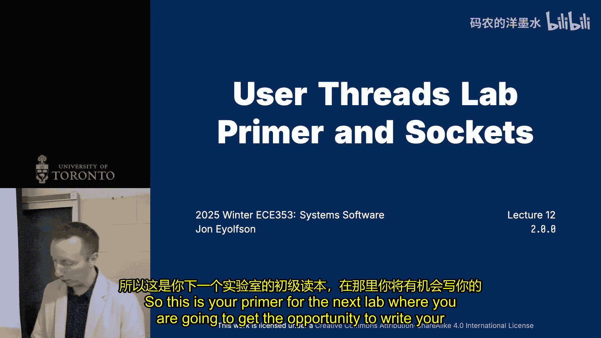
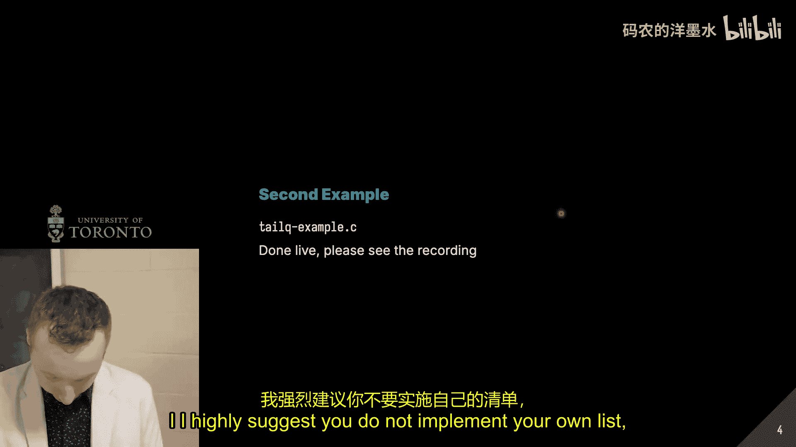
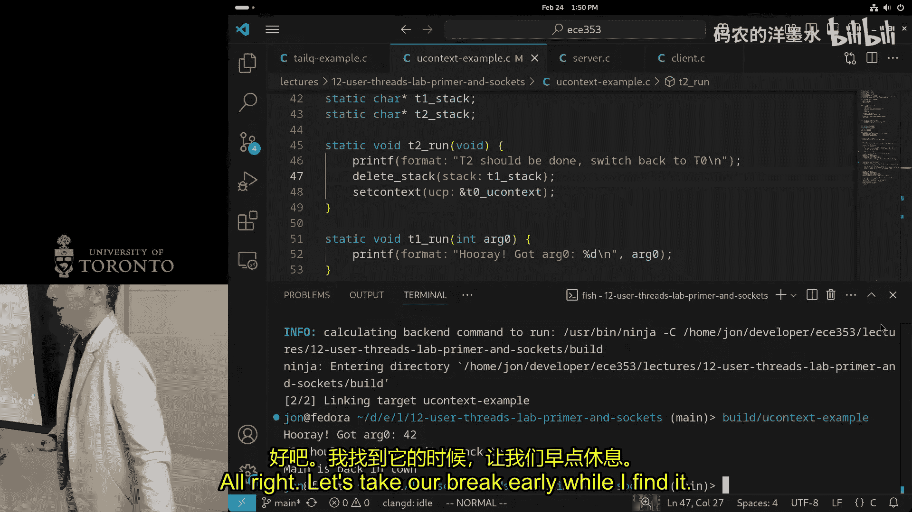
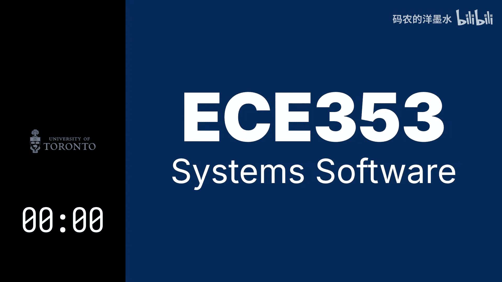
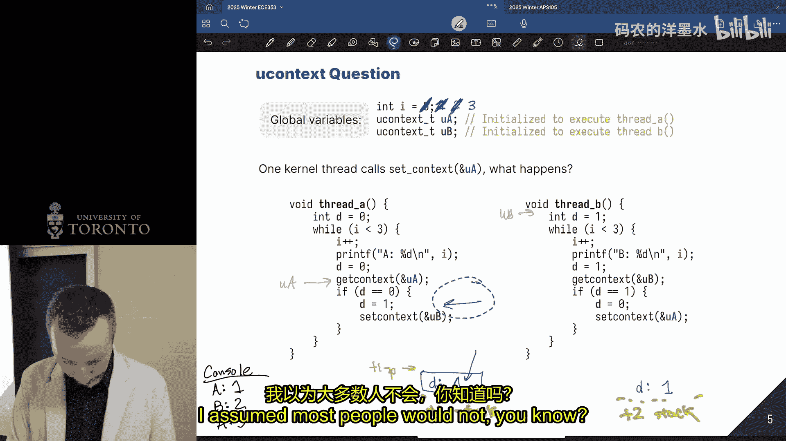
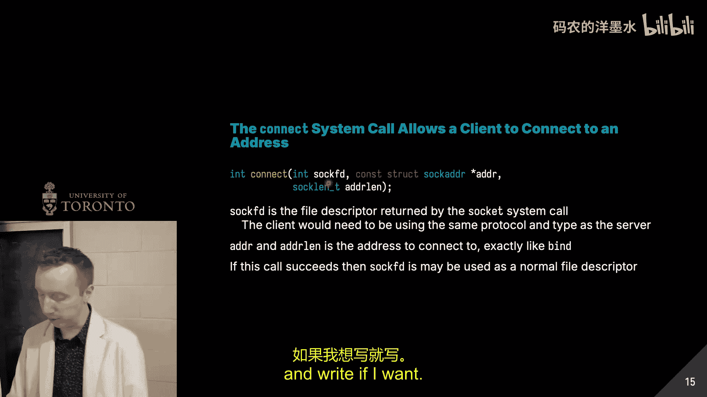
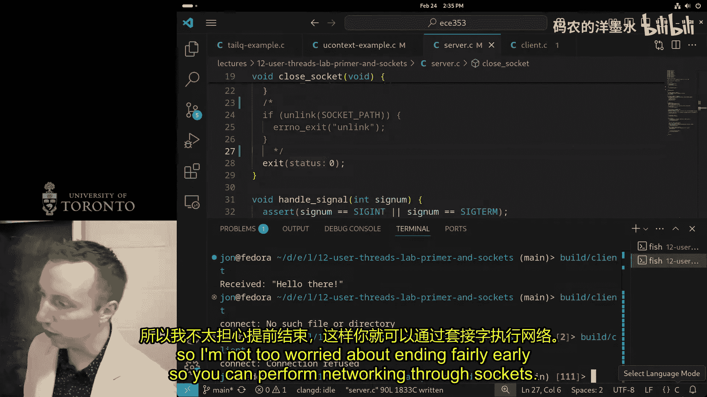
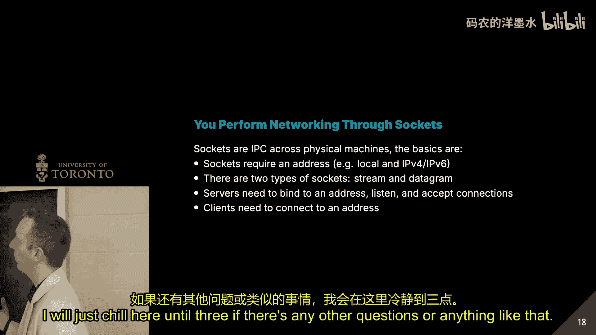

# 系统软件设计与编程：12：用户线程实验入门



在本节课中，我们将学习如何实现用户级线程库。我们将回顾线程的基本概念，然后深入探讨如何使用 `ucontext` 库来管理线程的上下文切换、栈分配和调度。此外，我们还将简要介绍套接字编程的基础知识。

## 线程与进程回顾



上一节我们介绍了进程和线程的基本概念。本节中，我们来看看如何具体实现用户级线程。

一个进程代表一个正在运行的程序，它包含以下部分：
*   一个打开的文件描述符列表。
*   一个虚拟内存空间，用于存放程序的代码、全局变量和堆。
*   一个或多个线程。每个线程拥有自己独立的寄存器和栈空间。

对于用户线程库的实现，我们需要跟踪每个线程的寄存器和栈，并进行调度。

## 使用 `tailq` 实现链表

在实现线程调度时，我们需要一个队列来管理准备运行的线程。以下是使用 `tailq` 宏实现双向链表的方法，这比手动实现链表更简单且不易出错。

首先，我们定义一个结构体作为链表的元素，并使用 `TAILQ_ENTRY` 宏为其添加链表指针。

```c
struct list_entry {
    int id; // 线程ID
    TAILQ_ENTRY(list_entry) pointers; // 链表指针
};
```

接着，我们定义链表头结构。

```c
TAILQ_HEAD(list_head, list_entry);
```

然后，我们可以声明一个全局的链表头并初始化它。

```c
static struct list_head head;
TAILQ_INIT(&head);
```

现在，我们可以向链表尾部插入元素。

```c
struct list_entry e1;
e1.id = 1;
TAILQ_INSERT_TAIL(&head, &e1, pointers);
```

要遍历链表中的所有元素，可以使用 `TAILQ_FOREACH` 宏。

```c
struct list_entry *e;
TAILQ_FOREACH(e, &head, pointers) {
    printf("ID: %d\n", e->id);
}
```

要移除链表中的元素，可以使用 `TAILQ_REMOVE` 宏。

```c
TAILQ_REMOVE(&head, &e1, pointers);
```

## 线程栈管理

每个线程都需要自己的栈。我们将使用提供的 `new_stack` 和 `delete_stack` 函数来分配和释放栈内存。这些函数内部使用 `mmap` 并处理了与 Valgrind 调试工具的兼容性问题。

```c
void* stack = new_stack(); // 分配新栈
// ... 使用栈 ...
delete_stack(stack); // 释放栈
```

## 使用 `ucontext` 进行上下文管理

`ucontext_t` 结构体用于保存和恢复线程的上下文（即寄存器状态）。这是我们实现用户线程的核心。

首先，我们需要为每个线程声明一个 `ucontext_t` 变量。

```c
ucontext_t t0_ctx, t1_ctx, t2_ctx;
```

使用 `getcontext` 初始化上下文结构。**注意**：直接调用 `getcontext` 后立即调用 `setcontext` 会导致无限循环。

```c
getcontext(&t0_ctx); // 保存当前上下文到 t0_ctx
setcontext(&t0_ctx); // 恢复 t0_ctx -> 跳回上一行，无限循环！
```

要创建一个新线程，我们需要：
1.  为新线程分配栈。
2.  初始化其 `ucontext_t`。
3.  设置其栈指针。
4.  使用 `makecontext` 指定线程要运行的函数。

以下是创建并切换到新线程 `t1` 的示例。





```c
// 1. 分配栈
void* t1_stack = new_stack();

// 2. 初始化上下文
getcontext(&t1_ctx);

// 3. 设置栈信息
t1_ctx.uc_stack.ss_sp = t1_stack;
t1_ctx.uc_stack.ss_size = DEFAULT_STACK_SIZE;

// 4. 指定运行函数并传递参数（仅限int类型）
makecontext(&t1_ctx, (void (*)(void)) t1_run, 1, 42);

// 切换到线程 t1
setcontext(&t1_ctx);
```

线程函数 `t1_run` 的定义如下。

```c
void t1_run(int arg) {
    printf("Hooray, got arg: %d\n", arg);
}
```

默认情况下，当线程函数返回时，整个进程会退出。为了实现线程库，我们需要在线程结束时切换到其他线程。

## 线程切换与 `swapcontext`

为了实现从主线程到新线程的切换，并在新线程结束后返回主线程，我们需要使用 `swapcontext` 函数。它会保存当前上下文到第一个参数，并立即切换到第二个参数指定的上下文。

```c
// 主线程中：保存当前上下文到 t0_ctx，并切换到 t1_ctx
swapcontext(&t0_ctx, &t1_ctx);
printf("Main is back in town.\n"); // t1 结束后，会回到这里执行
```



在线程 `t1` 中，我们可以切换到线程 `t2`，并在 `t2` 结束后清理 `t1` 的栈并切换回主线程。

```c
// 在 t1_run 函数中
setcontext(&t2_ctx); // 切换到 t2

// 在 t2_run 函数中
printf("T2 should be done, switch back to T0.\n");
delete_stack(t1_stack); // 清理 t1 的栈（由其他线程执行是安全的）
setcontext(&t0_ctx); // 切换回主线程
```

另一种管理线程结束的方法是使用 `ucontext_t` 的 `uc_link` 字段。如果设置了 `uc_link`，当线程函数返回时，会自动切换到 `uc_link` 指向的上下文，而不是退出进程。

```c
// 设置 t1 结束后自动切换到 t2
t1_ctx.uc_link = &t2_ctx;
```

## 套接字编程简介

套接字是另一种进程间通信机制，它允许不同机器上的进程进行通信，是网络通信的基础。

创建服务器端套接字需要四个步骤：
1.  `socket()`: 创建套接字。
2.  `bind()`: 将套接字绑定到一个地址（文件路径或 IP 地址+端口）。
3.  `listen()`: 开始监听连接请求。
4.  `accept()`: 接受客户端连接。

以下是使用 Unix 域套接字（本地通信）的简单服务器示例。



```c
int server_fd = socket(AF_UNIX, SOCK_STREAM, 0);
struct sockaddr_un addr;
addr.sun_family = AF_UNIX;
strncpy(addr.sun_path, "example.sock", sizeof(addr.sun_path) - 1);

bind(server_fd, (struct sockaddr*)&addr, sizeof(addr));
listen(server_fd, 0);

while (1) {
    int client_fd = accept(server_fd, NULL, NULL);
    write(client_fd, "Hello there\n", 12);
    close(client_fd);
}
close(server_fd);
unlink("example.sock");
```

客户端只需要两个步骤：
1.  `socket()`: 创建套接字。
2.  `connect()`: 连接到服务器地址。

客户端示例代码如下。

```c
int sock_fd = socket(AF_UNIX, SOCK_STREAM, 0);
struct sockaddr_un addr;
// ... 设置地址（与服务器相同）...
connect(sock_fd, (struct sockaddr*)&addr, sizeof(addr));

char buffer[128];
read(sock_fd, buffer, sizeof(buffer));
printf("Received: %s", buffer);
close(sock_fd);
```

## 总结





本节课中我们一起学习了用户级线程库的实现基础。我们了解了如何使用 `tailq` 宏方便地管理数据结构，如何使用 `new_stack`/`delete_stack` 分配线程栈，以及如何利用 `ucontext` 系列函数（`getcontext`, `setcontext`, `makecontext`, `swapcontext`）来保存、恢复和切换线程上下文。我们还简要介绍了套接字编程的基本步骤，这是实现网络通信的基石。掌握这些概念对于完成接下来的实验至关重要。