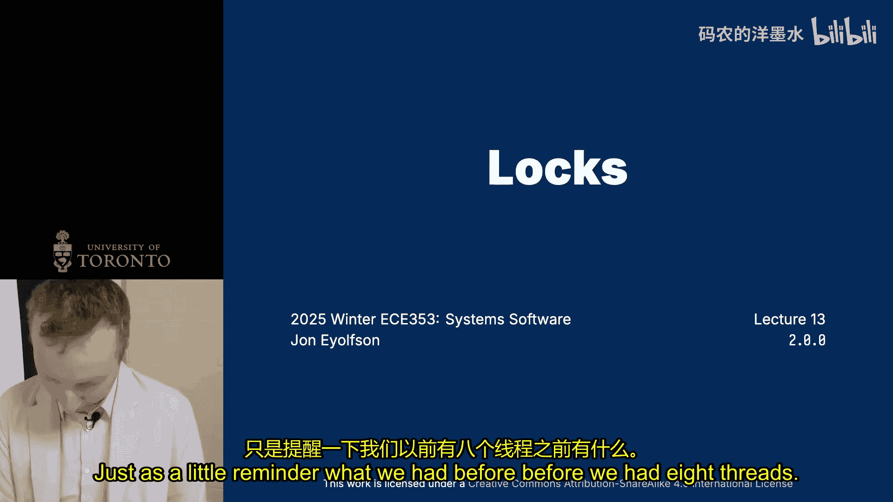
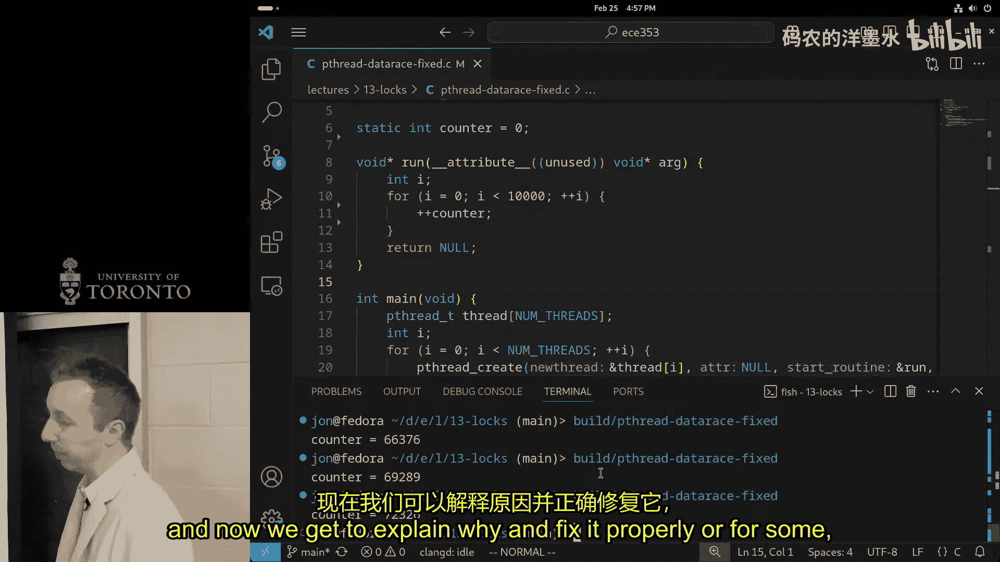
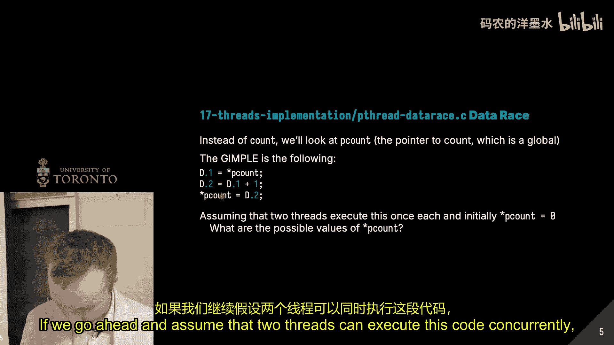
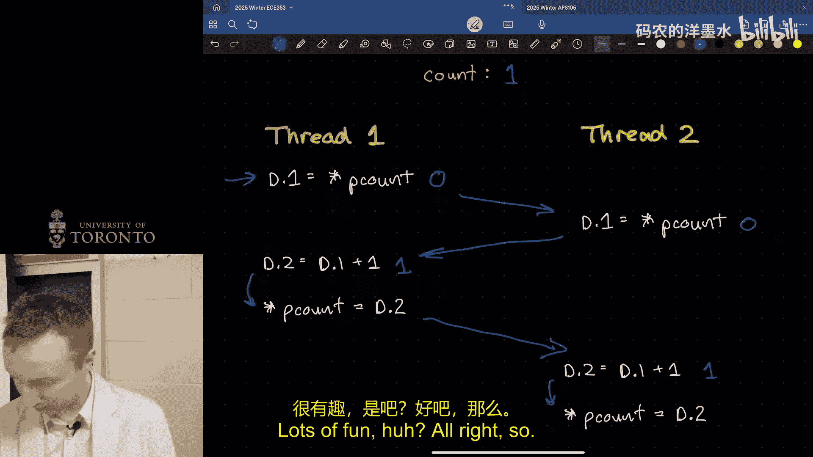
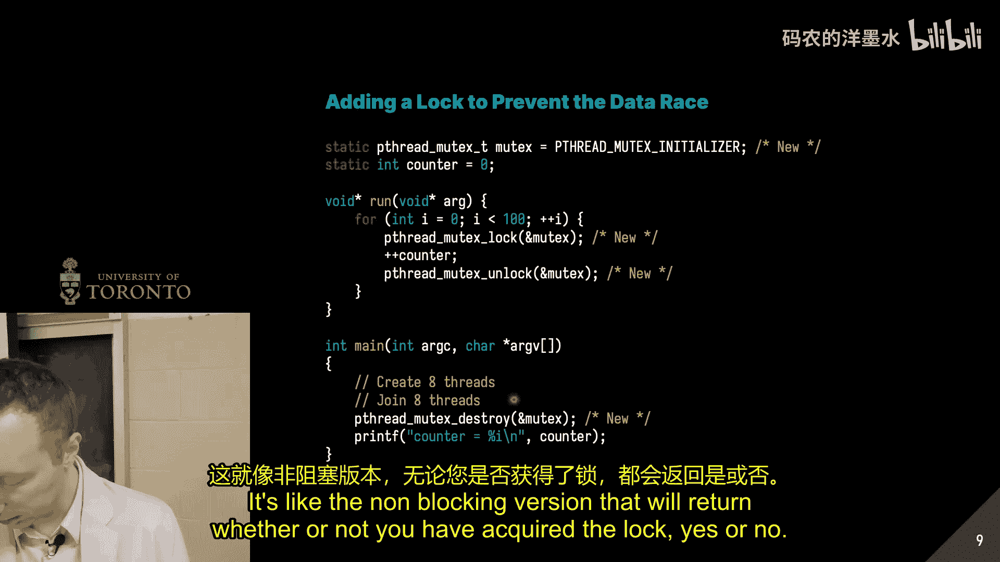
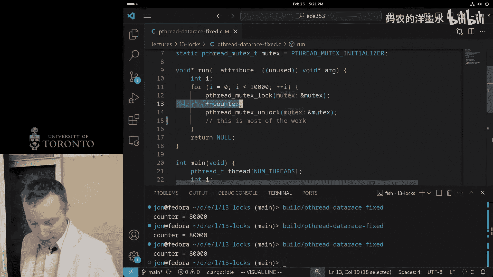
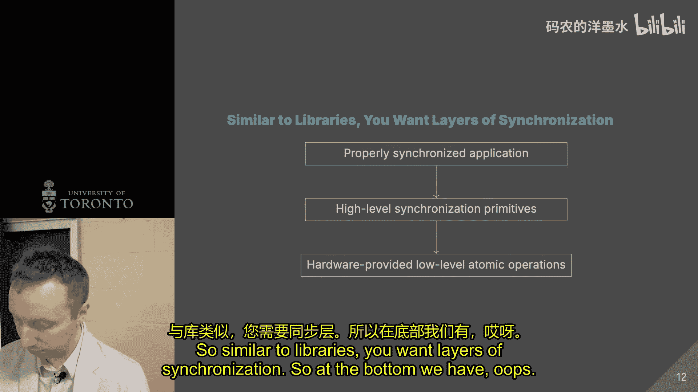
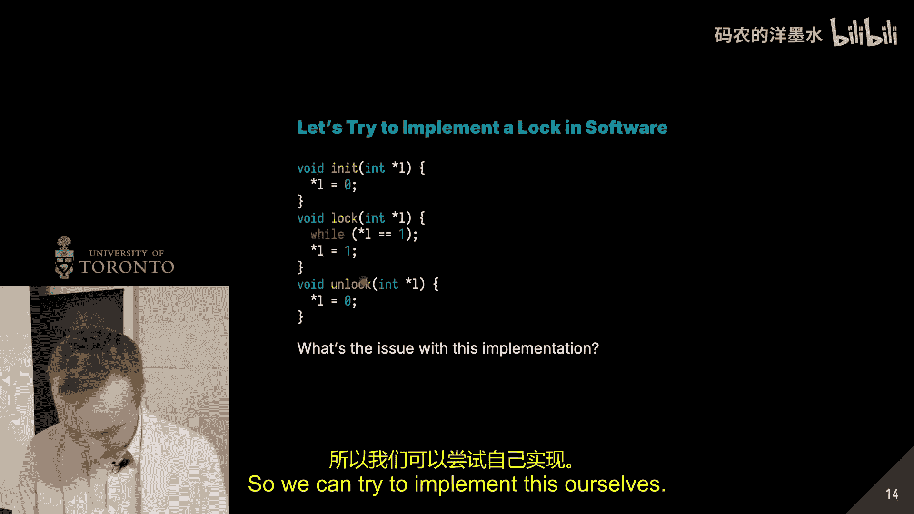
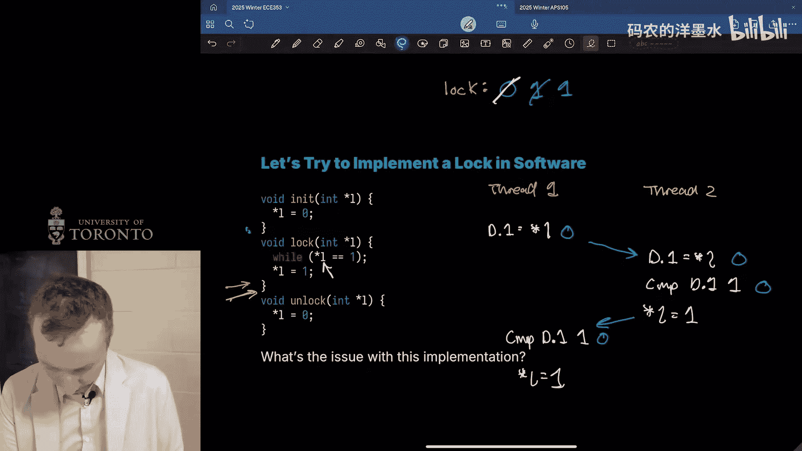
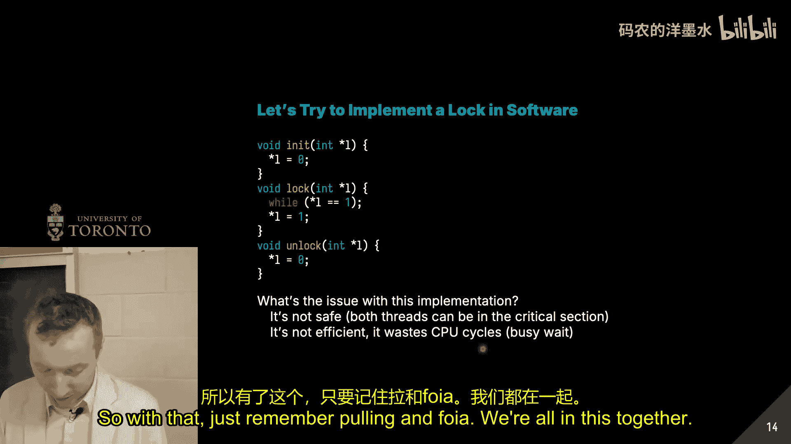

# 【全集 2025】多伦多大学 系统软件设计与编程 中英字幕 1080P p13 Lecture 13 - 锁 -BV1YrkYBQEeL_p13-

All right， welcome back to 353， 9 a。 is there exam today or something or midterm？Sorry。All right。

 multiple women inter today， so yeah， it's like another snow day。Could done this online。

 I could have not woken up at 4 AM。 That would have been great。 All right， Well。

 that's unfortunate because we are back to regularly scheduled。

lectecturing where things are now going to get difficult， so we get to talk about locks today。

 we're arguing about concurrency， we're arguing about threads。Just as a little reminder。

What we had before？Before we had eight threads， remember this example from way back when we had eight threads all incrementing the same global variable 10。

000 times。We ran it and while we argued that， hey， the actual answer should be 80。

000 if we have eight threads each incrting a variable 10，000 times， but when we ran it。

 we saw that you know it got inconsistent results and now we get to explain why and fix it properly or for some depth or at least have another way to fix it。

So what actually happened was something called a data race。

 and it occurs when sharing data because we were sharing。

Modifications to that global variable across multiple threads。

 so a data race is when two concurrent actions note here， not even parallel， too concurrent。

 so this even happened with a single CPU。So。This definition， also very important。

 you'll have this seared into your brain。So a data race is when two concurrent actions access the same variable and at least one of them contains a right operation and that is the case you might have a data race if both concurrent actions are both reading it。

 they're both reading the same data over and over again， it doesn't really matter。

 we'll only have a problem when one of them tries to write it and in which case we might get some still data is basically what it comes down to and we'll see a whole bunch of examples today and why that happened。

So。To begin talking about it and talking about how to do it properly。

 we have to talk about atomic operations so atomic operations aren't fun physics。

 anything like that they are just operations that are indivisible so they either happen or they don't there's no in between So you just assume any atomic instruction happens all at once means you cannot preempt it。

 you can't do anything concurrent， you can't switch from it either happens or it doesn't。

 but between two atomic instructions， you may be preempted。

 so you may switch which thread is currently executing and this makes arguing about our programs hard especially with higher level languages where one line of C even though C is not really that high level translates into multiple atomic instructions。

So if you're interested in compilers at all， compilers don't take your C code and spit out assembly。

 they use something called an intermediate representation which is kind of like between C and assembly and it generates assembly from that and does all of its analysis and everything on kind of like a simplified version of assembly so typically it's in the format called a three address code or TAC and this is what is used by compilers for their analysis and optimization if you ever get interested in that and how software works compiler courses are a great。

Great course to take。 That's what started me doing grad school because I liked my compiler course so much。

 I continued doing it until I got stuck in the academic vortex and now I am here forever， hopefully。

Maybe so three address code again， mostly used for analysis and optimization internally by compilers。

 the statements。A kind of simplified， they represent one fundamental operation for the purposes of this course we'll assume each of the operations are atomic and it's useful to have our code represent this way because it's easier to read than assembly and we can reason about data races in what's actually going on so statements are simplified。

 this is as complicated as a single three- address code statement gets a result equals an opera brand with an operator and an operaand and that is as complicated as it gets。

 it could be of course as simple as a result equals an opera brand or something like that。

So the three address code used by GCC is called Jple， don't ask me why it has a stupid name。

 something intermediate something， something programming language， something who knows。

 so to see that whenever you're compiling you can use this flag that's F dump Jumple tree to see that I'm not lying and that is the name and to see all the three address code generated by GCC you can use F dump tree all and see all the Jmple so again easier to reason about your code than low level than just like trying to reason about the assembly and it's more general too so you might see we're just going to look at briefly you might care about this more once you get into like programming for performance or again a compiler course。

So。Instead of count the compiler just reasons about the pointer to count which is a global so it just picks that virtual address for it。

 so if we took plus plus count and generated the gple for it。

 just renaming the pointer to count as just P count。

 the Juimpple is the following we'll see three instructions so the first one is going to be that memory load so it will load it will dereference P count。

 get the value of count， load it into a temporary in this case。For3 address code。

There is not the concept of registers， well there's kind of the concept of registers。

 so they're just calledtemporaries， but you assume you have an infinite amount of them and each instruction generates its own unique register and so we don't have to worry about register allocation or anything like that。

So this reads the value of count into a register called D1 if you want to think of it that way。

 and then that's it， that's the atomic construction。

 then the next is the increment on the value in that register if you want to think of it that way so creates a new temporary called D2 which is equal to D1 plus1 and then it does the right so it writes the updated value to count overwrites that value there so。

If we go ahead and assume that two threads can execute this code concurrently so again we're just worrying about concurrency between the two threads so between any of these instructions we could swap between the other so in the happy case where it kind of expects how we want it to we have this value in memory somewhere called count is currently equal to zero and when we start executing we only execute you know we only have assume we only have one CPU that can only execute one instruction at a time。

 so first we start off in thread one。

We execute this instruction。So that loads the value of count into a temporary called D1。

 so in this case it would load that value0。Then。Next we take that value， we add one to it。

 put it in a temporary called D2， so that value would just be1， and then we do the memory right here。

 so we write the value now1 to count， and we are now updating count from0 to1。

Then we context switch over to threadread2， start executing T2's code， and then we read。

The value of count into thread2s register。 So in this case， we would read the value1。

Then we would go ahead。Do the increment， so we increment one to two。And then we write out。

Then we do the memory right with the value 2。 so that would update count from a1 to a2 and then。

That gets us our right result。Now， if we rewind， that's only one combination。So。

For arguing about all of these。We assume。Each of these instructions are atomic。But we don't know。

 you know， between any two atomic instructions， I can either switch to the other thread or I could stay at the current thread。

Each thread individually will run its instructions in order， we can assume that from top to bottom。

 although that's not really true on modern CPUs either， but I will save you that headache。

So just assume each thread runs。All of its instructions in order。

 but we don't know any ordering between the two threads。 So in this case。

 if we just think about for this simple example， how many different ways are there to combine these two threads So I can start with this instruction。

 and then the next thing I could execute could be thread one's next instruction or threads2 or thread2's first instruction right And then after that I could continue with thread1 or thread2。

 sorry or switch back to thread1 you can see how this explodes quite quickly exponential number of combinations here we have to worry about and in order to argue that your software is correct。

 you have to argue about every single one of these So that is what makes programming fun and why concurency issues have lived in the Linux kernel as bugs for。

I don know， like 13 years， something like that took 13 years for some people to find some of these bugs。

 so。For example， most of the time， oh， maybe count is2， and that's great。

 but I might get a bad ordering of threads。 So bad ordering of threads again would be， okay。

 let's first start executing thread 1。 It would read that value of count into its temporary D1。

 And then we could context switch to thread 2。😊，Then thread2 would do its memory load and the current value of count is0。

 so it would load that value 0。 Now at this point， we're kind of screwed。

 It doesn't matter if we switch back to thread1 or continue executing thread2 At the end of the day。

 we're going to get the wrong answer here。 So let's just assume we go back to thread1。

If we go back to thread one。It will take its。Current D1， which is its own temporary value。 again。

 that is unique to a thread， and it would add one to it。 So 0 would get added to one。

 Give us the result one， then the next instruction。It could execute is updating the count。

 the value of count to be whatever its current value is in its register， which is now one。

And then we could switch back to threadread2。Now thread2。Well， in its D1 register。

 its current value is0 so it would get updated to a1， and then it would go ahead。

 execute its next instruction， which is to update rate the value1 to count。

 so it would update it from one to a1 and now we have the wrong answer。So any questions about that？

Lots of fun， huh。

Again， to analyze data races you have to assume all preemptions are possible。

 so the ones that are important for data races you argue about reads and writes to a location in this case I don't really care about the increment or anything like that becauses not that's internal independent on each thread what I care about is count so I'm doing this analysis just on count and the things that I care about are the reads and the writes so let's call the read and write from thread1 as R1 so that's a read from thread1 and。

Right one。 So that's a right from threadread1。 And of course， R2 and W2 from thread 2。 So if I。Again。

 assuming no reordering instructions。Between threads， I always have to have a read and then a write。

 So all our possible orderings in this case is if I start with a read1。

 the next instruction could either I could continue with thread 1 and make it to the right or I could switch to thread2 and then do the read。

 and then well if I do the write on thread1， I only have。

One choice I have to context switch to thread2 and then the next instruction would be a right to thread2。

 in which case if I did that， that's the happy case where the final value of count is2 Otherwise if I switch to thread2 and do a read2。

 then I might switch back to thread1 and do a right and then do thread2's right or I might continue doing thread2s right and then thread one's right either case the final answer is a one when it should be a2 and then similarly for。

The other three are the same idea just thread2 executed first。

 but otherwise it's pretty much the exact say。 So these are all of our combinations and if at least one of them has the wrong output。

 then we have a bug in our program so everyone understand this。Cool， so。

In order to solve this or prevent this well。Arguing about different innerleavings between threads is really hard。

 so we use some construct in order to prevent any switching between threads and we call them a muttex。

 So a mutex is short for mutual exclusion means only one can happen at a time。

 So they're actually part of the P thread library。 And you can create them either statically as a global variable or dynamically。

 So if you do them statically you can declare global called P thread muttex underscore T。

 That's the type for them。 give it a very， very creative name like M1 and。To initialize it。

 you just set equal to P thread initializer， which is some horrible C macro chna again， but it works。

If you have some P thread Muex M2 that you declare。

 It know on the stack or main stack or or through malloc or something like that。

 then you have to call P thread to knit on it， give it the address of the thing to initialize。

 and then it has a bunch of attributes。 but for this course。

 we'll just set to null and get all the default mutexes。 And then when you're done with it。

Like init is like malloc and destroy is like free， so you have to be destroy it once you're done with it。

If you want to include attributes， you have to use the dynamic version。

 the static one will just give you all the default things。

 which is probably good enough for us for now。So how it works is。That new text type。

It's kind of like a lock and kind of like a padlock if you will。

 so everything within the lock and unlock as a critical section so you can think of the mutex itself as a padlock and then there's only one key around that's hanging on the wall beside it。

And if you lock it， that means you take the key down from the wall。

 you lock it and you put the padlock on on the inside and no one else can get in so you have your code running that you call lock after that lock call you are the only thread that can obtain that lock there is only one single instance of this mutex and then you are the only one with exclusive access to run this protected code because if some other thread tried to do this lock call what will happen is oh someone already has the lock I can't proceed and you'll get blocked until the thread with the lock eventually calls this unlock function so you are guaranteed between the lock and the unlock call。

 at only one thread can be executing this code at any given time。And then after you unlock it。

 then more code can happen and then well that more code could get preempted switch to another thread。

 but everything we want to prevent data race for any code we need to protect should go between this lock and unlock call so we call that protected code you might call it a critical section has lots of different names depending on it。

 we're going to have a case where there's potential to have a deadlock if you're using multiple muttes which well get into later for now。

 we'll just worry about a single mutex。If you have multiple new text， though there's also a。

A function called P thread tri lock， and that will just try the lock and not block until you can actually lock the thing。

 so it will just return。It's like the non blocking version that will return whether or not you have acquired the lock yes or no。

So if we go back to our code now， if we wanted to prevent a data race。

 so what we argued about is we had a data race on counter。

 so because we have eight threads they're all running at the same time， all running concurrently。

 in this case also in parallel because I have lots of cores on my machine。

 but again for data races all we care about is concurrency。So for this。

We've identified that this is the line that has the potential data race。

 everything else there is unique to a thread it's living on that thread stack。

 so this is the thing I need to protect so since I need to protect that，Well。

 one way I could protect it and make sure that only one thread is doing this plus plus count counter at a time is I can go ahead。

 create a muex， so again it's P thread Mutex underscore T。

 I can give a very creative name like Muex and then just use the initializer so this will go ahead and initialize it for me。

 and then if I want to protect the plus plus count， I can do P thread Mutex lock。

Give it the address of Mutex。And then when I'm done with it， I can go ahead and unlock it。

So now because of that， only one thread can be executing this plus plus counter at a time。

 So between the memory read and the memory right。I'm essentially preventing any concurrent or any。

Any preemptions or anything like that while I'm trying to execute this code。

 So I could get preempted in the middle of doing this。

 but if I get preempted to another thread and they try to do the exact same thing， well。

 they'll be blocked by this lock called because I went I got preempted while I had the lock so I locked myself in that room。

 no one else can come in。 So even if they try， we're good。 So if I just do that。Save it。

And compile that。And now I run it， I get 80000 every single time。 It's all nice and consistent。

Drawback is well I essentially made this serial as well。

 so it's actually going to be slower than just having one program that just iterates 80。

000 times because again this is kind of a silly example， but unreal programs。

 this would be like not very much of the work and this would probably like the code around this。

 this is most of the work。In real programs， it would only be advantageous to do this if it actually speeds up your program。

In this course， we're just worry about doing things correctly。

 we'll worry about performance a little bit ish during the lab， but not very much pre。

Gras to be at the same time on multiple course。The lock doesn't prevent preemption。

 It just prevents preemption。The thread currently executing this from being preempted by another thread that is also going to execute that。

So。Let's say thread1 in the middle of this like does a memory read to counter and then we get preempted and we go to T2。

 well in order for thread2 to execute that plus+ counter， it has to have this lock。So， if thread1。

Is currently doing it， It means it has a lock and if Tread2 starts executing and it tries to do that。

 it would have to get by this lock call， and if it's implemented correctly， it will not be able to。

 what we say， acquire the Mut so it can't make it into that code。So it can't do it。

Thread2 could be doing other things， in this case。Thread2 would try to get the lock。

 see that it can't make any progress and then hopefully my offering system's smart enough to be like。

 okay， I'll just go ahead and switch back to whoever has that lock so that we can actually make some progress。

All right， any other questions before we attempt to implement a lock？That will make it more fun。

Allright， so that is just a little preview again。 we will get into how to actually implement this。

 So the critical section again means only one thread executes that critical section at a time。

 just like was brought up。Other threads could be executing other instructions。 At the same time。

 we still have preemptions。 Preemption still happen。 It's just that we can't。

No one else can make progress in that critical section if we get preempted and some other thread starts executing。

 it won't be able to enter that critical section， so we're not going to get interrupted in the middle of doing anything。

So if we want to implement a Mutex we need the following properties we need safety。

 aka mutual exclusion， so the rule is there should only be a single thread in that critical session at once that means we don't have to argue about any preemptions happening within that critical section we know that there won't be a data race there we also need to have liveness Aka progress so if multiple threads reach that critical session one must proceed。

 the critical section can't depend on outside threads if you do do that you can mess up in deadlock where threads don't make any progress again we'll see that in the next lecture。

And then you might also need bounded weight AKA starvation free。

 you can see this also came up in scheduling as well。

 operating systems typically do not like having starvation as something that is possible to happen。

 so what that means in this case is a waiting thread must eventually proceed they can't be stuck there forever waiting to acquire that lock。

All right， so。Practically， if you were to use threads and you want things to go actually fast instead of slowing down。

Your critical sections need to have minimal overhead， you need them to be efficient。

 you don't want to consume resources while waiting， you want it to be fair。

 so you want each thread to wait approximately the same amount of time and they should be simple so they should be easy to use hard to misuse that's generally the design for any kind of library。

So similar to libraries， you want layers of synchronization。 So at the bottom， we have oops。

At the bottom we have the hardware provided。Yeah。We have the hardware provided lowlel atomic operations so like the memory reads and the writes。

 like the actual instructions they have and then on top of those and some other atomic operations which we'll get into later。

 you build your high levelvel synchronization primitive so for example the Mutex would be an example of one of these and then using the Mutex you write a properly synchronized application without any data races that behaves consistently and fast。

So oops。So。To actually like implement a lock and implement critical sections。

This has gotten harder over time， assuming you have a processor with a single core on it。

 so a unit processor system。Back in the day， your implementation could be really。

 really easy if you have a single core。Where the only source of preemptions are interrupts well then the easiest solution is to just disable interrupts as disabling preemptions and then you're guaranteed that no one will interrupt you so back in the day your implementation for muttex lock could just be disable interrupts now no one else can interrupt you and then the unlock would just be to reenable interrupts again so this would essentially disable concurrency assuming it ignores signals and interrupts but this isn't going to work on multiprocessors where things could be happening in parallel so our life has gotten a lot more challenging。

So we can try to implement this ourselves。 So let's look at this。

We will have a lock。We're just going to model it by just an integer。

 and we're going to assign some magic values to it。🤢。

With some meaning such that the value0 means the muex is currently unlocked and the value1 currently means it is locked。

 so the idea here is that if someone creates one of these locks that we're going to try。

 they just create an int somewhere and then we go ahead they would call a knit and then whenever they want to use it。

 it would be lock and unlock so somewhere let's say they try to use it and gave it the name lock as a global variable。

As part of our knit， it would be equal to 0。 So even arguing about the， well。

 let's kind of argue about it a bit。 So the idea here。Is that in the log call。

What the law called does is it has this while loop。 So while D reference L is equal to1。

 So that means。That this will be true when that current value of the lock is equal to1。

 so currently if no thread has a lock， then the current value is0， so this will be false。

 and note there's a semicolon here such that if this was true， it would just be an infant while loop。

 it would just go back and forth， back and forth， back and forth until that condition changed。

So in this case， the value of the lock is0， so this would be false。

 so we would fall out and then we would change the value of the lock from a0 to a1。

So that would be what happens when the first thread executes it。 So we would say， hey。

 we have thread。One， and we could say。Has the lock because it's a thread that changed the value from a 0 to a 1。

 And now the property we should have is that if thread 2 comes along。And calls lock。Well。

 then thread 2 can't make any progress。 right， So thread 2， if it called lock。

 the current value is one。 So one is equal to one。 So it would just loop over and over and over here until eventually。

The operating system switches to threadread1。 Thread1 finishes its critical section and then eventually calls unlock。

 which would change that value from。One back to zero， and now if we go back to thread2。

Thread2 could go ahead， oh， well now the current value is0。This is false。

 so thread2 could go ahead and change that value from a0 to a1， and now thread2 has the lock。

And no one else can make any progress so everyone can of get the logic for that。All right。

 so I will give you a minute to think about this， so what happens is or sorry， in order to be safe。

Even if two threads start off by calling this lock function。

Only one of them should be able to progress。RightIf this is implemented correctly。

 only one of them will be able to make it pass this， no matter what。

But preemptions they have between each other。 So I'll give you a minute or two to think about this。

 Let's assume if thread1 and thread2 called this log function。

Is it possible that both thread1 and thread2 return from this lock function which would make our mutex essentially worthless。

 so think about well given the current value of the lock and what this code actually does。

Is there any concurrent？Accessses or execution of this code that will lead both threads to actually return from it。

 which would be very， very， very， very bad， so I will give you two minutes to think about that and then we will go through it。

All right， a stabs are bad that can happen。Yeah。あ。It's like neither correct。当然なる。

So just two threads calling lock。Yeah， we're just worried about we don't really care about Ne for right now。

自分どうした。Yeah， so first step is well。Skipping well。Kind of load。 They both read the value of L first。

 which。And more， I dont know， explicit terms means well this read right here。

 this is a memory read and that's an atomic instruction。

 so a bad thing that could happen is that thread1 executes first。

 it reads that current value into its register so it would do something like this version of the gple which is that memory read。

 so it would read that value0， then a bad thing that could happen is we could context switch to thread2。

🤢，Thread2。Would then。Go ahead and do the same thing where it reads that value0 as well， right？

It's not both happening at the same time。 We're just arguing about concurrency。 So concurrently。

 So we actually do have a context switch between them。 but now they both read that value 0。

 and now we're essentially screwed， right， So now it doesn't matter what executes next。

 if we executed thread2 next。 they would compare D1 to one。Which is true。Because current or sorry。

 which is false。Apparently， I got mixed up， so it would compare。0ero to1， that's false。

 so we would break out of the wall loop， it would go ahead and then do the instruction where we update the value of L to be equal to just one。

 so we would update the value of the lock to be equal to1 and we would be able to return from the lock。

So now that thread is done writing that lock code Now if we could switch back to thread1。

 if we switch back to thread1， it will do the comparison again。

 well with D1 that it loaded from memory which is currently zero， which as you can see。

 data races are basically caused by using stale data that's not really true anymore So still has the old value 0。

 but the current value is1， but we're ignoring it because we already read it from memory and we're not aware of the other thread。

 So when we compare we'll get the value 0， which is false， and then it will go ahead。

 execute the next instruction， which is the memory right updating that value from a1 to a1 and now both threads would make it by the lock call rendering our lock completely useless。

So everyone get that。Cool， so。

There's actually two issues with this implementation。 One， it's not safe。

 so both threads could be in the critical section， rendering this thing completely useless。

 and it's also not efficient because it wastes CPU cycles。 So it's not intelligent at all if。

It worked properly and thread1 acquired the lock and then thread2 called the lock function。

 it will essentially be stuck in that infinite loop until it won't give up the CPU。

 even though it can't make any progress it it's going to try and try and try and try and try again and that's something we just call a busy weight。

 it's waiting， doing work when it shouldn't really be doing it。

 it's just going to load that value one， over and over and over and over and over and over and over again until eventually thread one calls the unlock function。

So any other questions for today， next lecture， we will actually implement this correctly。

And it will be a load of joy， but we won't have enough time to do it today。

So we get to end a bit early。 You get to enjoy the rest of your early morning and go grab a coffee or something like that。

 So with that， just remember pulling for you。 We're on in this together。😊。

