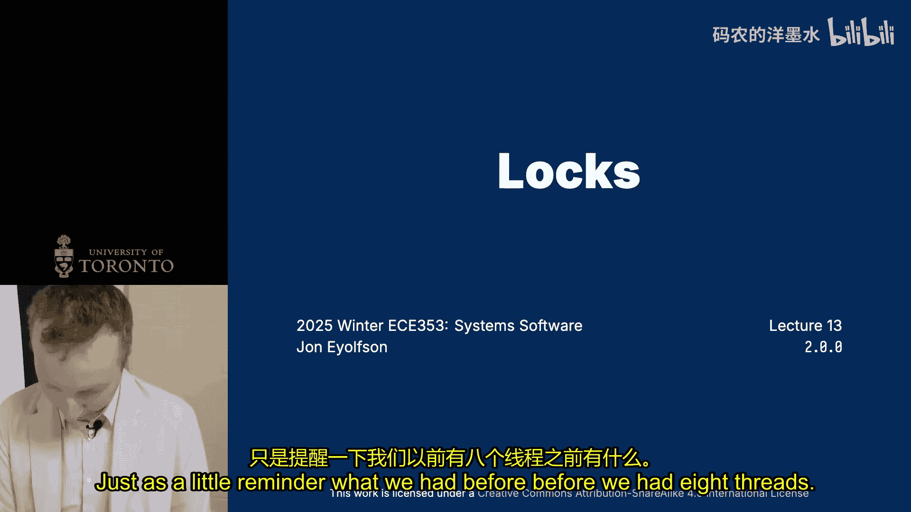
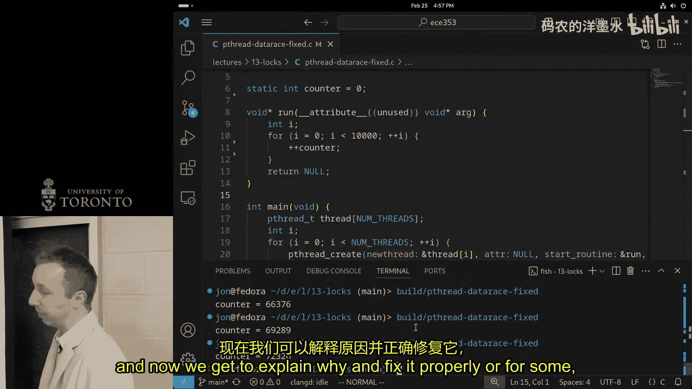
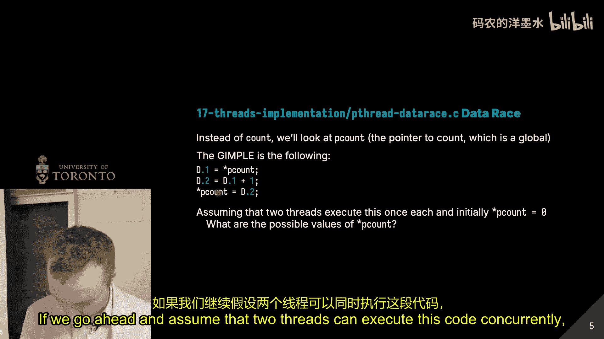
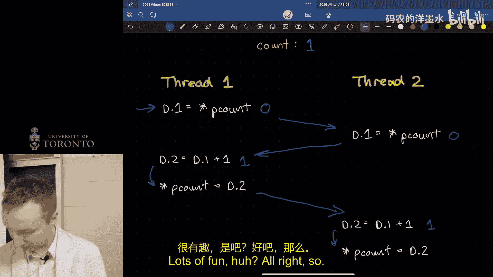
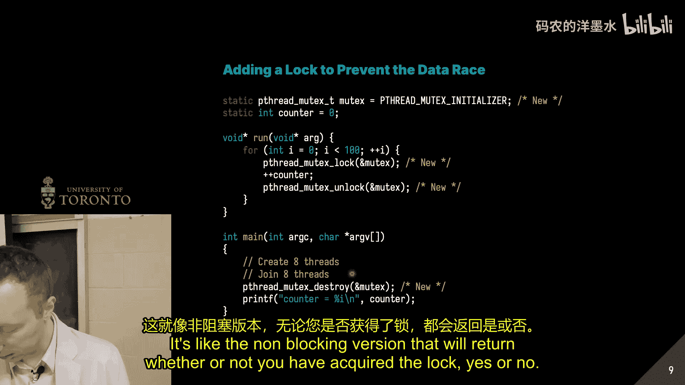
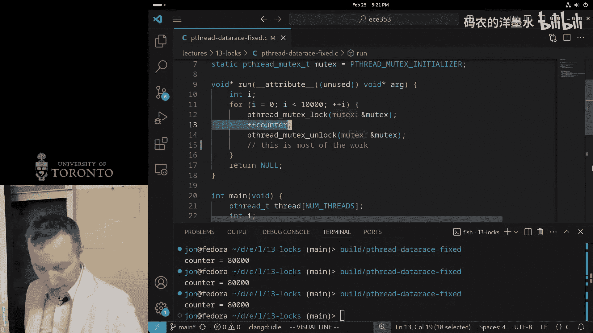
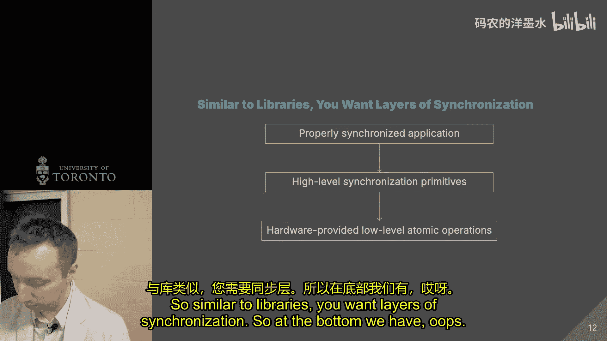
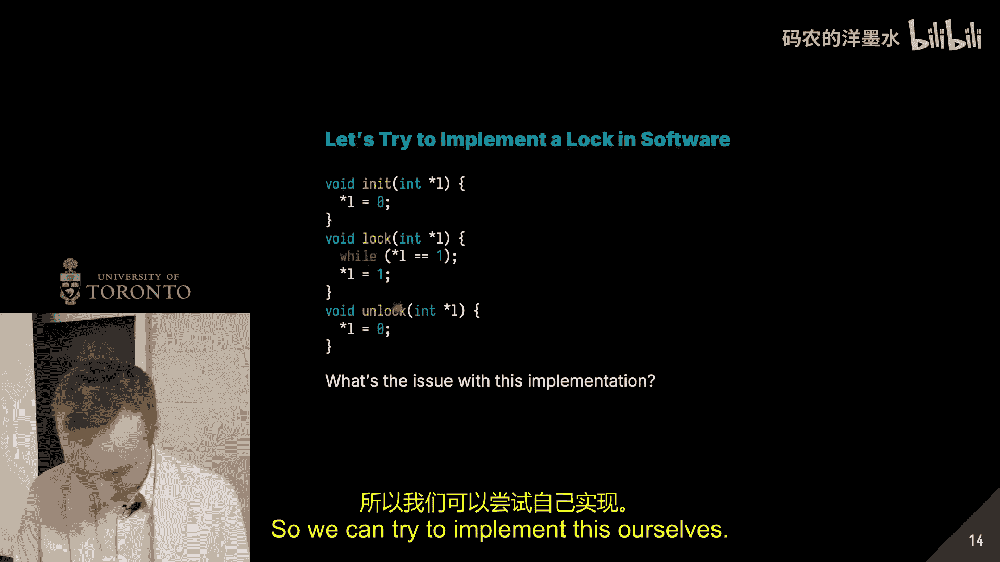
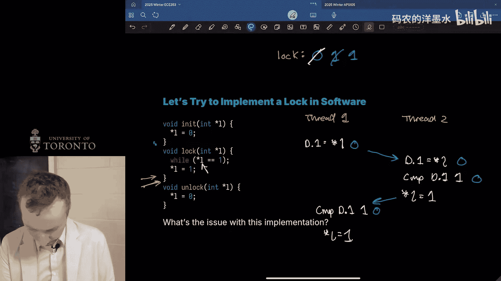
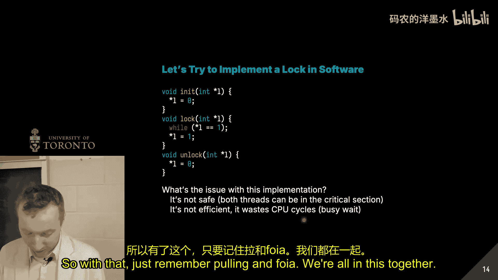

# 系统软件设计与编程：13：锁 🔒





在本节课中，我们将要学习并发编程中的一个核心概念：锁。我们将探讨为什么在多线程程序中会出现数据竞争，以及如何使用锁来确保数据的一致性和程序的正确性。

---

## 数据竞争与原子操作

上一节我们回顾了多线程程序可能产生错误结果的问题。本节中，我们来看看导致这个问题的根本原因：数据竞争。

数据竞争发生在两个并发操作访问同一个变量，并且其中至少有一个是写操作时。即使是在单核CPU上，由于线程的切换（并发），也可能发生数据竞争。为了正确分析程序，我们需要理解原子操作的概念。

**原子操作**是指不可分割的操作，它们要么完全执行，要么完全不执行。在原子操作之间，线程可能会被抢占（即切换到另一个线程）。然而，高级语言（如C语言）中的一行代码通常会被编译成多个原子指令，这使得分析变得复杂。

编译器在将代码转换为机器指令时，会使用一种称为**中间表示**（如GCC的Gimple）的格式进行分析和优化。这种表示将复杂的操作分解为一系列简单的、类似汇编的三地址码指令，便于我们理解数据竞争。



例如，对于C语言中的 `count++` 操作，其对应的三地址码可能如下：
```c
// 假设 p_count 是指向 count 的指针
d1 = *p_count;   // 原子操作：从内存加载值到临时变量 d1
d2 = d1 + 1;     // 原子操作：执行加法
*p_count = d2;   // 原子操作：将结果写回内存
```
每个三地址码指令（如加载、加法、存储）都被视为原子的。

---

## 为什么会出现错误结果？

现在，我们分析两个线程并发执行 `count++` 时可能出现的问题。每个线程都会按顺序执行自己的三地址码指令，但两个线程之间的指令执行顺序是无法预测的。

考虑以下错误场景：
1.  线程1执行 `d1 = *p_count`，加载 `count` 的初始值0。
2.  在写回之前，系统切换到线程2。
3.  线程2也执行 `d1 = *p_count`，同样加载到值0。
4.  线程2继续执行 `d2 = d1 + 1` 和 `*p_count = d2`，将 `count` 更新为1。
5.  系统切换回线程1。
6.  线程1使用它之前加载的旧值0，执行 `d2 = d1 + 1` 得到1，然后执行 `*p_count = d2`，将 `count` 从1覆盖为1。



最终，`count` 的值是1，而不是正确的2。这是因为线程1使用了过时的数据（脏读），并且两个线程的写操作相互覆盖。

为了彻底分析数据竞争，我们需要考虑所有可能的线程指令交错顺序。只要存在一种顺序导致错误结果，程序就存在Bug。

---

## 互斥锁：解决方案

手动分析所有线程交错顺序极其困难。因此，我们使用**互斥锁**来简化问题。互斥锁确保同一时间只有一个线程可以执行被保护的代码段（称为**临界区**）。

互斥锁就像一把只有一个钥匙的挂锁。线程调用 `lock` 相当于拿走钥匙并锁上门，获得独占访问权。其他线程尝试 `lock` 时，会发现锁已被占用，从而被阻塞，直到持有锁的线程调用 `unlock` 释放锁。

在Pthreads库中，使用互斥锁的步骤如下：



以下是创建和使用互斥锁的基本步骤：
1.  **声明与初始化互斥锁**：
    *   静态初始化：`pthread_mutex_t mutex = PTHREAD_MUTEX_INITIALIZER;`
    *   动态初始化：使用 `pthread_mutex_init(&mutex, NULL);`，使用完毕后需调用 `pthread_mutex_destroy`。
2.  **保护临界区**：
    *   在进入临界区前调用 `pthread_mutex_lock(&mutex);`。
    *   在离开临界区后调用 `pthread_mutex_unlock(&mutex);`。
3.  **尝试加锁**：
    *   使用 `pthread_mutex_trylock` 可以尝试非阻塞地获取锁。

将锁应用于之前的计数器示例，我们只需要保护 `counter++` 这一行代码：
```c
pthread_mutex_lock(&mutex);
counter++;
pthread_mutex_unlock(&mutex);
```
这样，无论线程如何切换，同一时刻只有一个线程能执行 `counter++`，从而保证了结果的正确性（总是80000）。需要注意的是，这会使临界区内的操作串行化，可能影响性能，但正确性是首要目标。

锁并不能阻止线程被抢占。它的作用是：如果一个持有锁的线程被抢占，其他线程在尝试获取同一把锁时会被阻塞，从而无法进入临界区，保证了临界区内的操作不会被打断。

---



## 如何实现一个锁？

理解了锁的用途后，我们来看看实现一个正确的锁需要满足哪些属性，并尝试自己设计一个简单的锁。

一个正确的锁实现需要满足三个核心属性：
1.  **安全性（互斥）**：`mutual exclusion`。确保任何时候最多只有一个线程处于临界区内。
2.  **活性（进展）**：`progress`。如果有多个线程试图进入临界区，至少有一个能成功进入。不能出现所有线程都在临界区外等待却无人能进入的死锁情况。
3.  **有限等待（无饥饿）**：`bounded waiting / starvation-free`。任何等待锁的线程最终都能获得锁，不会无限期等待。




此外，一个好的锁实现还应追求高效（开销小）、公平（等待时间近似）和简单易用。

同步原语是分层构建的：
*   **底层**：硬件提供的原子操作（如特定的读、写、比较并交换指令）。
*   **中间层**：利用原子操作构建的高级同步原语，如互斥锁。
*   **应用层**：开发者使用这些同步原语编写正确、高效的无数据竞争程序。



---

### 一个天真的锁实现及其缺陷

假设我们用一个整数变量 `lock` 来表示锁的状态：`0` 表示未上锁，`1` 表示已上锁。我们尝试实现 `lock` 和 `unlock` 函数。

以下是这个简单锁的实现逻辑：
```c
// 初始化
lock = 0;

void lock(int *lock) {
    while (*lock == 1) { /* 忙等待 */ }
    *lock = 1; // 获取锁
}

void unlock(int *lock) {
    *lock = 0; // 释放锁
}
```
**逻辑**：线程调用 `lock` 时，如果 `lock` 为1，就循环等待（忙等待）；如果为0，就将其设为1并进入临界区。调用 `unlock` 时将其设回0。

然而，这个实现存在严重问题。考虑两个线程几乎同时调用 `lock`：
1.  线程1读取 `lock`，得到0。
2.  在线程1将 `lock` 设置为1之前，系统切换到线程2。
3.  线程2也读取 `lock`，得到的仍然是0。
4.  现在，两个线程都认为自己可以获取锁。线程2可能先将 `lock` 设为1并进入临界区。随后线程1恢复执行，也将 `lock` 设为1（覆盖了线程2的设置），也进入了临界区。

**这就违反了互斥属性**，两个线程同时进入了临界区。此外，这个实现还使用了**忙等待**，即线程在等待锁时会持续消耗CPU周期进行检查，效率低下。



---



本节课中我们一起学习了数据竞争的成因、互斥锁的概念与使用方法，并分析了一个不正确的锁实现所存在的问题。锁是解决并发访问共享资源问题的关键工具，但实现一个正确、高效的锁本身就是一个挑战。下一讲，我们将探讨如何利用硬件提供的原子操作来实现一个真正可用的锁。